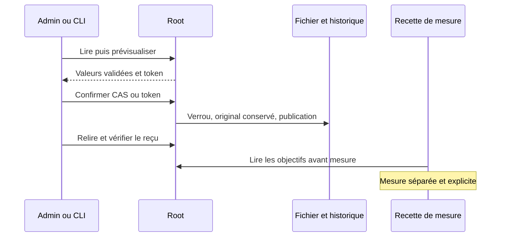

# Objectifs Rust de performance des graphes

Le parcours API/CLI/Admin est installé et vérifié sur la version locale189. La clôture globale de la migration reste ouverte.

La source privée graph-performance.json conserve schema_version, revision, values et history Go. Son absence utilise config/graph-performance.json versionné ; un fichier refusé/invalide ne devient pas un défaut. GET/HEAD /api/v1/graph-performance et POST /preview, /apply utilisent le même producteur que la CLI run-limits performance show|history|preview|apply. L’aperçu reste sans écriture ; le CAS explicite reste compatible Go et le token facultatif renforce la fraîcheur. Un rejeu exact renvoie l’état courant sans nouvelle révision.

Les objectifs clavier/rendu et samples sont positifs ; une charge contient au moins deux cartes et les charges ont des tailles distinctes : préconditions de la recette de mesure. La borne 2^53−1 est technique. Le nombre de mesures et les objectifs sont des choix opérateur, persistés et éditables dans le dialogue Admin ; aucune seconde borne métier copiée du Go. Le paramètre existant agent_provider_config_max_bytes couvre aussi ce fichier et son historique sérialisé, via la même validation des réglages moteur, Admin/API/CLI ; null signifie sans plafond, zéro refuse le contenu non vide.

Le dialogue charge les valeurs réelles, permet d’ajouter/supprimer les profils, prévisualise puis confirme et relit avec le contrôle partagé des reçus. Les nouveaux profils sont vides, sans valeur cachée. Un résultat incertain impose une relecture ; aucun succès fondé sur HTTP200 seul. Le fichier est sauvegardé puis publié atomiquement sous verrou compatible Go ; les causes et effets connus/incertains restent conservés jusqu’à la sortie. Aucune mission ni consommation n’est modifiée.

Le consommateur historique tests/graph_performance_ui.cjs lit la configuration publique et fige ses valeurs avant mesure. Sa recette graphique historique dépend encore de parcours de graphes Go ; ce lot ne prétend ni la rendre intégralement native ni prouver un gain de rendu. Sauver les objectifs ne lance aucune mesure et ne change pas le moteur des agents. Les preuves et limites restent dans le plan du lot.

La vue native ajoute source, digest et exact (décimaux fidèles), ainsi que bounds décrivant les seules préconditions techniques. Elle n’expose pas les anciennes bornes Go fixes de requête/fichier ; configuration_max_bytes reflète le réglage commun sauvegardé sous forme décimale ou null. Les clients Go comparés consomment la configuration/historique, les recettes de mesure lisent values ; la forme des métadonnées de présentation n’est pas une parité byte pour byte.

Recette finale PASS et intégrité vérifiée : API/CLI7, différentiel Go6 groupes/13 cas, navigateur4 FR/EN/thèmes, codec5, installation18 et dialogue Version14. Voir le RETEX du lot dans docs/plans/migration-rust/evidence/20261027-graph-performance-lh7z80oy. La revue globale reste explicitement ouverte pour les modifications concurrentes de préparation ; elle ne vaut pas acceptation de tout le moteur.

