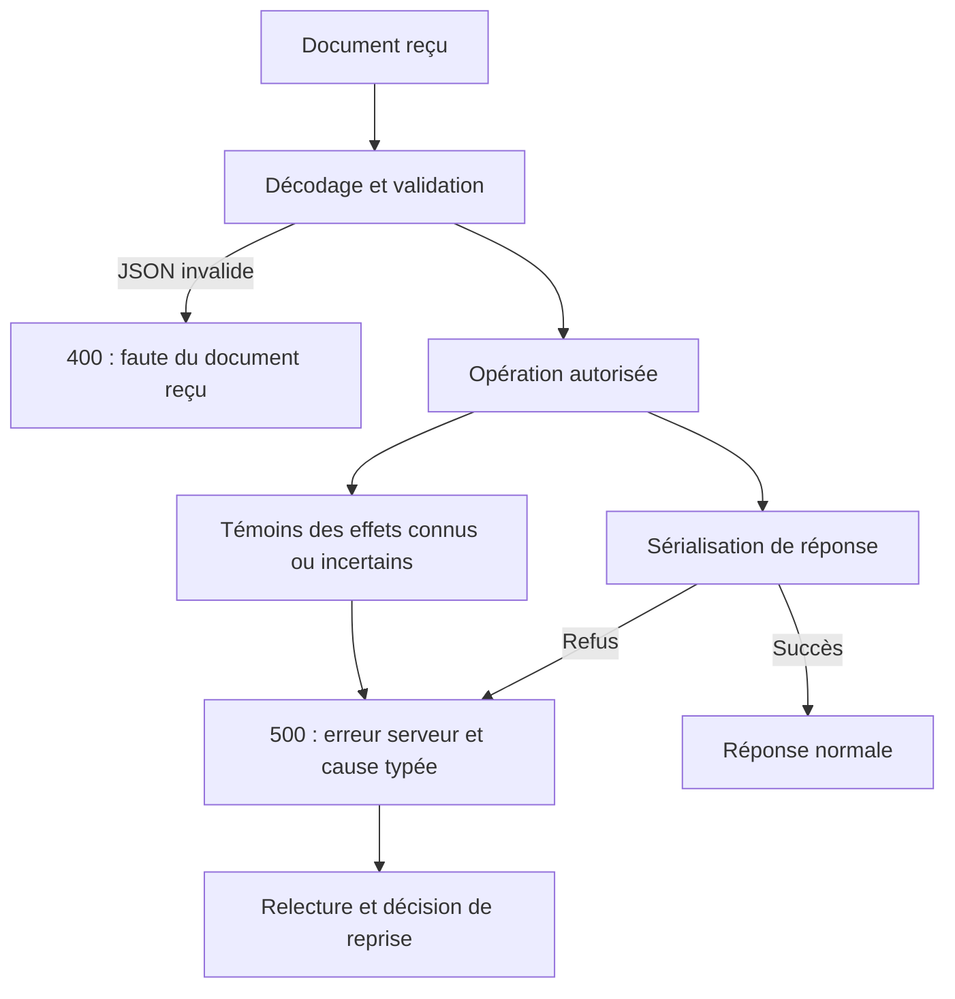

# Erreurs JSON de l’API native

[English](../en/NATIVE-HTTP-ERRORS.md). Contrat natif partagé issu de la migration des
[consultations](NATIVE-SESSION-VISIT.md) ; preuve et installation dans le
[plan](../plans/migration-rust/PLAN.md).

Le serveur distingue un document reçu invalide (HttpServiceError::Json,
web-document-invalid, HTTP400) d’un échec de sérialisation d’une réponse qu’il
produit (ResponseJson, web-response-encoding, HTTP500). Ce sont des catégories
de protocole, sans plafond, délai ou politique opérateur ajoutée. La cause JSON
typée est conservée ; le message public ne contient ni corps privé ni secret.

Cette distinction vaut pour les producteurs serde_json::to_vec et to_value
des réponses et projections API : consultation, cockpit/live, journaux, réglages,
limites, préparation, fournisseurs, budgets et projections de rapports déjà exposées. Elle n’altère pas les
octets d’une réponse normale ni la validation des documents reçus. La lecture
d’un document JSON serveur existant reste un contrat séparé : ne pas transformer
automatiquement tous les from_slice en réponse500 sans vérifier leur origine.

Une erreur500 ne prouve aucun rollback. Les effets Work, configuration,
préparation, fournisseur, confiance et consultation gardent leurs témoins distincts
dans leurs enveloppes existantes. Pour la consultation, le reçu auxiliaire est
conservé après encodage, fermeture, sortie/flush ou observation refusée. Relire
l’état avant toute reprise ; aucune relance automatique n’est autorisée par le code.

Le contre-exemple utilise un sérialiseur volontairement refusant, car le DTO
courant de consultation ne peut pas produire naturellement cette erreur. Il
reproduit400 avant correction et doit observer500 avec la même cause après.
Cela prouve la frontière de réponse, pas une panne réelle SQLite/disque ni
l’acceptation indépendante de toutes les API.

