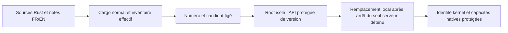
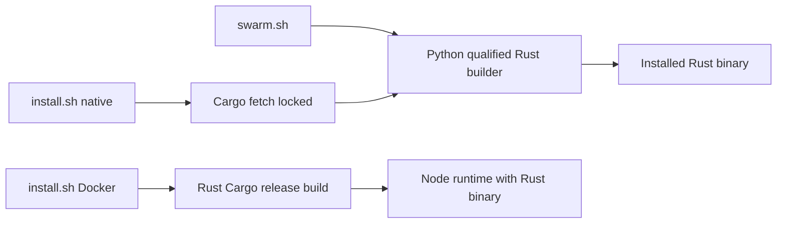

# Lanceur local Rust

`./swarm.sh` conserve son enveloppe shell/Python et construit exclusivement le moteur Rust : aucun compilateur ni fallback Go. Linux, Python 3, Cargo/Rust et les dépendances Cargo disponibles hors ligne sont nécessaires. Le cockpit historique complet n’est pas fourni par cette bascule du lanceur.

```sh
./swarm.sh build
./swarm.sh start --no-open
./swarm.sh status
./swarm.sh restart --no-open
./swarm.sh open
./swarm.sh stop
```

Le projet, l’adresse et le binaire sont mémorisés par `configure` dans `deploy/local-web.json` (local, non versionné). Les options `--root`, `--address`, `--binary`, `--startup-timeout`, `--stop-timeout`, `--mask-cifs` et les variables existantes restent disponibles. `rust_target_dir` dans ce fichier, ou `SWARM_RUST_TARGET_DIR`, choisit le cache Cargo local ; défaut technique : `.cache/rust-build-local`. Les cibles doivent être exclusives pendant une compilation. Un binaire externe reste externe ; le lanceur ne reconstruit automatiquement que `bin/swarm` et `bin/swarm-local`. `build.sh OUTPUT` émet aussi un candidat Rust qualifié, sans activation du service ; `SWARM_VERSION` peut fournir une étiquette explicite valide.

La compilation normale sans fixtures conserve ses dépendances effectives, caractéristiques et empreintes dans `.cache/local-delivery/`. Les sources/tests de recette sont maintenus dans le dépôt. L’empreinte plus large de candidats invalide le cache ; seules les dépendances effectives, les outils de livraison, le manifeste de notes, le commit, l’état modifié et la configuration/toolchain observée déterminent le numéro. Un graphe modifié peut nécessiter une seconde compilation pour corriger le numéro proposé. Les contraintes de configuration héritées du collecteur natif restent applicables ; cela ne prouve ni confinement de la chaîne de compilation ni acceptation globale.



Un échec de construction ou de qualification précède l’arrêt du serveur existant. Le candidat est testé avec un Root isolé et arrêté par SIGINT ; le redémarrage local utilise aussi SIGINT pour laisser le moteur drainer. Le lanceur refuse un listener étranger et vérifie PID, date de démarrage kernel, exécutable et argv. Une limite de démarrage/arrêt dépassée reste une erreur ; aucun processus inconnu n’est tué. Les délais de cycle de vie explicites existants sont distincts des politiques de missions ; aucun watchdog global de recette n’est ajouté.

La disponibilité exige `/api/v1/native-capabilities` avec le cookie privé du Root et le profil HTTP natif exact ; une page de connexion HTTP 200 ne suffit pas. `/api/v1/native-version`, protégé par la même session/Host, expose l’identité compilée et les notes embarquées FR/EN, avec GET/HEAD seulement. Le navigateur s’ouvre sur `/login?next=/live.html` : la clé doit être fournie au formulaire local ; aucun lien secret n’est produit par le lanceur. Le dialogue historique « Version et nouveautés » et le cockpit historique ne sont pas portés par cet incrément.

Un Root absent est initialisé publiquement ; un Root existant est ouvert par le moteur sans `init` implicite du lanceur. Les migrations/protections moteur, les consentements, les budgets et l’état suspendu d’une mission restent applicables. Démarrer le service peut reprendre les missions déjà autorisées suivant ces contrôles : le lanceur ne crée aucun consentement. Une installation locale vérifiée n’est ni une publication ni une preuve de fin de la migration.

Au démarrage, le conducteur relit sans écriture les missions automatiques autorisées. Un bail historique non attribuable à un epoch natif provoque `mission-legacy-lease-requires-migration` avant que l’API puisse répondre prête. Il n’est ni adopté ni effacé. Une suspension explicite par `mission pause`, avec révision et motif, permet de consulter la mission sans relancer ses agents ; l’unpause ne migre pas son bail. Ce contrôle initial ne garantit pas la santé future : les incidents ultérieurs restent traités par la supervision.

Pour un projet existant jamais préparé par Rust, exécuter explicitement `bin/swarm --root CHEMIN init` après sauvegarde adaptée : le lanceur n’initialise pas silencieusement la configuration manquante. L’opération publique valide le schéma existant, conserve une configuration native valide ou installe les valeurs initiales versionnées s’il n’y en a pas ; elle ne donne aucun consentement d’exécution. Refus de schéma, de propriété ou de configuration invalide : diagnostiquer, ne pas supprimer les fichiers ou relancer inchangé.

## Rust distribution entry points — October24



Go n’intervient pas dans ces chemins de build/exécution. Docker utilise Cargo release verrouillé, les features produit par défaut et la configuration SQLite FILESTAT versionnée ; les caches BuildKit sont des dérivés, pas des preuves. Sans métadonnées compilées explicites, un build Docker direct indique devel/inconnu honnêtement ; sa recette conserve l’identité de l’image. L’installation native conserve l’exécutable précédent si la compilation échoue. Les sources Go historiques, comparaisons de tests et rapports datés restent des références distinctes. CLI et web réutilisent le JavaScript sans repli Go. `open` ouvre le formulaire de connexion, jamais une URL secrète.

## Entrées compilées et candidats inutilisés

Le lanceur distingue l’inventaire large de candidats (invalidation du cache) des entrées réellement qualifiées par Cargo. Un test absent du build peut changer sans refuser une livraison dont les entrées compilées sont restées identiques. Le cache retient l’inventaire large courant après les contrôles. Les octets de chaque entrée effective doivent correspondre au profil qualifié, y compris après la qualification ; les outils de livraison, notes FR/EN, Git, environnement et chaîne de compilation sont comparés avant/après. Une différence conserve l’ancien serveur et ne produit aucune installation. Ces lectures ne constituent pas un verrou atomique du système de fichiers.

`tests/test_swarm_version_candidate_race.py` couvre témoin, cache réutilisé, test inutilisé modifié et refus après changement d’une source compilée, de Git, du compilateur, des notes ou du lanceur. Son compilateur et sa sonde sont des doubles explicites ; seules la compilation et la vérification publiques réelles établissent une livraison.
