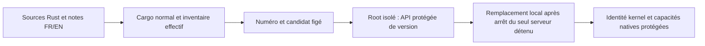
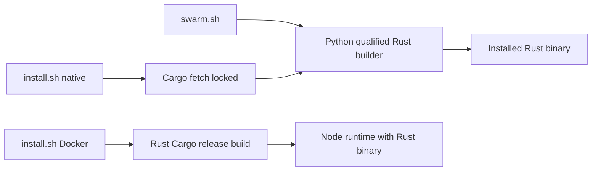

# Lanceur local Rust

`./swarm.sh` conserve son enveloppe shell/Python et construit exclusivement le moteur Rust : aucun compilateur ni fallback Go. Linux, Python 3, Cargo/Rust et les dépendances Cargo disponibles hors ligne sont nécessaires. Le cockpit historique complet n’est pas fourni par cette bascule du lanceur.

```sh
./swarm.sh build
./swarm.sh start --no-open
./swarm.sh status
./swarm.sh restart --no-open
./swarm.sh open
./swarm.sh stop
```

Le projet, l’adresse et le binaire sont mémorisés par `status` prend un verrou de cycle de vie partagé non bloquant. Une opération
exclusive concurrente donne le JSON `status:"concurrent-operation"`, code 2 ;
`running`, `ready`, `pid`, `binary` et `binary_sha256` valent null (inconnus).
Aucun état en cours d’écriture ni serveur n’est alors lu/sondé. Après libération,
le statut normal retourne 0 pour le processus actif attribué, 1 pour son absence ;
les erreurs HTTP/version restent des refus. Les lecteurs partagés coexistent ;
les mutations gardent le verrou exclusif. L’identité est revérifiée après les deux
observations de version et disponibilité. Aucun nouveau délai, retry ou choix opérateur.
Régression : `tests/test_local_status_lock.py` et
`LocalWeb.test_status_during_lifecycle_mutation_preserves_live_identity` ;
recette `tools/verification/recipes/local-status-lock.json`.

Contrôle installé en lecture seule (instance Authority gérée prête, verrou libre
et dernière image source qualifiée requis) : recette
`tools/verification/recipes/local-status-installed.json`, source maintenue
`tests/local_status_installed.py`. Identité/état vérifiés avant et après notre verrou
brièvement détenu, notes compilées et refus UI de la clé owner. Verrou occupé ou
image périmée : refus ; aucune session humaine créée, dialogue Version connecté
laissé ouvert comme critère non vérifié.

`configure` dans `deploy/local-web.json` (local, non versionné). Les options `--root`, `--address`, `--binary`, `--startup-timeout`, `--stop-timeout`, `--mask-cifs` et les variables existantes restent disponibles. `rust_target_dir` dans ce fichier, ou `SWARM_RUST_TARGET_DIR`, choisit le cache Cargo local ; défaut technique : `.cache/rust-build-local`. Les cibles doivent être exclusives pendant une compilation. Un binaire externe reste externe ; le lanceur ne reconstruit automatiquement que `bin/swarm` et `bin/swarm-local`. `build.sh OUTPUT` émet aussi un candidat Rust qualifié, sans activation du service ; `SWARM_VERSION` peut fournir une étiquette explicite valide.

La compilation normale sans fixtures conserve ses dépendances effectives, caractéristiques et empreintes dans `.cache/local-delivery/`. Les sources/tests de recette sont maintenus dans le dépôt. L’empreinte plus large de candidats invalide le cache ; seules les dépendances effectives, les outils de livraison, le manifeste de notes, le commit, l’état modifié et la configuration/toolchain observée déterminent le numéro. Un graphe modifié peut nécessiter une seconde compilation pour corriger le numéro proposé. Les contraintes de configuration héritées du collecteur natif restent applicables ; cela ne prouve ni confinement de la chaîne de compilation ni acceptation globale.



Un échec de construction ou de qualification précède l’arrêt du serveur existant. Le candidat est testé avec un Root isolé et arrêté par SIGINT ; le redémarrage local utilise aussi SIGINT pour laisser le moteur drainer. Le lanceur refuse un listener étranger et vérifie PID, date de démarrage kernel, exécutable et argv. Une limite de démarrage/arrêt dépassée reste une erreur ; aucun processus inconnu n’est tué. Les délais de cycle de vie explicites existants sont distincts des politiques de missions ; aucun watchdog global de recette n’est ajouté.

La disponibilité exige `/api/v1/native-capabilities` avec le cookie privé du Root et le profil HTTP natif exact ; une page de connexion HTTP 200 ne suffit pas. `/api/v1/native-version`, protégé par la même session/Host, expose l’identité compilée et les notes embarquées FR/EN, avec GET/HEAD seulement. `open` demande au binaire natif `swarm-rust web-ticket ADRESSE /live.html --json` un **lien de connexion à usage unique** et le passe seulement à l’ouvreur du navigateur (jamais affiché ni journalisé). Le ticket est un fichier privé `.swarm/web-ticket-<hash adresse>-<hash ticket>` contenant son échéance, jamais le secret ; `GET /login?ticket=` le consomme par suppression (un seul gagnant, même en concurrence), pose le cookie de la clé locale puis redirige vers `next` assaini. Rejeu, ticket expiré, autre adresse ou ticket mal formé : page de connexion, HTTP 401, message générique. Sa durée est le réglage v50 `web_login_ticket_seconds` (Admin, « Serveur et accès », 60 s à l’installation) ; un Root antérieur doit d’abord adopter ce réglage en enregistrant les réglages. Si l’émission échoue (binaire ancien, réglage non adopté), `open` affiche le code et ouvre `/login?next=/live.html` : la clé se saisit alors dans le formulaire. Le ticket ne donne que l’accès de la clé locale, sous le même UID : aucune séparation nouvelle face aux agents (EP-07 reste ouvert). Le bouton **Se déconnecter** (cockpit direct et espace de travail) envoie `POST /api/v1/logout` protégé (cookie, Origin, CSRF) : le serveur expire les cookies scopé et hérité de ce navigateur puis renvoie vers `/login`. Ce n’est pas une révocation : la clé `.swarm/web-session-*`, les autres navigateurs et les tickets non consommés restent valides. Pour révoquer, `./swarm.sh rotate` arrête le serveur géré, remplace la clé par `swarm-rust web-rotate ADRESSE --json` (refus si un serveur écoute encore, écriture atomique, nouvelle clé jamais affichée) puis redémarre sans recompiler et ouvre un nouveau lien. Les tickets étant liés à l’empreinte de la clé, tous les cookies et liens antérieurs sont refusés. Un ticket ne peut être émis que pour une adresse dont la clé existe (`web-ticket-server-never-started` sinon). Le dialogue historique « Version et nouveautés » et le cockpit historique ne sont pas portés par cet incrément.

**Mode `authority` (phase B).** Quand le Root a enregistré `web_access_mode=authority`, le moteur refuse le cookie de la clé locale partout sauf sur les deux sondes du lanceur (`GET/HEAD /api/v1/native-version` et `/api/v1/native-capabilities`, sans requête) : `start`, `restart` et `status` continuent donc de vérifier version et empreinte. `open` n’émet alors plus de ticket : il lit l’adresse `--listen` dans l’unité systemd installée par `deploy/authority/install.sh` (`/etc/systemd/system/swarm-authority.service`, seule source de vérité de cette adresse ; `SWARM_AUTHORITY_UNIT` pour les tests isolés), affiche `http://ADRESSE-DÉMON/` et ouvre `http://ADRESSE-DÉMON/login`. Unité absente, illisible ou sans `--listen 127.0.0.1:PORT` : `open` refuse (code 2) sans repli silencieux vers la clé locale ; `start --no-open` réussit avec un avertissement. Le mode est lu par `swarm-rust engine-settings show --json`. Test : `tests/test_swarm_local.py::test_open_in_authority_mode_targets_daemon_sign_in`. **Commande `./swarm.sh authority`** : `install --admin LOGIN --display NOM` (build release du démon + `sudo deploy/authority/install.sh`), `enable` (bascule complète : mode authority et clé du démon enregistrés, moteur déplacé sur l'adresse interne de l'unité, `sudo systemctl enable --now swarm-authority`, ouverture de `/login` ; refusé si le démon installé n'est pas le dernier build), `disable` (retour à la clé locale), `status`, `reset-password LOGIN` (secours sudo si aucun administrateur ne peut se connecter) et `accept-restore` (après une restauration voulue de l’état du démon, que le moteur refuse sinon avec `web-assertion-rollback`). `install` redémarre aussi le moteur en mode authority (format d’assertion partagé). Une étape en échec s'arrête là ; relancer après correction (les étapes faites ne changent rien).

Un Root absent est initialisé publiquement ; un Root existant est ouvert par le moteur sans `init` implicite du lanceur. Les migrations/protections moteur, les consentements, les budgets et l’état suspendu d’une mission restent applicables. Démarrer le service peut reprendre les missions déjà autorisées suivant ces contrôles : le lanceur ne crée aucun consentement. Une installation locale vérifiée n’est ni une publication ni une preuve de fin de la migration.

Au démarrage, le conducteur relit sans écriture les missions automatiques autorisées. Un bail historique non attribuable à un epoch natif provoque `mission-legacy-lease-requires-migration` avant que l’API puisse répondre prête. Il n’est ni adopté ni effacé. Une suspension explicite par `mission pause`, avec révision et motif, permet de consulter la mission sans relancer ses agents ; l’unpause ne migre pas son bail. Ce contrôle initial ne garantit pas la santé future : les incidents ultérieurs restent traités par la supervision.

Pour un projet existant jamais préparé par Rust, exécuter explicitement `bin/swarm --root CHEMIN init` après sauvegarde adaptée : le lanceur n’initialise pas silencieusement la configuration manquante. L’opération publique valide le schéma existant, conserve une configuration native valide ou installe les valeurs initiales versionnées s’il n’y en a pas ; elle ne donne aucun consentement d’exécution. Refus de schéma, de propriété ou de configuration invalide : diagnostiquer, ne pas supprimer les fichiers ou relancer inchangé.

## Rust distribution entry points — October24



Go n’intervient pas dans ces chemins de build/exécution. Docker utilise Cargo release verrouillé, les features produit par défaut et la configuration SQLite FILESTAT versionnée ; les caches BuildKit sont des dérivés, pas des preuves. Sans métadonnées compilées explicites, un build Docker direct indique devel/inconnu honnêtement ; sa recette conserve l’identité de l’image. L’installation native conserve l’exécutable précédent si la compilation échoue. Les sources Go historiques, comparaisons de tests et rapports datés restent des références distinctes. CLI et web réutilisent le JavaScript sans repli Go. `open` ouvre un lien à usage unique de courte durée, ou le formulaire de connexion à défaut ; jamais une URL contenant la clé durable.

## Entrées compilées et candidats inutilisés

Le lanceur distingue l’inventaire large de candidats (invalidation du cache) des entrées réellement qualifiées par Cargo. Un test absent du build peut changer sans refuser une livraison dont les entrées compilées sont restées identiques. Le cache retient l’inventaire large courant après les contrôles. Les octets de chaque entrée effective doivent correspondre au profil qualifié, y compris après la qualification ; les outils de livraison, notes FR/EN, Git, environnement et chaîne de compilation sont comparés avant/après. Une différence conserve l’ancien serveur et ne produit aucune installation. Ces lectures ne constituent pas un verrou atomique du système de fichiers.

`tests/test_swarm_version_candidate_race.py` couvre témoin, cache réutilisé, test inutilisé modifié et refus après changement d’une source compilée, de Git, du compilateur, des notes ou du lanceur. Son compilateur et sa sonde sont des doubles explicites ; seules la compilation et la vérification publiques réelles établissent une livraison.

### Mettre à jour une autorité déjà initialisée

`./swarm.sh authority install` sans argument rafraîchit une installation déjà
initialisée : compilation du démon, installation système via sudo, puis lecture
stricte du mode moteur et redémarrage du moteur en mode authority. Les comptes,
clé, pin et premier utilisateur restent conservés. Une installation fraîche
exige toujours `--admin LOGIN --display NOM` ; un marqueur initialisé sans
pin/clé publique refuse avant remplacement. Une lecture de réglages échouée
ou invalide indique que le démon a été installé mais que la suite n’a pas été
effectuée ; elle ne devient pas un succès vide.

Démon et moteur doivent partager le format des assertions (v1 et v2 ne sont
pas interchangeables). Après activation d’un moteur v2 face à un démon v1,
`assertion-format` impose la mise à jour cohérente de la paire, sans désactiver
l’autorité ni accepter les anciennes assertions. L’étape sudo nécessite le
terminal de l’opérateur quand aucune autorisation non interactive n’existe.

**Garde de paire avant tout remplacement (prévention de l’incident du 31
octobre 2026).** Avant tout `start` ou `restart`, et avant d’arrêter quoi que ce
soit, le lanceur refuse (exit 2, message « Paire d’assertion incompatible ») le
remplacement du moteur quand le mode d’accès sauvegardé du Root est `authority`
et que le démon installé et le moteur candidat ne parlent pas le même protocole
d’assertion. Le protocole se lit sur les octets du domaine embarqué
(`swarm-authority-assertion-v2\0` puis `v1` ; `rust/crates/swarm-authority/src/assertion.rs`
signe et vérifie avec). Cas de passage : mode `owner-key`, Root jamais initialisé
(pas de `.swarm/state.db`), démon installé absent (rien sur disque à
désynchroniser), protocoles égaux. Cas de refus fail-closed : paire divergente,
démon présent sans marqueur reconnu, réglages du moteur illisibles depuis un
Root initialisé. Le message de refus nomme les deux binaires, leurs protocoles
et la reprise : `./swarm.sh authority install` (qui remplace le démon avant le
redémarrage du moteur observé par la garde). Limites : la garde observe
`/usr/local/lib/swarm-authority/swarm-authority` (`SWARM_AUTHORITY_INSTALLED`)
seulement ; un démon servi d’ailleurs échoue fermé à l’exécution avec
`assertion-format`. Lecture seule (réglages + octets) ; n’arrête, ne démarre et
ne reconfigure rien. Test : `tests/test_local_pair_guard.py` ; recette
`tools/verification/recipes/local-pair-guard.json` (12 tests, épinglée sur
l’empreinte du binaire fourni).

## Administration « Comptes et accès » (mode authority)

En mode `authority`, le démon sert la page de connexion et le cockpit ; la
vue **Comptes et accès** du cockpit natif (entrée de menu réservée aux droits
`admin`) donne l'équivalent du menu Outils Wattson, aux standards Swarm :

- **Comptes** : création/modification/désactivation, affichage et création
  de clés API (le secret s'affiche une seule fois ; seule son empreinte
  reste consultable), révocation, sessions actives et déconnexion forcée.
  Le mot de passe n'est jamais affiché ni exporté.
- **Groupes** (union des droits) : création, duplication, renommage,
  modification du profil de permissions ; le droit effectif d'un compte est
  l'union de ses groupes. Le dernier administrateur ne peut perdre son
  droit `admin` ni être désactivé (`last-admin` refusé côté serveur).
- **Habilitations** : matrice rôles × permissions, une ligne par famille
  d'API du catalogue (14) et par entrée de menu (`view.<id>`, 16) ;
  le rôle intégré `admin` est verrouillé (30 cases cochées et désactivées).
  L'API reste l'autorité : une vue de menu masquée côté UI est aussi
  refusée en 403 côté serveur (`policy.rs`, schéma 3).
- **Journal d'accès** : connexions (filtres date/sujet/vue/moyen/statut,
  tri, pagination 50/page, export CSV/JSON), détail des actions par
  session, tableau de bord (4 KPI + 6 graphiques SVG par jour et par vue),
  actions d'administration, purge manuelle (regex + confirmation) et
  rétention `audit_retention_days` (vide = désactivée, sinon entier ≥ 1 ;
  relecture après écriture), niveau de journal du démon modifiable en
  direct. La purge par regex est soumise à une limite de débit serveur.
- **Réglages du démon** : configuration lue puis écrite avec `revision`
  (conflit = refus `revision-conflict`), diagnostics de l'instance.

API sous `/api/v1/authority/*` (comptes, groupes, policy, audit, config,
journal) ; granularité = familles d'API + `view.<id>` par entrée de menu ;
politique par défaut en deny-by-default avec planchers Biba. Chaque
connexion et chaque action d'administration sont inscrites dans le journal
signé du démon (`audit.jsonl`, chaînage par hachage).

Vérification : recette permanente
`tools/verification/recipes/authority-admin-ui-rust.json` — i18n `--check`
puis parcours navigateur réel sur binaires fournis (41 contrôles nommés :
connexion FR/EN × thèmes, entrée de menu, lien direct refusé sans droit,
compte, clé API, matrice verrouillée, rôle personnalisé, journal,
tableau de bord, purge, mobile 390 px, traduction anglaise intégrale ;
`recipe.py run` PASS puis `verify` VERIFIED). Preuve de qualification sous
`.swarm-fixtures/` avec empreintes SHA-256 des deux binaires. Limites :
vérification locale — ni acceptation indépendante ni installation ; la
recette n'exerce ni le relais distant ni la rotation des clés au-delà du
secret affiché une fois.
