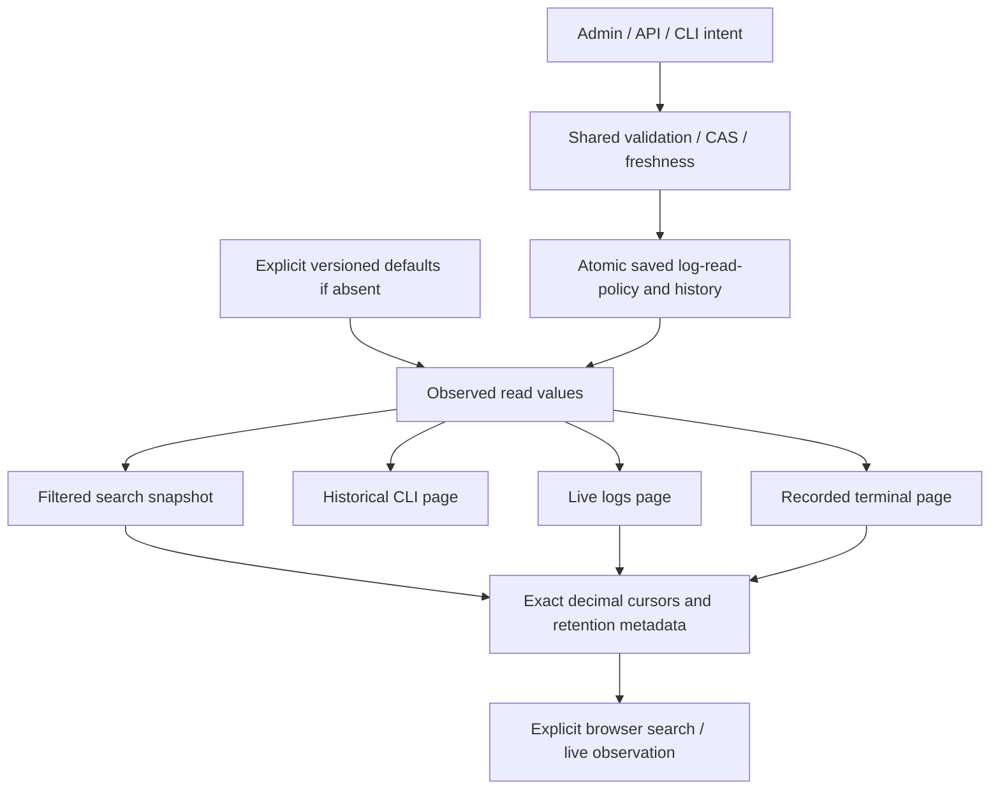

# Recherche historique de journaux et pagination native

Livré localement en205. Recette permanente4étapes PASS/intégrité VERIFIED : API Go/Rust8, anciens réglages3, navigateur4 FR/EN × thèmes à320/1440px avec contraste AA et curseur i64 exact, JavaScript10. Historique Rust2, texte/live10, activité8, Rustdoc/i18n ciblés. Installation55 assertions et dialogue Version14,30agents lus et5travaux inchangés.202→204 comporte des changements concurrents non acceptés ici ;204→205 change seulement les notes. Aucun achèvement global. [RETEX](../plans/migration-rust/evidence/20261027-log-query-8i8c635h/RESULT-RETEX.md).

## Parcours et données

GET/HEAD protégé `/api/v1/logs?work=WORK&agent=AGENT&after=SEQ&q=TEXTE&kind=TYPE` et `logs query WORK AGENT --input QUERY.json --json`. Le fichier exige schema_version1 ; after0, query vide et kind vide sont les origines de protocole facultatives. Work et Agent explicites et associés au datastore ouvert ; aucune recherche hors périmètre. Query est une sous-chaîne littérale SQLite instr(lower(message),lower(query)), sans joker LIKE : % et _ restent du texte ; le lower est celui de SQLite, pas une promesse de recherche Unicode complète. Kind est exact, vide pour tous. Les paramètres inconnus/doublons, identifiants invalides ou curseurs non canoniques refusent avant IO. After est un entier signé i64, y compris négatif pour cette API ; le live conserve son domaine non négatif.

Les entrées sont ordonnées par seq croissant, strictement au-delà d’after. Les clés Go conservées sont entries (seq,agent_id,at,kind,message), next_cursor, retained_from, retention_gap, more. Minimum retenu calculé sur tout l’historique de l’agent avant filtre ; zéro si absent. Une page filtrée vide conserve after comme curseur et le vrai minimum/gap. Gap reproduit la comparaison Go after>0 et after<first-1, avec sa représentation signée wrapping à i64::MIN. Cela n’affirme ni exhaustivité ni perte précisément mesurée. More exige une vraie ligne supplémentaire ; la sentinelle est décodée avant décision comme Go. Les chaînes SQL TEXT/BLOB appliquent le remplacement UTF-8 Go par octet invalide, sans analyser une éventuelle charge JSON contenue dans le message. NULL/types incompatibles restent des erreurs, pas des lignes silencieusement omises.

La lecture matérialise Work/Agent/minimum/page dans un snapshot SQL sous le contrôle existant de l’association physique du projet. Statements/finalisation, rollback, association et fermeture Root/sortie conservent les causes. Aucun lancement, signal, effacement, rétention, réservation, budget ni décision métier. Origine et texte enregistrés ne prouvent pas une identité ou une exécution. Le fichier de politique et le SQL ne sont pas conjointement atomiques ; read_policy expose l’observation utilisée.

## Source persistante et quatre consommateurs

`config/log-read-policy.json` porte les valeurs initiales versionnées : search_page_rows100, history_page_rows200, live_log_page_rows100, terminal_page_rows100. Elles s’appliquent uniquement quand le fichier privé log-read-policy.json est réellement absent. Une source présente invalide refuse sans repli. Chaque clé est obligatoire et nullable : entier positif de lignes/blocs, ou null sans plafond. Zéro ne forme pas une page qui progresse et est refusé. La borne JSON/JavaScript d’entier exact concerne les choix de taille, pas les identifiants de lignes ; aucune seconde limite cachée. Sans plafond matérialise toutes les lignes correspondantes, mémoire proportionnelle, sans supprimer la conservation existante.

Source → codec/validation commune → historique/CAS/écriture atomique contrôlée → modale Administration → Pagination des journaux et du terminal ; API `/api/v1/log-read-policy`, `/preview`, `/apply` ; CLI `run-limits logs show|history|preview|apply`. Reçu et source relus, rejeu exact renvoie l’état courant, conflit409 ; entrée invalide400 ; source/stockage invalide500. Un aperçu n’écrit ni politique ni verrou spécifique. Apply peut créer son verrou de coordination, même si la mutation est refusée ; aucun succès ni absence d’effet n’est déduit d’un simple Err après publication.

Les quatre valeurs atteignent respectivement query_logs, historical_agent_logs (zéro : dernières lignes ascendantes ; négatif : départ seq>0), agent_logs_after et terminal_events_after. Le lecteur live libre reçoit sa taille explicitement, sans fallback100. Les appels du live peuvent observer des révisions de politique distinctes ; aucune atomicité composite prétendue. Aucun agent ou plafond de définition figé n’est modifié.

La borne commune agent_provider_config_max_bytes encadre lecture du fichier et historique complet sérialisé. Un ancien projet sans ce champ peut lire les valeurs versionnées si la source est absente : observation O_PATH vérifiée, aucun contenu privé non borné lu et aucune adoption implicite. configuration_cap_adopted=false distingue absence ancienne de null explicitement illimité. Une source présente ou une sauvegarde exige cette borne adoptée. La modale indique ce prérequis ; adopter le groupe existant reste une décision explicite. Le groupe d’exécution complet n’est pas requis par le lecteur pour observer ce seul champ.

## UX et grands curseurs

Depuis le harnais d’agent, recherche explicite dans l’historique, filtre littéral/type, suite explicite et avis de gap. Les résultats sont du texte, avec les styles sémantiques du journal ; aucun HTML du message n’est exécuté et un type inconnu n’est pas une classe CSS arbitraire. Une erreur garde les résultats déjà lus, jamais un succès vide ; modifier un filtre invalide le curseur sans requête automatique.

Les clés numériques Go restent inchangées. L’extension native exact contient next_cursor, retained_from et les séquences en chaînes décimales i64 ; les pages live ajoutent next_exact. Le client conserve ces chaînes jusqu’à l’URL suivante. Les nombres anciens ne sont acceptés que s’ils sont exactement représentables ; un ancien curseur numérique non sûr est refusé ; la cohérence des nombres décodés avec les chaînes exactes est contrôlée avant l’adoption des lignes. Les nombres JSON déjà arrondis ne permettent pas de prouver la cohérence lexicale des octets numériques reçus ; les chaînes natives exactes font autorité. Les limites i64 sont des représentations de stockage, pas une politique opérateur. Les dix gardes JavaScript couvrent la vraie perte JSON au-delà de53bits, les extrémités signées, mauvais types et contradictions.

## Limites conservées

La constante legacy LIVE_PAGE_ROWS100 est encore utilisée par les fenêtres de télémétrie (appels/outils/spans/alertes), pas par ces quatre lecteurs. Cette politique native distincte reste ouverte ; ne pas la présenter comme un invariant du protocole ni comme réglée par cette modale. Les cadences/séries historiques du harnais et la barrière globale de complétion HTTP du cockpit sont des suivis séparés. Les tests à stubs/composants, la comparaison Go et l’acceptation distribuée restent distincts. Une restauration de source corrompue par fixture ne prouve pas une réparation autonome en production.

