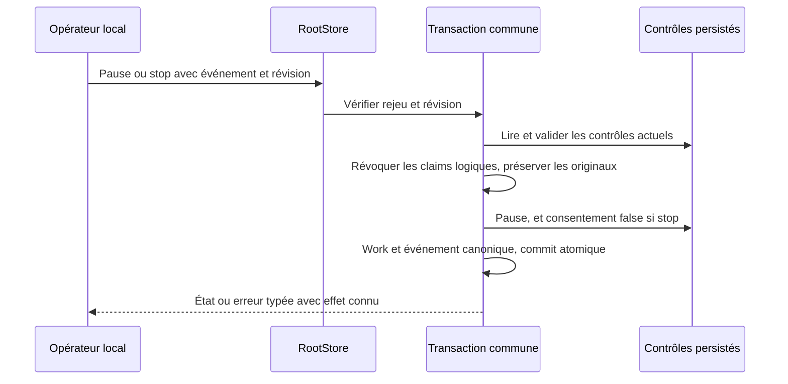

# Contrôles globaux natifs de mission

Le lot180 porte `mission show|pause|unpause|stop WORK --root ROOT [--input demande.json] --json`. Vérifié sur fixtures avec le binaire normal16 :42 tests Rust ciblés, Clippy strict/Rustdoc moteur et CLI, contrôles publics18, processus réellement actif19, régression HTTP20 et sortie EPIPE17 passent. Le lot182 ajoute la configuration de `mission start`/`mission resume` ; voir [le contrat de départ](NATIVE-MISSION-START.md) et ses preuves en cours de qualification. La boucle complète du conducteur et `mission watch` restent non portés. Ces résultats ne prouvent aucune installation.

## Deux niveaux de pause

La pause de mission est persistée dans `cockpit_controls`. Les admissions worker/planner et les contrôleurs natifs consomment déjà ce contrôle commun. La pause de planification est le champ indépendant `work.planning.paused` ; elle se règle par `planning pause|resume`. Une levée de pause globale ne modifie pas ce champ.

| Action | Mutation globale | Planificateurs et consentement |
| --- | --- | --- |
| show | Lecture seule, absences représentées par null | Révision/état réels, sans inférer une autorisation |
| pause | Départs suspendus | Générations des scopes incrémentées, détenteurs et échéances logiques effacés ; consentement conservé |
| stop | Départs suspendus | Même révocation logique et nouveau reçu canonique de consentement false |
| unpause | Départs non suspendus | Mode et consentement conservés ; aucun consentement nouveau, dispatch ou modèle lancé par la commande |

Ces actions sont des transactions du moteur commun avec révision et événement de commande. Elles conservent dépenses, réservations, activations, décisions, tâches, histoire du juge et contexte des anciens claims. Révoquer un claim logique ne libère pas une ligne d’ownership physique ; la fin réelle et les originaux doivent être établis par les contrôleurs existants. La commande n’envoie aucun signal aux processus : les appels déjà en cours restent soumis à leur propre supervision et aux contrôles de fraîcheur. Held19 vérifie un vrai planner inerte autorisé, identifié par socket/SO_PEERCRED/pidfd et registre SQL avant injection : la pause publique invalide son lease, la supervision arrête le processus sans signal de la recette, conserve son vrai wait/original et enregistre le refus. Après unpause, nouveau claim et aperçu réussissent sans modifier l’ancien original ni rembourser sa réserve. Ce cas ne prouve pas le comportement d’un worker déjà actif, ni de descendants échappés ou d’un processus hostile.

## Requête et absence de réglages

`show` n’a pas de fichier d’entrée. Chaque mutation exige une requête auditée stricte :

```json
{"schema_version":1,"event_id":"global-pause-1","expected_revision":12,"reason":"Suspendre les prochains départs pour examiner le résultat"}
```

Lire la révision actuelle et remplacer les valeurs d’exemple. Schéma1, identifiant sûr, révision positive et motif non blanc sont des invariants du protocole d’audit. Aucune limite métier de longueur du motif n’est ajoutée ; les limites de transport existantes s’appliquent. Un acteur, enabled, slots ou autre champ étranger est refusé. L’opérateur et l’heure sont observés côté moteur ; cela n’authentifie pas un humain.

Si aucun contrôle n’existe, `show` conserve cette absence. Une pause ou un arrêt initialise explicitement un état **manuel et suspendu**, sans créer de consentement. Ce choix refuse une admission automatique dans un état auparavant absent ; il ne reprend pas le défaut SQL historique `autonome` ni ses deux créneaux. Le nombre initial de créneaux provient de `mission_dispatch_default_slots`, sous validation de `mission_dispatch_max_slots`, réglages persistants du catalogue Admin et de `engine-settings preview/apply/show`. Aucun plafond numérique supplémentaire n’est caché dans ces commandes.

Si les contrôles existent, leur mode et leur nombre de créneaux sont conservés. Une baisse récente du plafond ne doit pas empêcher une pause de sécurité ni réécrire l’ancienne valeur :17 reste17 après sauvegarde d’un nouveau défaut3/plafond4. Les prochaines admissions devront appliquer leur propre politique courante. Unpause exige un contrôle existant et ne transforme jamais l’absence ou false en consentement true. Avec un mode automatique et un consentement déjà valides, lever la pause peut de nouveau permettre des départs à un conducteur autorisé ; la commande n’en crée pas un.

Sur un ancien schéma de réglages sans politique de créneaux, adopter explicitement le groupe via Admin/API/CLI avant une initialisation de contrôle ; aucun fallback2 n’est inventé. Un contrôle existant mal formé est refusé avec sa cause, sans réparation ou reset implicite.

## Erreurs, conservation et reprise

Révision périmée, demande étrangère, absence pour unpause, contrôle SQL invalide, débordement de génération, allocation, encodage ou écriture échouée restent des erreurs typées. Le refus doit préserver le Work et les événements/contrôles/réserves. La transaction commune annule aussi un contrôle déjà stagé si l’écriture suivante du journal échoue. Reprendre le même événement après correction de la précondition ; ne pas rembourser la consommation.

Un rejeu exact rend l’état courant sans seconde révocation, même si une autre commande a changé la pause depuis. Un commit connu reste signalé lors d’un échec ultérieur de fermeture/sortie ; relire le Work avant reprise. Les contextes de claims antérieurs restent immuables, mais leurs générations ne deviennent pas valides après unpause : créer une vraie nouvelle réception par claim, sans reconstruire les anciennes preuves. Stop révoque aussi les claims logiques, amélioration explicite par rapport à l’ancienne fonction Go stop qui ne le faisait pas.



## Preuves et limites

42 tests Rust uniques pour le contrat final : enveloppe3, contrôle Root2, lecteurs anciens3 et moteur de mutation11 dans quality04 (19 tests, sources consommées inchangées), diagnostics CLI5 et CLI commune17 dans quality13, diagnostic tardif web1 dans quality14. Le test Root injecte un déclencheur SQL négatif après staging du contrôle, vérifie rollback complet puis la même requête réussie. Le test de génération vérifie un témoin valide avant i64::MAX et l’absence de mutation. Le défaut du qualificateur SDK est conservé sous sdk-depfile05 : quatre tests Python et requalification des17 tests CLI sans les relancer. Clippy strict et Rustdoc moteur06 sont réutilisés sur les mêmes octets moteur ; la CLI modifiée a ses contrôles13 sur la source04. Profil normal16 SHA `2e3c519931f83b0f8f307d176748ace34d413f7e067910d4a9549f9b6dfcbc7f` :279 entrées effectives archivées, features de fixture absentes. Public18 vérifie les préflights worker avant/après et refus sous pause, claims natifs, contexte ancien immuable/stale et nouveau claim, quotas sauvegardés, refus et rejeu. Held19 couvre la fin réelle du planner inerte décrit ci-dessus. HTTP20 revalide les huit commandes de planification et leurs seize refus sur ce binaire. Un ancien consentement true sous conducteur réellement actif n’a pas été reproduit ; aucun nouveau consentement true n’est créé par ces commandes.

Recette permanente : `tools/verification/recipes/native-mission-controls.json`, avec `tests/rust_native_mission_controls.py`, `tests/rust_native_mission_pause_held.py`, `tests/rust_native_mission_output.py`, régression HTTP et garde de dep-info SDK. Manifeste validé ; étapes exécutées séparément sur binaire figé, pas le manifeste entier sur checkout concurrent. Les assertions et leurs sources sont conservées avec les preuves. Les fonctions nouvelles ou modifiées ont leur Rustdoc/docstring, revue de politiques et chaîne d’erreurs ; celle-ci reste une revue de la même session, sans indépendance. Aucun watchdog global. Ces preuves n’établissent ni fournisseur payé, acteur authentifié, conducteur automatique complet, navigateur, installation ou fin globale de migration. Les contrôles publics restent locaux ; aucun nouvel adaptateur HTTP de contrôle global n’est annoncé.


## Sortie interrompue après commit

EPIPE12 a reproduit une pause correctement committée dont le JSON d’erreur perdait le champ `recorded_work`, malgré une connaissance conservée dans le message humain. Le formatteur commun récupère maintenant les trois wrappers typés de conservation d’état et les résultats Root/Web connus ; il ajoute cette métadonnée indépendamment du web. Il ne reconstruit jamais une révision depuis un texte d’erreur et omet ce champ lorsque l’effet est inconnu. L’échec et ses causes restent non nuls, même avec métadonnées connues.

Output17 ferme le lecteur du pipe avant exec, après un témoin de commande valide : EPIPE réel, code non nul, cause BrokenPipe et métadonnées exactes Work/révision, contrôle de pause et événement unique persistés. Le rejeu identique ne change ni événements ni contrôles ni finance. Original-root21 vérifie aussi le Root du véritable contre-exemple12 : sa révision committée est conservée et l’ancienne requête exacte se rejoue sans mutation des événements/contrôles. Aucune donnée n’est réinitialisée pour obtenir la réussite. L’original12 reste intact.

La première requalification SDK05 portait sur les17 tests originaux, sans réexécution. La modification ultérieure du formateur a entraîné les nouveaux tests CLI13–14 et la requalification du binaire16. Aucun test exécuté plusieurs fois n’est compté comme un test unique supplémentaire. Le comportement est vérifié sur Linux ; aucune compilation pour une autre plateforme n’est revendiquée. Les fautes spécifiques d’encodage et de fermeture de Root ne sont pas injectées ici ; leurs branches sont relues et les causes composées du formateur sont couvertes par les tests.


Le rejeu d’un Root conservé est également une recette permanente : `rust_native_mission_output_replay.py --binary BIN --profile PROFIL --original-proof PREUVE_EPIPE --output NEUF`. Elle exige une naissance de fixture et un événement canonique déjà enregistré avec la même requête avant toute commande. Original-root22 vérifie les événements, contrôles, Work et finance inchangés sur le vrai contre-exemple12. Un Root ou original absent provoque une erreur, pas une reconstruction de preuve.
