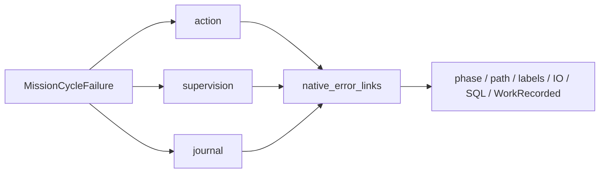

# Cycle du conducteur avec maintien du bail

`RootStore::run_mission_cycle` maintient un vrai bail pendant une opération synchrone explicite. Le Root doit être ouvert en écriture et lié au même datastore/processus que le bail. Une seconde connexion vérifie ce lien et renouvelle le bail avant de signaler qu’elle est prête ; le callback ne commence pas si ce thread est déjà terminé. Cette API ne choisit aucune tâche et ne vaut pas conducteur complet ou `mission watch`.


La cadence provient de `mission_supervision_poll_interval_ms`, figée avec les autres limites d’horloge et la révision du claim. Changer Admin ne réécrit pas le bail existant. Il n’existe pas de second délai global, de retry métier ni d’appel modèle implicite. `MissionCycleMonitor::is_running` observe seulement le thread ; chaque commande et chaque grant gardent leurs contrôles autoritatifs. La perte du bail n’entraîne ni acquisition automatique ni arrêt forcé d’un worker déjà libéré.

Le retour est `Result<T, Box<MissionCycleFailure<T>>>`. En échec, `action` conserve le résultat exact si le callback a commencé, `supervision` conserve les causes du heartbeat/fermeture de sa connexion, et `journal` conserve la cause d’écriture du cycle. `action=None` ne prouve pas qu’aucun heartbeat n’a été écrit. Une valeur réussie avant erreur tardive reste disponible. `Error::source` ne présente qu’une cause primaire : un adaptateur doit aussi examiner les autres champs, sans conclure à un rollback ou relancer automatiquement. Le journal reflète l’opération déclarée, pas une réconciliation métier prouvée. L’appelant conserve les obligations de fermeture du bail et du Root. Les panics se propagent après arrêt du heartbeat ; aucun résultat retourné n’est garanti dans ce cas.

## Validation du planner pendant son préflight

Le parent diffère sa revalidation complète du fournisseur jusqu’à EOF du canal privé CLOEXEC, pour ne pas demander le verrou exclusif `providers.lock` pendant que le helper effectue ses contrôles avant exec. Les contrôles Work/claim/pause et échéances du parent continuent. Les contrôles complets et la fraîcheur du helper restent inchangés ; après EOF, un verrou occupé refuse toujours. EOF seul n’est jamais une preuve d’exécution réussie. Aucun délai ou retry n’est ajouté. L’API HTTP et les formats des commandes ne changent pas.

## Preuves et rejeux

Le candidat normal14 archive283 entrées sans features de fixture. SDK16 utilise les mêmes186 entrées moteur. quality19 contient sept tests du cycle et six du planner ; Clippy moteur/tests/example et Rustdoc privé passent. cycle-permanent22 rejoue les sept tests et le conflit de verrou avec contrôle avant/après des sources ; permanent17 rejoue le worker réel dans ce cycle, avec soumission sans acceptation. planner-held24 vérifie pause puis reprise d’un planner réel. L’intégrité des recettes22 et17 a été vérifiée. Les échecs originaux et leurs sources restent dans le plan et les archives du lot184. La revue des sources est une déclaration de la même session, pas une revue indépendante ni une acceptation globale.

Définir `SWARM_MISSION_CYCLE_SOURCE` avec le snapshot de compilation retenu, puis exécuter :

```sh
python3 tools/verification/recipe.py run --recipe tools/verification/recipes/native-mission-cycle.json --output PREUVE_NEUVE
python3 tools/verification/recipe.py verify --evidence PREUVE_NEUVE
```

La recette courante exige les dix noms de tests (les huit historiques et deux projections) et vérifie les octets du snapshot. Elle ne découvre pas seule le graphe du profil livré ; celui-ci est conservé séparément. Le test de panic affiche son diagnostic attendu avant de le capturer. Pour le worker réel, utiliser les quatre variables binaires/profils décrites dans `NATIVE-MISSION-WORKER.md`.

Limites : sélection automatique, politiques de reprises/coût/relais et driver/watch complet restent à porter. Les défauts de fermeture système et de création de thread ne sont pas tous injectés. Les adaptateurs futurs doivent conserver toutes les causes et les résultats connus avant publication. Aucun serveur actif ni contexte embarqué d’agent n’a été mis à jour. Les changements parallèles de l’interface restent distincts de ce candidat figé ; ni leur validation ni la conformité de tout le checkout courant ne sont établies par ces preuves.

## Restitution structurée des erreurs

`MissionCycleFailure::diagnostics()` restitue séparément les causes des phases `action`, `supervision` et `journal`, avec leurs chemins, libellés typés et codes numériques IO/SQLite. Le parcours réutilise `native_error_links`, y compris ses branches de fermeture et les erreurs internes d’un `std::io::Error`. Chaque `RootStoreError::WorkRecorded` rencontré conserve son couple identité/révision ; plusieurs observations restent distinctes, sans choisir arbitrairement la « dernière ». Les observations ne sont pas une preuve de nouvelle écriture.

La projection ne sérialise jamais la valeur générique réussie, ni les messages privés `Display`. `action_started` et `action_succeeded` décrivent le résultat conservé, sans en déduire une révision Work. L’appelant doit conserver et traiter cette valeur séparément, puis gérer ses propres erreurs d’encodage, sortie et fermeture. Les familles inconnues restent limitées à leur `source()` ; le graphe des familles connues ne garantit pas l’exhaustivité de tout type d’erreur externe. Aucun retry, budget, délai ou droit supplémentaire n’est ajouté. Cette API prépare le futur adaptateur du conducteur ; `mission watch` reste indisponible.

Deux tests de projection couvrent les trois phases, trois révisions observées, les causes indépendantes, IO custom/rustix, la confidentialité et la valeur non sérialisable. Le test de panne réelle du heartbeat vérifie aussi la présence des causes SQL des deux phases et la reprise. La recette exige désormais neuf tests du cycle plus le test du verrou fournisseur (dix noms). Lot185 : neuf tests passent dans quality01, Clippy strict et Rustdoc privé passent ; permanent04 exige les dix noms et son intégrité est vérifiée. normal03 qualifie 283 entrées sans fixture ; 191 entrées moteur (sources, configuration et manifeste) correspondent au SDK. Le SHA normal reste identique au lot184 : cette API générique est exercée par les tests, pas encore consommée par la CLI. Les résultats184 conservent leur portée historique.


