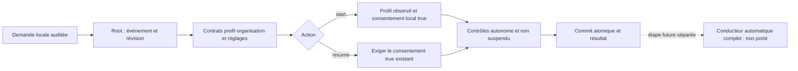

# Configuration native de départ de mission

`mission start WORK --input demande.json --root ROOT --json` enregistre un profil et une autorisation locale explicite ; `mission resume` réactive les contrôles seulement si cette autorisation est encore vraie. Le lot182 est vérifié localement :48 tests Rust ciblés, Clippy/Rustdoc moteur et CLI, sept recettes CLI/HTTP, et test d’atomicité API avec reprise passent. Cela ne prouve pas une installation. La boucle `mission watch` et le conducteur automatique complet restent à porter.

```json
{"schema_version":1,"event_id":"mission-start-1","expected_revision":12,"reason":"Autoriser cette mission locale","profile":{"provider":"mon-fournisseur","role":"worker","workspace":".","level":"standard","capture_output":true},"slots":3}
```

Utiliser le fournisseur réellement configuré et la révision courante. Le rôle est explicite (`worker`, `planner` ou `subplanner`) ; aucun choix de rôle caché n'est ajouté. Les limites et skills conservent leur vocabulaire de profil ; leur stockage ne prouve pas le support de tous les parcours d'exécution. Le profil fourni exclut `actor` et `updated`, observés côté moteur. Sans profil fourni, start exige un profil déjà enregistré. Sans créneaux fournis, le nombre enregistré est repris ; en son absence seulement, `mission_dispatch_default_slots` fournit le défaut. `mission_dispatch_max_slots` est le plafond opérateur nullable existant ; aucune borne Go supplémentaire n'est copiée.

Start et resume vérifient dans la transaction : absence d'archive de mission, organisation/reviewer, capacité déclarée du reviewer, catalogue/configuration de fournisseur et choix de modèle, workspace réel dans le projet, limites sous la politique persistée et créneaux sous le plafond actuel. Les observations de fichiers ne sont pas une photographie atomique de tout le système ; chaque lancement futur doit encore vérifier ses propres sources/droits/réservations. Aucun appel de modèle/probe, consommation ou tentative n'est créé par ces commandes.

Resume n'accepte que l'enveloppe schema_version/event_id/expected_revision/reason et conserve profil et reçu d'autorisation. Un arrêt enregistre false ; resume doit alors refuser. `unpause` reste une simple levée de pause qui ne renouvelle pas le consentement. Si l'opérateur réduit le plafond sous les créneaux enregistrés, resume refuse sans les réduire silencieusement ; corriger la politique ou démarrer explicitement avec une valeur conforme.



Les doublons exacts réutilisent le résultat enregistré avant les nouvelles vérifications de configuration ; ils ne réappliquent pas un départ après une pause ultérieure. Les refus conservent l'état. Les causes de lecture, fermeture, SQL, encodage ou sortie restent des erreurs ; un échec après commit doit conserver les métadonnées Work/révision connues et impose une relecture avant reprise. L'acteur local et le consentement déclaré ne prouvent ni identité humaine authentifiée ni confinement hostile.

Recette : `tests/rust_native_mission_start.py`, sur binaire lié à un profil normal sans fixture. `--expect-unported` conserve le RED de l'ancien binaire181 ; la qualification courante et ses limites sont consignées dans PLAN.md, lot182.

Les preuves182 distinguent : start13 (contrôles publics et refus de schéma modifié), atomic-api24 (vraie contrainte SQLite après ouverture Root), atomic-replay25 (rejeu par recette permanente). L’erreur SQL annule profil, consentement, contrôles et événements ensemble ; la même requête réussit après retrait du défaut et les finances/originaux restent inchangés. Le caller de vérification est `rust/crates/swarm-cli/examples/mission_start_atomicity.rs`, strictement distinct du CLI livré ; ses183 entrées moteur compilées et features communes sont comparées au profil normal04. Clippy23 passe. Les premiers qualificateurs15/16/17/19 ont été refusés avant toute exécution de fixture ; aucune de ces tentatives n’est un PASS.

Rejeu permanent de l’atomicité, depuis la racine, avec une nouvelle destination :

```sh
python3 tests/rust_native_mission_start_atomicity.py --binary docs/plans/migration-rust/evidence/20261022-182/normal-native04 --profile docs/plans/migration-rust/evidence/20261022-182/normal04/result.json --sdk-binary docs/plans/migration-rust/evidence/20261022-182/atomic-api24/sdk-binary --sdk-profile docs/plans/migration-rust/evidence/20261022-182/atomic-api24/profile.json --output /tmp/swarm-mission-atomicity-replay
```

Ces binaires figés et leurs profils doivent être disponibles ; leur absence est une précondition manquante. Les preuves ne valent pas acceptation globale ni revue indépendante. L’enveloppe auditée et le rôle explicite diffèrent du profil Go nu : la parité exhaustive RM02 reste ouverte.
