# Admission native des workers automatiques

État courant : candidat 201 en qualification, Binding v4. Les résultats 183–200 ci-dessous restent historiques et ne prouvent pas les nouveaux contrôles 201. `mission watch` produit reste non raccordé ; aucune acceptation globale du checkout courant n’est déclarée.

Lot183 : parcours natif vérifié localement ; revue incrémentale liée aux sources consignée séparément. La boucle complète du conducteur et `mission watch` restent non portées. `RootStore::prepare_mission_worker` demande un vrai `MissionLease` non désérialisable et quatre identifiants de requête (schema/event/revision/task). Le contrôleur construit les choix de lancement depuis le profil enregistré, sous les éventuels choix de modèle propres à la tâche déjà validés par la fabrique commune. Le profil commun est conservé ; aucune chaîne `origin` ou `conductor_id` fournie au chemin manuel ne vaut autorité automatique.

`native_mission` est un champ opaque optionnel du DTO Agent. Sa présence ne prouve rien seule : le lecteur strict vérifie son événement `agent.start`, la requête canonique de l'Agent, le reçu normalisé de commande et de claim, leurs générations/révisions de réglages. Avant le grant il vérifie aussi bail courant, horloge selon sa politique figée, identité réelle du processus propriétaire (host/PID/stamp observé), consentement courant et même séquence, profil inchangé, mode automatique, pause/archive et capacité selon les réglages Admin persistés. Ces faits ne sont ni identité humaine authentifiée ni protection contre un acteur hostile ayant les mêmes droits d'écriture SQL/fichiers.

La fin ou révocation du conducteur empêche les nouveaux départs. Les workers déjà libérés gardent leur supervision indépendante, conformément à Go `stopMission` et au contrat CLI watch ; aucune nouvelle politique d'arrêt forcé de ces workers n'est ajoutée. Leur publication/règlement restent soumis aux contrôles existants, sans acceptation implicite. Une intention automatique encore en file peut être annulée après révocation en validant sa provenance historique et l'absence réelle de processus/grant : exiger encore le consentement actif empêcherait son annulation. Une intention ancienne ne devient pas fraîche du seul fait d'un nouveau start ou d'un nouveau bail.

Le champ optionnel conserve la forme des anciens Agents manuels lorsqu'il est absent ; un ancien lecteur peut refuser les nouveaux champs. Aucun Root de mission vivant ou partagé avec Go n'est migré par ce développement. Le lot183 n'ajoutait aucun DDL ; le candidat197 ajoute le journal auxiliaire décrit ci-dessous. Aucun plafond de créneaux, délai global de test ou budget implicite n'est ajouté. Les retours par défaut des fences ordinaires signifient absence de provenance automatique, pas une politique opérateur modifiable. Les rôles, phases, noms d'événements et version1 sont des invariants de protocole ; créneaux et cadences proviennent des réglages sauvegardés. Les causes de schéma/lecture/encodage/kernel/horloge/fermeture/SQL restent typées, les écritures restent atomiques et les sorties après commit doivent conserver le Work connu.

La recette permanente `tests/rust_native_mission_worker.py` prépare deux tâches par les opérations publiques, lie les binaires normal et SDK à leurs profils puis vérifie les refus, l’annulation et le rapport produit par un processus inerte. Elle passe dans la preuve `evidence/20261022-183/permanent31`, dont l’intégrité a été vérifiée par le lanceur. Aucun watchdog global, appel payant ni acceptation implicite.

Rejeu : fournir `SWARM_WORKER_NORMAL_BINARY`, `SWARM_WORKER_NORMAL_PROFILE`, `SWARM_WORKER_SDK_BINARY` et `SWARM_WORKER_SDK_PROFILE` avec les quatre fichiers qualifiés, puis `python3 tools/verification/recipe.py run --recipe tools/verification/recipes/native-mission-worker.json --output PREUVE_NEUVE`. Vérifier ensuite avec `python3 tools/verification/recipe.py verify --evidence PREUVE_NEUVE`. Les variables désignent des preuves locales, sans politique produit ni secret.

Premier rejeu conservé worker18 : attente erronée created=true en preview ; le contrat impose false après rollback. Correction du test uniquement, profil moteur inchangé.

Preuves locales : binaire normal26 sans features fixture, 281 entrées effectives archivées ; SDK28 avec184 entrées moteur identiques. Deux étapes de recette31 : garde du qualificateur (un test nommé, témoin/refus/reprise) et worker réel. Les117 exécutions Rust de quality06 (114 noms distincts) et sept parcours publics11–17 portent sur les mêmes corps exécutables avant correction de commentaires uniquement dans trois fichiers ; ces contrôles ne sont pas présentés comme réexécutés sur normal26. Clippy/Rustdoc finaux sont conservés dans quality30. `review39` porte la déclaration même session sur les quatre axes, sans revue indépendante ni acceptation globale.

Limites : les refus sont exercés sur des intentions réellement en file ; les quatre phases de garde sont présentes dans le code mais la recette ne force pas une révocation distincte à chacune des quatre frontières. Git géré, conducteur complet/watch, données R6 et bascule/RETEX R7 restent ouverts. Le serveur existant n’est pas mis à jour par ces vérifications.

Scellé final : normal35 et SDK37 ont été reconstruits après retrait d’un blanc de fin de fichier ; leurs exécutables sont identiques octet pour octet à normal26/SDK28 exercés dans31. `final-equivalence38.json` conserve cette égalité et les seuls changements moteur depuis quality06 (commentaires/blancs dans quatre fichiers). La preuve31 est réutilisée, sans prétendre une nouvelle exécution.

Portée du candidat : huit entrées partagées ont évolué depuis le snapshot35 (réglages/catalogue, traductions et surfaces live). La revue39 vérifie les22 fichiers du lot ; la dérive est conservée dans canonical-drift.json. Aucun build ni qualification de l’ensemble actuel du checkout n’est revendiqué. L’intégration des changements concurrents reste ouverte.

Intégration des réglages partagés : normal41 et SDK43 incorporent les huit entrées relevées après35 ; les deux étapes de permanent44 passent et leur intégrité est vérifiée. integration-quality45 contient sept tests nommés dans quatre cibles (réglages, catalogue, cache-health et télémétrie). La revue39 reste liée au candidat35, pas renommée en revue globale de41. Trois assets Live ont encore évolué depuis41 ; leur comportement et l’intégration du checkout courant restent sous le chantier interface. Aucun changement concurrent n’a été écrit par cette reprise.

Lot184 : la recette courante exige désormais que le worker réel soit exécuté dans `RootStore::run_mission_cycle`, avec la clé vérifiée `heartbeat_cycle_used`. Les anciennes preuves183 gardent leur ancien contrat archivé ; elles ne prouvent pas ce renouvellement. Contrat et limites : `docs/architecture/NATIVE-MISSION-CYCLE.md`. La vérification est conservée ci-dessous.

Le contrat184 du worker sous cycle est vérifié dans permanent17 sur normal14/SDK16 (lot184), avec intégrité de recette vérifiée. Le planner de préparation utilise la correction de phase du verrou fournisseur ; le driver/watch reste ouvert. Voir `docs/architecture/NATIVE-MISSION-CYCLE.md` pour les erreurs conservées et les limites.

Lot186 : la recette vérifie aussi `RootStore::reported_costs` et `costs show` sur les vrais agents de ce parcours inerte. La déclaration simulée25 USD et les tentatives sans coût restent distinctes ; le champ CLI `scope=retained-worker-attempts` exclut planner/reviewer/réservations. Voir [Coûts rapportés](REPORTED-COSTS.md). Worker21 PASS et intégrité vérifiée ; cela n’ajoute pas le dispatcher/watch ni une facture authentifiée.

Lot187 : politique v32 de coût rapporté par tâche, persistée et exposée dans Admin. Le SDK vérifie un refus sans mutation, égalité, zéro/null, changement sauvegardé et refus du vrai départ après abaissement du seuil sur une intention déjà en file. Un coût historique25 USD est une donnée de fixture, jamais une autorité : ajouté au coût25 USD du worker réellement exécuté, le total50 USD garde deux déclarations et les tentatives sans coût. Worker13 PASS ; ni facture ni installation ni dispatcher complet. Voir [Coûts rapportés](REPORTED-COSTS.md).

Lot188 final : le niveau demandé est aussi conservé dans le profil de la tâche après admission. Normal21/SDK23 utilisent les mêmes285 entrées partagées de code/configuration/assets, avec des points d’entrée distincts. Le bundle figé conserve les traductions de ses consommateurs ; les évolutions Live parallèles du checkout restent hors de cette qualification.

## Profils effectifs des tâches

La factory conserve le profil parent obligatoire de rôle worker, puis sélectionne
le profil enregistré de la tâche s'il existe, sinon le parent. Le choix de modèle
sauvegardé surcharge provider et niveau ; le préflight commun valide encore la
route et sa politique. Le profil effectif doit également être worker.
Depuis le lot189, Binding v2 conserve les empreintes distinctes du parent
et du profil effectif. La factory archivée197 écrivait Binding v3,
qui conserve ces deux empreintes et lie la séquence du tour workspace acquis.
Le candidat 201 conserve ces champs dans Binding v4 et ajoute l’instance Root physique
(voir le contrat201 ci-dessous). Avant grant, les deux sont relus dans la transaction ;
un changement refuse sans démarrer le provider. Le staging automatique conserve
les profils configurés ; la demande effective reste dans Agent et son événement.
Le lecteur v1 conserve son contrôle historique du parent ; aucune protection
v2 rétroactive n'est revendiquée. Une future édition publique des profils devra
traiter les intentions v1 déjà en file. Une empreinte n'authentifie pas un acteur
ayant les droits d'écriture du datastore.

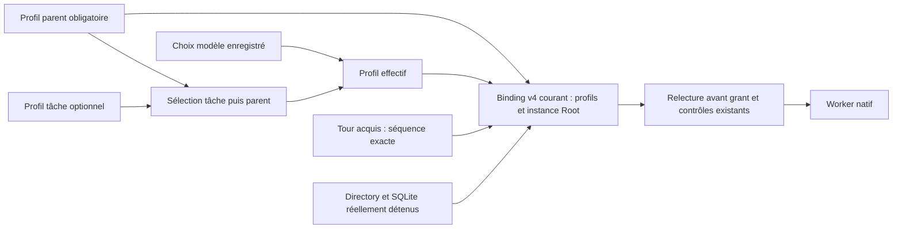

Recette : mission-task-profile ; témoin manuel sain, échec observé, décision de
reprise native, choix de modèle public, preview puis intention automatique.
Les corruptions négatives parent/tâche portent sur actor (audit exclu de la
projection du plan mais inclus dans le hash du profil), après admission réelle,
conservent les refus et restaurent les octets seulement après preuve de refus
sans mutation du Work. Ce sont des fixtures inertes, sans modèle payant ni
acceptation globale ; résultat de vérification consigné dans le plan.

## Compatibilité des intentions v1 — lot190

La recette mission-legacy-intent compile son exemple de vérification contre
les sources immuables du moteur188. Ce dernier crée lui-même le vrai reçu/Agent
v1 avec les opérations publiques, garde son bail et son heartbeat pendant que
le normal189 exécute le même Agent via agent run. Aucune conversion SQL de v2
en v1 : la provenance vient réellement de l'ancienne factory. Le modèle est un
programme Python inerte ; cela ne prouve ni un fournisseur réel ni une identité
humaine, ni la protection tâche v2 pour les anciennes intentions.
Le dialogue de fixture utilise une ligne prête puis une demande de fin sur stdin,
sans délai global arbitraire. Un EOF négatif dans un Root neuf doit conserver
la cause typée, sortir en échec et laisser l'intention queued sans provider.
RuntimeError masque volontairement le texte IO : un témoin statique est émis
uniquement après lecture de la vraie cause UnexpectedEof attendue. Les causes
action/fermeture sont conservées séparément ; aucune panne de close n'est injectée.
Voir le plan pour les sources/binaires/proofs et les résultats exacts.

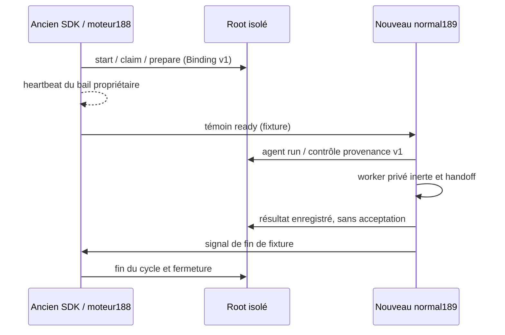

## Ordre des tâches

mission order WORK --root ROOT --json et RootStore::mission_task_order lisent
Work et cockpit_tasks dans le même snapshot SQL. Toutes les tâches sont listées,
quel que soit leur statut : priorité persistée décroissante (absence = neutralité
0 du schéma37), profondeur maximale des dépendances croissante, puis ID lexical.
priority et depth sont des chaînes décimales exactes ; le tri signé ne nie jamais
i64::MIN. Le graphe complet est vérifié sans récursion ni borne d'essais : cycles,
dépendances manquantes/répétées, identifiants invalides/doublons et priorité
orpheline refusent. Une valeur SQL mal typée ne disparaît pas derrière zéro.
Le snapshot est explicitement rollback, les statements sont finalisés et leurs
erreurs indépendantes conservées. Le lecteur ne crée aucun événement, réservation
ou provider et ne choisit aucune tâche prête. Ce n'est pas un plan exécutable :
le sélecteur devra encore vérifier consentement, fraîcheur des preuves, reprise,
slots, budget, workspace et FIFO global au départ réel. L'écriture Root/CLI est décrite ci-dessous ; HTTP/UX de priorité restent à
porter. Aucun nouvel écran Admin n'est revendiqué.

## Priorité ordinale auditée

mission priority WORK --root ROOT --input FILE --json utilise la même mutation
Root mission.priority. Le document impose schema_version=1, event_id unique,
expected_revision courant, task_id existant, reason non blanc et priority en
chaîne décimale canonique signée i64 (exemples : "0", "10", "-1"). Une valeur
plus haute passe avant une plus basse ; zéro est neutre. Ces valeurs ordinales
ne consomment ni slots ni budget. La borne i64 vient du stockage SQLite ; le
plafond métier0..9 de l'ancienne console n'est pas réintroduit implicitement.
Nombre JSON, null, signe+, -0, zéros initiaux, espaces et dépassement de
représentation sont refusés. L'absence ne signifie pas remise à zéro.
Le writer valide le task unique et stocke valeur + audit cockpit + événement
Work/révision dans la transaction commune. Rejouer exactement le même event
renvoie la mutation enregistrée sans doubler audit/révision ; une autre demande
sous le même event ou une révision périmée refuse. La relecture mission order
consomme effectivement la valeur persistée après réouverture. Les modes,
consentements, profils, réservations et tentatives ne sont pas changés.
L'attribution opérateur vient de l'environnement local, sans authentification
humaine implicite. API Root/CLI seulement : HTTP/UX de priorité et départs
automatiques complets restent à porter. Une future politique de vocabulaire
limité devra être persistée/validée et visible, jamais cachée dans un attribut UI.
La panne d'audit est testée sur un Root déjà ouvert ; une nouvelle ouverture
refuse d'abord les triggers supplémentaires, preuve distincte d'un rollback SQL.

La fixture de compatibilité utilise maintenant une enveloppe ready de version2
(distincte du Binding1) avec la vraie demande publique initiale, conservée par
l'ancien SDK. Le nouveau CLI la rejoue : reçu canonique/Work/audit/consentement
restent inchangés, puis le même Agent v1 s'exécute. Le reçu interne sérialise des
champs d'audit interdits à l'entrée publique ; il ne faut ni le réinjecter comme
requête utilisateur, ni assouplir la validation pour cela. Les demandes et reçus
originaux sont conservés séparément. Les preuves exactes restent dans le plan.

## Frontières des workspaces

Les gardes communes de préparation et de départ comparent les chemins Unix
canoniques par égalité ou préfixe avec séparateur. Elles retirent les séparateurs
finaux avant d'en ajouter un : la racine '/' reste un ancêtre, au lieu de devenir
le préfixe incorrect '//'. La règle couvre agents actifs et intégrations running ;
les frères comme '/project/a' et '/project/ab' restent disjoints. Aucun chemin
n'est interdit pour masquer un calcul incorrect. Le préflight continue d'imposer
le vrai Root, son confinement de workspace et ses observations de droits.
La recette négative modifie uniquement une ligne active dans un Root de fixture,
après une vraie intention queued disjointe : ce n'est ni un projet légitime
à la racine du filesystem, ni un exploit vérifié. Elle exige refus sans mutation
SQL, puis restauration exacte et admission ordinaire. L'unité SQL projette aussi
la garde d'intégration ; elle ne vaut pas intégration native réelle. Les lignes
SQL sont des observations de ressource, pas une identité/processus authentifié.
Le candidat FIFO197 réutilise ces frontières ; sa qualification est décrite ci-dessous.

## Observation de file workspace — candidat196

RootStore::mission_workspace_queue(WORK), CLI mission queue WORK, lisent le Work
et toutes les lignes workspace_turns dans une transaction cohérente. Les premiers
blockers plus anciens concernent les waiting de ce Work ; waiting/acquired
bloquent les arbres qui se chevauchent, released ne bloque pas. Les séquences
sont des chaînes décimales exactes. Lecture stricte des types/états/identifiants,
chemins Unix canoniques et horodatages ; aucune normalisation silencieuse d’un
ancien chemin relatif Go. SQL/finalize/rollback et close/output restent des
erreurs, causes secondaires conservées.

Cette observation n’inscrit/acquiert/libère aucun tour, ne vérifie pas une identité
de processus et n’autorise aucun départ. Le writer197 décrit ci-dessous revérifie dans
sa transaction autoritative ; la preuve196 reste celle du lecteur seulement. Les lignes de
recette sont des données d’observation, jamais une preuve d’admission publique.
Anciennes lignes Go non canoniques : adoption/migration ou refus à qualifier
avant activation. Profil et tests qualifiés dans les limites ci-dessous ; candidat non installé.

196 vérifié sur normal04 (289entrées effectives archivées sans fixture), non installé : native07 puis queue10 deux étapesPASS/source stable/intégritéVERIFIED. Qualité06 cinq tests du lecteur et un test de traduction d’erreur composé, Clippy/Rustdoc moteur et CLI PASS. L’injection finalize composée est une projection d’erreur, pas une vraie fauteSQLite. Les cinq lignes natives sont des métadonnées de fixture, pas des acquisitions publiques.

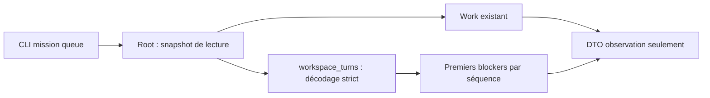

Le producteur Go setProfile dans dispatcher.go503 appelle resolveWorkspace avant persistance. L’inspection du seul dispatch ne prouve donc pas des lignes historiques relatives. Autres producteurs/imports et vraie baseGo restent à qualifier ; observation stricte ne vaut pas migration/adoption. Le candidat197 implémente acquisition/libération sous vrai bail et Bindingv3 ; sa qualification reste distincte des preuves196. Le conducteur/watch complet reste à porter.

## Candidat197 — FIFO sous bail : contrat et vérification locale bornée

`RootStore::sync_mission_workspace_queue` exige le Root ouvert et son vrai bail
non désérialisable, sous réglages réservés et transaction d'écriture. Il relit
Work et priorités, vérifie le DAG et l'ordre complet (priorité décroissante,
profondeur croissante, ID lexical). La projection structurelle conserve chaque
refus de statut, launch-held, branche non portée ou profil. Un profil structurel
`Ok` ne signifie pas « prêt » : le consommateur vérifie ensuite le lifecycle sur
une copie jetée, les preuves fraîches de dépendances/prérequis et décisions de
reprise prises en charge, les limites de tentatives sauvegardées, le budget,
le coût rapporté et les sources réelles de provider/workspace. Aucune tentative,
réservation ou consommation n'est persistée par cette observation.

Ces vérifications précèdent le filtrage par créneaux disponibles et occupation :
une tâche prête conserve sa place même si son workspace est occupé. Les réglages
de capacité sont validés sans inventer de capacité libre. `ready` signifie un
standing claim, jamais un grant. L'appelant doit synchroniser explicitement avant
la factory ; une preview ne synchronise pas et rollback intégralement son staging.
Le dispatch/watch automatique complet n'est pas fourni par cet appel.

Le journal auxiliaire append-only `workspace_turn_events` conserve les transitions
et générations libérées avant réinscription. Le writer synchronise les waiting,
libère les waiting devenus obsolètes et préserve les acquired. `agent.start`
acquiert atomiquement le tour FIFO dans sa transaction avec Work/réserve/Agent et
journal. Binding v3 conserve les deux empreintes de profil plus
`workspace_turn_seq`, chaîne décimale exacte liée au Work, à la tâche, au workspace
et à l'Agent réels. La provenance et l'acquisition sont revérifiées avant grant.
Les intentions historiques v1/v2 restent lues sous leur contrat d'origine, sans
FIFO rétroactive ni conversion SQL permettant de fabriquer cette protection.

Une annulation queued sûre ou un résultat terminal sûr libère dans la même
transaction que son règlement Work/réserve/Agent/journal. Une exécution en
quarantaine ou dont l'issue reste inconnue conserve le tour ; un retour `Err`
ne prouve pas l'absence d'effet. Le rejeu terminal vérifie l'historique de sa
propre génération sans toucher une réinscription plus récente. Ces observations
ne prouvent ni identité authentifiée, ni acceptation de tâche, ni permission
nouvelle contre les écrivains hostiles du même datastore.

### Retrait de permission et nettoyage des waiting

Après contrôle du bail, exactement cinq refus sémantiques sont distingués :
`planning-mission-paused`, `mission_archived`, `mission-controls-required`,
`mission-autonomy-required` et `mission-consent-required`. Pour ces seuls cas,
la synchronisation traite une liste vide, libère les waiting et conserve les
acquired. Elle retourne la cause originale dans `permission_refusal` ; le
consommateur doit impérativement traiter ce champ. Un résultat `Ok` de nettoyage
n'autorise donc aucun départ et ne renouvelle pas le bail.

Dans les contrôles globaux de permission, bail et journal, une variante
inconnue, une lecture SQL invalide, une corruption de preuve, un réglage
invalide ou un bail invalide reste `Err` ; aucun échec technique de ces contrôles
n'est transformé en nettoyage réussi. Les refus de readiness propres à une tâche
restent distincts dans la liste `refused`. Les échecs avant commit déclenchent le
rollback ; les causes secondaires et toute incertitude de commit/fermeture
restent visibles selon le contrat d'erreur transactionnel existant.

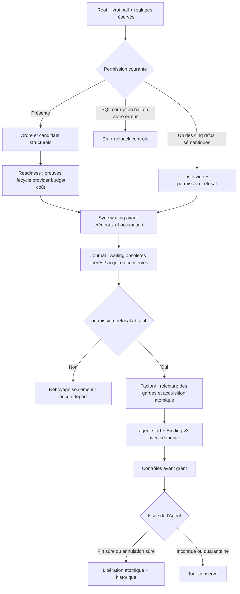

La preuve before-pause15 conserve deux assertions valides suivies du refus
exact planning-mission-paused au nettoyage. Le moteur final39 par défaut
(292 entrées effectives, SHA88859e0d, sans fixture) et le SDK FIFO final40 passent
final43 : inscriptions concurrentes, refus FIFO exact sans mutation, pannes journal
à l’acquisition/nettoyage/annulation avec rollback et reprise, conservation exacte
du tour acquis/réservations, progression sur le même workspace après libération,
historique de réinscription, fin du worker inerte et réouverture CLI publique.
final44 passe les scénarios worker/coûts existants. final45/final46 exécutent de
vraies intentions historiques v1/v2 issues des moteurs188/192 sous leur vrai
heartbeat propriétaire, avec rejeu public des contrôles et refus EOF. Les quatre
recettes ont une intégrité vérifiée. quality21 conserve17 tests Rust nommés et
Clippy/Rustdoc stricts ; final39 ajoute seulement des lignes Rustdoc relues dans
cinq fichiers produit. Les anciennes entrées de tests sont conservées et ne sont
pas présentées comme reconstruites ; final47 vérifie Clippy/Rustdoc finaux. Les
empreintes binaires ont changé : les quatre recettes publiques ont donc été
rejouées sur les binaires finaux, sans inférer leur égalité à partir des commentaires.

Limites : une des cinq variantes sémantiques de retrait de permission est exercée
par le parcours public. Reprise unknown/quarantine/crash, rejeu terminal après
nouvelle génération de la même tâche, équité complète/conducteur/watch et
acceptation indépendante restent ouverts. La panne journal est un épuisement
d’ordinal SQLite, pas une saturation filesystem. Fixtures inertes sans fournisseur
payant ni acceptation de tâche. Au point de comparaison précédent, vingt entrées effectives différaient dans le checkout
canonique concurrent (Live, télémétrie, réglages/ressources et lib.rs) : leurs
originaux sont préservés et exclus du candidat qualifié. Aucune qualification
combinée, installation, publication ou mise à jour des contextes embarqués et
sessions déjà démarrées n’est revendiquée.

Correction du consommateur terminal vérifiée : before52 reproduit le succès
malgré un snapshot released réel manquant ; after60 révèle ensuite la lecture en
autocommit du rejeu terminal. La réservation de réglages ne crée pas de snapshot
SQL. La branche corrigée ouvre une transaction de lecture, relit Agent/réservation/
preuve FIFO, puis conserve séparément les erreurs de lecture et de rollback.
verify_terminal vérifie l’historique FIFO après comparaison exacte du reçu durable ;
rejeu de récupération et observation des résultats pour le planner utilisent cette
garde. Aucun consentement/bail courant n’est exigé après fin, aucune FIFO rétroactive
pour manuel/v1/v2. Les gardes unitaires couvrent release absent, mauvais propriétaire,
séquence incorrecte, compatibilité ancienne et restauration.

Normal65 final (292 entrées effectives, SHA8e5af7aa, défaut sans fixture) partage
les vrais octets/features moteur des SDK66/67/68. quality69 passe18 tests Rust
nommés, Clippy strict moteur/CLI/SDK et Rustdoc privé. completion-after70 passe
fournisseur réellement fini -> panne règlement -> tour/réservation conservés ->
refus propriétaire vivant -> sortie propriétaire -> reconcile public -> libération
exacte/rejeu. Supprimer ensuite la preuve released refuse précisément avec
mission-agent-turn-release-missing ; restauration exacte puis rejeu réussissent
sans nouveau fichier fournisseur ni mutation SQL. final71–74 passent worker/coûts,
vraies intentions anciennes v1/v2 et cycle FIFO concurrent ; cinq recettes ont une
intégrité vérifiée (7 étapes). Le témoin/refus du retry de production du planner61
passe aussi sur normal55, avant la dernière transaction de recovery terminal : il
exerce le code inchangé d’observation/garde, pas la branche finale65 de rejeu.
Cette réutilisation est bornée, sans prétendre une réexécution. retained76 archive
et vérifie séparément tous les octets des sorties imbriquées, dont l’échec60.
Le vérificateur de recette couvre ses artefacts déclarés, pas automatiquement ces
sorties. La revue lie ces archives séparément ; aucun magasin vivant n’est cloné.

Apprentissage réutilisable : appliquer la provenance nouvelle à tous les lecteurs
du résultat, y compris rejeu terminal et preuves planner ; regrouper leurs lectures
dans un vrai snapshot SQL. Un verrou de réglages et un producteur vert ne prouvent
aucune de ces propriétés. Conserver le témoin sain en échec, diagnostiquer son
premier prérequis et restaurer exactement la corruption négative avant la reprise.
Unknown/quarantine, crash sans reçu complet, rejeu terminal après nouvelle génération
de même tâche et quatre autres variantes de permission restent non vérifiés.
Conducteur/watch complet, intégration Live/télémétrie concurrente, installation et
acceptation globale restent ouverts.

Qualification197 et travail concurrent : la revue77 a observé23 écarts canoniques,
dont de nouveaux changements RootStore/planning_native/reviewer gate pendant
les vérifications. Ce nombre décrit ce point de capture ; les profils qualifiés
restent liés aux sources immuables. La revue finale conserve l’inventaire exact
et les octets exclus. Aucune régression du code concurrent n’est déclarée réparée
ou qualifiée par les preuves FIFO. Son intégration reste à faire avant bascule.

## Sélection et admission suivantes — lot198

`RootStore::dispatch_mission_worker` est une API Rust Linux qualifiée localement.
La requête stricte contient schema_version, event_id et expected_revision ; le
moteur choisit la tâche. Le caller possède un vrai bail lié à l'instance Root et
au processus. Le résultat est une intention queued, un rejeu ou un refus explicite
sans admission ; cette API ne démarre aucun fournisseur ni boucle watch et n'a
pas encore de commande CLI dédiée.

Avant toute synchronisation, le moteur cherche l'original canonique de l'événement
sous une vraie transaction et les réglages réservés. La tâche vient de cet
original, jamais du profil courant reconstruit. Original manuel, autre Work,
mauvaise révision d'origine, provenance invalide ou changement de profil refusent.
Présence et octets request/Work, ainsi qu'un conflit de namespace orphelin,
survivent aux nouvelles tentatives de stockage existantes : disparition ou
remplacement observé ne deviennent pas une nouvelle sélection. Le rejeu garde
les contrôles actuels de profil/consentement/capacité et les reçus/FIFO originaux ;
un tour released ne suffit pas seul à établir un refus. Le namespace partagé
Agent.start ne prouve pas que le sélecteur a historiquement créé l'intention.

Une absence réelle permet de synchroniser tous les candidats ready avant les
créneaux et occupations. La révision synchronisée est contrôlée avant tout retour,
y compris une file vide ou un retrait de permission. La sync peut déjà avoir
commis : le résultat conserve cet effet. Un blocker FIFO ou une occupation directe
propre peut laisser passer un candidat disjoint ; la capacité de mission arrête
le passage. Erreur composite, commit/cleanup ou issue inconnue arrête sans chercher
une autre tâche. La vraie factory répète ses gardes et acquiert atomiquement le
tour avec l'intention.

Prepared, Replayed et NoAdmission ne prouvent ni processus lancé ni acceptation.
NoAdmission peut contenir un nettoyage commis, des refus de readiness, de permission
ou de ressources ; il faut les examiner. L'erreur conserve phase, identité de
préparation, effets de queue connus et causes antérieures. Les diagnostics traversent
également les causes secondaires sans afficher identifiants, prompts ou tables.
Le caller doit maintenir le heartbeat et conserver les résultats avec ses erreurs
indépendantes de fermeture/sortie. Une issue incertaine se reprend par le même
événement. Aucun nouveau plafond, délai, retry, budget ou créneau opérateur n'est
ajouté ; les politiques restent dans leurs sources persistées existantes.

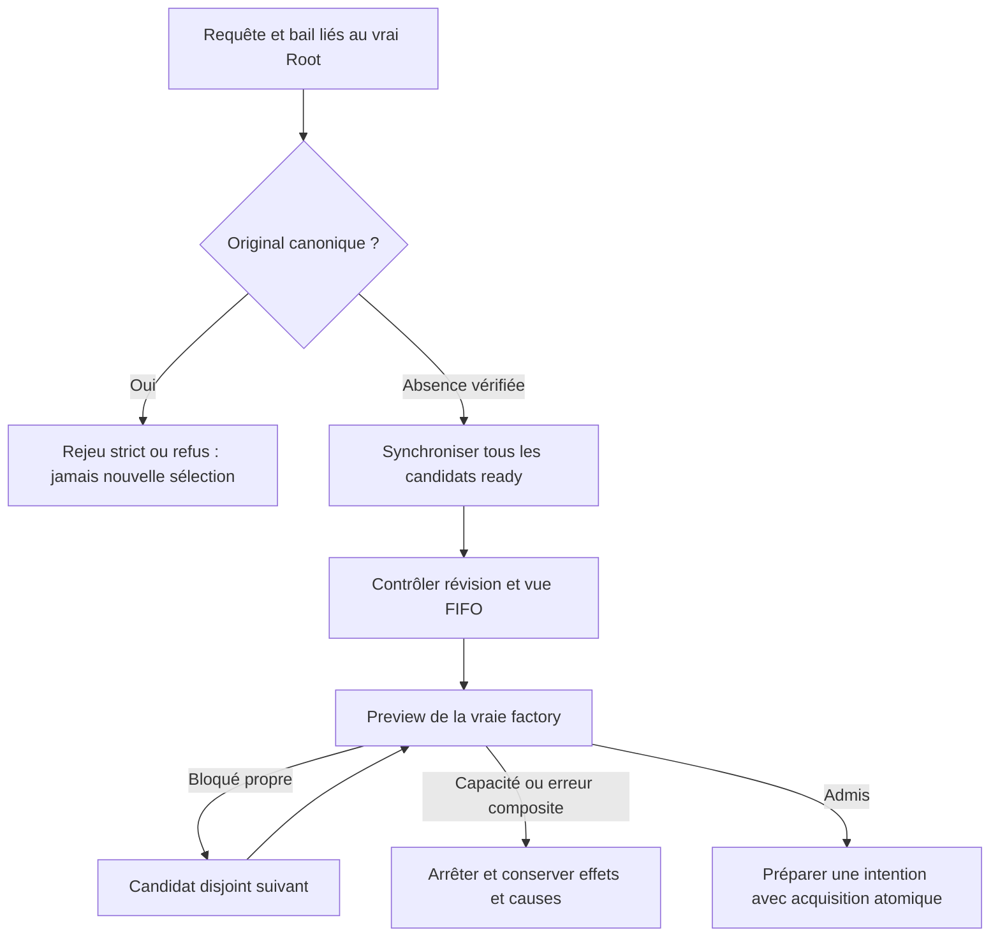

Preuves : normal24 (ab349179,293 entrées effectives sans fixture), SDK26 aux mêmes
200 sources moteur,20 tests ciblés10 réutilisés sur les mêmes corps exécutables, Clippy/Rustdoc27. La recette
permanente mission-worker-dispatch, public28 PASS/intégrité VERIFIED, vérifie
sélection disjointe, rejeu queued sans changement SQL, capacité après retrait public
du bloqueur, pause conservant le tour acquis, puis3conflits d'origine (manuel avec
sa vraie révision, autre Work, mauvaise révision). retained29 archive/revérifie116
sorties imbriquées hors cache, sans base Root. Le SDK ne démarre aucun fournisseur ;
la préparation utilise des programmes inertes et conserve leur coût simulé. Les
écritures/flush stdout sont contrôlés explicitement ; un marqueur partiel ne vaut
pas résultat final ni fermeture réussie.

Limites : pas d'injection réelle BUSY/finalize ou EPIPE, ni de commit/close réellement
incertain ; course de révision couverte par projection, pas entrelacement concurrent.
Le contre-exemple namespace avant correction et son binaire sont conservés dans
le plan (before04/13) ; les20 tests passent après correction. Watch, rejeu terminal
après nouvelle génération et acceptation globale restent ouverts. Les23 entrées
canoniques concurrentes Live/télémétrie/réglages/Root/lib sont exclues de ce profil :
aucune qualification combinée ni installation. Voir le plan et REPLAYS pour les
commandes, empreintes, échecs originaux et la reprise restante.

Le rafraîchissement du Rustdoc seul (doc-only22) conserve exactement les corps et les lignes exécutables ; normal24 et SDK26 sont aussi identiques octet pour octet aux binaires antérieurs (binary-equivalence24). Le profil courant et Rustdoc27 portent néanmoins sur les octets documentés finaux.

## Indépendance du worker après le départ du conducteur

La recette `mission-watch-worker.json` utilise le SDK de preuve
`mission_watch_worker`, puis la vraie commande `agent run` du binaire normal dans
une session distincte. Le conducteur garde son bail et son heartbeat jusqu'à
l'entrée réelle du programme fournisseur inerte. La permission enregistrée ou
un simple spawn ne suffisent pas : les observations noyau PID/stamp/parent,
le marqueur d'entrée et l'empreinte de l'entrée consommée doivent correspondre.
Le pair socket est attribué au superviseur détenu avant toute lecture bloquante.

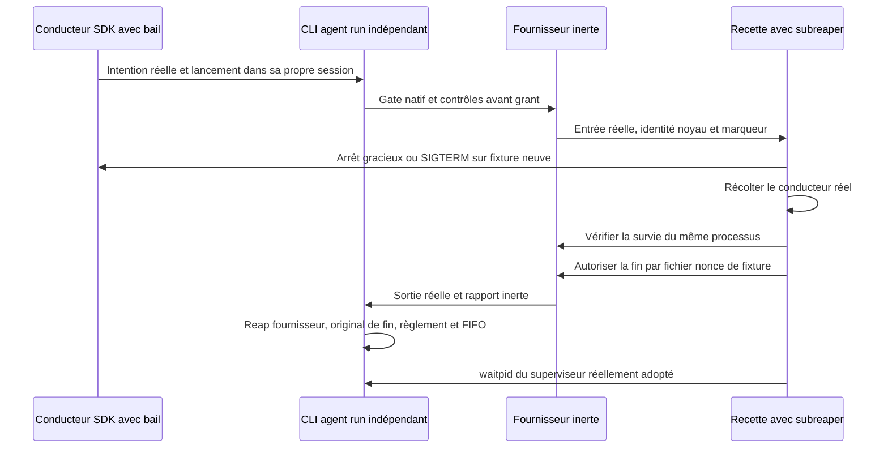

L'arrêt gracieux conserve le reçu de bail arrêté et la fermeture ; SIGTERM
conserve son vrai statut noyau sans inventer ces reçus. Après la récolte du
conducteur, les mêmes superviseur/fournisseur restent vivants, avec le même tour
acquis et la même réservation. La fin vérifie explicitement l'original de fin et
sa correspondance au résultat public : `kernel_reaped`, `output_complete` et
`workspace_release_confirmed` vrais, `recovery_required` faux, identité et réserve
inchangées. Le reçu exact est copié avec son SHA256. La recette récolte aussi le
CLI par vrai `waitpid` : le reçu de reap du fournisseur ne prouve pas ce reap CLI.
Le rejeu public conserve le SQL et les marqueurs ; aucune tâche n'est acceptée.

Preuve locale : lot199 `public23`, deux étapes PASS et intégrité vérifiée,
douze gardes Python et deux parcours réels (gracieux puis SIGTERM) ; trois tests
Rust ciblés dans `unit08`, Clippy strict dans `clippy11`. Normal198/24 et SDK199/10
partagent les mêmes 200 entrées moteur default sans fixture. `retained24`
conserve 115 sorties imbriquées, dont les deux originaux de fin, sans cloner les
bases Root. Les erreurs d'écriture et fermeture ne court-circuitent plus le
nettoyage ; leurs contre-exemples et causes secondaires sont conservés.

Cette preuve B1 n'est pas le raccordement de `mission watch` : le SDK emploie un
`pre_exec` propre à l'exemple, interdit dans les crates produit par leur
`forbid(unsafe_code)`. Le futur lancement produit doit être qualifié séparément.
Pas de fournisseur payant, installation, reprise automatique complète,
qualification des changements Live concurrents ou acceptation globale.

## Bootstrap de session produit vérifié

Le helper Linux privé `_mission_worker_entry AGENT --root ROOT_ABSOLUE --json`
valide son transport avant session ou ouverture Root, appelle `setsid` via
l'API sûre rustix, puis réutilise le consommateur de `agent run`. Son nom ne
confère aucun droit. CLI, moteur et SDK de preuve conservent `forbid(unsafe_code)`.
Le launcher doit utiliser un spawn ordinaire : rendre l'enfant leader de groupe
avant exec ferait refuser `setsid`. Le helper n'est pas un second superviseur.

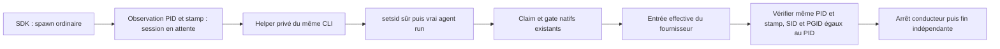

Le spawn ne prouve pas la session. Le SDK conserve son observation initiale et
n'annonce l'indépendance qu'après entrée réelle du fournisseur et contrôle des
PID/stamps/parents/SID/PGID. Une erreur après `setsid` conserve le SID observé et
la cause CLI originale, y compris état enregistré, fermeture et sortie. Une
session refusée conserve l'errno et n'appelle pas le runtime Agent. Les tests de
session refusée sont injectés ; le parcours positif est réellement exécuté dans
un sous-processus, jamais dans le runner de tests.

Lot200 : normal05 `c734f0c4`, 294 entrées effectives default sans fixture ; SDK10
partage les mêmes 200 entrées moteur. Cinq tests CLI06 et trois SDK11 nommés,
Clippy strict et Rustdoc privé12 PASS. Public14 PASS/intégrité VERIFIED : quatorze
gardes, quatre refus publics sans création Root/mutation, puis vrais parcours
gracieux et SIGTERM par le helper produit. Retained15 conserve 129 sorties,
dont originaux de fin, identités et statuts noyau ; aucune base Root clonée.

Le SDK B1 archivé en199 utilisait pre_exec ; la recette courante200 utilise ce
helper sûr. Le driver `mission watch`, ses canaux liés au descriptor Root et ses
phases de reprise restent non raccordés. Le test201 a établi qu'un remplacement
de `.swarm` à chemin constant peut conduire le worker à exécuter dans une copie,
alors que le conducteur conserve son instance originale. Les contrôles de bail
du conducteur et du worker interprocessus sont donc insuffisants pour ce cas.
Le correctif commun est en cours de qualification ; aucune résistance à ce
remplacement ni protection contre un écrivain hostile du même UID n'est acquise.
Pas d'installation ou d'acceptation globale.

### Liaison physique du stockage — candidat 201 en qualification

Le contrat implémenté observe le fichier réellement connecté à SQLite par le
builtin `sqlite_filestat('main')`. Dans sa closure de lecture, un nouveau témoin
Linux `O_PATH|CLOEXEC` suit le FD propre de SQLite via procfs ; il ne prend pas
possession de son FD de données, ne le duplique pas et ne le ferme pas. Le témoin
est comparé au `state.db` privé, régulier et single-link ouvert par `O_PATH` avec
`NOFOLLOW` relativement au directory détenu. `RootBinding` conserve les deux
identités dev/ino et les handles qui empêchent leur réutilisation pendant sa vie.
Une absence de builtin, association différente ou erreur d’observation refuse
sans repli sur un stat du pathname.

La factory courante produit Binding v4, qui ajoute `root_instance` aux empreintes
parent/effectif et à la séquence FIFO. L’original canonique protège cette liaison ;
un tuple fourni par le client ne crée aucune autorité. Avant claim et grant,
le lecteur exige v4 et compare l’instance réellement ouverte. Les contrôles de
bail/processus/profil/consentement/capacité/FIFO restent requis. Les versions 1–3
conservent la lecture historique/annulation/règlement selon leurs preuves, sans
nouveau droit de départ ni backfill d’une provenance physique inexistante.

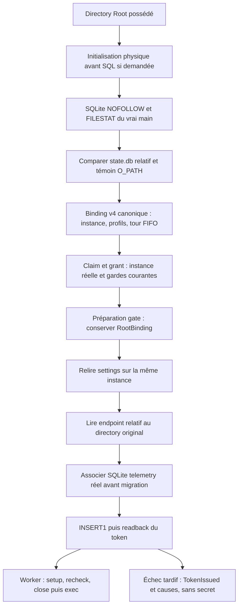

Sur Linux, l’initialisation explicite prépare le fichier privé avant connexion et
écrit le schéma après association du FD réel au fichier relatif. Un fichier
manquant est publié depuis un temporaire déjà fermé, avec NOREPLACE ; une
réparation des permissions vise l’inode retenu O_PATH via procfs, sans ouvrir puis
fermer un FD data qui retirerait des locks SQLite. `RootStore::open` ouvre un
Root existant ; `writable` ne signifie pas initialiser. Le code d’initialisation
ne constitue pas à lui seul une preuve de ses gardes ou de son absence d’effet.

Le worker conserve le binding acquis avant `prepare_agent_gate`, relit les
settings uniquement après comparaison avec la Root rouverte et le garde jusqu’au
retour du lanceur telemetry. L’endpoint est lu par descriptor relatif. Le store
telemetry distinct conserve son vrai SQLite et un témoin O_PATH, compare son
fichier avant migration/émission, puis exige INSERT1 et readback concordant du
digest/agent/date/révocation nulle. Le secret n’est rendu qu’après cette vérification.
Un INSERT0 ne devient pas un faux succès ; après INSERT1, un échec de readback ou
de fermeture garde le marqueur typé `TokenIssued`. Il indique une phase d’écriture
rapportée, pas un grant, une livraison, une acceptation ou une garantie que la
ligne existe encore. Les causes primaire/cleanup restent séparées ; le Debug de
`LaunchTelemetry` ne publie pas le token ni son environnement.

Le lanceur standalone conserve son API et accepte un directory owned0755 avec
fichiers privés. Le worker utilise l’API bound du vrai RootBinding. Reviewer et
planning utilisent encore la route publique sans leur binding de préparation :
leur continuité d’origine et leurs marqueurs après succès restent à raccorder.
Une recheck tardive ne prouve pas qu’aucune mutation antérieure n’a atteint une
copie. Il n’y a ni installation ni qualification implicite de ces consommateurs.

Le correctif bootstrap201 place désormais le timeout SQLite zéro explicite
immédiatement après connexion, avant la première capture FILESTAT, pour Root et
TelemetryStore. Root charge ensuite sa valeur Admin persistée avant le SQL
ordinaire ; `bind_root` et les observations ultérieures ne la réinitialisent pas.
Le zéro est la phase technique existante avant chargement des réglages, pas une
nouvelle politique opérateur. Les deux gardes permanentes de contention interprocessus
et de conservation de la valeur Admin ont réellement PASS74 sur le candidat65.
Le parcours CLI busy92 est également PASS sur normal65, avec refus typé Prepare
et reprise intacte ; les gardes prouvent l'ordre du handler, la mesure CLI ne
constitue aucune borne ou garantie de performance et ne couvre pas TelemetryStore.
Voir le [contrat et la provenance bootstrap](../plans/migration-rust/evidence/20261022-root-instance-201/bootstrap-busy-handoff.md).

`.cargo/config.toml` configure `LIBSQLITE3_FLAGS=-DSQLITE_ENABLE_FILESTAT` avec
`force=true`. Cargo doit être lancé avec cwd égal à la source immuable sélectionnée,
pas seulement avec un manifest situé ailleurs. Les collecteurs pré-lient, comparent
et archivent ses octets en normal/SDK ; les profils SDK doivent consommer la même
config. Le record garde aussi l’environnement avant application de la config ;
ce record ou les features Rust ne prouvent pas les flags C effectifs. La capacité
runtime doit être exercée sur les bons binaires. Les profils historiques où les
deux configurations sont absentes restent compatibles, sans réécrire leurs preuves.

Ces handles sont une liaison physique locale, **pas un confinement OS** contre un
acteur hostile du même UID, un procfs remplacé ou un ABA volontaire. SQLite ouvre
encore un chemin sous NOFOLLOW avant observation de son FD : sa connexion ou la
préparation SQL peuvent avoir des effets propres de récupération d’un hot journal.
Leur absence n’est pas établie ; le lot ne revendique pas zéro effet d’une
connexion arbitraire ni une protection par simple hash.

#### Preuves201 et critères encore ouverts

Les résultats intermédiaires16–62 gardent leur portée historique : capability
FILESTAT/O_PATH, profils18/31/45, tests33/34 puis 53 tests47–54 et public59. Le
zéro-test35 est conservé, puis les trois gardes ont réellement PASS49. Les défauts
08/26 ont exécuté le provider dans une copie ; le FAIL60 ultérieur refuse dans
le conducteur avant spawn et ne prouvait pas le comportement du worker DB seule.

Le [normal65](../plans/migration-rust/evidence/20261022-root-instance-201/canonical-normal65/result.json)
`8bd7ebc0…` qualifie 301 entrées correspondant aux sources figées63 ; SDK77 partage
moteur/config. **67 tests nommés PASS** : 57 moteur67–75, 5 CLI78 et 5 SDK79.
Les gardes bootstrap et diagnostics corrigés sont maintenant exercées sur ce
profil, avec sources/exécutables archivés et intégrité vérifiée. Le
[résultat85](../plans/migration-rust/evidence/20261022-root-instance-201/quality85/result.json)
rapporte Clippy et Rustdoc stricts PASS sur la portée moteur/CLI/SDK sélectionnée. Aucun résultat ne prouve installation,
acceptation indépendante ou qualification globale du graphe Live concomitant.

Le [schéma2 de sonde](../plans/migration-rust/evidence/20261022-root-instance-201/sdk-late-probe-plan62.md)
ajoute spawn_ready après les vrais contrôles binding/monitor, puis attend spawn
avant le Command existant. Cette fenêtre de fixture conserve tous les contrôles
et erreurs ; ses booléens ne créent aucune autorité. Schéma1 reste historique.

Les [répertoire88](../plans/migration-rust/evidence/20261022-root-instance-201/public-directory88/result.json)
et [DB seule89](../plans/migration-rust/evidence/20261022-root-instance-201/public-database89/result.json)
PASS, validés par la racine, exercent ce point tardif : deux témoins avec véritable
entrée provider/completion, enfant exit0 et SDK CHECKED_CLOSED ; deux injections
après spawn_ready entraînent l'enfant worker exit2 avec code d'instance attendu,
sans entrée provider et copie inchangée. Les processus détenus sont réellement
récoltés, l'original restitué et stop/reconcile/replay/cancel publics vérifiés.
Pour la faute, le SDK conserve EXPECTED_SUBSTITUTED_CONTEXT_REFUSAL ; il n'invente
ni logical stop ni checked close sur le contexte substitué. L'intégrité des deux
recettes est vérifiée ; [rétention90](../plans/migration-rust/evidence/20261022-root-instance-201/public-retained90/result.json)
archive 141+142 sorties imbriquées.

[Snapshot80](../plans/migration-rust/evidence/20261022-root-instance-201/snapshot80-replan.json)
a refusé avant runtime pour deux notes62 absentes. Source86 ajoute ces seuls
fichiers documentaires, avec les 301 entrées65 strictement identiques, avant
snapshot87 et recettes88/89. Cet échec de précondition reste conservé séparément.
Le négatif FILESTAT57v3 et l'écart SqlInputError avantfix restent historiques ;
les diagnostics corrigés sont exercés73, sans effacer les observations originales.
Le [busy avant61](../plans/migration-rust/evidence/20261022-root-instance-201/bootstrap-busy-handoff61.md)
a refusé SQLite5 après 5017838602ns sous verrou réel, cohérent avec le handler hérité
5s ; témoin/reprise/hashes identiques, sans seuil. Le
[busy candidat92](../plans/migration-rust/evidence/20261022-root-instance-201/boot-busy-candidate92/result.json)
PASS avec vérification d'intégrité : exit2 sous verrou, causes typées
`root-database-identity`, `database-identity-operation:Prepare`, `sqlite-code:5`,
**4440712ns** mesurés ; reprise et hashes DB/settings/SQL inchangés. Les
[24 observations93](../plans/migration-rust/evidence/20261022-root-instance-201/busy-retained93/result.json)
sont archivées. Aucun seuil, watchdog ou engagement de performance ; le zéro
avant capture est prouvé par les gardes74 plutôt que la latence. Ce parcours
CLI ne prouve pas le timeout de TelemetryStore. Les 12 gardes du harness corrigent
un flag de phase resté faux ; le [contre-exemple avantfix](../plans/migration-rust/evidence/20261022-root-instance-201/busy-phase-review62/result.json)
FAIL est conservé, sans modification du code compilateur65.

Restent ouverts : admissions legacy dans leur portée,
telemetry zéro/opt-out et effets tardifs au-delà des tests ciblés, raccordement
reviewer/planning, revue finale des nouveaux octets/docs et des consommateurs.
La [préparation de revue62](../plans/migration-rust/evidence/20261022-root-instance-201/review-scope62.md)
compte 43 deltas compilés contre 199 et 25 références ; elle n'est pas une déclaration
de conformité. Les sources incluent les ajouts Live/telemetry réellement compilés,
sans acceptation globale de leur graphe. Les limites hot journal/same-UID restent
explicites ; lot201, raccordement watch produit et migration restent ouverts.

Sur les mêmes binaires65/SDK77, la [recette watch98](../plans/migration-rust/evidence/20261022-root-instance-201/public-watch98/result.json)
passe : 14 gardes, sortie normale puis SIGTERM du conducteur, worker accordé
indépendant qui termine. L’intégrité est vérifiée et les [129 sorties99](../plans/migration-rust/evidence/20261022-root-instance-201/watch-retained99/result.json)
sont conservées. Ce SDK ne constitue pas le raccordement du conducteur produit.
Le timeout zéro durable de TelemetryStore demeure un choix préexistant sans
paramètre Admin identifié ; ce critère ouvert est distinct du zéro transitoire du
bootstrap Root, de l’opt-out et du résultat nul d’un INSERT.

## Compatibilité historique et transfert entre rôles

Les intentions Binding1, Binding2 et Binding3 restent lisibles et annulables ;
elles ne peuvent pas obtenir une nouvelle exécution exigeant Binding4. Les
recettes [v1/103](../plans/migration-rust/evidence/20261022-root-instance-201/legacy-v1-103/result.json),
[v2/104](../plans/migration-rust/evidence/20261022-root-instance-201/legacy-v2-104/result.json)
et [v3/118](../plans/migration-rust/evidence/20261022-root-instance-201/legacy-v3-118/result.json)
vérifient refus, annulation/libération et reprise idempotente sur de vrais
producteurs historiques, après un témoin v4. Elles ne prouvent ni ancien completed,
ni replay public mission.start v3, ni nouvelle admission. Le SDK v3 termine sur
l'EOF non nul attendu ; ce n'est pas une clôture gracieuse réussie.

Le [transfert de descripteurs116](../plans/migration-rust/evidence/20261022-root-instance-201/gate-component-unit116/result.json)
passe six tests mais reste réservé aux tests Linux. Son raccordement aux rôles
planning/reviewer n'est pas établi. Le reproducteur reviewer compilé110 n'a pas
été exécuté ; son [blocage d'outil115](../plans/migration-rust/evidence/20261022-root-instance-201/reviewer-wrapper-tool-block115.json)
est conservé séparément. Les tests du composant ne prouvent pas la protection
des rôles.

## Observation des intentions avant un futur départ

`RootStore::observe_mission_worker_continuation(&MissionLease)` lit les intentions
existantes dans un snapshot SQL, sous liaison physique Root/processus et bail
courant. Les réglages persistés gouvernent SQLite ; aucun retry, TTL, nouveau
stockage ou plafond de nombre d'agents n'est ajouté. L'ordre retenu de l'historique
n'est pas une priorité de relance. Le résultat concerne un appelant local de
confiance ; ce n'est pas un DTO HTTP ni une capacité transmissible par ses IDs.

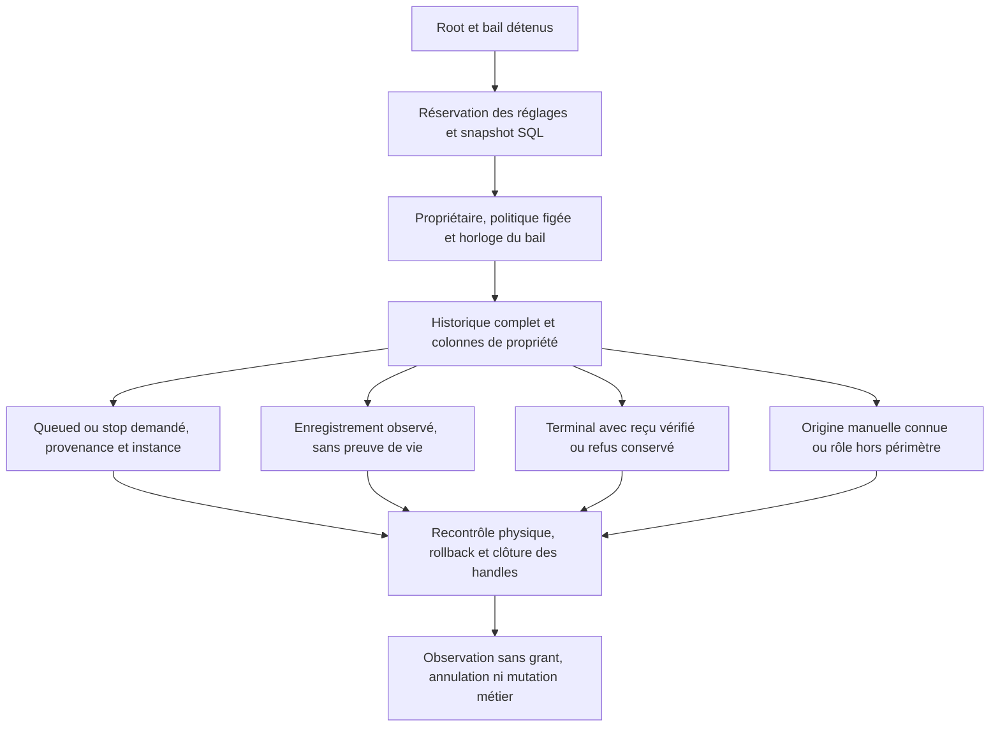

Un queued automatique exige attribution historique et Binding4 sur l'instance
réelle ; sa génération reste comparée explicitement au bail observateur. Cette
observation ne vérifie pas à elle seule la permission courante, la capacité ni
le gate final. Un enregistrement actif exige ses champs cohérents et un heartbeat
Go RFC3339, sans conclusion de fraîcheur ou de vie du processus. Starting peut
précéder l'enregistrement du child. Running/stopping exigent le child enregistré.
Stopping peut conserver le résultat opaque d'un incident de sortie incomplète :
sa présence ne prouve ni son contenu, ni une fin, ni un droit de reprise.

Un terminal vérifié exige le reçu privé et les preuves de libération existantes.
Une annulation avant enregistrement sans reçu reste explicitement non prouvée,
sans devenir relançable. Les refus sémantiques restent des entrées typées ; une
erreur de décodage/SQL/IO ou de clôture rend le rapport entier inutilisable pour
agir. Les causes primaires, secondaires et par entrée restent accessibles, y
compris à travers Box et IO. `CompleteButUnusable` ne prétend pas qu'un nettoyage
a échoué : un dernier recontrôle physique peut aussi invalider un rapport complet.
L'appel ne remplace ni le gate ni la récupération ; l'appelant ferme encore bail
et Root. Les effets techniques documentés de lecture SQLite restent distincts
d'une mutation métier.

Le [gel corrigé159, dix tests161](../plans/migration-rust/evidence/20261022-root-instance-201/continuation-unit161/result.json)
vérifie gardes structurelles, erreurs/wrappers et Roots réelles vides. Les
[contre-exemples156](../plans/migration-rust/evidence/20261022-root-instance-201/continuation-review-before156/result.json)
sont conservés. Le [parcours public169 sur162](../plans/migration-rust/evidence/20261022-root-instance-201/continuation-public169/result.json)
vérifie deux vrais queued v4 puis les sorties normale/SIGTERM du conducteur,
avec projections Agent/Work/reçus/FIFO inchangées avant départ. Le
[profil CLI164](../plans/migration-rust/evidence/20261022-root-instance-201/continuation-normal164/result.json)
et le [SDK166](../plans/migration-rust/evidence/20261022-root-instance-201/continuation-sdk-profile166/profile.json)
partagent les 202 entrées moteur et la configuration de compilation observées,
sans feature fixture. Les [129 sorties170](../plans/migration-rust/evidence/20261022-root-instance-201/continuation-retained170/result.json)
sont archivées, l'intégrité de recette vérifiée. Les six tests SDK172, quinze
gardes et [Clippy/Rustdoc stricts173](../plans/migration-rust/evidence/20261022-root-instance-201/continuation-quality173/result.json)
passent. La [revue corrective167](../plans/migration-rust/evidence/20261022-root-instance-201/continuation-corrective-review167.md)
est favorable pour F1/F2/F3 dans ce même contexte ; ce n'est pas une revue
indépendante. Aucun de ces binaires n'est annoncé installé.

Une preuve séparée [ledger185](../plans/migration-rust/evidence/20261022-root-instance-201/continuation-ledger-public185/result.json)
exécute le test moteur libtest177 : une réservation positive réelle, toutes les
lignes SQLite typées strictement égales autour de deux observations, projections
publiques et total_changes inchangés. Arrêt, annulation, libération et fermeture
sont vérifiés ensuite, séparément. Les sept gardes du harnais passent ;
[41 sorties186](../plans/migration-rust/evidence/20261022-root-instance-201/continuation-ledger-retained186/result.json)
sont archivées. Ce test cfg(test) n'est pas une API de lecture du ledger ; le
champ reservation_rows_verified du SDK166 reste false. Le défaut de transmission
des causes du harnais découvert188 est traité séparément ;185 ne le qualifie pas.
La quarantaine réelle et les terminaux/anciennes générations du lecteur restent
hors de ces preuves. La commande produit mission watch, la revue indépendante et
l'acceptation globale restent ouvertes. Des fichiers stdout/stderr durables ne
sont pas un prérequis hérité du Go : le chemin historique utilise os.DevNull ;
leur ajout produit est différé, voir le [registre après bascule](../plans/migration-rust/AFTER-CUTOVER.md).

## Premier conducteur CLI worker — candidat209 vérifié

Le candidat Rust non installé fournit `mission watch WORK --root ROOT [--json]`,
`mission status WORK --root ROOT` (texte FR/EN), et
`mission status-native WORK --root ROOT --json` (nouveau protocole version1).
Start enregistre toujours le consentement ; watch est maintenant un consommateur
explicite qui admet et lance les workers éligibles. Le serveur web ne lance pas
encore ce conducteur. Le JSON historique `mission status --json` reste refusé :
la petite projection native ne remplace pas le DTO cockpit Go.

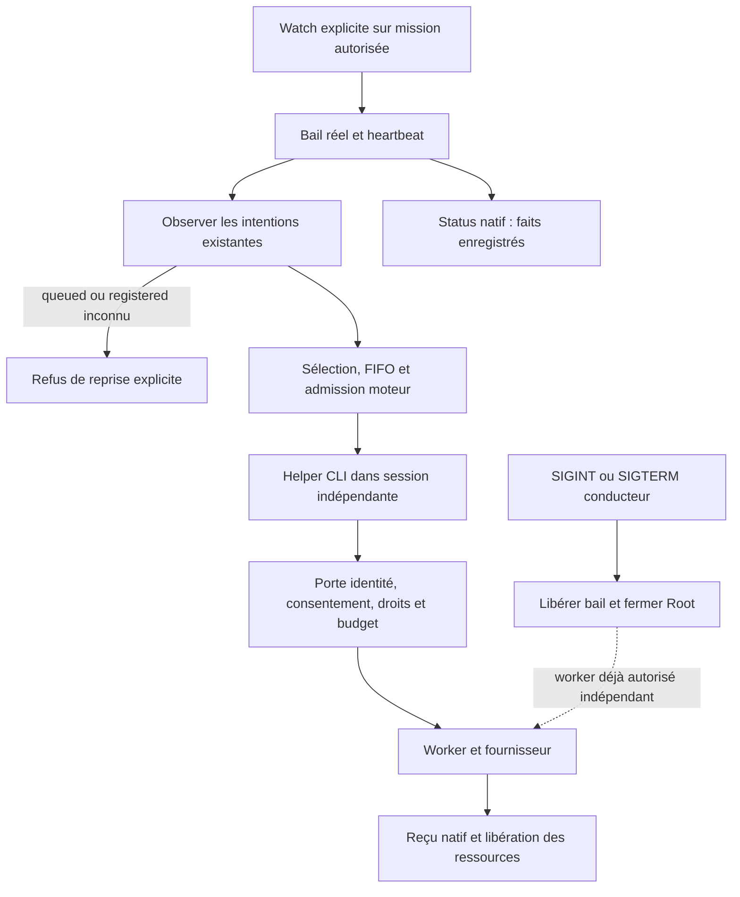

La cadence est celle de la politique persistée figée au claim ; aucun délai,
retry ou plafond local ajouté. Le conducteur suit ses propres enfants avec
try_wait sans attendre leur fin pour choisir le départ suivant. stdout/stderr
du helper vont vers null comme en Go. Les nouvelles observations stdout sont
JSONL version1, y compris sans --json ; elles n'établissent ni permission ni
réception durable. Un consommateur stdout bloqué reste une limite synchrone.
Un événement worker-started constate le spawn et porte
provider_start_verified=false : le fournisseur peut avoir progressé entre-temps.

Status-native retourne schema_version/work/revision/controls/supervision/agents/
limitations. Ses lectures sont séquentielles, pas un snapshot transactionnel unique.
Les PIDs et l'état de bail present ne prouvent pas la vie d'un processus. Prompts,
variables d'environnement, empreintes privées et texte libre d'erreur sont exclus.
La fermeture précède la publication ; refus, flush et causes de nettoyage restent
transmis. Après admission connue puis erreur, LifecycleRecorded conserve l'effet
sans prétendre rollback, remboursement ou révision inventée.

[Recette213](../plans/migration-rust/evidence/20261022-root-instance-201/watch-public213/result.json)
PASS avec intégrité vérifiée : pause puis SIGINT, SIGINT et SIGTERM sur trois
Roots fraîches. Chaque cas prouve entrée réelle du provider inerte, survie du worker
autorisé après sortie conducteur0, récolte réelle helper0, reçu, même tour FIFO
libéré et réservation estimée ; la tâche reste non acceptée. Dix gardes Python
passent. [Binaire209/profil](../plans/migration-rust/evidence/20261022-root-instance-201/watch-normal209/result.json)
identifie le candidat ; [10 tests Rust et Clippy204](../plans/migration-rust/evidence/20261022-root-instance-201/watch-targeted204/result.json)
et [Rustdoc206](../plans/migration-rust/evidence/20261022-root-instance-201/watch-rustdoc206/result.json)
portent le même code CLI203, avant seul ajustement du texte APEX embarqué209.
[Revue indépendante196](../plans/migration-rust/evidence/20261022-root-instance-201/watch-review196.md)
favorable dans ce périmètre. [Rétention216](../plans/migration-rust/evidence/20261022-root-instance-201/watch-retained216/result.json)
conserve les26/46 sorties des échecs205/211 et215 sorties213, sans copier les DB.

Limites ouvertes : planification/revue/validation automatiques, managed/recovery,
adoption d'une intention d'ancien conducteur, intégration web et JSON status Go.
Les états blocked publient les rôles automatiques absents et mission_complete=false.
Une intention automatique inconnue est refusée avant nouveau départ ; elle n'est
ni annulée ni relancée. Les branches de cleanup du harnais réparées211 restent
vérifiées par doubles, pas par la recette positive213. Aucun serveur remplacé,
aucune mission réelle lancée, aucune acceptation globale de G3 ou du lot201.

## Reprise d'une intention queued — candidat W2 vérifié

`mission watch` peut reprendre un worker automatique Binding4 resté queued,
sans processus enregistré. Sous le nouveau bail réel, le moteur ajoute un reçu
dans `native_mission_worker_adoptions` ; Agent, tentative, request/binding
originaux, Work, FIFO et réservation restent inchangés. Le reçu relie les claims
historiques et les révisions de réglages, avec le consentement courant. Une
adoption ne rafraîchit pas le contexte et n'autorise aucun lancement : la garde
courante revérifie identité physique Root, bail, profils, droits, budget et fraîcheur.
Manual, stop, registered/terminal et anciens bindings1–3 sont refusés.

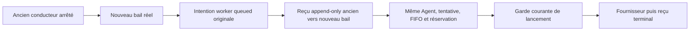

La requête d'adoption contient schema_version1, event_id, expected_revision et
agent_id, pas de permission fournie. Son replay exact sous le même bail est
idempotent ; payload modifié ou nouveau reçu sous le même epoch refuse. L'API
réserve les réglages et vérifie les données dans la transaction writer existante,
conserve les causes SQL/rollback/commit/close et ne lance aucun processus. Le
retour contient un Agent local privé ; la CLI publie seulement ses champs sûrs.
`mission-worker-adopted` JSONL observe le reçu, avec provider_start_verified=false
et mission_complete=false, avant le helper indépendant habituel.

[Recette224](../plans/migration-rust/evidence/20261022-g3-watch-restart/public224/result.json)
PASS, intégrité vérifiée : huit gardes ; huit appels API réels sur une Root
(refus revision périmée/pause/replay conflictuel/même epoch/bail arrêté, adoption,
replay et récupération) ; reprise sur une autre Root fraîche ; trois parcours W1
sur le même nouveau binaire. Les lignes SQL typées d'admission et réservation,
Agent/tentative/binding et FIFO sont comparés ; fournisseur fictif réellement
entré, survie après SIGINT, reçu natif et règlement unique sont vérifiés.
Les deux Roots évitent de confondre restauration des contrôles et rafraîchissement
du contexte : pause/unpause avance la révision du Work. L'échec223 et sa cause de
méthode sont conservés, sans retrait de garde ; le code interne exact du helper
n'a pas été capturé sur ce premier échec (stderr null).

[Profil normal219](../plans/migration-rust/evidence/20261022-g3-watch-restart/normal219/result.json),
SDK219/222 sur les mêmes sources moteur ;11 tests CLI218,4 tests moteur220,
Clippy et Rustdoc stricts passent. Les [sorties225](../plans/migration-rust/evidence/20261022-g3-watch-restart/retained225/result.json)
conservent65 fichiers223 et341 fichiers224, sans copie de bases Root.
[Plan et revue](../plans/migration-rust/evidence/20261022-g3-watch-restart/PLAN.md)
distinguent vérification locale et acceptation. Non vérifiés ici : reprises de
processus enregistrés, révocation concurrente au grant, contexte périmé à
réautoriser, rôles automatiques et serveur web. Aucun serveur installé remplacé,
aucune mission réelle ni acceptation globale ; voir aussi les limites W1 ci-dessus.

## Planification par watch — parcours W3 vérifié localement

Le candidat raccorde un `step_planning` foreground par passe du conducteur,
après observation des contrôles explicites (consentement activé, autonomie,
mission ni pausée ni archivée). L'autorité du planner reste son claim natif de
scope, comme dans le chemin Go ; le bail du conducteur n'est pas une autorisation
nouvelle transmise au private gate. Cette limite reste distincte du heartbeat.
Le résultat est projeté en `mission-planning-step` JSONL : scope/input/claim,
status idle/applied, settings_revision en chaîne décimale SettingCount,
work_revision entier, decision_applied et limites explicites. Aucun Work privé,
prompt ou sortie modèle brute n'est publié. Les effets Work connus suivent les
erreurs de dispatch, publication et cleanup ; aucun refus n'est converti en idle.

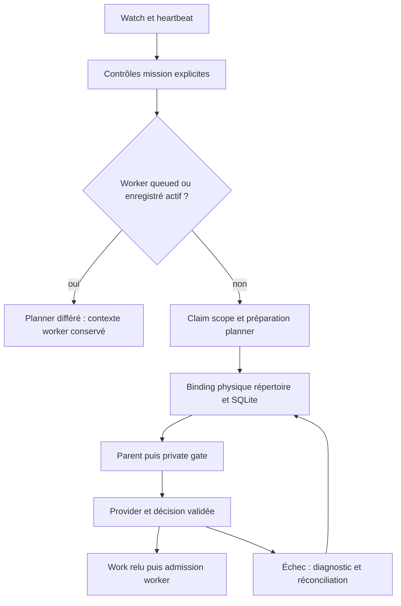

La préparation planner écrit une liaison normalisée immuable par claim dans
native_planning_run_bindings, sans modifier le schéma des anciens Runs. Un
RootBinding conserve les descripteurs répertoire et base O_PATH pendant le run
et la réconciliation. Parent, private gate et fence d'application comparent la
base réellement connectée et son association au répertoire. Le feedback vérifie
cette liaison avant publication du rapport et dans sa transaction : ce chemin
manquait au premier candidat228 (W3-R1), puis a été corrigé230. Une ancienne
preuve Applied sans liaison reste une lecture historique ; elle n'autorise aucun
nouveau grant. Les anciens échecs sans provenance ne sont pas adoptés silencieusement.
Ce contrôle local ne confine pas les écritures hostiles d'un processus de même UID.

État : compilation232, Clippy et Rustdoc stricts233 réussis ;25 tests Rust231
passent sur les fonctions ciblées avant deux simplifications de style CLI. La
[recette244](../plans/migration-rust/evidence/20261022-g3-watch-planning/public244/result.json)
passe16 gardes de preuve,12 gardes publiques partagées et le parcours sur trois
Roots isolées. Watch réalise les deux activations root/child, puis lance le
worker inerte jusqu’au reçu de fin, libération FIFO et réservation estimée.
La fin du processus ne valide pas la tâche. Une copie SQLite quiescente dans le
même répertoire est refusée sans mutation logique ni publication de diagnostic,
pour un reçu Applied et pour un échec sauvegardé. La restauration de l’inode
original permet replay historique ou règlement unique de l’échec, sans nouvel
appel fournisseur. Le témoin de règlement utilise une autre Root équivalente.
Les renommages de fixture gardent chaque fichier à un seul lien ; leurs échecs
et la reprise sont testés, sans affaiblir les contrôles du produit.
[Sorties237](../plans/migration-rust/evidence/20261022-g3-watch-planning/retained237/result.json)
conservent les tentatives234/235 et236 ; aucune copie de base Root n’est exportée.
Le binaire232 est identifié par son profil normal ; les notes/docs mises à jour
après sa construction ne sont pas supposées embarquées. Aucun serveur installé
remplacé ni acceptation globale ; la [revue indépendante](../plans/migration-rust/evidence/20261022-g3-watch-planning/HANDOFF-review.md) est favorable sur ce périmètre.
Le planner foreground peut retarder les signaux watch et n'offre pas le
parallélisme Go ; planning est différée tant qu'un worker automatique est actif
pour préserver sa préparation immuable. Ce sont des limites fonctionnelles du
candidat, pas de nouvelles politiques opérateur. Reviewer/validation automatiques,
processus déjà enregistrés, réautorisation des contextes et intégration web restent
ouverts. [Plan W3](../plans/migration-rust/evidence/20261022-g3-watch-planning/PLAN.md).

La [régression243](../plans/migration-rust/evidence/20261022-g3-watch-planning/public243/result.json)
passe8 gardes W2,8 contrôles API réels et reprise queued, puis3 parcours W1
pause/SIGINT/SIGTERM : cinq Roots fraîches. SDK241/242 sont liés aux mêmes204
entrées moteur que native232. Le validateur hérité accepte désormais seulement
les événements planner idle exacts ; applied et formes invalides restent refusés.
Le contre-exemple avant correction et la lacune sont conservés dans replan240
et HANDOFF-recipe. La [recette244](../plans/migration-rust/evidence/20261022-g3-watch-planning/public244/result.json)
rejoue W3 avec16+12 gardes et trois Roots fraîches ; les deux intégrités passent.
Les [sorties245](../plans/migration-rust/evidence/20261022-g3-watch-planning/retained245/result.json)
conservent341/215 fichiers sans base Root. Les preuves236/239 restent historiques
sur leur périmètre ; revue finale des octets et verdict indépendant dans le plan W3.

### Relais automatique d'un rapport terminé — contrat local vérifié
`mission watch` reprend aussi les workers terminés avant sa génération. Pour
un worker automatique courant, le moteur vérifie la provenance originale et le
reçu terminal, sélectionne un rapport non vide unique dans son workspace et
le soumet via `task.submit` sous le bail et le consentement actuels. Une tâche
soumise n'est pas acceptée. Rapport absent/périmé/ambigu : événement d'attente ;
IO ou preuve inconnue : refus avec cause. Un échec ultérieur conserve la révision
connue. Les écritures et le filesystem ne forment pas un snapshot atomique.
Dans Admin → Agents, `agent_report_clock_skew_seconds` règle la marge appliquée
au départ de la tentative : installation2secondes ;0exige mtime au départ ou
après. Une plus grande marge admet des rapports plus anciens. Absence historique
refusée jusqu'à adoption explicite, aucun lien avec les fenêtres d'affichage.
La pause du planificateur diffère de la pause mission ; elle empêche son activation
sans annuler un handoff déjà soumis. Source/proof : revue601, recette598,
profil597. Contrôles/reviewer automatiques raccordés dans les tranches659/702 ci-dessous ; parallélisme global encore ouvert.

## Suite automatique après handoff —659
Le conducteur relaye le rapport puis exécute ses contrôles enregistrés sous bail
et consentement revérifiés ; le private gate conserve parent/Root/source. Le
receipt requiert encore une revue et n'accepte pas la tâche. Les contrôles sont
drainés avant le prochain pass planner, sans limite par session. Le heartbeat
reste dans son thread existant. Le rejeu terminal relit sans nouvelle permission
ni process. Une révocation publique pendant un vrai contrôle déclenche TERM et
conserve wait, claim et observations durables sans PASS. Preuves657/658/profil643
dans [revue659](../plans/migration-rust/evidence/20261023-g1-status-contract/decision659/result.json).
Reviewer automatique raccordé et vérifié702 ci-dessous ; annulation SIGINT foreground, reprise complète et web restent ouverts.

### Reviewer automatique — parcours local vérifié702
`mission watch` conduit planner → worker automatique → rapport canonique →
contrôles natifs → reviewer natif. Le claim et la permission reviewer exigent le
bail réellement possédé et le consentement courant, avec liaison normalisée
`native_mission_review_bindings` distincte des contrôles. Le budget reviewer de
mission existant réserve et compte dans le même writer ; aucune remise à zéro.
Le gate privé et le poll vérifient parent, epoch, Root physique, producteur et
consentement. Le hash de source automatique inclut la liaison ; les jobs manuels
conservent leur domaine. Supprimer la liaison ne transforme pas un job en manuel.
Un résultat de même tentative n'est pas relancé automatiquement ; un état running
exige une réconciliation. La sélection de contrôles laisse le cycle de revue
posséder une tâche déjà en revue. Les receipts sont publiés avant le prochain
pass planner ; le heartbeat existant reste dans son thread indépendant.
Le rejeu public de l'intention originale après sortie du conducteur relit le
verdict sans nouveau bail, appel ou financement. Il n'accepte aucune tâche.
Les diagnostics conservent les motifs statiques du décodeur sans contenu privé ;
Root expose la plus grande révision explicitement enregistrée pour la première
identité Work connue, pas une garantie de révision courante ou de rollback.
[Preuves702](../plans/migration-rust/evidence/20261024-g3-auto-review/decision702/result.json) :
profil693 sans fixture ; parcours complet/rejeu, refus réel de citation absente,
rapport non resoumis après échec contrôle, révocation publique avec wait/TERM ;
six parcours manuels de contrôle et sept de reviewer, dont erreurs/reprise.
Les contre-exemples690 échouent avant correction692 puis passent ;19tests de
traversée des causes et9CLI passent, avec Clippy/Rustdoc stricts.
Limites : origine automatique du worker seulement pour la revue automatique ;
parité des producteurs manuels, consentement du planner en cours, annulation
SIGINT pendant un appel foreground, registered/managed/recovery/web complets,
concurrence Go et revue indépendante globale restent ouverts. Pas d'acceptation
mission automatique ni d'installation ; G3 et la migration entière restent ouverts.

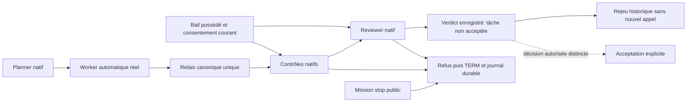

#### Refus complémentaires vérifiés709
La recette `mission-reviewer-revocation` tient le vrai reviewer après permission :
un témoin libéré fournit une revue favorable, puis une Root fraîche est stoppée
publiquement pendant la même attente. Le moteur termine le reviewer (TERM15),
retient wait/grant/channel fermé et réponse incomplète dans le journal, garde
claim et financement sans verdict favorable ni acceptation. Pas de garantie
d'annulation immédiate : le poll existant peut attendre les IO/politiques sauvées.
`mission-planner-reconsent` vérifie qu'un planner déjà permis ne peut appliquer
son ancienne décision après stop puis nouveau start : refus réel `stale_lease`.
Stop puis simple resume refuse déjà `mission-consent-required` ; aucun correctif
n'était nécessaire pour ces cas. Cela ne prouve pas tous les chemins/races de
consentement. La recette de citation absente compare maintenant `original_reply`
du journal à la réponse fixture effectivement émise, sans l'afficher en public.
[Preuves709](../plans/migration-rust/evidence/20261024-g3-auto-review/decision709/result.json),
recettes705/707/708 sur693,3étapes chacune avec intégrité. SIGINT pendant un
appel foreground reste distinct et non qualifié ; parité asynchrone Go encore ouverte.

#### Lecture et acceptation explicite après reviewer automatique —711
Le même vrai parcours watch est consommé par `mission status` : avant action,
la revue favorable reste « à revoir », aucune tâche acceptée. Une opération
`task update` explicite dans la fixture vérifie les preuves natives et rend le
statut validé. Modifier son rapport réel rend la validation périmée ; restaurer
exactement les octets rend le statut validé. Les lectures ne modifient ni base
logique/physique, ni consommation, ni invocation reviewer. Recette permanente
`mission-auto-review-acceptance`,711PASS3étapes et intégrité sur693 ; ce n'est
ni une authentification humaine, ni une acceptation automatique de mission.

#### Producteur manuel — revue automatique locale vérifiée730
Un worker lancé manuellement peut maintenant être le producteur d'une revue
automatique, après rapport soumis et contrôles natifs valides. Le nouveau
reviewer exige toujours le vrai bail possédé, le mode automatique, le consentement
courant et sa propre liaison d'epoch/source. L'origine manuelle du producteur
n'accorde aucun droit au reviewer. Le writer de permission du worker conserve
`native_agent_execution_origins` : directory et SQLite effectivement connectée.
Le gate enfant exige cette provenance, puis le lecteur du producteur vérifie
aussi tentative courante et receipt terminal original complet. Ni Actor ni
AgentExecutionSnapshot ne change ; aucun journal ancien n'est enrichi après coup.
Absence legacy refuse ce nouveau chemin, sans adoption de la Root actuelle.
Le relais du rapport et le premier contrôle automatique d'un producteur manuel
ne sont pas établis par ce scénario : le rapport est soumis et les contrôles
sont exécutés explicitement avant watch. La suite doit lever cette limite.
[Preuves730](../plans/migration-rust/evidence/20261024-g3-auto-review/decision730/result.json) :
716refus avant correction ;729vrai manuel→revueauto puis Root fraîche copiée
octet pour octet dans le même répertoire vers un autre inode SQLite : refus
`agent-origin-instance-changed` avant claim/reviewer/débit, Work et financement
conservés, deux fichiers retenus et original restauré.725/726confirment les
refus/rejeux/révocations d'origine automatique ;727six contrôles et728sept
reviewers manuels passent sur profil722 sans fixture.3guards metadata,
Clippy/Rustdoc stricts.718compile privée/724assertion de table optionnelle
restent conservées ;721/729 corrigent les préconditions, pas les protections.
La compilation, les recettes et la revue Root bornée ne constituent pas une
acceptation indépendante globale ; SIGINT/async/registered/managed/web et
R6/R7/RETEX restent ouverts. Rien installé ou publié.

#### Premiers contrôles et revue du producteur manuel — vérifiés743
Après lancement manuel natif et soumission explicite du rapport, `mission watch`
exécute maintenant les premiers contrôles puis le reviewer sans `task validate`
manuel. `mission_producer::completed` partage la vérification de la tentative, du
receipt terminal et de la provenance physique originale. Le relais de rapport
reste réservé aux workers automatiques ; contrôles et reviewer acceptent aussi
un worker manuel natif vérifié. Ce choix est un contrat interne d'opération,
aucun flag public ne choisit des droits. Les writers gardent leur vrai bail,
époque, consentement et budget ; les sources privées revérifient leur fraîcheur.
[Preuves743](../plans/migration-rust/evidence/20261024-g3-auto-review/decision743/result.json) :
731refuse avant correction ;739parcours manuel→rapport→contrôles auto→reviewer
avec ordre, receipt lié au vrai producteur/rapport, aucun validate manuel.
La copie identique du SQLite vers un autre inode dans le même répertoire refuse
avant claim de contrôle/revue et débit. La supervision du conducteur acquiert et
libère normalement son propre bail : seule l'absence d'effets Work/financement/
provider est affirmée, pas l'absence de toute écriture SQLite. Les deux fichiers
sont retenus et l'original restauré.740/741/742confirment refus/reprise/
révocation des parcours automatiques sur737 sans fixture.155tests de la famille
mission passent,2guards runtime-policy ciblés, Clippy/Rustdoc stricts. Un test
ledger spécialisé reste ignoré faute de fixture, donc pas de suite complète
revendiquée. Les6/7parcours manuels727/728 restent sur722 avec leur portée propre.
Le rapport du worker manuel est toujours soumis explicitement. Asynchronisme,
SIGINT foreground, registered/managed/web complets, R6/R7 et acceptation globale
restent ouverts ; aucun déploiement ni installation.

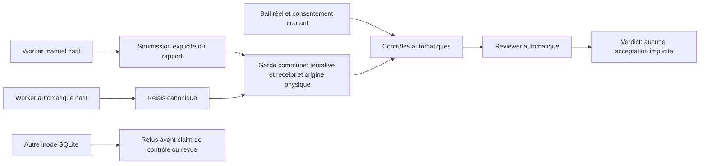

### Reprise du conducteur en observation d’un worker enregistré

Le nouveau `mission watch` peut observer une intention enregistrée, même si
l’ancien conducteur a quitté et si aucun handle enfant n’appartient au nouveau.
Le planner reste différé pendant ce contexte actif ; l’admission et les ressources
restent contrôlées par le moteur. Aucune adoption de processus, relance, annulation
ou attente de ce worker n’est accordée par cette observation. L’état enregistré
seul ne prouve pas la vivacité : la recette utilise un peer et des handles noyau.

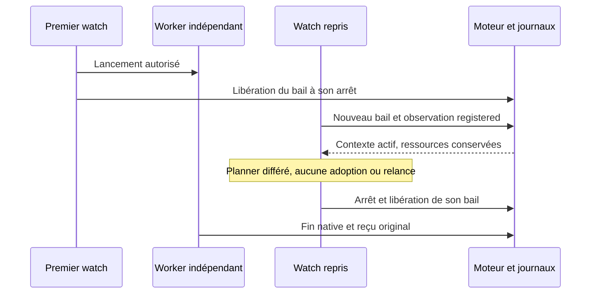

La recette permanente `mission-watch-registered-observer.json` vérifie ce parcours
et le nettoyage après refus de spool/pidfd, sur une fixture possédée et sans
fournisseur payant. Le compteur `children_still_running` concerne les enfants
lancés par ce watch ; les agents enregistrés se consultent séparément. Cela ne
clôt ni récupération de processus incohérents, ni ordonnanceur asynchrone complet,
ni intégration web, ni acceptation globale. Rien n’est installé.

### Rôles indépendants de la boucle de conduite — état historique1072

Contrôles, reviewer et planner utilisent un job scoped à la fois, sous Root peer
et bail réel. Le main continue observation/dispatch et publie après join ; arrêt
et causes sont conservés avant libération du bail. Le report pour worker actif
est observé indépendamment de la phase. Voir le schéma courant dans
[Rust migration](RUST-MIGRATION.md). Qualification locale1072 vérifiée ; ni concurrence
Go complète, ni intégration web ou installation déclarées.

### Rôles concurrents — candidat28octobre

La phase unique ci-dessus est remplacée dans le candidat par trois familles possédées : contrôles, reviewer et planner. Chaque famille conserve son handle jusqu’à jointure ; seuls le main et sa cadence persistée publient les résultats. Le planner attend la libération des contextes workers actifs et respecte provider/pause/échec sauvegardés. Les writers moteur, baux, consentements et budgets gardent leur validation propre. Les trois identités sont le protocole existant, pas un nouveau plafond opérateur.

Six tests ciblés passent, dont barrière à trois threads, panne/panique avec sorties des autres tâches conservées et interruptions propres classées séparément. Ces rapports synthétiques ne prouvent pas un arrêt OS ni une concurrence de fournisseurs. Parcours public, profil normal et installation du candidat restent à vérifier ; aucune clôture globale.

Deux conflits restent distingués : avant claim, une garde de révision plus récente
impose une nouvelle observation, sans fournisseur. Après claim, seule une porte
native refusant le contexte périmé AVANT exec peut être observée comme stale,
après reçu, consommation, feedback et fermeture réussis. Le refus reste une erreur
pour la commande manuelle. Watch publie le claim conservé et ne transforme pas
cette observation en permission. La prochaine activation doit satisfaire ses
gardes et budgets ; aucun remboursement ni masquage des autres erreurs.

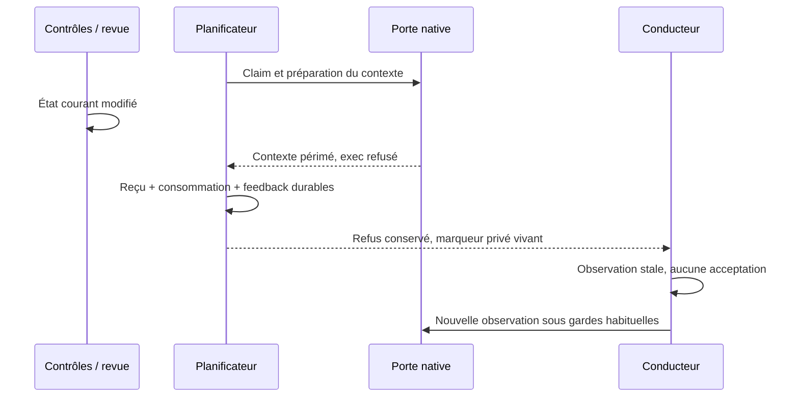

Ce parcours reste candidat tant que sa recette publique n’est pas vérifiée.
Une fermeture/écriture incertaine, une autre porte refusée ou un fournisseur
exécuté restent des erreurs bloquantes, même si un arrêt local arrive en parallèle.

### Aides cockpit historiques — préparation vérifiée, raccordement ouvert

Trois projections internes sont compilées et couvertes par28tests : santé3,
actions10, sources après livraison15. Elles consomment des observations fournies,
ne lisent pas le stockage et n’accordent ni identité, lancement, fraîcheur ou
acceptation. La liste des actions exige notamment la vraie raison de dépendance
non satisfaite ; une dépendance déclarée peut être fraîche. Les sources après
livraison conservent l’ordre des tâches et la sérialisation Go du contrat, avec
une erreur explicite si une observation de fraîcheur manque.

`agent list` n’est pas encore raccordé : fenêtre d’agents, données SQL, réglages,
preuves de revue et préparations doivent être assemblés avec leur vrai producteur.
Les producteurs natifs de coûts, Work et validation existent déjà et doivent être
réutilisés. Ces28tests ne prouvent ni le cockpit complet, ni son oracle Go, ni une
installation. L’absence de mode sauvegardé reste distincte d’une autorisation ;
la valeur initiale configurable fait l’objet d’une décision utilisateur en attente.
