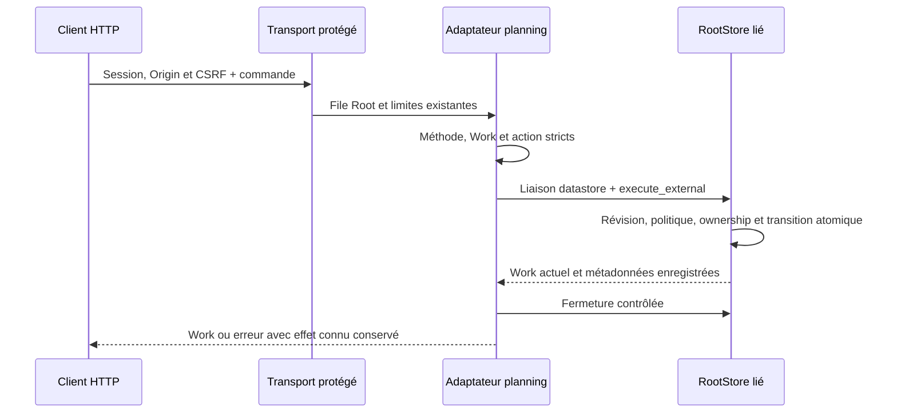

# API HTTP native de planification

Le lot179 porte le chemin consommé par l’ancienne interface : `/api/v1/planning?work=ID&action=ACTION`. Le serveur Rust normal utilise le même RootStore que la CLI ; aucune délégation, modèle ou acceptation humaine ne découle de cet adaptateur. Le serveur installé n’est pas changé par ces vérifications locales.

## Lecture et commandes

`GET` ou `HEAD /api/v1/planning?work=ID` lit le Work complet réel, avec planification ; `action=show` est aussi accepté. HEAD garde le statut mais n’envoie pas le corps. Les autres méthodes sont refusées avec Allow `GET, HEAD, POST`.

`POST` exige un `action` explicite parmi `enable`, `claim`, `lease-renew`, `decide`, `judge`, `renew`, `pause`, `resume`. Le corps est le PlanningRequest natif strict, avec schéma, event_id et révisions réelles attendues par l’action. Exemple après lecture du scope racine :

```http
POST /api/v1/planning?work=w-example&action=judge
Content-Type: application/json
X-Swarm-CSRF: TOKEN_RECU
Cookie: COOKIE_DE_LA_SESSION
```

```json
{"schema_version":1,"event_id":"operator-cycle-1","expected_revision":12,"scope":"root","scope_revision":3,"judge_cycle":1,"judge_verdict":"continue","reason":"Poursuivre le besoin ouvert"}
```

Les identifiants, révisions et jetons de cet exemple sont des emplacements à remplacer, pas des droits ou valeurs par défaut. Le client respecte aussi l’Origin et le Host attendus. `/api/v1/native-capabilities` annonce `planning` avec neuf entrées, dont `show`. Cette liste décrit le routage implémenté ; chaque demande reste soumise aux préconditions, au profil natif et aux preuves propres à sa mission.

`judge` et `renew` conservent les entrées en attente et les consommations ; `lease-renew` prolonge le claim courant ; `decide` exige la vraie liaison de lease et les événements reçus. Voir [le contrat des cycles](NATIVE-GLOBAL-JUDGE.md). `enable` observe le catalogue effectif du serveur, comme la CLI ; un modèle non annoncé est refusé. Les autres commandes gardent leurs validations moteur et ne lancent pas de processus depuis cette route.

## Protection, erreurs et reprise

Host/session/Origin/CSRF sont contrôlés avant l’accès Root. La limite de transport et la file Root existantes s’appliquent, sans nouvelle politique locale. La liaison au datastore ouvert au démarrage est revérifiée avant lecture ou mutation. Le moteur garde schémas, source, mission, révisions, propriétaire physique/logique, quotas et politiques persistantes. Déclarer un holder, acteur ou référence ne prouve pas une identité authentifiée.

L’URL exige un Work sûr, sans doublon, clé étrangère ni action vide. Un GET avec une action spécialisée non portée ne retourne pas un Work comme faux aperçu. `step`, `run`, les opérations managed et leurs previews restent explicitement non portés sur cette route. Cette admission est volontairement plus stricte que le Go sur les doublons de query et les actions GET inconnues ; aucun client ne doit dépendre d’un premier doublon ou d’un fallback de lecture.

| Réponse | Effet vérifié ou contrat |
| --- | --- |
| 200 | Work encodé réel ; un rejeu identique conserve l’état courant sans nouvelle transition |
| 400 | Query/corps invalide ou refus métier, sans mutation dans les cas testés |
| 403 | Accès/session/CSRF refusé avant Root |
| 409 | Révision ou autre conflit explicitement classé par le service |
| 501 | Action/aperçu non porté ; aucune réussite vide |

Les causes originales restent typées côté serveur et dans son flux d’observation sûr. Si une commande a été enregistrée avant un échec d’encodage/fermeture/sortie, ses métadonnées Work/révision sont conservées par le chemin commun ; l’absence de réponse ne signifie pas rollback. Relire l’état puis réutiliser le même événement pour un rejeu explicite, sans rembourser ni recréer de claim. Le test générique EPIPE13 vérifie le chemin commun après commit ; aucun échec d’encode/close spécifique de cette nouvelle route n’a été injecté.



## Preuves et limites

Source02, profil normal11 SHA `0c8141d4a3b1855c9221721902da185d521098495ab9cad1c0a95cc4ac6cd0c6` :276 entrées effectives archivées, aucune feature de fixture. Quality09 :18tests ciblés nommés, Clippy strict et Rustdoc privé. HTTP14 : vraie session, lecture/HEAD, annonce des capacités, huit commandes, seize refus ciblés, événements canoniques/Work/finance préservés, histoire longue lisible sous politique abaissée et rejeu sans transition. Driver13 : héritage d’environnement par défaut, EPIPE après commit et reprise explicite. Les premiers défauts de recette et refus de catalogue restent dans les preuves originales.

Recette permanente : `tools/verification/recipes/native-planning-http.json`. Les étapes finales sont exercées séparément sur le binaire figé ; le manifeste est validé sans revendiquer son exécution globale sur le checkout concurrent. Le helper serveur de recette accepte un environnement explicite optionnel pour le catalogue isolé ; il ne sérialise jamais les variables ou secrets. Aucun watchdog global. Ces preuves n’établissent ni UX navigateur complète, identité humaine, autonomie, isolation hostile même UID, installation, fin managed, restauration de données ou bascule globale.
