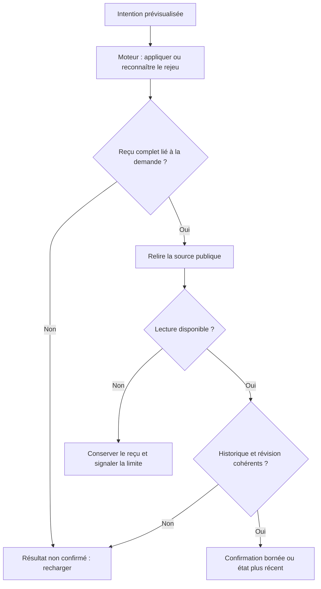

# Confirmation des politiques dans les clients natifs

Le moteur reste propriétaire de la validation et de l’écriture. Le client confirme une action seulement après vérification du reçu et de sa présence dans la relecture effective. Un HTTP200, un booléen applied ou des valeurs déjà identiques ne prouvent pas un nouvel enregistrement.

Le module partagé web/native-policy-receipt.js distingue les fichiers compatibles (attentes navigateur/fournisseur et futurs objectifs de graphe) des portées SQL des limites d’exécution. Il rapproche le reçu de l’intention prévisualisée, du token de fraîcheur, de la révision et des valeurs résolues. Pour les fichiers, le changement original est recherché dans l’historique ; à révision égale, l’empreinte de source doit correspondre au reçu. Pour SQL, la ligne d’historique et ses données enregistrées sont rapprochées de l’entrée retournée, y compris un retour à une révision. Les valeurs exactes sont des chaînes décimales pour éviter l’arrondi JavaScript. Les champs omis uniquement par omitempty gardent leur sens de protocole, jamais un défaut opérateur.

Une révision plus récente est admise si l’enregistrement attendu est toujours présent. Un rejeu ne devient pas une nouvelle application. Acteur, date et motif restent des données comparées ; ce contrôle n’authentifie personne et ne donne ni droits ni autorité de clôture métier au client.

Les états restent distincts : reçu mal formé ou non corrélé → résultat inconnu et rechargement ; reçu valide puis transport de relecture indisponible → reçu conservé, aucune nouvelle confirmation ; relecture réussie mais contradictoire → alerte, aucun succès vert. Il n’y a ni nouvelle politique de délai ni réessai automatique. L’historique demeure dans le moteur ; aucun client ne modifie une base directement.

Incident et preuves : docs/plans/migration-rust/evidence/20261027-web-request-policy-jnok5wvr/REPLAN-SHARED-RECEIPTS.md. Le contre-exemple182 emploie une réponse de test non transmise au moteur : fichier inchangé, faux succès visible. La correction et sa vérification distribuée restent suivies dans le lot courant. Cela ne qualifie pas toutes les autres familles de reçus de Swarm. Les pages déjà chargées doivent recevoir les nouveaux fichiers lors d’un rechargement ; les contextes agents embarqués sont indépendants.

La comparaison des motifs applique la représentation JSON Go : un surrogate UTF16 isolé devient U+FFFD, sans traduction ni retrait d’espaces. Les chaînes valides restent inchangées ; ce n’est pas une règle métier de motif.

