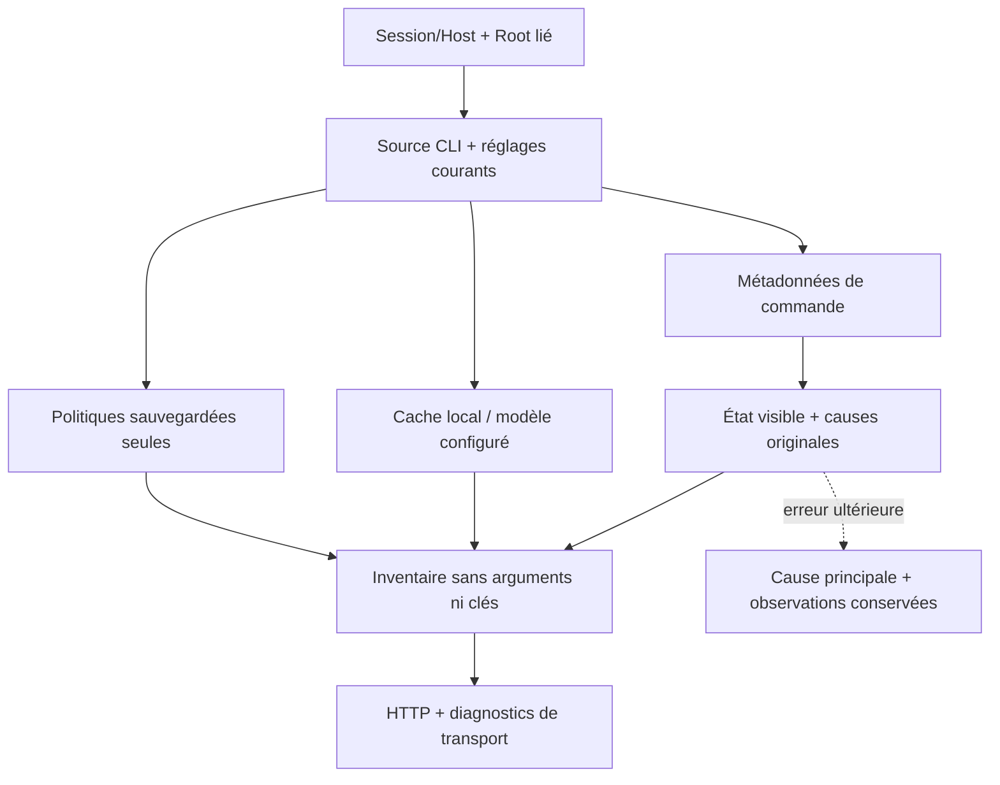

# Inventaire natif des fournisseurs CLI

`GET/HEAD /api/v1/providers/admin` expose l’inventaire CLI de l’opérateur local authentifié : empreinte d’une même source, fournisseurs, politiques réellement enregistrées, options de modèles déclarées et métadonnées de commande. Les champs Go `version`, `digest`, `providers`, `export`, `scope` sont conservés. Le chemin de commande est une donnée Admin intentionnelle ; arguments, environnement et clés ne sont pas exportés.

Aucune politique ni liste de modèles fournisseur n’est inventée. Une politique absente reste `null`, `saved:false` ; l’export contient seulement les politiques présentes. Les options Codex viennent du cache local visible et compatible avec le format v1, sous le même plafond de fichier et environnement effectif que le résolveur. Les mêmes identifiants regroupent leurs efforts déclarés comme la sélection runtime qui accepte une annonce correspondante. Le modèle déjà configuré dans les arguments peut aussi figurer comme déclaration non authentifiée. Aucun accès compte, effort effectif ou identité de modèle n’est établi.

Un fichier de commande absent, relatif, non régulier ou sans bit d’exécution est signalé dans sa ligne. Les bits observés ne prouvent ni ACL, ni exécution ou confinement. L’indisponibilité de l’adaptateur de préparation sans outils est distincte : une commande CLI personnalisée peut être exécutable et ne pas posséder cet adaptateur. Aucun programme, appel IA ou sonde n’est lancé au chargement.

Les causes originales de ces observations partielles suivent le DTO jusqu’aux diagnostics de transport. Si lecture, encodage ou fermeture échoue ensuite, elles restent jointes à la cause principale. Un catalogue/fichier malformé ou une politique stockée de forme invalide provoque une erreur serveur, jamais un catalogue vide réussi. Les requêtes avec corps, paramètres inattendus ou méthode incorrecte sont refusées ; les erreurs visibles et leur reprise sont couvertes par la recette `provider-admin-http-rust`.

Cet inventaire CLI ne remplace pas la [résolution effective](NATIVE-PROVIDER-RESOLUTION.md) et sa vérification des catalogues CLI/API. La [politique](NATIVE-PROVIDER-POLICIES.md) s’enregistre par aperçu/digest/token. Les connexions API, appels d’assistance et leur interface native complète restent des surfaces distinctes du plan.

Les champs de formulaire partagés conservent une valeur sauvegardée absente du catalogue comme option explicitement signalée « Valeur enregistrée hors de la liste ». Une valeur vide reste un choix vide ; les booléens et nombres sont comparés selon leur représentation DOM. Rafraîchir la liste ne remplace pas ces valeurs ; seul un choix explicite les modifie. La validation du moteur reste obligatoire : conserver une déclaration ne l’autorise pas. Les sélecteurs de navigation gardent leur contrat distinct. La recette `form-select-preservation-ui` exerce les fonctions réelles des sources historiques, traductions, clavier et thèmes. Ces fonctions et providers.js ne sont pas embarqués dans le serveur Rust actuel : le raccordement UI reste ouvert. Cette fixture de composant ne prouve ni une UX native installée ni le cockpit complet.

