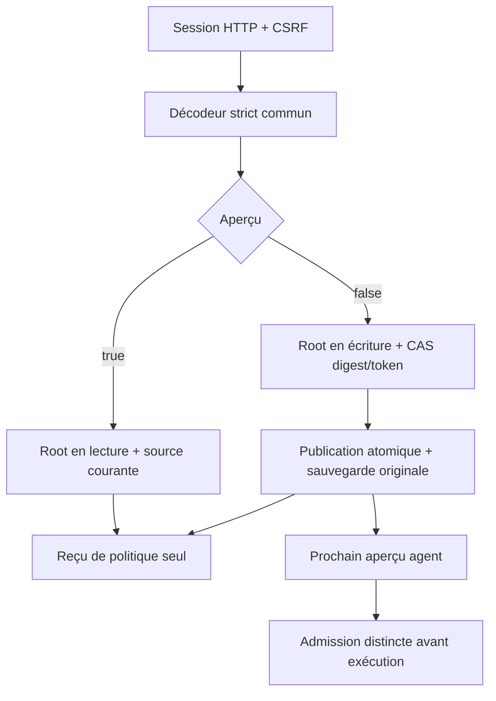

# API native des politiques fournisseurs

Le raccord `GET/HEAD/POST /api/v1/providers/policies` utilise le même décodeur et les mêmes opérations Root que `providers policies export|preview|apply`. La lecture renvoie `version`, `digest`, `policies` depuis une seule source vérifiée. L’export CLI portable conserve seulement `version` et `policies`. Les commandes, variables et secrets fournisseurs ne sont pas exposés.

POST accepte `version:1`, `expected_digest`, `policies`, `preview` et, pour appliquer, `preview_token` issu de la prévisualisation courante. Le format hérité conserve null, casse et fusion des clés du décodeur Go. Les niveaux simple/standard/exigeant sont les valeurs du protocole ; aucun plafond de 32 fournisseurs ou 65 536 octets n’est ajouté. Les limites de transport et fichier existantes restent applicables. Chaque politique conserve ses modèles/niveaux explicites ; aucune valeur modèle n’est inventée.

La session HTTP et le CSRF protègent l’entrée. Root contrôle son instance, les réglages persistés, le catalogue local non authentifié, le digest et le token. L’aperçu ne crée ni sauvegarde ni réservation. L’application utilise le publisher atomique existant et conserve l’original en sauvegarde. Elle ne lance aucun fournisseur, ne modifie aucun Work et ne reprend aucune mission. Le prochain aperçu d’agent consomme les nouveaux choix ; son admission reste distincte.

Entrée mal formée : 400 ; digest ou token périmé : 409 ; méthode interdite : 405 ; source stockée corrompue ou lecture/fermeture défaillante :erreur serveur. Les causes et publications connues/incertaines traversent la fermeture et l’encodage. Relire après toute issue incertaine ; ne pas répéter aveuglément une écriture. GET refuse une politique implicite ou un export vide plutôt que masquer la migration restante.

Cette tranche ne porte pas encore `/providers/admin`, les connexions API, leur résolution ou le formulaire fournisseurs complet. État et preuves d’exécution sont conservés dans le plan de migration ; cette page décrit le contrat du raccord, pas son acceptation globale.

Une application sans changement confirme aussi la synchronisation du fichier existant. Les adaptateurs CLI de configuration/politiques et HTTP de politiques conservent cette connaissance (`configuration_may_be_recorded:true`) après une sortie ou fermeture en erreur et dans l’observation native. Cela ne prétend ni nouveaux octets, ni nouveau snapshot ou nouvelle acceptation ; `changed:false` reste inchangé. La recette `configuration-noop-state-rust` vérifie les deux stdout fermés et l’observation HTTP, avec source, références de snapshots, travaux et réservations inchangés.

