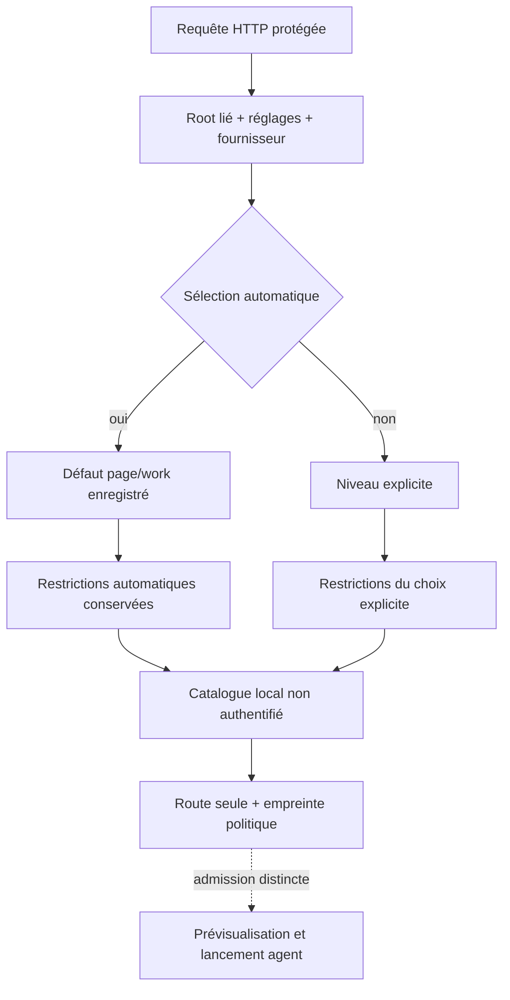

# Résolution native des modèles fournisseurs

`GET/HEAD /api/v1/providers/resolve?provider=IDENTIFIANT&purpose=USAGE` renvoie `{"route": ...}` depuis la configuration CLI et les restrictions Admin courantes. `level` est optionnel ; absent, vide ou `auto` conserve la sélection automatique. Les usages hérités sont `work`, `page`, `brainstorm`, `preparation`, `planning`. Une page choisit `page_level`, les autres usages `work_level`. Aucun nom de modèle par défaut n’est inventé.

Le résolveur commun conserve le caractère automatique pour vérifier les niveaux automatiques autorisés. Un niveau choisi explicitement passe par ses propres restrictions, sans montée en gamme ni repli. Le chemin historique des agents reste lié à l’usage `work`, avec la même représentation des avis, des modèles et de leurs sources. Le catalogue local est une déclaration non authentifiée ; un résultat ne prouve ni disponibilité du compte, ni modèle réellement exécuté, ni permission de lancement.

La lecture protégée vérifie session/Host et instance Root, puis lit réglages, fournisseur et catalogue sous réservation de lecture. Elle n’expose ni commande, arguments ou environnement, ni secret ; elle ne crée aucun Agent, réservation de coût ou processus, et ne modifie aucun Work. Refuser les contextes non vérifiés pour l’exécution n’interdit pas la simple consultation de métadonnées ; l’admission d’un agent reste séparée.

Une route nulle est réservée à un fournisseur CLI personnalisé déjà enregistré et sans politique de modèle. Un fournisseur inconnu, une requête invalide ou une sélection refusée ne devient jamais un succès vide. Champs inconnus/dupliqués, corps non vide et mauvaises sélections sont refusés ; les identifiants/niveaux/usages utilisent le vocabulaire ASCII partagé du moteur. Une politique stockée implicite pour un adaptateur connu, un fichier ou catalogue corrompu, une erreur IO ou de fermeture restent des erreurs serveur. Le raccord des connexions API renvoie explicitement non porté. Restaurer la source puis relire, sans lancer de fournisseur ni contourner les règles.

Cette tranche porte la résolution et le raccord de politiques documenté dans [l’API des politiques](NATIVE-PROVIDER-POLICIES.md). Le formulaire Admin fournisseurs complet et les connexions API restent ouverts dans le plan. Les preuves et l’état de livraison sont distincts du présent contrat.

La sélection réutilise le lecteur commun des catalogues CLI/API : une connexion active et une entrée CLI partageant `api-IDENTIFIANT` constituent un conflit de source, même pour la lecture d’un autre fournisseur. Une entrée API désactivée ne masque pas le fournisseur CLI. Un fournisseur API actif sélectionné reste explicitement non porté ; aucune redirection silencieuse vers un CLI.

