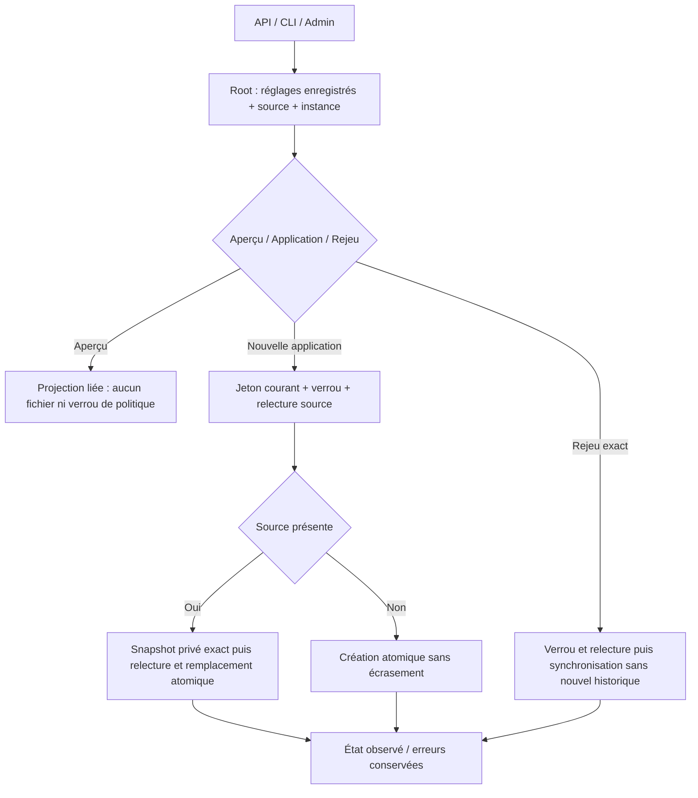
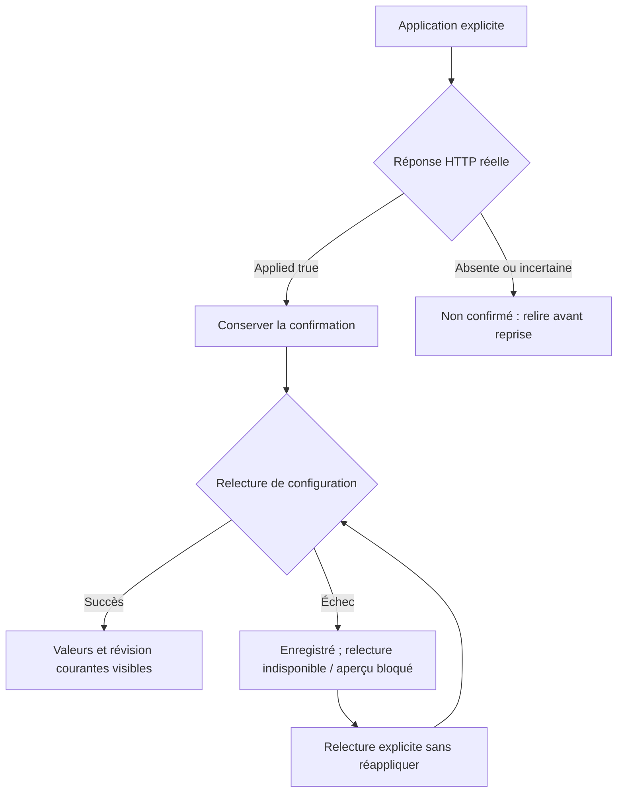

# Compatibilité native des réglages d’attente

Politique compatible et Admin native installées et vérifiées sur163. Douze groupes API/CLI et quatre parcours navigateur passent, dont la confirmation conservée après panne de relecture et sa reprise. Le test HTTP des connexions API reste à porter ; ces réglages conservés ne sont pas la politique des appels natifs de préparation.

Le fichier Go provider-wait.json, schéma1, reste distinct et compatible. La lecture conserve sa révision et son historique et distingue le fichier enregistré des valeurs versionnées réelles de config/provider-wait.json. Les réglages natifs du planificateur CLI structuré restent séparés ; aucun historique fusionné ni équivalence n’est inventé.

Silence et durée maximale sont deux délais indépendants : zéro désactive le délai concerné. Le bail contrôle la propriété, jamais la durée totale d’un appel. Les nouveaux baux suivent les bornes enregistrées des actions de planification natives ; les baux historiques positifs restent historiques après modification des bornes. La représentation Go des durées limite les secondes entières à i64::MAX / 1e9. Les plafonds opérateur Go sur motifs/historique/baux ne sont pas recopiés ; la politique courante de taille des configurations fournisseur régit le fichier enregistré.

GET/HEAD /api/v1/provider-wait, POST /preview et /apply ; CLI run-limits provider-wait show|history|preview|apply. La prévisualisation ne crée ni verrou de politique, ni fichier, ni snapshot. Une nouvelle application exige un aperçu courant lié aux octets source, à l’instance Root, aux réglages et au Change original ; l’horodatage de commit en est exclu. Le jeton natif n’est jamais enregistré dans l’historique Go. L’acteur reste vide/non authentifié pour les nouvelles lignes natives ; les dates sont des observations locales du moteur, sans autorité d’acceptation.

La répétition exacte d’un événement synchronise le fichier courant, renvoie la configuration courante et n’ajoute ni ne rétablit une ancienne révision. Une réutilisation différente ou une révision périmée refuse. La publication utilise le verrou Go contrôlé, un snapshot privé exact lors d’un remplacement, une création atomique sans écrasement puis un remplacement atomique. Un snapshot peut survivre à un refus ultérieur ; sa présence ne prouve pas l’application. Une publication visible/incertaine ou une erreur tardive exige une relecture ; l’état structuré traverse les sorties et nettoyages CLI/HTTP. Ces opérations ne lancent aucun fournisseur, Work, budget ni agent.

L’intégration Admin native doit exposer source, unités, sens de zéro, bornes du bail, historique et dialogue explicite de prévisualisation/application. Les projections décimales exactes dérivent de la configuration typée ; aucune seconde source persistée. La vérification de l’interface et l’installation restent ouvertes dans le plan de preuves.

Une confirmation positive d’application reste acquise si la lecture suivante échoue. Le dialogue doit conserver cette information, interdire les aperçus périmés et proposer une relecture explicite. La régression navigateur simule cette panne réseau côté client après un POST réel ; elle n’injecte pas de panne de stockage. Les motifs utilisateur sont affichés littéralement, jamais traduits avec les libellés.

## Lecture des historiques Go, correction courante

La comparaison Go/Rust exécutée a révélé un rejet natif supplémentaire pour un historique accepté par Go contenant Change nul. Les lignes enregistrées suivent désormais les contrôles de lecture Go : schéma, longueur historique/révision, ordre des lignes, validité des valeurs de ligne/courantes et égalité courant/dernière ligne. Les métadonnées Change/acteur/date restent typées et non authentifiées ; Change absent/nul/incohérent ou des identifiants d’événement répétés n’invalident pas un fichier autrement lisible. Les nouvelles demandes restent strictement validées. Le rejeu compare exactement le premier événement correspondant ; une demande différente refuse, même si un doublon ultérieur correspondrait. Ces métadonnées n’accordent aucun droit ni preuve d’autorisation passée.

Treize scénarios différentiels exécutés passent sur le candidat167 : import, champs nuls/casse/doublons, lecture/refus, premier rejeu et ajout après métadonnées historiques. Seules les observations acteur/date de nouvelle ligne et les projections natives source/aperçu ont des exceptions de comparaison limitées et explicites. Les douze groupes publics natifs et neuf régressions d’enregistrement de connexion passent aussi ; revue de correction conservée, installation169 vérifiée par douze assertions de binaire/API/ressources et quatorze contrôles du dialogue Version FR/EN. Aucune parité Go globale n’en découle. Des baux opérateur natifs hors anciennes bornes Go peuvent empêcher une reprise par l’ancien lecteur ; R6/R7 doit contrôler l’historique et conserver les originaux, jamais le tronquer pour fabriquer une compatibilité.
