# Reviewer natif Rust : contrat actuel

Les preuves natives décrites ici ciblent Linux ; aucune équivalence entre
plateformes n’est établie.

## Périmètre réellement disponible

Les aperçus, le contrôleur reviewer, le lecteur de contexte, la publication et
la réconciliation sont compilés dans le profil Rust normal depuis le lot162.
`task review` exécute le fournisseur configuré via le helper privé du même
binaire ; les tests utilisent exclusivement des programmes inertes locaux.
Les routes Web de lancement reviewer restent à porter. Le planner natif peut
agir depuis une revue passed courante vérifiée (lot165), clore des périmètres
natifs sous les preuves du lot166, et reprendre la même tâche depuis une demande
de correction native courante (lot168). Le conducteur global, les autres routes
de reprise et les autres protocoles restent partiels. Aucun résultat ne prouve une installation utilisateur, un jugement
indépendant réel, une identité de modèle authentifiée ou une acceptation de travail
utilisateur réel. L’acceptation explicite de tâche native est vérifiée sur fixtures
dans le lot164 décrit ci-dessous ; elle n’est pas une acceptation globale.
La qualification162 porte sur les entrées compilées figées ; elle exclut les
apports télémétrie concurrents conservés dans le checkout et l’interface installée.

| Parcours | Comportement |
| --- | --- |
| `task review-preview` | Lecture seule : contrôles natifs et configuration courante |
| `task review-inputs` | Lecture seule : originaux complets, prompt privé et empreintes |
| `quotas show/preview/apply` | Limites de mission et délai reviewer ; écriture explicite par apply |
| `engine-settings show/describe/preview/apply` | Politiques globales sauvegardées ; preview ne modifie rien |
| `ReviewOutputStream::from_saved_settings` | Décodage sous politique sauvegardée ; aucun processus |
| `planning claim` puis `planning call-preview` | Sélection et préparation du contexte normal vérifié ; pas de modèle |
| `planning decide` avec revue native | Actions existantes sous preuve passed courante ; historique/non-verdict et autres spécialisations restent non autorisants |
| `task review WORK --input FILE` | Claim/réserve puis un appel privé, original et avis/non-verdict ; jamais acceptation |
| `task review-reconcile REVIEW_ID` | Remise de l’original connu ou rejeu historique ; aucun nouvel appel |
| `task review-retire-stale REVIEW_ID` | Sortie explicite non verdict d’un original sain devenu périmé ; aucun nouvel appel |

Les deux aperçus de tâche prennent `schema_version`, `event_id`,
`expected_revision`, `task_id`. Une identité d’acteur ou commande affirmée par
l’appelant n’est pas une autorité. L’aperçu public refuse une revue déjà en cours ;
la relecture interne n’autorise que l’exacte revue liée au job normalisé.

## Correspondance des contrôles natifs

Avant conversion publique, lecture de l’original et rejeu, le moteur vérifie
la correspondance complète entre politique enregistrée, créneaux ordonnés du job
et résultats observés : versions de reçu, nombre de contrôles, job original,
ordinal, identifiants uniques, nom du contrôle et arguments exacts. Un résultat
d’une autre commande refuse avec `task-validation-receipt-slot-source-changed` ;
il ne devient pas un succès ni un artefact public bloqué plausible. Les échecs
cohérents et contrôles non tentés restent des observations bloquées conservables.
Un résultat absent ou infructueux sans indicateur d’échec refuse, pour éviter
un état bloqué sans incident attribué au contrôle.
Un succès exige aussi un processus tenté, une permission enregistrée et un
créneau observé à l’état permis, en plus du wait et des résultats existants.

Ce contrôle de données ne remplace pas les empreintes, lignes SQL, permissions,
identités et preuves de fin réelles. Il ne crée aucun avis indépendant ou droit.
Le préflight cumulatif S2 reste distinct : le futur contrôleur devra mapper ses
clés de transport aux tâches/contrôles d’origine et lier le candidat physique et
les politiques normalisées. Ce raccordement reste gardé, non réalisé ici.
Après une incohérence, conserver les originaux et réconcilier par le parcours
existant après réparation de la cause ; aucune réécriture du reçu pour accepter.

## Origine des nouveaux jobs de contrôle

Chaque nouveau job de contrôle enregistre, dans la même transaction que le job
et le Work, une ligne scalaire `native_validation_source_origins` : source
observée, empreinte des contrôles normalisés et liaison éventuelle au candidat.
L’empreinte du job combine ce domaine d’origine puis l’autorité de mission
existante. Les permissions, la publication et les lecteurs de revue réutilisent
ce même calcul. Supprimer ou modifier la ligne ne reconstitue pas l’empreinte
d’un nouveau job. Il ne s’agit ni d’un droit, ni d’une authentification du modèle.

Le reçu privé de job **version 2** conserve `source_origin` et `effective_policy`.
Le lecteur exige leur présence ; la conversion pure vérifie déjà la politique
effective contre son empreinte. Le lecteur Root vérifie aussi la ligne SQL puis
le domaine du job avec l’autorité enregistrée. Les anciens
reçus privés **version 1** omettent ces deux champs ; leur encodage et leur base
historique sont conservés, sans backfill à la lecture. Un reçu v2 incomplet ne
peut pas devenir un reçu historique. Le JSON public conserve son schéma existant.
Erreurs de schéma, type, empreinte, origine manquante ou contenu différent restent
des refus typés ; un échec d’écriture exige le rollback du caller et ne prouve pas
l’absence de lignes déjà stagées. Rejeu et réconciliation ne créent pas de nouveau
contrôle pour remplacer un original incomplet.

La liaison de candidat est **absente pour le parcours ordinaire livré**. Le
contrôleur géré S2 reste gardé : témoins physiques, plan de cohorte, revue complète
et publication du candidat sont encore à raccorder. Les observateurs de source
et les empreintes ne confinent pas un processus hostile du même utilisateur.

### Reçus cumulatifs privés : producteur et lecteur v3

Le lecteur accepte une variante privée v3 conservant le candidat complet, donc
les politiques originales/normalisées de chaque tâche et tous les créneaux.
`controls_sha256` lie le plan complet ; `candidate_binding_sha256` lie la préimage
du checkpoint entier. Le lecteur vérifie ces contenus, la ligne SQL originale et
le domaine du job, puis les créneaux/résultats. Une réécriture cohérente du JSON
avec de nouvelles empreintes ne remplace pas l’origine enregistrée.

| Reçu privé | Origine | Politique effective séparée | Candidat complet |
| --- | --- | --- | --- |
| v1 historique | absente | absente | absent |
| v2 ordinaire | présente, sans liaison candidat | présente | absent |
| v3 cumulatif | présente, avec liaison candidat | absente, plan dans le candidat | présent |

Toute combinaison mixte ou version inconnue refuse, sans downgrade ni backfill.
Les reçus v1/v2 gardent leurs octets et le producteur ordinaire reste v2. Le
lecteur ordinaire utilisé par les permissions/revues exige explicitement une
liaison candidat absente ; le producteur géré utilise un parcours source distinct
qui vérifie la préimage complète, le plan courant et l’instance Root réelle.

Exemple de **fixture de données**, pas d’exécution gérée : tâche A acceptée et B
courante ont chacune un contrôle `check`. Les clés de transport diffèrent, les
noms restent conservés et aucun plafond agrégé de politique n’est ajouté. Si A
échoue et B réussit, les contrôles publics restent ceux de B mais l’état global
est `blocked`, avec tâche/contrôle/transport de A dans les échecs. Le reçu privé
conserve les deux observations. La conversion exige aussi des arguments de
commande non vides et sans NUL ; deux valeurs invalides identiques ne valent
pas une preuve d’exécution.

Le lecteur compare la forme normalisée aux seules transformations du normaliseur
(trim, retrait d’autorité, résolution positive d’un délai initialement nul), sans
recharger des limites actuelles ni les inventer pour l’historique. L’appartenance
à la cohorte réelle et la normalisation sous les réglages enregistrés doivent
encore être établies au claim. Les empreintes et DTO ne prouvent ni permission,
ni propriétaire natif, ni descripteurs ouverts, ni intégrité Git courante.
**Root refuse encore le lancement géré : producteur du job cumulatif, permissions,
revue finale complète et publication restent à raccorder.** Les gardes physiques
et le plan existent en composants privés ; ce lecteur ne les active pas.

## Originaux, politiques et capture

Le prompt comprend la tâche sélectionnée, le rapport soumis canonique,
l’éventuel livrable Markdown différent déclaré sous `docs/`, le reçu des contrôles
natifs et les sorties complètes explicitement partageables. Les liens Markdown
ne sont pas suivis ; les données privées non autorisées ne sont pas ajoutées.
Rapport modifié, document déclaré manquant, image PNG/JPEG requise ou fenêtre
client positive non portée refusent. Une sortie partielle reste attribuée comme
telle, jamais une citation complète. Le compte et la somme des matériaux incluent
les sorties citées séparément du reçu ; le prompt inclut workflow et échappement
JSON. Aucun contenu n’est tronqué pour faire passer un plafond.

| Politique | Source persistée et sémantique |
| --- | --- |
| Contexte/fichiers/sources reviewer | Mission, éditeur des plafonds : zéro retire le plafond supplémentaire ; absence exige configuration |
| `review_delivery_max_bytes` | Réglages globaux : zéro interdit un fichier non vide ; null retire ce plafond |
| `review_response_max_bytes` | Réglages globaux v29, groupe Qualité et revue : zéro interdit le non-vide ; null initial explicitement illimité ; ancienne absence exige adoption |
| `review_timeout_seconds` | Quotas de mission, champ de requête à la racine : zéro retire le délai total ; omission/null préserve la valeur |
| `agent_capture_max_bytes`, `agent_capture_max_lines` | Réglages globaux : budget combiné stdout/stderr ; zéro ne retient aucun contenu, null retire le plafond concerné |
| Poll, grâce, drain, startup et stockage | Politique globale sauvegardée commune ; aucun second plafond local de reviewer |

Ces politiques utilisent leurs validations communes et surfaces Admin/API/CLI
existantes ; leur adoption ne mesure ni coût réel ni capacité effective du modèle.
Le navigateur refuse les entiers non exactement représentables sans imposer ce
plafond métier aux API/CLI. Les durées non représentables par l’horloge refusent.

La capture retient des préfixes sous les budgets combinés, mais compte et hache
tous les octets observés, même après troncature volontaire. Les lignes inachevées
continuent entre chunks, séparément par pipe ; le budget suit l’ordre observé,
sans inventer un ordre temporel global stdout/stderr. Dépassement de représentation,
allocation, IO ou parsing est un échec distinct de cette troncature. Tous les
bytes stdout alimentent le décodeur sous son propre plafond, même si la capture
vaut zéro ; stderr reste hors du JSONL. Flush ne prouve ni EOF ni fsync.

Le filtre retirant l’exact header libtest et les Vec de conservation sont des
dispositifs SDK. Le produit ne filtre aucun header et n’hérite pas de leurs tailles.

## Cycle normal et preuve privée

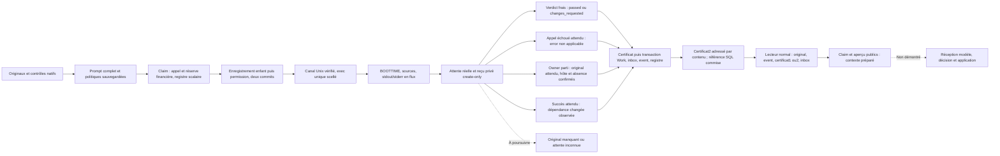

Le claim réserve atomiquement record de revue, appel et estimation financière.
Le registre `native_review_jobs` utilise des colonnes scalaires ; cela ne migre
pas le BLOB Work principal. Le dernier appel déjà réservé reste utilisable
(`0 < calls <= max_calls` avec job/réserve vérifiés), sans autoriser un nouveau
claim épuisé. Une permission enregistrée ne peut être remise en état exécutable.

Les coordonnées Root/dev/inode sont distinctes du workspace et de son scope
host/environnement. Owner et enfant proviennent d’observations OS et de l’identité
réelle du pair Unix, pas d’un PID JSON. Enregistrement et grant sont séparés.
Le canal est CLOEXEC, les copies inutiles du Stdio sont fermées après spawn,
l’exec consomme une fois le transport scellé ; EOF seul ne prouve aucun succès.
La préparation privée vérifie l’accès workspace par un fichier créé, synchronisé
puis supprimé. Ses effets IO et erreurs de nettoyage survivent au rollback SQL.
Les aperçus publics ne font pas ce probe et ne créent aucun confinement OS.

L’horloge totale BOOTTIME démarre après spawn et inclut l’admission du helper.
Le TTL original protège l’admission ; il n’est ni renouvelé, ni réutilisé comme
durée provider ou validité du résultat. L’expiration du TTL au milieu d’une revue
réussie n’est pas un scénario mesuré par les preuves courantes. Après la fin du
leader, les timers admission/total cessent et seul le drain sauvegardé s’applique.
IO et contrôles sont coopératifs, sans garantie temps réel ; les observations
conservent leur latence maximale. Le contrôleur garde causes typées, vraie attente
et éventuel Child non récolté : une projection JSON ne les remplace pas.

Le reçu privé est encadré, synchronisé et **create-only** avant le terminal SQL.
La version2 exige la capture réelle ; la version1 reste lisible avec capture
inconnue et ne suffit pas pour publication/réconciliation2.

| Champ | Interprétation |
| --- | --- |
| `process_attempted` | Primitive appelée ; pas à lui seul une preuve de fork/exec |
| `grant_attempted` | Byte de grant potentiellement exposé ; pas une identité de modèle |
| `waited`, code/signal | Attente connue ; une absence reste inconnue |
| `failed` | Échec de l’appel/transport/domaine, distinct d’un avis défavorable valide |
| `original_reply` | Exact candidat borné, même invalide ; absence ≠ hash d’une réponse vide |
| `raw_capture` | Politique, préfixes, comptes/hash de tous les octets, troncature et échec distincts |
| `provider_facts` | Déclarations non vérifiées ; absence ≠ coût zéro |

Schéma, horodatage, Root, sommes et cohérence des champs sont vérifiés. Le hash
non tronqué et les comptes de lignes doivent correspondre. Une attente sans
tentative refuse ; un échec partiel ne devient jamais succès. Ces contrôles ne
prouvent ni fraîcheur métier ni authenticité cryptographique. Une écriture/fsync
incertaine doit être relue, sans autoriser de nouvel appel.

## Verdicts, erreurs et réconciliation

`publication::record` relit le reçu2, exige propriétaire original courant et enfant
attendu absent, vérifie réserve, génération exacte des paramètres et matériaux
complets, puis redécode strictement la réponse originale. Il ne fabrique ni JSONL,
usage ou coût. La révision Work peut avancer, mais pas reculer avant le claim ;
l’intention et son hash gardent la révision originale. Checkpoint indépendant
compatible, source modifiée refusée : la dépendance réelle gouverne la fraîcheur.
Pause/reprise renouvelle l’événement d’autorité natif inclus dans le hash des
contrôles : ils restent périmés après reprise. La génération de bail du scope est
une observation séparée, absente de ce hash ; un claim/décision ordinaire ne
révoque pas à lui seul des contrôles inchangés.

Un avis `passed` laisse la tâche `submitted`. `changes_requested` la bloque pour
correction et garde `failed=false` : ce n’est pas un appel défaillant. Aucun avis
n’accepte une tâche.

`publication::reconcile_failed` est une opération distincte : reçu2 exact d’appel
échoué, permission déjà enregistrée, propriétaire original courant, attente connue
et enfant absent. Il conserve l’état de production, enregistre la revue `error`
sans critères applicables, puis terminalise le job en `refused`. Un deuxième
processus réel est refusé tant que l’owner original est actif ; un reçu valide
sans attente connue refuse même si le PID paraît absent. Il n’adopte aucun owner,
ne rejoue aucun provider, n’annule aucune dépense et ne devine aucun wait.
L’exclusion native est levée, mais un nouveau claim de la même tentative reste
refusé ; le retry explicite produit reste à porter.
Les causes complètes restent privées ; la raison publique utilise un vocabulaire
sûr. Sources possiblement changées ne deviennent pas un verdict frais.

Le certificat compact public a six champs : `schema_version`, `review`, `work_id`,
`task_id`, `source_sha256`, `validation_receipt_sha256`. Il exclut PID/host,
capture brute et faits provider. Le format2 exclut aussi `review.receipt` et
`review.receipt_sha256` ; son SHA256 complet détermine le chemin
`.swarm/native-review-public-v2-<sha>.json`, ajouté au record après encodage.
Le lecteur accepte également le format1 historique, lié au hash du job et
contenant son chemin (sans son propre digest). Ce choix de représentation
n’est pas un réglage opérateur. Compatibilité vérifiée sur les entrées immuables15804 : deux tests de format,
publication v1 et rollback v1/commit v2 réels, puis claim/aperçu publics normal08
pour les deux formats. La recette permanente est `native-reviewer-certificate-compat.json`. Producteur et lecteurs partagent le format pour déduire
l’étendue exacte avant lecture publique, sans plafond opérateur arbitraire.
Le reçu privé reste lu selon sa longueur encadrée, mais les tableaux de capture
inutiles sont ignorés au décodage : aucune borne mémoire globale n’est prétendue.

Fichier create-only/sync puis transaction unique Work/inbox/event/registre : un
rollback peut laisser un certificat sans résultat applicable. Reprise uniquement
à octets identiques pour un même nom. Des contenus2 différents peuvent
coexister après rollback ; seule la référence liée au résultat SQL commis fait
autorité. Aucun artefact existant n’est remplacé ou effacé. Une deuxième
vérification suit l’IO, sans lease de filesystem.
La même connexion et la politique de stockage sauvegardée gouvernent la mutation.
Un commit incertain n’est pas un permis de relancer ; les erreurs tardives gardent
la révision Work connue et leurs causes. Le rejeu relit original privé, événement
`review.result`, phase, révision et certificat ; digest de réponse absent et type
invalide sont distincts. Le rejeu ne renouvelle aucune fraîcheur ni autorité.
La réserve monétaire reste `estimated` ; règlement provider toujours ouvert.

## Consommation normale et limites de la preuve

`native_review_context` ouvre un Root/SQL readonly, lie registre terminal, original
privé ancré au Root, résultat immuable, certificat et verdict/erreur. Le payload
résultat est une revue, pas un Work historique. Le routage correspond à l’inbox
courante, au propriétaire de tâche et à sa tentative ; aucun scope historique
n’est inventé. Cette lecture n’exige pas un owner encore vivant et n’effectue
ni acquittement ni mutation.

Le contexte de verdict contient la revue et le rapport complet relu sous le
plafond de rapport sauvegardé. Les références de livraison incluent rapport et
certificat ; la projection de tâche contient sa revue pour la fraîcheur du
contexte. Une erreur contient revue/certificat et déclare explicitement
`unavailable_reports[event_id] = native-review-failed-no-applicable-verdict` dans
le contexte et la livraison. Aucun fichier actuel n’est chargé comme rapport
applicable à cet échec. Les limites d’événements et de contexte s’appliquent sans
omission silencieuse. Les revues gérées/historiques non portées restent refusées.

Claim et aperçu publics normaux vérifient sélection, empreinte de contexte,
préparation réelle et absence de mutation par l’aperçu. Le mode
`--expected-review-state error|stale` exige aussi état et inapplicabilité. Cela ne prouve
ni réception du modèle, décision, application, adoption produit ou acceptation.
Le lot165 vérifie séparément une décision active native depuis une revue passed
courante ; un aperçu seul reste distinct de cet effet et n’autorise aucune opération.

Les empreintes ne protègent pas contre un acteur du même UID réécrivant tout le
Root ou son historique. Identité authentifiée du modèle/humain, confinement OS,
facturation réelle, routes Web, décision active du superviseur, journal absent/incomplet,
enfant vivant/non attendu et autres sources non prises en charge restent ouverts.
La documentation ne les clôt pas.

## Rejouer et vérifier

| Preuve | Portée conservée |
| --- | --- |
| [155 final10](../plans/migration-rust/evidence/20261022-155/final10/result.json) | Checkpoint indépendant, source/refus/restauration, pause/reprise périmée ; pas de reviewer actif pendant ce checkpoint |
| [156 final10](../plans/migration-rust/evidence/20261022-156/final10/result.json) | Quatre appels échoués, rollback/reprise/rejeu, vrai foreign owner refusé, attente inconnue refusée, incident explicite |
| [156 normal17](../plans/migration-rust/evidence/20261022-156/normal17/result.json) | Binaire normal c546,255entrées effectives archivées, sans fixture ; pas installé |
| [156 public18](../plans/migration-rust/evidence/20261022-156/public-context18/result.json) | Claim/aperçu normaux, état error/inapplicabilité, pas de modèle/acquittement |
| [153 capture](../plans/migration-rust/evidence/20261021-153/units04/result.json) | Neuf gardes de capture ; sources de ce module non modifiées par156 |
| [Plan courant](../plans/migration-rust/PLAN.md) | Régressions de publication et contrôles finaux courants, originaux en échec, limites et suites |

Recettes permanentes sous `tools/verification/recipes/` :
`native-reviewer-claim-candidate`, `native-reviewer-controlled-process`,
`native-reviewer-private-journal`, `native-reviewer-streaming-capture`,
`native-reviewer-publication`, `native-reviewer-revision-continuity`,
`native-reviewer-failure-reconciliation`, `native-reviewer-departed-owner`,
`native-reviewer-certificate-compat`, `native-reviewer-stale-original`,
`native-reviewer-budget-result`. Les [rejeux](../plans/migration-rust/REPLAYS.md)
précisent préconditions et commandes. Les fixtures sont inertes et isolées ;
les limites de durée métier restent distinctes d’un watchdog global, absent.

SDK et binaire normal sont qualifiés séparément par features, profil, depfiles et
empreintes des octets effectifs, puis archivés. Une source concurrente modifiée
refuse sa qualification. Utiliser `--sdk-source-root` pour l’instantané retenu
vérifié ; ne pas extraire les preuves sur le checkout, le toolchain ou un Root
actif. Une relocalisation et les dépendances nécessaires restent des préconditions.
Le marqueur de fixture empêche les mélanges accidentels, pas une forge du même UID.
Conserver les refus originaux ; lire un ancien résultat ne réexécute pas son cas.
La recette globale du checkout partagé de Claude n’est pas revendiquée par ces
preuves figées. L’historique détaillé est dans PLAN ; les anciennes pages FR/EN
sont conservées dans `156/native-reviewer-doc-before14.tar.gz` avec leurs empreintes.

## Réconciliation après départ du propriétaire

La voie `publication::reconcile_departed` sépare la preuve d’exécution originale
de l’instance qui reprend. Elle exige l’original2 connu/attendu et la même
identité host:boot:PID-namespace. L’ancien PID doit être absent ou porter un autre
startstamp ; son enfant attendu doit être absent aussi. Un owner vivant, host
changé ou observation incertaine refuse. Aucun signal, reaping supposé, nouveau
grant, exec ou remplacement des scalaires owner/child n’est effectué.

Un original sain suit la même reconstruction complète, réserve, génération des
paramètres, redécodage et publication atomique que la voie owner courant. Un
original échoué suit la finalisation non verdict des appels échoués. La frontière d’owner est
vérifiée avant préparation et après IO ; elle est un fait de cycle, pas une
politique opérateur désactivable. Un owner encore vivant refuse aussi depuis
un autre processus. Le préflight `inspect_departed` est une observation, jamais
une permission réutilisable. Le rejeu terminal est historique et ne réaffirme
aucun départ/fraîcheur actuels.

L’identité OS de l’applicateur est observée par les recettes, mais son identité
et son autorité d’agent ne sont pas authentifiées ou liées au résultat de façon
persistante. I157-ACTOR reste requis avant de revendiquer cette traçabilité.
Journal manquant/legacy, attente inconnue et enfant vivant restent refusés.
Recette : `native-reviewer-departed-owner`, preuves et portée dans le plan.

## Original réussi devenu périmé

`retire_stale_departed` est une opération explicite sous le même garde de départ
confirmé ; elle ne remplace pas la publication de verdict. Un reçu2 sain/attendu,
la permission commise, l’absence réelle de l’enfant, le financement et la revue
running exacte doivent être conservés. La soumission canonique et la tentative
doivent correspondre. Le préparateur exige un changement observé : génération
des paramètres (contrat strict existant), autorité inactive, rapport lu dont le
hash diffère, source native recalculée différente, ou entrées complètes observées
différentes. Une lecture impossible, une politique invalide ou toute autre erreur
reste un refus ; aucun catch-all ne la transforme en résultat. Les scopes fermés
et états de tâche incompatibles peuvent encore refuser avant observation complète.

Après une seconde vérification suivant l’IO, la même transaction publie `stale`,
sans critères ni artefact de rapport applicable, conserve le statut de la tâche,
l’original, ses horodatages et l’estimation financière. Le contexte normal utilise
`native-review-stale-no-applicable-verdict`. Le certificat2 non applicable peut
coexister avec un candidat de verdict laissé par rollback. Le rejeu prouve le
résultat historique enregistré ; restaurer le rapport ne rend pas cet ancien
résultat applicable. Ni nouvelle exécution, retry automatique, acceptation,
règlement ni identité d’agent authentifiée ne sont établis. Les quatre variantes15909 et leurs contextes publics sont vérifiés : rapport,
paramètres, pause et autorité renouvelée. Six reprises12, quatre erreurs11,
huit publications13, trois unités scope15 et Clippy/Rustdoc14 PASS. Les entrées
sont immuables15904 ; normal08 SHA9c20b0 compile255sources identiques dans04
(preuve10), sans fixture et sans installation.

Le résultat stale conserve la famille de cause et les liens à l’original ; il ne
contient pas une copie indépendante signée des nouvelles sources. Le lecteur
vérifie son intégrité enregistrée, pas cette cause historique contre les fichiers
actuels. La preuve persistante de comparaison et de l’identité/autorité réelle
d’application reste à intégrer au suivi I157-ACTOR avant une revendication de
traçabilité complète. Les voies manquantes/legacy/attente inconnue restent refusées.

## Réserve d’un résultat et budget d’un nouveau départ

Un résultat original déjà exécuté ne demande pas une nouvelle réserve au tarif
actuel. Le garde de résultat vérifie dans la transaction l’unique ligne du bon
work/scope/job, son montant fini non négatif et son état estimated sans usage
observé. Le montant persistant est conservé : pas de revalorisation, débit,
remboursement ni facture déduite du texte fournisseur. La réserve doit rester
présente et valide ; une erreur SQL/type/fermeture ne devient pas un succès vide.
Cette confiance dans la ligne autoritaire SQL ne prouve pas un prix historique
signé indépendamment ou un règlement réel. Les lignes déjà réglées/observées
restent non prises en charge par ce garde conservateur.

`result_inputs` et `retirement_frame` utilisent cette remise historique ; les
sources et paramètres d’un avis applicable restent vérifiés. Admission, nouveau
départ et observation du processus conservent le contrôle strict du tarif et du
plafond actuels. Les modifications Admin/CLI de budget restent applicables aux
appels suivants et ne réécrivent aucune réservation existante. Le contrôleur ne
gagne aucun nouveau droit. Le reviewer utilise ce garde dans le profil normal depuis162. Le garde financier de résultat est aussi
utilisé normalement par la remise d’original du superviseur depuis161 ; le
lecteur financier commun et le garde de départ restent compilés normalement. Le raccord Web et la décision active demeurent ouverts. Le contre-exemple16002 est
reproduit ; deux résultats et contextes publics09, cinq gardes de départ normaux07,
quatre stale10, huit publications11 et Clippy/Rustdoc12 PASS sur05. Normal06
SHA cc2e88 compile255sources effectives, inchangées dans05 (08), sans fixture
et sans installation.

## Exécuter et reprendre depuis le CLI normal

`task review WORK --input FILE --root ROOT --json` prend les quatre champs des
aperçus. Son `event_id` doit être distinct de celui d’une validation ou d’une autre
mutation ; le rejeu exact conserve cet identifiant et ne réexécute pas le modèle.
Le moteur choisit son image `_reviewer_gate` : l’appelant ne fournit pas de commande.
La socket Unix, les identités OS observées, les sources et la permission scellée
sont vérifiées avant exec ; un stdin régulier refuse sans écriture dans le fichier.
Aucun header libtest n’est filtré du stdout fournisseur dans ce parcours.

Un avis `passed` conserve la tâche soumise ; `changes_requested` la bloque pour
correction. Un appel échoué reste une sortie CLI en erreur même si son original
permet l’enregistrement d’un non-verdict `error`. La reprise explicite
`task review-reconcile REVIEW_ID --root ROOT --json` peut acquitter ce résultat
historique avec `verdict_applicable=false` ; cela ne transforme pas l’appel
initial en succès. Le rejeu ne renouvelle ni fraîcheur ni autorité.

Avant application non terminale, le propriétaire doit être exactement le processus
original ou son départ doit être confirmé sur le même hôte ; aucun owner tiers
vivant n’est adopté. `task review-retire-stale REVIEW_ID` exige un original sain
attendu et une différence de dépendance constatée ; un IO inconnu ne vaut pas
péremption. Sans grant/attente/journal suffisant, la récupération reste refusée,
la réserve conservée et aucun nouvel exec n’est autorisé implicitement.

Le rejeu permanent `native-reviewer-normal-cli.json` vérifie sept cas normaux,
conserve les cadres originaux, certificats, programmes et canaux avant PASS et
vérifie les refus d’altération puis la restauration. Un programme inerte et une
identité Linux observée n’authentifient pas un agent ou un humain. Le suivi
I157-ACTOR, l’intégration Web, l’acceptation et le règlement restent ouverts.

## Acceptation explicite d’une tâche native : périmètre vérifié164

Le raccord CLI normal peut préparer `task update WORK --input FILE --root ROOT
--json` avec `schema_version`, un `event_id` propre à la décision,
`expected_revision` courant, `id` de la tâche, `status: "accepted"` et un éventuel
`next`. Ce parcours distinct ne donne pas l’acceptation à l’API du worker limitée
à running/blocked. Il exige une tâche worker soumise dans un périmètre ouvert,
sans changement de contrat, propriétaire, blocage ou résultat de tentative.
Un avis changes_requested/error/stale ne suffit jamais.

La vérification Root relit la tâche et sa révision SQL, le job/événement de revue,
son original privé et son certificat exact. Elle utilise aussi le hash de contrôle
lié dans cet original pour relire les cadres privés job/step, les lignes et
l’événement/certificat du contrôle déterministe. Ce hash vient du lecteur Root
vérifié, jamais du JSON d’acceptation. Le sélecteur de namespace du certificat
ne fait que choisir ce protocole ; un nom déclaré/malformé ne donne aucun fallback
vers une revue ordinaire. L’API sans paramètres courants refuse ces données natives.

Rapport, artefacts, contrat, contexte de projet, politiques de qualité, gate et
prérequis restent vérifiés ; la revue est réexaminée après les IO de préparation.
Le lecteur courant partagé applique la même vérification native aux dépendances.
L’original historique de contrôle est revalidé comme preuve déjà enregistrée :
il ne constitue pas une nouvelle permission d’exécuter sous les paramètres actuels.
Les chemins ordinary/managed de lecture ne deviennent pas une autorité ; leur
acceptation hiérarchique reste hors de ce raccord natif.

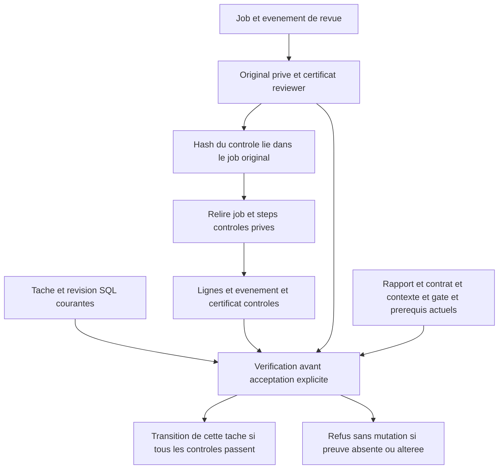

Aucun appel, remboursement, facture, acceptation de mission ou identité humaine
n’est créé par cette transition. L’accès local courant ne prouve pas une personne
ou une autorité d’agent authentifiée : I157-ACTOR reste ouvert. Les tests portent
sur des programmes inertes et des fixtures locales, sans installation utilisateur.
La recette `native-reviewer-task-acceptance.json` doit exiger le témoin, les refus
sur originaux privés/publics des deux étages et rapport, leur restauration, les
non-verdicts et la conservation des réserves/compteurs/originaux avant PASS.

La route protégée existante `POST /api/v1/action` avec kind=task applique le même
contrôle Root. Deux fixtures HTTP réelles vérifient acceptation, refus400 sur
original reviewer altéré sans mutation, restauration et rejeu historique sans
appel ; seuls leurs serveurs ont été démarrés puis arrêtés. Le rejeu acquitte
l’événement historique, sans nouvelle validation ni nouvelle autorité. Aucun
parcours navigateur n’est revendiqué : aucune mise en page/UI n’a changé ici.

## De la revue à une suite de travail : périmètre vérifié165

Un événement independent_review n’est pas une autorisation. Pour des opérations
actives déjà prises en charge, le moteur relit l’événement exact dans son inbox,
le résultat natif, ses deux étages d’originaux/certificats et la preuve courante
passed de la même tâche/tentative. Il relit aussi le rapport explicitement
référencé sous le plafond sauvegardé, sans le déguiser en événement handoff.
Les guards de tâche, exigences, délégation, budget, artefact, bail et commit
restent ceux des opérations task/delegate existantes. La recette exerce une
création de tâche ; elle ne constitue pas une campagne exhaustive de délégation.

La préparation du contexte vérifie déjà cette preuve lorsqu’elle sélectionne la
revue passed actuelle, avant un nouveau claim et un appel. Une revue archivée ou
un incident error/stale reste une observation attribuée disponible au diagnostic,
sans devenir un droit d’action ; changes_requested n’est pas un avis favorable.
Les explorations, run-observations et autres protocoles non portés refusent.

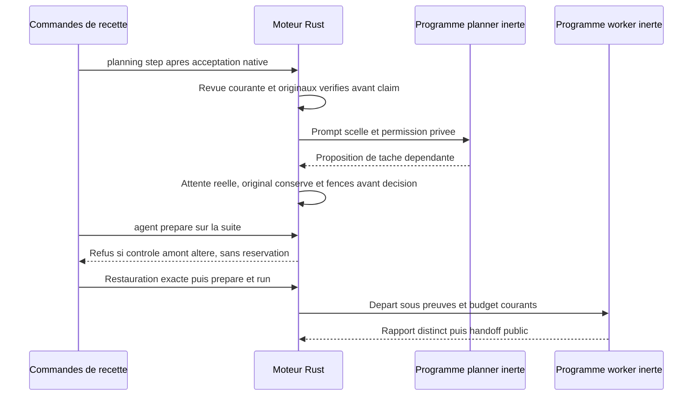

Le départ du worker dépendant refait la preuve de la tâche acceptée, dont les
originaux reviewer et contrôles : un ancien état accepted ne suffit pas à lancer.
La suite produite reste soumise ; aucune acceptation implicite ou identité humaine
n’est créée. Ce parcours est conduit par les commandes de recette et des programmes
inertes ; il ne prouve ni autonomie du conducteur global ni intelligence de modèle.
La clôture de périmètre reste à porter avec une frontière de vraie terminaison
physique, distincte d’un bail expiré ou d’un flag fourni par le demandeur.

Recette : `native-reviewer-active-decision.json`. Les originaux du planner et du
nouveau worker, leurs programmes, prompts et rapports sont conservés avant PASS.
Le rendu work show peut lui-même refuser si une preuve acceptée est illisible ;
la recette compare la révision/réserve readonly pendant le refus et tout Work
après restauration. L’amélioration d’observation partielle I165-OBSERVE reste au
plan ; aucun succès vide ou affichage de fraîcheur fictive n’est introduit.

Deux variantes actives négatives ont aussi un vrai programme planner inerte et
un original conservé : changes_requested et erreur de protocole refusent toute
création de suite. Leur lecture n’est pas une autorisation ; le refus conserve
les réserves existantes et ne réexécute ni reviewer ni worker.

### Clôture native des périmètres

L’implémentation `close` est vérifiée sur le graphe normal figé du lot166 (trois parcours publics, onze tests nommés, Clippy et Rustdoc) ; ce n’est pas une livraison installée. C’est une opération seule : aucune création/délégation mêlée. Tous les retours pending sont traités, les enfants clos, les tâches descendantes acceptées avec leurs originaux courants revue/contrôles/rapport/gates/dépendances et les exigences propres couvertes. `closure_unavailable` dans le prompt indique seulement l’éligibilité structurelle, jamais une permission de fin physique.

WorkEngine vérifie les propriétaires natifs planner, reviewer, validation et worker dans la transaction de décision. Une garde interne refuse par défaut et admet seulement le planner en remise dont l’original durable sain, la source/propriétaire exacts, l’empreinte et l’absence physique de l’enfant sont vérifiés. Attente inconnue, appel étranger actif ou original altéré refusent. Aucun flag de requête, bail expiré ou PID déclaré n’autorise la clôture. Run/usage et périmètre clos partagent le commit ; le parent reçoit `scope_closed`. Cela ne prouve ni confinement des descendants échappés, identité humaine/agent authentifiée, acceptation globale de migration ni conduite autonome.

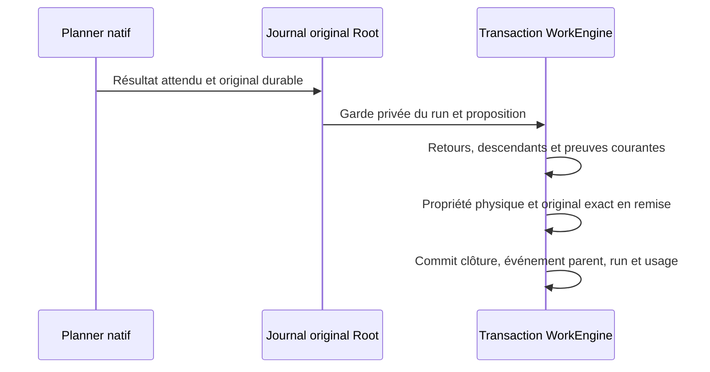

Une garde physique non confirmée reste un incident typé, jamais un refus métier terminal. Elle conserve original et propriété pour réconciliation ; une observation de grant absente ne libère pas le run. Le lot166 conserve séparément le contre-exemple avant correction.

### Garde de reprise du worker scoped

Un worker scoped bloqué ne démarre pas une nouvelle tentative sans le signal persistant de reprise du moteur. Le lifecycle commun et l’admission publique partagent cette garde, en conservant le maximum de tentatives de la tâche ; une revue error/running/queued exige une reprise de revue. Ce signal n’est pas une preuve de superviseur authentifié et n’est pas un override fourni dans la requête de lancement. La reprise native depuis changes_requested utilise uniquement le chemin de correction vérifié décrit ci-dessous ; les autres routes de revue/protocole/managed restent non portées. Les tâches manuelles gardent leur comportement. Le lot167 distingue le refus public général (aucun bypass démontré) de la précondition manquante reproduite dans le lifecycle commun.

### Reprise native de production (lot168, vérification sur fixtures)

Le lecteur commun distingue l’acceptation passed d’un verdict natif changes_requested courant, utilisable seulement par des opérations `retry` sur la même tâche. Cadres privés reviewer/contrôles, événements canoniques, certificats publics, rapport/contrat/projet et tentative actuelle restent obligatoires. Retry modifie seulement correction/signal persistants ; tentatives, revue et consommation sont conservées. Un départ signalé exige aussi une décision planning.decide retry concordant avec tâche/périmètre/correction/input de revue original. Une preuve manquante ou remplacée refuse. La fixture CLI normale vérifie un vrai deuxième worker sur la même tâche après cette décision ; erreur de protocole/managed ne donne aucun droit de production.

Le chemin de reprise worker du lot168 inclut à chaque préflight natif la relecture historique : avis archivé exact et tentative précédente completed, décision/correction canonique, rapport/contrat/projet actuels, ainsi que ledger contrôles/slots privés/public/événement originaux. Le contrôle est sélectionné par SHA du corps lié au reviewer vérifié, work et task, avec vérification ancien producer/attempt ; aucune validation actuelle/preview n’est fabriquée. Les lecteurs d’acceptation gardent leur exigence de validation actuelle exacte. Un témoin complet sain et un cas d’altération/reprise vérifient l’exécution réelle, le refus avant préparation et au préflight queued après archivage ; restaurer le même original permet de lancer le même agent queued.

La correction canonique reste dans task.next pendant admission et préflight ; le prompt worker la contient. Le lifecycle normal archive l’ancien avis et retire sa validation/gate lorsqu’il enregistre la nouvelle tentative ; il ne crée aucune nouvelle revue favorable. La fixture préserve handoff.md et soumet séparément retry-report.md. Le deuxième rapport reste soumis, non accepté, sans nouveau reviewer/contrôle revendiqué. La reprise après échec worker sans revue est vérifiée séparément au lot169 ; la reprise de protocole de revue reste à terminer.

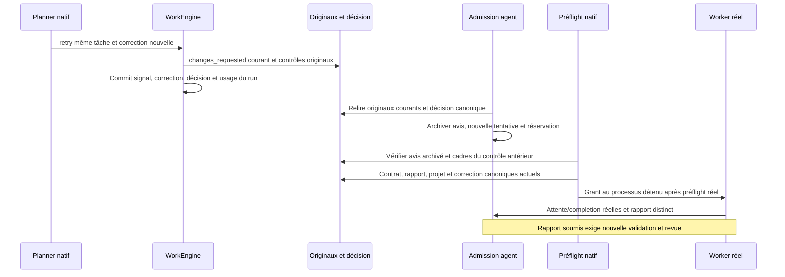

Rejeu : `native-production-retry.json` exécute un témoin réel sain avant les cas négatifs. Refus d’édition scoped publique non portée, puis corruption négative d’un événement canonique dans la seule fixture, contrôle altéré avant admission et contrôle antérieur altéré au préflight queued. Restauration exacte avant reprise, registres planning_calls et reservations des workers vérifiés séparément. La même fonction préflight est câblée à tous les stades natifs ; cette recette injecte avant le claim du propriétaire, pas entre enregistrement et grant. Les contrôles SHA/reçus/SQL n’authentifient toujours aucun agent sémantique/humain et ne prouvent ni protection contre un auteur hostile de même UID ni confinement des descendants échappés.

La fin worker sans revue et le contrat exact de lecture seule de sa completion sont décrits dans [Reprise worker native](NATIVE-WORKER-RECOVERY.md) ; lot169 vérifié sur fixtures isolées.

Une tentative de lancer la production pendant une revue error/running/queued refuse avec `scoped-worker-review-recovery-required`, même sans signal de reprise de production. Le diagnostic n’autorise pas une nouvelle revue ou production : réconciliation/reprise explicite et originaux restent requis. Une erreur native peut conserver le rapport submitted ; aucun blocage artificiel ni nouvelle tentative du producteur n’est créé par ce diagnostic.

## Reprise de protocole native — décision vérifiée sur fixture (lot172)

La route distingue un échec original classé `review_fragment_protocol` (code typé enregistré), avec attente/grant/channel connus, sortie0, capture saine et sans durée/drain/source interrompus, d’un verdict applicable. Ce dernier reste faux. Le lecteur partagé contrôle aussi rapport/contrat/projet et contrôles originaux courants ; les autres erreurs/stale/inconnus restent indisponibles pour les opérations actives. Le contexte remet seulement IDs de tâche/revue/tentative, propriétaire reviewer_protocol, type de correction et SHA du corps original privé (cadre SR1 vérifié séparément), plus le vrai rapport vérifié sous les limites sauvegardées. Le champ candidate_commit reste vide pour cette route sans dépôt Git. Aucun message libre d’erreur ne donne d’autorité.

`review-retry` est une proposition de correction nouvelle du reviewer sur la même tâche et son événement courant reçu. La décision conserve rapport, tentative, avis error, contrôles et dépenses, et met seulement next/décision/acquittement à jour. Capacités persistées, champs applicables, périmètre, preuve et absence d’owner concurrent sont vérifiés. Aucun worker, nouvelle revue, remboursement, acceptation ou succès futur n’en résulte. La deuxième exécution de revue et la reprise d’un incident déjà acquitté restent à porter/vérifier ; ne pas assimiler ce stade à une reprise complète. La décision seule est vérifiée172 ; la reprise complète reste ouverte.

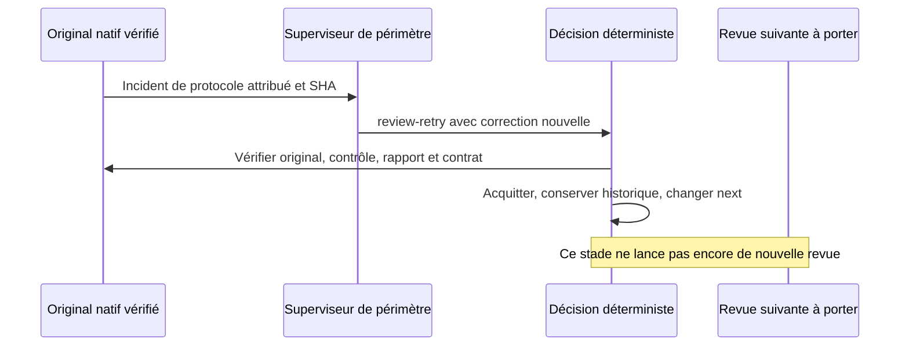

## Nouvelle revue après correction — vérifiée sur fixtures (lot173)

La reprise native observe soit l’erreur courante avant nouveau claim, soit la dernière erreur archivée de la même tentative derrière un job running vérifié. Elle relie originale privée/publique/événement, correction canonique/acquittement, rapport/contrat/projet et contrôles originaux. Aucun Task copié ou faux preview ne supprime l’erreur pour passer les gardes. L’avis ancien est archivé seulement après vérifications, avec une nouvelle réserve et un appel compté normalement.

`TaskReviewInputs.admission_source_sha256` est une observation additive : l’empreinte actuelle de source/autorité d’admission. Elle reste distincte de `preview.validation.source_sha256`, empreinte de l’exécution des contrôles d’origine. Une nouvelle génération du superviseur ne réécrit pas ces contrôles ; la nouvelle admission ne réutilise jamais leur ancien grant comme autorité fraîche. Le job et les gardes lient l’admission actuelle et le reçu original séparément. La directive `review_recovery` entre dans le vrai JSON/prompt et son SHA ; elle compte dans la limite de prompt sauvegardée, ne constitue aucune preuve de critère et n’est pas une permission. Source/projet/registre/funding/host/preflight restent recontrôlés ; l’instruction doit aussi satisfaire la politique actuelle.

173 vérifié : deuxième reviewer réellement exécuté, quatre fautes avant admission refusées/restaurées, nouveau retour d’abord soumis puis acceptation opérateur séparée de fixture. Incident déjà acquitté dans une nouvelle activation, erreurs de transport/source et source modifiée restent des contrats séparés. Les preuves d’identité sémantique, de résistance même UID et de confinement OS ne résultent pas de cette liaison.

Une décision/claim ordinaire ne révoque pas l’autorité des contrôles : source_authority suit les événements enable/pause/resume, pas toute génération d’affichage. Sur les nouveaux jobs avec origine, le SHA de contrôle lie aussi le job et sa politique effective ; il se distingue de la base d’admission. L’égalité des deux SHA reste possible pour les anciens originaux sans origine. Le contrôle173 avec pause/resume public prouve le cas distinct : nouvelle empreinte d’admission, ancienne empreinte/receipt de contrôle préservés, vrai deuxième avis puis acceptation opérateur séparée de fixture. Cette distinction ne crée aucune authentification humaine. La guidance fixe décrit la correction comme méthode/format de réponse attribué, hors preuves de critères, sans outil ou permission supplémentaire.

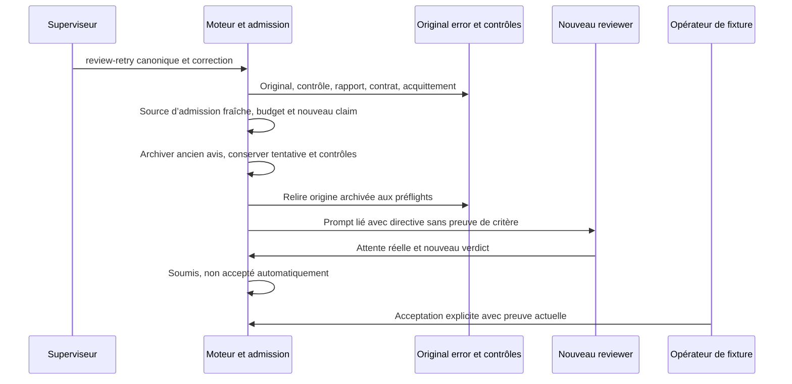

## Reprise après acquittement — vérifiée sur fixtures174

Un acquittement atteste la réception et ne résout pas une erreur. Sur une activation fraîche, le candidat transmet séparément les événements de revue acquittés encore courants, avec leur SHA original et le rapport vérifié. Ils ne deviennent pas des input_events. Les limites persistées de contexte, événements et rapports restent applicables ; un dépassement refuse explicitement. La nouvelle décision consomme seulement les entrées fraîches. Pour admettre une nouvelle revue, Root relit le contexte immuable native_planning_claims, son événement claim canonique, ses liens scope/holder/generation/revision et les acquittements effectifs. L’ancienne décision reste intacte. Vérifié sur le binaire normal12 (47a701,274 sources sans fixture) : témoin complet22, sept refus/restaurations et limite de contexte publique23, même tentative/rapport/contrôles/dépenses. Le prompt réel reçoit la nouvelle décision et son SHA, distincts de l’ancien acquittement conservé ; rejeu sans appel. Acceptation opérateur de fixture séparée, aucune identité humaine démontrée. Tests33/Clippy/Rustdoc10, documentation finale14, régressions16/18/19/20. Les échecs originaux sont conservés ; pas d’installation ni de migration globale achevée.

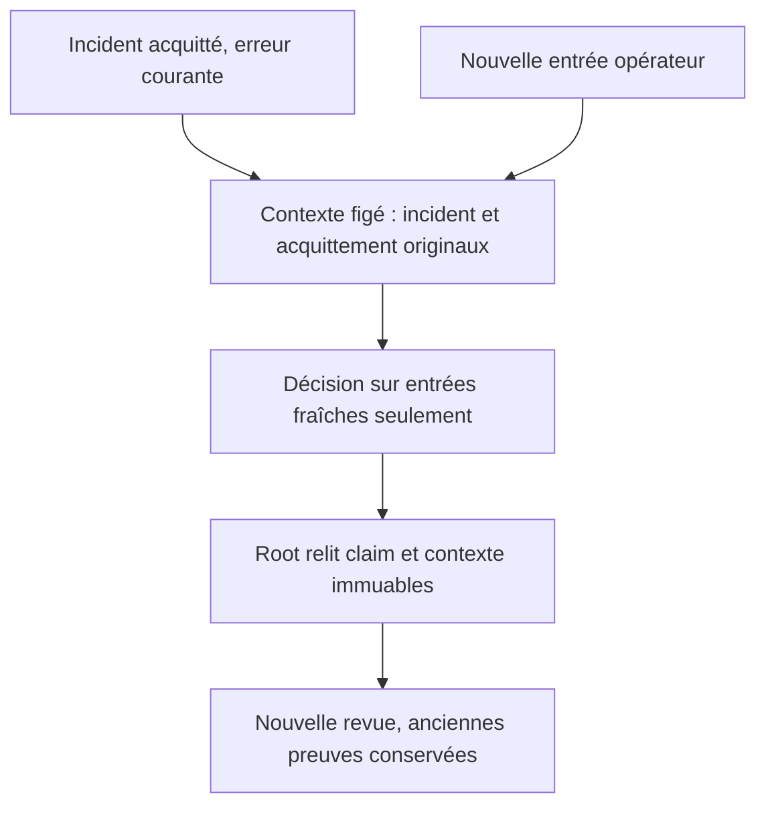

175 vérifié sur fixtures : une fin par signal avec attente confirmée, stream incomplet sans réponse, capture saine et cause typée de stream arrêté peut être classée review_fragment_interrupted/reviewer_runtime. Durée/drain/source expirés ou inconnus, capture en défaut et EOF seul restent non qualifiés. Cette classification ne donne aucun droit ; mêmes preuves actuelles, correction explicite, capacité, budget et admission fraîche restent exigés. Signal15 est une entrée de fixture, pas un choix opérateur ni seuil de produit. Normal07 d6f5d6/274 sources sans fixture,34 tests/Clippy/Rustdoc05. Parcours complets08/10, quatre refus/restaurations09 et sept11 avec limite publique de contexte rétablie PASS : incident pending puis déjà acquitté, vrai nouveau reviewer et correction/digest reçus, mêmes tentative/rapport/contrôles/dépenses et ancien acquittement ; nouvelle réserve/appel comptés, résultat d’abord non accepté puis acceptation opérateur de fixture séparée, rejeu sans nouvel appel. Régression protocole12 PASS. La vraie erreur initiale01 et le refus02 restent conservés ; aucun service installé, identité authentifiée, récupération d’attente inconnue ou migration globale établis.

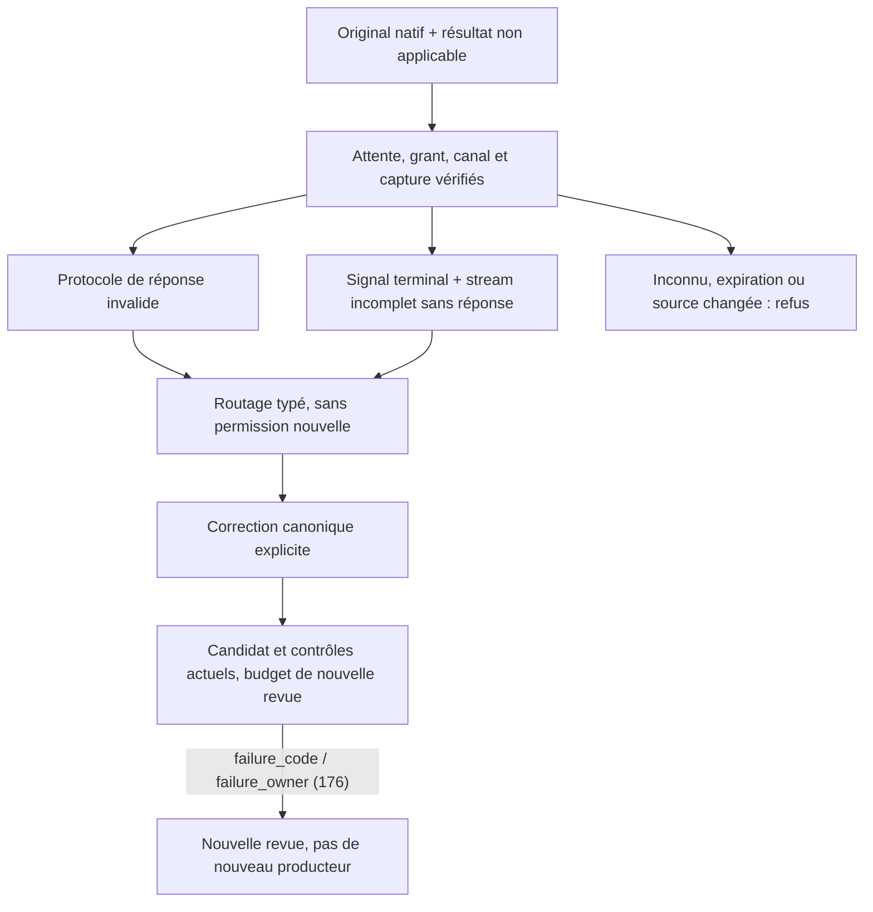

176 vérifié sur fixtures : la directive review_recovery ajoute failure_code et failure_owner, construits depuis la même classification de l’original privé vérifié. Ces observations expliquent la cause au nouveau reviewer ; elles ne sont ni entrées de requête, ni texte d’erreur arbitraire, ni identité authentifiée, ni permission. Les classes admises et les vérifications d’admission de175 restent identiques. Normal04 c8810c/274 sources sans fixture et34 tests/Clippy/Rustdoc02. Prompts réels05/07/pending09 vérifient exactement les deux couples code/owner ; neuf fautes06/08, dont mauvaise classe et mauvais rôle avec hash recalculé, refusent avant claim, restauration puis même revue réussie. Même historique/canonique/contrôles/rapport/dépenses, cap public préservé et rejeu sans exec. Les deux champs sont inclus dans la taille du prompt contrôlée par la limite persistée existante. Pas de nouveau profil d’autorisation, identité ou installation.

177 vérifié sur fixtures : les opérations judge/continue et renew racine se séparent des avis indépendants de candidats. Une décision par cycle, renouvellement seulement après continue sous quota de cycles sauvegardé (0 sans plafond), aucun reset d’activations/décisions/dépenses. Le contexte racine porte son JudgeState/historique complet sous le cap de contexte existant et la fraîcheur vérifie aussi ce contrat ; les enfants ne reçoivent pas cet historique. Les motifs nouveaux utilisent planning_decision_max_reason_bytes ; la cohérence durable ne doit pas réappliquer un ancien plafond4000. Judge end reste refusé sans contrat de candidat managed natif. Contrat, schéma, politiques et preuves : [juge global natif](NATIVE-GLOBAL-JUDGE.md). Normal06/47tests/control11/faults12/child13/legacy14 ; pas de port complet du conducteur ni de livraison revendiqué.

## Préparation native explicite du candidat géré

`swarm-rust task validation-candidate WORK --root ROOT --input request.json --json` utilise la même requête stricte que `validation-preview` (`schema_version`, `event_id`, `expected_revision`, `task_id`). Cette opération est une préparation Git explicite ; `event_id` est une corrélation et un éventuel futur identifiant de lancement, sans événement Root créé. Un job déjà associé à cet identifiant ou un contrôleur actif refuse avant Git : cette opération ne remplace pas la réconciliation d’un job.

Root relit le Work, la soumission canonique, le vrai producteur natif terminé, son dernier attempt, les politiques autorisées et les octets du rapport. Le plan courant et celui des tâches déjà acceptées sont normalisés séparément avec les réglages persistés. Après fermeture vérifiée de la transaction et de la réservation des réglages, le moteur vérifie le résultat conservé, prépare le candidat mono-parent et épingle ses répertoires. Une seconde observation Root doit correspondre à la première, y compris identité connectée de la base, Work et document complet des réglages. Toute modification concurrente de ces réglages refuse cette préparation, même si elle serait sans effet sur un futur contrôle ; ce contrôle conservateur concerne cet intervalle, pas une politique d’arrêt métier. Les descripteurs sont explicitement fermés sur toute issue après épinglage.

Le résultat public contient commit, empreinte du candidat complet, producteur/attempt et compteurs du cohort, sans chemins privés ni commandes. `job_created`, `controls_started` et `task_accepted` valent `false`. Répéter une préparation inchangée retrouve le checkpoint et la même copie ; une erreur peut avoir conservé des objets, ref ou fichiers, sans rollback implicite. Aucun job, permis, contrôle, revue, acceptation ni changement du pointeur candidat du Work n’est créé. `validation-preview` inspecte désormais le candidat existant sans nouvelle préparation ; `validate` utilise le lancement géré décrit ci-dessous. La revue finale gérée reste refusée (`review-managed-candidate-unported`). Cette étape CLI n’est pas encore un démarrage automatique par le conducteur ni une action UX.

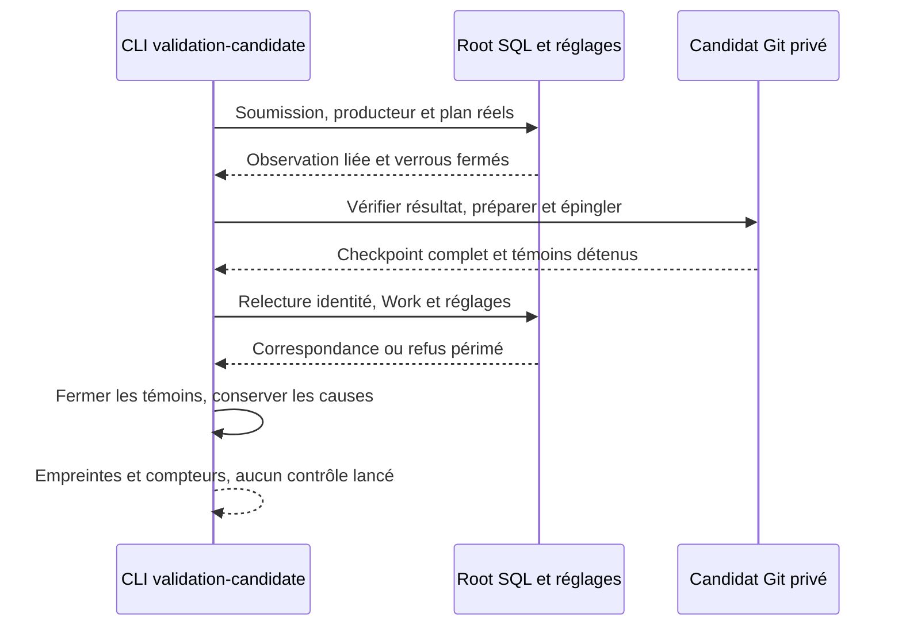

La recette maintenue `native-managed-candidate` exerce de vrais workers locaux inertes, leur handoff public, la préparation et sa répétition, les refus/récupérations et une mutation publique des réglages depuis Git. Ce dernier cas vérifie que Git ne retient pas les verrous Root/réglages et que l’observation finale refuse l’état périmé. Cela ne prouve ni confinement OS, ni commandes cumulatives exécutées, ni acceptation indépendante.

## Exécution native des contrôles gérés

`task validate WORK` prépare ou retrouve le candidat hors des transactions Root et exécute le plan de la tâche courante et de toutes les tâches déjà acceptées. Les politiques sont normalisées séparément avec les réglages persistés ; aucun plafond agrégé n’est créé. Une requête exacte déjà enregistrée est examinée avant toute préparation. Un job actif exige sa réconciliation ; un job enregistré se rejoue sans commande, sans réouvrir le candidat ni relire le cadre d’admission.

Le cadre privé `native-validation-candidate-…receipt` (schéma1) conserve la préimage complète avant le claim SQL. Le claim revalide producteur, soumission, politiques, dépôt, instance connectée du répertoire et de la base Root ; il enregistre atomiquement tous les créneaux, l’origine liée au candidat/plan, l’éventuel bail réel et l’événement du Work. Une erreur avant claim peut conserver des fichiers ou une référence Git, sans créer de permis. Les clés de transport restent distinctes des noms originaux des contrôles/résultats.

Le contrôleur conserve ses témoins de répertoires pendant l’appel d’exécution. Il réinspecte Git et les octets suivis avant chaque contrôle ; les sondes de supervision contrôlent les entrées déclarées, les identités détenues et l’autorité Root sans lancer Git sous verrou ou à chaque sonde. Le helper vérifie le vrai canal Unix, parent/enfant/groupe/permission, relit la préimage liée à l’origine SQL, épingle ses propres répertoires hors des verrous Root et revalide les sources avant exec. Son répertoire courant reste ancré sur ses descripteurs jusqu’à exec. Les délais, sortie, sondes et arrêt utilisent les réglages existants ; aucun watchdog global ou plafond de tentatives n’est ajouté. Une attente inconnue reste un échec de récupération, jamais un succès vide.

Le rapport soumis reste un artefact Root. Les entrées sont d’abord résolues et hachées dans le projet candidat, puis référencées par leur chemin réel relatif à Root pour les lecteurs de gate/preuves existants. Ces références peuvent exposer les coordonnées relatives du stage, jamais le préfixe hôte absolu ; aucune entrée Root homonyme ne remplace un fichier candidat. Les cadres privés restent privés. Une dernière inspection complète précède la publication du reçu v3, du résultat public et de la transaction job/créneaux/Work. Les résultats publics concernent la tâche courante ; tout échec dans la cohorte bloque le résultat global. Les contrôles ordinaires échoués n’empêchent pas les contrôles suivants ; une erreur de source/transport les laisse explicitement non tentés.

Après un refus de publication avec observations complètes, `task validation-reconcile` applique les originaux après départ réel du propriétaire, sans nouvelle commande ni nouvelle copie. `task validation-retire` abandonne explicitement les observations connues sans adopter leur résultat ni exiger une source encore fraîche. Les erreurs primaires, de fermeture, d’attente et les métadonnées Work déjà enregistrées traversent les couches de sortie. La détention des descripteurs et les lectures séquentielles ne constituent pas un confinement OS contre un écrivain malveillant de même UID.

La revue indépendante complète du candidat, son contexte de cohorte et la publication protégée du pointeur candidat restent à porter. Le sous-superviseur/superviseur garde la décision métier ; les contrôles ne valent pas acceptation. La recette `native-managed-validation` utilise de vrais workers locaux inertes, un projet `app`, des commandes réelles, un refus de fichier public puis la récupération publique, et le rejeu sans candidat. La cohorte publique de cette recette est la tâche courante ; elle ne fabrique pas de tâche antérieure acceptée. Les cas multi-tâches de plan/reçu restent des preuves de composants distinctes.

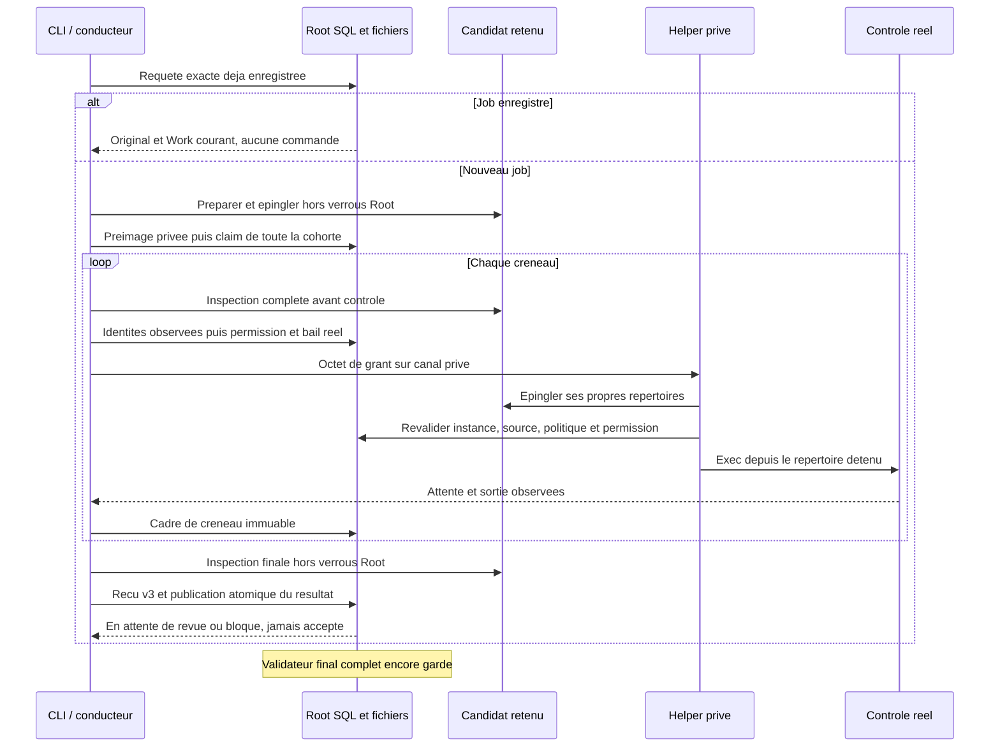

## Reconstruction du reçu global à partir des créneaux

`task validation-reconcile` et `task validation-retire` peuvent reconstruire un
reçu global absent lorsque **tous les reçus privés de créneau existent déjà**.
La reprise ne lance aucune commande. Le propriétaire initial doit être confirmé
absent ; l’instance Root, les lignes SQL, la politique et la source courantes
doivent correspondre à l’origine enregistrée. Le candidat géré est réinspecté
hors des verrous Root et ses témoins sont fermés explicitement. Chaque créneau
conserve son corps canonique, sa commande, son identité et son wait réellement
observé ; aucun reçu manquant, résultat, exit ou non-lancement n’est inventé.

La reprise refuse un original global présent mais illisible, incomplet ou de
forme invalide. Seule son absence confirmée ouvre la reconstruction. Une origine
historique absente, une source modifiée, un créneau manquant ou une issue de
processus inconnue refusent sans publication de résultat. Cette récupération
conservatrice ne règle donc pas les lots partiels dont les observations manquent.
L’absence d’un PID ne suffit jamais à les libérer.

Un original privé `native-validation-reconstruction-…receipt` conserve le corps
assemblé avant le reçu global, sans remplacer de fichier. Son événement et son
horodatage sont réutilisés après une interruption seulement si son contenu reste
exactement lié aux sources/créneaux vérifiés. `finished_at` décrit alors l’observation
d’assemblage, pas une heure de sortie de processus reconstruite. Les résultats
des commandes restent ceux des originaux. La publication ou l’abandon recontrôle
ensuite les originaux et ses propres conditions transactionnelles. Une erreur
peut laisser l’un de ces fichiers visibles sans changement SQL ; elle ne prouve
pas un rollback. Un rejeu terminal conserve son chemin historique sans reconstruction.
Aucune acceptation de tâche ni reprise automatique de commande n’est ajoutée.

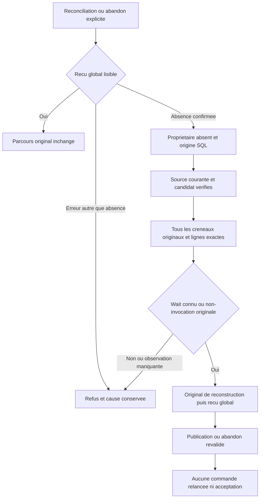

## Inspection native du candidat complet avant revue finale

Après de vrais contrôles natifs gérés réussis, `task review-preview` vérifie en
lecture seule la provenance et la configuration ; `task review-inputs` matérialise
une projection d'inspection du candidat Git retenu. Ce chemin utilise uniquement
un candidat existant : aucun nouveau stage, job, permis, appel reviewer, débit ni
acceptation. Le contexte final de verdict, ses baselines acceptées et sa
publication restent à porter. `task review` conserve donc explicitement le refus
`review-managed-candidate-unported`, même après un aperçu réussi.

L'inspecteur vérifie le reçu privé v3, ses créneaux natifs enregistrés et la source
courante. Il épingle le candidat hors des transactions/verrous de réglages, puis
conserve ses descripteurs jusqu'à la matérialisation, à la réinspection finale
hors verrous et à leur fermeture vérifiée. Le chemin procfd appartient à ce
propriétaire ; il n'est jamais une référence publique ou un chemin réutilisable.
Aucune protection contre un écrivain malveillant du même UID n'est revendiquée.

La projection contient tous les chemins suivis du dépôt candidat conservé, y
compris le préfixe du sous-projet ; elle ne scanne ni la racine de travail Swarm,
ni les fichiers non suivis, ni l'origine Git vivante. Les fichiers texte sont lus
entièrement et comparés à leurs empreintes brutes enregistrées. Un lien symbolique
est représenté par sa cible littérale UTF-8, sans lecture de cette cible, même si
elle sort du dépôt. Contenu binaire/non UTF-8, mode non pris en charge, original
absent ou source modifiée refusent sans omission silencieuse ni troncature.

Les rapports canoniques et critères de la cohorte courante/acceptée sont joints,
avec politiques et résultats des contrôles fraîchement exécutés par ce job
cumulatif, identifiants d'origine et clés de transport distinctes. Le reçu de la
tâche cible reste présent aussi. La projection déclare `inspection_only=true`,
`native_invocation_supported=false`, `native_verdict_supported=false` et
`accepted_baseline_verdicts_verified=false` ; elle ne prétend pas vérifier les
avis historiques acceptés. Un résultat de contrôle dont la sortie est tronquée
reste une observation déclarée comme telle, pas une sortie complète inventée.

Les réglages existants sont conservés : `review_delivery_files` borne l'inventaire
Git complet présenté, `review_context_files` compte tous les matériaux, doublons
attribués compris ; `review_source_bytes` compte leurs octets UTF-8 et
`review_context_bytes` le prompt final, framing et échappement compris. Le plafond
global de lecture de livraison s'applique aussi aux sources. Zéro signifie
explicitement aucune borne additionnelle ; valeur absente/négative ou dépassement
refuse. Les quotas publics persistés/réouverts et leurs validations existantes
sont utilisés ; aucune constante ou deuxième plafond n'est ajouté. Un refus ou
une erreur de fermeture conserve ses causes et ne vaut jamais permission.

## Protocole de citations du candidat en lecture seule

Pour un candidat géré, `task review-inputs` inclut `managed_protocol` dans sa
réponse et dans le prompt complet. Les entrées ordinaires conservent leur JSON
sans ce champ. Le protocole contient le contexte typé de la cohorte, son empreinte,
le catalogue complet de citations, l’empreinte du catalogue et `reply_schema`.
La version de citations2 et la portée d’inspection1 sont des formats de protocole,
non des réglages opérateur. Rapports canoniques, dernier essai enregistré,
producteur de soumission, contrats/politiques et observations du vrai job sont
attribués à chaque tâche. Leur présence n’authentifie pas un verdict antérieur.

Le catalogue utilise le même producteur d’originaux que le parseur de réponse.
Chaque source reste reconstituable octet pour octet, y compris les cibles
littérales des liens. Les métadonnées de cohorte/contrôles restent dans les matériaux attribués et le reçu ; elles ne deviennent pas des preuves sources d’implémentation. Les références proposées au modèle sont filtrées par les
limites de texte persistées dans Admin/API/CLI ; les originaux ne sont jamais
tronqués ou retirés du catalogue. Sans référence admissible, le schéma permet
encore `fail` ou `unknown`, mais pas un `pass` sans preuve. Les limites restent
exprimées en octets UTF-8, pas en caractères JSON Schema. Le parseur contrôle
également unicité des tâches/indices, couverture et appartenance des citations ;
un schéma seul ne prouve ni ces propriétés ni la vérité d’un critère. Pour une tâche sans critère, le schéma demande explicitement une liste vide, tandis que le parseur accepte aussi son absence : une représentation plus stricte, sans autorité supplémentaire. Le minimum de citation normalisée concerne seulement le repli Markdown ; les références du catalogue résolvent d’abord les extraits exacts des originaux.

Le plafond enregistré du prompt comprend le contexte, le catalogue et le schéma,
avec leur échappement JSON. `source_bytes` conserve son sens : somme des matériaux
originaux ; les duplications de représentation sont comptées dans le prompt.
Le contexte indique `inspection_only=true`, sans baseline acceptée fabriquée,
sans diff Git inventé et sans identifiant de blob déduit d’une empreinte SHA-256.
Le lancement natif géré, la vérification des verdicts des antécédents acceptés,
la publication et l’acceptation restent protégés. Une réponse syntaxiquement valide
reste une donnée, pas une permission ni une acceptation.

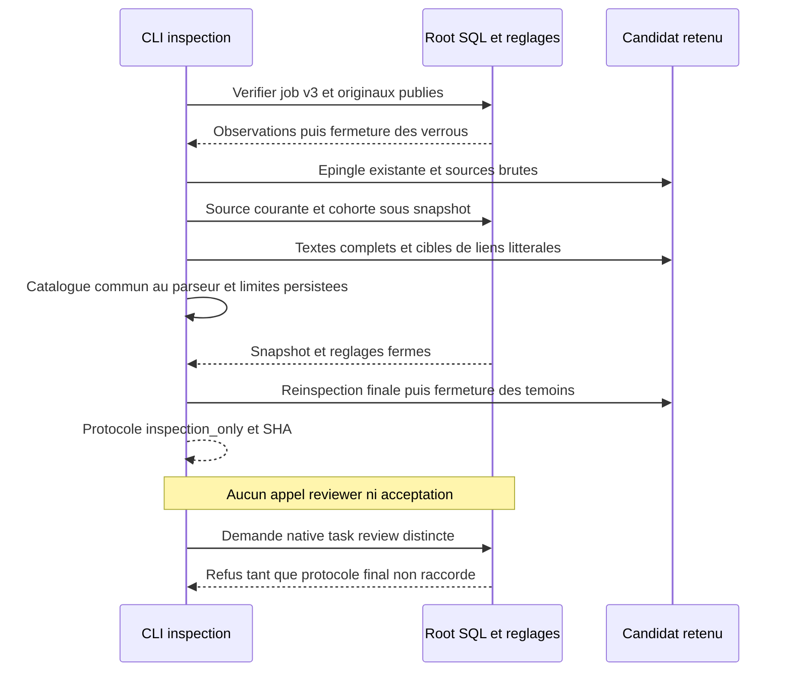

## Vérifier une sortie de cohorte fournie

`task review-check ID --root ROOT --input FILE --json` reprend les quatre champs
de `review-inputs` (`schema_version`, `event_id`, `expected_revision`, `task_id`)
et exige `prompt_sha256`, empreinte du prompt original, ainsi que `output`, chaîne
UTF-8 contenant les événements JSONL fournis. Les champs inconnus ou répétés
sont refusés. La limite technique d’entrée de commande reste celle du lecteur
commun ; aucun plafond métier supplémentaire n’est introduit.

Le moteur reconstruit les entrées complètes avec les réglages persistés courants,
garde les témoins du candidat pendant le décodage puis réinspecte et ferme
explicitement ces témoins avant de retourner. Une empreinte de prompt périmée,
un candidat ordinaire, une cohorte incomplète, des indices répétés, des citations
invalides, un outil déclaré ou un flux sans fin explicite refusent. Les limites
Admin de réponse, d’événement et de texte sont réellement consommées ; un refus
conserve sa cause et ne produit aucun résultat partiel sur la sortie CLI.

Le résultat contient l’opinion parsée et les empreintes du contexte, du catalogue
et de la réponse. `supplied_output_checked=true` décrit seulement les octets
fournis. `provider_started`, `review_recorded`, `native_execution_proven`,
`reviewer_authenticated`, `verdict_applicable` et `task_accepted` restent faux.
Même un avis `pass` ne prouve ni l’exécution du fournisseur, ni son identité,
ni la vérité des critères. Aucun débit, réservation, verdict enregistré ou
changement du Work n’a lieu. Aucun endpoint HTTP ou écran supplémentaire n’est
ajouté. Le lancement natif géré et sa publication restent à raccorder ;
`task review` conserve son refus de protection.

La recette permanente `native-managed-review-check.json` distingue les cas
positifs, les refus et l’absence de mutation. Les tests unitaires du décodeur
contrôlent séparément la conservation des octets et causes après échec.

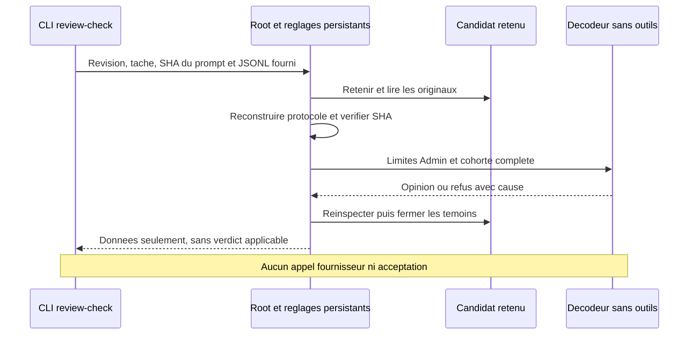
