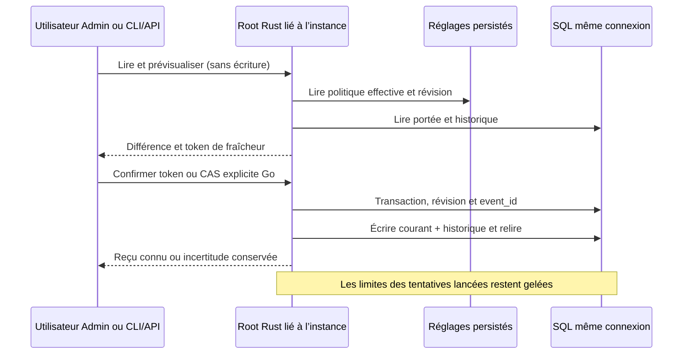

# Administration Rust des limites d’exécution

Le contrat G9 porte sur les limites des prochains départs, stockées dans les tables existantes `run_limits_config` et `run_limits_history`. Il ne change pas les limites gelées des tentatives déjà lancées et ne donne aucune autorité de clôture métier au moteur.

## Parcours public

L’Admin présente une carte et un dialogue de réglage par portée : projet, mission, rôle ou tâche. Charger la portée avant de modifier, prévisualiser sans écriture, puis confirmer. La relecture établit l’état enregistré ; un reçu positif suivi d’une relecture impossible reste visible et impose une nouvelle lecture. Les métadonnées historiques sont des données enregistrées, pas une authentification de l’acteur.

GET `/api/v1/run-limits?scope=project` renvoie l’entrée courante, l’historique descendant (null s’il est vide), les défauts/plafonds persistés, leurs diagnostics et une projection décimale exacte pour le navigateur. GET `/api/v1/run-limits/effective?mission_id=…&role=…&task=…` résout la hiérarchie administrative ; l’admission du fournisseur, du contrat de mission et des tentatives précédentes reste celle du lancement réel. POST `/preview`, `/apply`, `/rollback` et l’extension native `/rollback/preview` utilisent le même préfixe et le même Root lié à l’instance ouverte. Les protections de session, Origin et CSRF restent communes.

La CLI expose `run-limits show|history SCOPE MISSION KEY`, `effective MISSION ROLE TASK`, `preview|apply SCOPE MISSION KEY --input FICHIER`, et `rollback-preview|rollback SCOPE MISSION KEY REVISION --input FICHIER`. Le tiret remplace un identifiant vide. Le JSON suit le changement Go : schema_version, event_id, scope, mission_id, scope_key, expected_revision, values et reason ; le retour utilise to_revision. Un token d’aperçu est un champ de transport, absent de l’historique.

## Valeurs, concurrence et erreurs

Zéro hérite ; les cinq valeurs sont silence_seconds, tool_seconds, max_tool_calls, max_repeated_calls et max_consecutive_errors. Les choix opérateur proviennent de RuntimeLimitPolicy persistée dans les réglages moteur, modifiables dans leur dialogue Admin ; aucun plafond Go historique n’est recopié comme politique Rust. Les entiers signés 64 bits sont une représentation technique. Le mode observation exige une portée mission et un motif explicite.

Une application sans token conserve le CAS explicite Go sur expected_revision et peut réparer un corps courant illisible. Une application avec token vérifie aussi le snapshot inspecté, l’instance et les réglages. Une révision périmée refuse sans écriture ; aucun réessai métier automatique. Le moteur réutilise la politique de reprise stockage existante et une transaction sur la même connexion. Les deux lignes sont relues après écriture, et une erreur de commit ou de sortie conserve l’incertitude ou l’effet connu.

Un event_id déjà présent compare les octets canoniques de la demande, sans revalider l’ancien historique contre de nouveaux plafonds. Un replay exact renvoie l’entrée COURANTE. Le retour à une ancienne révision ajoute une nouvelle révision et garde tout l’historique. Les lectures Go ne deviennent pas des validations rétrospectives de métadonnées ou de politique ; une erreur SQL/JSON ne devient jamais un succès vide.

## État des preuves

Le test ciblé de réparation CAS est reproduit avant correction et passe après. Les preuves API/CLI, navigateur, livraison et qualification sont suivies dans le dossier G9 `docs/plans/migration-rust/evidence/20261027-run-limits-admin-ohyyq12v`. Une compilation seule ne prouve ni la parité Go globale ni l’installation ; les étapes non vérifiées restent ouvertes dans ce suivi.

La fermeture restaure le focus après la relecture de la carte, lorsque le bouton est de nouveau actif ; en cas de refus de lecture, le contrôle Recharger reste accessible.

La livraison locale178 est observée : 13 contrôles d’installation,14 assertions du dialogue Version FR/EN, ressources servies identiques au build et cinq travaux inchangés. Public9 et Go6 sont conservés sur177 ; leurs producteurs G9 restent identiques en178 hors commentaires/tests, et la différence de dépendance Nix ne touche que les gardes de processus hors de ce parcours. Navigateur4 sur178 : contraste calculé,320/1440, saisie invalide sans appel, reçu positif avec panne simulée de relecture, reprise réelle et focus après fermeture. Le premier collecteur complet reste FAIL à cause du focus ; ses deux étapes API/Go PASS et son intégrité sont conservées, puis la recette navigateur corrigée PASS est vérifiée séparément. Les tests Rust effectivement exécutés sont codec10 et Root2 ; une sélection initiale à zéro test est conservée comme preuve insuffisante. La revue GLM est statique et bornée, sans acceptation globale. Les ressources vivantes n’ont pas été adoptées silencieusement.

Réexamen après découverte182 : les confirmations du dialogue sont renforcées par NATIVE-POLICY-RECEIPTS ; les anciennes preuves de livraison restent historiques, pas une preuve de ce nouveau contrôle.

