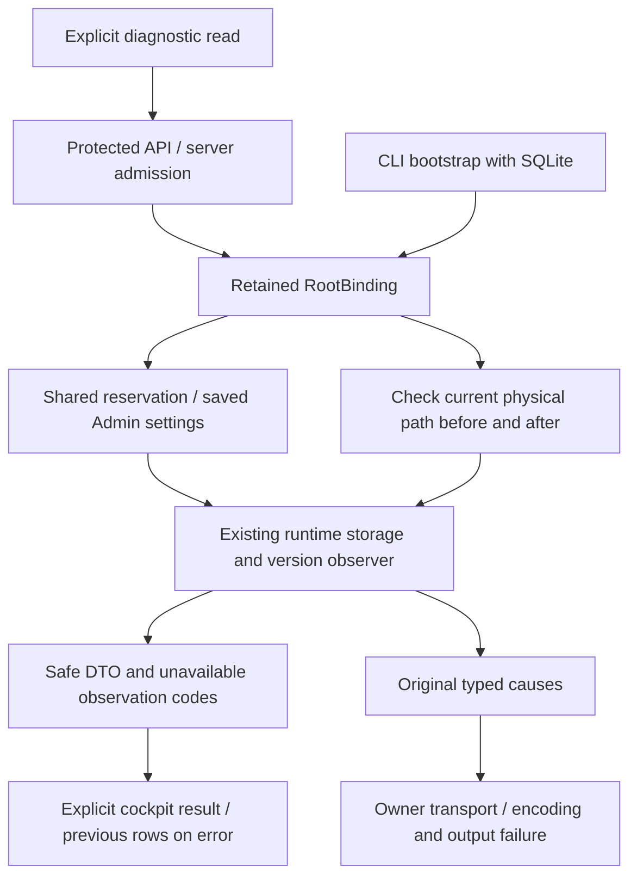

# Diagnostic de stockage natif

Livré localement en207. Recette permanente2étapes PASS/intégrité VERIFIED : API Go/Rust7 et navigateur4 FR/EN×thèmes320/1440 avec contraste AA et sauvegarde Admin réellement consommée. Régressions matérielles2, runtime6, Rustdoc/i18n ciblés. Installation27+Version14, ressources embarquées vérifiées et5travaux inchangés. Source protégée et lecture réelle vérifiées ; aucune acceptation globale. [RETEX](../plans/migration-rust/evidence/20261027-runtime-health-x97n_o9u/RESULT-RETEX.md).

GET/HEAD protégé /api/v1/runtime-health, corps vide et aucun paramètre. La CLI native runtime-health --root ROOT --json réutilise le producteur ; elle ouvre initialement SQLite pour acquérir la liaison puis le ferme. Le serveur déjà démarré possède les descripteurs RootBinding : il ne rouvre pas SQLite pour ce diagnostic. La disponibilité de la CLI à froid reste donc distincte de celle du serveur lié.

RootBinding.runtime_health vérifie le chemin courant contre les identités physiques de son répertoire et de sa base O_PATH avant/après, sous réservation partagée des réglages. Il réutilise mission_status_runtime.observe et ses champs persistés runtime_storage_stop_bytes, runtime_storage_warning_bytes et runtime_storage_stop_inodes. Ces valeurs sont validées et modifiables dans la modale Admin des réglages moteur ; aucune adoption implicite ni nouvelle valeur de secours. La politique Git/commande existante encadre l’observation de version. Les chemins du stockage et du temporaire sont des observations réelles du projet/processus, pas des chemins opérateur figés.

ready/warning/blocked et launch_allowed conservent leur sens limité au stockage. Ils ne prouvent ni intégrité SQL, ni permission de lancement, ni état fournisseur ou fin métier. Une erreur de mesure donne unknown et bloque le stockage ; les compteurs zéro du DTO historique ne sont alors pas présentés comme mesures dans l’UX. observation_errors ajoute les familles sûres ; les causes typées restent disponibles à la supervision du transport. Les erreurs d’encodage, de vérification, de libération ou de sortie/flush conservent aussi les causes annexes. Une source absente/malformée, un changement d’instance physique ou une horloge indisponible refusent explicitement.

Le cockpit propose un détail repliable, lecture explicite et lien Admin ; ni polling ni relance automatique. Ce lecteur de diagnostic ne dépend pas de l’initialisation Admin ni du délai de requête navigateur à réparer, comme les parcours de récupération déjà présents. L’admission serveur conservée continue à s’appliquer. Erreur de source/forme : observations antérieures conservées, erreur visible ; les textes sont rendus sans HTML. Une mesure numérique non représentable exactement est signalée, pas arrondie silencieusement. Choix de seuils, mesures courantes et droits de lancement restent distincts.

Les contrôles ci-dessus couvrent RH1–RH5 et la livraison locale RH6. La revue GLM est statique, avec contexte et limites conservés ; revue des22entrées compilées couverte mais20axes étrangers/notes restent ouverts. Les anciens défauts de qualification globale ne sont pas clos. Les vrais noms JSON sont next_step et volumes[].available_bytes/available_inodes : le premier lecteur206 erroné a été reproduit puis corrigé ; un garde de clés et le navigateur conservent ce contre-exemple. Les scénarios de faute touchent uniquement des fixtures privées, pas la base d’une mission réelle.

