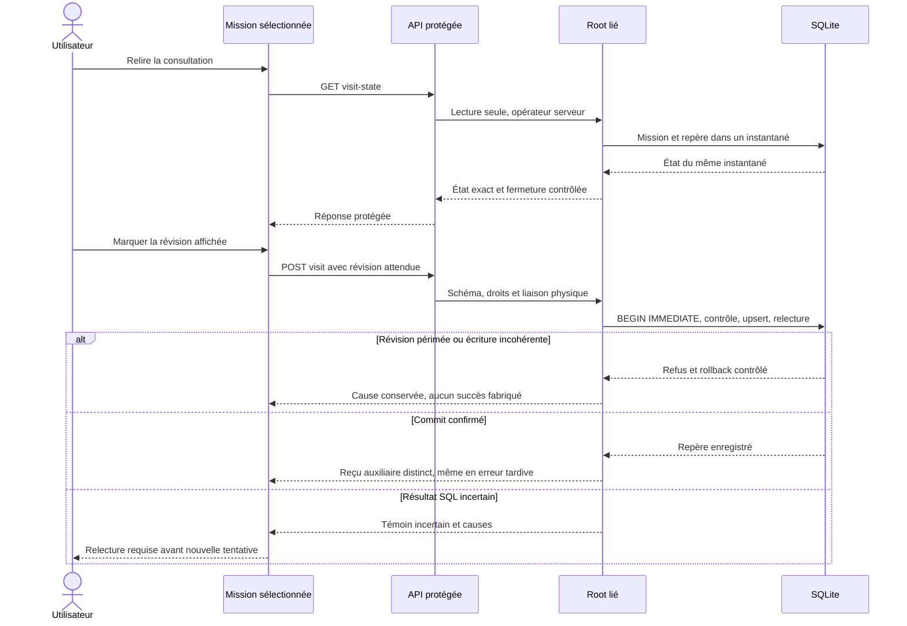

# Consultation locale d’une mission — contrat Rust

Le parcours natif est disponible sur Linux : API protégée, CLI et action explicite
du cockpit. Le [plan actif](../plans/migration-rust/PLAN.md) conserve les preuves
de recette et d’installation et les limites ; aucune acceptation globale de la
migration ou autonomie d’agents n’est déduite de ce parcours.
[English](../en/NATIVE-SESSION-VISIT.md).

`POST /api/v1/visit?work=WORK` conserve le comportement Go : enregistrer la révision
actuelle et l’heure pour l’opérateur local hôte/UID. Ce repère ne valide aucune
tâche, ne termine aucune mission et ne prouve pas une identité humaine. Aucune
permission, réservation, consommation ou exécution de fournisseur n’est créée.

Le corps historique vide signifie « révision actuelle au moment de l’appel ».
Le corps natif `{"schema_version":1,"expected_revision":"3"}` ajoute un contrôle
facultatif de fraîcheur : une révision différente refuse avec409 sans changer le
repère. Une valeur présente doit être une chaîne décimale canonique non négative
sur i64. `null`, nombres JSON, doublons et champs inconnus refusent avant écriture.
La version de schéma et la représentation i64 sont des invariants de protocole,
pas des limites opérateur. Aucun délai, plafond ou mécanisme de relance ajouté.

La réponse native ajoute à `saved:true` un `state` avec la révision actuelle exacte,
`exists`, `visit` (`revision`, `at`, `operator`) et `exact_visit_revision`. La lecture
native séparée `GET/HEAD /api/v1/visit-state?work=WORK` ne marque rien ; GET `/visit`
reste refusé. CLI : `visit show WORK --root ROOT --json` et
`visit mark WORK --root ROOT --input INTENT.json --json`. Sans fichier, mark conserve
la sémantique historique. L’acteur et l’heure proviennent de l’environnement serveur.

Une révision enregistrée négative est une donnée incohérente : le lecteur refuse
avec une erreur serveur, sans modifier la ligne ni renvoyer un état de succès.
Le marquage public peut remplacer ce repère par la révision actuelle validée ;
il ne valide aucune tâche. La réparation est testée sur une racine isolée.

La transaction IMMEDIATE lit la mission et écrit le repère sous la même transaction.
Une ligne affectée et une relecture égale sont obligatoires. Une erreur n’implique
pas une absence d’effet : les reçus auxiliaires typés `session_visit` distinguent
`recorded` et `uncertain`. Ils restent séparés des reçus Work/configuration/agent
jusqu’aux erreurs de fermeture, encodage, sortie/flush et observation HTTP. Un reçu
incertain décrit une tentative ; il exige une relecture, sans autoriser une relance.
L’absence de reçu ne prouve pas un rollback. La fermeture d’un navigateur ne prouve
ni annulation ni réception du résultat par le client.

L’interface propose une action explicite après lecture du repère. Elle compare
la révision de la mission sélectionnée et celle du serveur. Après une écriture
non confirmée, une relecture est obligatoire ; aucune tentative automatique.
Les erreurs conservent les observations précédentes. Les entiers élevés utilisent
leur lexème numérique exact, sans arrondi JavaScript ; une représentation inconnue
refuse explicitement le marquage. Copier un objet peut perdre cette métadonnée :
il faut relire, pas deviner. Les réglages réseau existants restent applicables.

Les fixtures SQL et de transport ne démontrent ni autonomie d’agents, ni acceptation
indépendante, ni fonctionnement sur toutes les plateformes. Les wrappers typés
connus conservent leurs témoins et causes secondaires ; un wrapper opaque externe
sans contrat de traversal ne fournit aucune preuve supplémentaire.

### Compatibilité CLI `mission seen`

`swarm-rust mission seen WORK --root ROOT --json` appelle le même writer que
`visit mark`, sans document d’entrée. Il rend les champs historiques
`revision` (entier), `at`, `operator`. Sans `--json`, confirmation FR/EN.
Seul le marque-page de l’opérateur local courant change ; aucun travail, tâche,
coût, droit ou processus n’est accepté ni lancé. Le label opérateur n’est pas
une authentification humaine. Une erreur de sortie conserve le reçu auxiliaire ;
relire `visit show WORK` avant toute reprise. Pour un contrôle explicite de
révision, employer `visit mark --input FILE`, dont le contrat natif reste distinct.
