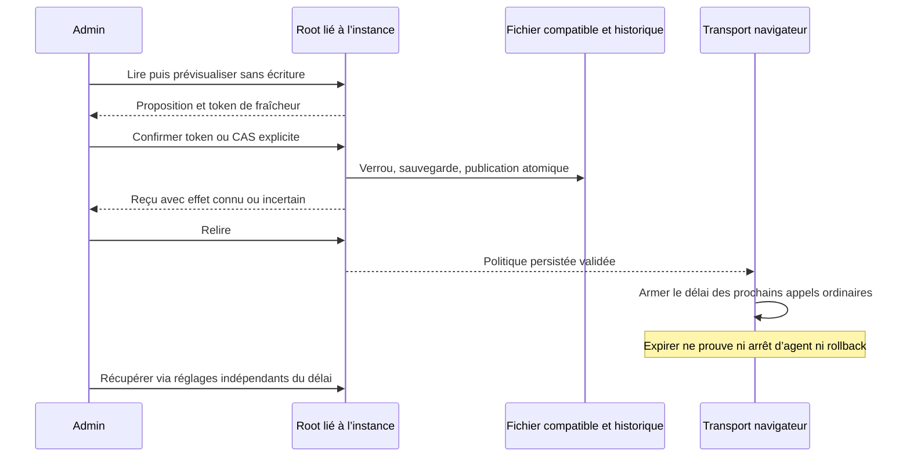

# Politique Rust des attentes navigateur

Ce lot G10 porte les API Go de web-requests.json, sans transformer une expiration de l’interface en arrêt d’agent ou en preuve d’échec métier. Le parcours native-runtime est installé et vérifié sur la version locale187 ; les autres transports restent à qualifier séparément.

## Source et opérations

Les trois valeurs general_ms, snapshot_ms et connection_test_ms sont des millisecondes, entières exactes pour JavaScript ; zéro désactive l’expiration correspondante. L’absence réelle du fichier utilise config/web-requests.json versionné ; une source illisible, refusée ou invalide ne devient jamais un jeu de valeurs par défaut. Les valeurs déjà chargées par un appel restent celles de son départ.

GET/HEAD /api/v1/web-requests lit la configuration courante et l’historique. POST /preview et /apply sous ce même préfixe partagent le producteur Root avec `swarm run-limits web-requests show|history|preview|apply --input FICHIER --json`. L’aperçu n’écrit rien et ne crée pas le verrou de politique. Une application peut utiliser le CAS Go explicite sur expected_revision ; un token d’aperçu fourni lie aussi la source, l’instance et les réglages. Le rejeu exact du premier event_id correspondant renvoie la configuration COURANTE sans ajout de révision et sans nouveau jugement des métadonnées historiques. Le token reste hors du changement enregistré.

GET/HEAD /api/v1/web-requests/script.js produit uniquement la révision et les trois durées typées, avec le MIME JavaScript après autorisation et lecture Root réussies. Un refus conserve le statut et le diagnostic JSON ; il n’est pas transformé en script vide réussi.

## Bornes et erreurs

La borne 2^53−1 est la représentation exacte Go/JavaScript, et les segments de timer 0x7fffffff sont une contrainte technique du navigateur. Les délais sont des choix opérateur persistants. La borne commune agent_provider_config_max_bytes, dont la clé historique reste conservée, couvre explicitement providers.json, models_cache.json, provider-wait.json et web-requests.json : lecture de source et historique complet sérialisé. Elle reste modifiable par le dialogue des réglages moteur, API et CLI avec la même validation. null retire la borne ; zéro refuse un fichier non vide. Il n’y a pas de seconde borne Go1MiB/16KiB ni de longueur de motif8..2000 cachée. Le motif d’un nouveau changement doit rester non vide.

Les paramètres de session, les réglages moteur et l’édition de cette politique ont un parcours de récupération qui ne dépend pas du délai à réparer. Les autres appels du transport commun de native-runtime utilisent la politique réellement chargée, sans valeur de repli. Si sa relecture échoue, les prochains appels ordinaires refusent jusqu’à réparation puis rechargement ; les appels déjà armés et les agents continuent sous leurs contrats propres. Ce lot ne prétend pas raccorder les transports de toutes les autres pages natives : leur inventaire et leur reprise restent explicitement à vérifier avant clôture globale.

Le dialogue Admin charge, prévisualise, confirme et relit. Un reçu positif suivi d’un échec de lecture reste « enregistré ; relecture indisponible ». Les champs sont alors bloqués jusqu’à rechargement. La fermeture restaure le focus après la relecture de la carte. L’historique conserve les textes comme données littérales, sans preuve d’authentification de l’acteur.

L’écriture prend le verrou Go compatible sous la garde des réglages, conserve un original privé, revalide la fraîcheur puis publie atomiquement. Le rejeu synchronise la source existante. Les erreurs de renommage, durabilité, fermeture, encodage ou sortie conservent l’effet connu ou incertain ; elles ne prouvent pas un rollback. Aucun Work, compteur, budget, fournisseur ou limite gelée n’est changé.

## Fidélité JSON et preuves

Chaque occurrence présente de values doit fournir les trois champs non nuls, y compris une occurrence dupliquée ensuite écrasée ; une absence complète conserve les zéros Go. Le précontrôle des octets bruts précède la projection commune Go pour ne pas perdre les doublons. L’historique nul et les changements historiques sans en-tête valide restent des données typées acceptées par Go, sans garde métier ajoutée.

Preuves conservées dans [le RETEX du lot](../plans/migration-rust/evidence/20261027-web-request-policy-jnok5wvr/RESULT-RETEX.md) : CLI/API8, contrôle de taille aperçu/application3, différentiel Go6 groupes/16 cas bruts, interface FR/EN et deux thèmes4, puis reçus partagés12 parcours et normalisation Unicode2. L’installation187 est établie par18 assertions sur le processus, les ressources et les lectures publiques, plus14 assertions du dialogue Version. Les collectes globales historiquement en échec restent en échec ; leurs étapes inchangées sont réutilisées avec leur portée exacte.

L’aperçu inclut les observations locales d’acteur et de date dans le contrôle de taille complet, comme Go. Ces métadonnées peuvent changer avant l’application ; elles ne prouvent ni identité authentifiée ni écriture.

Le client utilise désormais le contrôle partagé des reçus : demande, changement enregistré et relecture doivent correspondre avant succès (NATIVE-POLICY-RECEIPTS).

