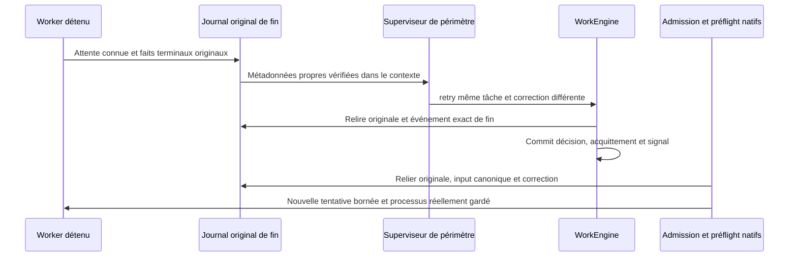
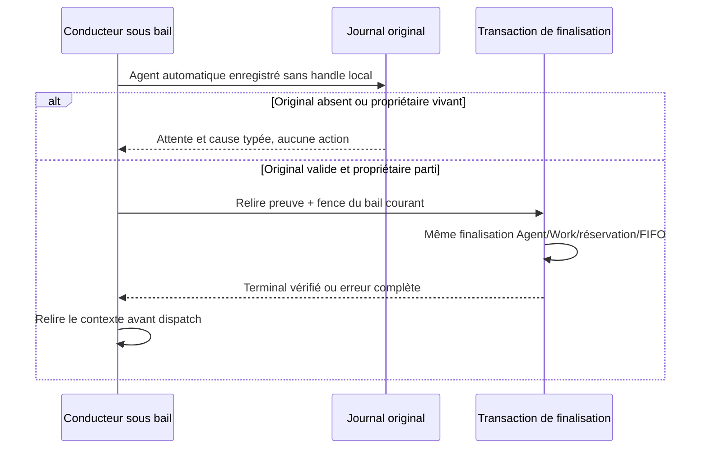
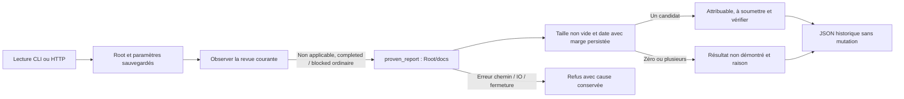
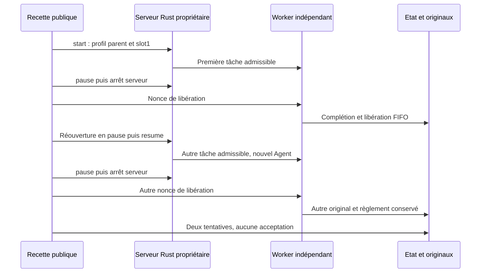
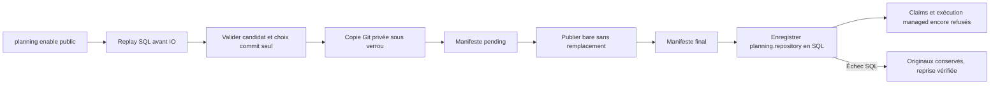
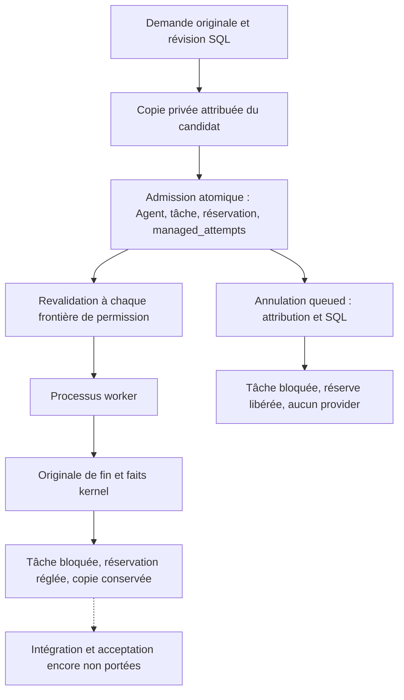

# Fin native du worker et reprise

Implémentation Linux vérifiée sur fixtures natives isolées dans le lot169. Le journal original de fin est une frontière de confiance locale privée, pas une identité cryptographique ni une protection contre un auteur hostile du même UID. PID absent/mort, bail expiré ou message « terminé » ne suffisent jamais à autoriser une reprise.

L’observateur en lecture seule partage la projection terminale Agent/réservation de recovery ; il n’appelle aucune récupération, n’écrit aucun état et ne rembourse aucune tentative. Il vérifie identité du Root original, ligne terminale complète, ownership normalisé, snapshot/contexte natifs, collecte kernel enregistrée, libération de workspace et disposition gate/sortie explicite. Attente/libération inconnue ou exécution en quarantaine/drainage refuse. Une sortie logique invalide connue peut être décrite pour correction, jamais comme acceptation de qualité. Un refus connu du helper est distingué d’un possible démarrage provider ; aucune exécution n’est devinée.

`attempt_ended` est relié exactement à l’originale courante/antérieure, au résultat de l’agent et à son périmètre. Le contexte sélectionné `worker_completions` contient IDs événement/tâche/tentative/agent, résultat, SHA original et observations sortie/démarrage ; aucun prompt/capture brut ou host/stamp PID. Ces octets entrent dans le hash de contexte et le fence de fraîcheur de remise existants. Les anciens événements gardent leur contrat d’acquittement historique seul.

Seule une décision explicite de reprise avec correction nouvelle et capacité sauvegardée d’essais peut poser le signal persistant. Originale et décision/input/acquittement canoniques sont relus avant admission et avant exécution native après création de la nouvelle tentative. La reprise de revue reste distincte ; une ancienne revue non liée n’autorise jamais la reprise après un worker plus récent en échec. Pas de nouvelle tâche ou reset des compteurs pour contourner les limites. Les preuves du lot169 distinguent fin0 témoin, fin17 réelle, décision native, deuxième worker0 et rapport soumis. Cinq altérations avant modèle (attente, gate, projection, JSON invalide et originale absente), puis attente inconnue au préflight refusent sans mutation/appel/réserve/exécution ; restauration exacte et même agent queued exécuté. Les historiques et originaux restent conservés, le rapport nouveau est soumis et non accepté. Une interruption, un refus pré-exec ou une sortie logique invalide sont reconnus par le contrat, sans parcours natif positif revendiqué ici. Aucun conducteur autonome ni installation annoncé.

Les constructeurs de fixtures créent maintenant le dossier de preuves et publient une attribution unique du Root avant l’initialisation CLI. Binary/output acceptent chemin ou chaîne ; le hash binaire est lu avant création du Root temporaire. Le marqueur n’authentifie aucun acteur et ne donne aucun droit. Un init échoué conserve chemin et canaux originaux ; un répertoire temporaire vide peut rester si l’écriture du marqueur de naissance échoue elle-même. Cela s’applique aux prochains imports/appels, pas aux processus Python déjà démarrés ni aux anciens Roots non attribués ; ne jamais adopter/supprimer un Root sur son préfixe ou mtime.

Preuves : [profil normal16](../plans/migration-rust/evidence/20261022-169/normal16/result.json), [reprise complète19](../plans/migration-rust/evidence/20261022-169/control19/result.json), [refus/restauration23](../plans/migration-rust/evidence/20261022-169/faults23/result.json), [récupération publique21](../plans/migration-rust/evidence/20261022-169/completion21/result.json), [29 tests/Clippy/Rustdoc17](../plans/migration-rust/evidence/20261022-169/quality17/result.json). La recette durable est `tools/verification/recipes/native-worker-failure-retry.json`. Les tests utilisent des programmes locaux inertes ; l’identité métier authentifiée, la résistance aux écritures du même UID, l’intégration du checkout concurrent complet et la bascule finale restent des critères séparés.

Qualification du binaire : le lot170 compile le checkout partagé actuel sans exclusion de télémétrie avec une cible neuve, puis vérifie les reprises ci-dessus et les actions HTTP protégées sur le même binaire. Les depfiles antérieurs ne préautorisent jamais un chemin : seules les sources et ressources déclarées des producteurs courants définissent les candidats ; la fermeture effective doit être identique avant/après et archivée. Un cache « fresh » n’est pas une preuve de ce lien. Recette : `native-profile-cache-integrity.json`, garde synthétique d’origine reproduite rouge puis verte, distincte du vrai build natif. Cela ne prouve ni comportement visuel de la console/télémétrie, ni installation, ni parité globale.

## Candidat1232 : finalisation sous le bail du conducteur
Le conducteur CLI/web peut examiner ses agents automatiques déjà enregistrés
sans handle local. Il ne les relance pas. Reçu absent et superviseur encore vivant
sont des attentes explicites avec cause conservée ; un reçu invalide reste une
erreur. La finalisation relit l'original, vérifie le départ réel du superviseur,
puis contrôle le bail dans la transaction commune Agent/Work/réservation/FIFO.
Une finalisation ou son rejeu ne vaut ni nouveau commit prouvé ni acceptation.
Le contexte de continuation est relu avant le prochain dispatch. Le chemin
générique qui annule les queued n'est pas utilisé. Les workers détenus restent
sous leur propriétaire initial ; son échec est conservé, pas maquillé en succès.
Ce port concerne le journal de fin natif ; le règlement des dépôts gérés
(planning.repository) reste explicitement refusé dans le producteur de settlement.
Qualification publique en cours, aucun restart/installation ni revue indépendante
du nouveau candidat établis.

La finalisation sous bail conserve aussi le reçu de provenance du nouvel événement
task.update et revérifie le bail après readback, dans la même transaction. Aucun
choix opérateur supplémentaire : cadence, retry stockage et lease viennent des
paramètres persistés existants. Le résultat terminal est boxé (représentation Rust),
sans changement de sérialisation. La recette permanente
`mission-worker-completion-recovery.json` couvre témoin réel, refus SQL, original
absent, kernel_reaped=false, sortie incomplète, mauvais Agent/version et restauration.
Le statut HTTP historique reste refusé pour un couple blocked/completed sans revue
courante ; show HTTP et status-native CLI sont distincts et restent consultables.
Cette preuve ne porte ni règlement repository, ni acceptation, ni installation.

Vérification locale1256 : [preuves et limites](../plans/migration-rust/evidence/20261024-worker-recovery1230/decision1253/result.json).
202 tests Rust ciblés passent (un autre test optionnel ignoré faute de fixture
ledger dédiée), Clippy et Rustdoc moteur/CLI/web passent. Les trois recettes
recovery/registered/web sont PASS et leurs archives sont vérifiées. Profil normal
1249 sans feature fixture ; aucune installation ni acceptation indépendante.
Le départ de l'ancien superviseur et un original présent ne suffisent jamais :
le producteur revalide l'Agent entier et ses ressources avant toute mutation.
Une attente n'authentifie pas un propriétaire et ne constitue aucune permission.

## Statut historique du résultat non soumis (candidat1263)
Le couple planifié non géré tâche blocked/agent completed peut maintenant être
présenté sans revue courante, hors livraison incomplète. Le statut historique
CLI/HTTP observe les rapports dans docs/ à la racine du projet, comme le Go ;
il ne consulte pas le workspace de l'agent à la place. Une unique candidature
non vide assez récente est attribuable, sans authentifier auteur ni qualité.
Absence, fichiers anciens ou plusieurs candidats restent des résultats non
démontrés avec raison explicite ; erreurs chemin/IO/fermeture restent des refus.
La marge est agent_report_clock_skew_seconds, validée/persistée et éditable dans
Admin/API/CLI existants ; zéro exige une date au départ ou après, une valeur plus
grande peut admettre un rapport plus ancien. Le statut ne soumet pas le rapport,
ne modifie pas la tâche et n'autorise aucun lancement. Les revues, livraisons
incomplètes et dépôts gérés gardent leurs contrats/refus propres. Ce port remplace
la limite1256 completed/blocked sans revue décrite plus haut ; qualification en
cours, aucune installation. Les preuves historiques1256 ne sont pas réécrites.

Vérification locale1283 : [preuves et limites](../plans/migration-rust/evidence/20261024-status-unsubmitted1260/decision1281/result.json).
105 tests moteur de statut et44tests CLI, Clippy et Rustdoc moteur/CLI/web passent.
Deux recettes publiques (recovery+attribution et revues/acceptation explicite)
passent avec intégrité vérifiée. Dix lectures CLI/HTTP vérifient les résultats
et marge persistée0→2 sans mutation. Le conducteur de la fixture est arrêté
par mission stop avant ces lectures : un heartbeat concurrent peut toujours
faire refuser le snapshot cohérent, comme le montre le1269 conservé. Normal1279
sans feature fixture, non installé ; revue indépendante/globale ouverte.

## Deux tâches successives avec un profil parent sauvegardé

La recette permanente `native-two-task-mission` lance deux vrais processus
inertes par le serveur HTTP Rust, sans préparation manuelle d'agent. Une
proposition publique délègue explicitement deux tâches ; le profil parent est
sauvegardé par `mission start` puis réutilisé par `resume`. La fixture conserve
un slot et un workspace communs : elle vérifie le séquentiel contrôlé, pas deux
workers simultanés. Le planning est mis en pause par son opération publique.

Pour chaque tâche, le test authentifie le pair Unix, les processus et le Root,
met la mission en pause, arrête son serveur propriétaire puis libère le worker
sur un nonce propre. Il exige une tentative terminée, la réservation estimée
conservée, un tour FIFO libéré exactement une fois et un original de complétion
lié au même Agent/tâche/tentative/bail. La tâche restante doit encore être `todo`
sans tentative avant `resume`. Une réouverture finale en pause conserve les deux
agents sans en créer un troisième. Les marqueurs du fournisseur local sont
archivés octet pour octet avant leur retrait pour le cycle suivant ; aucune
consommation ou donnée métier n'est remise à zéro.

Les deux tâches restent `blocked` : fin de processus et règlement des ressources
ne prouvent ni livraison des livrables déclarés, ni soumission, revue ou acceptation.
Les rapports sont des marqueurs de fixture. Le coût annoncé par le fournisseur
inerte n'est pas une facture ni une authentification de modèle. Aucun appel
payant, SQL d'écriture, watchdog global, Go ou installation n'est utilisé.
Le test réemploie le binaire normal1279 dont les entrées effectives sont inchangées.
Preuves et état exact : [lot1300](../plans/migration-rust/evidence/20261024-two-task1300/PLAN.md).

## Préparation du dépôt géré : commit enregistré uniquement (candidat1317)

`planning enable` accepte sous Linux `repository: {"path":"source",
"committed_only":true}` avec une liste `include_dirty` absente ou vide. Le serveur
et la CLI partagent la même mutation Root. Après validation du candidat complet,
le moteur lit HEAD et copie les objets dans `.swarm/managed/<work>/repository.git`,
sans checkout, modification du source, de son index ou de ses fichiers non commités.
Le profil purement mémoire garde son refus : seul Root observe le dépôt réel.
`base_commit` et `candidate_commit` désignent initialement le même commit observé.

Le manifeste `repository.json.pending` précède la publication sans remplacement
du bare, puis `repository.json`. Le moteur réutilise uniquement des manifestes
cohérents avec la requête/chemins et des objets commit effectivement présents.
Un manifeste final absent peut être restauré depuis l’original pending si le bare
est présent et valide. Un pending sans bare, un dépôt orphelin, une divergence ou
un objet manquant refuse et conserve les preuves : aucun nouveau clone ne remplace
l’original. Les préparations survivent à un rollback SQL ; une reprise publique
revalide les preuves. Un événement SQL déjà enregistré est rejoué avant toute IO.
Les répertoires privés sont ouverts sans suivi de symlink, conservés par descripteur
et verrouillés ; cela ne constitue pas une isolation face au même UID.

Les commandes Git utilisent `git_command_timeout_seconds` sauvegardé, avec les
mêmes règles Admin/API/CLI existantes. Pas de délai 90 secondes hérité. Git est
local, sans hooks, fsmonitor ou variables Git héritées ; les erreurs conservent
leurs sorties privées dans les causes typées, sans les afficher. Aucun autre
plafond opérateur n’est ajouté. Les échecs de synchronisation après rename gardent
leur incertitude ; ces barrières ne prouvent pas à elles seules un crash matériel.

Ce port configure la copie ; il ne porte pas encore les instantanés `include_dirty`,
les claims/décisions managed, les copies de workers, le règlement Git, les contrôles
ou l’acceptation gérée. Ces gardes restent actives. Aucun modèle n’est lancé par
l’activation. Recette prévue : `managed-repository-bootstrap`, source et contre-exemple
[lot1310](../plans/migration-rust/evidence/20261024-managed-bootstrap1310/PLAN.md).

Vérification locale1330 :7assertions publiques CLI/HTTP passent,2tests de stockage
et6tests planning, bootstrap fournisseur non géré, Clippy et Rustdoc passent.
Le refus de publication du manifeste final conserve le bare/pending puis la reprise
publique restaure l’original, sans publier de Work lors du refus. Les déclencheurs
SQL1320 étaient refusés à l’ouverture et ne prouvaient pas ce parcours ; cette
preuve initiale et le défaut de sélection PATH1323 sont conservés. Profil normal1319
sans fixture, non installé ; [preuves/limites](../plans/migration-rust/evidence/20261024-managed-bootstrap1310/decision1330/result.json).

## Planification native sur dépôt préparé (candidat1345)

Le planner peut désormais acquitter ses entrées, déléguer et créer des tâches
sur un dépôt géré préparé. Le moteur réobserve les manifestes, leur baseline et
les objets commit lors du claim, avant la permission d’appel et à la décision.
Le contexte scoped et sa comparaison de fraîcheur portent la même révision
candidate, le sous-répertoire et les opérations implémentées `delegate`/`task`.
Ils n’exposent pas les chemins source/stockage ni un outil Git list/read inexistant.
Les budgets, baux, entrées remises, workflows et gardes d’organisation existants
restent autoritaires ; le propriétaire d’un scope ne devient pas une identité
authentifiée par cette égalité de champs.

La limite1330 « claim repository non porté » est ainsi remplacée pour cette seule
branche. Les autres décisions managed, les copies/lancements de workers, leurs
règlements, contrôles, revues et acceptations restent refusés. La liste affichée
d’opérations est une capacité du protocole réellement porté, pas une politique
opérateur cachée. Le repo ne devient pas un accès système ou une permission
future parce qu’il figure dans un prompt. Qualification locale en cours dans
[lot1340](../plans/migration-rust/evidence/20261024-managed-planning1340/PLAN.md).

L’égalité des listes `included` suit leur contrat JSON Go : liste vide et champ
absent sont équivalents ; les listes non vides conservent leur ordre. Cette
normalisation reste en mémoire et conserve les octets originaux du manifeste.
Le contre-exemple1358 montrait un refus de reprise après `include_dirty: []` ;
le correctif partagé1359 couvre aussi les manifestes final/pending équivalents.
La copie bare contient les objets et l’historique du dépôt Git parent ;
`project_subdir` désigne le répertoire du projet dans ce dépôt.
Les dépôts historiques préparés par Go restent à qualifier pour leurs permissions
et verrou : le parcours actuel vérifie les copies préparées par Rust, sans
adoption implicite. Voir [périmètre legacy et reprise](../plans/migration-rust/evidence/20261024-managed-planning1340/LEGACY-SCOPE.md).

Vérification locale1365 : les deux recettes permanentes passent (14assertions
nommées),3tests stockage/manifestes et5tests scoped passent ; Clippy, Rustdoc et
preview non géré passent. La liste vide a d’abord reproduit un refus sur binaire
1354, puis la reprise du même Root/événement/original réussit sur1361 sans remplacer
la mission ni réécrire les preuves. Profil normal1361 sans fixture, non installé.
[Preuves et limites exactes](../plans/migration-rust/evidence/20261024-managed-planning1340/decision1365/result.json).
Les copies de workers et leur chaîne de règlement restent à porter ; aucune
acceptation indépendante ou globale n’est déduite de ces résultats.

## Statut initial d’une mission sur dépôt géré
Le statut historique des tâches `todo` sans tentative peut présenter le profil
automatique enregistré. Comme le `profileFor` Go, le calcul d’occupation utilise
`<storage>/copies/<task>-1/<project_subdir>`, et non le workspace du profil parent.
Le premier ordinal est un invariant d’adressage ; aucun plafond ou délai nouveau
n’est introduit. Les créneaux, coûts, budgets, dépendances et contrôles de pause
restent lus depuis leurs sources persistées existantes. Les métadonnées de chemin
invalides refusent sans produire un statut partiel.

Cette lecture ne vérifie ni ne crée la copie future, ne lance aucun worker et
ne réserve aucun budget. Sans conducteur actif, le consentement enregistré
produit une attente visible. La classification historique ne constitue pas une
permission de lancement : le lancement et le règlement managed restent refusés.
Recette maintenue : `managed-native-planning.json`, incluant deux tâches réelles,
l’absence de copies/agents et la stabilité du Work, des dépenses et des marqueurs.
Qualification et limites : [lot1370](../plans/migration-rust/evidence/20261024-managed-status1370/PLAN.md).

## Worker managed manuel : première tentative

La préparation manuelle crée une copie privée du candidat dans
`<storage>/copies/<task>-1/<project_subdir>`, sans partage d’objets ni hardlinks.
La demande originale reste dans SQL ; le préflight utilise le workspace effectif.
L’attribution native contient coordonnées Work/tâche/Agent, commit de base,
digests de demande et observations d’identité du workspace et de `.git`.
Ce sont des preuves locales sous le même UID, pas une identité cryptographique,
un confinement système ni une protection contre rollback de sauvegarde.

Le manifeste précède le renommage no-replace. Un refus SQL laisse les fichiers
pour reprise ; le même événement peut valider puis publier son staging original.
Une cible inconnue est conservée et refusée. La preuve conserve le digest complet
de la demande préparée ; un digest de contrat exclut seulement `expected_revision`
pour permettre une nouvelle révision optimiste après refus et configuration
publique du budget. La révision courante reste vérifiée par les gardes SQL ;
les autres champs restent liés. Le calcul du digest de contrat refuse les octets
non canoniques ; le chemin d’exécution relit aussi la forme SQL originale stricte.

Avant chaque permission native, le moteur relit attribution et ligne managed,
vérifie la copie physique, le Git autonome, le candidat et le workspace. La fin
d’un processus récolté vérifie originale de fin/kernel et attribution/SQL sans
dépendre du contenu mutable de sa copie. L’annulation sans départ fonctionne
également si le workspace est indisponible. Les lignes sont relues après les
derniers writers ; erreurs et échecs de fermeture restent conservés. Une fin
connue bloque la tâche et règle la réservation suivant les règles existantes ;
elle ne soumet ni n’intègre ni n’accepte un résultat Git.

La branche est limitée à une première tentative manuelle. Preview managed,
départ automatique/FIFO, retry, résultat Git immuable et publication restent
refusés ou non raccordés ; le statut historique managed reste limité aux tâches
initiales sans Agent. Les copies historiques Go restent à qualifier.
Recette permanente : `managed-manual-worker.json` (cas normal puis sous-projet,
refus d’attribution/copie avant départ, reprise, perte de Git après départ et
annulation avec workspace manquant). Vérification locale sans installation,
revue indépendante ou acceptation globale :
[preuves1390](../plans/migration-rust/evidence/20261024-managed-manual1390/PLAN.md).
