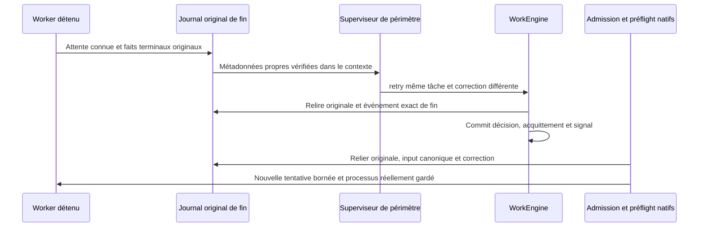

# Fin native du worker et reprise

Implémentation Linux vérifiée sur fixtures natives isolées dans le lot169. Le journal original de fin est une frontière de confiance locale privée, pas une identité cryptographique ni une protection contre un auteur hostile du même UID. PID absent/mort, bail expiré ou message « terminé » ne suffisent jamais à autoriser une reprise.

L’observateur en lecture seule partage la projection terminale Agent/réservation de recovery ; il n’appelle aucune récupération, n’écrit aucun état et ne rembourse aucune tentative. Il vérifie identité du Root original, ligne terminale complète, ownership normalisé, snapshot/contexte natifs, collecte kernel enregistrée, libération de workspace et disposition gate/sortie explicite. Attente/libération inconnue ou exécution en quarantaine/drainage refuse. Une sortie logique invalide connue peut être décrite pour correction, jamais comme acceptation de qualité. Un refus connu du helper est distingué d’un possible démarrage provider ; aucune exécution n’est devinée.

`attempt_ended` est relié exactement à l’originale courante/antérieure, au résultat de l’agent et à son périmètre. Le contexte sélectionné `worker_completions` contient IDs événement/tâche/tentative/agent, résultat, SHA original et observations sortie/démarrage ; aucun prompt/capture brut ou host/stamp PID. Ces octets entrent dans le hash de contexte et le fence de fraîcheur de remise existants. Les anciens événements gardent leur contrat d’acquittement historique seul.

Seule une décision explicite de reprise avec correction nouvelle et capacité sauvegardée d’essais peut poser le signal persistant. Originale et décision/input/acquittement canoniques sont relus avant admission et avant exécution native après création de la nouvelle tentative. La reprise de revue reste distincte ; une ancienne revue non liée n’autorise jamais la reprise après un worker plus récent en échec. Pas de nouvelle tâche ou reset des compteurs pour contourner les limites. Les preuves du lot169 distinguent fin0 témoin, fin17 réelle, décision native, deuxième worker0 et rapport soumis. Cinq altérations avant modèle (attente, gate, projection, JSON invalide et originale absente), puis attente inconnue au préflight refusent sans mutation/appel/réserve/exécution ; restauration exacte et même agent queued exécuté. Les historiques et originaux restent conservés, le rapport nouveau est soumis et non accepté. Une interruption, un refus pré-exec ou une sortie logique invalide sont reconnus par le contrat, sans parcours natif positif revendiqué ici. Aucun conducteur autonome ni installation annoncé.

Les constructeurs de fixtures créent maintenant le dossier de preuves et publient une attribution unique du Root avant l’initialisation CLI. Binary/output acceptent chemin ou chaîne ; le hash binaire est lu avant création du Root temporaire. Le marqueur n’authentifie aucun acteur et ne donne aucun droit. Un init échoué conserve chemin et canaux originaux ; un répertoire temporaire vide peut rester si l’écriture du marqueur de naissance échoue elle-même. Cela s’applique aux prochains imports/appels, pas aux processus Python déjà démarrés ni aux anciens Roots non attribués ; ne jamais adopter/supprimer un Root sur son préfixe ou mtime.

Preuves : [profil normal16](../plans/migration-rust/evidence/20261022-169/normal16/result.json), [reprise complète19](../plans/migration-rust/evidence/20261022-169/control19/result.json), [refus/restauration23](../plans/migration-rust/evidence/20261022-169/faults23/result.json), [récupération publique21](../plans/migration-rust/evidence/20261022-169/completion21/result.json), [29 tests/Clippy/Rustdoc17](../plans/migration-rust/evidence/20261022-169/quality17/result.json). La recette durable est `tools/verification/recipes/native-worker-failure-retry.json`. Les tests utilisent des programmes locaux inertes ; l’identité métier authentifiée, la résistance aux écritures du même UID, l’intégration du checkout concurrent complet et la bascule finale restent des critères séparés.

Qualification du binaire : le lot170 compile le checkout partagé actuel sans exclusion de télémétrie avec une cible neuve, puis vérifie les reprises ci-dessus et les actions HTTP protégées sur le même binaire. Les depfiles antérieurs ne préautorisent jamais un chemin : seules les sources et ressources déclarées des producteurs courants définissent les candidats ; la fermeture effective doit être identique avant/après et archivée. Un cache « fresh » n’est pas une preuve de ce lien. Recette : `native-profile-cache-integrity.json`, garde synthétique d’origine reproduite rouge puis verte, distincte du vrai build natif. Cela ne prouve ni comportement visuel de la console/télémétrie, ni installation, ni parité globale.
