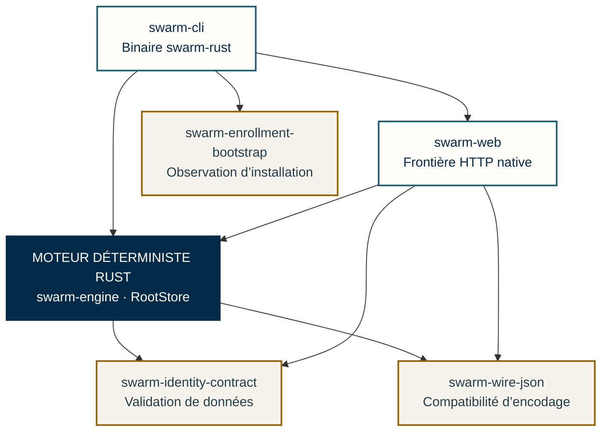

# Architecture interne de Swarm

Historique de planification : [contrat de lecture natif](NATIVE-PLANNING-HISTORY.md), sans exécution des décisions.

La consultation locale dispose de son [contrat natif API/CLI](NATIVE-SESSION-VISIT.md),
avec reçu auxiliaire distinct et reprise, et les [erreurs JSON API](NATIVE-HTTP-ERRORS.md)
distinguent entrée invalide et échec de réponse. Les preuves et limites restent dans le plan de migration.

[English](../en/ARCHITECTURE.md) · [README](../../README.md) · [Sources des schémas](../diagrams/CONTRACT-MAP.md)

La mémoire informe le raisonnement sans créer de droits. Une signature peut établir une origine et une intégrité sous ses hypothèses de confiance ; elle ne prouve ni vérité ni innocuité du contenu. Les vues complètes gardent leurs objets, échanges et raccords ouverts.

Le **moteur déterministe Rust** est le cœur de Swarm. Les vues ci-dessous sont
reconstruites à partir des contrats internes, avec leurs objets, propriétaires,
états durables et frontières de contrôle. Elles ne classent pas l’architecture
par langage historique : la maturité du portage se lit dans une matrice séparée.

Un bloc est une responsabilité fonctionnelle, pas nécessairement un service ou
une crate. Les traits pleins expriment les relations du contrat. Les pointillés
signalent une frontière explicitement future ou un raccord encore ouvert. Aucun
style ne remplace les preuves d’implémentation ou de qualification.

## 1. Moteur, orchestration et chaîne de preuve

[SVG en grand](../diagrams/architecture-overview-fr.svg) · [PNG](../diagrams/architecture-overview-fr.png) · [Source Mermaid](../diagrams/architecture-overview-fr.mmd)

Le moteur relie Work, exigences, plan, tâches, périmètres, baux, événements,
réservations, budgets, contextes, tentatives et candidat. Le superviseur racine
conduit l’objectif et les arbitrages ; les propriétaires enfants conduisent leur
périmètre. Le jugement global de cycle et la revue d’un candidat restent distincts.

Le départ passe par admissibilité, politique sauvegardée, réservations et contexte
figé. La remise rattache rapport et originaux au candidat Git. Le moteur exécute
les contrôles autorisés, prépare les pièces réellement reçues par la revue puis
revérifie droits, critères et fraîcheur avant la transition d’acceptation.
Une anomalie retourne au propriétaire ; elle ne devient pas un succès vide.

### Validation humaine et politique du résultat

Les règles et autorisations viennent des responsables humains. Une politique
`human` peut contenir des contrôles préautorisés : leur succès produit des preuves,
conserve l’attente de décision humaine et ne libère pas l’aval. La revue IA
indépendante ne tient pas lieu de cette décision. Le mode `automatic` conserve
ses contrôles et sa revue ; l’acceptation exige toujours les preuves applicables,
le même candidat, les critères et la fraîcheur.

Le contrôleur natif conserve `pending_human` et `human-validation-required`, avec
les gates et checks manuels ; il ne fabrique pas de gate qualité à partir du seul
PASS des commandes. Ce contrat de validation reste distinct de l’authentification
humaine protégée et du raccord global de l’identité, encore ouverts.

Sources : [validation humaine](../ENGINE-ACCEPTANCE.md#contrôles-comme-preuves-dune-revue-humaine),
[raccord139](RUST-MIGRATION.md#tâches-ordinaires-et-validation-humaine--raccord139-en-qualification),
[contrôleur natif](../../rust/crates/swarm-engine/src/root_store/task_validation/gate.rs).

Sources : [protocole IA/moteur](AGENT-ENGINE-PROTOCOL.md), [preuves de revue](REVIEW-EVIDENCE.md),
[traçabilité](TRACEABILITY.md), [cycles](JUDGMENT-CYCLES.md).

## 2. Identité, autorité et dernier usage

[SVG en grand](../diagrams/identity-authority-fr.svg) · [PNG](../diagrams/identity-authority-fr.png) · [Source Mermaid](../diagrams/identity-authority-fr.mmd)

| Objet / frontière | Contrat à conserver |
| --- | --- |
| Source humaine | Compte personnel local par défaut retenu, fournisseur d’entreprise optionnel ; bootstrap indépendant du premier visiteur et des agents ; parcours encore à intégrer |
| Identités | Principal avec issuer/sujet/catégorie ; acteur ; agent logique ; instance ; propriétaire du périmètre et auteur historique distincts |
| Autorité | Plan courant avec génération/empreinte, octrois exacts, chaîne délégable, dates et révocations ; aucun rôle déclaré n’accorde implicitement `agent.create` |
| Enrôlement | Clé épinglée indépendamment, challenge lié à la demande/projet, réponse Ed25519 et journal signé ; signature des octets distincte des droits courants |
| Publication | Permis privé exact ; instantané SQLite et tête Trust indépendante ; intention, COMMIT, confirmation et reprise récupérable |
| Configuration / canal | Configuration et témoin cohérents ; handshake attribué, image et processus épinglés ; un UID n’est pas une habilitation métier |
| Demande / effet | Opération, ressource, sources/destinataire et contenu exacts ; contrôles dans l’ordre Trust → SQLite → runtime ; accord, engagement, réception et effet distincts |
| Avant plan | Autorité de préparation explicite nécessaire ; aucune règle permissive fondée sur l’absence de plan |

Le service local sous compte distinct est le choix pilote adopté ; l’autorité
distante est prévue. Ces décisions ne déclarent ni installation du service ni
source humaine effective. Les protocoles internes, observations de stockage et
reçus ne ferment pas les raccords publics d’admission et d’usage.

Sources : [identité et autorité](AGENT-IDENTITY-CONTRACT.md),
[droits mémoire et avant-plan](../plans/deepagents-integration/CONTRAT-USAGES-MEMOIRE.md).

## 3. Mémoire, contexte reçu et conversation

[SVG en grand](../diagrams/memory-context-fr.svg) · [PNG](../diagrams/memory-context-fr.png) · [Source Mermaid](../diagrams/memory-context-fr.mmd)

| Circuit mémoire Swarm | Objets et contrôles |
| --- | --- |
| Connaissance de projet | RETEX vérifié, source fraîche, preview/admission, version d’expérience/procédure, sélection explicite, remplacement/retrait/import attribué |
| Contexte de tentative | Contrat et méthodes, références mémoire, projection de la même tâche, citations extractives, `prepared_context`, prompt final et son SHA/taille |
| Consignes futures | `instruction_base`, révisions attribuées, `revise-instructions`, rejet avant réservation, `used_by_attempt` et histoire de réception |
| Conversation | Début/fin de tour, session, usage et checkpoint durables ; `answered` exige une fin positivement confirmée, pas seulement exit 0 |
| Reprise explicite | Diagnostic en lecture seule, `checkpoint_sha256` et `facts_sha256`, motif et décision, précontrôle, nouvelle tentative de la même conversation |
| Droits d’usage | Propriétaire/auteur/récepteur distincts ; lire ne permet pas de résumer ou transmettre ; chaque source et destination participe au contenu autorisé |

L’assemblage recontrôle sources et capacité puis enregistre le contexte avant
départ. Un reçu préparé ne prouve pas la réception par le fournisseur. Une fin
incertaine exige réconciliation avant rejeu. Retirer une mémoire n’efface ni
anciens prompts ni consommations ; importer une mémoire ne crée pas son admission
locale. La base de consigne initiale reste conservée ; les ajouts attribués du
superviseur sont validés par défaut et rejetables avant réservation. Cela ne
remplace aucune décision humaine exigée pour le résultat. La qualification
native de ces circuits est suivie dans la matrice
de maturité.

Sources : [mémoire de projet et dialogue](../PROJECT-MEMORY.md),
[contrat d’usage](../plans/deepagents-integration/CONTRAT-USAGES-MEMOIRE.md),
[révisions de consigne](INSTRUCTION-LEARNING.md).

## 4. Supervision, incidents et reprise du besoin

[SVG en grand](../diagrams/run-supervision-fr.svg) · [PNG](../diagrams/run-supervision-fr.png) · [Source Mermaid](../diagrams/run-supervision-fr.mmd)

Le moteur distingue `elapsed_time`, `tool_wait`, `output_silence`, `infrastructure`
et `tool_failure`. Les événements gardent scope, tâche, agent, tentative et
compteurs. La boîte du propriétaire sépare retours courants et historiques ;
les décisions citent les événements effectivement reçus.

`planning decide` conserve motif et décision après vérification de propriété,
révision, bail, génération, tentative, disponibilité et budgets. Continuer ne
réinitialise rien. Arrêter exige confirmation du processus possédé avant libération.
Le signal reste visible si le propriétaire est indisponible ; aucun superviseur
ou budget n’est inventé. Les limites d’inférence structurée restent distinctes des
seuils d’observation de production. La fin du conducteur ne prouve pas la fin
d’un worker déjà libéré.

La boucle est **incident reçu → diagnostic du propriétaire → décision autorisée →
application → effet constaté → reprise / revue / apprentissage**. Une correction
qui échoue revient dans cette boucle ; documenter l’incident ne la termine pas.
La conduite du processus et l’acceptation du candidat sont distinctes : en mode
`human`, les contrôles et la revue ne remplacent pas la validation humaine requise.

Sources : [conduite](RUN-SUPERVISION.md), [protocole](AGENT-ENGINE-PROTOCOL.md),
[vitalité des appels](PROVIDER-LIVENESS.md), [apprentissage](INSTRUCTION-LEARNING.md).

## 5. Logs, télémétrie, consultation et preuve

[SVG en grand](../diagrams/logs-observability-fr.svg) · [PNG](../diagrams/logs-observability-fr.png) · [Source Mermaid](../diagrams/logs-observability-fr.mmd)

| Source | Conservation et consommation |
| --- | --- |
| Sorties / terminal | `agent_logs`, `terminal_events`, séquences/curseurs et lecture par mission/tentative ; pas une commande réexécutée |
| Événements moteur | Activités, incidents, décisions et reçus attribués ; distinction historique/courant et cause sûre |
| Appels et usages | Tentatives et réservations ; demandé/observé et inconnu/zéro distincts ; aucune facture déduite d’une réservation |
| Ressources Linux | Hôte, PID et starttime vérifiés avant mesure ; identité non vérifiable et donnée absente restent explicites |
| OTLP JSON | Jeton lié à l’agent actif, normalisation, rejets et séries attribués ; `telemetry.db` séparée, pas de prompt/réponse stocké par cette normalisation |
| Console et direct | Monaco en lecture seule avec repli texte ; filtres de serveur/page distingués ; SSE par empreinte et interrogation de repli explicite |
| Export / acceptation | Réponse originale de l’API avec périmètre/limites ; la preuve d’acceptation exige les originaux, candidat, contrôles, revue, validation humaine si requise et fraîcheur |

La consultation ne décide ni conduite ni acceptation. La chaîne doit rester
reconstructible : objectif, décision, propriétaire, tâche, tentative, candidat,
exécution, originaux, revue et décision appliquée. La timeline de sécurité et
la filiation réseau d’AC-02 sont une extension future, distincte des logs actuels.

Sources : [console](LOG-CONSOLE.md), [registre](CALL-ACCOUNTING.md),
[traçabilité](TRACEABILITY.md), [direct et OTLP natifs](RUST-MIGRATION.md).

## Organisation native du code

Le [workspace Cargo](../../rust/Cargo.toml) contient dix crates. Le graphique
ci-dessous montre un **sous-ensemble des dépendances de compilation sous Linux**, lu dans
les manifestes, pas un flux d’autorisation ni une liste de services déployés.

| Source | Rôle et limite |
| --- | --- |
| [swarm-cli](../../rust/crates/swarm-cli/src/lib.rs) | Décode et rend les commandes natives ; ne relance pas le moteur Go |
| [swarm-web](../../rust/crates/swarm-web/src/lib.rs) | Frontière HTTP, sessions et routes natives raccordées ; remplacement Go incomplet |
| [swarm-engine](../../rust/crates/swarm-engine/src/lib.rs) | Modèles, transitions, planification, exécution, supervision, contrôles et réglages selon le périmètre porté |
| [RootStore](../../rust/crates/swarm-engine/src/root_store.rs) | Accès au projet et aux réglages persistés ; ne vaut ni authentification humaine ni permission de partager une racine Go vivante |
| [swarm-identity-contract](../../rust/crates/swarm-identity-contract/src/lib.rs) | Validation des données d’identité ; une donnée valide n’authentifie pas un principal |
| [swarm-enrollment-proof](../../rust/crates/swarm-enrollment-proof/src/lib.rs) | Preuves signées compatibles avec le format Go ; signer des octets n’accorde pas de droits métier |
| [swarm-enrollment-state](../../rust/crates/swarm-enrollment-state/src/lib.rs) | Journal signé natif ; ancre de confiance et fraîcheur au dernier usage restent des obligations distinctes |
| [swarm-enrollment-authority](../../rust/crates/swarm-enrollment-authority/src/lib.rs) | Documents d’autorité versionnés ; leurs données ne sont pas une capacité d’exécution |
| [swarm-enrollment-config](../../rust/crates/swarm-enrollment-config/src/lib.rs) | Configuration d’installation et stockage protégé local ; pas une preuve d’opérateur authentifié |
| [swarm-enrollment-bootstrap](../../rust/crates/swarm-enrollment-bootstrap/src/lib.rs) | Déclaration et observation Linux ; libellé humain, clé ou UID distinct ne prouvent pas l’autorité |
| [swarm-wire-json](../../rust/crates/swarm-wire-json/src/lib.rs) | Comportements d’encodage partagés ; chaque protocole conserve son schéma et sa canonicalité |

Les ressources de présentation sont dans `web/`, `frontend/` et `locales/`.
La CLI et HTTP consomment les opérations du moteur, avec leurs propres frontières
d’entrée et de sortie. Les ressources réellement servies, le profil de build et
le binaire exercé doivent être vérifiés pour chaque livraison ; tester seulement
les fichiers du workspace ne prouve pas leur intégration dans un exécutable.

## Maturité Rust et cible produit

| Contrat | État observé et limites |
| --- | --- |
| Moteur | `WorkEngine` et `RootStore` existent dans `swarm-engine` ; qualification par parcours, pas bascule globale |
| Supervision | Worker, reprise et planner → worker vérifiés sur fixtures CLI ; couverture des rôles, revue/validation et web encore ouverte |
| Validation des résultats | Mode `human` et attente humaine préservés par le contrôleur natif ; preuves locales du raccord139 ; parcours global et authentification protégée restent distincts |
| Identité | Noyaux et protocoles d’enrôlement/configuration présents ; source humaine, service installé et dernier usage public restent à qualifier |
| Mémoire / contexte | Composition de contexte natif partiellement portée ; le guide mémoire géré est refusé tant que sa garde n’est pas portée ; parcours G8 complet et droits M20 ouverts |
| Journaux / télémétrie | Surfaces natives live et OTLP vérifiées localement ; cela n’établit pas la parité de toutes les consoles et de tous les consommateurs |
| Cycle global | `continue`/`renew` vérifiés dans leur périmètre natif ; `judge/end` reste refusé dans le contrat natif actuel |
| Sécurité AC-02 | Plan enregistré ; A0–A7 non démarrés ; reprise après migration/qualification et demande explicite |

Les sources opérationnelles décrivent aussi des implémentations historiques Go.
Leur langage est une information de version et de preuve, pas le nom d’un
sous-système de l’architecture Rust. Les [sources natives](../../rust/crates/swarm-engine/src/project_context.rs),
le [plan actif](../plans/migration-rust/PLAN.md) et le [contrat de migration](RUST-MIGRATION.md)
fixent l’état ; ces schémas ne relancent ni recette ni fournisseur.

La [cible produit](../PRODUCT-ARCHITECTURE.md) conserve deux UX séparables,
Projets et Processus métier. L’[architecture des actions de confiance](ACTIONS-CONFIANCE.md)
et le [plan AC-02](../plans/actions-confiance/securite-execution-apex.md) conservent
confinement, réseau/secrets, menus et quatre références visuelles. Aucun service,
confinement ou paiement réel n’est activé par cette documentation.
