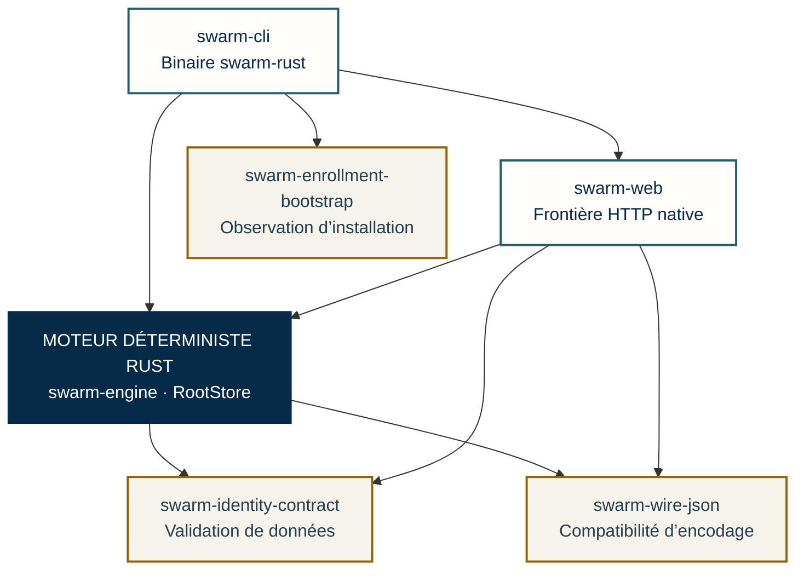

# Architecture interne de Swarm

Historique de planification : [contrat de lecture natif](NATIVE-PLANNING-HISTORY.md), sans exécution des décisions.

La consultation locale dispose de son [contrat natif API/CLI](NATIVE-SESSION-VISIT.md),
avec reçu auxiliaire distinct et reprise, et les [erreurs JSON API](NATIVE-HTTP-ERRORS.md)
distinguent entrée invalide et échec de réponse. Les preuves et limites restent dans le plan de migration.

[English](../en/ARCHITECTURE.md) · [README](../../README.md) · [Sources des schémas](../diagrams/CONTRACT-MAP.md)

La mémoire informe le raisonnement sans créer de droits. Une signature peut établir une origine et une intégrité sous ses hypothèses de confiance ; elle ne prouve ni vérité ni innocuité du contenu. Les vues complètes gardent leurs objets, échanges et raccords ouverts.

Le **moteur déterministe Rust** est le cœur de Swarm. Les vues ci-dessous sont
reconstruites à partir des contrats internes, avec leurs objets, propriétaires,
états durables et frontières de contrôle. Elles ne classent pas l’architecture
par langage historique : la maturité du portage se lit dans une matrice séparée.

Un bloc est une responsabilité fonctionnelle, pas nécessairement un service ou
une crate. Les traits pleins expriment les relations du contrat. Les pointillés
signalent une frontière explicitement future ou un raccord encore ouvert. Aucun
style ne remplace les preuves d’implémentation ou de qualification.

## 1. Moteur, orchestration et chaîne de preuve

[SVG en grand](../diagrams/architecture-overview-fr.svg) · [PNG](../diagrams/architecture-overview-fr.png) · [Source Mermaid](../diagrams/architecture-overview-fr.mmd)

Le moteur relie Work, exigences, plan, tâches, périmètres, baux, événements,
réservations, budgets, contextes, tentatives et candidat. Le superviseur racine
conduit l’objectif et les arbitrages ; les propriétaires enfants conduisent leur
périmètre. Le jugement global de cycle et la revue d’un candidat restent distincts.

Le départ passe par admissibilité, politique sauvegardée, réservations et contexte
figé. La remise rattache rapport et originaux au candidat Git. Le moteur exécute
les contrôles autorisés, prépare les pièces réellement reçues par la revue puis
revérifie droits, critères et fraîcheur avant la transition d’acceptation.
Une anomalie retourne au propriétaire ; elle ne devient pas un succès vide.

### 1.1 Multitâche dans une mission

Le Work porte le DAG des tâches. Chaque nœud conserve son périmètre, ses
prérequis, ses tentatives et sa politique de validation. Une dépendance représente
un résultat attendu avec ses preuves applicables. Une tâche terminée côté
processus peut donc laisser un successeur en attente. La transition de démarrage
vérifie l’état de la tâche et la fraîcheur des éléments requis avant de proposer
une nouvelle tentative.

[SVG](../diagrams/mission-multitasking-fr.svg) · [PNG](../diagrams/mission-multitasking-fr.png) · [Mermaid](../diagrams/mission-multitasking-fr.mmd)

| Étape | Producteur et état | Règle de passage |
| --- | --- | --- |
| Ordonner | Moteur, révision courante du Work et priorités enregistrées | Le comparateur trie par priorité décroissante, profondeur du plus long chemin croissante, puis identifiant lexical. Le graphe et la révision doivent correspondre à la projection. |
| Examiner | Conducteur de mission, sélection des workers | Le moteur filtre les états et profils pris en charge, puis vérifie consentement, prérequis, reprise, coût, modèle et espace de travail. Un refus de tâche laisse les autres candidatures examinables. |
| Inscrire | Moteur, sous bail de mission | La synchronisation inscrit les candidats prêts dans la file FIFO. Une tâche peut attendre avant d’avoir un créneau. [Synchronisation](../../rust/crates/swarm-engine/src/mission_workspace_fifo.rs#L259-L330) |
| Admettre | Usine native et moteur, transaction d’admission | Le moteur revérifie la révision, le bail, les contrôles, le profil, les créneaux et le budget. La transaction lie le tour acquis, l’Agent en file, l’événement du Work et la réservation applicable. Un conflit d’espace reconnu peut laisser passer un candidat disjoint. La capacité pleine termine la passe du Work. [Liaison et écritures](../../rust/crates/swarm-engine/src/agent_launch.rs#L1048-L1083) |
| Démarrer | Superviseur technique de l’agent | Le conducteur démarre l’Agent admis, puis attend le franchissement de sa barrière de démarrage avant une autre admission. Les processus déjà autorisés peuvent tourner simultanément dans des espaces disjoints. |
| Valider le résultat | Worker, contrôles, revue indépendante et responsable | La remise identifie le candidat. Les contrôles peuvent aboutir à une attente de revue ou de décision humaine. Le successeur devient admissible lorsque ses préconditions propres sont satisfaites. [États de validation](../../rust/crates/swarm-engine/src/root_store/task_validation/publication.rs#L181-L225) |

Les créneaux sont comptés par Work sur les états actifs enregistrés. Le
réglage enregistré reste soumis à la politique d’installation. Lorsqu’une
réservation est requise, le moteur vérifie le budget de la mission et conserve
les estimations, engagements et coûts déclarés séparément. Une limite d’essais
du plan ou un seuil de coût par tâche peut bloquer une candidature particulière.
Le contrôle de démarrage est indépendant des contrôles du résultat. Le
conducteur donne la priorité aux workers prêts avant une nouvelle activation
de planification admissible.

**Portée observée.** La recette CLI inerte historique a observé deux workers
autorisés simultanément dans des espaces distincts, un successeur en attente et
une décision racine concurrente préservée. Cette preuve est liée au profil et au
SHA de la recette. Elle laisse ouverts les limites de capacité en conditions
réelles, le coût facturé et la qualification générale des rôles.

[Comparateur](../../rust/crates/swarm-engine/src/mission_task_order.rs#L26) ·
[Candidats](../../rust/crates/swarm-engine/src/mission_candidates.rs) ·
[Dispatch et ressources](../../rust/crates/swarm-engine/src/mission_worker_dispatch.rs) ·
[Conducteur](../../rust/crates/swarm-cli/src/mission_watch.rs) ·
[Créneaux](../../rust/crates/swarm-engine/src/mission_agent.rs) ·
[Budget](../../rust/crates/swarm-engine/src/financial_budget.rs) ·
[Essai inerte de parallélisme](../../tests/rust_mission_watch_parallel.py)

### 1.2 Concurrence entre missions dans un Root

Le serveur Rust découvre les Work automatiques consentis et peut ouvrir une
session de conduite par mission éligible. Le bail de mission encadre la
propriété de cette session. Chaque Work applique ses propres créneaux et
budgets. Les missions d’un même Root partagent la file d’espaces de travail du
datastore. Une racine et son sous-répertoire recouvrent le même espace ; deux
chemins frères disjoints peuvent avancer indépendamment.

[SVG](../diagrams/mission-concurrency-fr.svg) · [PNG](../diagrams/mission-concurrency-fr.png) · [Mermaid](../diagrams/mission-concurrency-fr.mmd)

Un tour en attente valide conserve son rang. Une candidature déplacée reprend
place en fin de file. Les tours en attente ou acquis plus anciens bloquent
les espaces recouvrants. Libérer un tour acquis exige le propriétaire enregistré
et une fin ou annulation établie. La perte du bail du conducteur ne libère pas
à elle seule le tour acquis. Le moteur revérifie
aussi les occupations par agents et intégrations lors de l’admission. Après
libération et réévaluation, une mission peut prendre la ressource si les
autres gardes aboutissent. L’ordre porte sur les espaces de travail et les
tours enregistrés. Une politique d’équité par mission, un ordonnanceur inter-Root
et un débit garanti restent hors qualification.

**Portée observée.** Les tests Rust sur SQLite comparent la projection de
diagnostic et une vraie synchronisation pour des tours nouveaux, déplacés ou
retirés. Ils vérifient aussi l’acquisition et les espaces disjoints. Le [cycle FIFO natif 197](https://github.com/mo0ogly/swarm/blob/9e420d293eb78eeac7f6bbdd61f55e7dd2efe772/docs/plans/migration-rust/REPLAYS.md#L1145)
a exercé deux Work avec baux et connexions concurrentes. La qualification Web
P1.2 de trois missions a confirmé l’attente de B, le départ de C dans son
espace disjoint et la reprise de B sur son tour d’origine. La fiche détaille les
fenêtres exercées et la limite de reprise lorsque le prévol est expiré.
[Fiche de qualification P1.2](SAME-ROOT-FIFO-RECOVERY.md)

[Découverte web](../../rust/crates/swarm-cli/src/native_web/conductor.rs) ·
[File partagée](../../rust/crates/swarm-engine/src/workspace_turn.rs) ·
[Synchronisation et tests](../../rust/crates/swarm-engine/src/workspace_turn_write.rs) ·
[Diagnostic du cockpit](TOKIO-ORCHESTRATION.md#diagnostic-de-démarrage-automatique-dans-conduite)

### 1.3 Refus, interruption et reprise

Un sous-orchestrateur conduit son périmètre et conserve le détail d’un refus
d’autorité visant un autre périmètre. Pour le parcours natif couvert, le moteur
enregistre le refus et un avis adressé à l’orchestrateur racine. L’avis décrit
le périmètre et le code sûr. La racine détient la décision transversale. La
planification du sous-périmètre attend une décision enregistrée de la racine
sur l’avis, puis repasse les contrôles de révision, de droits, de consentement et de budget.

[SVG](../diagrams/scope-refusal-recovery-fr.svg) · [PNG](../diagrams/scope-refusal-recovery-fr.png) · [Mermaid](../diagrams/scope-refusal-recovery-fr.mmd)

| Situation | Réponse du système |
| --- | --- |
| Pause ou consentement retiré | Le conducteur refuse les nouvelles admissions. Le retrait durable du consentement survit à la seule levée de pause. Les réservations et les tentatives précédentes restent des faits historiques. |
| Refus de préflight | Conduite peut afficher un code moteur lié à la mission ou à la tâche. Après correction par son propriétaire, Actualiser relit le diagnostic. Cette lecture ne déclenche aucune tentative. |
| Interruption d’un worker admis | La réconciliation examine l’Agent enregistré et son contexte. L’adoption ou la continuation autorisée conserve son identité. Une nouvelle tentative corrective, lorsqu’elle est permise, est une opération distincte. |
| Résultat ou publication incertains | Retenir l’effet connu, les causes et les identifiants d’origine. Relire l’état effectivement enregistré avant toute décision de reprise. |

La recette historique inerte de refus enfant prouve la remontée, l’attente,
la décision racine et la reprise pour ce cas. La reprise d’un worker,
l’escalade d’autorité et la fin métier ont des contrats et des preuves distincts.

[Refus natifs](../../rust/crates/swarm-engine/src/planning_rejection.rs) ·
[Sélection de reprise](../../rust/crates/swarm-engine/src/root_store/planning_step.rs) ·
[Pause et retrait](../../rust/crates/swarm-engine/src/mission_control_write.rs) ·
[Continuation](../../rust/crates/swarm-engine/src/mission_worker_continuation.rs)

### Validation humaine et politique du résultat

Les règles et autorisations viennent des responsables humains. Une politique
`human` peut contenir des contrôles préautorisés : leur succès produit des preuves,
conserve l’attente de décision humaine et ne libère pas l’aval. La revue IA
indépendante ne tient pas lieu de cette décision. Le mode `automatic` conserve
ses contrôles et sa revue ; l’acceptation exige toujours les preuves applicables,
le même candidat, les critères et la fraîcheur.

Le contrôleur natif conserve `pending_human` et `human-validation-required`, avec
les gates et checks manuels ; il ne fabrique pas de gate qualité à partir du seul
PASS des commandes. Ce contrat de validation reste distinct de l’authentification
humaine protégée et du raccord global de l’identité, encore ouverts.

Sources : [validation humaine](../ENGINE-ACCEPTANCE.md#contrôles-comme-preuves-dune-revue-humaine),
[raccord139](RUST-MIGRATION.md#tâches-ordinaires-et-validation-humaine--raccord139-en-qualification),
[contrôleur natif](../../rust/crates/swarm-engine/src/root_store/task_validation/gate.rs).

Sources : [protocole IA/moteur](AGENT-ENGINE-PROTOCOL.md), [preuves de revue](REVIEW-EVIDENCE.md),
[traçabilité](TRACEABILITY.md), [cycles](JUDGMENT-CYCLES.md).

## 2. Identité, autorité et dernier usage

| Frontière | Code ou observation conservée |
| --- | --- |
| Agent, bail et Root | L’admission automatique lie l’Agent au Work, à la génération du bail, au tour d’espace et à l’instance du Root. Une observation locale de processus porte le PID, son instant de démarrage et l’hôte du superviseur. [Liaison](../../rust/crates/swarm-engine/src/mission_agent.rs#L247-L283) · [Identité du processus](../../rust/crates/swarm-engine/src/supervisor_identity.rs#L115-L168) |
| Session Web et mandat Trust | Le bootstrap enrôlé accepte une source typée pour une intention préparée. Les gardes de session, CSRF, compte courant et Biba restent distinctes. Le RETEX G05.3 rapporte un essai local en dev.225 avec comptes de fixture, sur le parcours explicitement enrôlé. [Entrée Web](../../rust/crates/swarm-web/src/service.rs#L776-L797) · [RETEX G05.3](../plans/migration-rust/evidence/20261027-biba-governance-apex/RETEX-G05.3.md) |
| Lecteur d’un dialogue de préparation | Quand un reçu d’admission correspond au tour lu, le lecteur vérifie le principal et les reçus applicables, puis contrôle l’habilitation avant restitution. Le chemin sans reçu correspondant conserve sa lecture historique. [Contrôle du lecteur](../../rust/crates/swarm-engine/src/root_store/preparation_dialogue.rs#L99-L208) |

Voir le [contrat d’identité](AGENT-IDENTITY-CONTRACT.md) pour les parcours
détaillés et leurs statuts.

### 2.1 Intégrité, confidentialité et confinement

| Frontière | Garantie recherchée | Portée établie |
| --- | --- | --- |
| Biba | Contrôler l’intégrité et les promotions par politique et séparation des rôles | Le noyau Trust porte niveaux, rôles et contrôles d’usage. L’intégration des parcours se vérifie à leur dernier point d’effet. [Contrat Biba](BIBA-RUST.md) |
| Bell-LaPadula | Vérifier classification, compartiments et habilitation du lecteur | Le moteur porte la politique, les attributions et des lecteurs contrôlés. La confidentialité de bout en bout et la déclassification restent ouvertes. [Périmètre et limites](BELL-LAPADULA.md) |
| Identité et mandat | Associer personne, agent logique, instance, opération et périmètre | Le chemin Web enrôlé accepte une source attribuée pour une intention préparée. Le mandat et les gardes d’admission restent propres au parcours. [Contrat d’identité](AGENT-IDENTITY-CONTRACT.md) |
| Confinement | Restreindre les effets d’un processus local | Les gardes Linux et le contrat projet fixent leurs propres limites. Leur portée physique est distincte de la politique métier et de la confidentialité. [Frontière Linux](../../rust/crates/swarm-biba-linux/src/lib.rs) |

Les [témoins de multitâche et de sécurité](#lien-entre-multitâche-biba-et-belllapadula)
indiquent quelles décisions et quels effets ont été observés à chaque frontière.

## 3. Mémoire, contexte reçu et conversation

[SVG en grand](../diagrams/memory-context-fr.svg) · [PNG](../diagrams/memory-context-fr.png) · [Source Mermaid](../diagrams/memory-context-fr.mmd)

| Circuit mémoire Swarm | Objets et contrôles |
| --- | --- |
| Connaissance de projet | RETEX vérifié, source fraîche, preview/admission, version d’expérience/procédure, sélection explicite, remplacement/retrait/import attribué |
| Contexte de tentative | Contrat et méthodes, références mémoire, projection de la même tâche, citations extractives, `prepared_context`, prompt final et son SHA/taille |
| Consignes futures | `instruction_base`, révisions attribuées, `revise-instructions`, rejet avant réservation, `used_by_attempt` et histoire de réception |
| Conversation | Début/fin de tour, session, usage et checkpoint durables ; `answered` exige une fin positivement confirmée, pas seulement exit 0 |
| Reprise explicite | Diagnostic en lecture seule, `checkpoint_sha256` et `facts_sha256`, motif et décision, précontrôle, nouvelle tentative de la même conversation |
| Droits d’usage | Propriétaire/auteur/récepteur distincts ; lire ne permet pas de résumer ou transmettre ; chaque source et destination participe au contenu autorisé |

L’assemblage recontrôle sources et capacité puis enregistre le contexte avant
départ. Un reçu préparé ne prouve pas la réception par le fournisseur. Une fin
incertaine exige réconciliation avant rejeu. Retirer une mémoire n’efface ni
anciens prompts ni consommations ; importer une mémoire ne crée pas son admission
locale. La base de consigne initiale reste conservée ; les ajouts attribués du
superviseur sont validés par défaut et rejetables avant réservation. Cela ne
remplace aucune décision humaine exigée pour le résultat. La qualification
native de ces circuits est suivie dans la matrice
de maturité.

Sources : [mémoire de projet et dialogue](../PROJECT-MEMORY.md),
[contrat d’usage](../plans/deepagents-integration/CONTRAT-USAGES-MEMOIRE.md),
[révisions de consigne](INSTRUCTION-LEARNING.md).

### 3.1 Graphe et continuité

Le graphe de la mission présente les tâches, dépendances et périmètres du Work.
L’atelier propose des sélections et filtres de lecture. Les commandes de
modification franchissent leur propre frontière moteur. Ce graphe ne promet
pas une indexation du code source. [Atelier du graphe](GRAPH-STUDIO.md)

Pour reprendre un dialogue ou une tentative, relire le contexte réellement
reçu, les références de source, la révision et l’identité de la tentative.
Une projection utile à l’agent peut être plus petite que les originaux.
Les contrats de contexte définissent ce qui est attribué, gardé et présenté.
Le contrat exige des droits distincts au point d’usage pour relire une
référence ou la transmettre. La qualification des usages publics M20 reste
ouverte. [Contrat M20](../plans/deepagents-integration/CONTRAT-USAGES-MEMOIRE.md)

## 4. Supervision, incidents et reprise du besoin

[SVG en grand](../diagrams/run-supervision-fr.svg) · [PNG](../diagrams/run-supervision-fr.png) · [Source Mermaid](../diagrams/run-supervision-fr.mmd)

Le moteur distingue `elapsed_time`, `tool_wait`, `output_silence`, `infrastructure`
et `tool_failure`. Les événements gardent scope, tâche, agent, tentative et
compteurs. La boîte du propriétaire sépare retours courants et historiques ;
les décisions citent les événements effectivement reçus.

`planning decide` conserve motif et décision après vérification de propriété,
révision, bail, génération, tentative, disponibilité et budgets. Continuer ne
réinitialise rien. Arrêter exige confirmation du processus possédé avant libération.
Le signal reste visible si le propriétaire est indisponible ; aucun superviseur
ou budget n’est inventé. Les limites d’inférence structurée restent distinctes des
seuils d’observation de production. La fin du conducteur ne prouve pas la fin
d’un worker déjà libéré.

La boucle est **incident reçu → diagnostic du propriétaire → décision autorisée →
application → effet constaté → reprise / revue / apprentissage**. Une correction
qui échoue revient dans cette boucle ; documenter l’incident ne la termine pas.
La conduite du processus et l’acceptation du candidat sont distinctes : en mode
`human`, les contrôles et la revue ne remplacent pas la validation humaine requise.

Sources : [conduite](RUN-SUPERVISION.md), [protocole](AGENT-ENGINE-PROTOCOL.md),
[vitalité des appels](PROVIDER-LIVENESS.md), [apprentissage](INSTRUCTION-LEARNING.md).

## 5. Logs, télémétrie, consultation et preuve

| Source | Écriture et lecture |
| --- | --- |
| Journal d’Agent | L’admission écrit une entrée `command`. Le chemin d’exécution natif produit notamment les entrées `lifecycle` et `incident`, avec un type distinct si le message a été tronqué. [Admission](../../rust/crates/swarm-engine/src/agent_launch.rs#L1067-L1084) · [Écriture du journal](../../rust/crates/swarm-engine/src/agent_execution_store.rs#L50-L109) |
| Terminal enregistré | Le lecteur live demande les lignes du journal et les blocs du terminal avec des curseurs distincts. [Lecture live](../../rust/crates/swarm-web/src/service/live.rs#L705-L727) |
| Télémétrie fournisseur | L’ingestion OTLP/HTTP vérifie un jeton d’exporteur et enregistre la télémétrie normalisée pour le sujet actif associé, Agent, revue ou appel de planification. [Ingestion](../../rust/crates/swarm-web/src/service/otel.rs#L126-L182) |
| Audit de l’autorité | Le journal de l’autorité ajoute et synchronise des entrées chaînées. La lecture contrôle la chaîne. Ce contrôle porte sur le journal relu. [Écriture et relecture](../../rust/crates/swarm-authority/src/audit.rs#L174-L275) |

### 5.1 Lecture historique, rétention et audit

La route protégée `GET/HEAD /api/v1/logs` ouvre le Root en lecture, vérifie sa
liaison et l’association Work–Agent, puis retourne les lignes filtrées et
ordonnées après le curseur. L’extension décimale exacte préserve les séquences
i64 jusque dans le navigateur. `retention_gap` compare le curseur positif
au premier élément conservé pour l’Agent. Le réglage de taille de page peut borner la réponse.
Le verdict BLP par message reste non établi sur cette route.
[Route](../../rust/crates/swarm-web/src/service/log_query.rs#L46-L71) ·
[Lecture moteur](../../rust/crates/swarm-engine/src/root_store/log_query.rs#L47-L109) ·
[Consommateur Web](../../web/native-log-query.js#L13-L24) ·
[Contrat de pagination](NATIVE-LOG-QUERY.md)

## 6. Composants, flux et frontières d’adaptation

| Surface | Responsabilité observée | Source et portée |
| --- | --- | --- |
| Cockpit et CLI | Choisir et déclarer les intentions, lire état et erreurs, rendre compte de l’effet. Le moteur arbitre la mutation à la révision fournie. | [Entrée CLI](../../rust/crates/swarm-cli/src/lib.rs) · [Cockpit natif](COCKPIT-COMPATIBILITY.md) |
| Serveur HTTP Rust | Admettre la requête, ouvrir l’instance Root liée, appeler le moteur, conserver erreurs et effets connus. Les lecteurs peuvent recevoir des codes diagnostiques dégagés des données privées. | [Planification HTTP](NATIVE-PLANNING-HTTP.md) · [Erreurs HTTP](NATIVE-HTTP-ERRORS.md) |
| Autorité | Le frontal et le moteur contrôlent chacun leurs frontières. Une session ou un UID ne vaut pas mandat métier. Les opérations protégées réévaluent identité, droit ou assertion selon leur contrat. | [Politique des requêtes web](NATIVE-WEB-REQUEST-POLICY.md) · [Autorité native](../../rust/crates/swarm-authority/src/lib.rs) |
| Root et stockage | Les lectures cohérentes et transactions du moteur couvrent l’état de leur Root. Les mutations conservent événement, révision et effet durable. Les workspaces d’exécution restent des ressources, avec garde d’identité et d’occupation. | [RootStore](../../rust/crates/swarm-engine/src/root_store.rs) · [Contrat de preuve](TRACEABILITY.md) |
| Fournisseurs | Le résolveur lit configuration, niveau, modèle et restrictions sauvegardées. Le préflight et la frontière d’exécution vérifient le profil, l’espace et les autorisations applicables avant de lancer un processus séparé. | [Résolution](NATIVE-PROVIDER-RESOLUTION.md) · [Lancement natif](../../rust/crates/swarm-engine/src/agent_launch.rs) |
| Intégration IDE / MCP | Toute passerelle éventuelle relève d’un contrat d’interface propre, avec attribution, droits de lecture et d’effet et preuve au dernier usage. Ce document ne qualifie aucun runtime MCP livré. | [Cible d’interface commune](../PRODUCT-ARCHITECTURE.md) |

Un flux de commande relie entrée attribuée, contrôle, transition et résultat
enregistré. Un flux de lecture produit une projection, éventuellement dégradée,
avec une raison visible. Le lecteur de diagnostic de démarrage réemploie les
règles des candidats et l’ordre FIFO. L’admission revalide la ressource, puis
l’exécution technique et les preuves du résultat suivent leurs propres contrats.

La résolution d’un fournisseur expose la route déclarée et les avis sûrs. Le
catalogue local constitue une source de configuration. Une résolution ne
qualifie ni la disponibilité du compte ni la route effectivement exécutée.
Le parcours natif de lancement de mission refuse les connexions API
sélectionnées. La préparation textuelle dispose d’un parcours HTTP JSON ou SSE.
La sonde manuelle de connexion utilise un parcours HTTP JSON distinct.
Les erreurs de fournisseur et les attentes suivent les
[politiques sauvegardées](NATIVE-PROVIDER-POLICIES.md) et le
[contrat d’attente](NATIVE-PROVIDER-WAIT.md).

### 6.1 Contrats aux interfaces

| Appelant et entrée | Producteur et sortie | Refus et reprise |
| --- | --- | --- |
| Cockpit Conduite, Work explicite et lecture actuelle | La route mission `launch-diagnostics` rend révision, tâche éventuelle et codes sûrs. | Session, Work ou observation invalides restent des échecs de lecture. Actualiser relit l’état. [Diagnostic](TOKIO-ORCHESTRATION.md#diagnostic-de-démarrage-automatique-dans-conduite) |
| Opérateur CLI/API, opération, identifiant d’événement et révision attendue | Le moteur vérifie la mutation, puis rend le résultat enregistré ou rejoué. | Un conflit de révision demande une nouvelle observation. Un effet déjà enregistré reste attaché à l’erreur tardive. [Protocole HTTP](NATIVE-PLANNING-HTTP.md) |
| Admin et adaptateur, fournisseur, niveau, usage et politique enregistrée | Le résolveur expose la route déclarée. Le contrôleur produit une tentative seulement après admission. | Un profil absent ou une route hors politique est refusé. Un diagnostic peut précéder une nouvelle décision autorisée. [Résolution](NATIVE-PROVIDER-RESOLUTION.md) |
| Agent, sources attribuées et contrat courant | La composition fournit au runtime le contexte tenté et sa référence. Les candidats gardent rapports, originaux et décision de revue. | Source retirée, preuve périmée ou effet incertain demandent l’examen des pièces avant reprise. [Mémoire](../PROJECT-MEMORY.md) · [Acceptation](../ENGINE-ACCEPTANCE.md) |
| Lecteur des journaux, Work, Agent, filtre et curseur | Une page protégée conserve ordre, bornes retenues et indicateur de suite. | Un filtre ou curseur invalide est refusé. Une lacune de rétention demande une lecture tenant compte de la borne retenue. [Historique](NATIVE-LOG-QUERY.md) |

## 7. Déploiement, capacité et qualification

| Question | Repère |
| --- | --- |
| Construction | Identifier SHA, profil, features effectives, ressources embarquées et empreinte du binaire. Les binaires de fixture et de production ont chacun leur identité. |
| Installation locale | Le [lanceur géré](../../swarm.sh) construit, qualifie et redémarre le seul service concerné. L’API de version et le dialogue affichent la provenance et les évolutions. |
| Stockage | Les mesures de santé lisent la liaison physique du Root et les réglages actuels. Les alertes de stockage ne suffisent pas à décider une admission, une permission ou une reprise. [Santé native](NATIVE-RUNTIME-HEALTH.md) |
| Capacité de mission | Les créneaux, le budget, les restrictions de fournisseur et les espaces disjoints déterminent le parallélisme réalisable. Les plafonds techniques du transport et les valeurs opérateur restent des contrats distincts. |
| Exploitation | Observer temps d’attente et d’exécution, reprises, blocages, coûts déclarés et preuves manquantes par Work, tâche et tentative. Relier chaque mesure à sa source et à sa couverture, en conservant l’inconnu. |
| Maturité | Distinguer contrat adopté, chemin présent dans le code, résultat observé sur fixture ou sur installation, et cible. Vérifier séparément parité des vues et qualification du runtime. |

La capacité entre plusieurs Roots, l’équité entre missions, les coûts réellement
facturés et le débit en charge doivent être mesurés avant une promesse
d’exploitation. Une archive historique garde sa date et son binaire ; une
nouvelle preuve porte son propre SHA. Le plan P0.1 modifie la documentation,
ses cartes et les rendus, sans introduire de nouvelle règle d’exécution.

### Référence et écarts retenus

L’architecture d’Agents-Orchestrator fournit un plan de lecture utile pour les
interfaces, runtimes, adaptateurs, graphes, reprise et observabilité. Swarm
décrit ici un moteur Rust et ses interfaces, avec propriété des périmètres,
admission déterministe et preuves avant acceptation. Les différences
d’architecture, de stockage ou d’intégration restent des questions de contrat,
de source et de qualification. [Référence figée](https://github.com/syntax-syndicate/Agents-Orchestrator/blob/fd1f2a75aca87907cd5e510a65516d120dfd7a3c/ARCHITECTURE.md) · [Plan Rust actif](../plans/migration-rust/PLAN.md)

## 8. Correspondance avec l’architecture de référence

| Rubrique de référence | Décision documentaire pour Swarm | Source et limite |
| --- | --- | --- |
| Vue d’ensemble et couches | Présenter les responsabilités du moteur Rust, des interfaces, de l’Autorité et des processus plutôt qu’une liste de services supposés. | [Organisation native](#organisation-native-du-code) · [Composants et flux](#6-composants-flux-et-frontières-dadaptation) |
| Moteur de workflow et équipe agentique | Décrire un Work et ses périmètres avec admissions, sous-orchestrateurs et preuves. Les conversations et les décisions de cadrage ont leurs propres traces. | [Multitâche](#11-multitâche-dans-une-mission) · [Protocole](AGENT-ENGINE-PROTOCOL.md) |
| Conception des composants et flux de données | Cartographier l’intention, le Root lié, la transition, le reçu et la lecture. Les appels au modèle franchissent une frontière de processus. | [API de planification](NATIVE-PLANNING-HTTP.md) · [Orchestration Tokio](TOKIO-ORCHESTRATION.md) |
| Adaptateurs, modèles locaux et alternatives | Documenter résolution, préflight, exécution et retour. Les restrictions de route sauvegardées restent consommées au point d’admission. | [Résolution native](NATIVE-PROVIDER-RESOLUTION.md) · [Attente et reprise](NATIVE-PROVIDER-WAIT.md). Aucun repli de modèle suggéré par la référence ne vaut politique Swarm. |
| Graphes, scanner et tableau de bord | Documenter le graphe de tâches et les références mémoire utilisées. Le scanner de code et les exports de graphe de la référence restent des pistes distinctes. | [Atelier du graphe](GRAPH-STUDIO.md) · [Mémoire](../PROJECT-MEMORY.md). Une qualification séparée serait nécessaire pour un index du code. |
| Collaboration, contexte et reprise | Distinguer consignes, réception, dialogues, tentative et reprise. Une interruption garde les originaux nécessaires à la réconciliation. | [Contexte](#3-mémoire-contexte-reçu-et-conversation) · [Reprise et incidents](#4-supervision-incidents-et-reprise-du-besoin) |
| Sécurité et confidentialité | Séparer Biba, Bell-LaPadula, identité, mandat, confinement et observation de l’effet. | [Frontières de sécurité](#21-intégrité-confidentialité-et-confinement). Les protections partielles restent qualifiées par parcours. |
| Observabilité et audit | Présenter journaux, télémétrie, registre d’appels, rétention et preuves selon leurs producteurs. | [Logs et audit](#5-logs-télémétrie-consultation-et-preuve) · [Registre d’appels](CALL-ACCOUNTING.md) |
| Déploiement, performance et capacité | Distinguer topologie locale, recette, binaire installé, concurrence par Work et ressources du Root. | [Capacité et qualification](#7-déploiement-capacité-et-qualification). Équité et débit inter-Root restent à établir. |
| MCP et interfaces IDE | Garder un objectif d’interopérabilité subordonné à un contrat de droits et d’observation. | [API commune cible](../PRODUCT-ARCHITECTURE.md). Le pont MCP du dépôt de référence reste un composant de ce dépôt. |

Le code amont exécute les étapes de workflow en série et Agentic Team
route un rôle par tour. Le dashboard et MCP ont leurs propres entrées et
consomment les contextes ou les moteurs selon leur contrat. Ces passages
justifient la séparation des vues d’interface, de coordination et de
dépendances d’exécution dans Swarm.
[Boucle workflow](https://github.com/syntax-syndicate/Agents-Orchestrator/blob/fd1f2a75aca87907cd5e510a65516d120dfd7a3c/orchestrator/core/engine.py#L440-L516) ·
[Boucle par rôle](https://github.com/syntax-syndicate/Agents-Orchestrator/blob/fd1f2a75aca87907cd5e510a65516d120dfd7a3c/agentic_team/engine.py#L311-L373) ·
[Dashboard](https://github.com/syntax-syndicate/Agents-Orchestrator/blob/fd1f2a75aca87907cd5e510a65516d120dfd7a3c/context_dashboard/app.py#L44-L76) ·
[Moteurs appelés par MCP](https://github.com/syntax-syndicate/Agents-Orchestrator/blob/fd1f2a75aca87907cd5e510a65516d120dfd7a3c/mcp_server/engines.py#L22-L62)

### Traçabilité des témoins

| Observation | Entrée et preuve | Portée |
| --- | --- | --- |
| Deux workers, une dépendance | [Code de la recette inerte](../../tests/rust_mission_watch_parallel.py) · [Bilan ORCH-04](../plans/migration-rust/PLAN.md#preuves-du-candidat-local) | Deux admissions actives et espaces disjoints. Les résultats du test n'établissent ni un débit soutenu ni l'acceptation des tâches. |
| FIFO entre deux Work | [Cycle FIFO natif 197](https://github.com/mo0ogly/swarm/blob/9e420d293eb78eeac7f6bbdd61f55e7dd2efe772/docs/plans/migration-rust/REPLAYS.md#L1145), recette avec baux possédés, connexions concurrentes, refus, libération et reprise sur le workspace. | Profil historique CLI et SDK, complété par les tests SQL du sélecteur courant. La qualification Web P1.2 est décrite séparément. [Trois missions](SAME-ROOT-FIFO-RECOVERY.md) |
| Refus enfant et reprise | [Plan et emplacement des originaux](../plans/migration-rust/PLAN.md#remontée-des-refus-dautorité-et-reprise) · [Recette](../../tools/verification/recipes/mission-watch-orchestration.json) · [Scénario](../../tests/rust_orchestration_scopes.py) | Le reçu original du scénario, SHA-256 `b0f243ccffaf45054a3ec673046115aa62b45618bd8f7b8f3b3999f4da48948c`, couvre refus, avis racine, décision et reprise pour un cas inerte. |
| Diagnostic et installation | [Contrat et recette](TOKIO-ORCHESTRATION.md#diagnostic-de-démarrage-automatique-dans-conduite) · [Fusion du diagnostic](https://github.com/mo0ogly/swarm/pull/46) | Le binaire de préparation des fixtures a le SHA-256 `7ff1854fa341e8e52763e6f3156c66de5c8c1ac2294a544b8410b6e233b9e791`. Le serveur HTTP sans conducteur de la recette a le SHA-256 `f924be23a3982a31e3aa1690f401ccb5b7388a9b529ce087962b40921e76d36b`. L’image locale est distincte. La version locale `v0.1.1-dev.389` a le SHA-256 `2fa03ed1ffe14d9243f681027085d0e6f61cbc018fd3c4102e85128f00a9567c`. Son identité active a été vérifiée par processus et API de version. Sur un Root isolé, ce binaire a servi le motif de pause et son rendu FR/EN. Le défaut de fournisseur et sa restauration appartiennent à la recette sans conducteur. [Index des reçus](../diagrams/README.md#reçus-de-qualification--qualification-receipts) |

### Lien entre multitâche, Biba et Bell–LaPadula

| Témoin | Contrôle établi | Portée de sécurité |
| --- | --- | --- |
| Deux workers dans un Work | Deux départs dans des espaces disjoints et un successeur en attente. [ORCH-04](../plans/migration-rust/PLAN.md#preuves-du-candidat-local) | Le code du départ raccorde le confinement Linux. Le témoin ORCH-04 établit le parallélisme. Les refus d’accès sont établis par la fixture Biba dédiée ci-dessous. [Dernier contrôle](../../rust/crates/swarm-engine/src/native_provider_exec.rs#L197-L233) |
| File et reprise entre Work | Rang FIFO, acquisition, libération et réconciliation sous les gardes du parcours testé. [Fiche P1.2](SAME-ROOT-FIFO-RECOVERY.md) | L’identifiant du tour et la liaison Agent–Root permettent de rapprocher des reçus. Aucun verdict Biba ou BLP ne découle du recouvrement des espaces. |
| Refus enfant et reprise | Refus de mandat, avis racine et décision enregistrée dans le cas inerte décrit plus haut. [Production des avis](../../rust/crates/swarm-engine/src/root_store/planning_rejection_feedback.rs#L179-L212) | Le refus de mandat a son propre contrat. Un contrôle de niveau d’intégrité ou d’habilitation sur cet avis reste à établir. |
| Worker géré, fixture Biba | Le reçu `managed-fioclex-fresh` observe des refus de lecture privée et d’écriture privée, officielle et en base, ainsi qu’un refus chez un descendant. Image `909ae5d8…f03d`. [Reçu](../plans/actions-confiance/verification-biba-transverse-20261028/managed-fioclex-fresh/result.json) | Preuve de confinement pour cette fixture. Le reçu indique `accepted:false` et ne porte aucun verdict BLP. |
| Préparation et dialogue, preuves BLP | Diagnostic public des sources attribuées du prompt sur fixture. Pour le dialogue, le verdict au point de lecture est conditionné par un reçu d’admission correspondant. [Reçu du diagnostic](../plans/actions-confiance/verification-blp/20261101-preparation-check-public-01/result.json) · [Contrôle du dialogue](../../rust/crates/swarm-engine/src/root_store/preparation_dialogue.rs#L99-L208) | Portée limitée à la préparation et à la lecture couverte. La confidentialité du trafic d’un worker et la classification de ses logs restent à établir par parcours. |

Une preuve combinée doit relier, pour une même image et une même tentative,
le sujet, l’objet exact ou sa version, la politique, le point de contrôle,
le verdict et l’effet observé. Les témoins ci-dessus couvrent des frontières
différentes.

## Organisation native du code

Le [workspace Cargo](../../rust/Cargo.toml) énumère 16 membres. Le graphique
ci-dessous montre un **sous-ensemble des dépendances de compilation sous Linux**, lu dans
les manifestes, pas un flux d’autorisation ni une liste de services déployés.

| Source | Rôle et limite |
| --- | --- |
| [swarm-cli](../../rust/crates/swarm-cli/src/lib.rs) | Décode et rend les commandes natives ; ne relance pas le moteur Go |
| [swarm-web](../../rust/crates/swarm-web/src/lib.rs) | Frontière HTTP, sessions et routes natives raccordées ; remplacement Go incomplet |
| [swarm-engine](../../rust/crates/swarm-engine/src/lib.rs) | Modèles, transitions, planification, exécution, supervision, contrôles et réglages selon le périmètre porté |
| [RootStore](../../rust/crates/swarm-engine/src/root_store.rs) | Accès au projet et aux réglages persistés ; ne vaut ni authentification humaine ni permission de partager une racine Go vivante |
| [swarm-identity-contract](../../rust/crates/swarm-identity-contract/src/lib.rs) | Validation des données d’identité ; une donnée valide n’authentifie pas un principal |
| [swarm-enrollment-proof](../../rust/crates/swarm-enrollment-proof/src/lib.rs) | Preuves signées compatibles avec le format Go ; signer des octets n’accorde pas de droits métier |
| [swarm-enrollment-state](../../rust/crates/swarm-enrollment-state/src/lib.rs) | Journal signé natif ; ancre de confiance et fraîcheur au dernier usage restent des obligations distinctes |
| [swarm-enrollment-authority](../../rust/crates/swarm-enrollment-authority/src/lib.rs) | Documents d’autorité versionnés ; leurs données ne sont pas une capacité d’exécution |
| [swarm-enrollment-config](../../rust/crates/swarm-enrollment-config/src/lib.rs) | Configuration d’installation et stockage protégé local ; pas une preuve d’opérateur authentifié |
| [swarm-enrollment-bootstrap](../../rust/crates/swarm-enrollment-bootstrap/src/lib.rs) | Déclaration et observation Linux ; libellé humain, clé ou UID distinct ne prouvent pas l’autorité |
| [swarm-wire-json](../../rust/crates/swarm-wire-json/src/lib.rs) | Comportements d’encodage partagés ; chaque protocole conserve son schéma et sa canonicalité |

Les ressources de présentation sont dans `web/`, `frontend/` et `locales/`.
La CLI et HTTP consomment les opérations du moteur, avec leurs propres frontières
d’entrée et de sortie. Les ressources réellement servies, le profil de build et
le binaire exercé doivent être vérifiés pour chaque livraison ; tester seulement
les fichiers du workspace ne prouve pas leur intégration dans un exécutable.

## Maturité Rust et cible produit

| Contrat | État observé et limites |
| --- | --- |
| Moteur | `WorkEngine` et `RootStore` existent dans `swarm-engine` ; qualification par parcours, pas bascule globale |
| Supervision | Sur fixtures CLI, priorité workers, deux exécutions simultanées et remontée enfant → racine → reprise. Le parcours Web P1.2 couvre trois missions isolées dans un Root. La couverture générale des rôles reste ouverte. |
| File entre Work | La recette 197, les tests SQLite et le scénario Web P1.2 couvrent recouvrement, FIFO et reprise dans un Root. Le crash pré-COMMIT conserve le tour de B. L’ordonnancement inter-Root reste ouvert. |
| Lecture cockpit | Le serveur isolé couvre le fournisseur inerte et sa restauration en FR/EN. Le binaire installé, vérifié séparément sur une mission isolée, couvre le diagnostic de pause en FR/EN. |
| Validation des résultats | Mode `human` et attente humaine préservés par le contrôleur natif ; preuves locales du raccord139 ; parcours global et authentification protégée restent distincts |
| Identité | Liaison technique Agent–bail–Root dans le code ; enrôlement Web explicite observé sur comptes de fixture (G05.3) |
| Mémoire / contexte | Composition de contexte natif partiellement portée ; le guide mémoire géré est refusé tant que sa garde n’est pas portée ; parcours G8 complet et droits M20 ouverts |
| Journaux / télémétrie | Écriture du journal d’Agent, recherche protégée et ingestion OTLP référencées au §5 |
| Cycle global | `continue`/`renew` vérifiés dans leur périmètre natif ; `judge/end` reste refusé dans le contrat natif actuel |
| Sécurité AC-02 | Plan enregistré ; A0–A7 non démarrés ; reprise après migration/qualification et demande explicite |

Les sources opérationnelles décrivent aussi des implémentations historiques Go.
Leur langage est une information de version et de preuve, pas le nom d’un
sous-système de l’architecture Rust. Les [sources natives](../../rust/crates/swarm-engine/src/project_context.rs),
le [plan actif](../plans/migration-rust/PLAN.md) et le [contrat de migration](RUST-MIGRATION.md)
fixent l’état ; ces schémas ne relancent ni recette ni fournisseur.

La [cible produit](../PRODUCT-ARCHITECTURE.md) conserve deux UX séparables,
Projets et Processus métier. L’[architecture des actions de confiance](ACTIONS-CONFIANCE.md)
et le [plan AC-02](../plans/actions-confiance/securite-execution-apex.md) conservent
confinement, réseau/secrets, menus et quatre références visuelles. Aucun service,
confinement ou paiement réel n’est activé par cette documentation.
