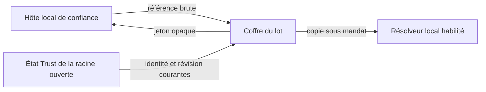

# Jetons P02 et coffre de correspondance

[English](../en/P02-TOKEN-VAULT.md)

Le moteur Rust sous Linux expose `RootStore::open_p02_vault` pour un hôte local
de confiance. L'hôte tient un coffre par lot, remplace le champ retenu avant
de remettre la donnée à l'agent et transmet seulement la projection autorisée.
L'adaptateur métier devra faire ces deux dernières opérations. Le composant
n'est raccordé ni à l'ingestion de factures, ni au fournisseur, ni à la
publication, et n'expose aucune opération HTTP ou CLI sur les valeurs.

- **Ouverture et émission.** Un administrateur Trust I3 authentifié choisit le
  projet logique, le lot, l'audience et le résolveur local courant. Il fournit
  une durée positive, le nombre total d'alias qu'il peut émettre et la taille
  maximale de chaque valeur en octets. Ces termes ont une portée locale au
  coffre. Il n'existe aucun réglage global ajouté, valeur par défaut ou
  persistance des termes. L'ouverture n'attribue aucune habilitation BLP.
- **Correspondance.** L'émetteur présente la valeur avant exposition. Une valeur
  identique dans le même coffre actif reçoit le même alias. Un nouvel alias
  encode 32 octets d'aléa du système en base64url sans remplissage. Les autres
  coffres ont leurs propres associations. La recherche de doublons parcourt
  la table bornée sous le contrôle de l'hôte. Une collision, un défaut d'aléa
  ou le dépassement d'une limite refuse l'émission.
- **Résolution.** Le moteur authentifie de nouveau le principal et vérifie
  le mandat d'instance, le contexte exact, la révision Trust et l'échéance
  monotone. La vérification et la copie ont lieu sous la réservation Trust de
  la racine ouverte. Seul le résolveur reçoit la copie à zéroïsation à la
  destruction. Son affichage de diagnostic masque la valeur et sa taille.
  L'appelant doit demander explicitement les octets avec `as_bytes()`.
  L'identité de la destination physique et l'emploi de cette
  copie relèvent de l'hôte de confiance. L'émetteur dispose de ses droits
  administratifs pour le cycle de vie, et doit être désigné comme résolveur
  s'il doit aussi obtenir une copie.
- **Retrait et reprise.** L'émetteur authentifié peut retirer un alias ou
  révoquer le mandat entier. Le retrait laisse un marqueur sans la valeur
  dans la limite totale d'alias afin d'empêcher la réutilisation d'un jeton
  retiré. L'emprunt Rust exclusif arbitre chaque mutation du coffre. Les
  changements Trust sont ordonnés par sa réservation. La fermeture du coffre
  ou du processus détruit la correspondance. Les buffers possédés par le coffre
  sont zéroïsés à leur destruction. Les copies déjà livrées, les allocations
  de l'appelant, la mémoire du processus et les moyens de réidentification
  demandent une qualification distincte.

Les erreurs de résolution sont typées et sans valeur brute. Quand la fermeture
de la réservation échoue, le moteur ne livre pas de copie. Après expiration ou
changement de révision, l'émetteur peut retirer les données s'il conserve le
rôle requis, ou l'hôte peut détruire le coffre. Une reprise ouvre un nouveau
mandat et émet de nouvelles associations. Le droit de résoudre ne confère
aucune autorisation de publication.

## Vérification

La recette [p02-token-vault](../../tools/verification/recipes/p02-token-vault.json)
exerce l'API Rust publique sur des factures fictives dans une racine isolée.
Elle requiert Linux, Cargo verrouillé, une cible admise et des temporaires
qualifiés. Les cas couvrent les alias intra-lot et inter-lots, les différences
de principal/projet/lot/audience, l’expiration, le retrait, la révocation et la
révision de l'autorité et la réouverture du projet. Le DAT P02 et les directives
D03, D06 et D10 conservent la proposition d'origine et les conditions du pilote.
