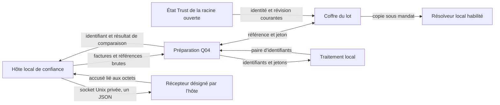

# Jetons P02 et coffre de correspondance

[English](../en/P02-TOKEN-VAULT.md)

Le moteur Rust sous Linux expose `RootStore::open_p02_vault` pour un hôte local
de confiance. L'hôte tient un coffre par lot, remplace le champ retenu avant
de remettre la donnée à l'agent et transmet seulement la projection autorisée.
Pour le parcours de brouillon de facture Q04, l'hôte appelle
`RootStore::prepare_p02_invoice_batch`. L'adaptateur prépare les données et le
brouillon en mémoire. Un hôte peut demander sa remise sur une socket Unix
privée connectée et lire son accusé. Les valeurs brutes restent dans l’API
Rust locale. Le choix du récepteur métier et le lancement du pilote restent
soumis à décision.

- **Ouverture et émission.** Un administrateur Trust I3 authentifié choisit le
  projet logique, le lot, l'audience et le résolveur local courant. Il fournit
  une durée positive, le nombre total d'alias qu'il peut émettre et la taille
  maximale de chaque valeur en octets. Ces termes ont une portée locale au
  coffre. Il n'existe aucun réglage global ajouté, valeur par défaut ou
  persistance des termes. L'ouverture n'attribue aucune habilitation BLP.
- **Correspondance.** L'émetteur présente la valeur avant exposition. Une valeur
  identique dans le même coffre actif reçoit le même alias. Un nouvel alias
  encode 32 octets d'aléa du système en base64url sans remplissage. Les autres
  coffres ont leurs propres associations. La recherche de doublons parcourt
  la table bornée sous le contrôle de l'hôte. Une collision, un défaut d'aléa
  ou le dépassement d'une limite refuse l'émission.
- **Résolution.** Le moteur authentifie de nouveau le principal et vérifie
  le mandat d'instance, le contexte exact, la révision Trust et l'échéance
  monotone. La vérification et la copie ont lieu sous la réservation Trust de
  la racine ouverte. Seul le résolveur reçoit la copie à zéroïsation à la
  destruction. Son affichage de diagnostic masque la valeur et sa taille.
  L'appelant doit demander explicitement les octets avec `as_bytes()`.
  L'identité de la destination physique et l'emploi de cette
  copie relèvent de l'hôte de confiance. L'émetteur dispose de ses droits
  administratifs pour le cycle de vie, et doit être désigné comme résolveur
  s'il doit aussi obtenir une copie.
- **Retrait et reprise.** L'émetteur authentifié peut retirer un alias ou
  révoquer le mandat entier. Le retrait laisse un marqueur sans la valeur
  dans la limite totale d'alias afin d'empêcher la réutilisation d'un jeton
  retiré. L'emprunt Rust exclusif arbitre chaque mutation du coffre. Les
  changements Trust sont ordonnés par sa réservation. La fermeture du coffre
  ou du processus détruit la correspondance. Les buffers possédés par le coffre
  sont zéroïsés à leur destruction. Les copies déjà livrées, les allocations
  de l'appelant, la mémoire du processus et les moyens de réidentification
  demandent une qualification distincte.

Les erreurs de résolution sont typées et sans valeur brute. Quand la fermeture
de la réservation échoue, le moteur ne livre pas de copie. Après expiration ou
changement de révision, l'émetteur peut retirer les données s'il conserve le
rôle requis, ou l'hôte peut détruire le coffre. Une reprise ouvre un nouveau
mandat et émet de nouvelles associations. Le droit de résoudre ne confère
aucune autorisation de publication.

## Préparation du brouillon de rapprochement

L'hôte approuve les identifiants de facture pour la divulgation, fournit les
références de compte sensibles, borne le nombre de lignes et fixe les termes
du mandat P02. Les identifiants doivent être valides et uniques. Une ligne
invalide ou un refus Trust entraîne la destruction du coffre partiel.
`project_for_agent` retourne exclusivement `invoice_id` et `account_token` à
l'émetteur sous mandat courant. L'égalité des jetons est lisible dans le lot.

Le traitement propose deux identifiants de facture distincts. L'hôte appelle
`prepare_draft` avec le contexte et le résolveur autorisé. Le moteur vérifie
les deux alias dans la même réservation Trust et calcule l'égalité. Le
brouillon contient exclusivement `invoice_id` et `account_matches` pour
l'audience du mandat. La préparation seule n’a pas d’effet réseau ou PAEA.
L'hôte reste responsable de l'autorité de sortie et du récepteur effectif.

La résolution du compte via `resolve_account` est une opération locale à part.
Le retrait d'un compte affecte toutes les factures qui partagent son alias.
Il fait refuser une nouvelle projection complète et les brouillons touchés.
Après retrait du mandat ou changement de révision Trust, les opérations
exigeant le mandat refusent. La reprise crée un nouveau lot à partir des
données dont l'hôte possède encore l'autorité.

## Remise locale et accusé

L’hôte de confiance passe une `P02DraftDestination` déjà connectée à
`deliver_draft`. Il lie le canal à une audience, à un contexte de mandat et à
une facture de référence également connue du récepteur. Il choisit les délais
d’E/S sur la socket. Swarm ne résout aucune adresse et n’ouvre aucun listener.
Le mandat et les alias sont vérifiés avant l’écriture, sans conserver la
réservation Trust pendant les E/S. Une révocation empêche les préparations
ultérieures. Elle ne retire pas une remise déjà autorisée.

Le canal est consommé pour un seul brouillon. L’émetteur écrit le JSON fermé
puis ferme sa moitié d’écriture. Le récepteur de test valide le schéma et
l’identifiant attendu, observe le résultat et répond par les 32 octets bruts
du SHA-256 du JSON suivi d’EOF. Seul cet accusé exact produit un
`P02DraftReceipt`. Un échec de préparation écrit zéro octet. Une erreur d’E/S
ou un accusé absent ou invalide laisse la réception non confirmée. L’hôte doit
rapprocher l’état côté récepteur avant toute nouvelle tentative. Le moteur ne
réessaie pas. Le hachage lie la réponse au brouillon sur le canal déjà choisi.
L’accusé n’accorde aucun droit et n’atteste ni un stockage durable ni un paiement.
Le récepteur Python est réservé à la recette.

## Vérification

La recette [p02-token-vault](../../tools/verification/recipes/p02-token-vault.json)
exerce l'API Rust publique sur des factures fictives dans une racine isolée.
Elle requiert Linux, Python 3, Cargo verrouillé, une cible admise et des temporaires
qualifiés. Les cas couvrent les alias intra-lot et inter-lots, les différences
de principal/projet/lot/audience, l’expiration, le retrait, la révocation et la
révision de l'autorité et la réouverture du projet. Le DAT P02 et les directives
D03, D06 et D10 conservent la proposition d'origine et les conditions du pilote.
Le test du brouillon vérifie les deux schémas sérialisés, les alias communs et
séparés, le résultat calculé, les refus sans remise au récepteur inerte et
la reprise après échec d'un lot partiellement préparé.

La recette lance aussi le récepteur Python dans un processus distinct. Elle
relit les brouillons fictifs côté réception, les accusés exacts et les issues
non confirmées. Elle vérifie zéro octet reçu après refus d’audience ou retrait.
