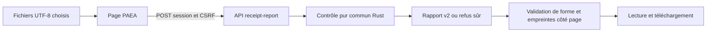

# Contrat de données PAEA v1

[English](../en/PAEA-CONTRACT.md) ·
[Plan et état d’exécution](../plans/actions-confiance/PAEA-APEX.md)

## Capacité actuelle

Le 26 octobre 2026, l’utilisateur autorise compilation et push, levant la consigne
précédente. Les huit cibles Rust PAEA (45 tests) et les cinq tests de schéma passent,
y compris la route HTTP native. Le navigateur exerce le véritable exécutable et
ses ressources embarquées : 12 configurations, 237 assertions, 24 refus attendus,
sans erreur inattendue. Ces résultats établissent le parcours de correspondance,
sans autorité/accord protégé, authenticité de reçu ou effet métier. La livraison
et son identité sont suivies dans [l’incrément 15](../plans/actions-confiance/paea/INCREMENT-15.md).
Les mentions « en sources/non compilé » des étapes datées ci-dessous décrivent
leurs preuves historiques ; elles ne sont pas l’état de qualification actuel.

`swarm protection canonicalize --input FICHIER|- --json` vérifie un document
`{proposal, context}` et calcule ses octets canoniques, son empreinte d’action et
son identifiant d’intention métier. Cette opération est **hors ligne** : elle
n’ouvre pas de Root, ne lit aucun jeton et ne crée ni mandat, ni approbation,
ni effet. Un `--root` différent de `.`, `--server`, un `--output` ou `--task`
non vide et une phase différente de `delivery` sont refusés. Les diagnostics suivent `--lang fr|en` ; les codes et
objets JSON sont indépendants de la langue.

Le résultat expose `authority:"not-established"` et `scope:"offline-data-only"`.
Le contexte fourni reste une déclaration non authentifiée. L’API de protection,
les services d’effet et leur activation ne sont pas implémentés par cette tranche.
Les commandes `protection commit`, `approve` ou `config-apply` refusent.

La bibliothèque Rust `swarm-protection-contract` est partagée par cette commande.
Elle ne dépend pas du moteur, n’a aucun accès OS et ne modifie aucun format Trust.
La livraison 15 a qualifié ces commandes sur le profil natif et installé dev80.
La restriction historique de compilation a été levée ; les preuves des étapes
antérieures restent conservées avec leur portée d’origine.

## Représentations

Le schéma `schemas/paea/contract-v1.schema.json` décrit les documents, propositions,
contextes, liaisons d’approbation et reçus. Il complète, sans les remplacer, les
contrôles de décodage brut et de sémantique suivants :

- `schema_version:1` ; propriétés inconnues et dupliquées refusées à toute
  profondeur, y compris les noms équivalents après décodage Unicode.
- UTF-8 et échappements Unicode valides ; pas de flottant ni de notation
  exponentielle dans les champs numériques. Le parseur garde sa protection
  technique de profondeur ; aucun plafond opérateur n’est ajouté.
- Identifiants : grammaire commune existante, 1–100 octets ASCII alphanumériques,
  tiret ou souligné. Digests SHA256 : 64 chiffres hexadécimaux minuscules.
- Paiement : montant positif sous forme de chaîne décimale sans signe ni zéro
  initial, au plus `9223372036854775807` pour la représentation i64 existante.
  Cette borne technique ne fixe pas de plafond métier. La devise est une
  représentation de trois lettres majuscules, pas une attestation de support ISO.
- Git : référence directe sous `refs/heads/`, grammaire de branche stricte ; OIDs
  SHA1/SHA256 minuscules, non nuls, distincts et du même algorithme. Le service
  futur doit encore refuser les références symboliques et vérifier le dépôt réel.
- Révisions de mandat/politique positives i64. Niveaux d’intégrité I0–I3 du contrat
  existant ; labels de confidentialité définis par la politique, sans permission
  déduite de leur nom. Un couple source/version dupliqué est refusé.

Le JSON Schema seul ne peut pas établir l’existence d’une facture, l’équivalence
métier, la borne lexicale i64 d’une chaîne, l’égalité des algorithmes OID ou
l’unicité des couples source/version. Le décodeur applique les invariants de
représentation supplémentaires. Le consommateur protégé doit prouver le reste.

## Canonicalisation paea-json-v1

Ce profil dédié n’est pas une revendication RFC8785/JCS. Les clés du schéma sont
ASCII et triées lexicographiquement ; objets sans espace ; chaînes JSON UTF-8
avec l’échappement minimal de serde_json ; entiers exacts ; tableaux ordonnés.
Aucune normalisation Unicode, d’URL, de chemin ou d’alias n’est implicite.

Le corps canonique contient `schema_version`, `canonicalization`, `action` et
`context`. Le `request_id` de transport est exclu. Les sources gardent leur ordre
réel de contexte ; les labels d’une source sont un ensemble trié sans doublon.
L’empreinte d’action est SHA256 des octets canoniques exacts. Une modification
du montant, bénéficiaire, version, candidat, source, principal, instance, mandat,
politique ou manifeste change le contenu lié à l’accord.

L’intention métier est SHA256 de `paea-intent-v1\n` suivi du JSON canonique :

| Domaine | Clé métier dérivée |
|---|---|
| `payment.settle` | projet, type, identifiant de facture |
| `repository.promote` | projet, type, dépôt, référence, ancien OID attendu |

Changer clé de requête, montant, version de facture, politique ou candidat ne
crée pas une nouvelle intention pour la même clé métier. Changer projet ou
ancien OID Git crée une autre intention. **Calculer cette clé n’impose aucune
unicité** : le service d’effet doit la réserver et traiter les conflits de contenu.
L’existence et la résolution authentiques des identifiants restent à vérifier.

`matches_approval` compare seulement empreinte et politique d’une liaison valide.
Il ne vérifie ni signature, habilitation, séparation des tâches, expiration,
attention humaine, mandat courant ni effet. Un reçu décodé n’est pas authentifié.

## États et interfaces futures

Le vérificateur pur du cycle n’accepte pas `UNKNOWN → DENIED`, `UNKNOWN → COMMITTED`
ni `UNKNOWN → COMMIT_REQUESTED`. Seule une observation de réconciliation mène à
`RECONCILED_COMMITTED` ou `RECONCILED_NOT_COMMITTED`. Les états terminaux ne mutent
plus ; lire un résultat historique reste une opération distincte du cycle.
Construire un événement Rust n’est pas une preuve qu’il a été observé.

Noms réservés par PA-01 pour le raccord futur commun CLI/API : `show`, `inventory`,
`config-preview`, `config-apply`, `mandate-create`, `mandate-delegate`,
`mandate-revoke`, `request`, `approve`, `commit`, `reconcile`, `export`, `verify`.
Ils ne sont pas disponibles dans l’espace `protection` actuel. Les mêmes
producteurs protégés devront être consommés par l’API et les deux UX ; aucun
stockage ou paramètre Root libre ne devra servir de source d’autorité.

## Vérification et limites

Les quatorze vecteurs des deux domaines sont conservés dans
`tests/fixtures/paea/contract-v1.json`. Ils ont été produits par l’oracle Python
depuis ce contrat, avant exécution Rust. Cette comparaison locale entre deux
implémentations de canonicalisation n’est pas la seconde frontière indépendante
exigée pour E3. Les tests de PA-01 ne prouvent aucun des scénarios distribués
T01…T22, aucun confinement ni niveau d’assurance global.

Recette permanente : `tools/verification/recipes/paea-contract.json`.
Toute erreur garde son diagnostic statique sûr et sa cause typée ; le lecteur
CLI réutilise les limites techniques d’entrée existantes. Une erreur d’écriture
ou de flush conserve une sortie non nulle, sans effet projet à réconcilier.

### Recette publique sans compilation

`tools/verification/recipes/paea-public-existing-binary.json` exécute quatorze tests
publics sur un **binaire déjà construit**, sans Cargo, build ni
redémarrage. L’appelant fournit explicitement `SWARM_PAEA_TEST_BINARY`, son SHA256
dans `SWARM_PAEA_TEST_BINARY_SHA256` et un chemin neuf
`SWARM_PAEA_TEST_TRANSCRIPT`. L’absence de ces préconditions refuse avant collecte.
Le transcript conserve les octets d’entrée/sortie et les codes retour de chaque
invocation ; l’empreinte du binaire est contrôlée avant et après la recette.
Elle ne démontre pas son graphe de compilation ni son installation.

Les quatorze vecteurs passent par stdin et fichier en FR/EN ; seize mutations
brutes couvrent doublons, clés Unicode équivalentes, nombres ambigus, données
après JSON, autorité inventée, OIDs incompatibles et no-op Git. Chaque faute est
encadrée par un témoin valide et une reprise valide dans la même racine isolée.
Des représentations équivalentes conservent exactement les octets attendus.
Le cas `/dev/full` vérifie la sortie non nulle après un échec d’écriture.
Cette recette nécessite un environnement Linux disposant de ce périphérique.

La revue GLM interne du décodeur est une contribution statique ciblée, sans
exécution par le modèle ni indépendance E3. Les suggestions de cas sont adaptées
au vrai schéma, puis vérifiées par le principal. Voir le
[suivi de l’incrément 02](../plans/actions-confiance/paea/INCREMENT-02.md).

La recette couvre aussi, pour les deux domaines en FR/EN, le refus des opérations
actives non implémentées et des options root/serveur/output/task/phase incompatibles.
Les valeurs explicites `--root . --phase delivery` restent admises. Les entrées
absentes, répertoires et JSON vides (stdin/fichier) conservent leurs codes de refus,
avec témoin et reprise. Aucun serveur n’est lancé ; cette vérification de routage
ne démontre pas la médiation d’un projet protégé. Voir
[l’incrément 03](../plans/actions-confiance/paea/INCREMENT-03.md).

Huit tests supplémentaires couvrent `compare` et `check-receipt` : rapports
complets des deux domaines en FR/EN, variantes d’intention/transport, toutes
les issues de reçu permises, entrées invalides et liaisons incompatibles,
UNKNOWN/terminaux, refus runtime et erreurs publiques d’écriture avec reprise.
Les deux fichiers conservent leurs octets et aucun fichier projet n’est créé.
Les diagnostics comparent exactement `failure.code`, l’enveloppe du producteur
CLI. Les fichiers d’entrée et les flux originaux figurent dans le transcript.
L’erreur de flush injectée par un writer Rust reste distincte du cas public
`/dev/full` ; ces tests Rust ne sont pas exécutés par cette recette Python.

### Vérifier le résultat hors ligne

Un [outil de correspondance](PAEA-CANONICAL-VERIFIER.md) relit le document et
l’export, recalcule octets/digests/intention et lie les fichiers consommés par
SHA256. Ce consommateur hors ligne ne constitue aucun rôle E3 ; aucune
authentification ou admission sémantique n’est établie. La commande runtime
`protection verify` reste indisponible.

### Comparaison Rust en cours de réalisation

Les sources de la bibliothèque exposent `compare_documents` : deux documents
strictement validés, chemins modifiés sans valeurs, identités des octets et
distinctions contenu/intention/transport. Aucun accord ou effet n’est établi.
Trois tests Rust sont écrits et non exécutés dans ce chantier. Le raccord CLI
est présent dans un candidat préconstruit ; ses observations publiques sans
nouvelle compilation sont suivies dans l’incrément 09. API/UX ouvertes. Voir
[l’incrément 05](../plans/actions-confiance/paea/INCREMENT-05.md).

### Commande de comparaison en sources (non qualifiée)

`swarm-rust protection compare AVANT APRES --json --lang fr` lit deux fichiers
réguliers avec les mêmes contraintes de transport que la commande existante.
Aucun stdin pour cette opération ; `./-` désigne un fichier nommé `-`. Options
runtime incompatibles refusées avant lecture. La sortie contient `scope` et
`comparison` ; les trois marqueurs autorité/effet/validité d’accord restent
`not-established`. Schéma descriptif : `schemas/paea/comparison-v1.schema.json`.
Les fichiers sont lus successivement, sans preuve d’instantané ni de fraîcheur.
Les erreurs IO/fermeture/validation/écriture/flush conservent les contrats existants.
Quatre tests CLI Rust sont écrits et non exécutés ; nouveau build et Rustdoc
restent différés. La recette publique utilise un candidat préconstruit, sans
installation revendiquée. API/UX non raccordées. Voir
[l’incrément 06](../plans/actions-confiance/paea/INCREMENT-06.md).

### Liaison des reçus au cycle — sources non qualifiées

`check_receipt_transition(action, receipt, expected_sink, previous)` relie le reçu
validé à l’empreinte exacte d’action, l’intention et le service attendu, puis
réutilise `State::transition`. UNKNOWN accepte uniquement les issues explicites
de réconciliation ; les états terminaux ne permettent aucun rejeu. Ce contrôle
pur retourne un état proposé, sans mutation ni IO. Les erreurs de forme, service
attendu, liaison ou cycle ont des codes statiques ; aucun rapport partiel.

Les paramètres fournis ne deviennent pas fiables par cette vérification. Même
un reçu forgé cohérent passe : signature, observation indépendante, artefact
observé, ordre protégé, autorité au dernier usage et unicité restent à établir
par le propriétaire protégé. Aucune nouvelle commande active. Quatre tests Rust
sont écrits, non exécutés ; aucun nouveau build ni installation dans ce chantier. Aucun format
de reçu ni politique n’est changé. Voir
[l’incrément 07](../plans/actions-confiance/paea/INCREMENT-07.md).

### Commande de liaison de reçu (qualification globale ouverte)

`swarm-rust protection check-receipt ACTION RECU SERVICE ETAT_PRECEDENT --json
--lang fr` consomme deux fichiers réguliers nommés : un document `{proposal,
context}` et un reçu au format existant. `SERVICE` est l’identifiant attendu,
sensible à la casse ; `ETAT_PRECEDENT` utilise exactement les valeurs sérialisées
de `State`, par exemple `COMMIT_REQUESTED` ou `UNKNOWN`. Les fichiers sont lus
successivement, sans instantané atomique ni preuve de fraîcheur. `-` et `--input`
non vide sont refusés ; `./-` reste un nom de fichier. Les restrictions runtime
existantes s’appliquent avant lecture ; la syntaxe d’état est aussi contrôlée
avant lecture. Aucun état par défaut n’est choisi.

Le raccord recalcule l’action canonique, décode strictement le reçu et appelle
`check_receipt_transition`. La sortie contient `schema_version`, `scope`,
`action_digest`, `intent_id`, `previous_state`, `proposed_state`, `authority`,
`receipt_authenticity` et `effect`. Les trois derniers marqueurs valent toujours
`not-established` ; `scope` vaut `offline-data-only`. Les valeurs de service et
d’observation ne sont pas recopiées dans le rapport. Schéma de sortie descriptif :
`schemas/paea/receipt-check-v1.schema.json` ; sa validation ne prouve pas la
correspondance ni le cycle, qui relèvent du contrôle Rust.

Une représentation JSON ou un nom d’état invalide retourne
`protection-document-invalid` avec cause conservée ; la représentation du reçu,
le service attendu, la liaison et le cycle gardent les codes décrits ci-dessus.
L’erreur de syntaxe d’appel utilise le code CLI existant `command_failed` ; les
erreurs de lecture gardent les codes du lecteur commun. Une erreur d’écriture
ou de flush peut suivre des octets partiels ou complets ; elle reste non nulle
et ne signifie pas qu’un effet protégé a eu lieu. Aucun projet ni reçu n’est
modifié et aucun accord n’est activé, même si le rapport est cohérent.

Quatre tests d’intégration ciblés sont écrits dans `protection_receipt` : les deux
domaines en FR/EN, refus/reprise, routage et erreurs d’écriture/flush avec cause.
Le test de sortie s’exécute dans un processus de test isolé pour que même une
régression ouvrant le Root par défaut n’atteigne pas le checkout appelant. **Aucun
test Rust exécuté ni nouveau build** sous la consigne utilisateur reconfirmée.
Services protégés, installation et qualification restent ouverts. Les
observations publiques du candidat préconstruit sont suivies dans
[l’incrément 09](../plans/actions-confiance/paea/INCREMENT-09.md). Historique :
[l’incrément 08](../plans/actions-confiance/paea/INCREMENT-08.md).

### Rapport lié aux octets d’entrée — schéma v2 en sources

`swarm-rust protection receipt-report ACTION RECU SERVICE ETAT_PRECEDENT --json`
prépare une sortie distincte de `check-receipt`. Les deux entrées restent au
schéma v1 ; seul le nouveau rapport utilise `schema_version:2`.
`check_receipt_documents` décode les deux entrées strictement, recalcule l’action
canonique et appelle le même contrôle de liaison/cycle avant de construire le
rapport. Il réutilise `DocumentIdentity` et SHA-256 déjà présents ; aucune
dépendance, politique, signature, autorité ou écriture d’état n’est ajoutée.

La sortie v2 contient les neuf propriétés suivantes :

- `schema_version:2` et `scope:"offline-data-only"` ;
- `document` : `document_sha256` des octets du premier fichier, `action_digest`
  canonique et `intent_id` métier ;
- `receipt_sha256` des octets exacts du second fichier ;
- `previous_state` fourni et `proposed_state` déclaré par le même contrôle ;
- `authority`, `receipt_authenticity`, `effect`, toujours `not-established`.

Le schéma descriptif est `schemas/paea/receipt-report-v2.schema.json`. Une
modification de mise en forme, clé de transport ou digest d’observation reste
distinguable dans l’identité brute correspondante, même si le contenu canonique,
l’intention ou l’état proposé sont identiques. Les empreintes ne prouvent ni
signature ni vérité d’un reçu ; il faut conserver les originaux et établir leur
provenance protégée. Lire deux fichiers successivement ne fournit ni instantané
atomique ni fraîcheur. Aucun champ métier ou identifiant de service n’est ajouté
en clair à la sortie. Les empreintes restent à remettre à un destinataire autorisé.

Le contrat v1 de `check-receipt` conserve ses neuf propriétés, sans ajout implicite
ni changement de version. Les deux commandes partagent les refus de framing,
d’état, de lecture et de binding/cycle, et la même écriture/flush avec causes
conservées. La version de sortie ne confère aucune permission et n’est pas un
réglage opérateur. Les erreurs préalables retournent aucun rapport ; un échec
de publication peut suivre des octets visibles sans effet projet.

L’extension a été écrite sans build dans [l’incrément 10](../plans/actions-confiance/paea/INCREMENT-10.md).
Depuis [l’incrément 12](../plans/actions-confiance/paea/INCREMENT-12.md), son parcours
CLI est observé sur un candidat **dev77 préexistant**, figé par SHA256 : 18 tests
publics, 973 invocations dont 268 refus attendus. Sept sources PAEA correspondent
à l’archive effective conservée du build ; aucun build effectué ici. La distinction
des octets de reçu/document est vérifiée, avec le format v1 conservé. Ces contrôles
Python ne sont pas l’exécution des quatre tests Rust de bibliothèque et des trois
tests CLI Rust, qui restent non lancés. Le corpus historique dev75 reste conservé.
Installation, authenticité, autorisation et effet réel ne sont pas établis.

### Vérifications depuis l’UX — raccord en sources

L’écran PAEA revient directement au cockpit (`/`) : son déploiement ne dépend
pas de la présence du module Biba/Actions de confiance. Le cockpit publie son
entrée propre ; un module voisin peut aussi fournir un lien vers PAEA.

Le menu du cockpit Rust et la page **Actions de confiance** proposent
**Vérifications PAEA** (`/paea.html`). Sélectionner le document JSON de l’action
et son reçu, saisir le service attendu, choisir l’état précédent puis cliquer
**Vérifier la correspondance**. Aucun état/service n’est deviné. Les fichiers
proviennent du dossier à examiner ; leur production par des services protégés
reste une dépendance PA-02/03/09. L’écran ne lance pas les tests du dépôt et
n’active aucune protection de projet.

Le résultat montre la correspondance structurelle, l’état **déclaré par le reçu**,
quatre empreintes et un rapport v2 téléchargeable. `UNKNOWN` garde son incertitude
et ne permet pas de réengager une action. Autorisation, authenticité et effet réel
restent non établis. Refus/erreurs restent visibles avec les fichiers sélectionnés.
Modification, refus ou nouvel essai invalident le rapport précédent ; chargement
désactive saisies et double soumission. Une reprise demande un geste explicite.



Raccord écrit, sans autorité ni service d’effet dans ce flux.
`POST /api/v1/protection/receipt-report` exige `Content-Type: application/json` et
l’enveloppe fermée `http-receipt-check-v1.schema.json` : `schema_version: 1`,
`document` et `receipt` **chaînes contenant les originaux UTF-8**, `expected_sink`,
`previous_state`. Doublons/champs inconnus, état/version/méthode invalides, query
ou type de contenu incorrects refusent. Les JSON internes ne sont pas décodés par
JavaScript, préservant les grands entiers. UTF-8 invalide refuse localement sans
remplacement ; un BOM est préservé et peut ensuite être refusé par le décodeur
commun. Avant export, le navigateur rapproche les empreintes brutes du rapport
des octets choisis. Les empreintes n’authentifient pas le service.

Admission Host/session/origine/CSRF et limite technique de transport existantes ;
aucun nouveau quota, délai, retry ou réglage Admin. L’API utilise
`check_receipt_documents`, comme la CLI `receipt-report`, sans Root par requête,
mutation ni effet. Causes JSON/PAEA typées, `failure.code` statique sans corps
fourni ; 400 pour refus de données, 403 pour admission, 405 pour méthode et 413
pour transport trop grand. Échec de livraison HTTP ne devient pas un succès.
Les assets FR/EN et thèmes `etat`/`sombre` figurent dans l’inventaire embarqué privé.

**Route Rust et octets effectivement servis non compilés/non exécutés/non
installés** sous la consigne active. Deux tests `swarm-web --test paea` sont
ajoutés à `paea-contract`, sans lancement. Le navigateur est vérifié sur les
sources avec une API explicitement simulée ; cela ne qualifie pas le service natif.
Rejouer sans compilation avec des répertoires neufs et des parents existants :

```sh
SWARM_PAEA_UI_EVIDENCE=/chemin/parent/existant/nouveau-navigateur \
  python3 tools/verification/recipe.py run \
  --recipe tools/verification/recipes/paea-ux.json \
  --output /chemin/parent/existant/nouvelle-recette
python3 tools/verification/recipe.py verify --evidence /chemin/parent/existant/nouvelle-recette
```

La recette couvre FR/EN, thèmes, 1440/1024/760/390/320 px, contraste du bouton,
clavier, vide/chargement, refus/reprise, UTF-8/empreintes, invalidation, export et
session indisponible. Aucun watchdog global ni appel fournisseur.
Preuves/limites : [incrément 11](../plans/actions-confiance/paea/INCREMENT-11.md).

### Écran relié au vérificateur réel sans compilation

Une deuxième recette `paea-cli-ux.json` relie les assets de l’écran à la CLI
préconstruite par un **pont HTTP de fixture**, distinct du service natif. Elle
n’invente pas les réponses du vérificateur : 174 assertions et 48 appels réels
(36 succès, 12 refus attendus), FR/EN, deux domaines, liaison, cycle, JSON invalide,
`UNKNOWN`/réconciliation et distinction des octets. Aucun Root vivant, fournisseur
ou effet ; chaque appel conserve ses fichiers et ses flux originaux.

Fournir `SWARM_PAEA_TEST_BINARY`, son `SWARM_PAEA_TEST_BINARY_SHA256` observé et
`SWARM_PAEA_UI_EVIDENCE` désignant un répertoire neuf, puis utiliser le lanceur
permanent avec `--recipe tools/verification/recipes/paea-cli-ux.json` et un
`--output` neuf ; vérifier les preuves par la commande `verify`. Aucun appel
Cargo ni watchdog global. Le pont possède une session de test : il ne prouve pas
l’admission Host/session/CSRF du serveur natif ni ses ressources embarquées.
Les deux tests HTTP Rust et le vrai parcours natif restent ouverts sous la
consigne sans compilation/redémarrage. Après un changement concurrent du catalogue
(hors libellés PAEA), le composant a été rejoué séparément sur les octets courants :
219 assertions et 40 requêtes simulées PASS. Le pont garde son catalogue archivé ;
voir [incrément 12](../plans/actions-confiance/paea/INCREMENT-12.md).

## Résolution hors ligne des dettes — incrément 16

`swarm protection resolve-payment REGISTRE DEMANDE --json --lang fr` utilise
le même module Rust pur que les autres commandes. Deux fichiers réguliers nommés
sont requis ; stdin et options de runtime incompatibles sont refusés avant lecture.
Exemples versionnés : `tests/fixtures/paea/payment-registry-v1.json` et
`payment-request-v1.json`. Schéma : `schemas/paea/payment-resolution-v1.schema.json`.

Le registre contient `schema_version:1`, `project_id`, `revision` positive i64 et
`debts`. Chaque dette fournit `debt_id`, `supplier_id`, `invoice_references` non
vide, `invoice_version`, `amount_minor`, `currency`, `beneficiary_account_id`.
La demande fournit `schema_version:1`, `request_id`, `project_id`, `supplier_id`,
`invoice_reference`, `expected_registry_revision`, `expected_invoice_version`.
Tous les objets sont fermés ; doublons JSON et nombres flottants sont refusés.
La grammaire des identifiants et des termes est celle du contrat v1, sans nouveau
plafond opérateur. Le snapshot entier est vérifié avant sélection : identifiant
de dette unique, couple fournisseur/référence unique, y compris les autres lignes.
Aucune recherche approximative, normalisation ou fusion automatique.

Le rapport v1 contient `proposal` (proposition v1 dont `invoice_id=debt_id`),
`registry_revision`, SHA256 exacts `registry_sha256`/`request_sha256`,
`scope:"offline-data-only"` et les trois mentions `authority`,
`registry_authenticity`, `effect` à `"not-established"`. La proposition n’inclut
pas le contexte : le futur producteur protégé doit vérifier le projet et lier
l’observation du registre au contexte avant canonicalisation/accord. Les hashes
ne prouvent ni signature ni fraîcheur. Une correction conserve `debt_id`, change
le contenu exact et conserve l’intention v1. Aucune migration du hash v1.

Codes sûrs : `protection-registry-identifier`, `protection-registry-ambiguous`,
`protection-registry-project-mismatch`, `protection-registry-stale`,
`protection-registry-reference-unknown`, `protection-invoice-stale`, plus les
erreurs de représentation communes. Aucune proposition après refus ; récupérer
les données courantes attribuées, corriger puis refaire explicitement le contrôle.
Lecture/écriture/flush gardent leurs causes ; une erreur de sortie peut exposer
un JSON partiel/complet, jamais un règlement. Les snapshots indépendants ne
prouvent ni continuité des IDs ni absence de dettes sémantiquement dupliquées
avec des références disjointes. PA-02/03 protégés restent ouverts.

## Résolution de facture dans Vérifications PAEA — incrément 17

Depuis le cockpit : **Vérifications PAEA → Résoudre une référence de facture**
ouvre `/paea-payment.html`. Choisir les fichiers registre et demande décrits plus
haut, puis **Résoudre la référence**. L’aide repliée précise leur rôle. Le résultat
affiche dette, version, montant entier en unités mineures/devise, compte, révision
et hashes. Le rapport brut peut être téléchargé ; il ne crée ni contexte
d’admission, ni accord, ni règlement. Les liens entre ces vues gardent langue et
thème. Le contrôle action/reçu reste disponible par retour explicite.

`POST /api/v1/protection/resolve-payment` exige Host/session/origin/CSRF natifs,
JSON, aucun paramètre de query et la borne de transport existante. Enveloppe
fermée : `{schema_version:1, registry:String, request:String}`. Les chaînes sont
les JSON UTF-8 originaux, pas des objets parsés ni des chemins serveur. Schéma :
`schemas/paea/http-payment-check-v1.schema.json`. La route renvoie exactement le
rapport `payment-resolution-v1`, par le même résolveur que la CLI. Les erreurs de
transport/JSON/résolution gardent leur cause typée et un code sûr ; aucun rapport
partiel ni mutation Root par cette opération.

Le navigateur décode les fichiers en UTF-8 fatal, conserve BOM et nombres des
entrées. Pour la révision i64 du rapport, il conserve le lexème numérique exact
via le contexte du décodeur JSON ; ce texte est interne à l’affichage. Un
navigateur sans cette capacité refuse et propose la CLI. Le téléchargement
conserve le JSON original, dont `registry_revision` reste un entier. Le montant
reste une chaîne entière ; aucune échelle monétaire n’est déduite de la devise.
Forme fermée, bornes de représentation v1, marqueurs non autorisants et hashes
des deux fichiers sont vérifiés avant affichage/téléchargement. Les fichiers
restent sélectionnés après refus, le résultat antérieur est effacé et une
nouvelle vérification exige un geste explicite. Aucun retry, stockage des
documents dans le navigateur, réglage opérateur ou nouveau plafond métier.

Ce raccord ne livre pas un registre protégé : authentification, continuité des
IDs, fraîcheur, approbateur humain et engagement effectif restent PA-02/03.
