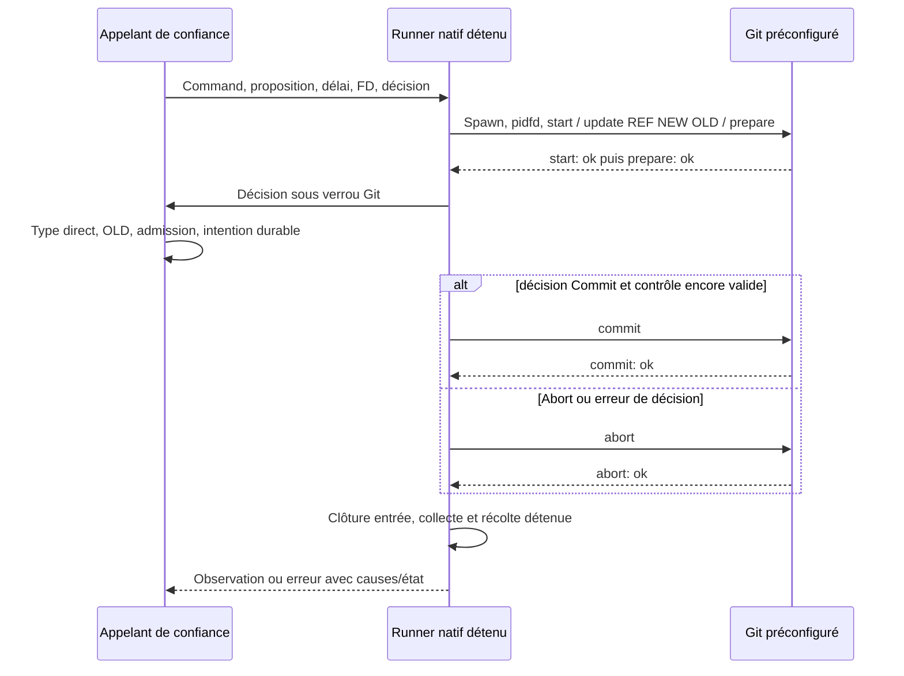
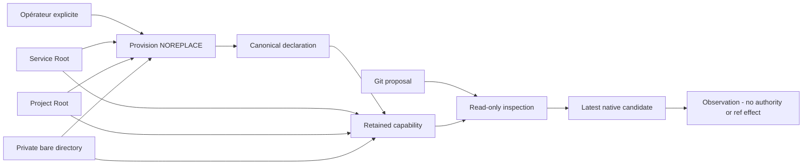

# Primitive transactionnelle Git PAEA

[English](../en/PAEA-GIT-TRANSACTION.md)

API Linux de bibliothèque qualifiée en fixtures : `run_git_reference_transaction`.
Elle compose le runner natif détenu avec une entrée nonbloquante et un parser
strict d'accusés Git. Aucun service d'effet PAEA, dépôt protégé, admission,
intention durable ou parcours de publication Git public n'est fourni par cette API.

## Entrées et responsabilités

L'appelant de confiance fournit une `Command` Git préconfigurée (exécutable,
options, cwd et environnement), une proposition Gitv1 validée, son échéance
monotone déjà décidée et éventuellement un FD d'annulation emprunté. `None` pour
l'échéance signifie aucune. Aucun chemin ou programme ne vient de la proposition.
La primitive ajoute seulement `update-ref --no-deref --stdin`. Le consommateur
natif doit utiliser les politiques persistées/Admin existantes ; aucun défaut de
durée, retry, grâce ou plafond opérateur n'est ajouté ici.

Le callback synchrone est appelé une fois après prepare, sous verrou Git. Il doit
établir type direct de référence, OLD exact, autorité courante et intention durable,
en conservant les témoins de dépôt et réservations nécessaires. La primitive ne
réalise pas ces contrôles à sa place. Le callback doit respecter contrôle et délai :
il n'est pas préempté. La proposition validée reste une donnée, jamais un droit.

## Séquence

`update-ref --no-deref` seul peut remplacer une référence symbolique ; une lecture
avant prepare laisserait une course. Le callback vérifie donc l'original pendant
que Git conserve le verrou acquis par prepare.

## Résultats, erreurs et reprise

`GitReferenceObservation` distingue `NotRequested`, `CommitRequested`,
`CommitAcknowledged` et `AbortAcknowledged`. NotRequested ne concerne que cet appel,
pas l'historique. Un ACK n'est ni une observation indépendante du ref ni une
attestation de l'exécutable. Après envoi de COMMIT, toute rupture exige une
réconciliation avant une nouvelle publication. Une sortie0 sans ACK terminal refuse.

`GitReferenceError` conserve cause primaire, causes de cleanup indépendantes,
flux privés possiblement partiels et récupération réelle du processus détenu.
`source()` n'expose que la première branche ; `branches()` les expose toutes.
`find()` suit le graphe Box/IO/Root existant, y compris cleanup secondaire, sans
fusionner plusieurs appels. `process_error_mut()` conserve l'accès à un Child
nonrécolté si le runner en détient un. Display/Debug publics ne rendent pas les
chemins, commandes, stderr ou diagnostics privés ; `output()` est un accès explicite.

`exit_status` est le statut réellement récolté quand disponible. `timed_out` est
l'observation optionnelle du runner ; None après échec du runner ne prouve pas
qu'aucune échéance n'a été atteinte. Une cause IO TimedOut peut rester séparée.
Une erreur de décision tente un abort explicite et conserve sa cause originale.

Annulation ou échéance observées avant l'envoi empêchent COMMIT ; aucune atomicité
temps réel entre contrôle et écriture n'est déduite. Une terminaison forcée peut
laisser un fichier Git .lock : la primitive ne le supprime jamais. Le futur service
doit établir sa propriété et le ref réel avant reprise ; cette récupération reste
à raccorder. L'entrée nonbloquante refuse un transport partiel/WouldBlock plutôt
que bloquer en dehors de l'observateur de processus.

Un sink Write ayant consommé un ACK ne doit pas renvoyer Interrupted rejouable.
La frontière conserve cette cause derrière une erreur nonrejouable pour empêcher
write_all de répéter l'état consommé et de contourner l'observation du processus.

## Vérification et limites

`tools/verification/recipes/paea-native-git-reference-transaction.json` vérifie neuf
cas natifs nommés et Rustdoc strict, sans watchdog global. Git réel : CAS/abort,
OLD périmé, référence symbolique, concurrents, erreurs de décision, annulation,
échéance et publication réelle suivie de SIGKILL avant ACK. Le dernier cas conserve
CommitRequested alors que le ref a changé. Les enveloppes d'erreur sont exercées.

L'échéance d'une seconde est une entrée de faute après témoin valide sous la même
durée, mesuré dans les preuves ; ce n'est pas une borne de recette ou un défaut du
produit. Seule la fixture jetable retire son lock après inode retenu et récolte
confirmée, afin d'observer sa reprise. Aucun cleanup de service protégé n'en découle.

La recette Python `paea-git-reference-transaction.json` garde séparément six essais
de primitives Git. Les preuves69 lient sources, Git réel et ELF de tests ; le build
normal222 et ses vues Version/UX ont leur propre ELF. Aucun appel public du serveur
ne déclenche encore le corps générique. Admission, mandat/accord, UID distincts,
confinement et acceptation indépendante restent ouverts.

[Décisions, preuves originales et suite69](../plans/actions-confiance/paea/INCREMENT-69.md).

## Réservation durable des intentions Git

`RootStore::paea_initialize_git_intents` provisionne explicitement le journal et
son association immuable projet/empreinte. `paea_reserve_git_intent` persiste les
bytes canoniques sous clé métier projet/dépôt/référence/OLD avant toute future
publication. Il retourne `New` ou `Existing` ; le second conserve exactement
l'ancien candidat/contexte, même si la clé de transport ou le contenu change.
`Existing` interdit une nouvelle publication : le futur service doit réconcilier.
`paea_read_git_intent` relit indépendamment après reprise ; `None` signifie absence
de réservation, jamais absence d'effet Git. Les schémas/canoniques corrompus refusent.

Un COMMIT SQL en échec reste `Uncertain`, avec cause et rollback conservés ; aucun
appel Git ne doit suivre cette erreur. Les diagnostics natifs suivent aussi les
branches de nettoyage. La politique de contention vient des réglages persistés
Admin existants, sans nouveau délai ni plafond. La recette permanente
`tools/verification/recipes/paea-native-git-intent.json` couvre persistance, refus,
contention réelle et corruption sur Roots jetables, avec Rustdoc strict.

Ce journal ne publie rien, n'atteste aucun champ du contexte et ne vérifie ni
mandat, candidat/revue/cohorte, dépôt ni référence. L'appelant doit encore assurer
stockage distinct détenu, association du dépôt, autorité courante sous réservation,
intention durable avant COMMIT Git et réconciliation compatible après rupture.
Il n'y a ni route HTTP de service ni reçu d'effet terminal dans ce composant.

## Lecture du dernier candidat cumulatif

`RootStore::current_managed_git_publication(work_id)` observe le dernier événement
natif de publication sous snapshot SQL, réservation des réglages et vérification
de l'association physique Root. Aucun sélecteur de tâche/candidat fourni par le
client ne peut choisir un ancien candidat. Le lecteur existant vérifie la chaîne,
les originaux de revue/validation, le résultat worker, les contrôles et toute la
cohorte courante. Absence, corruption ou donnée manquante refusent avec leurs
causes ; les erreurs de snapshot/matériel/fermeture restent conservées.

Le résultat donne révision Work/réglages, événement/tâche/revue, OID et empreintes
réels, sans chemin privé. `repository_request_digest` est l'empreinte de cadrage
réellement enregistrée, pas un `repository_id` de service. Le raccord doit encore
provisionner cette association ; aucun identifiant de service n'est inventé ici.
Cette observation n'est ni une capacité de dépôt détenue, ni une autorité courante,
ni un reçu d'effet ou un accord de promotion. Le service devra revalider sous sa
barrière d'engagement. Ce lecteur ne lance aucun provider et ne publie rien.

La recette `tools/verification/recipes/paea-current-managed-git-publication.json`
exige `SWARM_PAEA_CURRENT_PUBLICATION_FIXTURE` pointant sur une preuve cumulative
inerte réellement produite par `tests/rust_native_cumulative_publication.py`, avec
`--binary`, `--profile` et `--output` explicites. Ne jamais fournir une mission
utilisateur. Le test positif est ignoré sans invocation explicite `--ignored` ;
la recette exige son nom et ses assertions, pas zéro test. Les fautes modifient
seulement cette fixture et restaurent les octets avant de vérifier le refus.

## Association privée d'un dépôt de service

`paea_provision_git_repository` exige un journal70 déjà provisionné, un projet
physiquement distinct et un enfant Git bare privé préparé explicitement par
l'opérateur. L'identifiant est dérivé du Root service et de l'inode réel du dépôt,
jamais d'un chemin de proposition. Une déclaration canonique privée est publiée
NOREPLACE ; une seconde création refuse, sans adoption ou remplacement automatique.
`paea_open_git_repository` compare les octets attendus et retient les descripteurs
Root/projet/dépôt. La borne de lecture est la taille exacte du frame attendu,
pas un plafond opérateur. Un changement d'instance nécessite un reprovisionnement
explicitement autorisé, pas une restauration implicite de droits.

`PaeaGitRepository::inspect` vérifie cette association et le vrai dernier candidat
natif71 ; mauvais id/pin/projet/candidat, rebinding, symlink ou déclaration altérée
refusent. Il n'expose ni chemin ni Command mutable. Le probe Git durci utilise un
cwd issu du descripteur, puis `--git-dir .` dans le cwd propre de l'enfant : pas de
découverte du parent ni dépendance à un FD parent après une erreur d'enfant non
récolté. Les causes processus/stockage/fermeture sont conservées ; une publication
connue après erreur tardive reste accessible, une publication incertaine exige
une ouverture/lecture explicite, jamais un nouvel essai aveugle.

La déclaration ne prouve ni opérateur humain, séparation UID, confinement, mandat,
transfert des objets, OLD/type direct, barrière de dernier usage ou effet Git.
Le service d'effet et sa réconciliation restent à raccorder. La capacité doit
rester détenue et être fermée explicitement même après refus.

## Writer réel et précondition de format

Le lecteur interne d'effet exige l'état SQLite main Write sur la connexion Root
réellement ouverte. Un snapshot deferred/read ou un booléen fourni ne remplace
pas cette barrière. Le corps natif chaîne/originaux/cohorte est partagé avec
l'observation publique ; pas de BEGIN imbriqué, connexion étrangère ou dispense
d'approbation. Garder les réservations settings/Trust/plan/mandat jusqu'au COMMIT
reste la responsabilité du service d'effet. Le helper n'accorde aucun droit.

`inspect_object_format` lit le format de stockage Git bare réel et exige que la
représentation40/64 hex du candidat revu corresponde à SHA1/SHA256. Format inconnu,
non-bare ou incompatible refuse avant transfert, intention ou changement de ref.
Aucune présence d'objet ou opération de transfert n'est démontrée par ce contrôle.
Voir `tools/verification/recipes/paea-git-writer-format.json` : fixture neuve inerte
de première publication via SWARM_PAEA_WRITER_FIXTURE, jamais une mission utilisateur.

## Qualification du protocole pack (fixture uniquement)

La recette `paea-git-pack-protocol.json` exporte le candidat natif réellement relu
par CLI normale avec `pack-objects --revs --stdout` dans un fichier sur disque,
puis importe avec `index-pack --stdin --fix-thin` dans un bare neuf. Le pack ne
transite pas par une capture mémoire Python. Chaque enfant reçoit son propre
fichier stdin ; aucune référence n'est demandée par ces deux commandes.
Six assertions couvrent présence du commit et connectivité, absence de mouvement
des refs, répétition, format incompatible, corruption/troncature avec reprise et
OID absent. Les fichiers après refus sont inventoriés : un refus ne prouve pas
l'absence d'écriture d'objet. Les sorties et artefacts partiels sont conservés.

Il s'agit d'une expérience sur une petite fixture inerte née par le moteur, pas
d'une API native de transfert. Le service doit encore conserver les capacités
source/destination, gérer processus et erreurs, appliquer budgets et autorité
courante puis engager la ref avec son intention durable. Le protocole seul ne
prouve ni ces obligations ni une capacité de gros volume ou un confinement.

## Primitive native de flux pack

`run_git_pack` exécute uniquement export `pack-objects --revs --stdout` ou import
`index-pack --stdin --fix-thin`, sans refspec. Le constructeur durci et le délai
Git persisté sont partagés avec le runner géré. Trois fichiers réguliers distincts,
position zéro, sorties initialement vides : refus d'aliasage/écrasement avant spawn.
Entrée possédée par stdin enfant ; sorties sur fichiers, synchronisées même après
échec avec causes indépendantes conservées. Pas de capture du pack en Vec.
`GitPackError` conserve statut observé, timeout, possibilité d'écriture, branches
natives et éventuel enfant non récolté du superviseur. Les diagnostics restent
sur les fichiers privés de l'appelant ; le Display ne les expose pas.

L'appelant reste responsable des capacités cwd/source/destination, création privée,
fermeture vérifiée des sorties, validation d'OID/format et autorité courante.
L'entrée File/Stdio est consommée avec fermeture standard, sans reçu distinct de
fermeture vérifiée. Aucun journal métier, mandat ou service public ne consomme
encore cette primitive ; une réussite n'établit ni publication ni confinement.

Les erreurs de synchronisation de pack portent désormais un `GitPackSyncError`
avec canal `Stdout` ou `Stderr` et cause IO originale. Le graphe natif traverse
ces enveloppes même sous Box/IO, sans exposer de chemin. Une erreur de commande
reste primaire ; les deux synchronisations sont tentées et conservées séparément.
Si la commande réussit mais la sync échoue, son statut/timeout restent observés,
sans déclarer le transfert réussi. Le test noyau utilise des sorties proc en
lecture seule après témoin valide ; le cas sync après commande réussie est une
composition unitaire explicitement synthétique, pas une injection fsync réelle.

## Garde possédée de la source native

`PaeaGitRepository::retain_source` conserve un `PaeaGitSource` opaque : témoins
Root/SQLite réels, parents managed/work, bare source et lane partagée. Le chemin
stockage doit correspondre exactement à la définition native ; les opens sont
relatifs aux descripteurs. Le snapshot natif est observé avant acquisition. Le
constructeur ne lance aucun Git après prise de lane, afin qu'une erreur d'ouverture
partielle puisse fermer les handles sans libérer une dépendance asynchrone.

`source.inspect` contrôle la Root, chaque inode de parent/bare, l'inode courant du
lock et la publication native complète, avec recontrôle physique final. Une source
reliée ou un snapshot différent refuse ; aucun nouveau lock ou dépôt n'est adopté.
La lane reste possédée après un refus et après fermeture de la capacité dépôt.
`source.close` ferme explicitement tous les handles et libère la lane, conservant
les causes indépendantes. Ni ce type ni son Debug n'exposent de chemin/commande.

Le job de transfert interne ci-dessous garde cette source avec tout processus/erreur
dont elle dépend et résoudre l'enfant avant close. La garde seule ne vérifie pas
ce cycle de vie ; elle ne transfère aucun objet, ne crée aucun mandat et ne protège
pas du même UID. `paea-native-git-source.json` emploie une nouvelle fixture native
pour les substitutions physiques ; les preuves71 historiques restent immuables.

## Source dans le writer et révision de contexte

Le lecteur interne `PaeaGitSource::inspect_for_effect` utilise les mêmes contrôles
physiques/snapshot que l'observation publique, mais exige le vrai main WRITE sur
la connexion projet et appelle le lecteur dépôt prévu pour cet état. Aucun BEGIN,
COMMIT ou rollback n'est introduit. L'observation publique deferred reste distincte.
Le futur service conserve les réservations settings/Trust/plan/mandat et les gardes
jusqu'au point d'engagement ; ce helper ne les remplace pas.

Une application publique de configuration avec valeurs identiques crée une nouvelle
révision/histoire validée. Le candidat natif reste valide ; une garde Source ayant
capturé l'ancien snapshot doit néanmoins être renouvelée. Ce contrôle ne baisse
aucune politique et ne remet aucune consommation à zéro. La recette
`paea-native-git-source-context.json` vérifie séparément le writer réel et la
persistance de cette reprise, sur une nouvelle fixture détenue et inerte.

## Fichiers privés de pack (précondition interne)

Le propriétaire interne `GitPackFiles` crée un répertoire strictement nouveau et
cinq fichiers privés exclusifs, puis conserve chaque original avec son parent.
La révision est écrite/synchronisée une fois ; le pack est haché par blocs. L'entrée
d'import est rouverte via le parent détenu, contrôlée contre l'inode du pack
original, et gardée avec les sorties. Symlink, hardlink, répertoire déjà existant,
réécriture de révision et substitution de pack refusent sans adoption. Un échec
après mkdir peut laisser un répertoire : son nom reste à conserver par le caller.
Close tente chaque fichier puis le répertoire, sans supprimer les artefacts.

Ce composant ne démarre aucun processus. Les emprunts de flux ne prouvent pas la
durée de vie du Source/dépôt ou de l'enfant ; le job interne ci-dessous compose ces
propriétaires, tandis que l'exposition protégée exige encore admission et confinement. Les tests réels Git de ce composant
maintiennent explicitement tous ces propriétaires jusqu'au reap. Ce sont des
preuves unitaires cfg(test), distinctes du profil livré sansfixtures et d'un
service encore absent. Aucun quota/permission/approbation ne découle des fichiers.

## Job propriétaire de préparation d'objets (interne)

`GitTransferJob` possède Source, destination privée et fichiers de pack AVANT
sa première observation native. Il exécute une fois : source courante, inodes
distincts/formats, réglages sauvegardés, export/import en flux, objet commit exact,
refs destination inchangées puis source revalidée. Le reçu prouve la préparation
seule. Tout échec reste dans le job avec sa phase ; objets partiels/fichiers restent
conservés. Un second appel refuse sans remplacer la cause initiale. Aucun mandat,
intention métier ou COMMIT de ref n'est émis.

Close rend le propriétaire entier si le graphe d'erreur contient un enfant non
récolté ou son ownership perdu. La reprise non bloquante interroge les vrais Child
dans les wrappers Root/launch/Git/IO/boîtes concrètes listés ; chaque erreur IO et
statut réel restent conservés. Les wrappers mutables inconnus restent hors de
cet adaptateur, mais le graphe complet bloque toujours la libération. ECHILD
conserve la perte d'ownership, pas un droit de signal. Reap du leader ne prouve pas
le confinement des descendants échappés. Aucun export/import n'est relancé.

Ce composant reste interne : admission/réservations courantes, intention avant
engagement, OLD exact et réconciliation terminale restent requis.

Les métadonnées de refs utilisent le runner existant en Vec, sans nouveau plafond ;
seuls les octets de pack passent en flux. Confinement/quotas du service restent
requis avant exposition protégée ; la petite fixture ne prouve pas le volume.

La construction interne normale est désormais `GitTransferJob::from_repository` :
elle contrôle les vraies liaisons service/projet/déclaration, ouvre `SourceCustody`
avec parents/bare canoniques et lane partagée par observations FS/SQLite seules,
puis crée le staging depuis la Root service détenue. Aucun Git au constructeur.
Le job est Pending ; sa première observation native a lieu alors que tous ces
propriétaires sont déjà dans le job. Un échec garde Pending et sa cause réelle ;
un succès complète `PaeaGitSource` sans rouvrir les témoins. Close/reap s'appliquent
aux deux phases. Les erreurs purement préalables ferment tous les propriétaires
acquis, tout en laissant d'éventuels artefacts mkdir sous le nom choisi. Mauvais
service et staging existant refusent sans adoption/fallback.

L'ancien constructeur de job à Source déjà prête est cfg(test) seulement, pas un
bypass normal acceptant des fichiers arbitraires. `retain_source` public conserve
son contrat historique observation-first, distinct du constructeur de job ; ses
autres consommateurs de lecture restent hors de cette nouvelle preuve de cycle
de vie. Aucun service protégé public, admission, intention ou COMMIT ajouté ici.

La fabrique Root normale `paea_open_git_transfer_job` rouvre aussi le dépôt privé
par garde FS seule et contrôle de la déclaration canonique existante. Aucun Git
avant que le job Pending possède les deux extrémités et le staging ; contrôle
bare/format réel effectué ensuite par ce propriétaire. Provision/open publics
historiques gardent leur validation bare et ne sont pas l'entrée de cette fabrique.
Un bare endommagé refuse dans le job avant écriture de pack, sans adoption au
premier appel. Cas unitaires et SDK normal de formats restent distingués.

La vraie Root service ouverte doit être writable à la fabrique/création du staging
et lors de l’exécution unique. Une nouvelle poignée readonly du même datastore
refuse avant Git, même pour un job déjà créé. C’est l’invariant du mode d’ouverture
Root existant, pas une politique de retry, une séparation UID, un enrôlement, un
mandat courant ou une approbation indépendante.

## Consommateur gardé de préparation Reconcile

`RootStore::paea_git_transfer_call(project, proposal, context, work, child, pin,
staging)` prépare une seule fois un appel gardé : racines service et projet
writables distinctes vérifiées par instances physiques, `Action::Git` exigé,
action canonique figée, nonce et digests de racines inclus dans la racine de
permission via `Request::new(GitPromotion, Reconcile, …)`. La permission
exacte est `effect.execute` sur
`paea-action-v1/<root>/<service>/<operation>/<action>` ; `prepared.request()`
et `prepared.proposal()` l'exposent pour un enrôlement séparé. Aucun effet de
ref n'a lieu à la préparation.

`RootStore::call_paea_git_transfer(project, prepared, authority, context, head,
password)` consomme ce droit sous `with_paea_action` : opération Reconcile
recomparée, liaisons physiques service/projet revérifiées par `RootBinding::matches`,
rôle d'effet courant lu sous réservation Trust (révision de confiance courante,
identité non désactivée, `enrollment_principal` égal, intégrité Biba dominée par
I2 Invoke). Puis le job natif s'exécute une fois : observation réelle de la
publication courante, export/import de pack et postchecks. Le reçu figé
`PaeaGitTransferReceipt{candidate, pack_bytes, pack_sha256}` constate la
préparation ; il n'est ni un effet de ref ni un droit de commit.

`PaeaGitTransferCallError` conserve Personal(`AfterUse`)/Authority/Action/
MissingAction, `known_receipt()` et les branches indépendantes ; `find()` passe
par le graphe natif, qui couvre désormais aussi `TransferFailure` (étiquette de
phase et cause source). Un refus `paea-git-transfer-root-binding` avec mauvaise
racine ne consomme rien. Les diagnostics n'exportent que codes et causes sûres.

Pourquoi Reconcile et pas Commit : la préparation ne change aucune ref. Le COMMIT
réel exige OLD direct, intention durable et `run_git_reference_transaction`
(CONTINUITE-80) ; ce raccord reste un incrément séparé, jamais exposé comme
service accepté sans ses prérequis réels (séparation UID, enrôlement humain,
approbation indépendante toujours en attente).

Vérification : `tools/verification/recipes/paea-owned-git-transfer-reconcile.json`

exécute les neuf états natifs du job (`--lib transfer::tests`), les deux tests
d'intégration `paea_git_transfer_call` et Rustdoc `-D warnings`, sur la fixture
writer78b (SOURCE, régénérée le 2026-10-29, racine vivante) et la fixture
current71c (CURRENT, publication cumulative régénérée le 2026-10-29, racine
vivante), sans watchdog global. Les fixtures sont possédées par les recettes
(le reçu natif lie l'inode réel, aucune copie ne peut se substituer) ;
l'application de la configuration Trust d'effet explicite y passe par
l'opération publique `trust config-apply`, comme les recettes de contexte
existantes.

## Consommateur CLI gardé (deux phases interactives)

`swarm-rust paea transfer-call SERVICE PROJECT WORK CHILD PIN STAGING
DECLARATION --input REQUESTFILE` consomme l'appel préparé ci-dessus depuis un
processus CLI réel, selon le même motif interactif que
`trust enrollment-call` : les racines service et projet sont ouvertes writables
et l'appel préparé garde ses témoins mémoire vivants pendant que l'opérateur
provisionne la permission exacte hors bande. Le CLI émet une ligne publique
`paea-transfer-prepared` (service, opération, root_digest, action_digest,
permission exacte, `authority:false`, `restart_reusable:false`), puis lit sur
stdin privé une frame `swarm-trust-source-v1\n<pin64>\n<password>` (le pin est
celui de la déclaration protégée provisionnée de l'opérateur, jamais le pin de
journal Git passé en argument public) et démarre l'autorité enrôlée sur
DECLARATION. La frame est refusée (`paea-transfer-call-frame`) avant toute
ouverture de déclaration ou consommation de préparation si le header, la
longueur minimale, le séparateur ou le pin hex64 sont invalides ; le mot de
passe reste dans l'allocation zeroizing et n'apparaît jamais sur stdout/stderr.
Le résultat est une ligne `paea-transfer-result` (candidate, pack_bytes,
pack_sha256). L'opération préparée reste Reconcile : aucun effet de ref. Toute
erreur ferme service, projet, préparé et autorité en retenant chaque cause de
fermeture (RootCleanup apparié) ; aucun auto-grant, compte ou adoption à
distance n'a lieu — le provisionnement est un acte opérateur hors bande.

Vérification : `tools/verification/recipes/paea-transfer-call-cli-rust.json`
exécute les deux tests CLI réels (consommation exacte une fois ; refus de
frame invalide sans consommation ni mutation Trust) sur la fixture writer78b,
sans watchdog global ; l'aide FR/EN du binaire liste la commande.

## Consommateur gardé de promotion de référence (raccord CONTINUITE-80)

`RootStore::paea_initialize_git_promotions(project_id, project_digest)` crée le
journal d'effets `paea_git_promote_meta` + `paea_git_promote_effects`
(intent_id PK, action_digest, target_ref, new_oid, reçu JSON) sur la racine
service, en une transaction explicite. Il exige le journal d'intentions
préexistant (`paea_initialize_git_intents`) et refuse tout schéma existant ou
partiel : aucune adoption implicite d'historique.

`RootStore::paea_git_promote_call(project, proposal, context, operation, work,
child, pin)` prépare une seule fois un appel gardé de promotion, miroir du
contrat settlement : racines service et projet writables distinctes, `Action::Git`
exigé, action canonique figée, nonce et digests de racines dans la racine de
permission via `Request::new(GitPromotion, operation, …)`. Pour `Operation::Commit`,
les champs policy de la contexte déclarée sont attribués depuis la Trust réelle
sous `reserve_trust(false)` (révision + empreinte domaine `paea-trust-policy-v1`)
avant canonisation ; `Operation::Reconcile` conserve la contexte historique
telle quelle. Les deux préparations partagent donc le même digest canonique
seulement si la Reconcile réutilise la contexte attribuée du Commit.

`RootStore::call_paea_git_promote(project, prepared, authority, context, head,
password)` consomme ce droit sous `with_paea_action` : permission/service/
opération exacts, liaisons physiques revérifiées, plan d'identité courant lu
(projection V1/V2, stamp, scope) et rôle d'effet courant sous tx IMMEDIATE projet
+ réservation Trust partagée (révision courante, non désactivée, Biba I2 Invoke,
séparation `require_separation`/`role_separation` refusée au Commit, fraîcheur
policy au Commit). Puis :

- Commit : autorité humaine non expirée vérifiée ; réservation d'intention
  durable AVANT tout Git (`paea_reserve_git_intent`) ; replay sans Git si un
  effet identique existe déjà (récupération de crash) ; custody ouverte
  (`paea_open_git_repository` + `inspect_for_effect` : candidat courant réel
  sous l'écrivain projet) ; `run_git_reference_transaction` avec décision sous
  verrou Git — OLD exact exigé (`rev-parse --verify`), création seulement si
  OLD absent (zéro), ref déjà au candidat → Abort + enregistrement (récupération),
  OLD différent → refus `paea-git-promote-old-changed` ; OID réellement observé
  après le protocole ; effet enregistré sur le journal service ; COMMIT SQL
  incertain conservé comme `paea-git-promote-commit-uncertain`.
- Reconcile : lecture pure du journal service. Aucun Git, aucune publication.
  Intention absente ou effet absent → `ReconciledNotCommitted` explicite ;
  effet stocké compatible → `Recorded{replayed:true}`.

`PaeaGitPromoteOutcome` distingue
`Recorded{intent_id, action_digest, target_ref, new_oid, replayed}` et
`ReconciledNotCommitted{intent_id, target_ref}` ;
`PaeaGitPromoteReceipt{target_ref, old_oid, new_oid}` constate l'effet Git réel.
`PaeaGitPromoteCallError` conserve Personal/Authority/Action/MissingAction,
`known_outcome()` et les branches indépendantes. Un refus
`paea-git-promote-root-binding` avec mauvaise racine ne consomme rien. Aucun
service accepté n'est fourni : séparation UID, enrôlement humain, approbation
indépendante et clôture globale restent en attente (frontière CONTINUITE-80).

Vérification : `tools/verification/recipes/paea-owned-git-promote.json` exécute
les quatre tests d'intégration `paea_git_promote_call` (commit réel sous OLD
fencing après transfert qualifié préalable, replay + réconciliation, réconciliation
négative avant commit, refus de mauvaise racine) et Rustdoc `-D warnings`, sur
les mêmes fixtures vivantes writer78b/current71c, sans watchdog global. Le
parcours métier testé est l'ordre réel transfert (incrément 82) → promotion :
sans import préalable du pack candidat, Git refuse l'écriture de ref avec un
objet inexistant.

## Consommateur CLI gardé de promotion (deux phases interactives)

`swarm-rust paea promote-call commit|reconcile SERVICE PROJECT WORK CHILD PIN
DECLARATION --input REQUESTFILE` consomme l'appel préparé ci-dessus depuis un
processus CLI réel, selon le même motif interactif que `paea transfer-call` :
les racines service et projet sont ouvertes writables, l'appel préparé garde
ses témoins mémoire vivants pendant le provisionnement hors bande de la
permission exacte, puis la frame privée stdin `swarm-trust-source-v1\n<pin64>\n<password>`
 démarre l'autorité enrôlée sur DECLARATION (refus `paea-promote-call-frame`
avant toute ouverture de déclaration ou consommation si header, longueur,
séparateur ou pin hex64 invalides ; mot de passe jamais émis). Le résultat est
une ligne `paea-promote-result` : `outcome:"recorded"` (intent_id,
action_digest, target_ref, new_oid, replayed) ou
`outcome:"reconciled_not_committed"` (intent_id, target_ref) — le résultat
négatif explicite, jamais un succès vide. Pour Commit, la transaction de ref
réelle avec OLD exact a lieu (le ref observé après appel nomme le candidat) ;
pour Reconcile, aucun processus Git et aucun changement de ref. Toute erreur
ferme service, projet, préparé et autorité en retenant chaque cause
(RootCleanup apparié) ; aucun auto-grant ni provisionnement implicite.

Vérification : les trois tests CLI réels (`paea_promote`) sont exécutés par la
recette `tools/verification/recipes/paea-transfer-call-cli-rust.json` (commit
une fois avec OLD fencing vérifié par rev-parse ; réconciliation négative
avant commit ; refus de frame invalide sans consommation ni mutation Trust),
sur la fixture writer78b, sans watchdog global.

### Scénario composé de bout en bout (même racine, même candidat)

`promote_call_cli_chain_transfer_promote_replay_reconcile_once`
(`paea_promote.rs`, test `--ignored`) enchaîne sur les mêmes racines possédées
et le même candidat : transfert qualifié réel (import de l'objet candidat, sans
effet de ref), promotion CLI protégée `commit` (OLD exact pré-ensemencé, ref
créée au candidat, `replayed:false`), seconde invocation CLI identique
(replay du même intent durable : `replayed:true`, `intent_id` et
`action_digest` identiques, aucune seconde publication — le ref observé par
rev-parse reste au candidat), puis rapprochement CLI public `reconcile-effects`
sur un grand ledger frais et séparé : `git` rapporte
`consistent`/`effectCount:1` avec le `intent_id`/`action_digest` de la chaîne
et `verified:true`, et `settlement` reste explicitement `uninitialized`. La
composition est prouvée en environnement de test uniquement : identité d'agent
simulée explicite (fixture auth existante), aucune séparation UID, présence
humaine ou service accepté.

### Révocation de l'autorité courante entre préparation et consommation

`promote_call_cli_revoked_current_authority_refuses_without_effect_then_recovers`
(`paea_promote.rs`, test `--ignored`) vérifie la fenêtre courante réelle du
promote CLI protégé : après l'événement public `paea-promote-prepared`
(témoins physiques retenus par le processus CLI, aucune réservation), un
`config-apply` Trust — opération publique supportée, via la même surface que
l'opérateur — désactive l'identité effect du projet et avance la révision
courante. Le grant toujours signé refuse alors deux fois sous l'état courant
relu à la consommation (`policy::current_actor`, sans effet Git ni ligne
d'effet durable ni nouvelle mutation) : `paea-git-promote-trust-revision`
(révision de préparation ≠ courante), puis `paea-git-promote-effect-role`
(grant à révision assortie, identité effect désactivée) ; le diagnostic CLI
JSON projette ces causes typées. Après le `config-apply` public de
restauration (ensemble identique réactivé), le grant courant reprovisionné
explicitement consomme le même appel préparé exactement une fois :
`recorded`, `replayed:false`, ref au candidat, exactement une ligne d'effet
durable. Les event_id de configuration portent la révision visée en suffixe :
chaque exécution sur racine retenue crée des événements frais, sans conflit de
replay. Le harnais sérialise sa possession de la racine projet partagée par une
garde d'exclusion mutuelle in-process (`shared_project_root_guard`) : les cinq
tests mutateurs couvrent toute leur acquisition de la racine — de `owned()` aux
témoins finaux — au lieu de courir contre les fenêtres `config-apply` et les
lectures de révision des autres. Cette garde est propre au harnais : aucun
verrou produit, aucune exigence `--test-threads`, aucun contournement des
refus produit ; la suite combinée `--ignored` s'exécute avec le parallélisme
par défaut, et le test `shared_project_root_guard_admits_one_holder_at_a_time`
(lot par défaut, non ignoré) détecte toute régression vers la course. Limites
inchangées : l'autorité reste le fixture simulé explicite, aucune révocation
d'identité réelle, séparation UID ou présence humaine n'est prouvée ; le
changement courant est celui du fixture possédé, jamais un droit opérateur
réel.

## Consommateur web gardé (incrément 90)

Le raccord web suit le mécanisme single-intent éprouvé du
`TrustEnrollmentSource` (v49), pas un champ de réglage : un appel préparé
(transfer ou promote) porte des témoins physiques vivants (instances des deux
racines + nonce) impossibles à persister — un réglage ne désignerait qu'un
chemin et recréerait l'adoption implicite.

Construction : `swarm_web::PaeaGitCallSource::new_transfer|new_promote(PRÉPARÉ,
CHEMIN_SERVICE, CHEMIN_PROJET)` retient l'appel préparé et les DEUX chemins
trusted startup (jamais des données de requête). `PaeaGitCallSource::open(
DECLARATION, PIN)` démarre l'autorité enrôlée sur la déclaration provisionnée
hors bande ; à un refus de démarrage, l'appel préparé possédé est fermé et sa
cause retenue (`PaeaGitCallSourceError`, Display fixe
`paea-git-call-source-failed`, branches indépendantes). Aucun compte n'est
créé, aucune permission émise.

Bind : `NativeHttpService::open_git_call` / `NativeHttpServer::bind_git_call`
vérifient les DEUX témoins préparés (`PaeaGitTransferCall::binding_matches`,
ajoutée côté swarm-engine pour ce check de transport uniquement) contre les
racines réellement ouvertes (racine service du bind + racine projet ouverte
read-only depuis le chemin startup) AVANT toute publication de session ; à un
refus, l'autorité fournie est fermée explicitement. Ce check précède sans
jamais remplacer le recheck des deux témoins effectué par les consommateurs
moteur sous l'autorité maintenue (`paea-git-transfer|promote-root-binding`).

Consommation : `POST /api/v1/paea/git-call?call=transfer|promote`, sous la
garde ordinaire session/Host/CSRF, avec header unique
`Authorization: Enrollment <base64url(password)>` (zeroizing, non vide) et
corps = les octets exacts de l'action canonique (`check_command_input_size`
appliqué ; sha256(corps) comparé à `action_digest`). Sans source liée, la
route répond `paea-git-call-source-unavailable` sans ouvrir de racine. La
route ouvre les DEUX racines writables, rechecke les deux témoins, consomme
l'appel one-shot (`call_paea_git_transfer`/`call_paea_git_promote`), puis les
ferme (fermetures appariées, aucune cause perdue). La réponse JSON v1
`paea-git-call-result` porte `call`, `outcome:"prepared"` + reçu transfer
(candidate, pack_bytes, pack_sha256) ou `outcome:"recorded"` /
`"reconciled_not_committed"` + données promote. Les erreurs sont typées via les nouvelles
variantes `RootStoreError::PaeaGitTransferCall|PaeaGitPromoteCall` (code(),
source(), branches du diagnostic natif existant). Un second appel exact refuse :
l'appel préparé est one-shot. Le champ `paea_git_call` est fermé avec le
service (`close()` joint les deux sources sans perdre de cause).

Observation (incrément 91) : `GET /api/v1/paea/git-call`, sous la même garde
session/Host/CSRF, retourne la vue JSON v1 `paea-git-call-status` —
`bound:false` avec capability nulle quand aucune source n'est liée, sinon la
capacité publique de démarrage (`scope`, `call`, `service`, `operation`,
`root_digest`, `action_digest`). L'observation ne fait aucun IO de racine,
aucune consommation et ne porte aucun secret : l'opérateur distingue
configuré/appliqué/observé sans dépenser l'appel préparé one-shot, sur le
motif `identity_authentication.held_enrollment` de la vue show trust.

Vérification : `tools/verification/recipes/paea-git-call-web-rust.json` (3
étapes, preuves `docs/plans/actions-confiance/paea/evidence/
20261029-git-call-status-mvfdts57`) exécute le refus sans source (observation
`bound:false` explicite), le refus de bind sur mauvaise racine avant
publication et la consommation exacte complète sur la fixture native
writer78b (capacité observée sans consommation, mot de passe/corps erronés
refusés sans consommation, second appel refusé).

## Consommateur CLI gardé du settlement call (incrément 92)

Le troisième appel gardé PAEA reçoit son consommateur CLI public :
`swarm-rust paea settlement-call commit|reconcile PROJECT LEDGER DECLARATION
--input REQUESTFILE`. Le PROJECT (rédacteur de la clôture IMMEDIATE qui protège
le plan courant) est ouvert en premier, le LEDGER (racine consommatrice de
l'effet réel) en second ; les deux restent ouverts dans le processus pendant
toute la préparation. La préparation `project.paea_settlement_request(...)`
est suivie de l'événement public `paea-settlement-prepared` (service
`payment.settle`, `operation`, `root_digest`, `action_digest`, permission,
`authority:false`, `restart_reusable:false`) : l'opérateur provisionne cette
permission exacte hors bande, puis répond par la trame privée stdin
`swarm-trust-source-v1\n<pin64>\n<password>` (même grammaire que
transfer/promote call ; stdin non terminal exigé, secret jamais restitué sur
aucune sortie). La consommation `ledger.call_paea_settlement(...)` exécute la
transaction réelle : commit = un effet de grand livre exact et borné OLD
(reçu `recorded` avec `replayed`), reconcile = lecture pure du journal
(`reconciled_not_committed`, jamais un nouveau grant). Toute erreur ferme
prepared/project/ledger dans l'ordre et chaîne chaque cause de fermeture dans
`RootCleanup` ; le code CLI `paea-settlement-action` porte les refus de
préparation (dont `paea-settlement-separate-ledger-required`), les refus de
trame (`paea-settlement-call-frame`/`-input`) et de démarrage
(`paea-settlement-call-startup`) refusent avant toute consommation.

Vérification : `tools/verification/recipes/paea-settlement-call-cli-rust.json`
(3 étapes, preuves `docs/plans/actions-confiance/paea/evidence/
20261029-settlement-call-cli-mvfdts57`) exécute le CLI réel deux phases sur
deux racines physiquement distinctes : commit exact publié une fois (effet
durable compté, `replayed:false`), réconciliation négative avant commit
(`reconciled_not_committed`, zéro ligne d'effet) et trame erronée refusée sans
aucune consommation (état Trust du projet inchangé, zéro ligne d'effet).

## Vérificateur PA-09 de rapprochement des journaux d'effets réels

`RootStore::paea_reconcile_effect_journals(&ledger)` (module
`paea_effect_reconcile.rs`, lecture seule) rapproche les journaux durables RÉELS
des deux domaines d'effet : le grand livre de règlement (racine séparée, paramètre
`ledger`) et les journaux Git du service courant (intentions + promotions). Le
rapprochement s'établit par recomputation, jamais en croyant un rapport d'agent,
une déclaration de l'appelant ou le digest stocké seul :

- Schéma : chaque table est vérifiée avec le DDL exact de son producteur via le
  vérificateur auxiliaire autoritatif. Absent → `Uninitialized` explicite (jamais
  un succès vide) ; altéré/partiel/objets ajoutés → `Corrupt{codes}` ; aucune
  ligne n'est alors lue, aucune réparation n'est tentée.
- Settlement : le reçu stocké est re-décodé strictement, l'action canonique
  paea-json-v1 re-dérivée depuis les octets durables, puis reliée par
  recomputation au digest de l'effet, à l'`intent_id` (clé métier
  projet+facture), à la facture du `Action::Payment`, aux termes exacts de la
  dette provisionnée (`paea_settlement_debts`) et à la forme des métadonnées
  d'autorité (enrôlement, digests, séquences, horodatage RFC3339). Aucun frais
  de fraîcheur n'est établi : la forme n'atteste pas l'authenticité.
- Git : chaque effet de promotion est joint à son intention durable
  (`paea_git_intents`, octets réservés AVANT tout Git), re-canonisé, relié au
  digest d'effet et à l'identité d'intention, les colonnes du reçu
  (`target_ref`, `new_oid`) doivent égaler les colonnes de la ligne d'effet et
  l'`expected_old_oid` de l'intention durable doit égaler l'`old_oid` observé
  avant promotion consigné dans le reçu (`paea-effect-reconcile-git-old-oid`) :
  la transition promue doit partir de l'état réservé.

Le rapport v1 sérialisable distingue, par domaine,
`PaeaEffectReconcileJournal::Uninitialized | Consistent{effect_count, findings} |
Corrupt{codes}` ; chaque `PaeaEffectReconcileFinding` porte l'`intent_id`, le
`action_digest`, `verified` et les codes de refus exacts de chaque contrôle en
échec. Les lignes incompatibles sont rapportées, jamais réparées, supprimées ni
rejouées ; `verified=true` n'établit que la correspondance recalculée, pas
l'authenticité : un écrivain même-UID malveillant peut réécrire toutes les lignes
de façon cohérente (séparation UID, ancrages externes et stockage immuable
restent des prérequis ouverts). Aucune autorité, publication, mutation de
politique, provisionnement ou transport public n'existe dans cette API.

Le consommateur CLI public (incrément 85) est `swarm-rust paea reconcile-effects
LEDGER --root RACINE --json` : lecture seule, aucun effet ni autorité, il ouvre
les deux racines, applique la garde de séparation puis publie le rapport JSON v1.
Deux racines physiquement distinctes sont exigées (`paea-effect-reconcile-
separate-ledger-required` si l'identité d'instance — répertoire ou base —
coïncide) : un même stockage ne peut pas fournir les deux côtés du
rapprochement, sinon un stockage compromis fabriquerait ses deux témoins. Les
erreurs de fermeture sont appariées au résultat (`RootCleanup`) et le rapport
d'un rapprochement réussi n'est pas publié si la fermeture du grand livre échoue.
Les options d'exécution (`--server`, `--task`, `--input`, `--output`) sont
refusées sans ouvrir de racine.

Le consommateur web public (incrément 86) est `GET /api/v1/paea/reconcile-effects`
(swarm-web, session authentifiée obligatoire) : même contrat lecture seule,
aucun effet ni autorité. La racine du grand livre séparé n'est pas déduite de
la racine de service : elle vient du réglage persisté `paea_settlement_ledger_root`
(version de schéma 49, politique opérateur — source persistée, validation de
forme de chemin absolu canonique `settings-paea-ledger-root-invalid`, adoption
explicite exigée des installations anciennes). Sans réglage adopté, l'appel
répond `501 settings-paea-ledger-root-not-configured` ; une racine partagée
répond `409 paea-effect-reconcile-separate-ledger-required` (identité d'instance
identique) ; toute méthode ou charge non admise (POST, corps, requête) est
refusée sans ouvrir de racine. Un grand livre désigné mais non initialisé
produit un rapport explicite `uninitialized`, pas une erreur. L'interface Admin
présente le champ dans le groupe « Stockage et Git » ; l'étiquette d'erreur FR
accompagne chaque refus.

Vérification : `tools/verification/recipes/paea-effect-reconcile.json` exécute
les quatre tests d'intégration `paea_effect_reconcile` (journaux cohérents +
`Uninitialized` explicite, refus de l'auto-rapprochement d'une racine unique,
digest d'effet altéré détecté comme finding non vérifié dans les deux domaines,
intention durable manquante détectée), les trois tests CLI `paea_reconcile`
(rapport explicite sans mutation, refus de racine partagée, refus des options
d'exécution sans ouverture), les trois tests web `swarm-web paea_reconcile`
(rapport uninitialized via l'API authentifiée sans mutation du disque, refus
409 de racine partagée, refus 403 sans session et des charges malformées) ainsi
que la bibliothèque des réglages (17 tests unitaires dont la politique v49) et
Rustdoc `-D warnings`, sur les mêmes fixtures vivantes writer78b/current71c.
La corruption est injectée par SQL direct sur le stockage de test possédé,
jamais sur une base live.

## Surface navigateur des états d'effets (incrément 93)

`/paea-effects.html` + `/paea-effects.js` (swarm-web, famille « Vérifications
PAEA » aux côtés de `paea.html` et `paea-lab.html`) est le consommateur
navigateur en lecture seule des deux surfaces d'observation publiques : la
capacité de l'appel Git gardé (`GET /api/v1/paea/git-call`, incrément 91) et le
rapprochement des journaux d'effets (`GET /api/v1/paea/reconcile-effects`,
incrément 86). La page ne consomme AUCUN appel one-shot, n'expose aucun bouton
d'effet et ne contourne aucune garde : POST et en-tête d'enrôlement restent des
contrats des surfaces de préparation, jamais de cette page d'observation.

Comportement affiché : chaque domaine distingue explicitement chargement, état
vide (appel Git non préparé, journaux `uninitialized`), rapport cohérent (nombre
d'effets durables + findings par `intent_id` avec `verified` et codes de refus),
corruption (codes exacts) et refus réel (code d'erreur exact affiché, jamais un
succès vide ni un succès fabriqué). Le détail de capacité montre `bound`,
`scope`, `reason`, `service`, `operation`, `root_digest` et `action_digest`
lorsqu'un appel Git est préparé. Le rapport brut complet est replié dans un
élément `details` natif. Un refus d'accès sans session (403
`web-access-refused`) reste visible. FR/EN via les catalogues i18n (clés
FR → EN générées `npm run i18n:build`), thèmes etat/sombre, cibles tactiles
≥ 44 px, largeurs mobile vérifiées, navigation clavier (lien d'évitement en
premier tab).

Choix d'emplacement (décision réversible argumentée) : la page rejoint la
famille « Vérifications PAEA » plutôt que le cockpit — (a) cohérence produit :
les deux endpoints consommés sont des surfaces de vérification/observation
PAEA, pas des commandes de pilotage ; (b) réutilisation du contrat UI déjà
qualifié de la famille (thèmes, i18n, clavier, mobile) ; (c) surface réversible
et strictement lecture seule, sans risque d'être prise pour une action
d'opérateur. Le hub `paea.html` lie la page.

Vérification : `tools/verification/recipes/paea-effects-ui.json` — catalogue
i18n synchrone (`--check`), tests Rust de page `swarm-web paea_effects_page`
(servi sous session, refus 403 sans session, absence de POST dans le script,
liens du hub, clés EN présentes), reconstruction binaire frais (re-touch de la
table d'assets embarqués pour garantir l'octet servi), puis qualification
navigateur réelle `tests/paea_effects_ui_recipe.py` sur binaire frais et racine
fixture 0700 : états vides explicites sans faux succès, refus PA-09 visible
exact, FR/EN, deux thèmes, clavier (lien d'évitement premier, cible ≥ 44 px),
pas de débordement horizontal à 1280 et 390 px, captures d'écran, refus 403
anonyme page + API, aucun diagnostic inattendu dans la preuve.
Limites : la page reflète les rapports réels ; elle n'établit ni authenticité
des journaux (recomputation seulement, cf. PA-09), ni enrôlement, ni acceptation.
