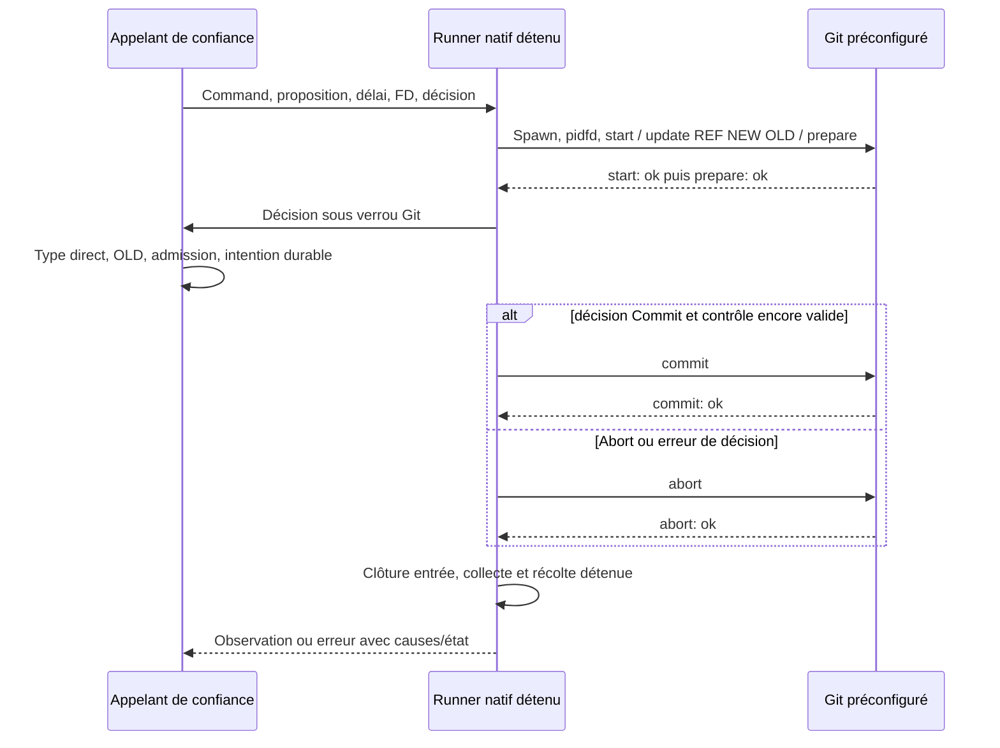
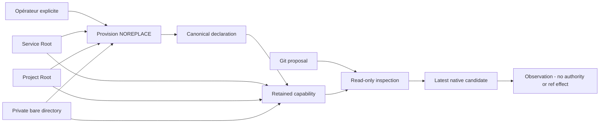

# Primitive transactionnelle Git PAEA

[English](../en/PAEA-GIT-TRANSACTION.md)

API Linux de bibliothèque qualifiée en fixtures : `run_git_reference_transaction`.
Elle compose le runner natif détenu avec une entrée nonbloquante et un parser
strict d'accusés Git. Aucun service d'effet PAEA, dépôt protégé, admission,
intention durable ou parcours de publication Git public n'est fourni par cette API.

## Entrées et responsabilités

L'appelant de confiance fournit une `Command` Git préconfigurée (exécutable,
options, cwd et environnement), une proposition Gitv1 validée, son échéance
monotone déjà décidée et éventuellement un FD d'annulation emprunté. `None` pour
l'échéance signifie aucune. Aucun chemin ou programme ne vient de la proposition.
La primitive ajoute seulement `update-ref --no-deref --stdin`. Le consommateur
natif doit utiliser les politiques persistées/Admin existantes ; aucun défaut de
durée, retry, grâce ou plafond opérateur n'est ajouté ici.

Le callback synchrone est appelé une fois après prepare, sous verrou Git. Il doit
établir type direct de référence, OLD exact, autorité courante et intention durable,
en conservant les témoins de dépôt et réservations nécessaires. La primitive ne
réalise pas ces contrôles à sa place. Le callback doit respecter contrôle et délai :
il n'est pas préempté. La proposition validée reste une donnée, jamais un droit.

## Séquence

`update-ref --no-deref` seul peut remplacer une référence symbolique ; une lecture
avant prepare laisserait une course. Le callback vérifie donc l'original pendant
que Git conserve le verrou acquis par prepare.

## Résultats, erreurs et reprise

`GitReferenceObservation` distingue `NotRequested`, `CommitRequested`,
`CommitAcknowledged` et `AbortAcknowledged`. NotRequested ne concerne que cet appel,
pas l'historique. Un ACK n'est ni une observation indépendante du ref ni une
attestation de l'exécutable. Après envoi de COMMIT, toute rupture exige une
réconciliation avant une nouvelle publication. Une sortie0 sans ACK terminal refuse.

`GitReferenceError` conserve cause primaire, causes de cleanup indépendantes,
flux privés possiblement partiels et récupération réelle du processus détenu.
`source()` n'expose que la première branche ; `branches()` les expose toutes.
`find()` suit le graphe Box/IO/Root existant, y compris cleanup secondaire, sans
fusionner plusieurs appels. `process_error_mut()` conserve l'accès à un Child
nonrécolté si le runner en détient un. Display/Debug publics ne rendent pas les
chemins, commandes, stderr ou diagnostics privés ; `output()` est un accès explicite.

`exit_status` est le statut réellement récolté quand disponible. `timed_out` est
l'observation optionnelle du runner ; None après échec du runner ne prouve pas
qu'aucune échéance n'a été atteinte. Une cause IO TimedOut peut rester séparée.
Une erreur de décision tente un abort explicite et conserve sa cause originale.

Annulation ou échéance observées avant l'envoi empêchent COMMIT ; aucune atomicité
temps réel entre contrôle et écriture n'est déduite. Une terminaison forcée peut
laisser un fichier Git .lock : la primitive ne le supprime jamais. Le futur service
doit établir sa propriété et le ref réel avant reprise ; cette récupération reste
à raccorder. L'entrée nonbloquante refuse un transport partiel/WouldBlock plutôt
que bloquer en dehors de l'observateur de processus.

Un sink Write ayant consommé un ACK ne doit pas renvoyer Interrupted rejouable.
La frontière conserve cette cause derrière une erreur nonrejouable pour empêcher
write_all de répéter l'état consommé et de contourner l'observation du processus.

## Vérification et limites

`tools/verification/recipes/paea-native-git-reference-transaction.json` vérifie neuf
cas natifs nommés et Rustdoc strict, sans watchdog global. Git réel : CAS/abort,
OLD périmé, référence symbolique, concurrents, erreurs de décision, annulation,
échéance et publication réelle suivie de SIGKILL avant ACK. Le dernier cas conserve
CommitRequested alors que le ref a changé. Les enveloppes d'erreur sont exercées.

L'échéance d'une seconde est une entrée de faute après témoin valide sous la même
durée, mesuré dans les preuves ; ce n'est pas une borne de recette ou un défaut du
produit. Seule la fixture jetable retire son lock après inode retenu et récolte
confirmée, afin d'observer sa reprise. Aucun cleanup de service protégé n'en découle.

La recette Python `paea-git-reference-transaction.json` garde séparément six essais
de primitives Git. Les preuves69 lient sources, Git réel et ELF de tests ; le build
normal222 et ses vues Version/UX ont leur propre ELF. Aucun appel public du serveur
ne déclenche encore le corps générique. Admission, mandat/accord, UID distincts,
confinement et acceptation indépendante restent ouverts.

[Décisions, preuves originales et suite69](../plans/actions-confiance/paea/INCREMENT-69.md).

## Réservation durable des intentions Git

`RootStore::paea_initialize_git_intents` provisionne explicitement le journal et
son association immuable projet/empreinte. `paea_reserve_git_intent` persiste les
bytes canoniques sous clé métier projet/dépôt/référence/OLD avant toute future
publication. Il retourne `New` ou `Existing` ; le second conserve exactement
l'ancien candidat/contexte, même si la clé de transport ou le contenu change.
`Existing` interdit une nouvelle publication : le futur service doit réconcilier.
`paea_read_git_intent` relit indépendamment après reprise ; `None` signifie absence
de réservation, jamais absence d'effet Git. Les schémas/canoniques corrompus refusent.

Un COMMIT SQL en échec reste `Uncertain`, avec cause et rollback conservés ; aucun
appel Git ne doit suivre cette erreur. Les diagnostics natifs suivent aussi les
branches de nettoyage. La politique de contention vient des réglages persistés
Admin existants, sans nouveau délai ni plafond. La recette permanente
`tools/verification/recipes/paea-native-git-intent.json` couvre persistance, refus,
contention réelle et corruption sur Roots jetables, avec Rustdoc strict.

Ce journal ne publie rien, n'atteste aucun champ du contexte et ne vérifie ni
mandat, candidat/revue/cohorte, dépôt ni référence. L'appelant doit encore assurer
stockage distinct détenu, association du dépôt, autorité courante sous réservation,
intention durable avant COMMIT Git et réconciliation compatible après rupture.
Il n'y a ni route HTTP de service ni reçu d'effet terminal dans ce composant.

## Lecture du dernier candidat cumulatif

`RootStore::current_managed_git_publication(work_id)` observe le dernier événement
natif de publication sous snapshot SQL, réservation des réglages et vérification
de l'association physique Root. Aucun sélecteur de tâche/candidat fourni par le
client ne peut choisir un ancien candidat. Le lecteur existant vérifie la chaîne,
les originaux de revue/validation, le résultat worker, les contrôles et toute la
cohorte courante. Absence, corruption ou donnée manquante refusent avec leurs
causes ; les erreurs de snapshot/matériel/fermeture restent conservées.

Le résultat donne révision Work/réglages, événement/tâche/revue, OID et empreintes
réels, sans chemin privé. `repository_request_digest` est l'empreinte de cadrage
réellement enregistrée, pas un `repository_id` de service. Le raccord doit encore
provisionner cette association ; aucun identifiant de service n'est inventé ici.
Cette observation n'est ni une capacité de dépôt détenue, ni une autorité courante,
ni un reçu d'effet ou un accord de promotion. Le service devra revalider sous sa
barrière d'engagement. Ce lecteur ne lance aucun provider et ne publie rien.

La recette `tools/verification/recipes/paea-current-managed-git-publication.json`
exige `SWARM_PAEA_CURRENT_PUBLICATION_FIXTURE` pointant sur une preuve cumulative
inerte réellement produite par `tests/rust_native_cumulative_publication.py`, avec
`--binary`, `--profile` et `--output` explicites. Ne jamais fournir une mission
utilisateur. Le test positif est ignoré sans invocation explicite `--ignored` ;
la recette exige son nom et ses assertions, pas zéro test. Les fautes modifient
seulement cette fixture et restaurent les octets avant de vérifier le refus.

## Association privée d'un dépôt de service

`paea_provision_git_repository` exige un journal70 déjà provisionné, un projet
physiquement distinct et un enfant Git bare privé préparé explicitement par
l'opérateur. L'identifiant est dérivé du Root service et de l'inode réel du dépôt,
jamais d'un chemin de proposition. Une déclaration canonique privée est publiée
NOREPLACE ; une seconde création refuse, sans adoption ou remplacement automatique.
`paea_open_git_repository` compare les octets attendus et retient les descripteurs
Root/projet/dépôt. La borne de lecture est la taille exacte du frame attendu,
pas un plafond opérateur. Un changement d'instance nécessite un reprovisionnement
explicitement autorisé, pas une restauration implicite de droits.

`PaeaGitRepository::inspect` vérifie cette association et le vrai dernier candidat
natif71 ; mauvais id/pin/projet/candidat, rebinding, symlink ou déclaration altérée
refusent. Il n'expose ni chemin ni Command mutable. Le probe Git durci utilise un
cwd issu du descripteur, puis `--git-dir .` dans le cwd propre de l'enfant : pas de
découverte du parent ni dépendance à un FD parent après une erreur d'enfant non
récolté. Les causes processus/stockage/fermeture sont conservées ; une publication
connue après erreur tardive reste accessible, une publication incertaine exige
une ouverture/lecture explicite, jamais un nouvel essai aveugle.

La déclaration ne prouve ni opérateur humain, séparation UID, confinement, mandat,
transfert des objets, OLD/type direct, barrière de dernier usage ou effet Git.
Le service d'effet et sa réconciliation restent à raccorder. La capacité doit
rester détenue et être fermée explicitement même après refus.

## Writer réel et précondition de format

Le lecteur interne d'effet exige l'état SQLite main Write sur la connexion Root
réellement ouverte. Un snapshot deferred/read ou un booléen fourni ne remplace
pas cette barrière. Le corps natif chaîne/originaux/cohorte est partagé avec
l'observation publique ; pas de BEGIN imbriqué, connexion étrangère ou dispense
d'approbation. Garder les réservations settings/Trust/plan/mandat jusqu'au COMMIT
reste la responsabilité du service d'effet. Le helper n'accorde aucun droit.

`inspect_object_format` lit le format de stockage Git bare réel et exige que la
représentation40/64 hex du candidat revu corresponde à SHA1/SHA256. Format inconnu,
non-bare ou incompatible refuse avant transfert, intention ou changement de ref.
Aucune présence d'objet ou opération de transfert n'est démontrée par ce contrôle.
Voir `tools/verification/recipes/paea-git-writer-format.json` : fixture neuve inerte
de première publication via SWARM_PAEA_WRITER_FIXTURE, jamais une mission utilisateur.

## Qualification du protocole pack (fixture uniquement)

La recette `paea-git-pack-protocol.json` exporte le candidat natif réellement relu
par CLI normale avec `pack-objects --revs --stdout` dans un fichier sur disque,
puis importe avec `index-pack --stdin --fix-thin` dans un bare neuf. Le pack ne
transite pas par une capture mémoire Python. Chaque enfant reçoit son propre
fichier stdin ; aucune référence n'est demandée par ces deux commandes.
Six assertions couvrent présence du commit et connectivité, absence de mouvement
des refs, répétition, format incompatible, corruption/troncature avec reprise et
OID absent. Les fichiers après refus sont inventoriés : un refus ne prouve pas
l'absence d'écriture d'objet. Les sorties et artefacts partiels sont conservés.

Il s'agit d'une expérience sur une petite fixture inerte née par le moteur, pas
d'une API native de transfert. Le service doit encore conserver les capacités
source/destination, gérer processus et erreurs, appliquer budgets et autorité
courante puis engager la ref avec son intention durable. Le protocole seul ne
prouve ni ces obligations ni une capacité de gros volume ou un confinement.

## Primitive native de flux pack

`run_git_pack` exécute uniquement export `pack-objects --revs --stdout` ou import
`index-pack --stdin --fix-thin`, sans refspec. Le constructeur durci et le délai
Git persisté sont partagés avec le runner géré. Trois fichiers réguliers distincts,
position zéro, sorties initialement vides : refus d'aliasage/écrasement avant spawn.
Entrée possédée par stdin enfant ; sorties sur fichiers, synchronisées même après
échec avec causes indépendantes conservées. Pas de capture du pack en Vec.
`GitPackError` conserve statut observé, timeout, possibilité d'écriture, branches
natives et éventuel enfant non récolté du superviseur. Les diagnostics restent
sur les fichiers privés de l'appelant ; le Display ne les expose pas.

L'appelant reste responsable des capacités cwd/source/destination, création privée,
fermeture vérifiée des sorties, validation d'OID/format et autorité courante.
L'entrée File/Stdio est consommée avec fermeture standard, sans reçu distinct de
fermeture vérifiée. Aucun journal métier, mandat ou service public ne consomme
encore cette primitive ; une réussite n'établit ni publication ni confinement.

Les erreurs de synchronisation de pack portent désormais un `GitPackSyncError`
avec canal `Stdout` ou `Stderr` et cause IO originale. Le graphe natif traverse
ces enveloppes même sous Box/IO, sans exposer de chemin. Une erreur de commande
reste primaire ; les deux synchronisations sont tentées et conservées séparément.
Si la commande réussit mais la sync échoue, son statut/timeout restent observés,
sans déclarer le transfert réussi. Le test noyau utilise des sorties proc en
lecture seule après témoin valide ; le cas sync après commande réussie est une
composition unitaire explicitement synthétique, pas une injection fsync réelle.
