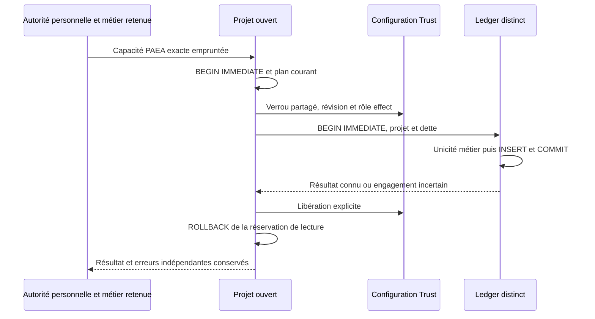

# Noyau de règlement fictif séparé PAEA

[English](../en/PAEA-SETTLEMENT.md)

Ce noyau Linux en bibliothèque écrit des règlements fictifs dans un RootStore
physiquement distinct du projet. Il n’effectue aucun paiement réel. Il ne fournit
pas encore un daemon, un protocole de service, un parcours UX de règlement, une
attestation de contexte agent ou un profil Linux séparé. Qualification et livraison
courantes : [incrément66](../plans/actions-confiance/paea/INCREMENT-66.md).

## Stockage et provisionnement

`RootStore::paea_initialize_settlement` est une opération de provisionnement par
appelant de confiance, sans adoption par la première requête. Sur un Root déjà
initialisé et protégé indépendamment, l’opérateur fournit le projet, son empreinte
de contexte épinglée et les termes des dettes. La méthode valide toutes les données
et refuse doublons, schéma existant ou partiel. Les dettes sont immuables dans ce
noyau ; aucun endpoint de modification n’est ajouté. Ce constructeur ne prouve
ni identité de l’opérateur, ni confinement, ni protection contre le même UID.

Trois tables versionnées conservent association au projet, termes exacts de dette
et effets. Les DDL, index et triggers non prévus sont refusés. Une facture est
identifiée par son identifiant métier stable ; version, montant entier positif,
devise et bénéficiaire doivent correspondre au registre privé. L’unicité porte
sur facture et intention métier, pas sur la clé de transport. Une nouvelle clé
ou un autre contenu ne permet pas un second règlement.

La limite de montant i64 est celle du contrat de représentation existant. Version
1, singleton et noms de service sont des invariants de protocole. Aucun délai,
retry, plafond monétaire ou budget opérateur nouveau. Le réglage Admin existant
`storage_busy_timeout_ms` du RootStore reste effectif ; aucun autre timeout SQL
n’est installé. Le profil SQLite et sa durabilité doivent être qualifiés dans le
environnement livré ; un test de contention ne prouve pas une résistance à toute
coupure électrique ou à un propriétaire malveillant du stockage.

## Requête et autorité courantes

`project.paea_settlement_request(ledger, proposal, context, operation)` conserve
un témoin de chaque stockage ouvert, calcule l’action canonique et une liaison
avec nonce aux deux instances physiques. Le projet et le ledger ne peuvent
partager ni répertoire ni fichier SQLite. La requête est une donnée à faire
autoriser séparément, pas une capacité d’exécution. `request()` expose le droit
PAEA exact à signer ; `canonical()` expose les octets à examiner. `close()` doit
libérer explicitement les deux témoins, même après un refus.

Le contexte de la proposition reste déclaré, sauf les champs de politique décrits
ci-dessous. Ce noyau n’en déduit aucun rôle,
mandat, provenance, label ou accord. Le futur contrôle attribué doit vérifier ces
faits avant l’émission de droit. Le principal et le scope observés dans le reçu
proviennent séparément de la capacité empruntée au compte courant. Un grant de
fixture et son mot de passe ne constituent pas un consentement humain réel.

Dans `AuthenticatedControl::with_paea_action`, le consommateur appelle
`ledger.paea_settle(project, prepared, identity)`. Le noyau compare les deux
stockages et la permission exacte, réserve le plan par transaction IMMEDIATE,
conserve le verrou Trust partagé, relit configuration et mapping canonique effect,
vérifie révision, rôle, contrôle Biba et expiration, puis réserve le ledger. Un
mapping désactivé, un plan ancien ou un autre projet refuse avant engagement.
Les valeurs déclarées dans le contexte n’alimentent jamais ces contrôles.

Le projet ne reçoit pas d’écriture métier dans ce parcours ; aucune atomicité
d’écriture entre deux bases n’est revendiquée. Le paiement fictif est le row
publié dans le ledger. Le temps `commit_requested_at` est échantillonné avant
l’écriture/COMMIT ; ce n’est pas l’heure exacte d’une publication. Les contrôles
d’expiration encadrent l’usage, sans garantie temps réel ou confinement déduite.

## Résultats, erreurs et reprise

`PaeaSettlementOutcome::Recorded` contient un reçu observé et `replayed`. La
première publication a `replayed=false`. Une action canonique identique, y compris
avec une nouvelle clé de transport, rend le reçu conservé avec `replayed=true`.
Un autre contenu pour la même facture renvoie un conflit contenant le résultat
ancien connu, sans nouveau paiement. Les effets existants sont lus avant toute
comparaison des nouveaux termes. Le reçu est une observation locale, pas une
signature indépendante ni une preuve contre réécriture par le propriétaire.

Une requête séparément autorisée `Reconcile` ne peut créer d’effet. Elle rend le
reçu existant ou `ReconciledNotCommitted{intent_id,invoice_id}` sous la réservation
du ledger. Cette absence observée n’est ni un succès vide ni un nouveau mandat.
Après redémarrage, préparer et autoriser un nouveau témoin ; ne pas désérialiser
une ancienne capacité. L’historique de facture reste celui du ledger rouvert.

`PaeaSettlementError` conserve code sûr, cause originale et erreurs de nettoyage
indépendantes. Son observation distingue `NotAttempted` (aucun COMMIT tenté par
cet appel), `Uncertain` et `Known`. `NotAttempted` ne signifie pas qu’aucun effet
historique n’existe. Une erreur de COMMIT reste incertaine même après rollback ;
observer par réconciliation avant nouvelle tentative. Le rollback explicite ne
rejoue pas silencieusement l’opération dans Drop. Les erreurs de libération après
résultat connu conservent ce résultat. Cause primaire, nettoyages et observation
doivent tous traverser le futur transport, qui n’est pas encore raccordé.

Le résultat du backend reste lui-même dans `paea_action::Use.action` ; les erreurs
d’autorité métier et `UseError::AfterUse` personnelle peuvent survenir ensuite.
Ne jamais les aplatir en « aucun effet ». Les méthodes de clôture des témoins,
du RootStore et du contrôle restent des obligations distinctes du consommateur.

## Vérification

`tools/verification/recipes/paea-separated-settlement.json` exécute les tests
nommés du target `swarm-engine --test paea_settlement`, sans watchdog global.
Journaux signés, mot de passe et plan sont réels dans des fixtures privées ; les
données de contexte restent déclarées. Les scénarios comprennent effet/rejeu et
réouverture, stockages erronés, termes incompatibles, plan/mapping périmés,
révocation avant première consommation d’un second droit, schéma/reçu corrompus,
COMMIT SQLITE_BUSY suivi de réconciliation et concurrence de deux connexions
indépendamment autorisées. Le statut effectif figure dans les preuves66 ; les
noms de scénarios ne constituent pas un PASS ni une acceptation E2/E3.

## Politique observée et limite d’admission

Pour `Commit`, la préparation valide d’abord les représentations reçues, puis
construit un contexte séparé avec `policy_revision` et `policy_digest` relus dans
le projet ouvert sous verrou Trust. Elle ne modifie pas l’entrée. L’empreinte
`paea-trust-policy-v1` couvre politique de base, politique de séparation des rôles
et blocs de contrôle ; la révision de configuration couvre aussi les changements
de mapping. `prepared.context()` expose ce contexte effectif à examiner avant
émission du droit. Les autres champs, dont sources/principal/instance/mandat,
restent déclarés et ne reçoivent aucune promotion de confiance par cette opération.
Un format de contexte invalide est refusé, jamais corrigé silencieusement.

Au point d’engagement, politique et révision sont recomparées sous le verrou
conservé. Un droit fraîchement signé ne rend pas utilisable une ancienne politique
canonique. Pour `Reconcile`, fournir le contexte historique exact de la requête
ou du reçu ; il reste conservé, tandis que compte, droit, mapping et révision
Trust de l’observateur sont courants. Une modification de politique ne relabellise
pas un effet historique et ne permet pas un nouvel engagement.

Ce noyau ne sait pas encore établir les participants et l’accord PAEA. Il refuse
un `Commit` quand `require_separation` est vrai ou quand une politique de rôles
active impose des incompatibilités. Une liste de conflits vide n’en impose pas.
Le refus `paea-settlement-attributed-admission-required` reste ouvert jusqu’au
raccord de l’admission attribuée : il ne clôt pas PA-03. La réconciliation est
une lecture, sans engagement nouveau. Les témoins de règlement des recettes sont
un profil de référence de fixture où ces exigences sont explicitement désactivées
par l’opération publique de configuration ; aucune politique réelle ou valeur
par défaut de l’instance locale n’est abaissée.

`RootStore::call_paea_settlement` compose le compte/droit courant et le backend.
`PaeaSettlementCallError` conserve Personal/Authority/Action/MissingAction,
`known_outcome()`, `commit_uncertain()` et les branches indépendantes.
`find()` réutilise le graphe natif pour les enveloppes concrètes Box, IO et Root,
y compris la branche de nettoyage secondaire ; il rend la première enveloppe,
sans fusion de plusieurs appels. Les diagnostics n’exportent que catégories et
causes sûres, jamais les octets de reçu ou le mot de passe. L’échec d’autorité
après un effet connu conserve cet effet et exige une décision de reprise explicite.

## Cohérence des métadonnées historiques

La lecture d'un reçu vérifie aussi l'identifiant d'enrôlement, la représentation
RFC3339 du temps, le pin projet du grand livre et la révision de politique dans
l'action canonique. Aucun âge maximal ni comparaison à l'heure actuelle n'est
ajouté : la réconciliation historique reste possible. Un refus conserve la cause
de décodage du temps et ne modifie ni reçu ni effet. Les13tests comprennent un
témoin avant chacune de quatre altérations isolées et la restauration exacte.
Ces contrôles détectent des incohérences, pas une réécriture cohérente par le
propriétaire. Ils ne prouvent ni signature ni mandat/approbation historiques et
ne lient pas le principal/instance déclaré à l'autorité observée. Voir incrément67.
