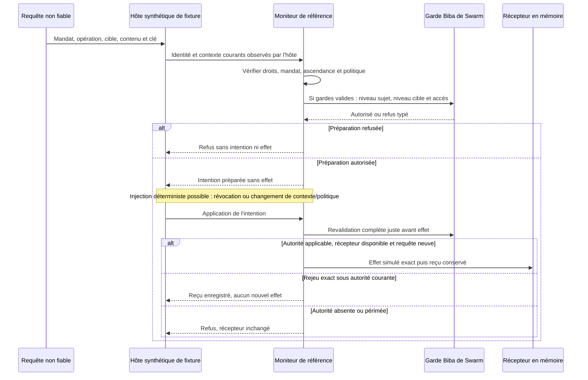
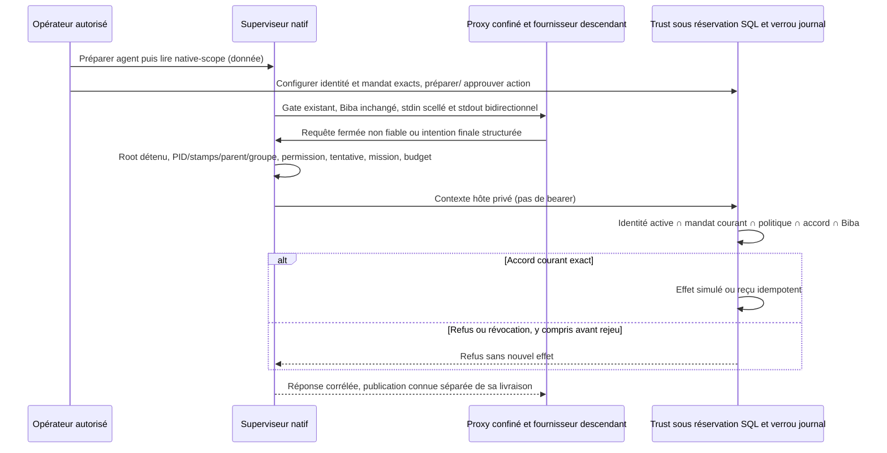

# POC-06 — mandat lié à la tâche et à la tentative

[English](../en/POC06-TASK-MANDATE.md) · [Plan et preuves](../plans/actions-confiance/POC06-TASK-MANDATE.md)

Le PoC est un **exécutable de référence isolé**, avec identités synthétiques,
contexte tenu par l'hôte de fixture et effets en mémoire. Il n'active pas une
protection dans les agents natifs, la CLI métier ou les connecteurs Trust.
Il ne prouve ni authentification cryptographique, ni persistance après crash,
ni confinement OS, ni atomicité distribuée. Les mandats de cet exemple ne
remplacent pas les mandats Trust existants.

## Contrat exécuté

Chaque opération doit satisfaire simultanément les droits courants de l'identité,
son mandat, la politique courante et le garde Biba. Le mandat lie installation,
projet, tâche, tentative, sujet, opération, cible, contenu exact et révision de
politique. Les champs `claimed_scope` et `claimed_subject` de la requête sont
ignorés pour l'autorité : seuls les registres et le contexte de l'hôte comptent.
Une lecture ou une proposition ne permet pas d'appliquer une modification.

Le code inclut par chemin les véritables sources `biba.rs` et du contrat des
identifiants : aucune copie de leurs règles n'est maintenue. `Apply` utilise
le contrôle Biba `Write` ; `Read` et `Propose` utilisent `Read` sur la cible.
L'admission d'un mandat est un acte distinct de l'hôte I3/admin, pas une
élévation du sujet. Le label I2 de cette admission concerne l'objet mandat,
pas la cible de l'effet, contrôlée séparément lors de l'utilisation.



Le rejeu est lié à `(identité, contexte complet, clé)` et aux termes exacts de
la requête. Il repasse les contrôles courants ; la révocation peut donc refuser
le rejeu, sans effacer son reçu historique. La délégation conserve la portée
exacte et vérifie les identités et droits de toute l'ascendance à chaque usage ;
parent absent, cycle, révocation ou droit retiré refusent. Aucun plafond de
profondeur, timeout ou durée de validité implicite n'est ajouté.

## Six parcours et reprise

| Parcours | Contrôles exécutés |
| --- | --- |
| `cross_task` | A réussit ; passage à B, autre tentative, projet ou installation refusé ; mandat B applicable puis reprise. Une fausse revendication A ne change pas le contexte de l'hôte. |
| `action_target` | Lecture et proposition sans mutation de cible ; opération, cible, contenu, droits de l'identité et de la politique contrôlés séparément ; reprise valide. |
| `revocation_replay` | Un effet malgré le rejeu exact ; identité désactivée et mandat révoqué refusés, reçu préservé ; nouvelle tentative sous nouveau mandat. Complément Oryh : A/B sur la même opération/cible, révocation A directe/cache/délégation, B toujours autorisé, panne commune distincte, renouvellement et reprise. |
| `delegation` | Enfant explicitement admis ; sujet substitué, portée/action/contenu/cible élargis, auto-admission, droit parent retiré, parent absent/cyclique/révoqué refusés ; reprise avec mandat applicable. |
| `check_apply` | Témoin valide avant chaque changement entre préparation et application : politique, mandat, tâche, identité et contenu ; refus sans effet puis préparation fraîche. Réponse perdue après effet connu : reçu retrouvé, aucune double application. |
| `invalid_biba` | Liens absents/invalides et sujet déclaré sans autorité ; I1 ne peut écrire I2, I3 ne peut lire I2 malgré un mandat correspondant ; témoins valides et reprise. |

Chaque refus vérifie le résultat typé et l'état du récepteur, ses compteurs de
mutation/proposition et ses reçus. Les traces Oryh corrèlent agent, installation,
projet, tâche, tentative, requête, mandat, version de politique, événement de
révocation, décision et compteurs du récepteur. Elles sont conservées avec les
sorties du programme ; ce ne sont pas des journaux de service externe ni une
preuve d'absence universelle d'effet. Seuls les chemins simulés inventoriés sont
couverts. Les incertitudes d'un connecteur externe restent hors de cette preuve.

## Rejouer

Dans la sélection native WIP fondée sur
`57647233142982ab8e7e7ed577a89d96c5511b41`, les commandes ci-dessous ne sont
pas un parcours disponible :
`rust/crates/swarm-engine/examples/poc06_task_mandate.rs` et
`tools/verification/recipes/poc06-task-mandate.json` sont absents de cette base
et exclus du paquet natif. Ils appartiennent au lot standalone conservé
séparément. Ces commandes restent la référence de ce lot ; leur utilisation
exige d'abord la collation et la qualification de ses sources, de son
validateur et de sa recette. Ne pas importer implicitement l'exemple dans le
broker natif ni attribuer à celui-ci les résultats historiques du standalone.

Depuis le dépôt, choisir un répertoire de preuves neuf et un parent existant
sur un système de fichiers Unix prenant en charge les liens physiques. Le
lanceur permanent utilise ces liens pour publier sans écraser de preuve ;
une Lexar FAT32 ne convient donc pas comme sortie directe de la recette.
Utiliser un staging Unix, puis une archive préservant les métadonnées sur la
clé réellement montée, avec relecture et comparaison des empreintes. Voir le
[stockage des preuves](../../tools/verification/README.md#stockage-usb-préféré--preferred-usb-storage).

```sh
SWARM_POC06_EVIDENCE_PARENT=/CHEMIN/UNIX/PARENT/EXISTANT \
python3 tools/verification/recipe.py run \
  --recipe tools/verification/recipes/poc06-task-mandate.json \
  --output /CHEMIN/UNIX/NEUF/RECETTE
python3 tools/verification/recipe.py verify --evidence /CHEMIN/UNIX/NEUF/RECETTE
```

La recette teste le validateur de rapports, compile l'exemple et les tests du
garde avec `rustc`, puis exécute les six scénarios. Elle n'utilise ni fournisseur,
ni réseau, ni base active, ni service. Les binaires sont dans `.cache/poc06-build`
sur le disque Unix local ; les preuves contiennent leurs empreintes, les sources
avant/après, arguments, compilateur et sorties exactes. Aucun watchdog global ni
retry n'est configuré. Le verrou de build occupé refuse sans interruption d'autrui.
Toute erreur de compilation/exécution ou sortie vide/incomplète arrête la recette.
Le vérificateur refuse Python optimisé (`-O` ou `PYTHONOPTIMIZE`) : ses assertions
ne doivent jamais être supprimées. Sept tests distincts éprouvent le validateur
de rapports ; ils ne remplacent pas les 144 assertions des six scénarios Rust.
Les échecs restent intacts ; une reprise utilise un autre répertoire.

Ce profil standalone compile les sources du garde ; il ne qualifie pas le profil
de production de l'application. Aucun redémarrage de serveur n'est nécessaire
pour exécuter le PoC. Le raccordement d'une identité et d'une tentative natives,
des mandats persistés et des points d'effet réels reste un travail distinct.

## Raccordement natif expérimental (9 novembre 2026)

Le raccordement produit est distinct de l'exemple ci-dessus. Le code natif est expérimental ; la qualification du profil produit, des parcours
publics et de l'installation est conservée séparément dans le plan.
Il protège les opérations Trust `request`, `commit`, `reconcile`, dont les effets
restent des connecteurs simulés. Il ne médie pas tous les outils ou les écritures
I0 du fournisseur et ne qualifie pas un paiement externe.

L'opérateur prépare d'abord l'agent, puis lit sa liaison déclarative :

```sh
swarm-rust agent native-scope AGENT_ID --root ROOT --json
```

La réponse comporte `root_digest`, `work_id`, `task_id`, `attempt_id`, `agent_id`.
L'empreinte du Root provient des identités physiques du répertoire ouvert et de
la connexion SQLite, avec séparation de domaine. Un chemin ou cette réponse JSON
seule n'authentifie personne. Dans la liste des identités de l'Admin Trust, ou
`trust config-preview` / `config-apply`, déclarer `native_scope` avec cette valeur,
un `subject`, des `roles` et une `integrity` explicitement autorisés. Omettre le
token et `enrollment_principal` : les mélanges et les doublons de scope refusent.
Le mandat créé par l'administrateur porte le même `native_scope`. Aucun rôle ni
niveau ne vient de la tâche. Les valeurs sont persistées dans la configuration
Trust ; aucun nouveau plafond, délai ou nombre de tentatives n'est ajouté.



L'adaptateur s'active seulement pour une liaison native explicitement configurée.
Le vrai leader enregistré est alors le proxy Swarm ; le fournisseur est son
processus descendant et hérite du confinement. Le gate ajoute au prompt préparé
les instructions fixes `native_provider_proxy::INSTRUCTIONS` avant de sceller
stdin. L'empreinte du prompt initial ne représente donc pas, à elle seule, les
octets reçus dans ce mode. Les parcours non configurés gardent leur transport.

Les fournisseurs Codex (`item.completed/agent_message`) et Claude
(`assistant/message/content/text`) peuvent proposer une unique intention finale,
sous forme de texte commençant exactement par `SWARM_TRUST_REQUEST ` suivi du
JSON fermé ci-dessous. Le proxy attend leur sortie réussie puis finalise tandis
que le leader natif reste vivant. Une proposition multiple ou malformée refuse ;
ce canal final ne renvoie pas la décision au modèle déjà terminé. L'audit et la
supervision portent le résultat. Ce mécanisme n'est pas une qualification d'un
modèle réel ni d'une boucle MCP interactive.

```json
{"type":"swarm.trust.request","schema_version":1,"id":"call-1","operation":"commit","input":{"schema_version":1,"event_id":"commit-1","action_id":"action-authorisee"}}
```

Un fournisseur implémentant directement ce protocole écrit le préfixe réservé
`SWARM_NATIVE_TRUST_V1 ` suivi d'une ligne JSON sur stdout et lire sa réponse sur le même descripteur, une requête à la fois et
avec un identifiant de trame neuf. L'identifiant de l'événement métier sert au
rejeu ; les deux identifiants ont des rôles différents. Les limites existantes
de trames et d'outils restent applicables. Aucun socket supplémentaire ni FD
hérité au-delà de stdio n'est autorisé par cette évolution.

La revalidation native précède les réponses en cache ; révoquer le mandat refuse
un nouveau commit, une réconciliation ou un rejeu sous cette autorité. Les reçus
historiques restent consultables par le parcours opérateur. Un bearer local ne
peut pas appliquer l'effet d'un mandat natif ; il peut préparer la demande et
l'approbation selon ses droits existants. Déléguer peut ajouter une liaison à un
mandat non lié, mais ne peut retirer ou changer une liaison parente. Le hash natif
lie aussi l'ascendance. Les mandats historiques non liés gardent leur préimage.

Les erreurs de stockage, fermeture et livraison ne prouvent pas l'absence d'un
effet : consulter l'état et la publication retenue avant reprise. `agent completed`
reste distinct du résultat métier et ne vaut jamais acceptation de la tâche.

Le préfixe réservé permet de refuser une trame RPC malformée sans la confondre
avec du JSON ordinaire du fournisseur. La finalisation porte un nonce neuf : une
ancienne réponse non consommée ne peut l'acquitter. Les refus et réponses préparées
sont journalisés par l'hôte dans `agent logs`, avec travail/tâche/tentative et
publication ; `delivered:false` signifie que ce témoin précède la livraison,
pas qu'une réponse ultérieure est nécessairement perdue. Le plafond de détail
sauvé pour les logs reste applicable. Une erreur technique conserve ses causes
et provoque la récupération du processus ; les diagnostics du proxy sont des
déclarations bornées, distinctes d'une preuve privilégiée du gate.

Périmètre natif : workers de `agent run`, manuels ou d'origine mission vérifiée.
Les gates de préparation/planning, validation et revue n'obtiennent aucune
autorité Trust par cette évolution. La recette `tests/native_task_mandate.py`
exerce six groupes natifs : coordonnées et cible, Biba, délégation, retrait puis
réadmission d'identité, révocation/rejeu A/B sur le même Root, intention finale
au format fournisseur. Le fournisseur de recette est déterministe ; les
modèles réels, une boucle MCP et une panne de service externe ne sont pas qualifiés.

Une intention réservée non finalisée, notamment sans identité native configurée,
refuse explicitement la fin du worker (`native-trust-incomplete`) : aucun succès
vide n'est substitué à la demande. Aucun effet tardif n'est exécuté après la
fin du processus. La recette conserve les contre-exemples de nonce périmé, de
réponse vide et d'intention omise, distincts du banc natif avec confinement.

Les instructions supplémentaires restent sous le plafond de contexte Admin
existant (`agent_launch_context_max_bytes`) ; un dépassement refuse avant exec,
sans plafond caché. La recette compare les octets réellement reçus sur stdin à
ceux du prompt préparé et du suffixe compilé qualifié. L'autorité d'effet ne
donne pas lecture de l'objet : le canal natif ne reçoit qu'un acquittement fermé.
Si une politique BLP existe, le contrat de diffusion natif n'étant pas admis,
l'opération refuse **avant effet** (`native-trust-confidentiality-not-admitted`).
Aucun niveau Biba, mapping de tâche ou désactivation de quarantaine n'attribue
une clairance. L'admission future de cette diffusion reste un chantier distinct.

### Qualification native et limites d’exploitation

La recette permanente `tools/verification/recipes/native-task-mandate.json`
exerce les six groupes ci-dessus et quatre contrôles de protocole : **64 assertions
nommées** au total. Elle exige un binaire immuable et son record de build qualifié ;
le même inventaire compilé doit rester inchangé avant/après. Le fournisseur est
déterministe et les effets Trust simulés. Les instructions de rejeu figurent dans
[les recettes permanentes](../../tools/verification/README.md). Résultats, image
installée et portée exacte : [suivi natif](../plans/actions-confiance/POC06-TASK-MANDATE.md#clôture-bornée-du-raccordement-natif--9-novembre-2026).

Configurer les mappings natifs du groupe avant d’émettre ses mandats : une
modification de configuration Trust incrémente sa révision globale et peut rendre
les mandats précédents périmés. Aucun renouvellement automatique ni émission
autonome de mandats n’est ajouté. La recette qualifie les workers manuels ; les
gardes d’origine mission sont réutilisées dans le code, sans qualification de
l’émission et de la conduite autonomes de ces mandats.

L’identité native configurée est affichée dans les réglages existants de
`/trust-actions.html?view=security`, sans jeton natif. Son rendu est vérifié sur
une fixture authentifiée avec l’image374 : FR/EN, clair/sombre, largeurs 1280 et 390,
fermeture Échap et retour du focus. Aucun mapping live n’a été créé pour ce contrôle.
Ce raccordement ne protège pas les commandes I0, les fichiers ou le dispositif
CI ; leurs frontières restent distinctes.

La recette complémentaire `tools/verification/recipes/native-task-mandate-web.json`
exerce 13 assertions HTTP : version, scope exact sans bearer, absence d’effet,
refus sans authentification ou avec un mauvais Host, quatre ressources servies
comparées aux octets de l’archive du profil qualifié, conservation du journal et
arrêt du seul serveur détenu. Elle utilise les trois variables de rejeu déjà
décrites ; elle n’exécute pas le navigateur. Pour l’observation CUA séparée :

```sh
python3 tests/native_task_mandate_web.py --binary "$SWARM_NATIVE_MANDATE_BINARY" --build-record "$SWARM_NATIVE_MANDATE_BUILD_RECORD" --output /chemin/preuves-neuves --hold-browser
```

`browser-ready.json` donne l’adresse de la fixture et le chemin privé de sa clé,
jamais sa valeur. Se connecter normalement à `/login`, ouvrir le dialogue Admin
et vérifier la ligne native. Ne pas enregistrer la clé dans les preuves. Après
les lectures, écrire exactement `finish` suivi d’un saut de ligne dans le FIFO
`browser-release.fifo` indiqué par ce reçu : le producteur recontrôle le journal
inchangé puis draine son serveur. Ce mode attend une remise explicite, sans
watchdog ; il ne vaut pas une supervision récurrente. Vérifier le thème et la
langue effectifs du DOM, pas seulement le nom de la capture ou le thème antérieur.
Le mode owner-key de fixture ne qualifie pas la connexion humaine du frontal Authority.


### Revalidation de l’image380

Le16novembre2026, les recettes permanentes natives et HTTP ont été rejouées sur
l’image installée380 :64 assertions natives et13 HTTP, toutes PASS avec intégrité
VERIFIED. Le profil par défaut et les790 entrées archivées ont été contrôlés.
Le fournisseur reste déterministe et les effets simulés. Les huit rendus374
restent historiques : aucun navigateur disponible ne permet de qualifier le
rendu380 ou une session humaine Authority. Voir le
[suivi exact et les limites](../plans/actions-confiance/POC06-TASK-MANDATE.md#reprise-sans-glm--16-novembre-2026--image-installée380).


### Sources déclarées pour les recettes native et HTTP

Le manifeste natif déclare `tests/rust_native_http_cli.py` : le driver importe
`rust_trust_biba`, qui importe ce helper au chargement du module, même si ce
parcours ne démarre pas son serveur HTTP. Le manifeste HTTP déclarait déjà ce
helper et importe aussi le driver natif. Les deux manifestes déclarent
`rust/crates/swarm-engine/config/engine-settings.json`, lu par `fixture_area`
si l’accès prouve les réglages sauvegardés absents. Déclarer ces sources ne
modifie aucun réglage ni droit et ne justifie pas de copier une configuration
privée active dans les preuves. La configuration effective de la fixture et
les observations de résolution restent des entrées d’exécution distinctes.

Cette déclaration couvre les imports locaux et le défaut statique identifiés,
pas l’ensemble de CPython, du système ou du graphe de compilation. Les étapes,
assertions et valeurs des deux recettes restent inchangées. Les résultats
historiques64/13 gardent leurs entrées d’origine : les nouveaux inventaires
ne complètent pas rétroactivement une empreinte manquante ni ne constituent
une nouvelle exécution ou qualification de leurs parcours.
