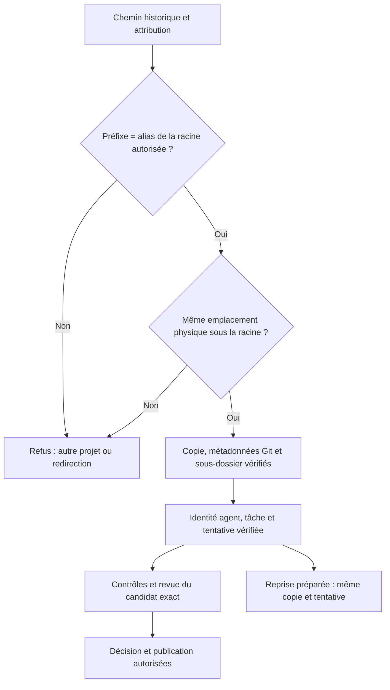

# Déplacement d'un projet et appartenance des copies

[English](../en/PROJECT-RELOCATION.md)

## Contrat actuel des sources

Un projet déplacé peut conserver son ancien chemin comme lien vers **la racine
entière du même projet**. Les références historiques de dépôt, copie et agent
gardent alors leurs chaînes originales. Le moteur vérifie leur identité physique
avant utilisation ; il ne réécrit ni la mission ni les preuves pour les rendre
compatibles. Un chemin disparu ou pointant vers un autre projet reste un refus.

Ce support suppose que l'opérateur a conservé un alias valide. Le moteur ne crée
aucun lien dans un autre répertoire du poste et ne déplace aucune mission de lui-même.
Le déplacement d'un service partagé reste une opération distincte : vérifier
ses missions et ses processus avant toute interruption ou migration de stockage.

## Identité logique et physique

| Élément | Vérification |
| --- | --- |
| Racine du projet | Résolution physique du chemin sélectionné |
| Dépôt géré | Même racine, emplacement réservé à la mission, manifeste et révisions Git compatibles |
| Copie | Attribution agent/travail/tâche conservée, emplacement de copie attendu, métadonnées Git isolées |
| Répertoire effectif | Racine de copie **plus** sous-dossier du projet, pas une égalité entre ces deux niveaux |
| Remise | Artefact contenu dans l'espace du producteur, empreinte et attribution vérifiées |
| Reprise préparée | Identités, contrat, paramètres, copie et tentative d'origine, sans duplication |

`canonicalOwnedProjectPath` examine les ancêtres de l'extérieur vers l'intérieur.
Seul un préfixe qui résout la racine entière autorisée peut représenter son alias.
Le reste du chemin doit résoudre exactement le même emplacement sous cette
racine. Un lien placé **dans** le projet vers une autre copie, un autre dossier ou
même sa racine est une redirection interne ; il n'est pas promu en alias autorisé.
Un lien externe visant uniquement une copie ne devient pas un alias de projet.

Les contrôles de `.git`, du répertoire Git commun et du sous-dossier effectif
restent applicables. Avant de conserver un résultat, le moteur vérifie la copie
et l'espace de l'agent stocké ; un argument contradictoire est refusé. Sous pause,
la remise reste en attente, sans contrôle, revue ou publication implicite.

## Preuves et limites

La recette déplace réellement une racine temporaire, conserve son ancien alias,
rouvre le stockage isolé et utilise le parcours public d'export de bundle. Elle
vérifie une remise, la publication du résultat existant, une nouvelle copie et le
rejeu de sa préparation. L'export ne réécrit pas l'état de la mission. Les cas
négatifs couvrent copies et métadonnées Git redirigées, alias externe d'une copie,
lien interne vers la racine, argument de workspace étranger et sous-dossier Git.

Les 27 tests/sous-cas ciblés passent avec détection de courses. Les revues et
processus de ces tests sont des fixtures ; cela ne prouve ni l'autonomie d'un modèle
réel ni le fonctionnement du serveur natif historique. Le binaire servant ce
dernier n'a pas été remplacé. L'accès natif et la reprise réelle demandent encore
une recette autorisée sur la version effectivement installée.
