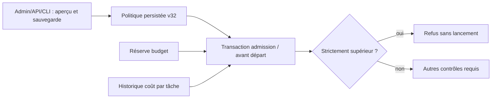

# Coûts rapportés des workers

`swarm-rust costs show WORK --root ROOT --json` et `RootStore::reported_costs` observent les déclarations `Agent.usage.provider_reported_cost_usd` de toutes les tentatives conservées, dans une transaction de lecture unique. Le Work doit exister. Les colonnes d’appartenance de chaque agent doivent correspondre à son corps. Une ligne incohérente, un montant négatif/non fini, un débordement ou une erreur SQL/fermeture refuse toute la lecture ; cela ne devient jamais un total vide réussi.

La sortie CLI ajoute `scope="retained-worker-attempts"` pour distinguer ce périmètre des autres appels de la mission. Le JSON garde `reported_usd`, `attempts_with_cost`, `attempts_without_cost`, `by_task` et `by_provider`. Un coût explicitement rapporté à zéro compte dans `attempts_with_cost` ; une déclaration absente compte dans `attempts_without_cost`. Aucune tentative signifie deux compteurs nuls. Toute somme avec des tentatives sans coût reste partielle. Ce ne sont ni des coûts authentifiés ni une facture. Les anciennes données conservées restent des déclarations ; cette lecture n’en reconstruit pas l’authenticité.

Il n’y a ni fenêtre récente de 200 lignes, ni prix déduit des tokens, ni somme de session OTLP ou réutilisation d’une ancienne observation valide devenue non canonique. Les appels planner/reviewer, les réservations et les estimations budgétaires ne font pas partie de cette projection, qui conserve le périmètre du `costSummary` Go. Les additions suivent les valeurs f64 conservées, dans l’ordre récent des agents, sans arrondi monétaire ou epsilon caché ; un débordement refuse. Le lecteur ne constitue aucune autorisation et ne débite aucun budget. Le contrôle d’admission automatique du candidat lot187 est décrit ci-dessous ; le dispatcher/watch complet reste à porter.

La CLI ouvre Root en lecture seule, encode puis ferme avant d’écrire, et conserve les causes indépendantes de lecture/fermeture. Une erreur de sortie ou flush est un échec même après écriture visible. Relire est possible sans reset de consommation ; la projection ne mutera pas les données pour les rendre lisibles. Le consommateur doit traiter un refus de lecture, jamais déduire zéro.

Lot186 vérifié localement : trois tests moteur, un test numérique et deux tests CLI passent ; Clippy et Rustdoc passent. `costs-permanent09` rejoue les six cas et son intégrité est vérifiée. `worker-permanent21` vérifie le vrai parcours natif inerte : 25 USD simulés rapportés, une tentative avec coût et les autres sans coût, puis lecture via le binaire normal. Le refus10 initial était une attente fausse du test sur le programme hérité ; il reste conservé avec son Root. `normal06` archive285 entrées sans feature de fixture ; SDK20 partage les mêmes187 sources Rust moteur. Ces preuves ne valent pas installation, facture, revue indépendante ou migration complète du conducteur.

## Admission automatique — candidat lot187

La politique persistée v32 mission_dispatch_cost_reserve_percent compare le coût
rapporté cumulé de la tâche à la réserve par lancement du budget. Installation :
200 %. Un montant strictement supérieur refuse ; égalité autorisée. Le pourcentage
est un entier non négatif, sans plafond métier caché à 100 %. Zéro refuse un coût
positif ; null retire seulement ce contrôle. Sans budget ou avec réserve nulle,
aucun seuil ne peut être dérivé. Une ancienne configuration sans ce champ refuse
l'admission automatique jusqu'à adoption explicite par prévisualisation/enregistrement.
Admin/API/CLI partagent le document et sa validation ; le catalogue place ce champ
dans le groupe de planification et délégation, avec aide FR/EN et conseil IA existant.

Le moteur relit politique, réserve et historique dans la transaction autoritaire de
création et avant libération. Les workers déjà libérés continuent leur supervision.
Aucun refus ne rembourse ni ne remet à zéro la consommation. Une erreur de lecture
reste une erreur avec cause ; elle ne devient pas un coût nul. Les déclarations
absentes restent inconnues : le total connu est une borne inférieure, jamais une
facture authentifiée. Les réservations estimées et leurs limites restent distinctes.
La comparaison conserve exactement les valeurs f64 stockées et le pourcentage entier,
sans arrondi du seuil ou multiplication flottante susceptible de déborder.

Statut : garde des lots187/188 vérifié localement sur candidat figé, non installé ; aucune acceptation globale.

Lot188 complète la preuve des traductions : le contrôle HTTP des octets embarqués a reproduit l’omission dans les premiers candidats, puis locale-after24 vérifie les nouvelles clés et toutes les clés du bundle précédent. Cela complète la recette de composant Admin, sans revendiquer l’acceptation complète de l’IHM servie. Voir [Rejeux permanents](../plans/migration-rust/REPLAYS.md).
