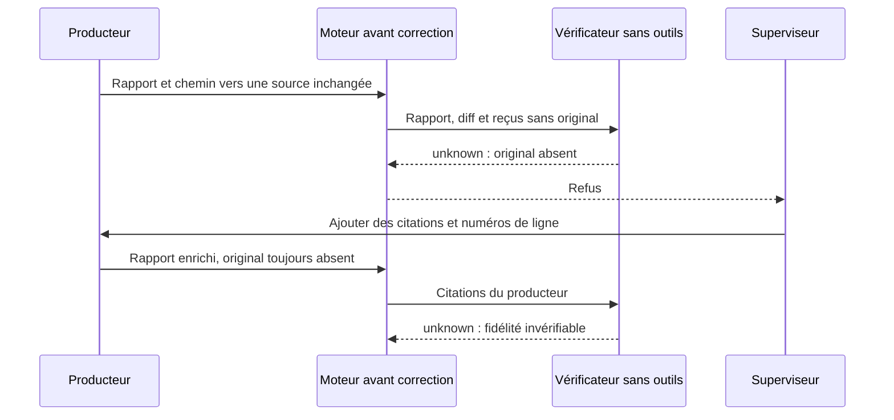
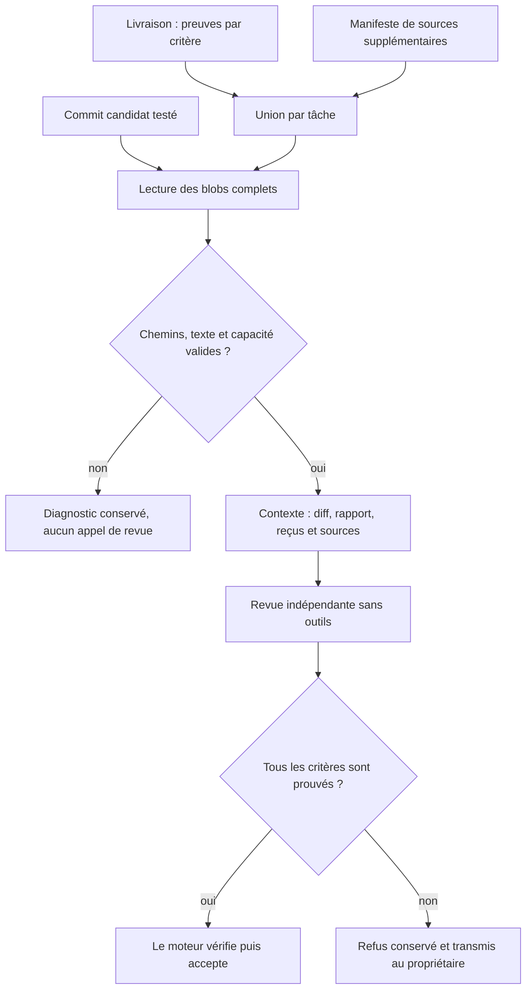
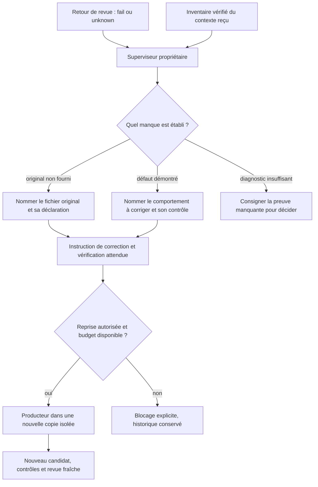
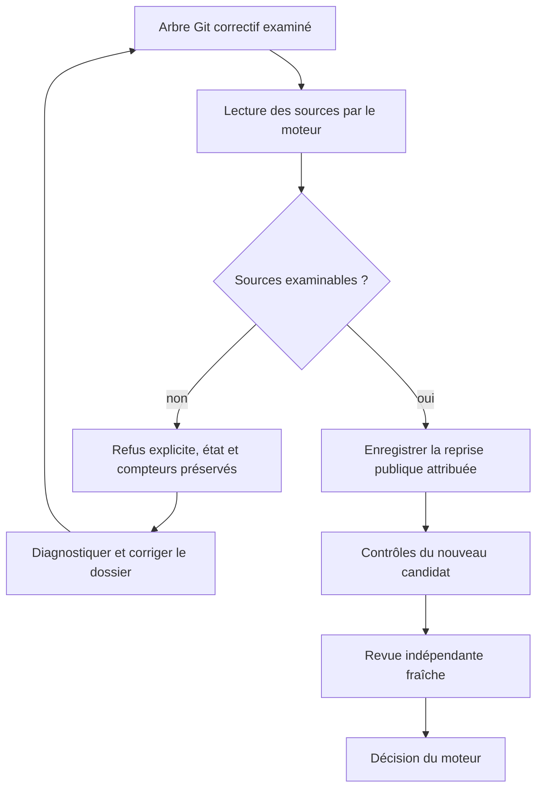
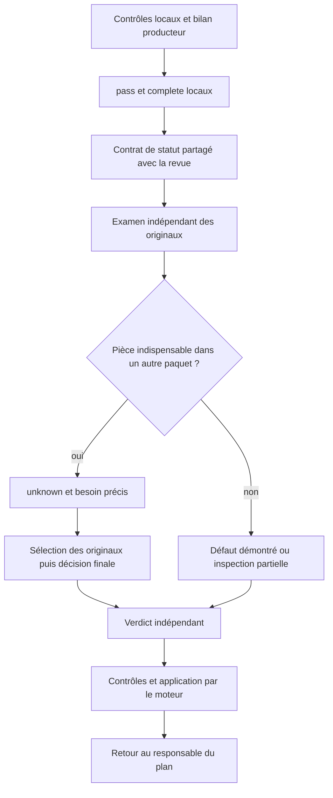

# Transmission des preuves à la revue et correction supervisée

Le [protocole IA/moteur](AGENT-ENGINE-PROTOCOL.md) distingue erreurs de réponse,
défauts du candidat et reprises autorisées, avec leur routage déterministe.

Le [contrat de traçabilité](TRACEABILITY.md) précise l’origine des exécutions,
la chaîne de preuve, les responsabilités et la gestion concurrente des remises.

Correction globale du 10 octobre 2026. Ce contrat s'applique aux livraisons Git
gérées de toutes les missions, aux responsables racine et aux sous-planificateurs.
Il ne dépend d'aucun identifiant de tâche ou de fournisseur particulier.

## Défaut observé

Un producteur déclarait un fichier inchangé dans son bilan, mais le vérificateur
ne recevait que le rapport et le diff. Le responsable demandait davantage de
citations sans joindre l'original. Le [cas réel T1](../publications/20261005-cursor-moteur/dossier-recherche/revisions/20261010-refus-contexte-revue.md)
conserve deux refus `unknown`, la correction manuelle du dossier et l'acceptation
après revue fraîche. La correction globale ci-dessous est distincte de cette
intervention manuelle.

## Comportement global du moteur

`delivery.criteria[].evidence` déclare des fichiers suivis, avec chemins relatifs
à la racine Git. Pour chaque tâche examinée, le moteur lit leurs contenus texte
complets depuis le commit candidat contrôlé, même inchangés. Il joint chemin,
blob Git, taille et SHA256 dans `sources[]`. Le rapport identifié est déjà fourni
dans `tasks[].report` et n'est pas ajouté une seconde fois par cette déclaration.
Le manifeste facultatif `docs/TASK-ID.review-context.json` ajoute des fichiers
complémentaires ; il ne retire pas les preuves déclarées dans la livraison.
Les doublons sont dédupliqués sans perdre leur attribution aux différentes tâches.

Il n'y a ni lecture de la copie vivante ni inférence de chemins depuis un texte
libre. Une preuve mentionnée uniquement dans une phrase reste à déclarer. Les
limites techniques existantes restent applicables : 24 fichiers distincts et
128 Kio de sources par tâche, 96 Kio par fichier, manifeste de 8 Kio. Les transports
et la coordination de revue conservent leurs propres contrôles de capacité.
Un fichier absent, non régulier, non textuel ou trop grand bloque avant réservation
d'un appel payant. Aucun fichier n'est tronqué ou remplacé par son résumé.
Le producteur doit fournir des preuves texte examinables ; ce parcours ne rend
pas une image binaire visible à un vérificateur texte.

Sans bilan ni manifeste, une tentative historique garde le parcours diff/rapport/
reçus. Les revues déjà enregistrées ne sont pas réécrites. Un nouveau dossier
invalide les preuves de revue qui ne correspondent plus à ses octets ; il doit
passer par les opérations publiques de reprise et une revue fraîche.

## Ce que reçoivent les superviseurs

Pour un événement `independent_review` courant, `planningDeliveryContext` joint
`review_evidence_inventory` au propriétaire, racine ou enfant. Cet inventaire
contient les identités de revue et candidat, l'empreinte du contexte, puis les
chemins, blobs, tailles et SHA256 des sources effectivement jointes. Il ne copie
pas leur texte dans le contexte de planification.

Le moteur relit le contexte archivé et vérifie son empreinte avant d'attester
l'inventaire. Un contexte absent, altéré ou d'une autre révision produit
`unavailable`, avec aucune source attestée. Un avis historique ne reçoit jamais
l'inventaire d'un avis plus récent. Les limites de projection continuent de
s'appliquer ; les événements non remis restent en attente.

Le même inventaire accompagne `.git/swarm-recovery.json`. Les consignes de
livraison, le contrat commun et la méthode replan expliquent la distinction entre
résultat défectueux et contexte absent.

Le responsable doit nommer la pièce manquante, sa transmission et la vérification
attendue. Une citation supplémentaire ne remplace pas l'original. Ce contrat
ne permet pas au moteur de prouver la qualité de toute décision de l'IA : une
source oubliée, une analyse erronée ou un critère ambigu peut encore mener à
`unknown` ou `fail`. Réception n'est ni compréhension ni acceptation.

## Mise à jour : vérifier une reprise avant de remplacer le refus

Le 10 octobre, la préparation corrective de T2 a reproduit un dépassement :
137 112 octets de sources pour une capacité de 131 072. Le dossier a été annoncé
prêt avant ce contrôle ; c'était un défaut de la méthode opérateur. La solution
consiste à vérifier les pièces effectivement transmises et leur union, sans
augmenter la capacité ni supprimer de critère. Les sorties originales du juge et
les limites de la suite interrompue restent jointes. Les miroirs EN déjà couverts
par T1 gardent leurs ajouts T2 dans le diff ; leur texte complet n'est plus joint
une seconde fois. Ce choix est explicite dans l'index de preuves.

`recoverResult` réutilise désormais `managedReviewSources` sur le résultat Git
examiné, avant de remplacer le résultat, la revue ou les références de reprise.
Cela couvre les soumissions et révisions correctives, les sources de livraison
et le manifeste complémentaire. Une erreur laisse inchangés l'état public,
l'ancien refus, la tentative et les compteurs. Le résultat corrigé passe ensuite
par les contrôles ordinaires et une revue indépendante fraîche. Ce précontrôle
porte sur les sources de la tâche réparée ; le contrôle complet des transports
et de la revue cumulative demeure nécessaire après intégration.

La vérification a aussi révélé un défaut lié : les ajouts documentaires faisaient
dépasser 32 000 octets au cadrage embarqué des planificateurs et du worker.
Le contrat commun a été compacté en conservant les obligations ; la capacité
reste inchangée. `tools/agent-workflows/check.py` exécute maintenant le test des
quatre contextes réellement construits par le moteur, en plus du contrôle des
fichiers individuels. Aucun fournisseur n'est appelé par ce contrôle.

Les résultats et le statut d'installation figurent dans la
[mise à jour de recherche](../publications/20261005-cursor-moteur/dossier-recherche/revisions/20261010-tracabilite-developpement.md).
Un correctif local vérifié ne prouve ni son installation dans le processus actif
ni l'acceptation de T2.

## Composants et vérification

### Statut local, revue indépendante et fragments

Le bilan producteur utilise `status=pass` pour une couverture démontrée par ses
contrôles locaux et `outcome=complete` pour une livraison locale complète. Ces
valeurs ne déclarent pas la tâche acceptée. Exiger un avis indépendant déjà
favorable avant de pouvoir demander cet avis créerait une boucle impossible.
Le préfixe commun de revue transmet maintenant le même `deliveryEvidenceBoundary`
que le producteur, dans les revues ordinaires, fragmentées et finales. Les
déclarations restent à vérifier ; cette règle ne transforme pas un claim en preuve.

Une preuve absente d'un paquet reste `unknown` avec un besoin précis pour la
sélection et la décision finales. Elle peut se trouver dans un autre paquet ;
son absence locale ne démontre pas son absence du dossier. Un ancien reçu FAIL
reste conservé. La revue doit comparer commandes, portée, sources et originaux
ultérieurs avant d'affirmer une contradiction. Le nom du paquet Go dans une sortie
ne prouve pas qu'une commande avec `-run` ait exécuté la suite complète.

Le scénario réel T2 du 11 octobre motive cette correction : confusion entre PASS
local et acceptation, reçu historique échoué et contrôle court sans commande.
Le test avec adaptateur et fournisseur simulé vérifie les instructions effectivement
reçues et conserve `unknown` ; il ne prouve pas la compréhension d'un modèle réel.
Voir la [mise à jour de recherche](../publications/20261005-cursor-moteur/dossier-recherche/revisions/20261011-instruction-learning-retex.md)
pour la vérification complète, l'installation et la nouvelle revue native.

- `managed_review_sources.go` : union des déclarations et lecture des blobs du candidat.
- `managed_review_evidence_inventory.go` : inventaire des sources reçues et intégrité.
- `planning_delivery.go` : remise de l'inventaire au responsable du retour.
- `managed_recovery_handoff.go` : dossier de reprise avec inventaire et consignes.
- `managed_delivery_contract.go`, contrat commun, replan et modèle de rapport : consignes globales.

La régression minimale reproduit d'abord l'absence d'une source inchangée dans
le contexte. Après correction, elle vérifie ses octets et empreinte, sa stabilité
après modification de la copie, l'attribution aux tâches et le maintien d'un
verdict `unknown` du fournisseur simulé. Les autres cas couvrent doublons, sources
complémentaires, dépassement de capacité, contenu non textuel, contexte altéré et
remise au responsable racine ou enfant. Ces essais de protocole avec fournisseur
simulé ne démontrent pas une meilleure qualité de décision d'un modèle réel.

La [note de recherche sur le correctif global](../publications/20261005-cursor-moteur/dossier-recherche/revisions/20261010-correction-globale-preuves.md)
conserve commandes, résultats et statut d'installation. Aucun budget, délai de
politique, critère ou état historique n'est modifié par ce contrat.
