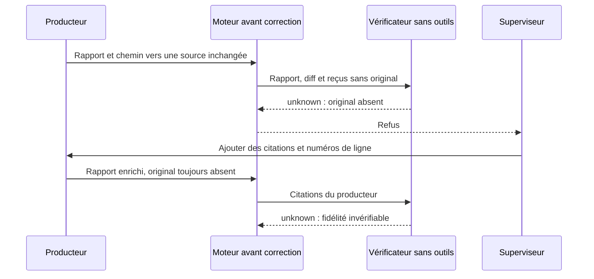
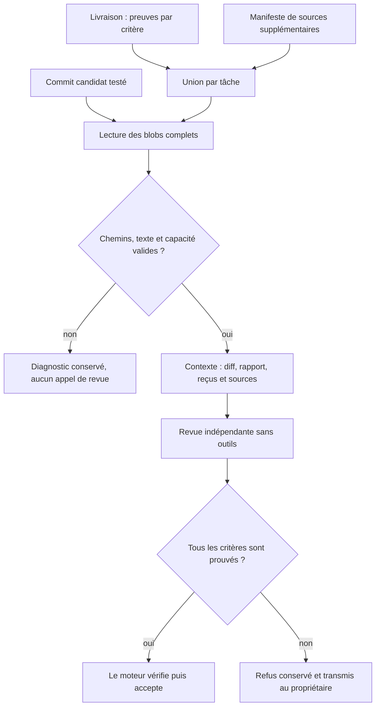
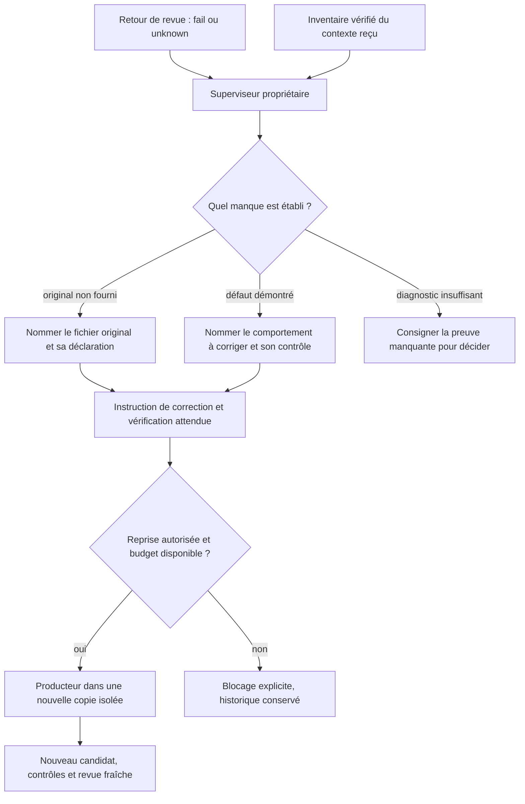
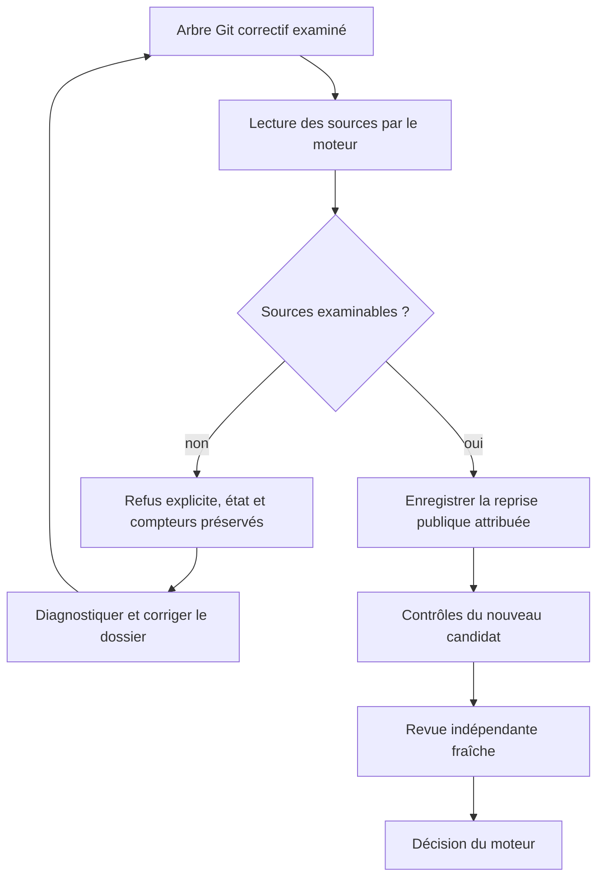
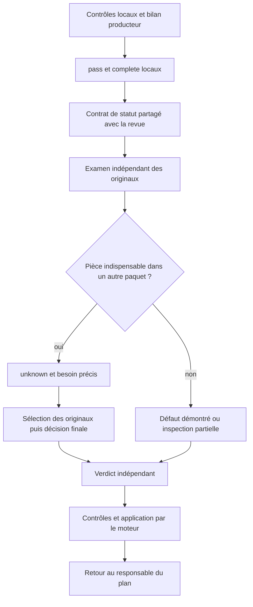
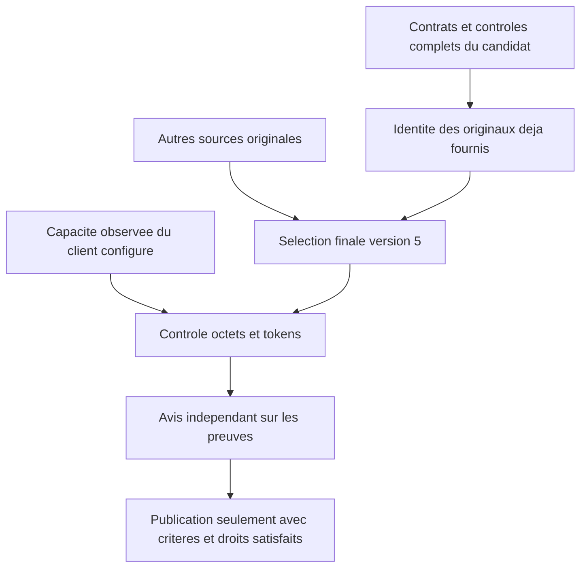
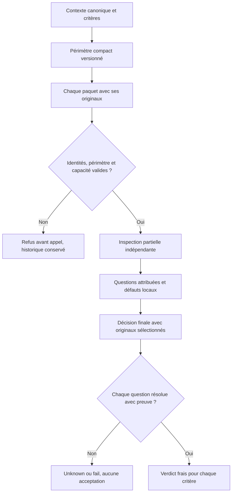
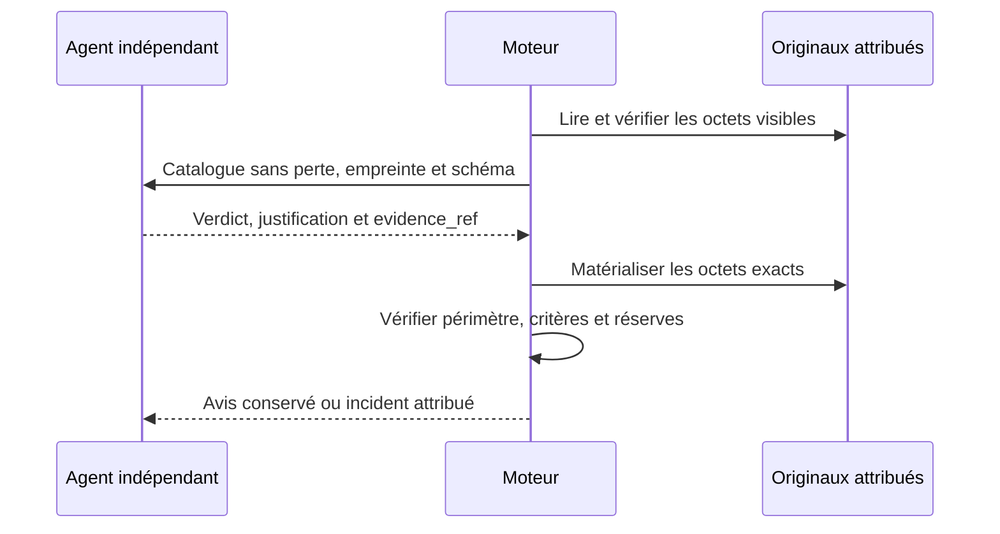

# Transmission des preuves à la revue et correction supervisée

Les contrôles autorisés avec `review_output: true` transmettent toute leur sortie
capturée, dans la borne technique existante de 64 Kio par commande. La réduction
intermédiaire à 8 Kio est supprimée : elle pouvait cacher les dernières assertions
d'un contrôle réussi. `output_bytes`, `output_sha256` et
`review_output_truncated` restent attribués au contrôle réel. Au-delà de la capture,
le marqueur de troncature reste vrai ; aucune sortie historique manquante n'est
reconstituée. Les politiques de sources et les limites de transport du contexte
de revue restent vérifiées avant l'appel ; un dépassement exige un découpage
examinable, jamais une acceptation ni une preuve silencieusement tronquée.

Le [protocole IA/moteur](AGENT-ENGINE-PROTOCOL.md) distingue erreurs de réponse,
défauts du candidat et reprises autorisées, avec leur routage déterministe.

Le [contrat de traçabilité](TRACEABILITY.md) précise l’origine des exécutions,
la chaîne de preuve, les responsabilités et la gestion concurrente des remises.

Correction globale du 10 octobre 2026. Ce contrat s'applique aux livraisons Git
gérées de toutes les missions, aux responsables racine et aux sous-planificateurs.
Il ne dépend d'aucun identifiant de tâche ou de fournisseur particulier.

## Défaut observé

Un producteur déclarait un fichier inchangé dans son bilan, mais le vérificateur
ne recevait que le rapport et le diff. Le responsable demandait davantage de
citations sans joindre l'original. Le [cas réel T1](../publications/20261005-cursor-moteur/dossier-recherche/revisions/20261010-refus-contexte-revue.md)
conserve deux refus `unknown`, la correction manuelle du dossier et l'acceptation
après revue fraîche. La correction globale ci-dessous est distincte de cette
intervention manuelle.



## Comportement global du moteur

`delivery.criteria[].evidence` déclare des fichiers suivis, avec chemins relatifs
à la racine Git. Pour chaque tâche examinée, le moteur lit leurs contenus texte
complets depuis le commit candidat contrôlé, même inchangés. Il joint chemin,
blob Git, taille et SHA256 dans `sources[]`. Le rapport identifié est déjà fourni
dans `tasks[].report` et n'est pas ajouté une seconde fois par cette déclaration.
Le manifeste facultatif `docs/TASK-ID.review-context.json` ajoute des fichiers
complémentaires ; il ne retire pas les preuves déclarées dans la livraison.
Les doublons sont dédupliqués sans perdre leur attribution aux différentes tâches.

Un fichier déclaré reste un original physique séparé même si son contenu apparaît
aussi dans le diff d’un nouveau fichier. La réduction ne retire que du contexte
inchangé du diff. Les préfixes `+` ne remplacent pas les octets littéraux nécessaires
aux citations ; le contrôle de capacité compte le contexte effectivement fourni.
Les anciens contextes archivés conservent leurs octets et leur validation.




Il n'y a ni lecture de la copie vivante ni inférence de chemins depuis un texte
libre. Une preuve mentionnée uniquement dans une phrase reste à déclarer. Les
[politiques de revue](REVIEW-POLICIES.md) sont persistées et réglables dans la
modale Admin : défauts de 24 sources et 128 Kio par tâche, 96 Kio par source ;
0 signifie sans plafond de politique. Le format du manifeste reste borné à 8 Kio. Les transports
et la coordination de revue conservent leurs propres contrôles de capacité.
Un fichier absent, non régulier, non textuel ou trop grand bloque avant réservation
d'un appel payant. Aucun fichier n'est tronqué ou remplacé par son résumé.
Le producteur doit fournir des preuves texte examinables ; ce parcours ne rend
pas une image binaire visible à un vérificateur texte.

Sans bilan ni manifeste, une tentative historique garde le parcours diff/rapport/
reçus. Les revues déjà enregistrées ne sont pas réécrites. Un nouveau dossier
invalide les preuves de revue qui ne correspondent plus à ses octets ; il doit
passer par les opérations publiques de reprise et une revue fraîche.

## Ce que reçoivent les superviseurs

Pour un événement `independent_review` courant, `planningDeliveryContext` joint
`review_evidence_inventory` au propriétaire, racine ou enfant. Cet inventaire
contient les identités de revue et candidat, l'empreinte du contexte, puis les
chemins, blobs, tailles et SHA256 des sources effectivement jointes. Il ne copie
pas leur texte dans le contexte de planification.

Le moteur relit le contexte archivé et vérifie son empreinte avant d'attester
l'inventaire. Un contexte absent, altéré ou d'une autre révision produit
`unavailable`, avec aucune source attestée. Un avis historique ne reçoit jamais
l'inventaire d'un avis plus récent. Les limites de projection continuent de
s'appliquer ; les événements non remis restent en attente.

Le même inventaire accompagne `.git/swarm-recovery.json`. Les consignes de
livraison, le contrat commun et la méthode replan expliquent la distinction entre
résultat défectueux et contexte absent.



Le responsable doit nommer la pièce manquante, sa transmission et la vérification
attendue. Une citation supplémentaire ne remplace pas l'original. Ce contrat
ne permet pas au moteur de prouver la qualité de toute décision de l'IA : une
source oubliée, une analyse erronée ou un critère ambigu peut encore mener à
`unknown` ou `fail`. Réception n'est ni compréhension ni acceptation.

## Mise à jour : vérifier une reprise avant de remplacer le refus

Le 10 octobre, la préparation corrective de T2 a reproduit un dépassement :
137 112 octets de sources pour une capacité de 131 072. Le dossier a été annoncé
prêt avant ce contrôle ; c'était un défaut de la méthode opérateur. La solution
consiste à vérifier les pièces effectivement transmises et leur union, sans
augmenter la capacité ni supprimer de critère. Les sorties originales du juge et
les limites de la suite interrompue restent jointes. Les miroirs EN déjà couverts
par T1 gardent leurs ajouts T2 dans le diff ; leur texte complet n'est plus joint
une seconde fois. Ce choix est explicite dans l'index de preuves.

`recoverResult` réutilise désormais `managedReviewSources` sur le résultat Git
examiné, avant de remplacer le résultat, la revue ou les références de reprise.
Cela couvre les soumissions et révisions correctives, les sources de livraison
et le manifeste complémentaire. Une erreur laisse inchangés l'état public,
l'ancien refus, la tentative et les compteurs. Le résultat corrigé passe ensuite
par les contrôles ordinaires et une revue indépendante fraîche. Ce précontrôle
porte sur les sources de la tâche réparée ; le contrôle complet des transports
et de la revue cumulative demeure nécessaire après intégration.



La vérification a aussi révélé un défaut lié : les ajouts documentaires faisaient
dépasser 32 000 octets au cadrage embarqué des planificateurs et du worker.
Le contrat commun a été compacté en conservant les obligations ; la capacité
reste inchangée. `tools/agent-workflows/check.py` exécute maintenant le test des
quatre contextes réellement construits par le moteur, en plus du contrôle des
fichiers individuels. Aucun fournisseur n'est appelé par ce contrôle.

Les résultats et le statut d'installation figurent dans la
[mise à jour de recherche](../publications/20261005-cursor-moteur/dossier-recherche/revisions/20261010-tracabilite-developpement.md).
Un correctif local vérifié ne prouve ni son installation dans le processus actif
ni l'acceptation de T2.

## Composants et vérification

### Statut local, revue indépendante et fragments

Le bilan producteur utilise `status=pass` pour une couverture démontrée par ses
contrôles locaux et `outcome=complete` pour une livraison locale complète. Ces
valeurs ne déclarent pas la tâche acceptée. Exiger un avis indépendant déjà
favorable avant de pouvoir demander cet avis créerait une boucle impossible.
Le préfixe commun de revue transmet maintenant le même `deliveryEvidenceBoundary`
que le producteur, dans les revues ordinaires, fragmentées et finales. Les
déclarations restent à vérifier ; cette règle ne transforme pas un claim en preuve.

Une preuve absente d'un paquet reste `unknown` avec un besoin précis pour la
sélection et la décision finales. Elle peut se trouver dans un autre paquet ;
son absence locale ne démontre pas son absence du dossier. Un ancien reçu FAIL
reste conservé. La revue doit comparer commandes, portée, sources et originaux
ultérieurs avant d'affirmer une contradiction. Le nom du paquet Go dans une sortie
ne prouve pas qu'une commande avec `-run` ait exécuté la suite complète.



Le scénario réel T2 du 11 octobre motive cette correction : confusion entre PASS
local et acceptation, reçu historique échoué et contrôle court sans commande.
Le test avec adaptateur et fournisseur simulé vérifie les instructions effectivement
reçues et conserve `unknown` ; il ne prouve pas la compréhension d'un modèle réel.
Voir la [mise à jour de recherche](../publications/20261005-cursor-moteur/dossier-recherche/revisions/20261011-instruction-learning-retex.md)
pour la vérification complète, l'installation et la nouvelle revue native.

- `managed_review_sources.go` : union des déclarations et lecture des blobs du candidat.
- `managed_review_evidence_inventory.go` : inventaire des sources reçues et intégrité.
- `planning_delivery.go` : remise de l'inventaire au responsable du retour.
- `managed_recovery_handoff.go` : dossier de reprise avec inventaire et consignes.
- `managed_delivery_contract.go`, contrat commun, replan et modèle de rapport : consignes globales.

La régression minimale reproduit d'abord l'absence d'une source inchangée dans
le contexte. Après correction, elle vérifie ses octets et empreinte, sa stabilité
après modification de la copie, l'attribution aux tâches et le maintien d'un
verdict `unknown` du fournisseur simulé. Les autres cas couvrent doublons, sources
complémentaires, dépassement de capacité, contenu non textuel, contexte altéré et
remise au responsable racine ou enfant. Ces essais de protocole avec fournisseur
simulé ne démontrent pas une meilleure qualité de décision d'un modèle réel.

La [note de recherche sur le correctif global](../publications/20261005-cursor-moteur/dossier-recherche/revisions/20261010-correction-globale-preuves.md)
conserve commandes, résultats et statut d'installation. Aucun budget, délai de
politique, critère ou état historique n'est modifié par ce contrat.

### Association des défauts et reprise du protocole

Un défaut cité exige un constat `fail` pour la même pièce. `inspected` ou `unknown` avec un défaut reste une réponse invalide, conservée avec son coût ; le moteur ne transforme pas ce contenu en refus ni en acceptation. Le contrat de citation1 permet plusieurs défauts distincts par pièce en échec, sous la borne commune de transport ; le contrat historique exige une seule entrée. Le diagnostic de reprise suit la version du paquet, conserve les identités et n’écrit aucune preuve dans le journal. Une allégation peut déclencher un diagnostic de code indépendant, sans fabriquer le verdict absent.

Une citation absente ou ambiguë peut faire échouer le décodage avant la construction des constats. La reprise vérifie alors séparément l’identité du candidat, du contexte, du paquet et de la réponse originale immuable, puis transmet un diagnostic borné de citation. Elle ne remplit pas la ligne, ne répare pas la citation et ne transforme pas le JSON invalide en avis. Un autre candidat, un paquet modifié ou une réponse altérée n’autorise pas ce diagnostic.


## Sélection des originaux déjà reçus

À partir de la version 4, le journal de sélection final désigne dans `already_supplied_originals`
les pièces de contexte dont les octets complets et l'empreinte sont identiques au
champ `task_contracts_reports_controls` déjà remis au sélecteur et au décideur.
Elles ne sont pas facturées une seconde fois dans `cost_rows`. Les autres
originaux doivent toujours être sélectionnés intégralement ; une identité de
transport ne prouve aucune conformité. Une pièce altérée ou attribuée à un autre
contexte est refusée. Les messages et journaux versions 1 à 3 restent reconstruits
avec leur contrat d'origine, sans réécriture de leurs preuves.

Pour le client Codex configuré et le modèle reconnu, le moteur observe d'abord
la version et le catalogue embarqué du client, puis utilise la capacité attestée
et le comptage exact en octets/tokens. Un paquet compatible avec le transport
historique ne doit pas masquer cette capacité. Les réserves et l'empreinte du
client sont figées dans le plan ; le modèle, les appels autorisés et la
consommation ne sont pas augmentés. Sans capacité établie, le parcours historique
conserve ses limites et ne devient pas une preuve de capacité du fournisseur.



La version courante 5 lie aussi le schéma fourni au modèle à l'inventaire exact :
chaque branche de `references.items.anyOf` associe un index de paquet, un index
de pièce et son empreinte autorisée. Les trois identités du candidat, contexte
et plan sont également bornées à leurs valeurs attendues. Une empreinte libre
mal recopiée ne fait donc plus partie des réponses proposées au fournisseur.
Le parseur reste l'autorité pour association, doublons, fraîcheur et capacité ;
il ne corrige ni ne remplit une réponse invalide. La taille du schéma réellement
envoyé entre dans le précontrôle octets/tokens avant toute réservation payante.
Les schémas et messages des journaux 1 à 4 restent ceux de leur version.

Les octets de chaque `review_output` non vide déjà transmis sont aussi des
originaux distincts pour la validation des citations, identifiés logiquement par
`controls/ID/output.txt`. Le moteur conserve en parallèle le JSON du reçu. Une
citation littérale de la sortie n'a pas à reproduire les échappements de son
enveloppe JSON. Les résolutions de questions utilisent les mêmes originaux
visibles, séparément : aucun collage entre commandes, aucune normalisation des
données, aucun accès à une sortie absente ou non transmise. Cela corrige la
validation du transport ; une sortie citée ne démontre pas à elle seule le critère.

Les erreurs de format des réponses finales sont typées `review_fragment_protocol`
comme celles d'inspection : JSON invalide, référence de sélection incohérente,
citation finale ou résolution sans preuve. Le code est conservé jusqu'au reçu
public et au routage vers le superviseur propriétaire ; `review-retry` exige
encore décision fraîche, motif nouveau, originaux intacts et budget disponible.
Une erreur des originaux détectée avant décodage reste un défaut d'intégrité,
et un véritable avis défavorable reste `changes_requested`. Le typage ne
transforme aucun refus historique et ne déclenche pas de dépense automatique.

## Base acceptée dans une nouvelle revue

Après le premier candidat accepté, un nouveau contexte utilise la base précédente
vérifiée même si le contexte complet tiendrait dans le transport. Le moteur
contrôle les avis, critères, producteurs, politiques, contrôles et empreintes de
cette base, puis fournit le diff complet depuis ce commit. Une base altérée ou
périmée bloque ce parcours. Tous les critères des tâches anciennes et nouvelles
exigent encore des contrôles et un verdict indépendant sur le nouveau candidat.

Le contrat de base version 1 rend cette portée explicite dans chaque inspection
partielle. Les demandes de sources doivent se rattacher à un critère courant,
une modification ou une interaction précise. Une incertitude réelle reste
`unknown` ; une base vérifiée ne constitue pas un avis favorable sur le delta.
Les contextes et prompts historiques de base version 0 restent reproduits sous
leurs octets d’origine ; une version inconnue est refusée.

Les dépendances critiques nouvellement utilisées restent à déclarer comme
originaux complets. Un diff de répartiteur ne fournit pas nécessairement les
helpers définis ailleurs dans le même fichier. Déclarer le fichier complet et
le rattacher aux critères qui utilisent son décodage, ses limites ou ses sorties.

## Défaut lié à son constat

Les nouveaux paquets portent `finding_contract_version: 2`. Chaque constat est
indexé par la pièce reçue et choisit une forme exclusive : `inspected` avec
`v/r/e`, `unknown` avec `v/r/e/n` et au moins une preuve manquante, ou `fail` avec
`v/r/e/d` et au moins un défaut démontré. Chaque élément de `d` contient `quote`,
`explanation`, `reproduction` et `expected`. Le schéma ne propose aucun tableau
`defects` global, ni numéro de pièce à recopier dans le défaut. Le numéro du
constat est son attribution ; la ligne vient de la citation littérale unique.

Le parseur refuse les mélanges, champs étrangers, citations absentes ou ambiguës,
doublons et dépassements du maximum commun de quatre défauts par paquet. Il ne
convertit jamais une contradiction en avis favorable. Une inspection reste
partielle ; seul le verdict final indépendant porte sur les critères du candidat.
Les contrats de constat 0 et 1 restent lisibles sous leur format historique.

Vérification ciblée : `go test -race ./internal/engine -run
'^TestFragmentNestedDefect' -count=1 -v`. La fixture vérifie attribution, opinion
conservée, refus sans acceptation, diagnostic de citation et reprise explicite
avec conservation des appels et originaux. Elle ne prouve pas une revue native.

## Reçu du candidat et résolution de contexte

Le reçu moteur fourni dans `task_contracts_reports_controls.receipt` est aussi
un original pour les résolutions de questions. Sa représentation JSON est celle
effectivement transmise : une citation exacte de `candidate_commit` peut établir
la liaison des contrôles au candidat courant. Le parseur ne l’ajoute pas aux
sources d’implémentation ; ce reçu seul ne peut justifier un critère métier
`pass`. Un reçu non transmis, une autre identité ou une citation fabriquée restent
refusés. Le moteur ne réécrit aucun ancien avis après cette correction.

Une citation de résolution refusée indique désormais `packet`, `artifact`,
`need_index`, l’empreinte de la citation complète et un extrait JSON borné. Le
texte cité absent n’établit pas l’absence du fichier. Le superviseur doit partir
de ce contre-exemple et des originaux réellement reçus avant de décider une
nouvelle reprise ; un constat produit partiel ne remplace pas ce diagnostic.

## Citation attribuée à une autre pièce

Un champ `quote` présent ne signifie pas que son texte existe dans la pièce
désignée. Sur erreur, le moteur distingue maintenant ce cas d’un champ vide,
donne les coordonnées et l’empreinte de la citation, et cherche son texte exact
dans les autres originaux du même paquet. Les correspondances sont du diagnostic
avec index et empreintes ; le moteur ne déplace jamais le constat du vérificateur.
Le superviseur peut demander une nouvelle attribution indépendante fondée sur ce
contre-exemple. Les extraits de noms sont bornés pour conserver le diagnostic
entier dans le contexte propriétaire, même avec des chemins malveillants.

Les schémas et messages d’inspection historiques restent identiques. Le diagnostic
ne réécrit ni réponse, ni défaut, ni verdict, et une citation trouvée ailleurs
ne démontre pas la réalité du défaut annoncé.

## Delta canonique et message fragmenté

Les nouvelles bases acceptées portent `version: 2`. Les versions 0 et 1 restent
lisibles et leurs consignes historiques conservent leurs octets. Le nouveau
contexte distingue le delta Git complet, découpé dans les paquets, du champ `diff`
vidé dans les messages finaux pour ne pas retransmettre implicitement ces octets.
Une valeur vide à cet endroit ne prouve aucune absence de changement.

Les lignes de type `diff` de l’inventaire recensent toutes les sections avec leur
nom et leur empreinte. Le décideur lit intégralement seulement les originaux
sélectionnés ; il peut demander les sections nécessaires aux critères et aux
interactions, ou rester `unknown` si elles manquent. `changes_since_observations`
désigne un autre delta : celui des inspections historiques réutilisées vers le
candidat courant. Son absence sans réutilisation ne décrit pas le delta depuis
la base acceptée. L’inventaire ne devient pas une preuve d’implémentation dans le
parseur, et aucun avis historique ne vaut acceptation du nouveau candidat.

## Réponse structurée complète et projection humaine

Le lecteur des appels structurés utilise maintenant l’extraction originale des
événements de réponse finale publique. La projection humaine à 16000 octets reste
séparée : son suffixe de troncature ne doit jamais entrer dans un JSON de revue,
de planification ou de contrôle. La borne technique de réponse structurée reste
64 Kio, distincte de la borne existante du flux ; un dépassement est refusé avec
sa taille et conserve le texte capturé pour diagnostic, sans devenir un verdict.
Les événements de raisonnement et les sorties d’outils ne sont pas des réponses
finales et restent exclus.

Les fixtures Codex et Claude exécutent le vrai parcours de sous-processus et
vérifient les originaux UTF-8 de 15999, 16000, 16001, 65536 et 65537 octets. Les
réponses admises gardent exactement leurs octets et leur JSON ; le dernier cas
est refusé sans couper le texte de diagnostic. Un ancien fichier déjà coupé ne
permet pas de récupérer sa fin : conserver cette limite et obtenir une nouvelle
réponse seulement après correction de la cause et décision autorisée.

## Périmètre commun des inspections

Les nouveaux contextes portent `inspection_scope_version: 1`. Chaque paquet
contient un `scope` compact avec les tâches, titres, livrables, critères, sections
de diff et identités de la base. Le moteur dérive ces champs du contexte canonique
et vérifie leur égalité avant un appel ; un champ altéré, absent ou de version
inconnue bloque le plan. Leur taille est comprise dans le comptage du message,
y compris après découpage par capacité ou reprise avec observations historiques.
Les anciens contextes sans cette version conservent leurs paquets et messages.

Le périmètre est du cadrage, pas une preuve d’implémentation. L’inspecteur rattache
un manque à un critère ou une interaction concrète. Le décideur final conserve
chaque question et peut en réfuter la nécessité par une citation du contrat
courant, notamment si la demande est hors périmètre ou circulaire. Il ne peut
écarter un défaut ou une preuve nécessaire par une déclaration de périmètre.
Une dépendance inchangée réellement affectée doit toujours être examinée ; toute
preuve nécessaire absente reste `unknown`. Les citations du contrat servent à
résoudre le cadrage, jamais à prouver une conformité métier dans le parseur.



Vérification ciblée du contrat :

```sh
go test ./internal/engine -race -count=1 -v -run '^TestManagedFragment(EveryInspectionReceivesCurrentCriteria|RejectsUnknownScopeVersion|ScopeAcrossTokenPackingAndFinalSelection)$'
```

Le contrôle doit exécuter trois tests principaux et les deux sous-cas de
repaquetage ; une sortie sans test exécuté n’est pas une réussite. Cette fixture
établit la transmission et le refus d’une altération, pas une acceptation native.

## Longueur des demandes de preuve

Les nouveaux paquets portent `inspection_contract_version: 1`. Pour leurs
demandes `n`, le parseur applique les mêmes unités que le schéma JSON : 3 à 240
caractères Unicode, avec refus des doublons et du UTF-8 invalide. Les caractères
accentués et hors du plan multilingue de base comptent chacun pour un caractère ;
leur taille en octets est distincte. La borne totale de réponse et les contrôles
exacts de capacité continuent de s’appliquer, sans troncature. Le diagnostic de
refus donne la pièce, l’index de demande et les deux tailles, sans changer le texte.

Les paquets historiques sans cette version gardent leur ancienne validation en
octets et leurs prompts. Une erreur déjà enregistrée reste une erreur : la
correction du parseur ne réinsère pas sa réponse dans le journal. Le parcours
public de changement de méthode prépare une nouvelle revue complète, avec de
nouvelles réservations et les consommations antérieures conservées. Les nouvelles
consignes partielles explicitent aussi que le champ `diff` vidé dans la pièce de
métadonnées correspond à une omission de transport ; les sections de diff restent
des pièces originales distinctes, nécessaires selon les critères et interactions.

Vérification ciblée :

```sh
go test ./internal/engine -race -count=1 -v -run '^TestFragmentUnicodeNeeds'
```

Deux tests principaux vérifient les limites Unicode, accents, caractères hors BMP,
minima, dépassement et doublons, ainsi que le maintien du contrat historique et
le refus d’une version inconnue. Aucun de ces tests n’accepte une tâche métier.

## Conventions de citation transmises avant une reprise

Les rôles reçoivent déjà leurs droits, leurs identités et un schéma JSON avant
chaque appel. Les contextes historiques `citation_contract_version: 1` ajoutaient
les conventions littérales dès la première sélection et décision, avant toute
erreur ; les contextes historiques sans cette version gardent leurs messages. La sélection des originaux utilise des références paquet/pièce et
SHA-256 ; la décision finale exige ensuite une citation littérale des preuves
visibles. Ces deux contrats restent distincts : une source déclarée dans le
manifeste n’est pas automatiquement une pièce entière sélectionnée pour la fin.

Lorsqu’une résolution cite un texte absent des originaux visibles, la reprise
transmet désormais `retry_directive.citation_diagnostic` version 1. Ce diagnostic
lie la réponse originale rejetée à son appel, sa revue, son candidat et son
SHA-256. Pour le premier écart refusé, il conserve les index de question, l’empreinte
de la citation rejetée et des fenêtres de texte exact des originaux déjà visibles,
avec nom, SHA-256, ligne et offset en octets. La recherche de voisinage peut
localiser une ligne malgré une différence de mise en forme ; les fenêtres
transmises gardent les octets de l’original, sans les normaliser. Elles sont
bornées à quatre originaux et 256 caractères par fenêtre ;
une coupure est indiquée séparément et n’ajoute pas de caractères à l’extrait.
Le diagnostic est sérialisé une seule fois dans la directive. Il cible la première
frontière refusée ; toutes les questions finales et la réponse source intégrale
restent conservées et doivent être traitées indépendamment.
Ces bornes sont des contraintes de représentation du diagnostic ; la capacité
du message complet est contrôlée avant tout appel.

Les conventions rappellent de conserver indentation, espaces, tabulations, sauts
de ligne et signes de patch. Une sortie de contrôle qui contient du JSON reste
son texte capturé : interpréter un champ imbriqué ne crée pas un nouvel original
admissible. Un saut de ligne réel diffère des deux caractères barre oblique
inverse et n. L’agent peut choisir un extrait plus court, exact et pertinent,
ou garder `unknown` en désignant la preuve nécessaire. Le diagnostic ne corrige
jamais l’avis rejeté et ne produit aucun verdict. Les contrôles d’admission des
citations et l’obligation de revue indépendante restent inchangés.

La même préparation s’applique aux reprises du superviseur et de l’opérateur.
Le diagnostic est conservé avec la décision publique, puis avec l’appel effectif ;
la validation reconstruit le message et vérifie son empreinte. Les anciennes
consignes sans ce champ conservent leurs octets. Une réponse source altérée ou
attribuée à un autre candidat bloque la préparation au lieu d’autoriser une
nouvelle dépense.

Lorsque le journal final existe déjà, le précontrôle relit et valide les
inspections, la sélection et les empreintes historiques avec leurs consignes
d’origine. Il mesure ensuite la sélection encore nécessaire ou la décision
exacte, avec les pièces déjà sélectionnées et la nouvelle directive. Les paquets
d’inspection terminés ne sont pas des appels futurs à agrandir avec cette
directive. Une décision devenue trop grande reste refusée avant réservation.
La préparation initiale et les reprises d’inspections conservent le contrôle
de leurs formes complètes.

### JSON et JSONL

Les décisions, avis et instantanés de journaux sont des objets JSON complets,
validés par le moteur. Certains transports de sortie, notamment les événements
du fournisseur et les tests Go, utilisent une suite de lignes JSON indépendantes
(JSONL). Cela permet de lire les événements progressivement et de conserver un
préfixe exploitable après interruption. Cela n’autorise ni à compléter un avis
JSON incomplet ni à transformer des logs en acceptation.
La protection contre la modification relève des droits d’accès, des empreintes
et des contrôles d’intégrité propres au journal concerné.

Vérification de la transmission avant appel et après réouverture :

```sh
go test ./internal/engine -race -count=1 -v -run '^(TestCurrentReviewCitationConventionsBeforeFirstCall|TestRecoveryPrefixCarriesLiteralCitationConventions|TestFinalCitationRecoveryReplacesLegacyContractAfterReopen|TestFinalCitationRetryMeasuresRemainingMessage|TestCitationDiagnostic.*)$'
```

La fixture exécute le parcours public opérateur et superviseur, préserve le refus
initial, vérifie le message effectivement reçu par un sous-processus isolé et le
nouveau résultat de revue. Ce transport déterministe ne remplace pas une revue
native du pilote. Un test distinct altère l’original capturé et exige un refus
sans mutation ni dépense.

## Références originales — contrat de citation 2

Les nouveaux contextes des sources actuelles utilisent `citation_contract_version:
2`. La qualification native et le binaire effectivement installé doivent être
vérifiés séparément ; voir le suivi du programme dans `docs/plans/`.
Les versions historiques 0 et 1 restent lisibles sous leur contrat original.

La sélection des pièces entières conserve ses références paquet/pièce/SHA-256.
Pour l’avis final, le moteur construit ensuite `citation_catalog` à partir des
seuls originaux effectivement fournis : rapports et contrôles attribués aux
tâches, sources et diff visibles, reçu et contrats pour les questions de liaison
ou de périmètre. `catalog_sha256` lie le catalogue au candidat et au contexte.
Un critère `pass` ou une résolution `resolved` contient `evidence_ref`, un entier
admissible proposé par le schéma ; `fail` et `unknown` gardent une explication
`evidence`. L’agent conserve la décision sémantique et sa justification.

Le moteur matérialise cette référence en octets originaux puis applique les
contrôles existants : couverture exacte des critères et réserves, tâche,
candidat, preuve originale, changements actuels et droits de preuve. Un reçu ou
un contrat ne devient pas une preuve de conformité métier. Une référence
inconnue, une autre empreinte de catalogue, des champs dupliqués, une ambiguïté
texte/référence ou un JSON invalide sont refusés, sans compléter la réponse.
Aucun verdict rejeté n’est réparé ni réaccepté.

Le catalogue partage les fragments identiques, y compris les sorties reprises
sous forme de chaînes JSON dans les contrôles et le reçu. Sa table `originals`
décrit chaque nom, type, empreinte, taille et séquence de fragments ; les fragments
négatifs indiquent l’encodage chaîne JSON du fragment d’indice `-1-n`, sans
les guillemets externes. La concaténation doit reconstruire exactement chaque
original et son SHA-256. `la colonne `evidence_encoding` de `quotes`` précise la forme littérale
matérialisée pour l’avis. Le découpage à 768 octets respecte UTF-8 et peut conserver
une fin de moins de huit octets avec le fragment précédent ; c’est une granularité
de représentation, sans retrait de contenu ni plafond de politique ajouté.
Le message et son schéma complets sont mesurés avant réservation. Les bornes
existantes restent distinctes : 64 Kio de réponse du transport structuré,
16 Kio pour la réponse finale fragmentée. La matérialisation interne n’est pas
confondue avec les octets reçus du fournisseur.

Les nouvelles revues fragmentées conservent également un fichier de consignes
originales, avec leur méthode, leur attribution et leur empreinte. Une revue
favorable reste relisible avec ces consignes après une évolution des méthodes ;
une revue encore active doit satisfaire les contrôles de fraîcheur. Après erreur
sous le contrat 2, une reformulation, un nouveau délai ou une hausse de budget
seuls ne permettent pas de relancer le même protocole. Les parcours opérateur
et superviseur refusent l’opération avec `review_precondition_unchanged`. Une
modification des consignes communes ou du profil seule ne constitue pas une
correction du protocole 2, même si son empreinte de texte change.
Une évolution effective du contrat versionné conduit à une revue complète du même candidat,
après vérification des originaux historiques ; aucune inspection ancienne ni
avis n’est réattribué. L’aperçu expose le besoin d’appels et le plafond minimal
sans appel fournisseur ni remise à zéro des consommations.



Vérification ciblée en environnement isolé :

```sh
go test ./internal/engine -race -count=1 -v -run '^(TestCitationCatalog|TestReferencedCitation|TestStructuredCitationContract|TestFinalCitationRecoveryReplacesLegacyContractAfterReopen|TestReviewMethodRestart)'
```

Ces fixtures vérifient le sous-processus, la réouverture, les refus et la
conservation des preuves. Elles ne prouvent ni une revue native indépendante,
ni l’acceptation du programme, ni sa qualification pour diffusion.

Les contenus Git du contrat 2 sont lus en stdout brut : les espaces, tabs, CRLF
et LF de bord restent présents dans les rapports et diff, y compris après
compaction ou calcul d’un delta. Stderr reste séparé du contenu. Les versions
0/1 conservent leurs chaînes historiques normalisées ; elles ne sont pas
réécrites comme si ces octets avaient été fournis auparavant. La validation du
rapport Git reprend la version enregistrée dans le contexte.


## Fenêtre configurée des revues fragmentées

`quotas show|preview|apply` et le dialogue Admin « Réglages du moteur » partagent
`limits.review_context_tokens`, persisté dans `ReviewerConfig.input_context_tokens`.
L’unité est le token de la fenêtre totale : 0 conserve le défaut du client, sans
signifier illimité. Une valeur positive exige une capacité observée compatible ;
une fenêtre trop petite pour les réserves ou supérieure au maximum annoncé est
refusée sans mutation ni appel. Les quotas de sources, les réserves d’entrée et de
sortie et les budgets d’appels restent distincts. Une fenêtre étendue peut modifier
la tarification du fournisseur ; elle n’autorise aucun appel supplémentaire.

Le contrat de capacité version 2 conserve défaut, maximum annoncé, valeur
configurée, modèle, version et empreinte de l’exécutable, fournisseur et empreinte
de capacité. Le même nombre est transmis explicitement au client Codex par
`model_context_window` pour chaque inspection, sélection et décision. Il est ajouté
après la construction des arguments sans outils, sans reprendre les permissions
d’un producteur. Le maximum provient du catalogue embarqué du client exécuté ; un
cache d’une autre version ou une limite publiée pour l’API ne prouve pas ce plafond.
L’aperçu vérifie ce contrat, la sauvegarde revérifie sous verrou et une révision
périmée est refusée. Un réglage explicitement demandé qui ne peut être vérifié ne
retombe pas silencieusement sur le transport historique. Les anciens contrats
version 1 et leurs octets restent relisibles.

Un avis fermé en erreur conserve ses consignes figées et ses preuves originales
pour préparer une correction différente. Cette lecture historique ne relance
aucun appel, ne réutilise pas un verdict et ne supprime pas le refus de reprise
inchangée. Le nouveau candidat doit passer ses propres contrôles et sa revue.
La sortie complète d’un contrôle doit aussi tenir dans sa capture : employer un
format natif plus compact avec les mêmes cas exécutés et noms vérifiés est distinct
d’une troncature ; conserver le premier dépassement et la nouvelle sortie entière.

La décision de réutiliser une inspection compare aussi l’empreinte réelle des
consignes. Une méthode différente impose des inspections fraîches du candidat
corrigé, même si le schéma de citation est inchangé. Le refus de relancer une
erreur inchangée est un autre contrat : il ne doit pas servir de prédicat de
réutilisation. Cette séparation n’autorise aucune dépense ni acceptation implicite.
