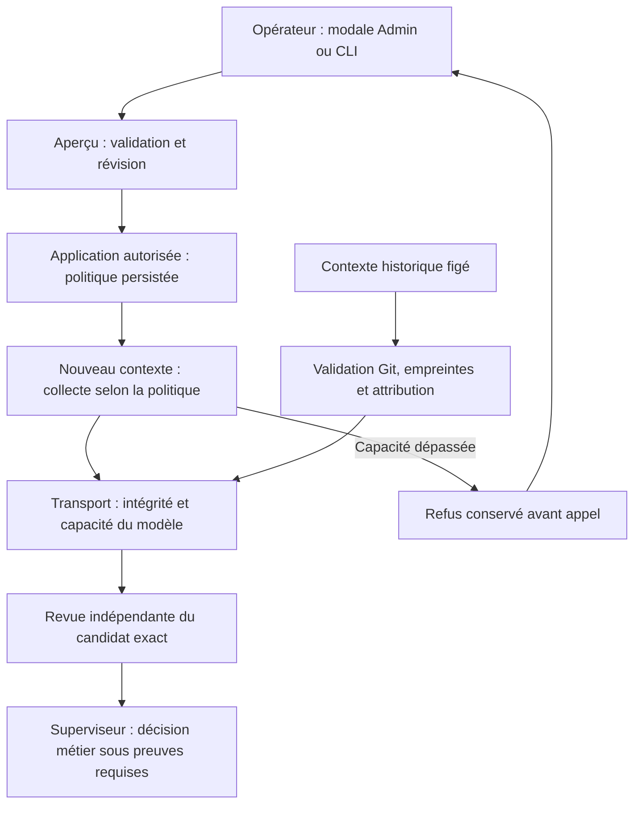

# Politiques de revue

La modale de réglages Admin expose les plafonds de revue d'une mission. API,
CLI `quotas preview` / `quotas apply` et Go valident les mêmes valeurs persistées.
L'aperçu n'applique rien. L'application exige la révision actuelle, un motif et
un identifiant d'événement ; aucun compteur, tentative ou refus n'est effacé.
Une session de planification détenue ou une revue en cours interdit la modification.

| Champ JSON `limits` | Unité | Défaut historique |
| --- | --- | --- |
| `review_delivery_files` | Fichiers du diff et d'un lot coordonné | 100 |
| `review_context_files` | Sources distinctes par tâche (manifeste et livraison) | 24 |
| `review_source_bytes` | Octets complets d'une source | 98304 |
| `review_context_bytes` | Octets cumulés des sources par tâche | 131072 |

Chaque valeur accepte 0, sans plafond de politique, ou un entier positif. Une
valeur négative est refusée sans mutation. L'absence du champ conserve le réglage
courant ; une configuration historique sans réglage utilise le défaut visible.
La consommation d'appels reste séparée. Augmenter une politique ne donne ni avis
favorable ni droit fournisseur. Le format du manifeste conserve sa borne de
8192 octets, visible en lecture seule ; chemins sûrs, blobs Git réguliers,
UTF-8, empreintes et attribution restent obligatoires. Les capacités des modèles
et transports sont contrôlées indépendamment, sans troncature silencieuse.

Le moteur vérifie le contrat et applique la décision autorisée. Le superviseur
racine arbitre les problèmes transversaux ; le sous-superviseur traite son
périmètre. Une politique nouvelle ne requalifie pas rétroactivement les pièces
d'une revue payée : les validations historiques contrôlent leur intégrité.
Une source absente ou malformée reste un défaut d'intégrité ; un manifeste valide
qui dépasse le nombre configuré est un refus de capacité, pas un JSON invalide.

Compter l’union du manifeste et des pièces de livraison, sans doublons ; le
rapport déjà joint n’est pas ajouté une deuxième fois. Exemple : un manifeste
de28 sources peut produire35 sources distinctes avec la livraison, pour214328
octets. Il faut couvrir35 sources et214328 octets, ainsi que la plus grande
source au plafond individuel.
Après aperçu puis sauvegarde, rouvrir la modale et consulter `quotas show`.
Reprendre par `planning retry-review` uniquement lorsque le checkpoint impayé
courant, son producteur terminé et ses contrôles restent attribuables. Si les
preuves ont changé, utiliser la réparation publique du résultat récupéré.
Une hausse seule laisse le statut bloqué : contrôles et revue fraîche restent
nécessaires. Aucun reset des tentatives ni acceptation manuelle sans preuves.

Recettes : `TestConfiguredReviewFilePolicyPreservesCheckpointAndAllowsExplicitRecovery`,
`TestReviewSourcePolicySeparatesValidManifestFromCapacityAndPreservesAllBytes`
et `tests/review_file_policy_ui.cjs` (binaire, configuration fournisseur isolée,
identifiant fournisseur, répertoire de preuve). La recette navigateur ne lance
aucun agent ni appel fournisseur.
