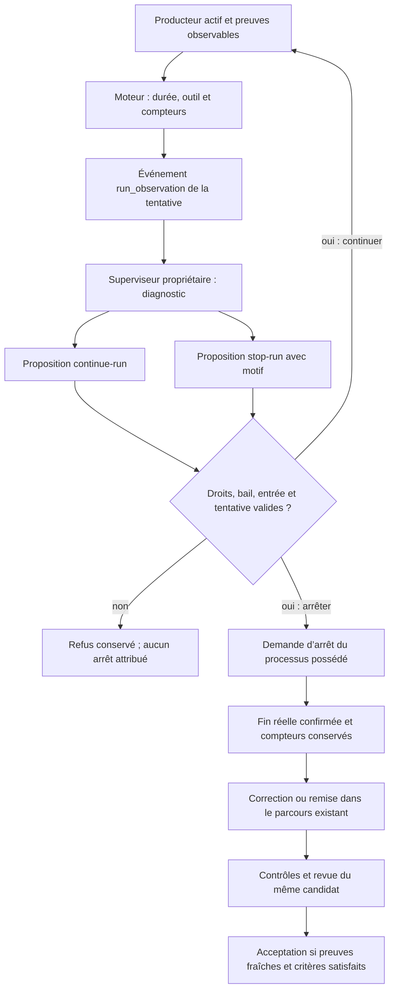
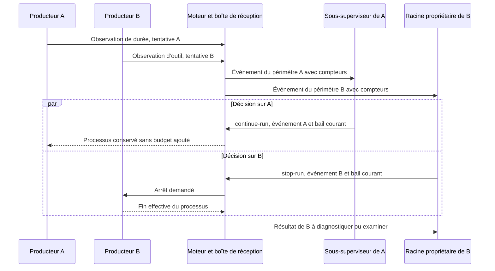
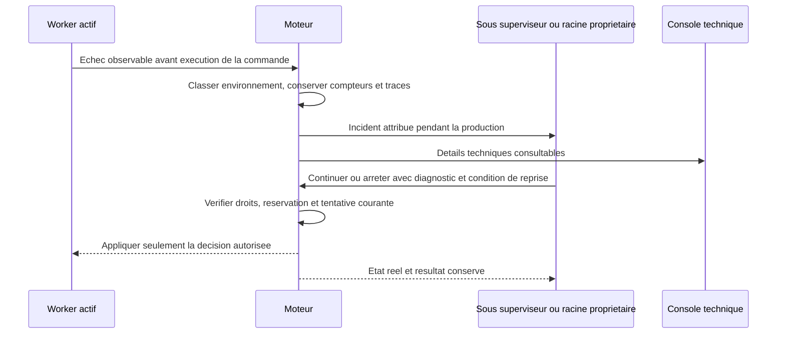

# Conduite des agents : décision IA et observation déterministe

Décision utilisateur du 11 octobre 2026, après l’interruption de T2 Cursor.
Le superviseur propriétaire juge l’avancement utile et décide de la conduite.
Le moteur mesure, transmet, vérifie les droits et applique une décision attribuée.
Une durée écoulée ne prouve ni achèvement, ni absence de progrès, ni acceptation.

## Incident et choix

La tentative `a-a349f9134d355713576b7166`, agent
`auto-f2abbcfe6bed66fd1a5e`, a été interrompue le 11 octobre à
08:36:27 UTC, avec code 143 et `stop_kind: delai`. Elle exécutait encore un test ;
78 appels et 78 résultats étaient observés pour un plafond de 80 appels.
Le délai total de 1 800 secondes a provoqué l’arrêt déterministe. Le travail
conservé dans un stash n’est ni perdu ni accepté ; son existence ne prouve pas
que les critères sont satisfaits. Les originaux restent conservés.

Relever ce délai repousserait le même défaut. Désactiver indistinctement les
limites retirerait aussi des contraintes de dépense. La correction retenue
sépare les durées observées et les autorisations : les durées alimentent la
décision du responsable ; les budgets autorisés restent opposables.

Les deux parcours de production, automatisé et terminal/dialogue, perdent leur
arrêt automatique par durée. L’attente d’un outil structuré devient également
une observation. Les délais propres aux commandes de contrôle, aux appels
structurés de préparation/revue et aux baux restent des mécanismes distincts ;
ils ne sont pas une décision sur l’achèvement de la tâche.

## Répartition des responsabilités

| Responsable | Fait | Ne peut pas déduire du seul chronomètre |
| --- | --- | --- |
| Producteur | Exécute son périmètre, conserve ses preuves et remet son résultat | Qu’un critère est vérifié ou qu’une autre tâche lui appartient |
| Sous-superviseur | Analyse les observations de ses propres tâches ; décide continuer ou arrêter ; transmet les dépendances hors périmètre | Une acceptation globale ou un budget supplémentaire |
| Superviseur racine | Conduit l’objectif global et les arbitrages de ses tâches ; exploite les remises des enfants | Que chaque producteur a fini parce qu’un délai est dépassé |
| Moteur Go | Mesure, attribue les événements, contrôle la décision et confirme la fin réelle du processus | Progrès utile, blocage sémantique ou tâche terminée |
| Vérificateur indépendant | Examine le candidat et ses preuves dans un contexte distinct | La validité du candidat à partir d’un processus terminé |

L’IA peut conclure que le travail est fini et proposer la clôture. Le moteur
revérifie alors les preuves et transitions applicables. Ce contrôle d’intégrité
n’est pas un jugement autonome du moteur sur le travail restant.

## Contrat réellement implémenté

Les seuils existants restent configurables et figés par lancement :
`timeout_seconds` dans le profil de lancement, `tool_seconds` et
`silence_seconds` dans Admin, avec leur héritage existant. Le nom JSON historique
`timeout_seconds` est conservé ; il désigne désormais un seuil d’observation
pour ces processus de production. Aucun délai de remplacement n’est ajouté.
L’UX FR/EN précise cette sémantique.

`agent.progress` expose `elapsed_seconds`, `time_threshold_exceeded`,
`tool_wait_seconds` et `tool_time_threshold_exceeded`, avec les compteurs existants.
Le silence observé conserve une vitalité fournisseur `unknown` ; aucune proportion
d’avancement n’est inventée. Le terminal natif expose la durée, sans inventer les
appels d’outils qu’il ne voit pas.

Pour une tâche de plan actif, `run_observation` est enregistré dans la transaction
travail/événement et adressé à son `scope_id`. Il contient agent, tentative,
déclencheur (`elapsed_time`, `tool_wait`, `output_silence`), seuil et photographie
des compteurs. Un déclencheur est enregistré une seule fois par tentative.
Les compteurs continuent après le seuil. Le contexte réellement remis au
planificateur et le schéma strict contiennent ces observations et opérations.
Une production active ne bloque plus l’activation du responsable ; l’attente du
verdict du contrôleur après la fin de production reste protégée.

Les propositions `continue-run` et `stop-run` passent par `planning decide`,
identiquement en CLI et API. Elles utilisent `id` de tâche et `next` motivé ;
les autres champs de l’opération sont vides ou zéro. Elles exigent :

- propriétaire exact, révision, bail et génération actuels ;
- événement courant explicitement traité et effectivement remis au responsable ;
- tâche en cours, même agent/tentative et processus encore actif ;
- budgets de décisions et d’activations existants, mission disponible.

Le motif et la décision sont persistés avec l’événement. `continue-run` conserve
le processus et les compteurs ; il ne renouvelle aucun budget. `stop-run` est lu
par le superviseur technique du processus, avec `stop_kind: planning`, puis la
fin réelle est confirmée avant libération. La course arrêt/résultat tient compte
d’une décision déjà persistée. Une décision périmée ne contrôle pas une tentative
suivante ; une répétition identique de la requête ne dépense pas une autre décision.

Les contraintes d’appels d’outils, répétitions et erreurs, quotas fournisseur,
intégrité du stockage, arrêts humains, permissions et tentatives restent en place.
Cette correction porte sur les coupures de durée ; elle ne prétend pas confier
tous ces garde-fous à une IA. Une correction du code utilise la reprise existante
après arrêt confirmé ; `next` n’est pas un canal de commande arbitraire au worker.

## Plusieurs agents, propriétaires et indisponibilité

Ce diagramme décrit les frontières du contrat, pas une preuve de deux appels IA
simultanés dans la mission Cursor. Son plan observé ne possède encore qu’un
périmètre racine ; l’exercice de la hiérarchie est confié à T3.

Si le responsable est en panne, sans budget, en pause ou sans fournisseur, aucune
nouvelle décision IA n’est inventée et aucun nouveau budget n’est accordé. Le
signal demeure visible et en attente ; le temps seul ne tue pas le producteur.
L’arrêt opérateur reste disponible. Pour une exécution sans plan, les observations
figurent dans l’état public de l’agent ; aucun superviseur IA fictif n’est créé.
Un seuil inchangé ne provoque pas une série d’appels payants. Une autre observation
courante ou un retour alimente le tour suivant ; une conduite continue avec suivi
périodique renouvelé serait une politique explicite supplémentaire.

## Vérification et portée

Les tests isolés couvrent : processus et terminal actifs après le seuil, outil
encore en cours, remise au propriétaire racine/enfant, décision CLI, arrêt
confirmé, continuation, doublon, réouverture, contrôle d’identité et refus hors
périmètre/inactif/non remis. La reproduction sur les trois sources originales
échoue sur les anciennes coupures. Les tests utilisent un fournisseur double ;
ils ne constituent ni une décision autonome avec IA réelle ni l’acceptation de T2.

Les reçus exacts et l’état d’installation sont tenus dans la
[note de recherche datée](../publications/20261005-cursor-moteur/dossier-recherche/revisions/20261011-run-supervision.md).
Cette documentation oriente les lots suivants ; elle ne remplace pas leurs preuves.
Le contrat complète [le protocole IA/moteur](AGENT-ENGINE-PROTOCOL.md),
[la reprise autorécursive](AUTORECURSIVE-RECOVERY.md) et
[le parallélisme](AGENT-PARALLELISM.md).

## Valeurs Admin effectivement reçues au lancement

Les seuils `tool_seconds` et `silence_seconds` explicitement enregistrés dans
Admin remplacent les valeurs d’observation par défaut du fournisseur et celles
de la tentative précédente pour un nouveau départ. Un délai explicite plus court
dans la requête de lancement reste conservé. Le moteur relit ces réglages dans
la transaction de réservation : un changement pendant le préflight ne fige pas
un ancien seuil. Les valeurs et les directives de commande sont alors gelées
dans l’agent réellement créé ; modifier Admin ensuite ne réécrit pas sa session.

Les plafonds d’appels, d’erreurs, de répétitions, de plan et de reprise restent
restrictifs. Une augmentation de seuil temporel ne leur accorde aucun budget et
ne modifie aucune limite de compte du fournisseur. L’absence de valeur Admin
explicite conserve l’héritage et les plafonds historiques. Ce choix corrige le
cas mesuré où Admin indiquait900s mais le nouveau prompt restait limité à300s.

## Incident d’infrastructure pendant une production

Les échecs d’environnement reconnus par le diagnostic structuré sont conservés
avec leurs compteurs et traces. Ils ne sont plus imputés au compteur d’erreurs
consécutives du worker ni au plafond d’échecs identiques : un outil empêché de
démarrer ne prouve pas une faute du code produit. Tant que cet échec persiste,
la répétition d’une même commande est un incident à conduire ; elle ne remplace
pas une décision de fin. Une commande réussie ou un échec ordinaire rétablit le
comportement habituel des répétitions. Le plafond d’appels autorisés, les attentes
fournisseur, l’intégrité du stockage et les arrêts humains restent opposables.

Pour une tâche planifiée, le moteur remet un `run_observation` de déclencheur
`infrastructure` au propriétaire du périmètre pendant que le processus est actif.
L’observation capture le diagnostic attribué, l’agent, la tentative et les
compteurs. Chaque nouveau constat environnemental est remis une seule fois ;
un échec d’outil indépendant ne remet pas un ancien incident. Le responsable
utilise `continue-run` ou `stop-run`, avec la raison et les preuves effectivement
reçues. Le moteur vérifie les droits et la fraîcheur, puis confirme la fin réelle
s’il applique un arrêt. Les tâches indépendantes peuvent continuer. Pour un
processus sans planificateur, le diagnostic reste disponible et les budgets
s’appliquent ; cette correction ne crée pas de superviseur implicite.

L’UX affiche l’incident d’environnement et la décision attendue avec un vocabulaire
fonctionnel ; les traces techniques se déplient dans le diagnostic et restent
accessibles dans la console. Ne pas afficher « reprise terminée » avant contrôle
observé, ni transformer un problème persistant en succès par une nouvelle étiquette.

Le contrat de stockage passe à la version 30 pour préserver ces observations et
les empreintes de budget des reprises de contrôles face aux anciens décodeurs.
La migration publique sauvegarde le stockage privé sans réécrire les travaux,
leurs événements ou leurs consommations. Arrêter les anciens processus avant
cette migration ; ne jamais utiliser une mission active comme fixture de test.
Les régressions isolées utilisent un fournisseur simulé et un vrai sous-processus,
avec décision publique du responsable : elles ne prouvent pas une décision autonome
par un modèle réel ni la remise en état des partages CIFS du poste.
