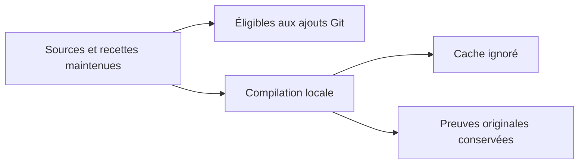

# Caches Rust et captures Git

Le dépôt exclut `/.cache/` et `/rust/target/` des ajouts Git ordinaires. Cela couvre les compilations et les fixtures locales gelées, y compris un cache imbriqué dans un snapshot. Les sources et recettes maintenues restent dans `rust/`, `tests/` et `tools/` ; les originaux de preuve restent sur disque. Les archives de preuve déjà exclues gardent leurs règles spécifiques.

Cette règle n’efface aucun fichier, ne retire aucun fichier déjà suivi et ne supprime pas les objets Git existants. Elle ne prouve ni le comportement d’une capture Codex qui utiliserait d’autres options, ni l’arrêt d’un processus déjà lancé. Aucun processus de l’application, cache d’autrui ou historique Git n’est interrompu/supprimé par ce changement. Les recettes ne modifient pas l’index principal.

La recette `local-build-cache-ignore` vérifie les règles réelles sur les caches parent/imbriqué, l’éligibilité des sources/recettes et, dans un dépôt jetable indépendant, la conservation des données et des fichiers déjà suivis. Un échec conserve ce dépôt jetable. Les résultats et l’incident de saturation sont dans le lot186 du plan. Nettoyer seulement un cache identifié, régénérable et autorisé, après conservation des preuves/empreintes utiles ; l’exclusion n’est pas une autorisation de nettoyage.

## Déplacer une lignée de compilation : vérifier les chemins effectifs

Lot188 : un cache déplacé vers une nouvelle fixture source pouvait être déclaré fresh par Cargo alors que les depfiles nommaient encore l’ancienne racine. Le qualificateur a refusé profile-input-absent-or-external ; cet échec est conservé sous normal08. Ne pas contourner ce refus ni supposer que le changement de chemin reconstruit tout. L’exécutable non qualifié a été conservé avec son empreinte, puis seuls les paquets locaux du workspace de notre cible ont été invalidés avec cargo clean -p ; le registre et les cibles d’autrui restent intacts. Normal11 recompile et qualifie les vrais chemins. Une copie figée des sources doit aussi intégrer les ressources modifiées : une recette sur le composant actuel ne vérifie pas les anciens assets embarqués. Le garde permanent embedded-settings-locale compare le vrai HTTP aux entrées effectives et aux clés du catalogue.

Une mise à jour des traductions dans une fixture figée doit rester cohérente avec ses consommateurs figés. Pour une addition de réglage, conserver les clés antérieures et ajouter les nouvelles via le générateur existant ; ne pas importer une suppression de clé décidée dans un chantier UI parallèle dont le consommateur n’est pas compilé ici. Le bundle minimal de preuve n’autorise pas une réécriture du checkout partagé ou une livraison combinée non vérifiée.
