# Remplacement du moteur Go par Rust

Lanceur local actuel : [construction/version/service exclusivement Rust](NATIVE-LOCAL-LAUNCHER.md), installé en développement ; cela ne clôt pas les parcours et critères globaux de migration.

[English](../en/RUST-MIGRATION.md). Décision utilisateur du 17 octobre 2026 :
remplacement complet avec **une seule bascule finale**, sans moteur hybride déployé.
Le [plan et les preuves](../plans/migration-rust/PLAN.md) conservent périmètre,
dépendances, critères et limites. Le développement porte sur Rust ; la bascule globale et la version du service utilisateur restent distinctes des recettes isolées ci-dessous.

## Bilan historique public des missions ordinaires

`mission status WORK --json` est raccordé au DTO historique complet (21 champs
quand les cooldowns sont absents) pour Work vide/todo sans profil/Agent/planning,
et pour les tâches ordinaires bloquées après un Agent terminal failed/interrupted.
Le parcours public vérifié comprend la préparation manuelle puis l'annulation
avant départ : identité d'Agent/tentative originale, profil conservé, résultat
stopped_early et dépenses inconnues distinctes des réservations libérées.
Les autres branches refusent explicitement ; ce périmètre ne constitue pas le
cockpit complet. Le texte natif et `status-native` restent
les observations distinctes du conducteur.

La lecture assemble données, contrôles, fraîcheur, dépenses, guidage et phases,
observe réellement `.swarm` et le répertoire temporaire, puis revérifie les données
et l'association au datastore. Ces contrôles séquentiels ne créent pas un instantané
atomique ni un confinement système. Les causes originales survivent aux refus
ultérieurs, à la fermeture et à l'écriture/flush de la CLI.

Les réglages schéma38 ajoutent `runtime_storage_stop_bytes` (268435456 octets),
`runtime_storage_warning_bytes` (1073741824 octets) et
`runtime_storage_stop_inodes` (256). Ils sont persistés, validés et décrits dans
le catalogue Admin ; zéro désactive le seuil concerné et warning doit être au
moins égal au seuil d'arrêt. L'absence historique exige une adoption explicite,
sans fallback. Une mesure stockage inconnue bloque. La santé stockage seule
n'autorise jamais un Agent. Schéma SQLite inchangé37.

La version compilée reste `devel`/inconnue tant que son injection Rust n'est pas
qualifiée ; l'historique réellement embarqué est validé. Aucun commit source
observé n'est présenté comme le commit du binaire. Les visites de plus de200
événements sont refusées, sans troncature, jusqu'au port du contrat de pagination.
Recette publique309 PASS :13 gardes et17 lectures/refus avec SQLite inchangé,
seuils enregistrés et consommés, ENOSPC et reprises. Profil normal308 sans
fixture ; SDK308 partage214 entrées moteur identiques. Tests moteur60PASS304
(agrégat revérifié308), CLI5PASS305, réglages6PASS307, Clippy/Rustdoc308 PASS.
La revue indépendante finale et ses limites figurent dans le suivi W4. Aucun
service installé, interaction Admin en navigateur ni parité Go globale annoncés.

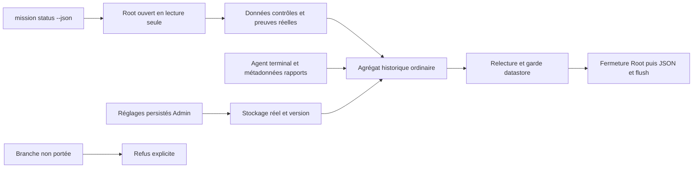

Le parcours terminal325 passe13 gardes/22 lectures-refus ; son intégrité est
vérifiée et la revue indépendante approuve production320/recette325. Les18 tests
lecteurs, Clippy et Rustdoc320 passent ; normal320 et SDK320 sont qualifiés avec
les mêmes entrées moteur. Les replays325 réutilisent les octets de production320
inchangés ; aucune reconstruction du moteur pour corriger le harnais.

La découverte de rapports lit seulement les métadonnées dans docs, sans plafond
silencieux. Elle accepte les liens fichiers vers une cible régulière contenue dans
le projet, y compris une cible sans permission de lecture ; elle ne suit pas les
liens de répertoires et refuse les vraies sorties du projet. Le tri conserve la
date lstat du lien. Aucune politique UID sur docs/rapports n'est ajoutée ; les
gardes Root/.swarm restent en place. Les erreurs de parcours sont conservées et
refusées, jamais transformées en liste vide comme le faisait le Go défaillant.
Un rapport trouvé reste partial_possible, sans preuve de complétude/attribution.
Le test typé vérifie OutsideProject ; la CLI expose l'enveloppe sûre
GateContractError (gate-evidence-invalid), sans publier les chemins privés.

États actifs, Agent completed/rapport soumis, revue historique, planning, cooldown
actif et clip de trace>600 restent à porter. La branche failed est couverte par
le classificateur ciblé ; le parcours CLI terminal vérifié325 est interrupted.
Aucune preuve runtime foreignUID, interaction Admin en navigateur ou installation
n'est déduite des tests. La suite active porte le worker terminé et la soumission.

Les sections suivantes conservent les preuves des étapes précédentes ; leurs
limites décrivent les sources historiques nommées, pas une qualification globale.

## Préparation du bilan de mission historique — W4

`mission status WORK --json` reste refusé tant que son agrégat historique n'est
pas assemblé et vérifié ; `status-native` conserve son contrat distinct. Le port
W4 ajoute les types de sortie historiques, les projections pures des tâches,
dépenses, guidage et phases, ainsi qu'une lecture transactionnelle des données
retenues : Work,
Agents complets, événements, visite de l'opérateur explicite, réservations de
planification non libérées et échanges structurés. Ce lecteur ne marque aucune
visite et ne modifie aucun budget, bail, échange ou état d'agent.

Aucune fenêtre implicite de 200 lignes ni mesure remplacée par zéro n'est ajoutée.
Une mesure absente reste absente ; les charges malformées refusent toute la
lecture, avec cause et erreurs de finalisation/repli conservées. Ces entrées
privées ne sont pas sérialisables directement : le bilan public doit choisir
explicitement les champs exposés. L'activité réelle, la fraîcheur des validations,
la santé du stockage et la version effective restent des producteurs à raccorder.

Le raccord des résultats et la conservation des causes jusqu’au flush sont
vérifiés dans la portée ci-dessous ; composition du bilan et raccord CLI ouverts.

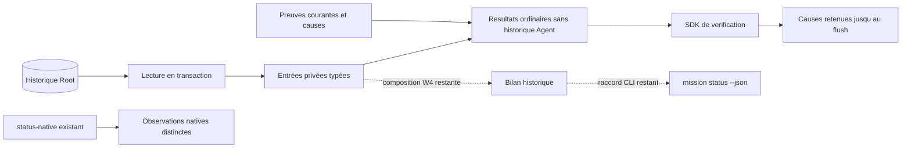

Les API `mission_status_inputs` et `mission_status_freshness` sont consommées
par un exemple de recette distinct de la commande produit. La fraîcheur lit les
preuves réelles et conserve leurs causes ; les observations sont séquentielles,
pas un instantané atomique de l'ensemble. Avant et après les preuves, le chemin
utilisé doit nommer le même datastore que les descripteurs retenus. Une égalité
de descripteurs ne suffit pas à établir cette association ; un Root absent ou
remplacé est refusé. Cela ne crée ni verrou de chemin ni confinement du même UID.

Sur la source figée258 :48 tests ciblés255 et le nouveau garde Root258 passent,
Clippy/Rustdoc stricts259 passent, profil normal260 sans fixture et SDK261 à
210 entrées moteur identiques. La recette262 vérifie un Root public inactif,
11 refus purs et7 observations/refus avec données SQLite inchangées ; elle
ne prouve pas le bilan complet, les producteurs runtime ou l'acceptation.
Le parseur Go partagé conserve les fractions d'horodatage à virgule ; les
objets JSON opaques passent directement au décodeur sans conversion `Value`
qui effacerait les clés répétées. Les contre-exemples restent en régression.

La propagation aux anciennes API révèle un défaut distinct : un lecteur gate
pouvait valider le Work ouvert avec les preuves d'un autre Root placé au même
chemin (264 et267, ce dernier sur le moteur normal). Le writer testé refuse déjà
sans enregistrer ; sa protection ne s'étend pas implicitement aux autres writers.
La correction partagée vérifiée couvre gate, revue, reçu/anchor/Git de
revue gérée, validation de tâche et validation du Work. Sur Linux, elle retient
l'instance ouverte et contrôle le chemin avant/après sous réservation, conserve
les causes primaires/secondaires et ferme les témoins explicitement. Les autres
Unix gardent leur contrat de réservation historique sans preuve d'association
physique. Les vues et autres lectures de fichiers restent des candidats d'audit,
sans prétendre que tout accès au matériel est couvert.

La correction est couverte par79 tests ciblés (269/277), Clippy/Rustdoc stricts278,
profil normal279 et exemples280/281 avec211 entrées moteur identiques. Les
recettes282 (substitution/refus/reprise) et284 (bilan partiel) passent et leur
intégrité est vérifiée ; les sorties285 sont conservées sans base Root. Les
anciennes fixtures de revue restent volontairement incomplètes : leur refus
`planning-policy-invalid` ne prouve pas le contrôle d’autorisation d’un planning
valide. Le défaut initial264/267 et les échecs de méthode269/283 sont conservés.

Le raccord vérifié suivant, encore partiel : `mission_status_results` lit Work,
réglages et historique Agent, contrôle leur cohérence avant/après et projette les
résultats ordinaires sans historique d'agent pour la tâche. Le contrat conserve
les causes de preuve périmée dans un sidecar non sérialisable ; une erreur tardive
du garde ne doit pas les perdre. L'ownership SQL/contenu des Agents est contrôlé
aux deux lectures. Les branches hiérarchiques et l'historique Agent nécessitant
un classifieur réel refusent explicitement, sans inventer d'activité ni de scan de
rapports vide. Le SDK choisit les résultats publiés et leurs diagnostics sûrs ;
ce n'est toujours pas le JSON complet de la commande produit.

Quatre tests API290 et les contrôles stricts291/300 passent. Le profil normal292
et le SDK298 partagent212 entrées moteur identiques, sans fixture. Le rouge296
reproduit une perte de cause lors d’une sortie saturée ; le vert299 vérifie13
gardes,11 lectures/refus sans mutation, une gate valide puis périmée, les causes
Gate et ENOSPC conservées ensemble, et la reprise après restauration. Les100+100
sorties301 sont archivées sans base Root. Le contrôle de fermeture tardive du
module reste simulé ; aucune injection réelle de close/horloge/encodage ni
fixture Agent corrompu n’est revendiquée. Le code de vérification d’ownership
partagé est appelé aux deux lectures. Une observation réussie avec sidecar
d’erreurs exige de conserver ce sidecar jusqu’au dernier consommateur :
la seule gestion des retours `Err` ne suffit pas à protéger ces causes.

Le [suivi W4](../plans/migration-rust/evidence/20261023-g1-status-contract/PLAN.md)
distingue code, tests et parité encore ouverte. Aucun serveur installé n'est
remplacé par cet incrément.

## Observation en direct des agents — LIVE-UX-01 (lecture seule)

Amélioration hors chemin critique demandée le 21 octobre 2026 : suivre en direct
les agents de **toutes** les missions et ouvrir à la demande une fenêtre harnais.
Tout est natif Rust (`swarm-web`, module `service/live.rs`) ; aucune route Go.

| Route | Méthodes | Contrat |
|---|---|---|
| `/api/v1/live/overview` | GET/HEAD | Chaque Work enregistré, ses agents (vue légère, plus récents d’abord), compteurs par état et totaux. Échec de lecture = refus complet, jamais de vue partielle. |
| `/api/v1/live/agent?agent=&work=&logs_after=&terminal_after=` | GET/HEAD | Vue de l’agent, réponse, page suivante de `agent_logs` et de `terminal_events` (100 lignes, parité Go `/api/v1/logs`), curseurs `next`/`more`. |
| `/live.html`, `/live-session.html`, `/live/*` | GET/HEAD | Pages et ressources embarquées ; session protégée requise. |

Refus : `live-query-invalid` (clé absente, inconnue ou dupliquée, requête sur
`overview`), `live-cursor-invalid` (négatif/non numérique), `live-agent-unknown`
(404), `live-agent-work-mismatch`. POST refusé. La vue légère exclut prompt,
espace de travail, contextes et préconditions. Le texte PTY est l’UTF-8 enregistré
avec `invalid_utf8` en cas de remplacement ; le navigateur retire les séquences ANSI
et affiche via `textContent`. Aucune entrée, aucun bail, aucun arrêt n’est offert.

Le tableau de bord interroge toutes les 2 s (cadence d’affichage du cockpit Go,
pas une politique moteur), suspend en onglet masqué, garde 3 min d’historique
local d’agents actifs (courbe), barre d’états globale et par mission, graphe
`parent → enfant` par mission. Un clic ouvre le harnais : état, rôle,
fournisseur, activité, durée, dernier signal, jetons, diagnostic, journal et
terminal enregistrés, interrogés toutes les 500 ms tant que l’agent est actif.

Push (`GET /api/v1/live/events`, SSE) : flux possédé par la connexion, aucune lane
tenue au repos. Toutes les 1 s, une sonde `GET /api/v1/live/fingerprint` (empreinte
SHA-256 des Works, agents et curseurs de journaux/PTY) passe par le canal de jobs
normal (`try_acquire` sur la lane Root, observée comme tout job, autorisée avec le
cookie du client). Événements : `retry: 2000`, `change` (id = empreinte, reprise
par `Last-Event-ID`), `: busy` si la lane est saturée, `refused`/`closed` puis fin.
Un flux ouvert occupe un slot de connexion opérateur. Hors transport HTTP/1 possédé
(appel typé), la route répond 501 `live-events-transport-required`. Le navigateur
recharge les JSON sur `change` et repasse en interrogation (2 s / 500 ms) si le push
est indisponible ou refusé ; le mode est affiché.

États fournisseur : chaque agent expose `provider_facts` (`usage_state`,
`model_state`, compteurs et premiers codes d'erreur ; historique omis). Les agents
sans usage observé sont comptés et signalés ; aucun zéro silencieux.

Terminal : xterm lecture seule (bundle `web/lib/terminal/live-terminal.js`,
`frontend/build-live-terminal.mjs`, trois éléments `<style>` patchés pour le nonce).
`/live-session.html` reçoit un nonce neuf par réponse dans la CSP et la balise
`swarm-style-nonce` ; gabarit invalide = 500. Repli texte si le bundle échoue.
Aucune entrée n'est relayée.

Indicateurs (LIVE-UX-02) : chaque vue d'agent ajoute `limits` (limites propres
à l'agent), `context` (octets, fichiers inclus/exclus, nombre de mémoires et de
références — jamais le contenu) et, sur Linux, `resources` : RSS, temps CPU
cumulé (`/proc/PID/schedstat`, ns) et threads du superviseur et du processus
fournisseur avec ses descendants. Un PID n'est lu que si son starttime `/proc`
et le tuple d'hôte égalent l'identité enregistrée ; sinon l'état le dit
(`ended`, `identity-mismatch`, `not-recorded`, `unavailable`, `other-host`) sans
nombre. La vue d'ensemble ne sonde que les agents actifs ; la vue agent ajoute
`context_memory` (id et version des mémoires). Le navigateur calcule le CPU en
« % d'un cœur » entre deux lectures, relit toutes les 3 s tant que des ressources
vivantes existent (cadence d'affichage), signale « À surveiller » à partir des
seules marques du moteur (seuils dépassés, limite d'erreurs, erreurs, usage
invalide, identité non vérifiable) et anime liens, nœuds actifs et changements
(coupé avec `prefers-reduced-motion`). Couleurs de séries validées (contraste,
daltonisme) par thème ; les valeurs restent écrites en texte.

Limites : pas d'accès à une racine Go en service ; empreinte = lecture O(agents)
par sonde ; pas de revue indépendante. Plan, tâches et preuves :
`docs/plans/migration-rust/PLAN.md`, entrée LIVE-UX-01.

### Télémétrie fournisseur — LIVE-UX-03, incrément E2E-1 (local, vérifié)

Récepteur OTLP/HTTP **JSON** natif : `POST /api/otel/v1/logs` et
`POST /api/otel/v1/metrics` (`swarm-web/src/service/otel.rs`). Seules routes
exemptées du cookie/CSRF ; elles exigent un exportateur machine :
1. avant lecture du corps : Host exact, POST, `Content-Type: application/json`,
   aucun `Content-Encoding`, `Authorization: Bearer <64 hex>` ;
2. dans le job Root, avant décodage : digest du jeton présent et non révoqué
   dans `.swarm/telemetry.db`, **et** agent encore actif dans la base mission
   (fin/arrêt/abandon = révocation implicite, y compris après redémarrage).

Les points sont rattachés à l'agent **du jeton**, jamais aux attributs du corps.
Normalisation (`swarm-engine/src/telemetry_normalize.rs`) : noms connus
seulement (préfixes `claude_code.`/`codex.` retirés), liste blanche de champs
scalaires par nom (≤ 128 caractères) ; prompt, réponse, paramètres/sortie
d'outil et texte d'erreur ne sont jamais conservés ; noms inconnus comptés.
Stockage (`telemetry_store.rs`) : base **séparée** `.swarm/telemetry.db`
(schéma propre v1, fichier 0600 du même utilisateur, NOFOLLOW, attente SQLite
nulle) — le schéma mission 37 commun avec Go n'est pas modifié. Jetons : digest
sha256 seul. Idempotence : empreinte sha256 par agent (rejeu = doublon ignoré).
Totaux : delta sommés, cumulatifs = dernière valeur par série, jamais mélangés
(`value: null`, temporalité `mixed`).

Réponses : `{}` ou `partialSuccess` (`rejectedLogRecords`/`rejectedDataPoints`) ;
401 `telemetry-token-invalid` (inconnu, révoqué, agent inactif ou absent, aucune
base : indiscernables), 415 `telemetry-format-unsupported` (protobuf,
compression), 405 `telemetry-method-invalid`, 400 `telemetry-body-invalid`
(cause conservée), 413 au-delà de `web_http_body_max_bytes`, 503
`telemetry-store-unavailable` (rien conservé, rejeu sûr).

Console : `/api/v1/live/agent` ajoute `telemetry` (état `no-token` / `waiting` /
`received` / `unavailable` + code, provenance `provider-declared-unauthenticated`,
100 derniers appels `api_request`, outils agrégés, décisions, totaux, noms
inconnus, rejets) ; l'empreinte live inclut un marqueur du store, donc une
arrivée de télémétrie est poussée aux fenêtres ouvertes. Le harnais affiche le
panneau « Télémétrie fournisseur » (FR/EN, deux thèmes, mobile).

**Lancement instrumenté (E2E-2)** : réglage Admin v30 `agent_telemetry_providers`
(liste, défaut vide = désactivé ; seul `claude` accepté, `codex` et doublons
refusés ; dépend de v29). Au démarrage, `swarm-rust web` publie
`.swarm/telemetry-endpoint.json` (adresse liée, PID, estampille, hôte ; 0600,
écriture atomique) et le retire à l'arrêt s'il est encore le sien. Dans la porte
d'exécution d'un **worker**, après toutes les gardes et `fresh()`, si le
fournisseur est activé et l'enregistrement désigne un processus vivant de cet
hôte : jeton émis (digest seul), variables ajoutées sans jamais écraser une
variable héritée (`CLAUDE_CODE_ENABLE_TELEMETRY`, `OTEL_{METRICS,LOGS}_EXPORTER=otlp`,
`OTEL_EXPORTER_OTLP_PROTOCOL=http/json`, `OTEL_EXPORTER_OTLP_ENDPOINT=http://ADRESSE/api/otel`,
`OTEL_EXPORTER_OTLP_HEADERS`, `OTEL_RESOURCE_ATTRIBUTES=swarm.agent_id=…` informatif).
Serveur absent ou périmé : aucune variable. Échec de préparation avec réglage
actif : refus `agent-telemetry-setup-failed` (cause conservée). Intervalles
d'export : défauts du fournisseur. Preuve : lancement réel d'un faux fournisseur
`claude` (Python) via `agent prepare/run`, POST OTLP 200, vue live `received`,
relancement désactivé sans variable, endpoint retiré (`tests/rust_native_telemetry_launch.py`).

**Harnais (quick wins, 22 octobre)** : frise d'activité en **couloirs** (un par
groupe : messages, appels modèle, outils, cycle de vie, erreurs) — la position
porte la catégorie, la couleur la complète ; les appels `api_request` y ont leur
couloir (jaune de référence `#eda100`/`#c98500`). Ligne « Écart déclaré −
télémétrie » (entrée+sortie, deux déclarations, jamais réconciliées ; « partiel »
au-delà de 100 appels). Raccourci `m` → panneau télémétrie (`t` reste le thème du
tableau de bord). Constat : en thème sombre, bleu `#3987e5` et violet `#9085e9`
(LIVE-UX-02) sont trop proches en comparaison toutes paires (ΔE 9,8 < 15) ;
corrigé pour la frise par les couloirs, à revoir pour les autres graphiques.

**Plan relié aux agents (22 octobre)** : `/api/v1/live/overview` ajoute `plan`
par Work (tâches enregistrées par la phase initiale : titre, propriétaire,
livrable, nombre de critères, dépendances, statut, blocage, prochaine étape,
tentatives, rôle/tentatives/outils/modèle prévus ; aucune instruction ni
mémoire) et `/api/v1/live/agent` ajoute `planned_task`. Tableau de bord : graphe
« Plan (phase initiale) » au-dessus des agents (colonnes de dépendances, flèches
pointillées, tâche non démarrée marquée, clic → nœud de l'agent) ; harnais :
panneau « Tâche prévue » (prévu / réel, dépassement signalé). Défaut corrigé :
le redimensionnement effaçait les flèches du plan (même peintre pour les deux
graphes). **Animations d'action** (coupées par `prefers-reduced-motion`) :
pastilles flottantes « +N jetons » / « +K outils · nom » et onde quand les
compteurs servis augmentent entre deux rendus, électrocardiogramme d'activité
par agent actif (32 derniers écarts, fenêtre d'affichage), flux animé sur les
flèches vers une tâche active, surlignage glissant des nouvelles lignes du
journal et des nouveaux appels modèle.

**Thème sombre et lisibilité du plan (22 octobre)** : recherche exhaustive des
ensembles de 4 teintes de la palette de référence passant toutes les paires dans
les deux thèmes : seuls deux passent, tous deux avec un vert proche du vert
réservé au statut « Terminé » en clair (`#18753c`) — écartés. Décision : la frise
(seule légende multi-séries) garde bleu/magenta/jaune (validés toutes paires,
clair et sombre) et le cycle de vie passe en encre neutre (catégorie de fond) ;
le violet ne sert plus qu'à des graphiques mono-série étiquetés (jauge d'outils,
CPU). Plan : pointes de flèche, ordre des tâches par barycentre de leurs
dépendances (moins de croisements), survol/focus d'une tâche = chaîne amont et
aval mise en avant, reste estompé.

**Cascade, blocages et pouls (22 octobre)** : la vue télémétrie expose
`tool_calls` (100 derniers `tool_result` : heure, outil, durée, succès déclarés)
et le harnais trace la cascade des 20 derniers (barre de (heure − durée) à
heure, échec en rouge et « ✗ », animation sur les seuls appels nouveaux).
Tableau de bord : panneau « Ce qui bloque » par mission, calculé depuis le plan
servi (tâche non terminée attendant des dépendances non terminées, tête de
chaîne, blocages explicites ; terminée = `accepted` ou `waived` ; aucune
estimation de durée) ; « pouls » = changements observés par minute (jetons qui
augmentent, appels d'outils) sur 10 minutes, redessiné toutes les 5 s pour
décroître sans requête réseau.

**Santé du cache — LangWatch L3 (22 octobre)** : réglages Admin **v31**
`agent_cache_miss_ratio_percent` (défaut 50) et `agent_cache_min_input_tokens`
(défaut 1000), valeurs reprises de LangWatch `token-timeline.ts` (Apache-2.0) ;
groupe complet obligatoire, pourcentage ≤ 100, dépend de v30. `/api/v1/live/agent`
ajoute `cache_policy` (null avant v31). Harnais : par appel, entrée totale =
entrée + cache lu + cache créé ; un appel jugé (entrée totale ≥ minimum) dont la
part lue du cache est sous le seuil est « relu » (contexte relu, coût payé deux
fois) : compte « N relus sur M jugés », courbe de l'entrée totale par appel
(compactions visibles), colonne « Cache lu » avec la mention « relu ». Affichage
seul : rien n'est bloqué ni facturé ; données déclarées par le fournisseur.

**Transcript typé — LangWatch L2 (22 octobre)** : `swarm-engine/src/agent_transcript.rs`
dérive à la lecture, sans nouvelle persistance, un transcript typé du flux
fournisseur déjà retenu dans `native_execution_result.capture` (borné par
`agent_capture_max_bytes`). Formats reconnus par leur forme : Claude Code
`stream-json`, Codex `exec --json`. Types : début de session, appel modèle
(jetons déclarés), message, outil, résultat d'outil (nom repris de l'appel),
outil refusé (`permission_denials`, `declined`), note (résultat, erreurs,
types inconnus comptés, capture tronquée). Aucun contenu servi : seulement
types, noms d'outils, identifiants, drapeaux d'erreur, longueurs et jetons.
`/api/v1/live/agent` ajoute `transcript` (null pendant la tentative : la
capture n'existe qu'à la fin). Harnais : panneau « Transcript typé » avec
filtres par type (boutons bascule, compteurs). Limites : pas d'horodatage par
événement dans ces flux (aucune durée), pas de transcript en direct pendant la
tentative (exigerait une persistance dans la supervision, chez Codex).

**Alertes superviseur — LangWatch L5 (22 octobre)** : six règles fixes
(`swarm-engine/src/live_alerts.rs`) lisent uniquement des marques déjà calculées
par le moteur sous ses réglages : agent en échec, limite d'erreurs atteinte
(critiques), seuil de durée dépassé, attente d'outil prolongée (agents actifs),
usage invalide ou incomplet, tâche bloquée (avertissements). Aucun nouveau seuil
ni réglage. Les règles terminales (échec, limite d'erreurs, usage) ne visent que
la dernière tentative d'une tâche ni acceptée ni dispensée : une relance (agent
plus récent sur la même tâche, d'après `started`) ou l'acceptation les lève ; un
`started` illisible n'est jamais deviné (l'alerte reste). L'historique durable
vit dans `.swarm/telemetry.db` (schéma **v3** : table `alerts` en v2, colonne
`resolution` en v3 ; une seule alerte ouverte par règle et sujet). La migration
n'a lieu que sur un chemin d'écriture, sous verrou, en relisant la version dans
la transaction ; lire un ancien schéma ne le modifie pas.
`GET /api/v1/live/alerts` est une lecture pure (au plus `LIVE_PAGE_ROWS`
ouvertes et résolues, `open_more` / `history_more`).
`POST /api/v1/live/alerts/evaluate` (session + CSRF, corps vide ou `{}`) calcule
les conditions depuis la base mission et réconcilie l'historique : idempotent,
conditions dédupliquées, aucune écriture si rien ne change (pas de contention
avec l'ingestion OTLP en régime stable), sinon transaction `IMMEDIATE`. Lecture
mission et réconciliation sont sérialisées dans le serveur (une évaluation d'un
état ancien ne passe pas après une plus récente). Résolution qualifiée :
`cleared` (condition levée, sujet présent) ou `gone` (agent ou tâche disparus).
Refus : `telemetry-store-busy` (503, autre écrivain),
`telemetry-store-unavailable` (503), `live-clock-invalid` (500). Tableau de
bord : panneau « Alertes » (ouvertes ; historique replié avec durée et nature de
la résolution ; heure moteur de l'événement quand connue ; ouverture du harnais).
Chaque console notifie les alertes ouvertes qu'elle n'avait pas encore vues
(même étiquette : le navigateur n'en montre qu'une), quelle que soit la console
dont la requête a enregistré la transition ; la première évaluation d'une page
sert de base ; plus de trois nouvelles d'un coup donnent une notification de
synthèse (choix d'affichage). Un store occupé provoque une seule réévaluation
après une cadence par série d'échecs, jamais en pause. Bouton « Tester la
notification » purement local. Limites : évaluation seulement si une console
est ouverte et non en pause ; onglet masqué : évaluée sur changement poussé,
pas en mode interrogation ; évaluation continue sans console = point d'accroche
dans la supervision (Codex) ; pas de purge de rétention de l'historique.

**Livraisons — LangWatch L9 (22 octobre)** : LangWatch relie une session à sa
pull request ; Swarm n'a pas de PR, l'équivalent est la tâche et son candidat
revu. `plan_view` (vue live et harnais) ajoute `delivery` : commit candidat,
candidat précédent, état et date de la revue indépendante, nombre de revues —
ou `null` sans revue enregistrée ; jamais le rapport de revue. Tableau de bord :
registre « Livraisons » par mission (tâches ayant des tentatives ou un candidat
revu) : statut, tentatives (agents rattachés à la tâche), jetons et coût déclarés
cumulés sur l'usage observé seulement (les autres comptés à part, jamais
estimés), commit candidat abrégé. Aucune persistance, aucun réglage. Limites :
aucun parcours public Rust ne produit encore une revue indépendante terminée
(flux reviewer de Codex en cours) : la colonne commit n'est prouvée que par un
test unitaire de projection ; l'usage du relecteur n'est pas ajouté (risque de
double compte s'il est aussi un agent de la tâche) ; l'état de revue est affiché
tel qu'enregistré, non traduit.

**Rétention et plafond — réglages v33 (22 octobre)** :
`agent_telemetry_retention_days` (défaut d'installation 30, modifiable ; null =
conserver sans limite ; zéro refusé) et `agent_telemetry_max_events_per_attempt`
(défaut null = aucun plafond opérateur, la limite de corps HTTP restant
appliquée ; zéro refusé), groupe complet, dépendant de v30, réglables dans
l'Admin (groupe Agents). Store console **v4** : index d'arrivée et ligne de bilan
cumulé des purges. À l'ingestion OTLP, le plafond et la purge s'appliquent dans
la transaction d'enregistrement (échec = rien gardé, rejeu sûr) ; les points au-
delà du plafond sont refusés, comptés comme rejetés et signalés à l'exporteur
(`partialSuccess`, `telemetry-attempt-cap-reached`), jamais tronqués en silence ;
un rejeu de points déjà stockés reste un doublon. L'évaluation des alertes
applique aussi la purge (aucune écriture si rien n'est dû). La purge supprime
les points plus anciens que la limite (date d'arrivée), les alertes résolues et
les empreintes de jetons révoqués ; jamais une alerte ouverte ni un jeton
valide. Une lecture ne purge ni ne migre jamais. Visible : réponse d'évaluation
(`purged`, `retention`), `GET /api/v1/live/alerts` (`retention.policy`,
`retention.last_purge`), ligne « Conservation » sous le panneau Alertes.
Avant v33 : aucune purge ni plafond (l'absence historique n'adopte pas de
défaut).

**Codex instrumenté (22 octobre)** : `codex` rejoint `TELEMETRY_PROVIDERS`.
Sonde préalable sur `codex-cli 0.163.0` sans appel payant
(`docs/plans/telemetrie-agents/codex-otel-probe-20261022/`) : Codex n'exporte
qu'avec une section `[otel]`, ne développe pas `${VAR}` dans les en-têtes, mais
reprend `OTEL_EXPORTER_OTLP_HEADERS` quand `[otel]` n'en fixe pas. Au lancement,
le jeton va donc dans l'environnement seulement, et les exporteurs passent par
des arguments globaux insérés juste après le programme (`-c otel.exporter=…`,
`-c otel.metrics_exporter=…` vers `/api/otel/v1/{logs,metrics}`,
`-c otel.log_user_prompt=false`) : aucun secret dans `argv`, calculés après les
contrôles de fraîcheur (hors empreintes de pré-vol), comme l'environnement.
Normalisation : la réponse `response.completed` devient l'appel `api_request`
(entrée non cachée = entrée − cache, cache lu, cache écrit, raisonnement) ;
`codex.api_request` (tentative HTTP) devient `api_attempt` ; les autres
événements de flux sont comptés, non stockés ; `tool_result` de Codex transporte
`arguments` et `output` en clair, jamais conservés (liste blanche, test dédié).
Prouvé : test unitaire de normalisation sur la forme observée, insertion
d'arguments, et E2E public avec un faux `codex` exécutable (mêmes `argv` que la
CLI réelle). Limites : une version de Codex observée ; histogrammes Codex non
stockés (comptés comme rejetés) ; aucune exécution Codex réelle facturée.

**Télémétrie, 10 améliorations (22 octobre)** :
1. *Histogrammes* : les histogrammes Codex connus (`api_request.duration_ms`,
   `turn.ttft/ttfm.duration_ms`, `turn.e2e_duration_ms`, `turn.token_usage`) sont
   conservés (somme, nombre, min/max, tranches ≤ 64) ; lecture : latences par nom
   et modèle (moyenne, médiane, 95e centile interpolés), jetons par type ; un
   histogramme inconnu est « non reconnu », plus « rejeté ».
2. *Écart d'usage* : règle d'alerte `agent-usage-mismatch` (jetons de **sortie**
   déclarés vs somme télémétrie, dernière tentative terminée d'une tâche non
   acceptée), seuil réglage **v34** `agent_usage_mismatch_percent` (défaut 10 %,
   null = règle désactivée).
3. *Relecteur et planification* : mêmes injection et opt-in que les workers ;
   jeton lié au sujet `review:<job>` ou `planning:<claim>` ; l'ingestion n'accepte
   un sujet que pendant les phases actives de son job. Vue console : chaque
   mission liste ses relectures et planifications (« Relectures et
   planification » : type, cible, phase, identifiant ; lecture seule de
   `native_review_jobs` / `native_planning_runs`, tables absentes = liste vide),
   et le bouton « Télémétrie » ouvre le harnais en mode run
   (`GET /api/v1/live/run?run=review:<id>|planning:<claim>&work=` ; refus
   `live-query-invalid`, `live-run-unknown` 404). Les changements de phase entrent
   dans l'empreinte live (console réveillée au début et à la fin d'un run).
   Limites : pas de coût estimé (seul le digest du fournisseur est persisté pour
   ces runs) ; pas de journal, terminal ni ressources (non enregistrés pour eux).
   Le rendu périodique de l'aperçu conserve désormais le focus clavier (agent,
   tâche, bouton de run) et le surlignage de chaîne sous le pointeur.
4. *Coût estimé* : appels sans `cost_usd` chiffrés par le catalogue de tarifs
   (`swarm-rust pricing save`, même fournisseur et modèle, version la plus
   récente), exposés à part (`estimated_cost`), jamais mêlés au coût déclaré.
5. *Débit et réserve* : débit en jetons/min sur les 5 dernières minutes d'appels
   (choix d'affichage) et part de la réserve de lancement du budget consommée
   (déclaré + estimé), signalée au-delà de 100 %.
6. *Traces* : route `/api/otel/v1/traces`, Codex exporte via
   `-c otel.trace_exporter=…` ; spans conservés sur liste blanche (exécution,
   tour, échantillonnage, outils), chemins de code et attributs internes
   supprimés, des centaines de spans internes comptés « span (other) » ; arbre
   indenté de la dernière trace dans le harnais. Spans Claude non activés (forme
   non vérifiée).
7. *Purge au démarrage* du serveur web (avant publication de l'adresse).
8. *Noms Codex utiles* reconnus (cf. 1).
9. *Noms non reconnus* listés par nom dans le harnais.
10. *Vrai `codex` de bout en bout* : script `tests/rust_native_codex_real_otel.py` ;
   **bloqué** par un échec de lancement Rust antérieur, identique sans
   télémétrie (transmis à Codex dans PLAN).

**Évolutions restantes, lots 1–2 (22 octobre)** — réglages **v35** :

- *Évaluation des alertes par le serveur* (`agent_alert_evaluation_seconds`,
  défaut 60 s, null = seulement console ouverte) : un fil du serveur web,
  démarré après la purge de démarrage et arrêté puis attendu avant la fermeture
  du service, exécute la même évaluation que la console (`evaluate_alerts`) ;
  dernier résultat (`starting`, `running`, `error` avec code, `stopped` si le
  réglage repasse à null, `off`) exposé par `GET /api/v1/live/alerts` et
  l'évaluation (`server_evaluation`) et affiché sous les alertes. Un cycle en
  échec n'est pas relancé avant la cadence suivante. Activer après démarrage
  exige un redémarrage (lecture au démarrage).
- *L7 budget* (`work_budget_warning_percent`, défaut 80, 1–100, null = pas
  d'avertissement) : règles `work-budget-threshold` (avertissement : le plus
  élevé des montants engagés — estimations réservées des quatre registres — et
  du coût déclaré atteint la part du plafond) et `work-budget-overspent`
  (critique : coût déclaré supérieur au plafond, écart constaté après coup que
  l'admission sur estimations ne peut empêcher), sujet `budget:<mission>`,
  plafond nul = illimité. L'aperçu porte `budget` par mission (plafond, réserve,
  engagé, déclaré, tentatives sans coût) et une pastille dans l'en-tête.
- Preuves : tests moteur (règles, réglages v35), web (`budget_alerts_…`), E2E
  `rust_native_telemetry_launch.py` (`server_alert_loop` : serveur redémarré à
  1 s, alerte ouverte sans requête console), navigateur.

**Évolutions restantes, lots 3–8 (22 octobre)** — magasin console v5–v7,
réglages **v36–v37** ; aucune donnée de contenu (prompt, réponse, sortie
d'outil) n'est stockée ni exportée :

- *L11 causes d'échec* : les tentatives en échec (ou arrêtées par une limite)
  sont regroupées par la cause la plus précise que le moteur a enregistrée
  (empreinte de reprise, raison de limite, code d'usage, élément de diagnostic,
  code de sortie, type d'arrêt, sinon « non classé ») ; aucun modèle, aucune
  similarité de texte. Panneau « Causes d'échec » de l'aperçu
  (`failure_groups`), groupes dépliables qui restent ouverts au rafraîchissement.
- *L10 annotations* : verdict (bon, mauvais, incertain) et note de l'opérateur
  par tentative terminée (`/api/v1/live/annotations`, GET file / POST CSRF),
  révision optimiste (`annotation-revision-conflict` 409), note bornée par
  `annotation_note_max_chars` (v36, défaut 2000, refus sans troncature, caractères
  de contrôle refusés sauf saut de ligne et tabulation). Formulaire dans le
  harnais, file « À annoter » dans l'aperçu.
- *L8 jeu de régression* : `GET /api/v1/live/dataset?work=&select=failed|bad|all`,
  faits enregistrés seulement (tâche, issue, cause, usage déclaré, annotation,
  résumé de télémétrie) ; export JSONL depuis chaque mission. Un échec du
  magasin console refuse l'export plutôt que de le rendre partiel.
- *L4 évaluations* : évaluateurs déterministes exécutés une fois par tentative
  terminée lors de l'évaluation des alertes (serveur ou console) : issue,
  limites, fiabilité des outils (score sans verdict), réutilisation du cache
  (verdict selon v31), cohérence d'usage (verdict selon v34) ; sur une page
  d'appels tronquée, mesure marquée `partial` et sans verdict. Échantillon
  stable par empreinte (`agent_evaluation_sample_percent`, v37, défaut 100,
  null = désactivé). Panneau « Évaluations » du harnais. **Juge par modèle non
  réalisé** : un appel payant doit passer par les portes de lancement et les
  réservations de budget du moteur (zone Codex) ; l'exécuter depuis le serveur
  web les contournerait. Reprise : une porte « juge » côté moteur.
- *L6 scénarios* : attentes de l'opérateur par tâche (issue, outil utilisé,
  outil sans échec, outil interdit, échecs d'outils maximum, coût déclaré
  maximum, usage observé), jugées contre la dernière tentative de la tâche ;
  « non jugeable » quand la télémétrie manque (jamais deviné).
  `/api/v1/live/scenario` (GET résultats / POST CSRF, révision optimiste),
  éditeur structuré dans le harnais, pastille « scénario n/m » sur la tâche
  du plan.
- *Traces Claude* : sonde sans appel payant
  (`docs/plans/telemetrie-agents/claude-otel-probe-20261022/`) ; au lancement
  instrumenté s'ajoutent `OTEL_TRACES_EXPORTER=otlp`,
  `CLAUDE_CODE_ENHANCED_TELEMETRY_BETA=1`, `OTEL_LOG_USER_PROMPTS=0` ; cinq spans
  gardés, `user_prompt` et `bash_argv0` retirés.
- Harnais d'un agent terminé : plus d'interrogation périodique, mais tant que
  le flux poussé est disponible chaque changement le relit une fois (« relu à
  chaque changement ») ; évaluation, annotation ou résultat de scénario
  enregistrés après la fin s'affichent sans recharger. Sans flux poussé, le
  bouton « Reprendre le suivi » reste proposé.
- Juge par modèle : spécification proposée à Codex
  (`docs/plans/telemetrie-agents/JUGE-L4-SPEC.md`).
- Limites relevées par la revue indépendante : un dernier envoi de télémétrie
  qui croise une écriture de la boucle d'alertes reçoit 503 ; si la tentative
  devient terminale avant la nouvelle tentative de l'exportateur, ce reste est
  refusé et les évaluations (écrites une fois) en sont privées — non testé,
  reprise : délai de grâce d'ingestion après la fin, comme réglage Admin ;
  l'empreinte live relit tous les runs à chaque sonde et la boucle relit les
  identifiants évalués à chaque cycle (coût proportionnel à l'historique).
- Limites : une tentative est évaluée une fois, même si de la télémétrie arrive
  après ; les évaluations, annotations et scénarios ne sont pas purgés par la
  rétention v33 ; les scénarios ne jugent que la dernière tentative.

**Restant** : émetteurs réels non exercés
de bout en bout (vrai `codex` bloqué au lancement) ; purge seulement lors d'écritures de la console (aucune si ni
ingestion ni console). Limite : un client au jeton bien formé fait lire un corps borné
avant refus. Pas de revue indépendante.

## Observations fournisseur79 — parcours local vérifié

Le code candidat extrait usage et modèle déclarés par le fournisseur et les
expose dans `Agent.native_provider_facts`, au heartbeat puis à la clôture. Ce JSON
opaque n’authentifie ni modèle exécuté ni coût. `usage` et `reported_model` ne
sont canoniques que pour des observations actuellement valides ; états absent,
invalide et incomplet restent explicites, avec historique valide et premier code
d’erreur sans payload arbitraire. Le garde outil continue indépendamment.

La dernière déclaration terminale remplace la précédente : caches séparés, aucun
cumul de tours/sessions, absence distincte de0. Les champs fournis mal typés ou
négatifs sont refusés ; la conversion numérique conserve le domaine float64 du
producteur Go, sans en faire un budget ni un arrêt. Le coût reste rapporté par
le fournisseur ; la réservation et les tarifs ne sont pas recalculés ici.
Le timestamp vient du moteur. Les contrôles Cc/Cf du modèle sont refusés ; le
plafond d’événement v18 borne ce canal, sans second plafond caché200octets.
Données de sortie interdites avant permission ; aucun droit n’est tiré de ce JSON.

Le test initial79 est RED après contrôle lifecycle valide : données absentes.
Six tests d’extraction, neuf tests de flux et les deux parcours CLI dédiés passent,
dont invalidité puis reprise dans le même processus actif. Le prévol refuse
les fausses observations initiales sans mutation. La qualification du profil courant est détaillée ci-dessous ;78garde ses
preuves historiques.

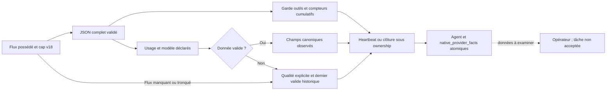

Les diagnostics CLI conservent désormais la cause de garde dans une erreur IO,
les deux branches du wrapper cleanup CLI et les sources distinctes partageant
l’adresse d’un wrapper transparent. Le cycle réel reste détecté. Trois cas RED
puis PASS vérifient cette projection sans `Display`/`Debug` de données arbitraires.
Une erreur d’horloge moteur a une famille sûre et déclenche cleanup possédé ;
aucune horloge fournie par le fournisseur ne remplace sa preuve.

Le domaine numérique compatible est explicite : nombres float64 finis, entiers
après décodage, non négatifs et au plus`9e15` jetons. Un dépassement rend la
déclaration invalide ; la durée et les droits d’exécution restent séparés. Cette
conversion conserve le contrat de représentation du producteur Go, sans garantir
une précision décimale arbitraire ni transformer une déclaration en facture.


Qualification79 :549tests Rust nommés workspace PASS, aucun ignoré ;13suites
vides non comptées. Recette native PASS108tests Rust, puis générateur4tests PASS,
Clippy et Rustdoc privé PASS. Le profil CLI final sans fixtures est distinct du
profil d’analyse ; les preuves sont dans le plan. Aucun service installé ni
modèle réel, facture ou acceptation globale ne sont démontrés.

Les canaux usage/modèle gardent des dernières déclarations indépendantes ; ils
n’établissent pas leur association à un même appel/tour/session. Une future
liquidation devra relier route, usage, contexte d’appel et tarif sans déduire
cette relation de deux dernières valeurs. La réservation reste estimée ici.

## Lancement manuel natif — vérification partielle78

`agent run ID --root ROOT --json` raccorde maintenant une intention créée par
`agent prepare`. Ce parcours est limité au worker manuel et aux exécutables
locaux pris en charge. Les routes de modèles, dialogue, hiérarchie et contexte
mémoire non portés continuent à refuser ; ce n’est pas une migration achevée.

Le prévol relit les colonnes/request, Work et dernière tentative `recorded`, le
contexte/workflow, fournisseur/env/workspace, TTL d’origine et estimation existante.
Après claim du superviseur réel, le helper reste bloqué jusqu’à enregistrement
PID/PPID/PGID/starttime et commit de permission. Il recontrôle la filiation et les
preuves, ferme Root, puis remplace son image avec le fournisseur ; le prompt
exact passe par memfd scellé. Un canal privé CLOEXEC rapporte les refus pré-exec.
EOF seul reste ambigu : il ne prouve ni démarrage réussi ni vitalité. L’image est
remplacée par `execve` explicite : aucun repli shell pour un fichier sans shebang.

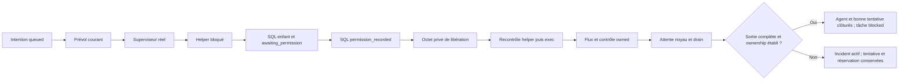

Le superviseur applique l’arrêt opérateur et les gardes d’outils : TERM puis
grâce configurée et KILL. Le champ historique `timeout_seconds` est un **seuil
d’observation de durée**, jamais une deadline d’arrêt. Son dépassement renseigne
`time_threshold_exceeded` ; silence, attente d’outil et heartbeat périmé restent
également des observations, sans prouver non-progrès ou fin. Le drain configuré
commence après la fin noyau du leader. Les caps de capture/événement/messages
n’arrêtent pas la collecte des compteurs ni le drainage. `agent show` utilise le
seuil de heartbeat figé : récent/périmé/futur/terminé, sans affirmer la vitalité
fournisseur. Les réglages sauvegardés ensuite s’appliquent aux futurs départs.

Les déclarations Claude/Codex sont décodées sans arbre JSON récursif ; doublons
et nombres sont validés, entrée initiale conservée quand un diff change à la fin.
Seul le texte assistant explicite devient public. JSON illisible ou dépassant son
cap dégrade la visibilité ; première cause typée et code sûr restent disponibles.
Rétention UTF-8 et nettoyage Cc/Cf Unicode15.0.0 sont explicites ; les empreintes
portent sur tous les octets observés, y compris ceux omis de la capture.

La clôture atomique concerne Agent, dernière tentative correspondante, événement,
log et estimation initiale exacte, y compris son absence légitime sans enveloppe.
Une estimation réservée devient `estimated` si le fournisseur peut avoir démarré,
`released` seulement si son absence de démarrage est établie. Aucun coût mesuré,
remboursement, nouvelle tentative ou acceptation n’est inventé. Processus non
récolté ou perte d’ownership laisse l’état actif pour reprise explicite.

Les preuves intermédiaires sont conservées dans78. `native-cli11` passe10cas
mais son attente d’arrêt temporel était erronée et a été invalidée par la revue
du contrat ; la recette actuelle vérifie un processus encore actif après le
seuil puis un stop opérateur. Les originaux et la correction restent dans le plan.
Pas de service redémarré, mission réelle ou confinement OS prouvé.

Un refus de drain ou une sortie interrompue conserve maintenant un incident
`stopping` actif, sans `ended`, sans clôturer la tentative ni libérer l’estimation.
Le résultat distingue récolte noyau et sortie complète. Un refus helper conserve
son code enfant séparément, sans faux code fournisseur. La réconciliation après
un tel incident reste à porter avec preuve fraîche sur les flux ; la seule
disparition du leader ne l’autorise pas. Aucun confinement OS n’est acquis.

Les erreurs JSON de CLI incluent maintenant `failure.causes` : familles et
opérations classifiées, y compris les deux branches d’un échec de cleanup. Cette
projection exclut les textes arbitraires d’erreur, SQL, contexte et chemins ; elle
ne transforme pas un refus en autorisation de retry. Le diagnostic précis reste
nécessaire avant toute reprise.

La recette [Admin v18](../plans/migration-rust/evidence/20261019-78/browser18-01/result.json)
passe quatre parcours FR/EN×thèmes :20champs, dont neuf réglages de supervision,
sauvegarde/réouverture/null et capture effective7octets par un cat local. Ce
transport navigateur privé ne qualifie pas une API HTTP authentifiée. Les356tests
d’intégration moteur passent. Une panne unitaire intermittente de spawn garde
son errno original inconnu ; le témoin possède désormais ses writers hors du
parent multithread, vérifie ETXTBSY puis reprise et conserve kind/errno/stade
des futurs refus. Cela n’ajoute aucun retry produit ni attribution rétroactive.

## Réglages de supervision v18 — parcours manuel raccordé

Le groupe complet de neuf champs est explicite, versionné et présenté par le
catalogue commun des réglages. Les valeurs initiales existent seulement dans le
JSON d’installation. V17 reste lisible, mais le getter de supervision refuse
avant adoption explicite preview/apply. Un groupe partiel refuse. Persistance,
réouverture via API Root, bornes, consommation par le processus et parcours Admin
sont vérifiés sur le périmètre manuel décrit ci-dessus. Aucun service HTTP natif
ni modèle réel n’est prouvé par ce contrat.

| Champ persisté | Valeur initiale | Unité | Null |
| --- | --- | --- | --- |
| `agent_supervision_poll_interval_ms` | 1000 | milliseconds | refusé |
| `agent_supervision_heartbeat_stale_ms` | 10000 | milliseconds | refusé |
| `agent_supervision_term_grace_ms` | 3000 | milliseconds | refusé |
| `agent_supervision_output_drain_ms` | 2000 | milliseconds | sans plafond |
| `agent_provider_event_max_bytes` | 1048576 | bytes | sans plafond |
| `agent_capture_max_bytes` | 1048576 | bytes | sans plafond |
| `agent_capture_max_lines` | 1000 | count | sans plafond |
| `agent_public_message_max_bytes` | 1048576 | bytes | sans plafond |
| `agent_log_message_max_bytes` | 2048 | bytes | sans plafond |

Poll/fraîcheur sont strictement positifs ; zéro grâce demande une escalade
immédiate seulement après une décision d’arrêt. Zéro drain n’attend pas un flux
encore ouvert après le leader ; un drain incomplet est un incident, pas une
clôture sûre. Zéro rétention retire le contenu du canal sans effacer compteurs
ni codes bloquants. Sans plafond peut consommer mémoire et stockage sans borne.
L’âge du heartbeat reste une observation, jamais une preuve de mort ou un arrêt
automatique. L’adoption ne remet à zéro ni tentative ni budget consommé.

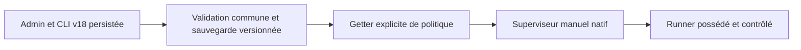


## Budget d’agent déjà réservé — précondition du parcours manuel

`check_reserved_agent_budget` contrôle l’estimation propre réservée et les quatre
ledgers courants sans ajouter une seconde réserve de départ. Une capacité engagée
exactement égale au plafond reste valide. Réserve requise absente, étrangère,
libérée ou modifiée, montants corrompus et engagements désormais excessifs refusent
sans mutation. Le contrôle d’admission conserve son contrat d’allocation nouvelle.
Aucun coût réel, remboursement, reset ou droit d’exécution n’est déduit. Le
superviseur manuel consomme ce contrôle avant libération du helper. Le témoin
financé vérifie réserve conservée puis estimated, ou released uniquement sur
refus pré-exec confirmé ; le drain incomplet maintient reserved.

## Snapshot natif d’exécution — contrat de stockage strict

`Agent.native_execution` conserve du JSON opaque, y compris les contraintes
futures inconnues. Le consommateur strict v1 exige politique, révision de réglages,
révision Work, SHA256 du contexte complet et phase d’entrée. Une donnée absente
ou non prise en charge refuse sans défaut Admin actuel. La rétention brute évite
de jeter silencieusement une contrainte lors d’une autre opération de cycle de vie.
Ni cette cohérence JSON ni son hash n’authentifient un acteur.

`awaiting_permission` et `permission_recorded` sont des phases de protocole.
La seconde signifie que le fournisseur peut avoir démarré ; elle ne prouve ni
exécution réelle, libération sûre d’un budget ni acceptation de tâche. Registre
SQL réel, libération de l’entrée, contrôles noyau et clôture sont raccordés par
le parcours manuel Linux. Crash et reprise après drain incomplet restent ouverts.
Le décodeur de données seul ne fait aucune IO, aucun départ, aucun octroi de
permission ni mutation du cycle de vie.

## Processus contrôlé78 — consommateur manuel raccordé

Le runner Linux possède un stdin explicite et des hooks internes de notification
après acquisition du pidfd, de réveil monotone fourni par le contrôleur et de
signal TERM/KILL. Le wrapper Git/validation conserve stdin=null et sa deadline
explicite. Aucun intervalle, grâce, reprise ou délai global n’est ajouté.

Une notification après spawn ne garantit pas que la commande n’a rien exécuté.
Le parcours manuel emploie donc un helper bloqué avant libération du contexte,
vérifie l’enregistrement SQL et revalide sa préparation ; réglages Admin figés
et raccordement Root sont décrits ci-dessus.
Les contrôles fixture du runner ne valent ni identité authentifiée, ni lancement
fournisseur autorisé, ni clôture de tâche. Les causes d’IO et les éventuels enfants
non récoltés restent conservés pour reprise. Les17cas courants du runner et
consommateurs Git/validation passent ; le parcours Root est vérifié séparément
par11cas CLI. Le point antérieur15cas reste historique dans les preuves78.


## Contention commune des agents77 — contrôles ciblés vérifiés

La préparation, l’enregistrement du superviseur, l’intention d’arrêt et
l’annulation non démarrée consomment le même adaptateur `agent_storage_retry`.
Il utilise les trois réglages de stockage déjà présents :
`storage_busy_timeout_ms`, `storage_busy_retries`, `storage_busy_retry_delay_ms`.
Le timeout SQLite est actualisé par tentative ; reprises et délai sont relus
après libération de la réservation de configuration. Zéro reprise signifie
un essai ; `null` peut attendre indéfiniment. Un plafond fini peut légitimement
s'épuiser pendant une autre écriture, sans autoriser un double lancement.

Seuls les BUSY SQLite directs avec autocommit confirmé après refus sont
réessayés. Commit, nettoyage ou couches métier imbriquées restent des erreurs
à diagnostiquer ; aucune incertitude de commit n'est rejouée automatiquement.
L'épuisement conserve la cause SQLite, les tentatives et la révision de politique
dans `agent-launch-storage-busy` pour l'admission et `agent-storage-busy`
pour les autres opérations. Le rejeu après commit concurrent connu doit
retrouver la même intention, sans nouvel attempt, événement ou estimation.
Ceci ne relance aucun fournisseur et n’augmente aucune politique. Les tests77
vérifient refus sous writer, état inchangé, libération/reprise, politiques finie
et illimitée et exclusion des commits incertains. Ce sont des preuves locales
sur fixtures, pas une acceptation de la chaîne distribuée d’incidents.

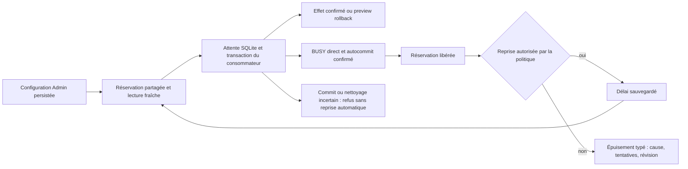

Le booléen interne durable/preview exprime l'effet attendu du callback ; il
n'est pas une politique opérateur ni un droit d'exécuter un agent. Les erreurs
de commit, rollback et fermeture restent distinctes d'un refus BUSY sûr.
Le contrôle d'epoch SQL de l'arrêt était déjà présent après sa réservation
d'écriture ; une hypothèse de manque a été falsifiée et n'a produit aucune
modification redondante du moteur.

## Point historique77 — chaîne de politique du garde

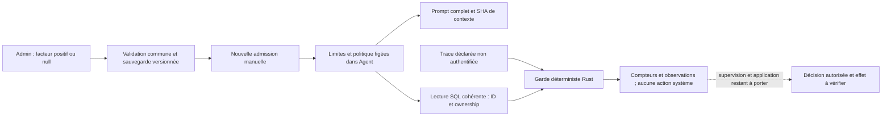

Changer Admin modifie les prochaines admissions ; aucun rejeu ne remet les
compteurs à zéro ou ne remplace un snapshot historique. Le graphe continu
représente le diagnostic local au point77 ; la branche pointillée y était non
portée. Son raccordement manuel78 est décrit en tête de cette page.
Les fenêtres de détection sont distinctes de la rétention des logs et des budgets.
Les horodatages du diagnostic sont fournis par l'appelant, sans authenticité.

Écarts intentionnels aux comportements Go observés : le facteur autrefois
implicite4 devient une politique explicite ; un même ID avec un contenu différent
est refusé au lieu d'être ignoré ; un texte d'erreur technique ne dispense pas
du compteur d'échecs déclarés. La source réelle d'un incident d'infrastructure
devra être établie par la supervision, séparément du message du fournisseur.
Le premier motif de garde reste conservé, mais les événements déclarés ultérieurs
continuent à enrichir les faits cumulés. Cela ne prouve pas que ces outils ont
été exécutés ni qu'un arrêt a effectivement eu lieu. Les profils fournisseurs,
la supervision, les compteurs finaux distribués et l'acceptation globale restent
à qualifier avant bascule.

## Rejeu diagnostique du garde77 — contrôles ciblés vérifiés

`swarm-rust agent guard AGENT --input trace.json --root ROOT --json` lit
l'agent enregistré et sa politique figée, dans un snapshot SQL cohérent. Le
rejeu refuse l'absence historique du snapshot, les contradictions ID/ligne et
les événements invalides ; il ne lit pas la politique Admin actuelle comme
fallback. La sortie porte `preview_only:true`, `process_started:false` et
`event_source:caller_declared_unverified`. Aucun outil n'est exécuté, aucun
arrêt appliqué, aucune réservation ou tâche modifiée. La cohérence des lignes
SQL ne constitue pas une authentification. `process_started:false` décrit cette
opération de diagnostic ; il n’observe pas la vitalité d’un processus existant.

Exemple de trace déclarée :
```json
{"schema_version":1,"events":[{"call":{"at_ms":0,"id":"A","name":"Read","input":{}}},{"result":{"at_ms":1,"id":"A","failed":true,"message":"permission denied"}}],"final_at_ms":1}
```
`output`, `call`, `result` et `visibility` sont des variantes exclusives ;
les temps en millisecondes doivent être monotones. Un message technique ne
transforme pas un résultat déclaré en incident moteur et ne dispense pas son
compteur d'erreurs. Une perte de visibilité conserve les compteurs cumulés,
mais rend les inférences de série inconnues. Les observations de silence ou
d'attente ne prouvent pas la mort du fournisseur et ne déclenchent pas un arrêt.
Les contrôles ciblés moteur et CLI réel sans features passent ; les preuves
Admin finales et l’identité de leur binaire sont consignées dans le plan.

## Garde natif77 — politique diagnostique figée

V17 ajoute `agent_interleaved_failure_lookback_multiplier` : facteur positif
initial4, ou `null` sans expiration. Il est validé, persisté et présenté dans
Admin. Le facteur multiplie le plafond de répétitions figé, en résultats terminés ;
il ne change pas ce plafond ni les compteurs consommés. Les nouvelles intentions
figent cette politique et sa révision dans une métadonnée native additive.
L'ancien Go n'avait pas ce champ : son absence reste historique, sans fallback.
Aucune identité, permission ou exécution n'est prouvée par cette métadonnée.

Le prompt complet inclut la politique figée avant SHA. Les modifications
ultérieures n'actualisent pas une intention existante. Le générateur DTO conserve
cette extension et refuse une collision de nom avec un futur champ Go. Le
consommateur de garde est accessible par le rejeu CLI en lecture seule ;
son activation dans la supervision réelle reste à porter. Les contraintes
natives inconnues survivent au stockage mais refusent la consommation du garde.
Aucun processus fournisseur n’est activé.


## Contexte courant76 — composant vérifié

La nouvelle préparation manuelle compose après transition : mission, tâche,
agent, nouvel attempt, compteur et révision candidate qui sera enregistrée.
Le Next d'origine reste la prochaine action du brief ; le texte générique de
fin d'exécution ne le remplace pas. Le dernier contrat propre du plan est
reconstruit depuis les enregistrements, sans corps de tâche sœur ni ancien
contrat remplacé. Les hypothèses et décisions manuelles communes restent
des données déclarées ; elles ne valent pas droits ou réussite.

Un mapping ambigu/incohérent, une déclaration explicite visant un contrat
absent ou une tâche de plan sans contrat refuse sans repli sur un ancien plan.
Les branches déléguées/correctives restent refusées jusqu'à leur port.
Les identifiants sont des observations moteur, pas une authentification
cryptographique. Les préparations historiques restent rejouées sans réécriture ;
aucun rejeu n'autorise l'exécution ni n'actualise implicitement leur contexte.
La future exécution devra revérifier le contexte et refuser une preuve périmée.

L'empreinte porte le prompt complet après cette composition. Un aperçu et son
commit ont les mêmes octets ; modifier le Work rend l'ancien hash insuffisant
même en rafraîchissant la révision du lancement. Revoir un nouvel aperçu permet
la reprise. Le cap d'octets est celui des réglages v16, sans nouvelle politique.
Recette permanente :14tests moteur et23CLI par défaut, archive vérifiée.
Quatre parcours Admin FR/EN×thèmes ont aussi vérifié l’identité courante dans le
consommateur de production et les refus/reprises des réglages. Aucun processus
fournisseur ni installation.


## Admission manuelle native75 — composant vérifié

Commandes publiques : `swarm-rust agent preview|prepare WORK --root ROOT
--input FILE --json`. Le JSON strict schema1 fournit `event_id`,
`expected_revision`, `task_id` et `provider`. Zéro durée hérite du défaut
persisté ; une durée négative refuse. Le rejeu compare l'intention d'origine
avant normalisation et conserve son enregistrement ; un contenu différent
avec le même identifiant refuse. `created=false` en preview ne prouve aucune
réservation. La perte de sortie après commit reste une erreur : relire/rejouer,
sans recréer une tentative ni démarrer de processus.

La nouvelle fabrique `RootStore::prepare_agent_launch` construit elle-même une
intention manuelle worker et son contexte. Elle observe le workspace réel,
l'exécutable configuré, les noms d'environnement autorisés et le workflow, puis
revérifie ces observations dans la transaction d'admission. Aucun processus
fournisseur n'est démarré. `preview` annule toutes les écritures SQL ; une sonde
locale de lecture/écriture est temporaire et supprimée explicitement.

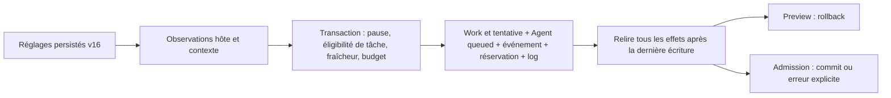

V16 ajoute dix choix persistés : durée de lancement et plafond, plafonds d'octets
instruction/catalogue fournisseur/contexte, TTL de préparation et plafond, espace
libre minimal, liste d'environnement et compatibilité des fournisseurs sans
contexte vérifié. `null` enlève un plafond nullable ; zéro espace libre désactive
seulement ce plancher. La compatibilité initiale1 conserve le parcours Go facultatif ;
0 exige un contexte vérifié et refuse ce parcours encore non porté. Aucune
capacité fournisseur n'est prouvée par une vérification hôte. L'empreinte de
commande ne couvre pas ses bibliothèques, interpréteurs ou fichiers dépendants.

Les missions hiérarchiques, mémoire sélectionnée, dialogue, catalogue API,
routage modèle et contexte field-guide sont explicitement refusés tant que leurs
contrats ne sont pas portés. Ces refus ne comptent pas comme fonctionnalités
migrées. Les régressions et preuves historiques sont dans le suivi75 ; le
composant est vérifié dans son périmètre manuel, sans installation, nouvelle
acceptation ni garantie globale. La recette courante77 étend ce contrôle.


## Intégrité des budgets de périmètre — R3bj66 vérifié par composant

Les validateurs communs Go/Rust refusent désormais `activations`, `max_tasks` ou
`max_activations` négatif sur un périmètre. Zéro consommation reste valide ; zéro
limite locale hérite de la limite globale. L'historique positif dépassant une
limite locale resserrée reste représentable : le contrôle d'admission doit refuser
un nouvel usage séparément. Aucun compteur n'est corrigé ou remis à zéro.

Le contre-exemple conservé montre les trois champs acceptés par les validateurs,
et une mutation CLI native sur fixture commettant un compteur négatif. Le refus
est appliqué au contrat commun avant acceptation persistée, avec un diagnostic sûr, sans seuil
opérateur supplémentaire. La fixture corrompue est préservée ; restaurer un témoin
de test n'est pas une opération publique de réparation d'une mission réelle.
Un état réel invalide demanderait un diagnostic et une réparation autorisée de sa
provenance ; cette évolution ne fournit aucun outil de reset ou de contournement.
Les budgets des ancêtres et leurs réservations restent à porter avant claim.

[Qualification66](../plans/migration-rust/evidence/20261019-66/qualified01/result.json) :
413 tests Rust,40CLI par défaut et30comparaisonsGo/natif de rapports passent,
8437entrées/73paquets stables, profils de production/fixtures distincts. Le refus
public couvre trois champs, préserve DB/settings et permet une reprise sur fixture
restaurée. Aucun nouveau parcours Admin66 n'est revendiqué ; interfaces et politiques
restent celles du65. Migration partielle et aucune installation.

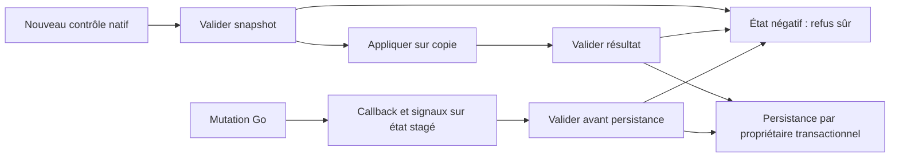

Schéma simplifié des nouvelles opérations : les rejeux durables ont leur garde
transactionnelle antérieure. Il ne prouve ni autorité ni validation de tous les
effets de bord Go. Les refus gardent l'état et ne remettent aucun compteur à zéro.

## Rapports de planification — R3bi65 vérifié par composant

`swarm-rust planning-report --root ROOT --input EVENT.json --json` lit les
références d'un événement fourni. Ces champs sont des données déclarées : aucune
identité, autorisation, réception ou prise en charge de tâche n'est prouvée.
Le handoff explicite prime ; le repli historique exige kind=handoff et exactement
un artefact dont le chemin finit par `.md` (casse sensible). Sans référence,
la réponse est `null`. Une référence sélectionnée mais invalide échoue.

La politique v14 `planning_report_max_bytes`, initialement 64000 octets, est
persistée et éditable dans Admin avec la validation commune API/CLI. Zéro refuse
tout rapport ; `null` retire ce cap, sans autoriser les documents vides, NUL,
UTF8 invalide ou à empreinte différente. V13 exige une adoption explicite même
pour une lecture sans référence. Cette limite diffère du transport JSON de
16MiB, du cap de contexte de livraison review et de la capacité du modèle.

Root prend une réservation des réglages courants. Le lecteur partagé résout le
chemin, vérifie containment et fichier régulier, lit complètement puis vérifie
le SHA sur les octets retournés. Un alias interne au projet est permis ; sortir
du projet refuse. NOFOLLOW vise le chemin résolu et ne constitue pas un confinement
OS ni un bail pour une future action. Les causes d'erreur et les erreurs de
fermeture sont conservées ; aucun texte tronqué n'est rendu comme preuve valide.
Aucun acquittement d'événement n'est produit et aucun état métier n'est modifié.
Le raccordement au contexte de livraison/capacité et à claim reste à terminer.


[Qualification65](../plans/migration-rust/evidence/20261019-65/qualified01/result.json) :
411 tests Rust,39CLI défaut,30comparaisonsGo/natif et quatre parcours Admin ciblés
passent, avec8437entrées/73paquets stables et profils distincts. Les refus ont leurs
témoins valides, les alias internes sont distingués des sorties du projet, les
échecs write/flush ont une reprise. Migration globale partielle, pas d'installation.

## Transmission des règles de qualité — R3bh64

Le paquet worker compile aussi `tools/agent-workflows/templates/QUALITY.md` :
revue des politiques et de leur consommateur Admin/API/CLI, documentation FR/EN
et contrats de fonctions, conservation des causes et contrôle des erreurs,
profils réellement exercés et replan. Les autres rôles ne reçoivent pas cette
consigne d'implémentation. Aucun droit ou outil supplémentaire n'est accordé.
Le corps Go mesuré est de 31955 octets, sous sa limite inchangée de 32000 ;
le prompt complet fait 32155 octets. Les 45 octets de marge ne constituent pas
un budget modèle. Une croissance doit être diagnostiquée, jamais tronquée.

Le test isolé observe les clauses dans le prompt préparé, dans l'entrée reçue
par un faux adaptateur et après réouverture. Il prouve les octets transmis,
ni leur compréhension ou application par un modèle, ni une identité authentifiée.
Les sources restent figées au build : les processus déjà démarrés ne sont pas
actualisés. Les accords AGENTS ne sont pas tous importés automatiquement.
Les préparations de claim, de capacité et d'exécution restent ouvertes.

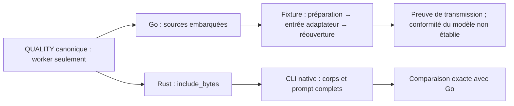

Preuves et limites : [lot64](../plans/migration-rust/evidence/20261019-64/),
[rouge](../plans/migration-rust/evidence/20261019-64/quality-red.stdout),
[réception sur fixture](../plans/migration-rust/evidence/20261019-64/receipt-green01.stdout).
La qualification complète du lot est conservée séparément ; celle du lot63
ci-dessous reste sa preuve historique.

[Qualification64](../plans/migration-rust/evidence/20261019-64/qualified01/result.json) :
404 tests Rust, 37 CLI, 15 comparaisons Go/Rust et quatre parcours Admin ciblés
passent ; 8432 entrées/73 paquets stables. Production sans fixtures et profils
vérifiés ; migration globale partielle, aucun serveur installé ou redémarré.

## Cadrage figé des rôles — R3bg63 vérifié par composant

`swarm-rust agent-workflow worker --root ROOT --json` observe les méthodes du
rôle sur une racine native initialisée. Rôles : `planner`, `subplanner`, `worker`,
`reviewer`. Les sources canoniques sont incluses au build ; un fichier de skills
dans le checkout du worker ne les remplace pas. Le descripteur extrait du vrai
producteur Go fixe ordre, préfixes et limites du rôle ; Rust n'appelle pas Go
au runtime. Le contexte projet ordinaire est lu sous ses limites propres.

Le réglage v13 `agent_workflow_max_body_bytes` propose 32000 octets pour le
**corps de base**, avant manifeste et projet. Zéro refuse, `null` retire ce cap ;
un journal v12 nécessite une adoption explicite. Les limites du projet et la
capacité modèle restent distinctes. Aucun texte n'est tronqué. La réponse expose
`body_bytes`, `body_limit`, `settings_revision` observée et `prompt_sha256`.
Le lecteur Root utilise une seule réservation de réglages.

`Workflow.SHA` suit la composition Go base/projet ; il ne lie pas seul tous les
octets du prompt. Un contre-exemple réel a conservé des métadonnées égales malgré
une notice différente. `prompt_sha256` couvre le prompt complet ; le garde Root
`check_agent_workflow` relit sous la politique courante et compare texte, empreinte,
métadonnées et compte. Il refuse une observation altérée même si elle garde ou
recalcule son empreinte déclarée. Ce contrôle ne donne aucun bail de fraîcheur
pour une future action et ne prouve pas identité, autorité ou réception par un agent.

La notice Go est alignée sur Rust : refuser les secrets reconnaissables ne prouve
pas leur absence ; aucune configuration de permissions n'est importée. Les
anciens prompts restent leurs instantanés historiques, pas des contextes réécrits.
Les erreurs de lecture/projet/politique/encodage/close/write/flush sont conservées,
sans succès vide ni contenu privé dans les diagnostics publics.

[Qualified01](../plans/migration-rust/evidence/20261019-63/qualified01/result.json)
passe 404 tests Rust, 37 tests CLI au profil par défaut et
[15 comparaisons Go/Rust](../plans/migration-rust/evidence/20261019-63/parity02/result.json)
(13 prompts complets égaux, deux refus), avec shadow ignoré, modification du projet,
refus et reprise. [Quatre parcours Admin ciblés](../plans/migration-rust/evidence/20261019-63/admin02/result.json)
FR/EN × thèmes vérifient enregistrement/réouverture et consommateur réel : corps
exact/sous-taille/zéro/null, adoption, révision, clavier, cinq largeurs et erreur
backend/reprise. Les anciens consommateurs UI ne sont pas déclarés rejoués.
8430 entrées/73 paquets stables ; profils et binaires séparés, production sans fixtures.

Cette étape ne porte ni `claim`, ni capacité modèle, ni lancement, ni identité ou
permissions d'agents, ni mémoire gérée, ni API HTTP ou installation. Le paquet
embarque CONTRACT/skills ; il n'importe pas automatiquement toutes les consignes
AGENTS et ne prouve pas leur réception par un processus déjà démarré.

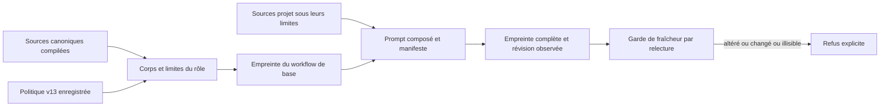

Les empreintes et la fraîcheur sont des observations de contenu ; elles ne prouvent ni identité de l’agent, ni autorité, ni réception autonome.

## Activation locale — R3bf62 vérifié par composant

`planning enable` crée une hiérarchie sur un Work neuf sans tâches : racine,
exigences `req-N`, message initial et juge au cycle 1. Les budgets de tâches,
décisions et activations sont explicitement positifs dans la requête ; aucun
budget consommé n'est réinitialisé. Les contrôles déclarés sont liés au critère 1
puis normalisés sous les réglages enregistrés. Aucun contrôle ni agent n'est lancé.
Le sous-ensemble local exige un fournisseur et un dépôt absents, et
`max_review_calls=0`. Les préparations fournisseur/reviewer/dépôt géré restent à porter.

Les deux politiques v12 sont persistées et éditables dans l'Admin partagé :
`planning_request_max_bytes` propose 65536 octets comme le Go ;
`planning_max_requirements` propose 100 exigences à l'activation. Zéro refuse
respectivement les nouvelles mutations de planification (pause/reprise incluses)
ou l'activation ; `null` retire le cap concerné. Le transport distinct reste limité
à 16 Mio. Les anciens journaux restent lisibles mais nécessitent une adoption
explicite pour une nouvelle mutation. Les rejeux durables précèdent le nouveau cap,
avec refus des intentions différentes et des révisions obsolètes. C'est une
priorité de rejeu volontairement distincte du contrôle de taille Go avant transaction.

[Qualified01](../plans/migration-rust/evidence/20261019-62/qualified01/result.json)
passe 397 tests Rust, 35 tests CLI par défaut et 26 cas Go/natif accompagnés de
22 témoins valides. Les [six observations publiques](../plans/migration-rust/evidence/20261019-62/default-cap02/result.json)
vérifient la limite par défaut, les octets exacts, le dépassement et l'échappement.
Le JSON source indenté de 65553 octets est accepté lorsque son intention canonique
fait exactement 65536 octets ; l'effet de l'échappement HTML est aussi contrôlé.
[Quatre parcours Admin](../plans/migration-rust/evidence/20261019-62/admin01/result.json)
FR/EN × thèmes enregistrent/réouvrent les deux champs puis vérifient la CLI réelle,
le refus sans mutation, le rejeu et la reprise. 8423 entrées/73 paquets stables,
binaires sonde/production séparés et profil production sans `test-fixtures`.

Ces preuves locales ne qualifient ni fournisseur réel, ni identité du demandeur,
ni dépôt géré, ni exécution native, ni API HTTP, ni installation ou bascule globale.

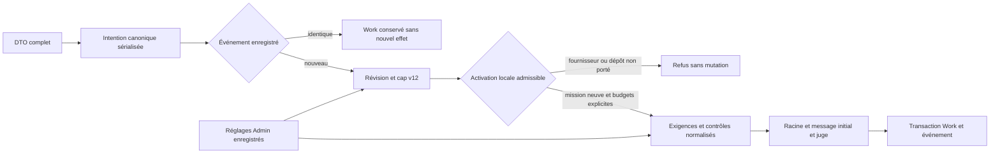

Le cap porte sur le JSON déjà sérialisé ; il ne prouve pas une borne mémoire agrégée. L’activation locale ne lance aucun agent et n’authentifie pas le demandeur.

## Contrôles de planification — preuve historique R3be61

La CLI native `planning show/pause/resume` lit le Work brut ou applique le contrôle
dans la transaction Work/événement existante. Le rejeu d'une intention identique
ne modifie pas une deuxième fois les générations ; conflit d'intention et révision
obsolète refusent sans mutation. Toutes les leases sont invalidées une fois par
nouveau contrôle. Cela ne stoppe aucun processus et ne prouve aucune identité.

Dans le profil historique61, le réglage v11 `planning_resume_max_reason_bytes` propose 4000 octets comme Go.
Zéro refuse un motif non blanc ; `null` supprime cette borne. Pause et reprise
sans motif non blanc restent possibles avec un ancien journal valide ; un motif
consommé exige l'adoption explicite du réglage. Les quatre parcours Admin
FR/EN × clair/sombre enregistrent/réouvrent puis vérifient le consommateur CLI :
témoin, zéro/refus sans mutation, null/reprise/rejeu, quatre octets UTF8 exacts et
dépassement. Les générations négatives ou dépassant la représentation refusent.

[Qualified01](../plans/migration-rust/evidence/20261019-61/qualified01/result.json)
passe 391 tests Rust, 34 tests CLI par défaut et 27 comparaisons de DTO/candidats
purs Go/natif (20 données égales, sept refus appariés). Les sondes et la CLI
production sont séparées ; leurs bons profils reproduisent les empreintes testées.
Les 8419 entrées effectives et 73 paquets sont stables. Les erreurs write/flush
après commit conservent explicitement le résultat et permettent le rejeu identique.
Le hook Go est aussi corrigé : seul `decide` traite ses opérations SQL. Le serveur
Go actuel n'est pas redémarré. Voir les [parcours Admin](../plans/migration-rust/evidence/20261019-61/admin01/result.json).

L'inventaire Go suit les champs JSON visibles et conserve les marshalers custom ;
`PlanningOperation` garde `depends: []` explicite pour `revise-dependencies`.
Le générateur reproduit le Rust exact depuis les producteurs actuels. Ces DTO
ne confèrent aucune autorité. Autres mutations hiérarchiques, processus natifs,
authentification, HTTP, installation, bascule et acceptation globale restent ouverts.

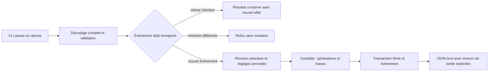
Le rejeu ne consomme pas une deuxième génération ; une sortie en erreur après
commit conserve le résultat et permet un rejeu identique. Cette chaîne ne prouve
ni arrêt des processus ni authentification des agents.


## Projection gérée simple — R3bd60 vérifié par composant

Le raccord candidat compose le garde de revue/Git existant avec les contrôles
lus depuis un reçu géré lorsqu'aucun enregistrement automatique n'est présent.
Ce remplacement sert uniquement à l'affichage : il ne modifie pas le Work et ne
répare pas le garde de fraîcheur, qui exige toujours l'enregistrement original.
Les protocoles batch/fragment restent explicitement refusés dans tous les états ;
la lecture Git gérée reste limitée à Linux. Les erreurs de reçu/politique/IO sont
propagées au consommateur, sans succès vide. Le codec natif exige UTF-8 et
refuse les octets invalides avec leur cause ; Go peut les remplacer. Aucune
identité ou acceptation nouvelle.

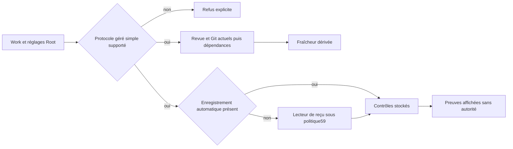

Qualified03 vérifie 382 tests Rust du workspace, 31 tests CLI avec features par
défaut, 60 comparaisons Go/natif (54 égales et six refus plus stricts documentés),
32 vues CLI publiques et huit refus publics de protocoles. Les binaires de sonde
et de production sont séparés ; leur empreinte est liée à leur compilation exacte.
Le graphe de la CLI de production exclut `test-fixtures`. Cinq observations
supplémentaires vérifient la politique persistée sur cette CLI réelle : défaut,
borne exacte, refus juste sous la taille, zéro et reprise après `null`.
Voir les [preuves60](../plans/migration-rust/evidence/20261019-60/qualified03/result.json)
et la [recette du consommateur](../plans/migration-rust/evidence/20261019-60/production-cap/result.json).
Ces preuves locales n'établissent ni identité authentifiée, ni acceptation, ni
serveur natif installé. Les protocoles gérés étendus restent ouverts.


## Reçus machine gérés — R3bc59 vérifié par composant

Le lecteur natif utilise la politique persistée `managed_receipt_max_bytes`,
introduite dans les réglages v10 et proposée par le catalogue Admin partagé.
La valeur initiale de 1 048 576 octets conserve la borne Go ; zéro refuse tout
reçu non vide, `null` désactive cette borne et autorise une consommation mémoire
sans plafond. Cette politique est distincte de la taille du livrable texte.
Les journaux v9 restent lisibles ; le nouveau lecteur exige une adoption explicite.
Prévisualiser ne modifie rien ; l'enregistrement suit la validation et le contrôle
de révision communs. L'Admin natif reste un composant candidat, non installé dans
le serveur Go.

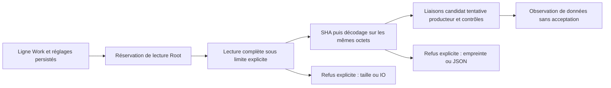

Une absence de reçu est distincte d'une déclaration partielle, d'une corruption
ou d'un refus. Les erreurs gardent leur cause ; aucun reçu tronqué n'est utilisé.
La concordance des identifiants n'authentifie pas un agent. Les protocoles batch
et fragment restent refusés, et la projection gérée complète reste à raccorder.
Qualified03 passe 378 contrôles Rust nommés, 31 comparaisons Go/natif réelles
(22 cas de données/absence identiques, neuf refus natifs explicitement plus stricts)
et quatre parcours Admin langue/thème, sur les mêmes entrées effectives.
Ces preuves restent locales au composant ; migration globale, installation et
acceptation indépendante restent ouvertes. Voir les [preuves de qualification](../plans/migration-rust/evidence/20261019-59/qualified03/result.json).
La limite concerne ce lecteur de reçu structuré. Les gardes historiques hashent
les reçus en streaming ; la politique de leur buffer de contexte machine est
suivie séparément dans le plan, sans prétendre à un plafond global de lecture.


## Projection hiérarchique ordinaire — R3bb58 vérifié par composant

Le parcours de lecture Root peut maintenant dériver l'état des tâches d'une
hiérarchie sans dépôt géré. La fraîcheur exige à la fois revue courante, gate
courante lorsque requise et dépendances courantes. Une dérogation ne dispense
pas de la revue hiérarchique configurée. Une revue configurée mais absente est
présentée comme pending, sans la confondre avec absence de configuration.

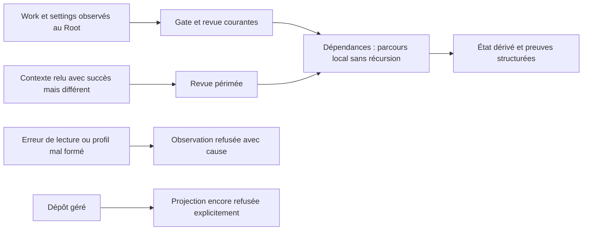

Le producteur de contexte distingue désormais typiquement une différence de
contexte d'une erreur IO/JSON ; le consommateur ne branche pas sur la formulation
d'un message. Les refus métier attendus rendent la fraîcheur fausse. Les erreurs
inattendues de revue refusent l'observation entière et conservent leur cause.
Ce dernier choix est plus strict que la projection Go qui masque certaines de
ces erreurs en simple péremption ; sa réception dans la future API/UX native
reste à vérifier avant bascule. Les vues gérées restent refusées en attendant
leur projection spécifique de reçus/contrôles, même si le garde de données57
fonctionne. Aucune lecture n'accorde identité, autorité, acceptation ou bail futur.
Preuves sous `docs/plans/migration-rust/evidence/20261019-58/` ; qualified02 vérifie le composant, migration globale PARTIAL.

## Revue courante gérée — R3ba57 vérifié par composant

Le garde Root `inspect_review_evidence` compose désormais les contrôles déjà
natifs : contexte projet courant, dernière tentative, contrat des instructions,
puis candidat, fichiers/contexte, baselines simples et rapport Git réel pour une
revue gérée. Les settings sont lus et validés au Root sous réservation ; les
limites de contexte, profondeur et délai Git viennent des réglages persistés.
Le stockage géré reste contenu dans le Root canonique selon le lecteur Git natif ; les dépôts externes ne sont pas qualifiés ici.
L'ancienne fonction pure ordinaire sans settings conserve son refus pour le cas
géré, sans inventer de valeurs de secours.

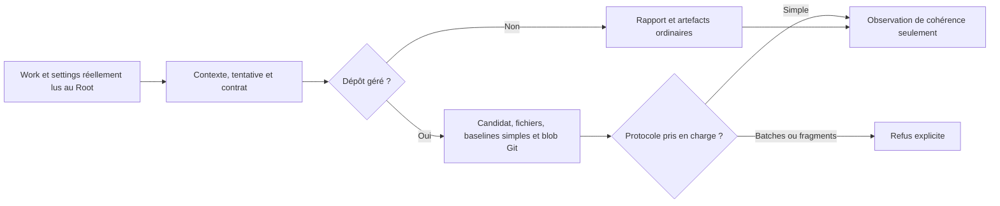

Cette observation ne prouve ni identité du vérificateur, ni autorité, ni revue
indépendante effective, ni acceptation. Elle ne crée aucun bail de fraîcheur et
ne modifie ni Work, journal ni réglages. Les erreurs gardent leurs causes typées,
y compris lors de la fermeture de réservation. Les transitions et projections
hiérarchiques restent refusées tant que leur contrat complet n'est pas porté.
Le test Root utilise de vrais fichiers et un rapport réellement commité dans une
fixture privée ; une telle fixture ne constitue pas une exécution d'agent.
Preuves sous `docs/plans/migration-rust/evidence/20261019-57/`, qualified02 :42 tests Rust/9targets et33cas Go/natif concordants ; migration globale PARTIAL.

## Critères Work — R3az56 vérifié par composant

Le diagnostic original a reproduit des créations aux critères blancs que l'édition
refusait. Les deux moteurs appliquent désormais la même règle dès création : chaque
élément doit contenir du texte selon la sémantique d'espaces commune Go/Rust.
Aucune limite de volume ou politique Admin n'est ajoutée. Un refus ne crée
ni Work ni événement ; le même événement corrigé réussit sur les fixtures qualifiées. Lire ou
rejouer un ancien Work ne le corrige pas rétroactivement. Voir les preuves56 ;
qualified-03 vérifie le composant, avec migration globale PARTIAL et aucune bascule du service.

## Paramètres réellement applicables — R3ay55 vérifié par composant

Le diagnostic CLI a reproduit huit créations Go/Rust acceptant `max_attempts`
ou `max_tool_calls` sans inscrire la limite demandée. Une modification explicite
`task.update` la conserve : c'est le parcours supporté, sous ses validations.
Le contrôle ajouté refuse les paramètres significatifs non applicables avec
`unsupported_parameter`, sans enregistrer la nouvelle mutation. Les valeurs ne
figurent pas dans ce diagnostic. Le protocole partagé est
`contracts/work-request-fields.v1.json` ; sa liste d'opérations et de champs est
un contrat d'API, pas une politique que l'Admin pourrait élargir.

Les erreurs de lecture du contrat embarqué doivent conserver leur cause typée,
y compris après la première valeur JSON. Le test de corruption remplace les
octets uniquement dans son processus isolé, puis vérifie le retour au contrat
valide ; il ne modifie ni source persistée ni base de mission.

Zéro, chaîne vide et faux gardent la sémantique d'omission des scalaires ; une
collection vide explicite garde son intention. `outcome` exige une sortie d'une
tentative en cours. Les paramètres de révision hiérarchique exigent une édition
de définition d'un Work hiérarchique ; cela ne remplace aucun contrôle de droits,
de pause ou de fraîcheur. La mutation hiérarchique native reste non portée.

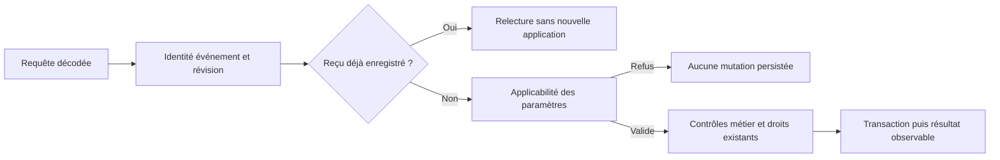

Un ancien reçu accepté reste relisible ; cela ne rend pas sa limite ignorée
rétroactivement effective. Pour une tâche historique concernée, le propriétaire
doit examiner le contrat et les consommations avant une correction explicite.
Preuves : `docs/plans/migration-rust/evidence/20261018-55/`. Le diagnostic et les
tests ciblés ne prouvent ni installation du candidat, ni migration complète.
Les vérifications et leurs limites restent dans le plan ; aucune bascule annoncée.

## Phases manuelles par défaut — R3ax54 vérifié par composant

Le candidat Rust introduit le réglage persistant v9 `task_manual_required_gate_phases` :
l’installation propose entry, validation et delivery ; une sélection vide explicite
conserve les contrôles des critères. Le choix des phases est une politique ; les
identifiants de phase sont du protocole. Le Root doit consommer cette sélection
pour une nouvelle tâche, et demander l’adoption explicite d’un ancien document
qui ne la possède pas. La sélection Admin utilise des cases à cocher et des libellés dans l’ordre du
catalogue, sans exposer le tri technique de l’ensemble JSON. La recette et
l’inspection visuelle passent sur les fixtures décrites ci-dessous.

Une exigence déjà enregistrée reste conservée lors des éditions : changer les
defaults ou le titre ne doit ni retirer ni réintroduire des phases dans un mapping
adopté. Le Go conservé garde ses defaults de compatibilité pour les nouvelles
tâches et partage la correction de préservation des mappings ; il ne consomme pas
ce nouveau réglage Rust. Une migration historique et l’autorité d’acceptation
restent distinctes de la présence d’un mapping. Sources en vérification ; aucune
installation, bascule ou garantie globale annoncée.

Le catalogue de présentation passe en version2 pour annoncer les groupes de
choix ; le journal de réglages est en version9. Le client accepte les catalogues1
sans ce nouveau type et2 ; un groupe de choix annoncé en version1 ou une valeur
mal typée/inconnue/dupliquée refuse le chargement et laisse l’édition désactivée.
Une reprise recharge les données réelles sans mutation.

Une publication des defaults fait avancer la révision du journal, même si la
politique de qualité reste identique. Comparer séparément sa génération, son
empreinte et ses valeurs ; ne pas exiger que la provenance `settings_revision`
reste figée lorsqu’on publie d’autres réglages.

Qualification [54](../plans/migration-rust/evidence/20261018-54/qualified-05/result.json) : composant PASS, migration globale PARTIAL. Les361tests Rust de03 et46Go de02 sont réutilisés après comparaison des sources/graphes/embeds et environnement ;05 exécute à nouveau les quatre parcours Admin.60comparaisons publiques et4replays gate concordent,8387entrées/73paquets stables. Le garde de revue refuse les déclarations absentes/périmées/ouvertes ; sa déclaration05 est complète, sans garantie sémantique exhaustive. [Huit captures](../plans/migration-rust/evidence/20261018-54/visual-review.json) inspectées à320/1440 ; les interactions couvrent aussi1024/760/390. Cas limites : transport malformé, ancien journal v8, sélection vide, refus sans mutation et reprise. Aucun provider, serveur remplacé, revue indépendante ou acceptation globale.

```mermaid
flowchart LR
  A[Choix Admin ou CLI] --> B[EngineSettingsDocument v9]
  B --> C[TaskDefinitionLimits observées par Root]
  C --> D[Nouvelle tâche : plan_checks]
  D --> E[Contrôles de critères toujours requis]
  F[Tâche déjà créée] --> G[Exigences existantes conservées]
  B -. ne réécrit pas .-> F
```

Les éditions ordinaires conservent les exigences adoptées. Un changement explicite de mode de validation suit le contrat automatique décrit plus bas : les contrôles synthétiques du modèle manuel peuvent être remplacés par les commandes préautorisées, sans suppression des exigences personnalisées. Le mapping seul ne certifie pas les tâches historiques ou l’identité d’un reviewer.

## Revue continue des incréments — contrôle de méthode

La migration applique quatre axes à chaque incrément : politiques codées en dur,
contrats des fonctions, chemins d’erreur et documentation produit/méthode. Les
règles persistantes figurent dans AGENTS.md et les consignes personnelles communes.
`tools/rust-migration/review_increment.py` compare deux inventaires effectifs du
collecteur de qualification. Il exige pour chaque entrée locale changée une revue
sur les quatre axes, son empreinte actuelle, une justification et des références
de preuve dont les octets sont encore identiques. Une suppression reste à examiner.
Les pages, schémas et notes concernés doivent être référencés dans l’axe documentaire.

Un fichier conservé mais retiré des entrées de qualification exige un état
`unselected`, un motif explicite et la même empreinte que dans le snapshot
précédent. Il reste conservé et n'est pas présenté comme supprimé. Une source
modifiée, un motif absent ou un état ambigu est refusé. Les quatre axes de revue
restent requis ; ce retrait de sélection ne permet pas d'omettre un consommateur
réel des graphes du compilateur.

Les références de preuve sont désormais archivées avec leurs octets et empreintes
avant fermeture de revue (`review-reference-originals.*`). Une édition ultérieure
du document ne remplace pas cet original. Chaque lecture est revérifiée avant
archivage ; référence modifiée, collision ou erreur IO empêche la qualification.
Une archive ne prouve ni justesse du document ni exécution du comportement décrit.

```mermaid
flowchart LR
  A[Sources exactes et inventaires] --> B[Candidats lexicaux]
  B --> C[Revue des quatre axes avec preuves]
  C --> D{Couverture et empreintes valides ?}
  D -->|Non| E[Refus de la revue et diagnostic]
  D -->|Oui| F{Constat ouvert ?}
  F -->|Oui| G[Contrat non conforme : propriétaire et reprise]
  F -->|Non| H[Revue déclarée complète]
  H --> I[Tests fonctionnels et recette restent nécessaires]
```

Le script produit des candidats lexicaux (littéraux, fonctions, gestion d’erreur),
pas un verdict sémantique. La revue classe chaque valeur : donnée de test,
invariant du protocole, contrainte technique ou choix opérateur ; ce dernier exige
un réglage persistant traçable jusqu’au consommateur et à l’Admin. Un booléen dans
un test n’est pas automatiquement une politique. Une constante dans le moteur
n’est pas automatiquement justifiée par le mot « sécurité ».

Le garde refuse une couverture absente/périmée (sortie2) ; un constat ouvert avec
propriétaire et condition de reprise donne BLOCKED (sortie1). La sortie0 signifie
seulement que la revue déclarée est complète et ses références fraîches. Elle ne
prouve ni l’exactitude du commentaire, ni l’absence exhaustive de hardcoding, ni
une revue indépendante ou une acceptation. Le collecteur commun impose désormais ce
contrôle : définir `SWARM_MIGRATION_REVIEW_BASELINE` vers l’inventaire effectif
précédent, puis fournir `source-review.json` dans le nouveau répertoire de preuves
avant son contrôle final. Une référence absente est refusée avant les vérifications
coûteuses ; une revue absente, périmée ou ouverte empêche la qualification.
`source-review-result.json` conserve le résultat. Les contrôles qui contournent
ce collecteur doivent justifier un garde équivalent. Ce garde couvre l’incrément
déclaré ; les constats historiques restent suivis dans le plan et doivent être
réexaminés avant l’acceptation globale. Aucune protection du moteur en service
ou revue indépendante automatique n’est annoncée.
Les preuves historiques conservent leur portée ; réexaminer les lots concernés
lorsqu’une nouvelle découverte invalide une hypothèse.

## Critères obligatoires dès l’ajout — R3aw53 en qualification

Les nouvelles tâches manuelles ajoutées par les sources Go et Rust génèrent le
même mapping que leurs modifications : plan-entry/entry, plan-validation/validation,
plan-delivery/delivery et un plan-criterion-N/validation par critère. Ces identifiants
appartiennent au contrat existant des gates, sans nouveau délai ou plafond. Les
Le lot53 conservait ce modèle manuel codé en dur dans les deux moteurs ; le
lot54 ci-dessus porte son paramétrage natif. Le Go conservé reste une référence
de compatibilité et ne consomme pas ce nouveau réglage Rust.
`mandatory=false` est une variante négative de test pour un contrôle déjà requis ;
les contrôles facultatifs hors du mapping restent possibles. Les
contrôles personnalisés sont conservés lors d’une modification ; les anciens
identifiants numérotés sont reconstruits à partir des critères réels.

En mode automatique, le mapping utilise les identifiants des commandes déjà
préautorisées par l’opérateur ; il remplace seulement les identifiants synthétiques
du modèle manuel, sans supprimer les exigences personnalisées. Chaque critère
doit toujours être couvert par un contrôle autorisé. La dérivation ne lance ni
n’autorise de commande supplémentaire et ne remplace pas le garde de couverture.
Une modification explicite des critères d’une ancienne tâche ouverte peut adopter
le mapping même si le texte est identique ; elle invalide la gate précédente.

Chaque critère doit être non blanc. Une gate doit déclarer les contrôles liés
avec la phase et le drapeau mandatory attendus. Le Root Rust applique aussi le
réglage sauvegardé task_max_criteria à l’ajout, comme à la modification ; la
bibliothèque pure n’invente aucune limite opérateur. Aucun champ d’entrée ne
remplace le réglage Root. Un refus préserve la ligne et l’historique ; sauvegarder
une limite compatible permet de reprendre le même événement après réouverture.

Les erreurs CLI gardent leur code stable et exposent les seules raisons
statiques sûres, par exemple `format: task-criteria-invalid`. Pour ce refus,
contrôler les critères non blancs et le réglage Admin `task_max_criteria` ; le
contenu des critères et les causes privées de stockage/processus ne sont pas
imprimés. Le test vérifie la base intacte et la reprise après correction de politique.

Cela ne réécrit pas les tâches historiques sans mapping et n’authentifie aucun
contrôleur. Leur adoption/migration reste requise avant la bascule complète et
une nouvelle acceptation ; ne pas promouvoir ce correctif des nouvelles tâches
en garantie sur tout l’historique. Les critères Work et les données historiques
ne sont pas modifiés par cet incrément. Source sous vérification ; aucune mise
en service Go/Rust annoncée.

## Enregistrement CLI de gate — R5f52

`swarm-rust gate ID --root ROOT --input FILE [--task TASK] [--json]` passe le
DTO strict existant à Root. Le fichier porte schema_version, event_id,
expected_revision, task_id, phase, name et document ; la phase vient du DTO.
Si `--task` est fourni, il doit correspondre à task_id avant toute mutation.
La politique de qualité reste celle des paramètres sauvegardés. En méthode3,
un changement de génération invalide la gate précédente : la réorientation
publique est nécessaire avant un nouvel enregistrement. La commande
ne crée aucun droit de reviewer ni acceptation de tâche.

Une évaluation enregistrée et autorisée rend0 ; une évaluation enregistrée
mais refusée rend1 avec son enveloppe publique ; une erreur de format, stockage,
rendu ou sortie rend2. Une erreur après commit conserve l’état et indique sa
révision. Le même événement/contenu reprend sans doublon. Les essais incluent
méthode3 et comparaison de la méthode2 avec Go ; qualification en cours.

Recette ciblée : `python3 tools/rust-migration/verify_work_view.py REPERTOIRE_NEUF gate`.

Qualification [52](../plans/migration-rust/evidence/20261018-52/qualified-01/result.json) : 28 tests CLI nommés, 60 comparaisons de vues et quatre replays gate Go/Rust PASS ; 8376 entrées/73 paquets stables. Compilation, Clippy, Rustdoc, traductions et méthodes passent. Méthode3/politique sauvegardée vérifiées sur fixture ; aucune acceptation ou installation.

## Commandes Work et rendu public — R5e51

En développement, le binaire Rust expose `work list`, `work show ID`, `resume
[ID]`, `work create`, `work update ID`, `task add|update ID`, `ooda ID` et
`checkpoint ID`. Les mutations exigent `--input FILE` (ou `-` pour stdin), le DTO
versionné, l’identifiant d’événement et la révision attendue. `--json` fournit
l’enveloppe `work`, `validation`, `events`, `current_gates`, `current_git`,
`resume_markdown` ; les événements opaques gardent leurs lexèmes numériques et
leurs octets compatibles Go. Le JSON conserve ses libellés et sa fiche en français canonique, comme Go ;
le mode texte suit `--lang fr|en`.
`resume` sans identifiant liste les travaux ; il ne lance aucune tâche.

Root lit la ligne réelle, le journal de paramètres, les événements et les preuves
sous réservation. `work show` ne publie aucun fichier ; `resume` et les mutations
publient atomiquement `.swarm/views/ID.md`. Après mutation, une révision différente
refuse avant publication. Un échec de fiche, de fermeture ou de sortie ne supprime
pas une mutation déjà enregistrée : le diagnostic donne son ID/révision ; relire
l’état et rejouer le même événement avec le même contenu permet de reprendre sans
doublon. Une collision de répertoire préserve son contenu ; remplacer un lien ne
suit pas sa cible. La durabilité après une erreur de synchronisation reste celle
du contrat de stockage, jamais une promesse de rollback.

Les limites Admin v8 du nombre de décisions et de largeur sont consommées par le
rendu réel après réouverture, sans borne cachée. L’historique persiste intégralement.
Une décision OODA sélectionnée malformée refuse le rendu avec sa cause conservée ;
les métadonnées Git indisponibles ont des diagnostics explicites. Le calcul de
fraîcheur des dépendances emploie un mémo limité à cette lecture et un parcours
itératif : cycles/dépendances absentes restent périmés, aucun cache d’autorité
n’est créé. Le nombre de tests et la mesure debug ne donnent aucun pourcentage
de migration ni garantie de performance production.

Les sorties CLI vérifient aussi flush : une écriture acceptée suivie d’un
échec de vidage reste une erreur, avec la révision conservée après mutation.
Des octets peuvent déjà avoir été transmis ; le code de sortie reste nécessaire.

Les Work hiérarchiques refusent encore leur projection tant que leur contrat
n’est pas porté. Les fournisseurs, la supervision complète, les anciennes
migrations, le serveur et la bascule restent à terminer. Aucun nouveau service
n’est installé. Recette : `python3 tools/rust-migration/verify_work_view.py
REPERTOIRE_NEUF` ; preuves ciblées sous [51](../plans/migration-rust/evidence/20261018-51/).

Qualification [51](../plans/migration-rust/evidence/20261018-51/qualified-03/result.json) : composant PASS, migration PARTIAL. 352 tests Rust
nommés et 52 comparaisons publiques Go/Rust ; sources produit identiques à02
(failure recette conservée), seuls le lanceur corrigé et le finisher changent.
8375 entrées/73 paquets stables ; traduction, génération, méthodes/diff PASS.
Les vecteurs debug100/500/1000 gardent leurs sorties identiques ; à1000, mesure
locale1,172s avant /0,347s après, sans garantie production. Aucun déploiement.

```mermaid
flowchart TD
    A["CLI : lecture ou mutation"] --> B["Root : paramètres et état réels"]
    B --> C["Validation, événements, fichiers et Git"]
    C --> D["Rendu FR/EN : limites Admin sauvegardées"]
    D --> E{"show ?"}
    E -->|oui| G["Fermeture vérifiée puis sortie"]
    E -->|non| F["Publication atomique avec révision attendue"]
    F --> G
    F -->|échec après mutation| H["État conservé : diagnostic et replay"]
```

## Métadonnées Git contrôlées — R5d50

Sur Linux, les lecteurs natifs de métadonnées partagent désormais une exécution
contrôlée : noms des filtres configurés lus sans leurs valeurs, neutralisation de
chaque famille clean/process/smudge/required, hooks et fsmonitor désactivés,
variables `GIT_*` héritées écartées, invite et verrous optionnels désactivés.
Cela empêche une lecture de `git status` d’exécuter les filtres déclarés par le
dépôt ou la configuration globale. Les lectures sont séparées ; elles ne prouvent
ni un snapshot Git ni l’identité ou l’autorité d’un acteur.

`RootStore::inspect_git_metadata` utilise la politique persistée
`git_command_timeout_seconds` par commande. Les créations et checkpoints Root
transmettent aussi le journal verrouillé via l’environnement configuré. Un ancien
journal sans politique Git donne des métadonnées optionnelles explicitement
indisponibles, sans commande ni délai inventé ; le lecteur strict refuse.
L’API de bibliothèque historique `observe_git` garde un délai explicitement non
borné et partage la neutralisation des filtres ; elle ne remplace pas la frontière
Root configurée.

Les sorties originales restent dans les causes typées privées ; les diagnostics
publics n’exposent que champs, raisons, codes et empreintes. Une commande refusée
ne rend pas un champ vide « propre ». Les erreurs de lancement, lecture,
protection, nettoyage et politique sont conservées. Le filtre de test exécuté
par Git avant protection est reproduit sous50 ; Qualification [50](../plans/migration-rust/evidence/20261018-50/qualified-01/result.json) : composant PASS, 341 tests Rust nommés et quatre parcours Admin. Vrai Git et shim isolé vérifient les sorties nominales, filtres non exécutés, index inchangé, délai sauvegardé appliqué à lecture/création, refus sans mutation puis reprise, aucun lancement Git sans politique et adoption conservant l’historique. Les8373entrées/73paquets et binaires externes Git/Python restent stables ; compilation/Clippy, Rustdoc/exemple, méthodes, traductions et diff passent. Migration globale PARTIAL. Aucun service Go n’a été remplacé. Son ancien `gitState`
reste un reliquat identifié avant toute revendication de bascule complète.

## Projections Work et présentation persistée v8 — R5c49

`RootStore::inspect_work_validation` reconstruit `TaskEvidence` et l’état de
validation depuis le Work stocké, les fichiers actuels et l’historique contrôlé,
sous réservation. Une acceptation sans gate courante reste périmée ; un rapport
revu ne démontre aucune exécution. `unknown` et une liste vide ne deviennent
jamais `passed`. Les contrôles courants et historiques restent séparés ; le tri
des durées mesurées est stable. Une erreur SQL/JSON historique refuse toute
observation. Les incohérences de contrôles humains restent visiblement périmées
avec leur raison sûre dans `limits`, ajout explicite au comportement Go.

| Réglage Admin v8 | Défaut | Sens |
| --- | --- | --- |
| `evidence_longest_measured_count` | 5 | Contrôles mesurés affichés ; 0 aucun, null tous |
| `work_view_recent_decisions` | 10 | Décisions OODA affichées ; 0 aucune, null toutes |
| `work_view_wrap_characters` | 80 | Caractères Unicode après expansion des tabulations ; positif ou null sans découpage |

Ces paramètres ne suppriment aucun reçu ni événement et ne limitent aucune
exécution. Les journaux1..7 restent lisibles/rejouables ; l’adoption du groupe8
complet est explicite. Une installation neuve reçoit les défauts8. La limite de
sortie provient toujours du réglage Admin existant. Les booléens de fraîcheur
ne sont pas fournis au consommateur Root par l’appelant.

Recette : `python3 tools/rust-migration/verify_work_projection.py REPERTOIRE_NEUF`.

Qualification [49](../plans/migration-rust/evidence/20261018-49/qualified-01/result.json) : composant PASS, 337 tests Rust nommés, 138 comparaisons Go/Rust sur 23 scénarios FR/EN, quatre parcours Admin à36champs. Les trois réglages sont sauvegardés, réouverts et leur effet contrôlé : vrai Work pour le classement, helpers avec politique sauvegardée pour OODA/découpage. 8369 entrées/73 paquets stables ; compilation/Clippy workspace, Rustdoc/exemple, vet, méthodes, traductions et diff passent. Quatre captures des nouveaux champs inspectées à1440px, les interactions couvrent aussi1024/760/390/320. Les helpers de sélection OODA
et de découpage consomment les valeurs sauvegardées dans la sonde ; le rendu Work
public complet reste à raccorder. Les Work hiérarchiques refusent explicitement
avec `command_not_ported` tant que leur autorité n’est pas portée. Aucun service
remplacé, aucune identité ou acceptation déduite de ces lectures.

## Reçus de validation courants — R3av48

`check_validation_evidence` vérifie la cohérence d’un reçu avec la dernière
tentative, l’empreinte de politique hors attribution, les commandes ordonnées,
les résultats, les droits de partage de sortie et les octets réels de tous les
artefacts. En mode automatique, la gate est recalculée avec le profil de qualité
observé. Aucun contrôle configuré retourne une absence explicite de reçu ; une
incohérence ou un fichier inaccessible retourne une erreur avec sa cause.

Seules les sorties non vides, complètes et partagées par la politique deviennent
des sources de citation. Un préfixe tronqué cohérent n’est pas une source complète.
La limite en octets UTF-8 réutilise `validation_max_output_bytes` d’Admin ; null
signifie sans plafond, zéro ne conserve aucun octet. La modification de cette
limite peut rendre un ancien reçu incompatible avec la politique de lecture.
`RootStore::inspect_validation_evidence` relit la vraie tâche et les paramètres
sous réservation, sans booléen de fraîcheur fourni par l’appelant. Une lecture
réussie vérifie des données ; elle n’authentifie pas l’auteur de l’URI controller,
ne prouve pas la provenance d’exécution et ne vaut ni revue ni acceptation.

Recette : `python3 tools/rust-migration/verify_validation_evidence.py REPERTOIRE_NEUF`.
Correction de source Go associée : une politique sans contrôles ne doit pas indexer ni partager les résultats d’un ancien reçu ; le cas a reproduit une panique avant correction. Qualification [48](../plans/migration-rust/evidence/20261018-48/qualified-03/result.json) : composant PASS, 31 tests Rust nommés, 5 tests Go, 35 scénarios et 111 comparaisons avec témoin/reprise. Fichiers modifiés/absents refusés puis restaurés ; limite persistée consommée après réouverture. 8357 entrées/73 paquets stables. Compilation/Clippy, Rustdoc/exemple, Go vet et méthodes passent. Les échecs initiaux restent conservés ; migration globale PARTIAL. Service Go existant conservé. Les tests couvrent aussi le profil/gate automatique réel,
les fichiers modifiés/absents/hors racine, les erreurs conservées et la reprise,
puis l’effet du réglage persisté sur une tâche stockée après réouverture.
Le composant Admin n’est pas modifié ; sa limite déjà exposée est consommée ici.
Le parcours public TaskEvidence/validation/rendu reste à raccorder.

## Liste publique des Work — R5b47

Le binaire Rust prend en charge `swarm-rust work list --root ROOT --json`.
Il ouvre un espace déjà initialisé en lecture seule, rend les Work complets du
plus récent au plus ancien et retourne `[]` uniquement après lecture vide réussie.
Les erreurs de stockage/décodage et de fermeture refusent avant toute sortie de
succès ; une écriture de sortie échouée reste une erreur. La commande ne crée
aucun espace ni reçu d’acceptation et ne lance ni Go ni fournisseur. Les paramètres
sans rapport sont refusés avant ouverture. Les données JSON sont identiques en
FR/EN ; les séparateurs Unicode sont échappés, les caractères HTML conservés.

La restriction initiale au JSON de R5b47 est levée par R5e51 pour le mode texte
et les commandes documentées ci-dessus ; les preuves47 restent historiques.
Recette : `python3 tools/rust-migration/verify_work_list.py REPERTOIRE_NEUF`.
Trois tests du vrai binaire passent après avoir échoué sur la commande absente :
liste vide/populée, refus d’une base privée endommagée avec reprise et conservation
de l’original, arguments/racine absente/sortie défaillante. Qualification [47](../plans/migration-rust/evidence/20261018-47/qualified-01/result.json) : composant PASS, 20 tests CLI nommés et six comparaisons des vrais binaires Go/Rust (FR/EN, vide puis deux Work). Compilation/Clippy workspace, Rustdoc, Go vet et méthodes passent ; 8352 entrées/73 paquets stables. Migration globale PARTIAL, aucune installation revendiquée.

```mermaid
flowchart LR
    A["work list --json"] --> B["Valider les arguments"]
    B --> C["RootStore en lecture seule"]
    C --> D["Lire et décoder tous les Work"]
    D --> E["Vérifier la fermeture"]
    E --> F["Écrire la liste JSON"]
    D -->|erreur| G["Fermer et conserver les causes"]
    G --> H["Échec sans liste émise"]
    F -->|erreur de sortie| I["Échec, sortie possiblement partielle"]
```


## Historique des contrôles Work — R5a46

Le lecteur natif `read_validation_control_history` restitue les contrôles des
tentatives appartenant à la tâche, par reçu le plus récent, sans plafond de
rétention ni troncature. Il exclut le reçu courant et les doublons ; les durées
absentes restent inconnues. Un reçu historique ne devient jamais un verdict
courant. `RootStore::inspect_control_history` fournit la tâche et le reçu
réellement stockés sous réservation ; les données fournies à la fonction pure
ne constituent aucune autorité ni preuve d’identité.

Une tâche sans tentative retourne un historique vide sans requête. Sinon une
erreur SQL, de lecture, de décodage ou de finalisation refuse toute observation
avec sa cause, sans mutation ni succès partiel. C’est un durcissement explicite
par rapport au lecteur Go historique qui ignore ces erreurs ; sa correction Go
n’est pas revendiquée. Recette :
`python3 tools/rust-migration/verify_control_history.py REPERTOIRE_NEUF`.
La sonde utilise un SQLite privé marqué en lecture seule et le vrai lecteur Go
compilé ; le test Root distinct passe par un Work et une tentative stockés.
Qualification [46](../plans/migration-rust/evidence/20261018-46/qualified-01/result.json) : composant PASS, 24 tests Rust nommés, 12 scénarios valides avec témoin/reprise et 52 comparaisons, quatre corruptions et une panne SQL avec reprise. Les 8349 entrées/73 paquets sont stables ; compilation/Clippy/Rustdoc/vet/méthodes passent. Le CLI Work public complet, ses projections de
validation et son rendu restent à raccorder. Pas de changement Admin ou UX dans
cet incrément, donc les parcours visuels45 ne sont pas rejoués.

## Réponses structurées et réglages Admin v7 — R3au45

Le parseur natif lit les données `reason` et `criteria` avec le codec strict
compatible Go : clés de casse différente, null, doublons et réutilisation des
tableaux suivent les contrats vérifiés. Les champs inconnus sont refusés, chaque
index1..N doit apparaître une fois et le nombre de critères doit correspondre.
`pass` exige une citation présente selon le garde44 ; `fail` ou `unknown` donne
`changes_requested` sans exiger que le texte décrivant un manque soit une citation.
Le résultat est une déclaration structurée, pas une revue indépendante acceptée.

Le journal v7 ajoute trois champs Admin (catalogue33 champs) :

| Champ | Défaut initial | Unité et effet |
| --- | --- | --- |
| `review_reply_min_text_bytes` | 8 | Octets UTF-8 après retrait des espaces Go de bord, raison et preuve |
| `review_reply_max_text_bytes` | 4000 | Octets UTF-8 bruts par raison/preuve ; null sans ce plafond |
| `review_quote_min_normalized_bytes` | 8 | Octets après normalisation Markdown, sans effet sur une sous-chaîne exacte |

Zéro retire un minimum ; zéro au maximum n’admet que du texte vide si le minimum
est aussi zéro. Réduire les minima peut admettre des textes ou citations faibles ;
retirer le maximum augmente le risque de mémoire. Ces limites sont différentes
du cadrage fournisseur en caractères et du transport commun16MiB. Le groupe v7
est complet ou refusé ; son maximum ne peut être inférieur au minimum. Anciennes
versions1..6 conservées/rejouables, adoption explicite sans défaut caché.

`RootStore::inspect_review_reply` relit la tâche et le journal réels sous
réservation de réglages. L’appelant fournit la réponse et les textes originaux,
qui restent non authentifiés. La révision observée n’est pas une réservation de
la tâche pour une action future. Aucune mutation, identité ou autorité d’acceptation
n’est accordée ; les protocoles de lots et fragments restent à porter.
Les refus donnent un diagnostic sûr sans extrait privé, avec causes de codec,
allocation et fermeture conservées. L’API pure exige des limites explicites et du
texte UTF-8 valide ; un DTO à zéro critère suit la sémantique Go, sans acceptation.

Recette courante : `python3 tools/rust-migration/verify_review_reply.py REPERTOIRE_NEUF`.
Qualification liée aux sources : [preuves45](../plans/migration-rust/evidence/20261018-45/qualified-02/result.json). Composant PASS : 319 tests Rust workspace/206 moteur, 75 scénarios de réponse Go/Rust avec témoin/reprise (225 comparaisons), 30 comparaisons Git et 30 de bases historiques. Les quatre parcours Admin FR/EN×thèmes passent à33champs : les trois nouvelles valeurs sont sauvegardées, réouvertes puis changent le résultat du parseur sur une vraie tâche stockée. Texte fourni non authentifié ; aucune acceptation. Les8347entrées/73paquets restent stables. Compilation,Clippy,Rustdoc/exemple,méthodes,traductions,diff PASS. La première recette reste FAIL : elle réutilisait un formulaire périmé après son propre changement CLI ; le CAS avait correctement refusé. La recette corrigée recharge le composant et remonte toute alerte de preview/apply, sans watchdog ajouté. Quatre captures FR/EN×thèmes inspectées aux largeurs1440/320 ; les interactions couvrent aussi1024/760/390. Aucun serveur remplacé.


Les lanceurs courants de qualification des citations, réponses et Git écrivent
maintenant stdout/stderr directement dans de nouveaux fichiers de preuve pendant
l’exécution. Les octets finaux et codes restent vérifiés après fermeture ; un
nom déjà utilisé est refusé au lieu d’effacer l’original. Deux tests ciblés
vérifient, par échange de descripteurs sans délai arbitraire, la visibilité avant
fin, un code non nul et ses octets, le refus d’écrasement et la reprise. Les
[preuves du lanceur](../plans/migration-rust/evidence/20261018-45/stream-capture/result.json)
sont distinctes de la qualification du moteur45, dont les sources produit restent
identiques. Cette modification d’outillage n’installe aucun moteur ou réglage.

## Citations originales et fermeture des blocs — R3at44

Le prédicat natif `review_evidence_present` recherche d’abord la sous-chaîne
exacte, pour tous les types d’artefacts. Le repli ne concerne que les noms `.md`
et les types `source`/`diff` : backticks retirés et espaces Go normalisés dans
un même paragraphe. Il ne traverse ni bloc de code, ni hunk/en-tête de diff, ni
frontière ajout/suppression/contexte. Une fermeture de bloc doit avoir le même
marqueur, une largeur au moins égale à l’ouverture et un suffixe blanc.
Ce garde conservateur ne prétend pas analyser tout Markdown.

Le vrai parseur Go acceptait une citation non littérale après une fausse
fermeture : six contre-exemples ont été reproduits, avec témoin littéral valide
avant chaque défaut. Le garde commun Go est corrigé au même incrément que son
port Rust. La qualification44 conserve le rouge original et les résultats de
reprise ; aucune acceptation complète de tâche n’est déduite du test de parsing.

Le minimum normalisé est un argument explicite, pas une nouvelle valeur Root
implicite. Les limites du vrai parseur Go (8..4000 octets UTF-8) restent distinctes
des indications du schéma fournisseur et du catalogue de citations. L’adoption
d’une politique persistante/Admin demeure nécessaire avant leur consommation
par un parseur natif intégré. Le prédicat accepte même une citation littérale
vide : le parseur appelant doit vérifier complétude et limites. Aucune preuve
d’origine, d’identité, d’autorité ou de verdict n’est établie. Aucun état modifié ;
une erreur d’allocation est rendue explicitement, jamais convertie en absence.
Les entrées Rust sont du texte UTF-8 valide ; les octets non UTF-8 ne sont pas
qualifiés par cette sonde. La mémoire suit les textes fournis, sans plafond caché.

Recette : `python3 tools/rust-migration/verify_review_quote.py REPERTOIRE_NEUF`.
Elle compare l’oracle extrait du vrai prédicat Go, exécute les tests de son vrai
parseur et vérifie les sources effectives avant/après ; elle ne déploie rien.
Qualification liée aux sources : [preuves44](../plans/migration-rust/evidence/20261018-44/qualified-01/result.json). Composant PASS : 23 tests Rust ciblés, 6 tests Go de premier niveau réellement exécutés, 47 vecteurs concordants avec témoin littéral et reprise pour chacun, 4 refus/reprises de transport natif. Les 8334 entrées et 73 paquets de registre restent stables. Compilation, Clippy, Rustdoc, exemple exécutable, méthodes et diff passent. Le garde pur ne modifie ni Admin ni configuration ; la recette navigateur43 reste une preuve historique, pas une recette du nouveau code. Le parseur complet, les lots, fragments, identité et acceptation restent ouverts ; aucun service remplacé.

## Bases historiques natives et réglage Admin — R3as43

Le garde des fichiers de revue parcourt désormais les bases historiques sans
récursion Rust. Chaque reçu, contexte et rapport conserve sa propre obligation
de chemin et d’empreinte, même si plusieurs revues partagent un contexte. Le
contexte est haché puis parsé depuis le même buffer. Les versions de base0/1/2,
les candidats précédent/courant, les avis historiques passés et les références
immédiatement cycliques sont vérifiés. Lots et fragments restent refusés à tous
les niveaux tant que leurs protocoles ne sont pas portés. Aucune acceptation ni
identité n’est déduite de ces contrôles de fichiers.

Le journal v6 ajoute `managed_review_max_baseline_depth` au catalogue Admin
(30 champs). Le défaut initial128 reprend la valeur Go : profondeur racine0,
128 liens ou129 contextes sur une chaîne. `0` refuse tout ancêtre ; `null`
désactive la limite de profondeur, avec un coût de lecture potentiellement
supérieur. Les anciennes versions1..5 restent exactes/rejouables ; l’adoption
v6 est explicite avant inspection d’une base, sans valeur implicite héritée.
Le garde sans base reste utilisable avec la politique antérieure correspondante.

Avec une limite active, la profondeur fait partie de la clé du sous-calcul en
cache : un sous-arbre déjà lu près de la racine ne peut pas masquer un chemin
plus profond dépassant la politique. Sans plafond, les contextes identiques
ne sont pas redéveloppés. `reviews_checked` et `max_depth` décrivent les entrées
effectivement contrôlées, pas un compteur d’acceptations ou une hauteur de graphe
recalculée quand un sous-graphe déjà vérifié est réutilisé sans plafond.

```mermaid
flowchart LR
  A[Admin : profondeur puis aperçu et sauvegarde] --> B[Journal v6 courant]
  B --> C[Parcours itératif des bases]
  C --> D[Chaque revue : reçu, contexte, rapport et protocole]
  D --> E[Contexte : mêmes octets hachés et parsés]
  E --> F[Version et liens historiques cohérents]
  F --> G[Cache après obligations, avec profondeur si bornée]
  G --> C
  C --> H[Preuves de fichiers seulement, sans acceptation]
```

Le consommateur Work/Git réutilise ce garde avec le vrai Work et les réglages
courants. La sonde de navigateur reçoit une revue de fixture et les vrais fichiers,
lit le journal réel puis appelle le même garde ; elle ne simule ni Work stocké,
ni identité, ni autorisation. La comparaison Go utilise la vraie méthode privée
du moteur via un test compilé et explicitement activé sur une racine marquée,
sans stub de protocole. Les branches non portées ne sont pas promues en parité.
Qualification source liée : [preuves43](../plans/migration-rust/evidence/20261018-43/qualified-01/result.json). Composant PASS : 310 tests nommés du workspace, 197 moteur par défaut, 30 comparaisons Git et 30 comparaisons de bases Go/Rust (22 valides, 8 refusées), avec témoins et reprises. Les quatre parcours Admin FR/EN×thèmes passent à 30 champs ; zéro puis null sauvegardés/réouverts changent le vrai garde de fichiers. Les données de revue de cette sonde restent fournies, pas authentifiées comme Work. 8333 entrées/73 paquets restent stables. Compilation, Clippy, Rustdoc, exemple exécutable, méthodes, traductions et schémas rendus/inspectés passent. Migration globale PARTIAL : lots, fragments et autorité restent ouverts ; aucun serveur remplacé.


## Contexte de revue typé et liaison au Work — R3ar42

`RootStore::inspect_managed_review_git` relit le Work stocké et les réglages
courants sous réservation partagée. Les candidats dépôt/revue/validation
automatique et chaque paire chemin/empreinte doivent concorder. Le contexte
est ensuite lu dans un buffer dont l’empreinte est vérifiée ; le décodeur strict
et le choix du contrat de citation Git utilisent ce même buffer. Un changement
ultérieur de fichier ne modifie pas les octets déjà parsés ; une nouvelle
inspection relit les preuves. L’observation n’est pas un bail de fraîcheur.

Le codec couvre les DTO réels Go de contexte, tâche de contexte, base acceptée,
livraison et critère de livraison, avec les types de preuve déjà portés. Il
préserve casse des clés, effets de null, champs répétés, réutilisation des slices,
nil/vides et reçu JSON opaque, y compris les nombres hors flottants. Le mode
strict refuse les champs inconnus dans tous les objets structurés ; le mode
compatible suit json.Unmarshal. Le codec Work existant conserve son mode
compatible. Décoder un DTO ne vérifie ni son origine ni son autorité.

L’accès aux artefacts partage maintenant ouverture régulière/locale et fermeture
vérifiée. Le hachage ordinaire reste en flux ; seul le contexte à parser est
retenu falliblement, sans troncature ou plafond implicite. Les empreintes
contradictoires d’un même chemin restent refusées individuellement.

```mermaid
flowchart LR
  A[Work stocké et réglages courants] --> B[Candidats et trois preuves liées]
  B --> C[Contexte : lecture et empreinte du buffer]
  C --> D[Décodage Go strict du même buffer]
  D --> E[Contrat de citation et rapport Git]
  E --> F[Empreinte Git égale au rapport observé]
  F --> G[Observation sans acceptation]
  D --> H[Lots, fragments ou bases : refus tant que non portés]
```

Les lots et journaux de fragments restent refusés. Les fichiers des bases
historiques suivent désormais le garde R3as43 et sa politique explicite. Même une observation
réussie ne prouve pas les critères/contrats de toutes les tâches, l’identité du
vérificateur ou l’autorité courante. L’acceptation gérée reste non portée.
Les premiers tests sur lignes SQL réelles couvrent falsification, contexte
inconnu, mauvais candidat/version/rapport Git, protocoles non portés, absence
de mutation et reprise. Qualification source liée : [preuves42](../plans/migration-rust/evidence/20261018-42/qualified-03/result.json). Le composant passe 307 tests nommés du workspace et 194 du moteur par défaut, 31 vecteurs de codec dans deux modes (62 comparaisons Go/Rust), chacun précédé du témoin valide. Dix variantes de falsification/refus/reprise passent sur le vrai Work SQL, sans mutation ni acceptation.8322 entrées/73 paquets restent stables. Compilation,Clippy,Rustdoc et exemple exécutable passent ; schémas FR/EN rendus et inspectés. Aucun nouveau parcours navigateur : les réglages et le frontend restent ceux vérifiés en 41. Les protocoles complexes et l’autorité restent ouverts ; migration globale PARTIAL.


## Lecture Git native et délai configurable — R3aq41

Le journal de réglages v5 ajoute `git_command_timeout_seconds` au catalogue
Admin partagé (29 champs). Le défaut initial explicite est de 90 s, issu du Go ;
`0` expire immédiatement, `null` désactive ce délai et peut laisser une attente
sans fin. Ce délai produit est distinct d’un watchdog de vérification : les
recettes n’imposent aucun délai global arbitraire. Un journal v1..4 reste lisible
et rejouable, sans inventer de réglage Git ; une adoption v5 par preview/apply est
requise avant ce consommateur. Historique, réservations et consommation ne sont
pas remis à zéro. Le Go en service conserve actuellement son ancien comportement.

`RootStore::inspect_git_report` lit le vrai journal sous réservation partagée
et appelle le lecteur natif d’un blob `candidat:rapport` dans un dépôt local
relatif à la racine. Seuls les identifiants d’objet hexadécimaux complets de 40/64 et
les chemins Git relatifs sont admis. La version de citation 2 hache stdout exact ;
les versions 0/1 fusionnent stderr et retirent les espaces Unicode comme Go, sans
réparer les octets UTF-8 invalides. Les autres versions sont refusées.

Le lanceur Linux commun aux validations et à Git conserve pidfd, groupe dédié,
leader non récolté avant nettoyage, attente wait4 et erreurs de lecture/écriture/
fermeture. Les deux flux sont drainés ; l’arrêt du leader entraîne le signal au
groupe. La lecture est fixe, sans shell, pager ou conversion de texte ; les
variables GIT_* héritées sont retirées pour éviter de rediriger le dépôt nommé.
Cela ne confine pas Git : sa configuration et ses objets alternatifs restent un
contrat de dépôt local à protéger. La résolution de chemin n’est pas un droit.

Le hachage utilise tous les octets, sans troncature ni plafond caché ; la mémoire
croît donc avec la sortie. Une allocation refusée ou sortie incomplète reste une
erreur. Les octets originaux d’un échec sont conservés pour diagnostic explicite,
mais Debug/Display n’affichent pas leur contenu. Aucun faux rapport vide réussi.

```mermaid
flowchart LR
  A[Admin FR/EN : aperçu puis enregistrement] --> B[Journal v5 : délai Git]
  B --> C[Root : réservation partagée et lecture courante]
  C --> D[Git natif : pidfd et groupe dédié]
  D --> E[Empreinte exacte ou historique du blob]
  D --> F[Erreur : cause, sortie privée et nettoyage]
  E --> G[Observation seulement : protocoles et identités encore requis]
```

Ce composant n’ouvre aucune acceptation gérée : le lien au Work courant, les
protocoles de revue, lots/fragments/bases et l’identité/autorité restent à vérifier.
La sonde `git_report_probe` exige une racine fixture marquée ; elle n’est pas une
API agent ni HTTP. Les résultats de qualification sont conservés dans le plan.

[Preuves](../plans/migration-rust/evidence/20261018-41/qualified-01/result.json). Qualification source liée : composant PASS, 304 tests nommés workspace,191 moteur par défaut,30 comparaisons Git Go/Rust, cinq refus/reprises et quatre parcours Admin FR/EN×thèmes à 29 champs.8321 entrées/73 paquets restent stables. Compilation,Clippy,Rustdoc et exemple exécutable passent. Le délai0 puis null enregistré dans l’Admin change effectivement le résultat Git, sans modifier le journal pendant la lecture. Les journaux v4 originaux restent exacts et rejouables. Complément : dépôt Git SHA256 et suppression effective des redirections GIT_* héritées vérifiés ; schémas rendus et inspectés. Migration globale PARTIAL ; aucun serveur remplacé ni revue indépendante exécutée.


## État disponible

Le workspace rust/ contient sept bibliothèques natives : swarm-identity-contract
(identifiants, texte, digests, principal, portée et permissions) et
swarm-enrollment-proof (challenge et réponse signée), swarm-wire-json (compatibilité
des chaînes Go partagée) et swarm-enrollment-state (journal SQLite signé vérifié sur fixtures isolées), puis
swarm-enrollment-authority (documents et consommateur authentifié vérifiés sur fixtures),
puis swarm-enrollment-config (formats, Store Linux protégé et coordinateur avec témoin),
et swarm-enrollment-bootstrap (déclaration et lecture protégée ; qualification ci-dessous). Leur propre code interdit unsafe.
La première ne dépend d’aucune crate externe lorsque sa feature optionnelle serde est désactivée ; la seconde utilise des dépendances
verrouillées, notamment SHA-256, Ed25519, CSPRNG, base64 et Serde. Une donnée valide
ne donne aucun droit ; une signature n’établit ni droits métier ni état courant.
Le moteur swarm-engine ajoute les données, projections et transactions décrites
ci-dessous, puis l’assemblage Work sur connexion fournie. Avec ces sept bibliothèques
de protocole, il constitue la huitième bibliothèque native. L’exécutable CLI
de développement expose le contrôle de bootstrap, init et les réglages moteur.
Le root neuf et les paramètres persistés sont natifs ; les anciennes migrations,
la CLI Work, le serveur, le lanceur et le login restent à livrer.
Les sources Go ne sont ni remplacées ni appelées par ces bibliothèques.

L’oracle Go tools/rust-migration/oracle est exclusivement un outil de comparaison.
Le futur produit Rust doit implémenter lui-même ses fonctions, sans exécuter Go.
Les sondes et les données de test ne sont pas des interfaces publiques du produit.

## Construire et vérifier

Depuis la racine du dépôt, avec les outils Rust présents :

```sh
cargo test --manifest-path rust/Cargo.toml --offline --locked --workspace --all-targets
cargo fmt --manifest-path rust/Cargo.toml --all -- --check
cargo clippy --manifest-path rust/Cargo.toml --offline --locked --workspace --all-features --all-targets -- -D warnings
python3 tools/rust-migration/inventory.py /chemin/preuves-inventaire
python3 tools/rust-migration/verify_identity.py /chemin/preuves-lot-neuf
python3 tools/rust-migration/verify_proof.py /chemin/preuves-protocole-neuf
python3 tools/rust-migration/verify_enrollment.py /chemin/preuves-journal-neuf
```

Le comparateur refuse de remplacer un résultat existant, conserve sources,
commandes et sorties, puis compare les validations au Go sur corpus et domaine
Unicode. Les binaires de fixture sont construits dans un répertoire temporaire.
Aucun projet actif ou fournisseur IA n’est utilisé. Il n’y a pas de watchdog
global ajouté ; Go est lancé avec -timeout=0. Le Cargo.lock est conservé. R2.1 utilisait le cache ; R2.2 a récupéré les nouvelles
dépendances SQLite, dont les archives verrouillées et sources réelles sont conservées. Toolchain mesurée : Rust/cargo 1.96.0 sur cette
machine, sans prétendre qualifier d’autres versions.

Ces recettes offline supposent les dépendances en cache. Sur une autre machine,
`cargo fetch --manifest-path rust/Cargo.toml --locked` permet de les récupérer
avant vérification ; R2.2 a effectué cette récupération avant sa qualification offline.

Le lot R1 conserve son différentiel. R2.1 passe 44 noms Go, deux sous race et
21 tests Rust avec fixtures ; 825 échanges et 1 243 136 cas de chaînes JSON
concordent avec Go. Les sources et dépendances effectivement utilisées sont
liées aux preuves. Cela ne prouve ni les workflows, ni une autorité humaine,
ni la compatibilité de l’application entière. La revue n’est pas indépendante.

## Protocole de preuve disponible — R2.1

Le challenge est produit par le CSPRNG système, lié à la clé publique épinglée
indépendamment, au projet et au digest de la demande complète. La réponse v1
Ed25519 couvre son contexte et le payload opaque. Un challenge ne produit qu’un
Statement local : les clones partagent sa consommation, y compris sous concurrence.
Un refus ne le consomme pas ; une réponse valide permet ensuite la reprise.
Le payload et la demande retournés sont possédés, sans alias modifiable.

L’enveloppe reçue refuse doublons, clés inconnues ou mauvaise casse, champs
absents/non chaînes et suffixes supplémentaires. Espaces et ordre des champs
restent permis comme en Go. La forme signée reproduit les échappements Go,
y compris HTML et U+2028/U+2029 ; les substitutions UTF-8/UTF-16 du Go sont
reproduites avant les contrôles de schéma et de base64. Ne pas appliquer ce
décodage souple aux futurs documents qui exigent des octets canoniques exacts.

test-fixtures est désactivée par défaut ; elle seule expose l’injection d’entropie
et la sonde de comparaison. Le contrôleur compile un consommateur valide avant
de vérifier le refus du helper de fixture dans le build normal. Aucun nouveau
timeout, retry, quota ou plafond métier n’est ajouté. Une erreur de mutex Rust
est refusée ; elle ne crée jamais un Statement partiel.

Les clés privées sont typées ; leur import/provisionnement reste à porter.
Vérification mathématique compatible avec Go, distincte du contrôle d’enrôlement
d’une clé forte et de sa provenance. Une preuve signée peut être historique :
droits, révocation, fraîcheur finale et contrôle humain restent à établir par
le consommateur protégé. Ce protocole ne les remplace pas.

```mermaid
flowchart TD
  P["Pin public et projet indépendants"] --> C["CSPRNG : challenge partagé et demande liée"]
  D["Digest de la demande complète"] --> C
  C --> S["Requête publique : signature des octets choisis<br/>aucune décision de droit ici"]
  C --> L["Propriétaire, mutex, non-consommation"]
  S --> L
  L --> V["Schéma JSON, contexte, Ed25519 et base64"]
  V --> T["Valide : consommation unique et Statement possédé"]
  V --> E["Invalide : refus sans consommation, reprise possible"]
  T --> A["Consommateur courant, droits et révocation<br/>raccord encore ouvert"]
```

## Conditions de la bascule unique

Préserver CLI/API, données SQLite et migrations, transactions, événements,
budgets, reprise, autorisations, contrôles Linux, ressources et UX FR/EN.
Construire le moteur Rust distinct, comparer sur copies isolées, puis vérifier
la sauvegarde et le retour arrière avant la bascule autorisée. Aucun double
écrivain sur la base. Le binaire actif et ses effets doivent ensuite être observés.
Les critères d’identité et mémoire actuellement ouverts ne deviennent pas
acceptés par la réécriture. Le compte humain local par défaut et sa configuration
UX restent requis, sans fournisseur d’identité externe imposé.

Rust apporte des règles d’ownership et de vérification statique ; l’usage de
unsafe impose encore des obligations propres. Ces propriétés ne prouvent pas
la justesse de nos droits, transactions ou contrôles humains. Voir la
[référence Rust sur unsafe](https://doc.rust-lang.org/stable/reference/unsafety.html).
Go dispose déjà d’une gestion automatique de mémoire ; aucun gain de performance
n’est déduit du changement de langage ([guide officiel Go](https://go.dev/doc/gc-guide)).

```mermaid
flowchart LR
  G["Go conservé comme référence"] --> T["Contrats et preuves comparables"]
  R["Moteur Rust en construction"] --> T
  T --> V["Parité complète et restauration vérifiée"]
  V --> B["Une bascule autorisée"]
  B --> E["Rust actif, effets vérifiés et RETEX"]
```

## Journal natif vérifié sur fixtures — R2.2

swarm-enrollment-state implémente le journal signé v1 sur SQLite embarqué,
avec rusqlite 0.40.2 et libsqlite3-sys 0.38.2 (source SQLite 3.53.2).
Le journal conserve le schéma dédié version 1 ; il ne migre pas le schéma moteur 37.
La clé publique et le checkpoint Head viennent d'une source indépendante protégée.
Le fichier ne peut pas se déclarer lui-même courant ; une restauration du fichier
et de son témoin supprime la détection de retour arrière.

Les connexions sont locales à chaque opération : WAL exigé à l'ouverture,
synchronous=FULL sur chaque connexion, suppression explicite du busy handler
5000 ms de rusqlite pour reproduire le Go sans attente/réessai automatiques.
Une transaction BEGIN IMMEDIATE relit toutes les lignes signées, même au-delà
de la tête déclarée, avant lecture protégée ou append. Un retry exact n'est
accepté qu'au dernier événement ; une révocation interdit la réactivation de l'ID.
Les callbacks doivent rester réversibles et sans réentrée, fermeture ou attente
d'un autre écrivain : le commit peut échouer après leur exécution.

Context permet une annulation explicite sans nouvelle politique temporelle.
Le hook de progression SQLite vérifie cette annulation à chaque instruction VM ;
cette granularité technique n'est pas un plafond de travail. Avant rollback,
le hook est retiré pour que l'annulation n'empêche pas le nettoyage.
Les intégrations deadlines HTTP/processus restent à porter dans les lots suivants.
Les réponses signées ne sont retournées qu'après commit ; leur authenticité
historique ne prouve pas la fraîcheur au moment d'une action distribuée.

Le codec des chaînes Go est partagé dans swarm-wire-json ; chaque protocole garde
son schéma et sa canonicalité. ActiveReply exige schema_version=1, body en base64
standard paddé, génération positive et tête cohérente. La validation du format
ne remplace ni signature, ni authenticité du principal, ni autorisation métier.
Les octets des changements restent canoniques exacts, base64 URL sans padding.

Vérification en cours : tests natifs, oracle Go et sondes Rust dans
tools/rust-migration/verify_enrollment.py. Comparaison des signatures,
refus/reprise, JSON et ouvertures croisées sur fichiers jetables uniquement.
Aucun raccord à une autorité active, à l'UX ou au moteur Swarm n'est établi.
Référence du pilote : [rusqlite 0.40.2](https://docs.rs/rusqlite/0.40.2/rusqlite/).

```mermaid
flowchart TD
  H["Clé et Head indépendants"] --> T["SQLite WAL + FULL : BEGIN IMMEDIATE"]
  S["Proposition canonique signée"] --> T
  T --> V["Vérifier toutes les signatures et la chaîne"]
  V --> A["Append comparé au Head ou callback actif réversible"]
  A --> C["COMMIT puis résultat ou réponse signée"]
  V --> E["Refus ou annulation : rollback sans succès partiel"]
  A --> E
  C --> F["Usage distribué : fraîcheur et autorisation encore à raccorder"]
```

Qualification R2.2 : 29 tests Rust avec fixtures et 28 sans ; 62 noms Go et deux
race réutilisés seulement après contrôle du graphe et des octets inchangés.
Parité exacte sur 266 propositions signées, 790 changements altérés avec témoins
valides/reprises, 281 réponses actives et deux bases croisées. TEXT et BLOB
conservent les mêmes octets d'événement authentifiés ; TEXT falsifié reste refusé.
Preuves : [résultat final du journal](../plans/migration-rust/evidence/20261017-03/qualified-02/result.json).
Ceci qualifie un composant, sans mise en service moteur ni acceptation globale.

## Documents d'autorité vérifiés sur fixtures — R2.3a

swarm-enrollment-authority porte le producteur et le consommateur de documents v1.
Il conserve génération d'enrôlement, projet, principal, portée, révision de
confiance, droits exacts et plafonds de délégation. principal_id et principal_kind
sont les vrais noms JSON Go. Le support Serde d'identity-contract est optionnel,
sans modifier les validations. L'étiquette human ne prouve ni authentification
réelle ni présence humaine.

L'encodage canonique convertit les dates en UTC à la nanoseconde et garde une
liste de délégation vide explicite. time 0.3.55 assure la représentation des dates,
sans TTL par défaut, normalisation d'issuer/subject ni plafond de politique.
Le début de validité est inclus, l'expiration exclue comme en Go. Les ensembles
de droits utilisent des tables de hachage comme Go, sans plafond de nombre ;
aucun gain de performance n'est mesuré.

DecodeActive contrôle payload authentifié, version ActiveReply, Head indépendant,
ID/génération, projet, principal, plan, confiance et digest de demande complète,
puis l'instant d'observation explicite. Il ne relit pas le stockage. Un ancien
Statement et un ancien témoin peuvent encore passer après révocation ; réservation
à l'usage final, login et raccord moteur restent ouverts.

Les erreurs de frame gardent leur cause de version. Les erreurs d'historique du
journal conservent maintenant le refus d'origine (par exemple enrôlement doublon),
tout en refusant l'historique comme change. RED/GREEN conservés, aucun record
invalide n'est retourné. La qualification finale passe 73 noms Go, 40 tests Rust avec fixtures et 39 sans,
avec 4 334 cas Go/Rust concordants et 5 700 entrées inchangées, dont les sources de
65 paquets de registre. Ce résultat R2.3a précède le module Publication ci-dessous.
[Preuves d’autorité](../plans/migration-rust/evidence/20261017-04/qualified-01/result.json). Voir [time 0.3.55](https://docs.rs/time/0.3.55/time/) et le plan.

```mermaid
flowchart TD
  P["Clé épinglée, projet et demande indépendants"] --> S["Statement authentifié"]
  S --> V["ActiveReply v1 canonique et génération du journal"]
  E["Contexte attendu résolu indépendamment"] --> V
  V --> D["Document v1 : données du principal, plan, droits et plafonds"]
  D --> T["Fenêtre UTC explicite de validité"]
  T --> O["Données validées : aucune capacité moteur"]
  O --> F["Réservation source/usage final encore à raccorder"]
```


## Descriptor de publication immuable — R2.3b

Le module publication prépare une demande canonique qui lie projet, principal,
session et sa fenêtre explicite, portée, confiance, document d'enrôlement exact,
snapshot, racines ordonnées et témoin précédent. Prepared conserve ses octets
immuables et leur digest avec séparation de domaine. Chaque lecture rend une
copie indépendante ; aucune identité ni session n'est authentifiée par Prepare.
Bind compare seulement projet et digest : la signature et l'enveloppe restent
contrôlées par le protocole proof. CheckActive vérifie d'abord la fenêtre de session,
puis le document authentifié et le digest exact de son contenu canonique.

Les octets du snapshot restent opaques et inchangés, y compris espaces externes,
clés dupliquées, très grands exposants et UTF-8 imparfait dans les chaînes,
comme json.Valid Go. La forme doit être un objet JSON valide après bytes.TrimSpace.
La profondeur maximale 10 000 est celle du parseur Go ; c'est une limite de
représentation technique. Les racines sont uniques et leur ordre est conservé.
Aucun plafond métier ni délai global de test n'est ajouté.

La qualification liée aux sources passe : 135 cas Go nommés, dont 15 tests parents,
un test Go de concurrence sous race, 48 tests Rust avec fixtures et 47 sans.
Les 10 990 comparaisons Go/Rust concordent ; 5 707 entrées sont restées stables,
dont les sources de 65 paquets de registre. fmt, vet, clippy et builds passent.
[Qualification R2.3b](../plans/migration-rust/evidence/20261017-05/qualified-01/result.json). L'intégration aux sources
fiables, la fraîcheur au moment de l'usage et l'application atomique au registre
restent ouvertes. Les données déclarées ne créent aucun droit moteur.
[Comparaison préliminaire](../plans/migration-rust/evidence/20261017-04/publication-interop-01.result.json).

```mermaid
flowchart TD
  D["Données déclarées : session, plan, droits, snapshot et racines"] --> P["Prepared immuable : octets canoniques et digest de demande"]
  P --> C["Challenge et Statement authentifié par proof"]
  P --> V["CheckActive : session valide et document exact attendu"]
  C --> V
  V --> R["Résultat validé sur fixtures"]
  R -. "Intégration future" .-> A["Sources fiables, réservation et application au registre"]
```


## Configuration d'installation : formats purs — R2.4a

swarm-enrollment-config porte Pins, Values, Change, Snapshot, View et Projection.
Il conserve les révisions u64 en chaînes décimales, y compris au-delà de la précision
JavaScript. Encode vérifie tout l'historique : acteur épinglé, événements uniques,
prédécesseurs exacts et dates explicites. Chaque tête lie pins et entrée canonique
par SHA-256 et séparation de domaine. Les snapshots et vues rendus sont possédés.
Valider un pin vérifie sa représentation ; sa provenance doit rester indépendante.

Le mode local exige un chemin absolu propre et non racine. La limite de 107 octets
provient de sockaddr_un Linux, terminateur compris dans les 108 octets du transport ;
elle n'est pas une politique d'exécution. Le mode remote reste explicitement refusé.
Aucun mode, chemin ou délai par défaut n'est ajouté par ces fonctions.

Decode conserve l'ordre des validations Go puis exige les octets canoniques exacts.
Les clés inconnues, dupliquées, repliées, manquantes ou nulles restent refusées ;
une erreur de version ou de mode ne devient pas arbitrairement une erreur de format.
La grammaire temporelle Go est reproduite à cette frontière, y compris ses tolérances
historiques ; ces variantes ne sont jamais acceptées comme configuration canonique.
Les dates sont normalisées en UTC sur une copie à l'encodage. ValidateView refuse
une représentation d'entrée différente, même si elle représente le même instant.

wire-json partage maintenant le codec de dates sous feature timestamp optionnelle.
Le sérialiseur qui garde l'offset reproduit aussi Go pour les offsets sous la minute ;
l'heure locale est conservée et l'offset tronqué, tandis que l'encodage canonique
reste UTC. La feature n'est pas activée par défaut dans wire-json.

La qualification liée aux sources passe : 55 tests Rust avec fixtures, 54 sans,
75 cas Go nommés (17 parents, dont 12 tests du stockage Go servant de référence),
10 337 échanges de configuration et 10 990 échanges d'autorité concordants.
Les 5 727 entrées sont restées stables ; 65 paquets de registre sont archivés et liés
au lock. fmt, vet, clippy et builds passent. Les contrôles Go inchangés ont été
réutilisés avec vérification de leurs sources, graphes et environnement ; les
comparaisons Rust affectées ont été réexécutées. Les échecs initiaux sont conservés.
[Preuve R2.4a](../plans/migration-rust/evidence/20261017-06/qualified-03/result.json).
Le cache incrémental régénérable a été nettoyé après conservation et vérification
des sondes exécutées et des sources ; aucune fixture ni preuve supprimée. Le Store protégé et le Coordinator avec son témoin
indépendant sont portés aux lots ci-dessous. Une Projection
est une donnée de prévisualisation ; elle ne sauvegarde rien et n'applique pas le service.

```mermaid
flowchart TD
  P["Pins de bootstrap indépendants : provenance encore à raccorder"] --> C["Change : révision attendue, mode, socket, raison"]
  C --> H["Historique validé et tête liée aux pins"]
  H --> V["View : données sauvegardées déclarées"]
  V --> R["Projection distincte : base et reprise exactes"]
  R --> O["Formats natifs purs : aucune écriture ni autorité créée"]
  O --> S["R2.4b/c : stockage protégé, témoin et reprise sur fixtures"]
```


## Store Linux protégé et gestion des erreurs — R2.4b

Le module store de swarm-enrollment-config ouvre un répertoire existant sous l'UID
réel du service. Il ouvre chaque composant sans suivre les liens, vérifie les
propriétaires et refuse les ancêtres modifiables par groupe/autres, sauf répertoire
sticky appartenant à root. Le répertoire final est exactement 0700. Verrou et
configuration sont des fichiers ordinaires 0600 du service, à un seul lien physique.
Les chemins de stockage sont des chemins OS, pas la valeur local_socket_path.
Open peut créer config.lock ; il ne crée ni configuration implicite ni compte.
Les attributs des objets ouverts sont revérifiés à chaque réservation.

Le Store utilise Mutex::try_lock puis flock exclusif non bloquant. Il n'attend ni
ne réessaie une réservation contestée. Close attend la fin de l'opération courante
comme Go : l'authorizer ne doit pas réentrer ni attendre ce Store. Le callback reçoit
des copies possédées et doit résoudre une autorité authentifiée ; renvoyer le principal
contenu dans une demande ne prouve rien. Même le rejeu exact de l'événement courant
est réautorisé. Les anciens événements réutilisés sont refusés. Le contexte explicite ne lance aucun minuteur et ne fixe ni durée ni retry.
Il distingue annulation et expiration externe avec premier motif conservé ;
le runtime appelant reste responsable des délais configurés. Aucun motif ne
réinitialise l'historique. Les clones partagent le handle et son état fermé.

L'écriture utilise un nom aléatoire CSPRNG, CREATE|EXCL|NOFOLLOW, validation du fichier
0600, écriture complète, synchronisation et fermeture explicite avant rename. La
création utilise RENAME_NOREPLACE ; l'application remplace atomiquement. Le répertoire
est synchronisé ensuite. Une umask restrictive provoque un refus, sans chmod forcé.
Les fermetures rapportent leurs erreurs via nix 0.30.1 ; les autres opérations utilisent
rustix 1.1.5. Ces dépendances sont verrouillées ; notre code garde forbid(unsafe_code).
Drop libère les ressources mais le caller doit appeler Close pour recevoir ses erreurs.
Une erreur d'unlock pendant un unwind est conservée jusqu'à Close ; un mutex empoisonné
est refusé, puis Close/réouverture permet une reprise explicite. La panique originale
reste au caller ; ce n'est pas encore le routage d'incident du moteur Rust.

| Erreur observée | Effet et condition de reprise |
| --- | --- |
| format/version/mode, pins/path, head/conflict/event | Pas de commit de la demande refusée ; corriger la source approuvée ou résoudre une tête indépendante, sans apprendre l'autorité du fichier suspect |
| unauthorized/canceled/deadline | Aucun nouvel événement ; autorité réelle ou contexte d'appel valide requis, sans remise à zéro de l'historique |
| busy | Refus immédiat ; l'appelant décide la reprise dans sa politique, aucune boucle de retry ajoutée |
| storage avant rename | Original conservé, nettoyage temporaire tenté ; causes principale et de nettoyage conservées séparément |
| indeterminate après rename | Remplacement possiblement visible ; réautoriser et rejouer exactement l'événement courant pour terminer la barrière de durabilité, sans doublon |
| storage après libération | L'événement peut déjà être écrit ; le code storage seul ne prouve jamais l'absence de mutation. Vérifier état/témoin et événement avant reprise |
| erreur de libération/fermeture | Aucun View/Projection exploitable rendu ; les causes restent accessibles même si une écriture avait déjà abouti |
| closed/state | Handle fermé ou mutex empoisonné refusé ; fermeture explicite, résolution de l'incident et réouverture approuvée |

Error::source conserve la cause originale, cleanup_error la branche de nettoyage,
et contains_code permet d'observer les deux branches. Display/Debug ordinaires
exposent classe/position JSON ou kind/errno, sans recopier une valeur privée mal typée
ou le message d'un callback. Les causes détaillées ne doivent pas être diffusées comme
messages publics. Cette protection porte sur Error de configuration ; elle ne prouve
pas la migration de tous les journaux et adaptateurs du moteur.

La qualification liée aux sources passe : 71 tests Rust avec fixtures, 66 sans,
26 cas Go nommés de stockage (12 parents) et un test Go sous race. Les 101 opérations
comparées concordent, avec lecture/écriture/rejeu croisés dans les deux sens.
10 337 cas de formats et 10 990 cas d'autorité ont été revérifiés. Les 5 870 entrées
sont restées stables, dont les sources de 67 paquets de registre. fmt, vet, clippy et
builds passent. Les tests/race Go inchangés sont réutilisés sous garde de sources,
graphes et environnement ; le contrôle de l'oracle modifié est réexécuté.
[Qualification R2.4b](../plans/migration-rust/evidence/20261017-07/qualified-03/result.json).
Les tests injectent écriture partielle, erreurs
de fermeture, fsync et nettoyage, avec témoin valide et reprise ; ces injections sont
locales au Store et derrière test-fixtures, désactivée par défaut. Les API correspondantes
sont absentes dans un consommateur compilé par défaut. Elles ne constituent pas une
preuve de panne disque réelle. La profondeur JSON maximale de Go est maintenant
contrôlée au codec partagé, avant la validation du schéma, sans deuxième copie locale.

Le Store est une primitive sous le Coordinator décrit ci-dessous. Il ne protège pas d'un agent
ayant le même UID et accès aux fichiers, n'authentifie pas l'humain et ne prouve pas
la fraîcheur finale. Le coordinateur et son témoin sont portés ci-dessous ; le service, le login et le moteur Rust
restent à raccorder. Aucun adaptateur produit ne doit apprendre sa tête de confiance
du fichier config.json seul.

```mermaid
flowchart TD
  O["Répertoire protégé existant et pins indépendants"] --> L["Mutex et flock non bloquants"]
  L --> A["Autorisation actuelle et CAS, y compris rejeu"]
  A --> T["Temporaire 0600 : octets, fsync, fermeture vérifiée"]
  T --> R["Rename atomique, NOREPLACE pour création"]
  R --> D["Fsync répertoire puis libération vérifiée"]
  D --> V["View uniquement si aucun échec"]
  T -. "Échec avant remplacement" .-> C["Original conservé ; nettoyage et causes"]
  D -. "Échec après remplacement possible" .-> I["Résultat refusé ; état à vérifier, rejeu exact réautorisé"]
  V --> W["R2.4c : Coordinator et témoin indépendant sur fixtures"]
```


## Coordinateur et témoin durable indépendant — R2.4c

`store::Coordinator` ouvre deux répertoires protégés, distincts et non imbriqués,
sous le même UID. Les deux chemins sont validés avant toute ouverture ; deux
objets ayant le même couple device/inode sont refusés. Chaque opération réserve
config puis witness sans attente, et libère les deux même si une libération échoue.
Les causes et la phase de stockage restent disponibles ; aucun résultat exploitable
n'est rendu après une erreur de libération.

Le témoin canonique lie pins, tête confirmée et éventuelle intention : dernière
Entry complète et tête cible. La création/modification réautorise la demande,
sauvegarde et synchronise l'intention dans witness.json, écrit atomiquement
config.json, puis confirme et synchronise le témoin. Preview n'écrit aucun de ces
documents. Read exige la concordance avec la tête confirmée et synchronise les
deux répertoires avant de rendre la vue ; il ne déduit jamais l'autorité du fichier.
Un fichier config sans witness produit witness_missing : aucune reconstruction
ou initialisation silencieuse du témoin à partir de config.

Une intention restante produit pending pour la lecture, le preview et une demande
différente. Recover, ou le rejeu exact de la demande en attente, réautorise avec
les droits actuels et conserve l'entrée, la cible et l'horodatage d'origine. Le
config doit être la base confirmée ou la cible exacte ; un historique différent
est refusé. La reprise synchronise d'abord l'intention existante, puis écrit le
config manquant ou synchronise la cible déjà visible, avant confirmation. Si le
fichier de confirmation est visible mais son fsync a échoué, Read peut produire
indeterminate au lieu de pending ; une nouvelle barrière réussie est nécessaire.
Une erreur storage peut également survenir après remplacement ou à la libération.
Ne pas conclure « rien n'a été écrit » d'après son code seul.

| État observé | Décision et reprise |
| --- | --- |
| Deux documents absents | not_configured ; création initiale explicite et autorisée |
| Config présent, témoin absent | witness_missing ; récupérer une preuve indépendante, jamais la deviner |
| Intention valide, config à la base ou à la cible | pending ; reprise réautorisée, sans nouvel événement ni horodatage |
| Tête config différente du témoin | head ; ne pas adopter l'historique restauré |
| Witness mal typé/non canonique | witness ; cause JSON conservée, valeurs privées absentes des diagnostics ordinaires |
| Version future | version ; pas de remise à zéro ni migration implicite |
| Autorité refusée ou contexte expiré/annulé | Refus, intention conservée ; droits valides et nouveau contexte requis |
| Échec d'écriture/fsync/nettoyage/fermeture | Refus avec phase et causes ; inspecter l'intention et l'état avant reprise |

Cette indépendance est logique, sur deux répertoires du même service. Restaurer
les deux ensemble n'est pas détectable ; un agent partageant cet UID n'est pas
confiné. Le bootstrap humain, l'autorité de lancement, le service, les politiques
Admin et le raccord au moteur restent à porter. Aucune brique ne crée un compte
à partir d'un label `human`. Une bibliothèque et ses fixtures ne prouvent pas une
protection active du serveur Go ni une bascule Rust.

```mermaid
flowchart TD
  A["Autorité actuelle et deux réservations protégées"] --> P["Préparer : intention liée, fsync témoin"]
  P --> C["Écrire config atomiquement, fsync répertoire"]
  C --> W["Confirmer tête et retirer intention, fsync témoin"]
  W --> V["Libérations réussies puis View"]
  P -. "Interruption" .-> B["Lecture et nouvelles demandes bloquées"]
  C -. "Interruption" .-> B
  B --> R["Recover : réautoriser la décision d'origine"]
  R --> H["Config doit être base confirmée ou cible exacte"]
  H --> S["Fsync intention ; écrire ou synchroniser config cible"]
  S --> W
  H -. "Autre tête ou témoin absent" .-> E["Refuser ; ne pas reconstruire la confiance"]
  V -. "Raccord non implémenté" .-> M["Service, compte humain et moteur Rust"]
```

La recette `verify_config_store.py` couvre maintenant Store et Coordinator avec
les tests Go ciblés et leur concurrence sous race, les six crates Rust, les fichiers
échangés dans les deux sens et une sortie de processus natif après l'intention.
Les hooks de phase et injections sont exclusivement derrière test-fixtures,
désactivée par défaut. Les pannes synthétiques ne prouvent pas une panne kernel
réelle. Les preuves et limites de la qualification sont dans le plan de migration.


Qualification finale : [R2.4c-02](../plans/migration-rust/evidence/20261017-08/qualified-02/result.json).
82 tests Rust avec fixtures / 73 par défaut, 57 cas Go nommés (26 parents) et 2
contrôles sous race, 101 opérations Store + 143 Coordinator concordantes. Les
10 337 formats config et 10 990 cas authority restent conformes après compilation.
5 873 entrées stables et 67 dépendances de registre conservées. Le dernier passage
réutilise les tests/race Go inchangés sous contrôle de 1 857 entrées et des graphes ;
vet, Rust et les parcours CLI de fixture sont réexécutés. Les deux API de fixture
contrôlées sont refusées par un consommateur compilé sans feature. fmt/clippy/vet
et builds passent. Sources, binaires, sorties et documents croisés sont conservés.
La cause d'annulation après intention est PendingCause : pending et canceled/deadline
restent observables, source() conserve le contexte ; cleanup_error ne désigne que
la branche de nettoyage/libération. Ne pas confondre cause de reprise et nettoyage.


## Déclaration de bootstrap et lecture protégée — R2.5

La crate native `swarm-enrollment-bootstrap` sépare une déclaration immutable des
preuves d'authentification. Document contient schema_version, pins, service_uid,
controller_uid et les chemins configuration_directory/witness_directory. Les UID
doivent différer ; chemins absolus propres, non racine et non imbriqués. Les octets
JSON canoniques doivent correspondre exactement au document réencodé. Aucune valeur
`human`, clé publique ou séparation d'UID n'est une autorité authentifiée.

Load reçoit une empreinte SHA-256 approuvée indépendamment. Il ouvre seulement des
objets existants, sous l'UID effectif : bootstrap dans son répertoire 0700, fichier
ordinaire 0600 à un lien, puis deux répertoires protégés distincts entre eux et du
bootstrap. Le fichier est contrôlé avant/après lecture ; les octets lus doivent
correspondre à l'empreinte avant décodage. Le service_uid doit être l'UID réel.
Toutes les fermetures sont tentées, même après un refus ou une fermeture en échec ;
aucun Document n'est rendu si l'une échoue. Les causes de nettoyage restent distinctes.
Les diagnostics ordinaires n'échouent pas sur une valeur privée mal typée et ne la
recopient pas ; la cause originale est conservée pour diagnostic autorisé.

Load ne crée ni verrou, compte, credential, coordinateur ou service. Le résultat est
une observation de stockage à cet instant. Le bootstrap doit rester protégé après
la lecture ; une authentification humaine, un confinement et l'autorité réelle de
lancement restent requis. La qualification du lot est suivie dans le plan ; les
injections sont désactivées par défaut et ne prouvent pas une panne disque réelle.


```mermaid
flowchart TD
  P["SHA-256 approuvé hors du fichier"] --> F["Ouvrir bootstrap protégé existant"]
  F --> S["Fichier 0600, propriétaire réel, un lien"]
  S --> R["Lire puis revérifier le fichier"]
  R --> H["Comparer les octets au digest indépendant"]
  H --> D["Document canonique : pins, UID distincts, chemins"]
  D --> V["Ouvrir et comparer les trois répertoires protégés"]
  V --> C["Fermer tous les handles, conserver toutes les causes"]
  C --> O["Observation uniquement si aucun échec"]
  O -. "Non établi par Load" .-> A["Authentification humaine, confinement, lancement"]
  H -. "Empreinte différente" .-> E["Refus sans réécriture ni apprentissage du pin"]
```


Qualification R2.5 : [résultat](../plans/migration-rust/evidence/20261017-09/qualified-02/result.json).
5 tests Rust avec injections / 4 par défaut, 4 017 cas de formats Go/Rust et 49
chargements protégés concordants, sans écriture. 5 560 entrées stables et 67 paquets
de registre conservés. Les six bibliothèques précédentes inchangées réutilisent leurs
82/73 tests sous garde de sources/outils/flags/lock externe. Les API d'injection
sont refusées par un consommateur par défaut ayant d'abord compilé un contrôle
valide. Le résultat de stockage ne vérifie ni humain, ni confinement, ni service.

## Premier exécutable de développement — R5a

`swarm-rust` expose `identity bootstrap-check` ; les autres commandes restent
explicitement non portées et refusées. Le help FR/EN indique ce périmètre partiel.
Il conserve les champs publics du contrôle Go : schema_version, bootstrap_digest,
bootstrap, storage_verified et les trois drapeaux human_authentication_verified,
confinement_verified, service_started. Seul storage_verified peut être vrai ici.
La commande intervient avant tout projet et ne crée pas de .swarm, de verrou ou
service. Elle n'appelle pas Go à l'exécution et ne remplace pas le binaire actif.

```sh
cargo build --manifest-path rust/Cargo.toml --locked --offline -p swarm-cli --bin swarm-rust
rust/target/debug/swarm-rust identity bootstrap-check EMPREINTE_SHA256 --input /chemin/absolu/bootstrap.json --json
```

Le répertoire effectif dépend de CARGO_TARGET_DIR : la qualification utilise le
cache possédé rust/target/r24b ; cette recette sans override utilise rust/target.
L'empreinte doit venir de l'installation protégée, pas être apprise d'un fichier
suspect pour contourner le contrôle. Ces commandes ne provisionnent aucun compte.
Les flags Go du parcours sont conservés ; une valeur d'option ne devient pas un
flag. Les erreurs d'écriture rendent un statut non nul, avec une cause distincte
du défaut du canal diagnostic dans RunOutcome. Les diagnostics ordinaires sont
sanitisés ; les détails d'erreur de stockage protégés restent disponibles à un
appelant autorisé, pas exposés directement en JSON. La compatibilité de tous les
messages des commandes non portées et le help complet restent ouverts. Les argv
de ce binaire partiel sont UTF-8 ; un argument invalide est refusé avant lecture.


Qualification [R5a](../plans/migration-rust/evidence/20261017-10/qualified-01/result.json)
PASS : 8 tests Rust du consommateur, test Go du véritable parcours CLI, vet/clippy,
builds, 67 cas Go/Rust comparés et sorties nominales identiques. Trois diagnostics
de répertoires non protégés sont volontairement résumés côté Rust ; code de sortie,
classification et refus restent identiques, les causes détaillées restent dans
RunOutcome. C'est une différence explicite de message, pas une parité totale des
diagnostics. L'écriture réelle vers /dev/full est classée storage_unavailable ;
cela vérifie le canal de sortie sans saturer un disque. Exécution native avec PATH
vide et strace : un seul execve, celui de swarm-rust, aucun lancement Go observé.
7 852 entrées stables, dont resources.go et 274 assets réels ; graphes normal/race
refermés, 67 paquets de registre et deux binaires archivés. Le contrôle est de
lecture seule ; aucune création de projet, service ou compte constatée. Le reste
du moteur/CLI et la bascule unique restent ouverts.

```mermaid
flowchart TD
  A["Arguments OS et langue FR/EN"] --> P["Parser les options et leurs valeurs"]
  P --> C["identity bootstrap-check avant tout projet"]
  P -. "Commande non portée" .-> N["Refus explicite ; aucun fallback Go"]
  C --> L["Load natif et digest indépendant"]
  L --> V["JSON : stockage observé ; humain, confinement, service = false"]
  V --> O["Écrire la sortie et vérifier le résultat"]
  O -. "Échec I/O" .-> E["Statut non nul ; cause et défaut de diagnostic distincts"]
  O --> F["Aucune création de projet ou de service"]
  F -. "Port restant" .-> M["Modèles, transactions, supervision et moteur complet"]
```


## Contrat Request et projection JSON — R3a

La bibliothèque native swarm-engine décode et sérialise Request, ValidationPolicy
et ValidationControl ; elle n'exécute pas encore les tâches. Le générateur extrait
42 champs des trois types Go réels et vérifie aussi Request.MarshalJSON : depends
vide non nil est ajouté à la fin du document, contrairement à une omission simple.
Le projecteur partagé conserve les doublons, le repli de casse Go, les nulls et
la réutilisation des éléments de slices lors de doublons, y compris après troncature.
Les valeurs de map repartent de zéro. Le jeton entier -0 est zéro ; -0.0 et -0e0
restent refusés en position entière. Config et réponse active du journal utilisent
ce contrat commun ; les octets opaques ne sont pas réécrits.

decode_external_request vérifie schema_version=1 et efface origin non fiable ;
cette hygiène d'attribution n'authentifie aucun humain. Les erreurs publiques
conservent leurs causes originales dans source(), sans exposer les valeurs privées
dans Display/Debug. La qualification élargie des consommateurs est vérifiée :
les 29 662 cas Request concordants ne sont pas une acceptation du moteur.
Work, Task, transactions, migrations SQLite 37 et supervision restent à porter.


```mermaid
flowchart LR
  G["Types Go réels et MarshalJSON"] --> A["Extraction AST et génération contrôlée"]
  A --> D["DTO Rust Request et validations"]
  J["Octets JSON non fiables"] --> P["Projection Go compatible : types, doublons, nulls"]
  P --> D
  D --> E["Sérialisation native et corpus Go/Rust"]
  D -. "Entrée externe" .-> O["Schema 1 ; effacer origin"]
  O -. "Reste à réaliser" .-> M["Transitions, transactions et supervision"]
```

### Mesure locale des performances

Le harnais tools/rust-migration/benchmark_request.py compare les codecs Request
réels, sans mission ni fournisseur. Go est compilé avec les optimisations standard ;
Rust en release et sans test-fixtures. Même CPU logique, GOMAXPROCS=1, trois tailles,
sérialisation seule et décodage strict suivi de sérialisation. L'égalité des octets
est contrôlée avant les mesures et par digest à chaque lot ; les boucles vérifient
leur nombre d'opérations et consomment leur sortie. Des pilotes fixent un nombre
d'itérations commun, puis sept paires alternées sont conservées.

La latence publiée est la moyenne d'un lot, médiane de sept lots, avec étendue ;
ce n'est pas le p99 des requêtes. Le RSS est le pic du processus complet, runtime,
imports et préchauffage compris ; il ne mesure pas les allocations par opération.
La machine partagée, sa charge et sa mémoire sont enregistrées. Aucun score ne
décrit le moteur complet, un fournisseur distant ou les langages en général.
La cible de 150 ms du lot le plus rapide réduit l'effet du timer : ce n'est pas
un délai d'arrêt ; aucun watchdog global n'est appliqué. Sources, graphes effectifs,
ressources embarquées, dépendances verrouillées et binaires sont liés aux mesures.

Premier [benchmark local Request](../plans/migration-rust/evidence/20261017-12/BENCHMARK.md) terminé : sérialisation Rust plus rapide, coût du décodage compatible à étudier, gros aller-retour variable. Les plages, limites de RSS et charge de la machine figurent dans le rapport ; aucun gain global du moteur n’est établi.

Qualification [R3a](../plans/migration-rust/evidence/20261017-11/qualified-02/result.json)
PASS : 106 tests natifs / 96 par défaut, 29 662 Request comparés, corpus config,
autorité, preuves, réponses actives et parcours de stockage/CLI affectés revérifiés.
7 871 entrées stables, graphes effectifs fermés et 67 dépendances de registre.
Les API d'injection restent absentes par défaut. Cela ne porte ni Work/Task, ni les
transactions/migrations de la base du moteur, ni son exécution complète.


## Modèles persistés Work/Task — R3b

L'extraction des fichiers Go réellement compilés ferme 85 types et 771 champs
dans 42 fichiers, dont les objets mémoire, revues, profils et validations. Les
83 nouveaux DTO Rust réutilisent ValidationPolicy et ValidationControl. Le
projecteur dédié en arène conserve les doublons, nulls, pointeurs, backing de slices
et les spans JSON opaques ; il ne remplace pas le projecteur Request/config.
Les flottants utilisent une représentation compatible Go, en cours de comparaison.

decode_work_row vérifie le nom de la colonne, l'UTF-8, le JSON puis schema_version=1,
l'identité et la révision concordantes (>0) avant de rendre Work. Les champs inconnus
restent ignorés comme dans json.Unmarshal de lecture Go. Ces codecs Work/Task/Event
acceptent des documents UTF-8 ; ils n'accordent aucun droit et ne sont pas des
commandes de mutation. Une ancre de journal de revue est récursive : serde_stacker adapte la pile de
désérialisation. Son sérialiseur généré, Drop/Clone/égalité et Debug de la chaîne
sont itératifs ; l'adaptateur de sérialisation seul ne protégeait pas ce cas.
La profondeur syntaxique Go 10 000 reste le contrat de représentation ; aucune
politique d'exécution n'est créée. Les erreurs publiques protègent les valeurs
privées et conservent la cause pour diagnostic autorisé.

État : contrat de données R3b vérifié par qualification liée aux sources.
Transactions, migrations moteur, lecture SQL publique Rust et supervision restent
à réaliser. La présence de champs mémoire/validation n'applique pas leurs droits.


Le test de représentation couvre une ancre à 10 000 niveaux, le refus à 10 001,
une chaîne portée par Task, puis clone, comparaison, Debug, encodage et libération.
Les frontières de valeurs JSON sont indexées une fois pour éviter de rescanner les
sous-documents à chaque niveau. Ce sont des protections techniques du codec, pas
des délais ou plafonds d'exécution opérateur. Le corpus différentiel de
59 576 cas et la qualification liée aux sources passent sur ce périmètre.

La recette de lignes utilise une base isolée initialisée par le vrai CLI Go et un
auxiliaire Go chargé avec les UDF du moteur. 35 lectures publiques comparent le
champ work de l'enveloppe CLI au codec natif ; deux corps invalides sont arrêtés
par le trigger avant persistance et restent comptés séparément. Chaque cas vérifie
un témoin valide, le refus sans donnée partielle et la reprise. Le dump logique de
la base est inchangé pendant la consultation. Cela ne prouve pas un lecteur SQL
ni un work show Rust. Les champs inconnus restent dans le BLOB original lu, sans
réécriture ; leur absence dans le DTO suit le comportement Go.

Prérequis identifié pour les prochaines mutations : swarm_identity_plan_digest_v1,
projection canonique de plan, triggers et compteur de génération. Ils conservent
les champs inconnus pertinents et ne créent pas d'adoption humaine. Le projet
reste en développement ; les droits mémoire, l'exécution des validations et la
supervision ne sont pas appliqués par la simple présence de leurs données typées.

```mermaid
flowchart TD
  G["CLI Go et schéma SQLite 37, fixture isolée"] --> U["UDF et triggers Go conservés"]
  U --> C["Colonnes ID/révision et BLOB original"]
  C --> V["Codec Rust : nom, UTF-8 et syntaxe Go"]
  V --> A["Frontières indexées, arène : doublons et JSON opaques"]
  A --> D["85 types : désérialisation à pile extensible"]
  D --> R["Vérifier schéma, identité et révision de Work"]
  R --> W["Work ou refus sans valeur partielle"]
  D --> S["Ancre récursive : sérialisation et libération itératives"]
  W -. "Non porté" .-> M["Lecteur SQL Rust, transactions, droits et supervision"]
```

Qualification [R3b](../plans/migration-rust/evidence/20261017-13/qualified-02/result.json)
PASS : 59 576 comparaisons, 19 cas profonds, 35 lectures publiques Go comparées
et 2 refus par son trigger, 29 662 Request de non-régression. 111/100 tests natifs
et 13 tests/sous-tests Go réussis ; les sept contrôles précédents sont réutilisés
sous garde exacte, pas annoncés comme réexécutés. 8 105 entrées stables et 72
dépendances de registre ; API de fixture refusée par défaut. Les données ne
constituent toujours ni transaction native, ni authentification, ni exécution.


## Projection de plan et composant SQLite d'identité — R3c

identity_plan_digest implémente la projection versionnée des définitions de plan.
Un arbre générique en arène garde les champs inconnus et les jetons numériques
exacts (dont -0, 1.0, exposants et entiers au-delà de 2^53) ; les objets sont triés
récursivement et les chaînes suivent le décodage/échappement Go. Les omissions et
le fragment SQL v37 sont extraits des vrais producteurs Go et liés à leurs hashes.
Le wrapper projection_version/work compte dans la revalidation syntaxique Go.

register_identity_plan_projection ajoute la fonction déterministe à une connexion
existante ; il faut l'enregistrer sur chaque nouvelle connexion. Il ne crée ni
schéma, stockage, délai, rôle ou droit. IDENTITY_PLAN_HEADS_SQL est le seul fragment
v37, à exécuter en transaction après les schémas précédents validés par le futur
Store. Ce n'est pas une initialisation de toute la base. Les tests de composant
vérifient générations, changements de définition, résultats omis, protection du
stamp, refus et rollback du DDL/version/ligne, y compris sur BLOB vide.

Limite observée de la référence Go : modernc.org/sqlite v1.36.3 tombe avant le
callback lors du passage d'un BLOB vide. Trace originale et témoin valide sont
conservés dans le plan. Le test Go direct de la vraie fonction confirme que le
corps vide doit être refusé ; Rust le refuse sans tomber. Cette différence
volontaire de gestion d'erreur est une amélioration du port, pas une réparation
du Go actif ni une comparaison concordante de ce cas via son pilote. Les autres
paramètres sont comparés via le vrai SELECT Go. Qualification liée aux sources terminée pour le composant natif ; la comparaison
via le pilote Go reste partielle. Les cinq tests natifs ciblés et le contrat Go passent.

La collecte commune inclut maintenant les ressources des include_str!/include_bytes!
et include! littéraux locaux, avec fermeture des inclusions imbriquées et hash
des octets. Les expressions dynamiques non prises en charge sont refusées ;
OUT_DIR/concat et autres entrées générées requièrent une extension de collecte,
pas une affirmation de couverture implicite. Cette règle couvre le SQL embarqué.
Un digest n'atteste pas une adoption humaine ; fraîcheur, permis, délégations et
autorisations de création restent des contrôles de consommateurs à porter.

Qualification [R3c](../plans/migration-rust/evidence/20261017-14/qualified-01/result.json) :
composant natif PASS, résultat global PARTIAL à cause du crash du pilote Go sur
BLOB vide. 2 795 comparaisons concordantes, 59 576 Work/Task et 29 662 Request de
non-régression, 116/105 tests natifs et contrôles Go ciblés réussis. 8 116 entrées
stables, 72 dépendances de registre, SQL embarqué et graphes effectifs liés.
Le BLOB vide est refusé sans chute en Rust, avec reprise sur témoin valide ; il
reste une anomalie ouverte de la référence Go, pas une comparaison concordante.

Limite de contrat v1 confirmée : les noms exclus auto_validation et override
ne sont pas les clés actuelles automatic_validation et manual_override de Task.
Ces vrais résultats font changer le digest v1. Le port compatible conserve v1 ;
la correction versionnée du composant et des stamps/générations est décrite en
R3d ci-dessous ; fraîcheur du registre et Store complet restent à raccorder avant la bascule. Ne pas
modifier le hachage en place ni réactiver des droits historiques. Les effets sur
un workflow vivant ne sont pas établis par les seuls tests de projection.

Apprentissage : comparer deux implémentations ne valide pas leur spécification.
Croiser les exclusions avec les producteurs typés et vérifier les invariants
métier, en plus de l'égalité des octets. Les preuves de R3c concernent le composant
de données/SQL ; ni la migration globale, ni l'adoption, ni les permis et leur
fraîcheur ne sont déclarés achevés.

```mermaid
flowchart TD
  G["Sources Go : règles et fragment v37"] --> X["Extraction AST, hashes et régénération"]
  X --> D["Rust : arbre JSON générique, omissions v1 et nombres exacts"]
  D --> H["Wrapper versionné, profondeur puis SHA-256"]
  H --> U["Fonction SQLite sur chaque connexion"]
  U --> T["Fixture : triggers, génération et rollback atomiques"]
  D --> C["2 795 comparaisons via le vrai SELECT Go"]
  C -. "Exception ouverte" .-> E["Pilote Go : crash BLOB vide ; refus et reprise natifs"]
  T --> V["v2 et conversion des stamps : voir R3d"]
  V -. "À raccorder" .-> S["Store complet et autorité des consommateurs"]
```


## Passage explicite de projection v1 à v2 — R3d

`identity_plan_digest` conserve exactement v1. `identity_plan_digest_for` exige
`IdentityPlanProjection::V1` ou `V2` ; v2 exclut aussi les vrais champs Task
`automatic_validation` et `manual_override`, en conservant les exclusions v1.
La version fait partie du wrapper haché : même sans ces résultats, v1 et v2 ont
des digests distincts. Les champs inconnus, propriétaire, instructions, budgets,
lexèmes numériques et limites syntaxiques conservent leurs règles précédentes.
L'audit AST compare les quatre groupes et les quatre objets imbriqués avec les
producteurs réels ; cette couverture des noms ne prouve pas que toutes les
exclusions souhaitables ont été identifiées. Les deux UDF versionnées sont
inscrites par `register_identity_plan_projection`, sur chaque connexion.

`read_identity_plan_stamp` exige une version attendue et recalcule le digest de
la ligne jointe. Le résultat est une donnée ; `matches_scope` vérifie une égalité,
jamais un droit. Cette lecture ne valide ni Work adopté, ni acteur, ni signature,
ni fraîcheur externe. Un lecteur courant v2 doit refuser une tête v1 ; la lecture
historique v1 ne constitue pas une solution de repli autorisant l'exécution.

`upgrade_identity_plan_projection` convertit le composant dans une transaction
fournie par l'appelant, avec savepoint interne. Prérequis : format global v37,
clés étrangères actives, table et trois triggers v1 conformes au producteur,
aucun contrat tiers référençant la table de têtes. Toutes les têtes doivent
correspondre au corps et à v1 ; les générations doivent pouvoir avancer de un.
Le composant refuse une seconde conversion et toute structure inconnue.

La conversion conserve les anciennes et nouvelles empreintes dans
`agent_identity_plan_projection_history` (interdiction SQL d'UPDATE/DELETE), avance
toutes les générations et installe les triggers v2. L'historique ne porte pas de
clé étrangère supprimant ses lignes avec Work. Il n'est pas un journal signé.
Une erreur de projection, de schéma, d'écriture ou de libération déclenche une tentative de
rollback du savepoint ; les causes de rollback et de fermeture restent
accessibles sans exposer les corps dans le message d'erreur. La transaction
extérieure et ses écritures antérieures appartiennent toujours à l'appelant.

Les tests ciblés vérifient le reproducteur v1, le comportement v2, l'invalidation
d'une ancienne portée par génération/digest, les erreurs et reprises, le rollback
DDL après début de conversion, la transaction extérieure et les débordements.
La qualification complète des sources et de la fixture publique Go est vérifiée ;
les anciens résultats R3c ne sont pas réattribués à ces nouvelles sources.

Ce composant ne change pas `user_version` et n'est exposé par aucune commande
utilisateur. Le futur Store doit choisir et vérifier sa migration globale avant
de rendre la base disponible, conserver les contrats tiers, et raccorder registre,
permis, adoption et témoin externe. Un rollback de transaction annule cette
conversion ; restaurer une sauvegarde complète peut restaurer d'anciennes têtes.
L'historique SQL local et une génération avancée ne protègent donc pas à eux seuls
contre la restauration complète ou la réutilisation d'un identifiant supprimé.
Aucun chemin public de suppression/réutilisation Work n'a été trouvé dans l'audit
Go ciblé ; la clôture de ces risques relève du Store/contrôle de fraîcheur final.
Le Go produit reste v1 ; son pilote BLOB vide reste une anomalie ouverte.

```mermaid
flowchart TD
  V1["v1 conservée : historique et oracle Go réel"] --> P["Précontrôles des corps, têtes, schéma et générations"]
  P --> S["Savepoint dans la transaction de l'appelant"]
  S --> H["Historique v1 vers v2 + génération avancée"]
  H --> V2["Têtes et triggers v2 : résultats exclus, définition liée"]
  S --> R["Erreur : rollback du savepoint, causes conservées"]
  V2 --> C["Commit ou rollback appartient à l'appelant"]
  C -. "Raccordement restant" .-> F["Store global, registre, permis et témoin externe"]
```

Le lecteur de stamp utilise explicitement les tables `main`. La conversion
refuse les objets TEMP qui masquent ses tables ou triggers ; deux contre-exemples
avant correction sont conservés. Dix tests ciblés passent. La qualification finale
inclut aussi un verrou d'écrivain concurrent et la reprise après sa libération ;
le délai nul de cette fixture n'est pas une nouvelle politique du produit.

Qualification [R3d](../plans/migration-rust/evidence/20261018-01/qualified-02/result.json) :
126/115 tests natifs, 2 852 cas v2, 2 795 v1 SQL réels et témoins d'adaptation,
59 576 Work/Task et 29 662 Request passent. 8 124 entrées stables, 72 dépendances,
trois ressources SQL liées. La vraie base Go en fixture est convertie, restaurée
par rollback puis rouverte ; contention refusée puis reprise vérifiée. L'ancien
écrivain Go est refusé sans mutation. Bilan PARTIAL pour l'anomalie BLOB vide du
pilote Go ; composant v2 PASS, Store global et témoin externe non réalisés.


## Lecteurs SQL natifs de Work — R3e

`read_recorded_work(&Connection, id)` et `list_recorded_works(&Connection)` lisent
`main.works` avec les colonnes réelles `id,revision,body`. Une transaction fournie
par l'appelant est utilisable par déréférencement ; le lecteur n'en ouvre ni n'en
valide une nouvelle. Un SELECT conserve son snapshot SQLite. L'ordre de liste
reste `rowid DESC`, distinct d'un tri par date ou révision.

Le codec commun valide UTF-8, schema_version=1, identité et révision positive
égales aux colonnes. Une ligne incorrecte refuse toute la liste, même après des
lignes valides ; une table vide réussit avec `[]`, un travail absent échoue.
Les identifiants de requête sont validés et liés comme paramètres. Les objets
TEMP n'alimentent pas ces lectures. Aucune autorisation n'est déduite des données.

Les représentations SQL suivent les conversions réelles Go : entier SQLite,
décimal texte/BLOB compatible int64 (y compris + et zéros initiaux), ou flottant
intégral que FormatFloat('g',-1,64) rend sans exposant. Le seuil d'écriture
scientifique à 1e6 dans cette conversion est une règle du format Go ; ce n'est
pas une limite de révision ou une politique d'exécution : l'entier SQLite
1000000 reste accepté. La cohérence du corps reste obligatoire après conversion.

Les erreurs SQL, de décodage et de finalisation conservent leurs causes ; un
message public sûr ne contient pas le corps. Les causes de nettoyage multiples
restent distinctes. Une erreur de nettoyage n'est pas une preuve de restauration
réussie ; aucune injection de panne de finalisation n'est déclarée vérifiée ici.
Les lecteurs n'ouvrent pas de racine, ne migrent pas et n'ajoutent ni délai,
réessai, permission ou commande utilisateur. Le Store et l'enveloppe `work show`
(validation, événements, gates, Git, résumé) restent à porter.

Cinq tests ciblés et 412 cas SQL comparés aux vrais lecteurs Go passent au stade
candidat. Le programme Go de test est généré depuis work_row.go et safeName,
utilise le vrai type engine.Work et reste exclu du binaire natif. Les colonnes
sans affinité de la fixture de conversion servent à observer tous les types
SQLite ; elles ne remplacent pas le schéma moteur réel. La recette ciblée est
`python3 tools/rust-migration/verify_recorded_work.py CHEMIN_PREUVE_NEUF` avec
CARGO_TARGET_DIR explicite ; elle lie sources, Go normal/race, ressources et
dépendances, compare aussi au CLI Go public sur une base isolée, et réutilise les
preuves précédentes seulement après vérification des entrées inchangées.
Qualification native terminée sur ce périmètre ; aucune bascule ni CLI native Work acceptée.

[Qualification R3e](../plans/migration-rust/evidence/20261018-02/qualified-01/result.json) :
31/30 tests moteur, compilation du workspace, clippy/vet, 412 comparaisons SQL
(208 témoins) et deux comparaisons publiques Go passent ; 8 132 entrées stables et
72 dépendances. L'environnement et les entrées des preuves réutilisées sont
identiques ; la garde de péremption du lanceur est vérifiée séparément après ce
lancement, avec six refus/reprises. Les sources natives n'ont pas changé.

Bilan PARTIAL : le CLI Go work list ignore une panne de sortie JSON (/dev/full,
code 0). Le probe natif signale la panne, sans modifier la base. Le Go actif n'est
pas corrigé ; le port de la vraie commande native doit réutiliser la gestion de
sortie contrôlée de R5 et couvrir ce cas. L'enveloppe complète, les événements,
les mutations atomiques et le Store restent à raccorder. Une erreur de cleanup
conservée exige prise en charge par l'appelant, pas une affirmation de succès.

```mermaid
flowchart TD
  C["Connexion ou transaction de l'appelant"] --> Q["SELECT sur main.works, paramètres liés"]
  Q --> R["Conversions SQL compatibles Go"]
  R --> V["Codec commun : UTF-8, schéma, identité, révision"]
  V --> D["Données complètes, ordre rowid DESC pour la liste"]
  Q --> E["Erreur : aucun résultat partiel, causes conservées"]
  R --> E
  V --> E
  D -. "À raccorder" .-> S["Store, droits, événements et commande publique"]
```

Les schémas R3c/R3d/R3e FR/EN sont rendus et inspectés. Pour les flowcharts, la
recette conservée utilise l’API Mermaid installée dans une page unique ; elle
évite un préchargement de polices mathématiques en échec sur cet environnement.
Elle ne prétend pas vérifier les graphes exigeant KaTeX ou un autre layout.

Les lanceurs retiennent leurs grandes fixtures dans `.cache` du dépôt et
consignent le périphérique et l'espace libre. Le temporaire Go effectif est
à vérifier séparément : `/tmp` peut être un tmpfs saturé malgré un disque libre.
Un scratch GOTMPDIR/TMPDIR choisi pour une vérification reste local à ce processus.
Les anciennes copies binaires temporaires retirées après conservation/empreintes
sont retraçables par le manifest ; les fixtures et données originales sont conservées.


## Lecteur SQL des événements et sortie brute — R3f

`swarm-engine` expose `list_recorded_events(&Connection, work)` puis
`encode_recorded_events(&[RecordedEvent], escape_html)`. La connexion ou transaction
reste au demandeur : pas d'ouverture de racine, migration, commit, nouvelle
politique de nom, recherche du Work ni contrôle d'autorisation. Le filtre est
paramétré dans `main.events`, trié par révision croissante comme Go. Une absence
réussie donne `[]` ; une erreur SQL ou de conversion refuse toute la liste.

`RecordedEvent` conserve id/work_id/kind/at en octets, revision en i64 et le
payload en `Option<Vec<u8>>`. Le scanner réel Go `database/sql` accepte seulement
BLOB vers `json.RawMessage` : BLOB vide devient nil avec modernc v1.36.3 ; TEXT,
NULL et nombres sont refusés. Les en-têtes acceptent les conversions scalaires
Go, notamment `FormatFloat('g', -1, 64)`, distinct du format des nombres JSON.
Le scanner de révision est commun aux lecteurs Work et événements.

La lecture ne parse pas le payload. L'encodeur vérifie sa syntaxe et sa profondeur
Go (10 000 niveaux), compacte les espaces et conserve lexèmes numériques,
clés dupliquées, échappements UTF-16 et octets bruts. BLOB vide est émis `null`.
Un payload malformé refuse tout le résultat avec `event-payload` ; un échec de
lecture donne `event-storage`. Les causes et éventuelle erreur de finalisation
sont conservées ; Display/Debug n'exposent pas les données privées.

Les en-têtes remplacent chaque octet UTF-8 invalide par `\ufffd` ; le payload
opaque peut conserver de tels octets à l'intérieur de chaînes, comme RawMessage
Go. La sortie n'est donc pas une garantie de texte UTF-8 strict. `escape_html`
est une option de transport : true reproduit Marshal, false l'Encoder CLI Go.
Les séparateurs U+2028/U+2029 des en-têtes sont toujours échappés ; ceux d'un
payload brut le sont seulement en mode HTML. La sortie est compacte, sans
newline. La validité de ces données n'atteste ni identité, droits, historique
complet ou fraîcheur ; le consommateur UX devra encore traiter leur affichage.

```mermaid
flowchart TD
  C["Connexion ou transaction du demandeur"] --> Q["main.events : filtre paramétré, révision ASC"]
  Q --> S["Conversions SQL Go : en-têtes, révision, payload BLOB"]
  S --> R["RecordedEvent : octets conservés, JSON non parsé"]
  S --> E["Erreur explicite, aucune liste partielle"]
  R --> J["Encodage explicite : syntaxe et profondeur Go"]
  J --> O["Sortie brute compacte, option HTML"]
  J --> E
  O --> F["Consommateur et autorisations : raccord restant"]
```

Le comparateur `tools/rust-migration/verify_recorded_events.py` extrait la méthode
Go réelle, compare les lignes SQL puis les octets encodés, et relit une base créée
par le CLI Go. Il vérifie aussi le refus, la reprise et l'écriture vers `/dev/full`,
puis rejoue les 412 cas Work affectés. Les sondes restent gated `test-fixtures`.
Recette, depuis le dépôt, avec un dossier de preuves neuf :

```sh
CARGO_TARGET_DIR=rust/target/r24b python3 tools/rust-migration/verify_recorded_events.py /chemin/preuves-r3f-neuf
```

La qualification lie les sources réelles Go normal/race/root/embed, les ressources
SQL Rust et les dépendances verrouillées. Les fixtures et temporaires compilateur
restent sur le disque du dépôt ; aucun watchdog global n'est ajouté. Les codecs
antérieurs sont réutilisés seulement après contrôle de leurs entrées, toolchains,
environnement et dépendances. Le refus préalable absolu/relatif du chemin Cargo
est conservé dans le [suivi](../plans/migration-rust/PLAN.md).

L'anomalie Go de sortie ignorée doit être suivie au portage du CLI : lire le
payload et l'encoder sont deux frontières distinctes. Le lecteur natif ne fournit
pas encore le Store complet, ses mutations, le serveur ou la commande Work Rust.
Les résultats et limites restent dans les preuves R3f du plan ; aucune bascule
n'est déduite de cette étape.

Qualification source-bound R3f native PASS, bilan global PARTIAL : 36 tests moteur
avec fixtures / 35 sans, 1 684 cas Go/Rust (1 362 témoins valides), 412 régressions
SQL Work et deux comparaisons publiques d'événements (valide/reprise). Compilation
workspace, Clippy et vet passent ; 8 140 entrées et 72 dépendances Rust conservées.
[Résultat](../plans/migration-rust/evidence/20261018-03/qualified-03/result.json).
Le CLI Go sur fixture malformée rend effectivement code 0, stdout/stderr vides ;
la sonde Rust refuse sans divulguer le payload et refuse `/dev/full`. L'anomalie
Go reste ouverte avec celle de work-list ; aucun serveur actif n'est corrigé.


## Réservation et rejeu avant mutation — R3g

`reserve_recorded_command(&Transaction, work, kind, event, request)` porte le
préfixe SQL de `Store.mutateWithHookOnce`. Il valide le nom de l'événement,
réserve l'écrivain par `UPDATE main.works SET revision=revision WHERE id=?`, puis
contrôle `PRAGMA main.user_version` avant de rechercher l'événement dans
`main.events`. La réservation existe même si aucun Work ne correspond. Cette
opération n'est pas une lecture seule : les triggers existants peuvent s'exécuter.
Les schémas arbitraires ne sont pas attestés par cette primitive.

L'époque technique `RECORDED_COMMAND_SCHEMA_VERSION=37` est comparée à la
constante Go réelle pendant la qualification ; elle est distincte des versions
v1/v2 de projection d'identité. Un écart donne `storage_version_conflict`, avant
le rejeu. Un événement existant doit avoir le même Work (ou un Work vide dans la
requête de création), le même kind et exactement les mêmes octets request.
Une différence donne `event_conflict`. Aucune normalisation JSON n'est appliquée.

Le résultat `Some(Work)` relit l'état courant et vérifie son enveloppe, comme Go,
au lieu de reconstruire l'état ancien de l'événement. `None` signifie uniquement
« événement non enregistré » : une requête invalide peut encore obtenir cette
observation. Elle n'est ni un droit, ni une validation, ni une mutation réussie.
Les contrôles expected_revision, plan, agents actifs, définition, hooks,
autorisations, mutation Work et insertion d'événement restent à porter.

Le demandeur doit garder cette même transaction pendant tous les contrôles et
écritures suivants, et la terminer explicitement, y compris après erreur. Aucun
commit, rollback de sa transaction, retry, sommeil ou callback métier n'est
ajouté par cette fonction. Les erreurs conservent causes et éventuelle erreur
de finalisation ; Display/Debug restent sobres. `sqlite_extended_code` conserve
le diagnostic et `is_busy` reconnaît la famille BUSY (5), sans donner une politique
de retry. BUSY_SNAPSHOT (517) exige une transaction fraîche ; dormir dans le
snapshot périmé ne suffit pas. Les paramètres du futur Store restent à raccorder
à la configuration produit persistée et à l'Admin.

```mermaid
flowchart TD
  T["Transaction du demandeur"] --> N["Nom d'événement valide"]
  N --> W["UPDATE no-op main.works : réserver l'écrivain"]
  W --> V["Époque du stockage = 37"]
  V --> R["Rechercher main.events par event_id"]
  R --> B["Existant : Work, kind et octets request identiques"]
  B --> C["Some : Work courant cohérent, donnée sans autorité"]
  R --> A["Absent : None, aucune validation métier"]
  A --> F["Gardes et mutation atomique : raccord restant"]
  V --> E["storage_version_conflict"]
  B --> X["event_conflict"]
  W --> Z["Erreur SQL : cause conservée"]
```

La sonde gated et `tools/rust-migration/command-reference` extraient le préfixe
réel Go jusqu'à la frontière `create :=`, ainsi que la lecture Work, le validateur
de nom et l'époque. Ce comparateur ne remplace pas l'implémentation métier Go et
n'en prouve pas le portage complet. La recette conserve les sources normal/race,
root/embed et ressources Rust, puis compare une création/modification/rejeu par
le vrai CLI Go sur fixture et l'observation native :

```sh
CARGO_TARGET_DIR=rust/target/r24b python3 tools/rust-migration/verify_recorded_command.py /chemin/preuves-r3g-neuf
```

Aucune mission active, racine réelle ou commande publique Rust n'est modifiée.
Le [plan](../plans/migration-rust/PLAN.md) conserve les vérifications et la reprise.

Qualification R3g native PASS, migration globale PARTIAL : 43 tests moteur avec
fixtures / 42 sans, 324 cas Go/Rust (166 témoins), création/modification/rejeu
public Go et observation Rust identiques en révision 2. Quatre tests Go nommés
(plus deux sous-tests) et un race ciblé passent ; compilation workspace, Clippy
et vet passent. [Résultat](../plans/migration-rust/evidence/20261018-04/qualified-02/result.json) :
8 146 entrées stables et 72 dépendances conservées. Refus/reprise après conflit,
version incorrecte, erreur de trigger, BUSY et BUSY_SNAPSHOT, et erreur stdout
sont couverts dans leurs recettes respectives. Les fixtures Unix de contention
créent leur propre répertoire 0700 sur disque, sans supposer un cache Cargo
préexistant. Seule cette machine Linux est qualifiée ; autres plateformes,
mutations complètes et raccord produit restent ouverts.


## Persistance atomique Work et événement — R3h

`stage_recorded_change(&mut Transaction, RecordedChange)` écrit un candidat Work
final et son événement sous un savepoint. Le candidat fournit identité, prochaine
révision et horodatages ; cette primitive ne génère ni ID ni heure. Elle réutilise
réservation/version/rejeu R3g, avant le contrôle de révision du candidat. Un rejeu
identique retourne `Replayed(Work courant)` ; il ne réapplique pas le candidat.

En l'absence d'événement, une création exige expected_revision=0 et revision=1.
Une mise à jour relit le Work courant cohérent puis exige la révision attendue et
la prochaine révision exacte, calculée sans débordement. Le schéma du corps doit
rester 1 et son ID conforme au contrat partagé. Le corps utilise le codec Go
qualifié ; l'UPDATE compare id ET revision. Chaque INSERT/UPDATE doit affecter
exactement une ligne. L'événement conserve les mêmes octets request dans payload
et request. Après les triggers, les identités SQL, les octets du corps et les valeurs d'événement
sont relus : une écriture ignorée ou altérée ne devient pas un succès silencieux.

`Staged` signifie « savepoint relâché, commit extérieur restant ». Le demandeur
doit réserver l’écrivain avant ses gardes métier et le calcul du candidat dans
la même transaction (appel R3g explicite possible), puis appeler cette primitive.
Les hooks suivent dans cette transaction avant le commit et sa réponse. Un
candidat calculé avant réservation ne prouve pas la fraîcheur des gardes. Les contrôles de planification, agents,
autorisations, valeurs métier et politiques de retries ne sont pas fournis ici.
Aucun callback SQL n'est exposé par cette primitive ; un Work emprunté immuable
empêche de modifier ses champs après sérialisation. Le schéma arbitraire d'une
connexion n'est pas attesté et une donnée persistée ne prouve pas une autorité.

Une erreur annule le savepoint lorsque SQLite le permet et conserve les écritures
antérieures du demandeur. Les triggers peuvent toutefois faire `RAISE(ROLLBACK)`
et terminer toute la transaction : `outer_transaction_lost()` le signale, sans
annoncer une conservation impossible. Le demandeur doit alors repartir dans une
transaction fraîche. Les erreurs de nettoyage sont conservées ; si le rollback
local échoue, aucun RELEASE susceptible de conserver les écritures partielles
n'est tenté. Le Drop implicite ne relance pas un nettoyage déjà refusé. Les
causes restent accessibles, sans recopier les données privées dans Display/Debug.
Le rollback RAII reste actif pendant l'exécution avant ce nettoyage explicite.

```mermaid
flowchart TD
  T["Transaction extérieure du demandeur"] --> G["Store à porter : réserver, gardes métier et candidat"]
  G -.-> S["Savepoint : réservation, version et rejeu"]
  S --> R["Rejeu : retour du Work courant"]
  S --> C["Nouvel événement : enveloppe et révision contrôlées"]
  C --> W["INSERT ou CAS Work, puis INSERT événement"]
  W --> P["Relire les valeurs après triggers"]
  P --> O["Staged : commit extérieur restant"]
  W --> E["Erreur : rollback local et cause conservée"]
  P --> E
  E --> L["Si SQLite a terminé la transaction : contexte perdu signalé"]
  O --> F["Hooks futurs, commit et réponse : propriétaire Store"]
```

Le comparateur `tools/rust-migration/change-reference` extrait la queue SQL réelle
Go depuis l'incrément de révision jusqu'au commit. Horloge et candidat sont fournis
par la fixture ; aucune garde métier n'est stubée sous l'étiquette « moteur complet ».
Les cas ordinaires et contre-exemples d'intégrité restent séparés. La recette
vérifie aussi les tampons v1/v2, commit différé refusé, reprise, persistance/reopen
sur schéma créé par Go et relecture de données natives par le vrai CLI Go :

```sh
CARGO_TARGET_DIR=rust/target/r24b python3 tools/rust-migration/verify_recorded_change.py /chemin/preuves-r3h-neuf
```

Les preuves Go antérieures peuvent être réutilisées uniquement avec mêmes sources
réellement compilées normal/race/root/embed, producteurs, toolchains,
environnement et octets du corpus. La provenance et les empreintes sont conservées,
avec témoins, refus de preuves périmées et reprise. Les 324 cas R3g sont rejoués côté
Rust après l'extraction interne sur Connection ; l'API Transaction R3g reste identique.
Le [plan](../plans/migration-rust/PLAN.md) conserve résultats, anomalies Go et
conditions de reprise. Aucun Store complet, serveur ou CLI de mutation Rust n'est
rendu disponible par ce composant.

La comparaison d'identité est explicite : ni WHERE id=? ni une collation SQL
insensible à la casse ne prouvent l'égalité des octets. Les postconditions relisent
les deux id SQL ; le préfixe R3g relit aussi la clé d'événement avant de retourner
un rejeu. Deux régressions comportementales conservées (altération d'identité,
faux rejeu sous NOCASE) échouaient avant correction et passent après, avec
témoins valides sur les mêmes préconditions. Cette vérification ne remplace
pas l'attestation du schéma ou les droits du futur Store.

La présence d'un objet Rust Transaction ne prouve pas que SQLite est encore en
transaction. Réservation, staging et conversion de projection refusent désormais
un contexte déjà terminé avant toute écriture ou création de savepoint. Sans
cette garde, le relâchement d'un savepoint pouvait committer implicitement une
nouvelle transaction. Les erreurs sont command-transaction-inactive et
identity_plan_transaction_inactive ; un tel refus impose une transaction fraîche.
Les tests reproduisent le défaut avant correction et vérifient absence de
mutation durable puis reprise. Les recettes sans test collecté ne sont pas
comptées comme réussies.

Qualification finale R3h native PASS, référence Go/migration PARTIAL : 55 tests
moteur avec fixtures / 54 sans, 324 cas de rejeu, 65 cas de stockage dont 58 de
parité et 7 contre-exemples Go explicitement refusés par Rust (47 témoins valides).
Compilation workspace, Clippy et vet ciblé passent ; tests Go/race/vet antérieurs
réutilisés après contrôle et 12 refus de preuves périmées suivis de reprise.
[Résultat](../plans/migration-rust/evidence/20261018-05/qualified-04/result.json) :
8 155 entrées stables et 72 dépendances conservées. Les preuves RED/GREEN des
identités sous NOCASE et des transactions terminées sont conservées séparément.

Sur schéma réellement créé par Go : corps Work, événements et tampons v1 natifs
sont identiques au Go ; le vrai CLI Go relit les écritures natives après reopen.
Refus/reprise sur événement, conversion v1→v2 avec rollback/commit/reopen et
refus sans mutation au débordement passent. Le vrai CLI Go à MaxInt64 écrit en
revanche MinInt64 et sort 0, puis refuse la ligne à sa relecture : anomalie Go
ouverte, serveur actif inchangé. Une erreur stdout après commit natif ne défait
pas l'effet durable ; la recette constate révision 3 puis rejoue la même clé
sans doublon. Le futur dispatcher doit traiter ce résultat comme réponse
incertaine, sans inventer rollback, nouvel événement ou acceptation.


## Gardes avant mutation — R3i

`inspect_recorded_mutation(&Transaction, work, kind, event, expected, request)`
porte les contrôles de `Store.mutateWithHookOnce` précédant `fn(&w)`. Elle
réutilise la réservation R3g et conserve la transaction du demandeur. Le rejeu
identique retourne le Work courant avant les contrôles de révision, de décodage
et de métier : une nouvelle garde ne doit pas réexécuter un événement enregistré.
Un événement absent conduit soit à `Create` (expected = 0, ID et heure restant à
produire), soit à la lecture d'un Work cohérent et au contrôle de sa révision.
`Existing`, `Create` et `Replayed` sont des données, jamais un permis d'action.

Une planification hiérarchique refuse `work.update` et `task.add` à cette
frontière. Une modification du travail refuse les agents queued, starting,
running ou stopping. Pour `task.update` et `task.submit`, le décodage interne
reproduit `json.Unmarshal` Go et tolère les champs inconnus ; le décodeur public
strict reste inchangé. `criteria: []` et `depends: []` modifient la définition,
alors que leurs valeurs null n'ajoutent pas ce changement. Une transition de
statut contrôle les agents de la tâche ; une modification de définition contrôle
tous les agents du travail. Les seules métadonnées ne déclenchent pas ce contrôle.
La fermeture métier conserve ses autres validations, encore à porter.

Une révision de définition hiérarchique est réservée à task.update : pause
publique lue dans `main.cockpit_controls`, confirmation, motif de 16 octets utiles
minimum et 2 000 octets originaux maximum, tâche blocked sans transition, empreinte
courante, même nombre de critères, périmètre présent non clos et aucune revue
running. Les contrats de dépôt géré restent refusés. `Planning.paused` ne remplace
pas la pause publique. Une ligne de pause absente signifie false ; une table,
colonne ou valeur illisible est une erreur avec cause conservée. La conversion
booléenne suit database/sql/driver.Bool (entiers 0/1 et graphies texte/blob Go,
aucun float ou NULL). Un lancement running contrôle d'abord le verrou de
préparation non libéré, puis les agents concernés.

`task_review_contract(&Task)` reproduit reviewContract Go : SHA-256 du tableau
[title, deliverable, criteria, depends, plan_brief_hash], puis, si présentes,
des références mémoire ordonnées avec la première empreinte. Les distinctions
nil/vide, l'encodage Go et l'ordre des champs mémoire sont conservés. Une
empreinte de données ne prouve ni identité, ni droits, ni validation indépendante.

Les requêtes ciblent main, même si TEMP masque une table. Les erreurs conservent
leur cause et leur éventuelle erreur de finalisation ; Display/Debug n'affichent
pas les données de la mission. Une erreur ne termine pas la transaction du
client : il doit explicitement la terminer, même après un refus. La réservation
peut exécuter des triggers existants. Aucun commit, horloge, ID, retry, budget ou
politique supplémentaire n'est ajouté.

```mermaid
flowchart TD
  T["Transaction du demandeur"] --> R["Réservation, version 37 et recherche de rejeu"]
  R -->|"Identique"| P["Replayed : Work courant, gardes suivantes ignorées"]
  R -->|"Absent"| C{"work.create ?"}
  C -->|"Oui, expected = 0"| N["Create : ID, heure et création restent à faire"]
  C -->|"Non"| V["Lire Work cohérent et vérifier sa révision"]
  V --> W["Immutabilité hiérarchique ; agents actifs du travail"]
  W --> Q["Tâche : requête typée, pause publique et contrat si révision"]
  Q --> L["Démarrage : verrou de préparation ; agents concernés"]
  L --> X["Existing : Work courant, mutation encore à faire"]
  N -.-> F["À raccorder : mutation et validation complète du plan"]
  X -.-> F
  F -.-> S["Stockage atomique R3h disponible"]
  S -.-> H["À raccorder : hooks, commit et réponse"]
  R -->|"Erreur"| E["Refus explicite ; demandeur termine sa transaction"]
  V -->|"Erreur"| E
  W -->|"Erreur"| E
  Q -->|"Erreur"| E
  L -->|"Erreur"| E
  C -->|"Oui, expected différent de 0"| E
```

Les pointillés décrivent le raccord restant ; ils ne constituent pas une preuve
d'exécution. L'ordre transactionnel complet des hooks et de l'événement reste à
porter avant la bascule. La primitive de stockage R3h ne valide pas elle-même
l'application métier ou la planification complète. Aucune commande publique
Rust de mutation, identité courante vérifiée ou autorisation n'est revendiquée.

Recette reproductible, sur fixtures isolées uniquement :

```sh
CARGO_TARGET_DIR=rust/target/r24b python3 tools/rust-migration/verify_mutation_guard.py /chemin/preuves-r3i-neuf
```

Les corps Go sont extraits par AST jusqu'à beforePlanning avec leurs vrais
helpers. Les noms de types et l'appel au helper de périmètre sont adaptés pour
la fixture ; les ID et heures de création sont des valeurs de fixture, non une
implémentation native. Le comparateur porte uniquement sur les gardes, pas sur
la fermeture de mutation ni sa validation finale. La sonde gated peut lire une
racine absolue marquée `.rust-migration-fixture`, créée par la recette ; elle y
interdit le SQL et le corps Work injectés et annule toujours sa transaction.
Les preuves et limites restent dans le [plan](../plans/migration-rust/PLAN.md).

Qualification R3i native PASS, migration globale PARTIAL : 66 tests moteur avec
fixtures / 65 sans (dont 11 tests de gardes), 374 cas Go/Rust dont 209 témoins,
324 régressions de rejeu et 65 de stockage. Six tests Go nommés couvrent aussi les
parcours CLI de révision hiérarchique et les erreurs de pause. Compilation du
workspace, Clippy et vet passent. La recette sur base réellement créée par Go
vérifie refus sans modification Work/événements/empreinte, métadonnées avec agent
actif, rejeu, révision périmée et reprise jusqu'à la révision 4 (quatre événements).
[Résultat](../plans/migration-rust/evidence/20261018-06/qualified-02/result.json) :
8 162 entrées stables et 72 dépendances. Les preuves Go antérieures sont réutilisées
après contrôle exact des sources normal/race/root/embed, outils et environnement,
avec douze refus de preuve périmée et reprise. Les corpus complets des codecs et
bibliothèques inchangées ne sont pas réexécutés. Pas de revue indépendante,
publication ou acceptation globale. Les défauts Go déjà établis restent ouverts.

Le diagnostic métier expose aussi un motif stable via `reason()` et un
`ContractRevisionRefusal` typé : confirmation, motif, tâche, empreinte, critères,
champs, périmètre ou revue. Le code public compatible Go reste inchangé.
Display/Debug utilisent uniquement ces libellés fixes, sans recopier motif,
empreinte ou titre soumis. Les adaptateurs futurs doivent conserver ce détail
pour guider la reprise ; il ne constitue pas un droit ou une politique de retry.


## Validation du plan et signaux — R3j

`validate_planning_state(&Work)` porte le validateur durable Go complet :
prérequis métier, politiques de planification et consommations, contexte du
reviewer, historique du juge, scopes uniques, racine, parents, cycles, profondeur
configurée, couverture et propriété des exigences, rôles exécutables des tâches
et identités des événements. Les rôles de tâche hiérarchique restent vides ou
worker. Ce contrôle de données ne prouve ni l'identité d'un agent, ni ses droits,
ni la fraîcheur des preuves d'acceptation.

`validate_requirement_prerequisites` conserve le cas historique où une table
absente/vide ne configure aucun prérequis. Une table configurée vérifie les
exigences référencées, doublons et cycles avec une pile explicite. La marche
des parents mémorise les profondeurs établies, sans consommer la pile native ou
ajouter une limite de profondeur. MaxDepth = 0 et MaxScopes = 0 gardent leur
sémantique Go sans plafond ; les valeurs persistées restent la source du contrat.
Les contrôles du juge portent sur les cycles, limites, verdicts, clôture et
historique, motifs non vides de 4 000 octets maximum, dates Go, renouvellements
et référence finale requise pour end. Ils n'exécutent pas le juge.

`apply_planning_validation_signals` valide avant de parcourir l'arbre, prépare
une copie du Planning, puis valide le résultat avant de le conserver. Le Work
reste identique en cas de refus, y compris pour un signal dupliqué. Pour chaque
tâche dont le statut passe vers accepted ou en sort, dans l'ordre des tâches,
la fonction ajoute validation_changed, lie la dernière tentative si présente et
remet son propriétaire et ses ancêtres à ready. Un statut inchangé et les autres
transitions n'ajoutent rien. L'identifiant plan- + SHA-256 reproduit l'encodage
Go du tableau [event, validation, task]. Le temps est fourni par le demandeur et
recopié ; aucune horloge ou autorité n'est authentifiée par cette fonction.
Elle ne change ni révision Work, ni base SQL, ni budget, ni droit. Le moteur
complet devra conserver les gardes, appliquer la mutation puis ces contrôles,
et raccorder stockage, hooks et commit dans leur ordre réel.

Le parseur `swarm_wire_json::go_rfc3339::parse`, sous feature timestamp, reprend
l'algorithme existant de configuration. Le wrapper config conserve ses erreurs
et son contrôle canonique ; tolérer une orthographe Go au décodage intermédiaire
ne rend pas cette orthographe canonique. Le juge utilise le même parseur, vérifié
contre time.Parse(RFC3339Nano), y compris heure à un chiffre, virgule décimale,
troncature nanoseconde et décalages permis par Go. Le parseur retourne un instant,
pas une horloge de confiance. Aucun module engine ne dépend normalement du Store
de configuration pour parser une date.

```mermaid
flowchart TD
  W["Work candidat et statuts précédents"] --> V["Valider prérequis, politiques, juge, arbre, propriété et événements"]
  V -->|"Valide"| C["Copier le Planning, conserver l'original"]
  C --> S["Changement d'acceptation : signal ordonné et parents prêts"]
  S --> F["Valider le plan obtenu"]
  F -->|"Valide"| O["Remplacer le Planning en mémoire"]
  V -->|"Refus"| E["Erreur motivée ; Work original conservé"]
  F -->|"Refus ou doublon"| E
  J["Historique durable du juge"] --> D["Parseur Go RFC3339 partagé"]
  K["Configuration canonique existante"] --> D
  D --> V
  O -.-> R["À raccorder : mutation complète, transaction, autorité, hooks et commit"]
```

Le comparateur AST extrait les vrais validateurs et les signaux Go ; seuls les
appels de méthode scope sont adaptés aux alias de fixture, et now est une horloge
de fixture. Les cas de comparaison ordinaires ont un arbre validé avant l'appel
du helper Go, précondition de vérification explicitement distincte du produit Go.
Le cas brut avec parent absent est séparé : Go panique après modification mémoire,
Rust refuse avant modification. Le doublon de signal illustre aussi la différence
d'atomicité mémoire. Ces deux contre-exemples ne sont pas des cas de parité et ne
prouvent pas une exploitation publique. Aucune boucle cyclique brute Go n'est
lancée pour établir le défaut. Refus et reprise sont vérifiés sur fixtures.

```sh
CARGO_TARGET_DIR=rust/target/r24b python3 tools/rust-migration/verify_planning_state.py /chemin/preuves-r3j-neuf
```

La recette publique Go crée une mission, active le plan, réserve un responsable
et décide une tâche sans fournisseur. Rust valide le Work réellement persisté et
refuse des copies altérées sans toucher à la base. Ce n'est pas une mutation ou
une planification publique Rust. Le [plan de migration](../plans/migration-rust/PLAN.md)
conserve les résultats, les défauts Go ouverts et le raccord complet restant.

Qualification R3j native PASS, migration globale PARTIAL : 115 tests des trois
modules concernés avec toutes les fonctionnalités / 106 par défaut, dont huit
tests de planification. 1 051 cas de parité et deux contre-exemples Go séparés,
113 témoins positifs, 10 337 régressions de configuration, 324 de rejeu et 374 de
gardes passent. Six tests Go nommés, compilation workspace, Clippy et vet passent.
La recette CLI Go enable/claim/decide et lecture native/refus de copies invalides/
réouverture Go passent sans fournisseur. [Résultat](../plans/migration-rust/evidence/20261018-07/qualified-02/result.json) :
8 171 entrées stables et 72 dépendances. Les fixtures protégées exigent aussi des
ancêtres non modifiables par groupe/autres ; un scratch 0700 dans le checkout
0775 ne suffit pas. Le lanceur crée et contrôle un scratch privé sous le vrai
home sûr. Le premier échec de fixture est conservé, les protections inchangées.
Aucune commande publique Rust de mutation, revue indépendante ou bascule globale
n'est établie par ce lot.


## Transformations de définition et identité de requête — R3k

`validate_work_request` porte le contrôle Go de schéma et de commande avant
réservation/rejeu : schema_version = 1, puis l'une des six commandes connues.
La fonction ne l'applique pas. `apply_work_creation`, `apply_work_definition`,
`apply_task_addition` et `apply_ooda` portent quatre transformations mémoire,
avec leurs refus motivés. Elles ne génèrent ni identifiant, horodatage,
observation Git, permission ou transaction. Les autres commandes restent à porter.

La création exige titre, objectif et périmètre non blancs et une liste de critères
non vide ; elle valide les prérequis, copie next et l'observation Git fournie.
Comme Go, elle ne valide pas chaque libellé de critère à cette frontière. Le
Store fournit l'enveloppe et la liste de tâches initiale. La modification du
travail exige un champ de définition, refuse les champs réservés aux tâches,
exige des tâches todo/blocked et interdit de modifier les règles de prérequis
après création de tâches. Elle valide les chaînes et critères puis les prérequis.
Elle conserve tâches, tentatives, revues et automatic_validation, mais efface
leurs gate, manual_override et revalidation, conformément à Go. Un refus laisse
le Work initial intact, y compris si les nouveaux prérequis sont invalides.

L'ajout exige une identité sûre et nouvelle, titre/livrable et critères, ainsi
que des dépendances déjà présentes ; il ajoute une tâche todo avec attempts:[].
Les distinctions nil/vide et le comportement Go sur les dépendances répétées
sont conservés. OODA exige observation, orientation, décision, propriétaire et
suite non blancs ; elle met à jour next et summary si result est fourni. Aucune
commande ni agent n'est lancé. Ces fonctions seules ne vérifient ni les agents
actifs ni l'immuabilité hiérarchique : les gardes R3i et l'autorité du futur Store
restent nécessaires. Les enveloppes Work ne sont pas révisées par ces helpers.

`encode_work_mutation_intent` distingue explicitement absent, criteria:[],
memory:[] et requirement_prerequisites:{} ; depends:[] était déjà conservé par
le codec historique. Les marqueurs vides supplémentaires sont ajoutés dans un
ordre fixe au JSON DTO Go. Le décodeur public et `encode_request` restent
compatibles Go. Ce nouvel encodage interne devra être consommé par le Store
avant la réservation et par le stockage pour éviter une identité ambiguë.

Deux contre-exemples publics Go sont conservés : certaines collections vides
sont omises par Request.MarshalJSON, ce qui permet à une requête différente de
rejouer l'événement précédent comme si son intention était identique. Native
vérifie la distinction d'octets et le refus event_conflict dans une composition
réelle avec réservation/stockage ; son raccord public reste à réaliser. Les
historiques ambigus ne fournissent pas une intention à deviner. La reprise doit
être une modification explicite fondée sur l'état courant, sans changement
silencieux d'event_id, retry automatique, remise à zéro ou droit implicite.

```mermaid
flowchart TD
  R["Request typée"] --> C["Valider schema_version et nom de commande"]
  C --> I["Intention interne : conserver les collections vides explicites"]
  I --> P["R3g/R3i disponibles : réserver et reconnaître le rejeu"]
  P -->|"Identique"| E["Retour du Work courant, sans réapplication"]
  P -->|"Nouvelle opération"| D["R3k : création, définition Work, ajout de tâche ou OODA"]
  D --> V["R3j disponible : validation du plan et signaux"]
  D -->|"Erreur"| X["Motif explicite, Work initial conservé"]
  V --> S["R3h disponible : persistance atomique"]
  F["À intégrer : Store complet, ID, horloge, Git réel et autorité"] -.-> P
  H["À porter : checkpoint, task.update et ordre des hooks avant événement"] -.-> S
```

Ce schéma décrit les composants disponibles et le raccord visé, pas un Store
public déjà implémenté. Les clocks et Git de la recette sont fournis à la
transformation native à partir de l'observation Go ; révision/updated sont
comparés à la frontière après transformation, sans revendiquer leur génération
Rust. Le comparateur extrait les vrais cases Go et leurs helpers. Les fixtures
Git utilisent head/branch/changes et refusent les clés inconnues, afin qu'un
champ ignoré ne soit pas pris pour une preuve. Les quatre écarts de modifications
mémoire avant refus Go sont conservés séparément des cas de parité.

```sh
CARGO_TARGET_DIR=rust/target/r24b python3 tools/rust-migration/verify_work_definition.py /chemin/preuves-r3k-neuf
```

L'archive des preuves conserve toutes les entrées et métadonnées avec gzip niveau
1 ; le helper réel est comparé au niveau 9 sur fixture déterministe et vérifie
les mêmes octets TAR décompressés. C'est un coût de représentation des preuves,
pas une politique du produit, un timeout ou une suppression de ressources.
Les limites et le raccord complet sont conservés dans le [plan](../plans/migration-rust/PLAN.md).

Qualification R3k native PASS / migration PARTIAL : 82 tests moteur avec fixtures,
81 sans ; 283 cas de parité et quatre contre-exemples mémoire séparés, 144 témoins,
324 régressions de rejeu et 1 053 de planification. Quatre tests Go nommés,
workspace check, Clippy et vet passent. La recette CLI Go create/update/task.add/
OODA, réouverture et reproduction du rejeu ambigu passent ; le candidat natif
correspond à la frontière des transformations, avec ID/temps/Git fournis.
[Résultat](../plans/migration-rust/evidence/20261018-08/qualified-01/result.json) :
8 178 entrées stables, 72 dépendances. Le contrôle positif du champ Git changes
et le refus de dirty invalide sont exécutés des deux côtés. Le helper d'archives
est vérifié sur entrées liées à leurs empreintes. Les permissions actuelles,
commandes publiques Rust et le Store complet restent à raccorder.


## Chemins locaux et checkpoint — R3l

`canonical_project_root`, `canonical_owned_project_path` et `local_file` portent
les helpers réels Go de model.go. Le nettoyage lexical précède la résolution des
liens : lien/../fichier ne signifie pas résoudre le lien avant de remonter.
Un alias du root entier est admis ; un enfant redirigé, même vers le root, ne
devient pas un chemin possédé. local_file exige un fichier régulier dans le root.
Les erreurs conservent leur cause IO avec un diagnostic qui ne reproduit pas le
contenu privé. Les chemins OS Unix, y compris non UTF-8, sont exercés.

La libc locale refuse 41 liens successifs, contre 255 pour EvalSymlinks Go.
Le contre-exemple natif avant correction est conservé ; une marche Unix explicite
reproduit désormais la limite Go et les cibles contenant point, parent et slash
final. Le plafond 255 est une compatibilité technique de la stdlib, pas une
politique d'exécution ou un délai opérateur. La branche non Unix utilise la
résolution standard et n'est pas qualifiée par ces preuves Linux.

Ces fonctions observent un chemin. Elles ne fournissent ni autorité, ni ouverture
de contenu protégée contre un remplacement concurrent. Les futurs lecteurs
doivent préserver un handle de root et vérifier l'ouverture réelle à leur propre
frontière ; une chaîne canonique seule ne protège pas contre une substitution.

`apply_checkpoint` valide schéma/commande, résumé non blanc et tous les fichiers
mémoire avant de modifier Work. Elle copie summary, next, memory et Git fourni ;
absent et liste vide restent distincts. Un refus conserve tout le Work initial.
Elle ne lit pas le contenu des fichiers, ne génère ni révision, ni horloge, ni Git,
et n'applique aucune transaction. Les trois consommateurs précédents partagent
maintenant le prédicat exact de strings.TrimSpace Go, testé aux frontières Unicode.

```mermaid
flowchart TD
  R["Chemin fourni"] --> L["Nettoyage lexical Go avant résolution"]
  L --> S["Résolution Unix des liens : plafond technique Go de 255"]
  S --> C["Root canonique et contrôle de confinement"]
  C --> F["Mémoire : fichier régulier dans le projet"]
  C --> O["Chemin possédé : alias du root entier seulement"]
  F --> V["Checkpoint : valider tous les fichiers avant modification"]
  V --> A["Copier résumé, next, memory et Git fourni"]
  V -->|"Refus"| E["Cause conservée ; Work inchangé"]
  A --> P["À raccorder : Store, révision et persistance"]
  T["Limite : observation de chemin ; aucun handle protégé contre substitution"] -.-> F
```

La recette compare les helpers Go extraits de leurs sources et le candidat Rust,
avec témoins valides, fichiers/alias/sorties, longues chaînes, erreurs et reprise.
Le parcours public Go checkpoint vérifie refus sans mutation persistée puis
reprise de la même requête après création du fichier manquant. Le rejeu ambigu
memory:[] contre mémoire absente est conservé comme défaut Go ; le codec interne
R3k distingue ces intentions, son raccord au Store restant nécessaire.

La collecte des preuves accepte désormais les scripts de méthode supplémentaires
annoncés. Le réemploi Go suit les Imports des graphes compilés normal/race, avec
variantes de tests et embeds, plutôt que classer tout fichier non Rust comme Go.
Quatorze injections de preuve périmée vérifient refus et reprise ; ajouter un
script non Go ne produit plus de faux changement du moteur Go. Un embed runtime
ajouté reste détecté, indépendamment de son extension.

```sh
CARGO_TARGET_DIR=rust/target/r24b python3 tools/rust-migration/verify_local_path.py /chemin/preuves-r3l-neuf
```

Résultats et échecs originaux sont conservés dans le [plan](../plans/migration-rust/PLAN.md).
Ce lot ne clôt ni task.update, ni les hooks, le Store complet ou la bascule.

Qualification R3l native PASS / migration PARTIAL : 172 cas de parité et 7 contre-exemples mémoire, 75 témoins ; 88/87 tests moteur, quatre corpus de régression, deux tests Go nommés, workspace/clippy/vet et parcours public de reprise passent. 8 187 entrées stables, 72 dépendances. Schémas FR/EN rendus et inspectés. [Résultat](../plans/migration-rust/evidence/20261018-09/qualified-02/result.json).


## Contrats de tâche, politiques et consignes — R3m

`update_task_definition` produit un candidat à partir des vraies règles Go :
édition de contrat sur tâche todo/blocked sans transition simultanée, aucune
production running dans le travail et aucune revue running sur la tâche.
Titre/livrable non blancs, critères, budgets et dépendances sont validés avant
remplacement. Le graphe utilise une traversée explicite et conserve la recherche
Go du premier identifiant, y compris sur une entrée historique dupliquée.
Les absences, répétitions et cycles sont refusés sans récursion machine.

Un contrat de revue réellement changé archive l'avis courant, sans effacer ses
prédécesseurs ni les tentatives. Une modification de seul budget conserve l'avis.
Un changement effectif invalide gate, automatic_validation, manual_override et
revalidation. Les contrôles personnalisés restent ; les contrôles plan-criterion
sont reconstruits avec les critères actuels. Un no-op conserve les preuves.
La couverture d'une politique existante est vérifiée avant cette reconstruction,
dans le même ordre que Go.

`normalize_validation_policy` prend ses limites explicitement : contrôles,
arguments, fichiers de preuve, justification, défaut et maximum des délais,
cumul et programmes autorisés. Elle retire actor/authorized_at fournis ; le
contexte du futur Store doit fournir une attribution vérifiée. La structure
DefinitionContext actuelle ne l'authentifie pas. La normalisation ne lance aucun
programme et ne prouve pas le confinement physique de dir ou des inputs.
Les codes de sortie 1..255 relèvent de la représentation du processus.

`TaskDefinitionLimits::legacy_go` et `ValidationPolicyLimits::legacy_go` sont des
entrées de compatibilité explicites pour les fixtures. Elles reproduisent les
bornes Go existantes ; elles ne doivent pas devenir un fallback caché du runtime.
La source persistée, les valeurs initiales utilisables, l'Admin FR/EN et les
consommateurs API/CLI/Rust restent à raccorder. Cette exigence inclut la liste des
programmes autorisés. Une liste valide n'est jamais une autorisation déduite d'un
texte d'agent ; les contrôles de droits restent obligatoires. L'IHM doit expliquer
unités, valeurs effectives, défauts, sens de zéro/illimité lorsqu'il est prévu et
conséquences, puis vérifier enregistrement, réouverture et effet réel.

`composed_task_instructions` place les apprentissages applied dans l'ordre inverse
des révisions, puis la base opérateur. La base initiale reste conservée.
`update_task_instructions` reconnaît les anciens préfixes opérateur et distingue
remplacement de base et déplacement ambigu d'un apprentissage. Un refus conserve
la tâche initiale. `apply_task_metadata` compose définition, owner, consignes et
blocker sur un candidat, puis le remplace uniquement après succès complet. Elle
refuse toute transition d'état : lancement et acceptation exigent encore le
Store et les preuves réelles, sans booléen de permission fourni par l'appelant.

```mermaid
flowchart TD
  R["Modification de tâche"] --> G["R3i disponible : réservation, pause, agents et contrat hiérarchique"]
  G --> Q{"Champs de définition présents ?"}
  Q -->|"Oui"| D["Définition : tâche rouverte et aucune production active"]
  Q -->|"Non : métadonnées seules"| M
  L["Limites explicites et programmes autorisés"] --> N["Normaliser la politique et vérifier sa couverture"]
  D --> N
  N --> V["Graphe : dépendances présentes, uniques et sans cycle"]
  V --> B{"Changement effectif ?"}
  B -->|"Oui"| C["Contrat changé : archiver l'avis, conserver tentatives et historique"]
  B -->|"Non : garder les preuves"| M
  C --> I["Invalider les preuves courantes et reconstruire les contrôles"]
  I --> M["Métadonnées et consignes : préserver base et apprentissages attribués"]
  M --> W["Remplacer le candidat seulement après succès complet"]
  A["À raccorder : réglages persistés et IHM Admin FR/EN"] -.-> L
  W --> S["À raccorder : Store, transitions et preuves d'acceptation réelles"]
```

La sonde Go extrait les vrais helpers et la branche metadata de Store.apply.
Horloge et acteur sont fournis par fixture, pas authentifiés. Sur erreur de
normalisation, la sonde projette explicitement la politique originale ; elle ne
revendique donc pas l'absence d'effet sur la slice partagée du helper Go isolé.
Les modifications partielles de Work et de composition avant refus sont, elles,
conservées comme contre-exemples séparés. Les limites de la sonde initiale et les
preuves originales sont dans le [plan](../plans/migration-rust/PLAN.md).

```sh
CARGO_TARGET_DIR=rust/target/r24b python3 tools/rust-migration/verify_task_definition.py /chemin/preuves-r3m-neuf
```

La qualification vise données/refus, historique, nil/vide, graphe profond,
politiques, consignes, parcours CLI Go et candidats natifs. Elle ne constitue
ni une IHM Admin livrée ni une commande publique native de mutation complète.

Qualification R3m native PASS / migration PARTIAL : 94/93 tests moteur ; 829 cas de parité et 3 contre-exemples mémoire, 416 témoins. Dix tests Go nommés, workspace/Clippy/vet, 179 régressions chemins et 324 préfixe passent. Le parcours public Go vérifie modification, refus sans écriture, requête corrigée avec le même event, rejeu et réouverture à révision 6 ; les candidats natifs correspondent à la frontière des helpers. 8196 entrées stables, 72 dépendances. [Résultat](../plans/migration-rust/evidence/20261018-10/qualified-01/result.json). Le raccord Admin et les commandes publiques Rust restent ouverts.


## Hook transactionnel avant événement — R3n

`stage_recorded_change_with_hook` étend le primitif R3h dans l'ordre réel de Go :
réservation/rejeu, écriture de Work, hook SQL, événement. Le helper sans hook
appelle ce même chemin. Un rejeu retourne le Work courant avant toute exécution
du callback. Le hook voit un Work immuable déjà persisté dans la transaction,
avec l'événement nouveau encore absent. Il peut compléter des tables SQL dans
ce même savepoint ; il ne doit pas terminer la transaction ni produire d'effet
externe, fichier ou fournisseur. Cette API est interne au moteur de confiance,
pas un callback injectable depuis une requête ou une extension non vérifiée.

Les octets réellement persistés, identité et révision sont contrôlés avant le
hook, après lui et après l'événement. L'époque de stockage est revérifiée après
le hook. Un refus de callback conserve sa cause diagnostique sans la reproduire
dans le message public, annule ses écritures et celles du candidat, et préserve
les écritures antérieures du propriétaire extérieur. Staged exige toujours le
commit de ce propriétaire. La fonction ne génère ni autorité, horloge, ID ou retry.

Si un callback viole son contrat et exécute COMMIT, le Work peut déjà être durable
sans événement. La détection de perte de transaction ne l'annule pas : l'erreur
indique cette situation, le candidat ne doit pas être relancé automatiquement et
le propriétaire doit réconcilier l'état observé. ROLLBACK non prévu est également
détecté. Les fixtures montrent que le tail Go peut continuer à écrire l'événement
en autocommit après ces commandes, puis retourner une erreur. Ce n'est pas une
injection publique démontrée, mais un contre-exemple du contrat de callback isolé.
Les altérations silencieuses de Work/époque par le hook sont refusées nativement.

```mermaid
flowchart TD
  R["Réservation et reconnaissance du rejeu"] --> Q{"Événement déjà enregistré à l'identique ?"}
  Q -->|"Oui"| P["Work courant ; aucun hook réexécuté"]
  Q -->|"Non"| W["Valider enveloppe puis écrire Work"]
  W --> V["Vérifier octets, identité et révision réellement stockés"]
  V --> H["Hook SQL interne de confiance ; événement encore absent"]
  H --> C["Vérifier transaction active, époque et Work inchangés"]
  C --> E["Insérer événement et vérifier toutes les postconditions"]
  E --> S["Staged : commit extérieur encore requis"]
  H -->|"Erreur, transaction encore active"| F["Annuler le savepoint ; préserver les écritures extérieures"]
  C -->|"Transaction perdue"| U["État à réconcilier ; aucun retry aveugle"]
  H -->|"Transaction perdue"| U
  X["Interdit dans ce contrat : effet externe ou fin du tx dans le hook"] -.-> H
```

La comparaison conserve les 65 cas R3h et ajoute les hooks, soit 111 cas avec
témoins avant fautes et snapshots des lignes réellement persistées. Les écarts
d'intégrité Go sont séparés de la parité. Les tests natifs couvrent aussi rejeu
sans hook, annulation locale, conservation des écritures extérieures et reprise
sur la même opération après réparation. Le Store complet, les transitions et
l'Admin restent à raccorder.

```sh
CARGO_TARGET_DIR=rust/target/r24b python3 tools/rust-migration/verify_recorded_hook.py /chemin/preuves-r3n-neuf
```

Les contrôles d'archives utilisent désormais tools/rust-migration/check_archive.py
avec une destination neuve explicite. Ils ne réécrivent plus un rapport d'un
ancien lot. Refus du réemploi sans mutation, reprise et quatre chemins d'appel
réels sont vérifiés. La copie du rapport de qualification R3k reste dans
qualified-01/archive-equivalence.json ; le rapport partagé réécrit par les anciens
lanceurs ne doit pas être présenté comme son original. Le [plan](../plans/migration-rust/PLAN.md)
conserve l'incident, les empreintes, les limites de reconstruction et les preuves.

Qualification R3n native PASS / migration PARTIAL : 99/98 tests moteur, 91 cas de parité et 20 contre-exemples d’intégrité Go, 71 témoins ; 324 régressions de préfixe, quatre tests Go nommés, workspace/Clippy/vet passent. La recette sur base réelle Go vérifie écriture native, réouverture Go, refus/reprise, perte de sortie après commit, rejeu sans doublon et conversion v2. 8 200 entrées stables, 72 dépendances. [Résultat](../plans/migration-rust/evidence/20261018-11/qualified-01/result.json). Quatre chemins d’appel du helper d’archives et la conservation historique sont vérifiés séparément.


## Assemblage transactionnel Work et environnement natif — R3o

`WorkEngine::execute_external` assemble désormais le chemin natif sur une
connexion SQLite 37 fournie : décodeur externe strict et effacement d'origin,
encodage sûr de l'intention, transaction, réservation/rejeu/gardes, transformation,
validation du plan, incrément vérifié et persistance/commit. Les cinq commandes
work.create, work.update, task.add, checkpoint et ooda sont raccordées, avec
task.update limité aux métadonnées et définitions. Une transition non portée
renvoie command_not_ported sans modifier le travail. Aucun agent n'est lancé.
L'ouverture/migration du root, les droits du transport et les commandes publiques
Rust de travail ne sont pas encore raccordés ; le constructeur reçoit root,
connexion et limites effectives explicitement, sans fallback legacy_go.

La commande retourne un Work après commit confirmé. Un rejeu lit l'état courant,
annule explicitement sa transaction et n'appelle ni horloge, ni générateur d'ID,
ni observation Git. Les événements natifs consomment le codec R3k : une collection
vide explicitement ajoutée ne peut plus être confondue avec une intention absente
sur le même event_id. Cela ne reconstruit pas les intentions perdues des anciens
événements Go. Les refus et pannes d'environnement sont annulés explicitement.
Une erreur de commit avec rollback confirmé est command-commit-refused ; une
transaction perdue ou un commit non réconcilié reste un résultat incertain.
Aucune relance, modification d'event_id ou remise à zéro automatique n'est ajoutée.

`SystemEnvironment` utilise le CSPRNG système, douze octets et 24 chiffres hex
comme Go, puis l'heure civile UTC avec les fractions RFC3339Nano. La largeur d'ID
est un format cryptographique, pas un plafond d'exécution à régler dans l'Admin.
La date peut normaliser des nanosecondes négatives ; une date non représentable
par time est une erreur, sans troncature ou panique. L'identité d'observation est
hostname/uid réel Unix, identique au helper Go ; elle n'authentifie pas un humain.
Ces observations ne remplacent ni les délais monotones, ni une autorisation.

Git exécute les trois commandes Go avec les mêmes arguments et conserve chaque
échec de lancement ou de commande séparément. Les champs de GitState reproduisent
l'affichage historique, mais issues distingue un champ indisponible d'une valeur
connue. Un changes vide ne prouve donc pas un dépôt propre. Les consommateurs
publics devront rendre ces indisponibilités visibles. Création et checkpoint
valident leurs champs/chemins avant toute observation Git. Aucune sortie de Git
ne sert de preuve d'acceptation fraîche à cette frontière.

Les octets OS UTF-8 invalides deviennent un U+FFFD par octet, comme la valeur JSON
publique Go. Go peut écrire \ufffd alors que Rust écrit le caractère U+FFFD valide :
la valeur décodée est égale, pas les octets de cette représentation initiale.
Les originaux et le compte des variantes lexicales sont conservés. L'égalité
d'octets reste exigée pour ID/temps et texte UTF-8 valide ; les codecs de chaînes
valides ne sont pas modifiés. Toute future signature directe de ces octets doit
choisir son contrat explicite plutôt que supposer cette égalité.

```mermaid
flowchart TD
  R["Entrée externe : schéma, champs et origin effacé"] --> I["Encoder l'intention avec collections vides explicites"]
  I --> G["Transaction : réservation, rejeu, révision et gardes"]
  G -->|"Rejeu identique"| P["Work courant ; rollback explicite ; aucun environnement rejoué"]
  G -->|"Nouvelle commande"| N["Création : ID et heure natifs ; sinon Work existant"]
  N --> D["Créer, modifier, ajouter tâche, checkpoint, OODA ou métadonnées"]
  D --> E["Git si nécessaire : valeurs et erreurs séparées"]
  E --> V["Validation du plan et incrément de révision vérifié"]
  V --> S["Horodatage puis persistance Work et événement"]
  S --> C["Commit extérieur explicite"]
  C --> O["Retour après commit confirmé"]
  D -->|"Refus"| X["Rollback explicite ; erreur et causes conservées"]
  C -->|"Échec"| Q{"Rollback effectivement confirmé ?"}
  Q -->|"Oui"| X
  Q -->|"Non ou transaction perdue"| U["Résultat incertain : observer et réconcilier"]
  F["À intégrer : root, migrations, transitions, Admin et CLI/API"] -.-> R
```

La recette compare séparément les représentations d'environnement et les effets
transactionnels. Sur deux roots isolés initialisés par Go, le vrai environnement
Rust génère ID/horloge/UID/Git et les commandes modifient la base nativement.
Pour comparer les données métier Go/Rust, seuls les ID racine et horodatages
générés sont normalisés ; leurs formats sont vérifiés séparément. Les lectures
Go de la base native, refus sans mutation, reprise, intention ambiguë et perte de
réponse après commit sont vérifiés. Le protocole des sondes reste une fixture,
sans commande publique native de travail ni prétention d'authentification humaine.

Les nouvelles arêtes time/getrandom/nix utilisent des versions déjà verrouillées.
Le changement de graphe/features impose ici une exécution workspace fraîche et
une référence Go fraîche avec race ; l'ancienne garde de réemploi reste stricte.
Les politiques de tâches/contrôles restent des paramètres explicites : leur
persistance, défauts initiaux et IHM Admin restent nécessaires avant clôture.

```sh
CARGO_TARGET_DIR=rust/target/r24b python3 tools/rust-migration/verify_work_engine.py /chemin/preuves-r3o-neuf
```

Le [plan](../plans/migration-rust/PLAN.md) conserve la référence, les variantes
d'encodage, les incidents, les preuves et les raccords encore ouverts.

Qualification R3o native PASS / migration PARTIAL : 210 tests workspace et 108 moteur default exécutés en qualified-01, réutilisés en qualified-02 après comparaison exacte de 4 303 entrées natives, outils et graphe/features ; qualified-01 reste FAIL pour la sonde Go. Dix fautes de réemploi refusées avec reprise. Référence Go/race fraîche, 324 préfixe, six cas Git et 65 759 valeurs d’environnement concordantes ; 18 525 encodages identiques et 47 234 variantes lexicales UTF-8 invalides explicitement conservées. Le vrai environnement natif crée/modifie les bases isolées, Go les relit, le codec sûr refuse le rejeu ambigu et une réponse perdue après commit se rejoue sans doublon à révision 9. 8 212 entrées stables, 72 dépendances. [Résultat](../plans/migration-rust/evidence/20261018-12/qualified-02/result.json). Aucun raccord public CLI/API ou Admin n’est déduit de la sonde.


## Root natif et réglages persistés — R3p en cours

`RootStore` initialise un root local neuf en Rust avec le schéma SQLite 37 :
76 objets, 49 tables vides, dérivés d’une initialisation Go isolée. Aucune donnée
d’identité ni autorité n’est recopiée. Les versions 1 à 36 et les versions
futures sont refusées ; leurs migrations restent à porter sans réinitialiser.
La bibliothèque ne constitue pas encore le serveur ou la CLI publique de travail.

Les valeurs initiales proviennent de `rust/crates/swarm-engine/config/engine-settings.json`.
Elles sont persistées dans `.swarm/engine-settings.json`, avec révision, motif,
auteur/date et historique lié par empreintes. Les compteurs sont des chaînes
décimales exactes ; `null` signifie sans plafond pour les champs qui le permettent.
Zéro ne signifie pas implicitement sans plafond : zéro tentative de reprise
supplémentaire signifie une seule exécution, délai zéro signifie aucune attente.
Les plafonds de définition ne changent ni la consommation ni les réservations
existantes. La liste des programmes admissibles ne vaut pas autorisation de lancer
un contrôle. Les limites de représentation SQLite/plateforme restent distinctes.

Une prévisualisation ne modifie rien ; son jeton et la révision sont vérifiés sous
réservation exclusive avant publication. Un rejeu exact retrouve le document courant
sans réécrire l’historique ni réobserver l’environnement. Une mutation Work conserve
une réservation partagée pendant sa transaction et utilise les réglages lus.
Seul SQLite BUSY avec annulation confirmée peut être retenté : le nombre et le délai
sont persistés, relus entre tentatives ; aucun agent ni fournisseur n’est relancé.

À la première initialisation uniquement, un `storage-retry.json` Go valide est
importé sans écraser ses valeurs ; une configuration native existante fait ensuite
autorité. Le format hérité conserve ses validations observées, dont 4 096 octets.
Les écritures passent par un temporaire privé, synchronisation, fermeture vérifiée,
remplacement atomique et synchronisation du répertoire. Avant remplacement, l’original
est préservé ; après remplacement avec échec de synchronisation, le résultat est
explicitement incertain. Les erreurs de nettoyage restent associées à la cause.

```mermaid
flowchart TD
  D["Défauts versionnés et éventuel import Go"] --> I["Initialisation native explicite"]
  I --> S["Réglages persistés et historique"]
  A["À livrer : dialogue Admin FR/EN et API autorisée"] -.-> P["Prévisualisation sans mutation"]
  S --> P
  P --> C["Réservation exclusive, jeton et révision"]
  C --> W["Publication atomique, durée de persistance vérifiée"]
  W --> S
  S --> R["Réservation partagée et lecture effective"]
  R --> M["Transaction Work avec limites effectives"]
  M -->|"BUSY annulé, politique autorisée"| R
  M --> E["Résultat et révision des réglages utilisés"]
```

L’acceptation Admin reste ouverte : sauvegarder, rouvrir, modifier puis constater
l’effet dans le consommateur réel, en FR/EN, dans les deux thèmes et au clavier.
Les empreintes locales ne protègent pas d’une restauration complète ni d’un acteur
ayant le même UID. L’initialisation du système de fichiers et la transaction SQLite
ne sont pas un commit unique ; la reprise conserve les étapes déjà accomplies.
Les preuves intermédiaires sont dans `evidence/20261018-13` du plan ; la qualification
R3p est conservée dans qualified-02 ; la migration globale reste partielle.

La CLI de développement raccorde désormais `init`, `engine-settings show`,
`engine-settings preview --input FICHIER` et `engine-settings apply --input FICHIER`,
avec `--root ROOT`, `--json` et `--lang fr|en`. Elle appelle directement RootStore,
ferme le stockage avant d’émettre la réponse et conserve les causes de nettoyage.
Les sorties sont JSON, y compris sans `--json` pour ces nouvelles commandes.
Le fichier d’entrée contient EngineSettingsChange : schema_version=2 pour le
catalogue courant (v1 conservée pour les journaux historiques), event_id,
expected_revision décimale, values complètes, reason non vide et preview_token
obtenu de preview pour apply. Une réponse perdue après publication demande un
rejeu de la même intention, jamais une réinitialisation des compteurs.
La CLI locale suppose les droits du processus Unix ; elle n’établit pas
l’authentification humaine d’une future API. Le Work CLI et le serveur restent
à porter ; le raccord Admin reste un critère distinct et ouvert.

Les défauts initiaux de programmes comprennent aussi cargo/rustc pour pouvoir
préparer les contrôles d’un projet Rust. C’est une extension explicite aux défauts
Go observés ; les fixtures de parité Go conservent leur liste historique. Cette
liste est réglable et ne déclenche aucune exécution. Le motif d’une modification
doit être non vide ; aucun minimum arbitraire de longueur n’est ajouté.

Les six fautes de publication sont des injections locales sous test-fixtures
(écriture partielle ENOSPC, synchronisation fichier, fermeture, rename,
synchronisation répertoire, nettoyage). Elles vérifient la propagation et la
reprise sans saturer le disque partagé ; ce n’est pas une mesure des limites
physiques du système de fichiers. Le verrouillage SQLite est en revanche un
vrai verrou exclusif sur une base isolée, sans délai global de test.

Qualification R3p native PASS / migration PARTIAL : 227 tests workspace et 121
tests moteur default exécutés et comparés à leur inventaire nominatif ; quatre
tests Go ciblés et concurrence race passent, ainsi que compilation et Clippy.
Le schéma natif égale les 76 objets / 49 tables vides du vrai init Go ; Go relit
et modifie le root natif isolé. Preview pure, refus sans jeton, sauvegarde,
réouverture, rejeu, conflit et conservation des réglages après réinitialisation
sont vérifiés par les CLI réelles. Le plafond modifié est consommé par WorkEngine.
8 219 entrées stables, 72 dépendances. [Résultat](../plans/migration-rust/evidence/20261018-13/qualified-02/result.json).
Les opérations Work utilisent encore une sonde de fixture ; Admin, API et anciennes
migrations restent ouverts. Aucun serveur actif remplacé.


## Catalogue et dialogue Admin commun — R3q en cours

`engine-settings describe` fournit les défauts d’installation et les métadonnées
de tous les réglages : libellés, unités, possibilité de sans plafond et conséquences.
Il ne lit ni ne crée de projet. Le catalogue est vérifié contre les valeurs réelles
et leur validation. `frontend/engine-settings` fournit le dialogue réutilisable
avec prévisualisation, motif, historique, erreurs visibles et retour du focus.
Les compteurs restent des chaînes exactes ; aucune conversion Number ou borne
maximale métier n’est ajoutée par le formulaire. Les traductions passent par le
catalogue EN existant et le composant utilise les styles sémantiques partagés.

L’intégration navigateur en cours est une recette isolée vers la CLI native.
Elle ne constitue pas encore l’écran Admin du serveur Rust authentifié ni une
nouvelle route du serveur Go. La clôture RM06 exige encore ce raccord public et
la vérification des droits, de la session et du CSRF. Le lecteur CLI de demandes
a encore un écart au contrat d’entrée Go, conservé dans le plan pour correction.

Le composant candidat vérifie les quinze champs actuels, avec aides à déplier,
titre/actions fixes et corps défilant. Les erreurs de réglage conservent un motif
structuré et un message FR/EN ; un conflit garde la saisie sans réappliquer
silencieusement sur une autre révision. La prévisualisation et les erreurs sont
rendues visibles et reçoivent le focus. La recette `tests/rust_engine_settings_admin_ui.cjs`
utilise quatre roots privés et les vraies CLI Rust : toutes les combinaisons
FR/EN×thèmes, cinq largeurs, valeur >2^53 exacte, null explicite, refus sans mutation,
rejeu après réponse perdue, réouverture et effet dans WorkEngine. C’est une preuve
du composant avec transport CDP de test, pas du serveur natif authentifié.

```mermaid
flowchart TD
  C["Catalogue Rust : défauts, unités et nullabilité"] --> U["Dialogue Admin commun FR/EN"]
  U --> T["Recette isolée : transport CDP vers CLI native"]
  T --> P["Prévisualisation sans écriture"]
  P --> V["Valeurs proposées visibles ; jeton conservé"]
  V --> H["Confirmation opérateur"]
  H --> A["Application : même intention, jeton et révision"]
  A --> S["Publication persistante et historique"]
  S --> R["Réouverture : valeurs confirmées"]
  R --> E["WorkEngine : effet réel du réglage"]
  A -->|"Conflit"| X["Refus sans écrasement ; saisie conservée"]
  A -->|"Réponse perdue"| I["Rejeu de la même intention sans doublon"]
  I --> S
  F["À livrer : serveur Rust, autorisation, session et CSRF"] -.-> P
  F -.-> A
```

Qualification R3q native/composant PASS, migration PARTIAL : 229 tests workspace
et 122 moteur sans fixtures, inventaires nominatifs, référence Go fraîche et race,
compilation/Clippy, traduction générée et quatre parcours navigateur passent.
Les binaires du navigateur sont ceux de la qualification backend ; 8 223 entrées
backend stables, 72 dépendances, sources frontend et appartenance stables.
[Résultat lié](../plans/migration-rust/evidence/20261018-14/qualified-01/result.json).
Les captures finales et schémas FR/EN ont été inspectés. Le complément de rendu
vérifie un motif HTML malveillant stocké puis affiché comme texte, sans image
injectée ni exécution, et un contour clavier de 3 px. Les échantillons mesurés
(champ, action, libellé, titre) dépassent 9:1 dans les deux thèmes ; ce n’est pas
une certification WCAG globale. [Rendu et contrastes](../plans/migration-rust/evidence/20261018-14/rendering-01/result.json).
Le serveur natif authentifié, son écran Admin installé et les autres politiques
d’exécution restent explicitement ouverts.

```sh
CARGO_TARGET_DIR=rust/target/r24b python3 tools/rust-migration/verify_settings_admin.py /chemin/preuves-r3q-neuf
```


## Lecture des demandes — R3r en cours

Le lecteur natif reprend la borne du transport Go readInput : 16 Mio par document,
avec un octet supplémentaire uniquement pour détecter le dépassement. Cette
contrainte de document, visible dans le catalogue Admin en lecture seule, est
distincte des quinze politiques d’exécution éditables et ne fixe aucun délai.
La borne s’applique aussi aux demandes externes Root avant transaction.

Un fichier nommé est ouvert sans blocage puis son descripteur doit désigner un
fichier ordinaire ; taille, lecture et fermeture sont vérifiées. Un FIFO,
périphérique ou répertoire est refusé explicitement, sans essayer d’en lire le
contenu. Ce durcissement est une différence déclarée avec l’ouverture Go, dont
la borne de lecture reste conservée. Les liens vers des fichiers ordinaires
sont admis. Cela ne prouve ni confinement ni autorité d’identité.
`--input -` sélectionne explicitement stdin pour les demandes de réglages ; le
producteur du flux doit terminer son envoi. Aucun watchdog global n’est ajouté.
Les erreurs de lecture et de fermeture conservent leurs causes sans afficher
le contenu privé ; refus et reprise doivent laisser l’état persistant intact.
Les contrôles ciblés passent ; la qualification complète R3r est en préparation.

```mermaid
flowchart TD
  I["Source de demande explicite"] --> F{"Fichier nommé ou stdin ?"}
  F -->|"stdin"| B["Flux emprunté ; le producteur termine l’envoi"]
  F -->|"Fichier"| O["Ouverture NONBLOCK et contrôle du descripteur"]
  O --> K{"Fichier ordinaire et taille admise ?"}
  K -->|"Non"| C["Refus ; fermeture vérifiée ; état intact"]
  K -->|"Oui"| R["Lecture bornée : 16 Mio et un octet de détection"]
  B --> R
  R --> V{"Lecture et frontière valides ?"}
  V -->|"Non"| E["Cause conservée ; nettoyage associé"]
  V -->|"Oui, fichier"| L["Fermeture vérifiée avant traitement"]
  V -->|"Oui, stdin"| D["Décodage de la demande complète"]
  L --> D
  L -->|"Erreur"| E
  D --> A["Contrat de commande ; aucune écriture partielle d’entrée"]
  M["Admin : limite de transport en lecture seule"] -.-> R
```

R3r qualifié PASS natif/composant, migration PARTIAL : 236 tests workspace et
127 moteur sans fixtures, inventaires exacts, Go ciblé/race, compilation/Clippy.
Les CLI réelles vérifient frontière exacte de 16 Mio, dépassement refusé et stdin
fini ; Go conserve un seul Work/événement et Rust ne publie aucun preview.
FIFO/périphérique/répertoire nommés refusés avec témoins et reprises, alias régulier
admis. Le frame Root trop grand est refusé avant environnement/transaction.
8 226 entrées backend stables, 72 dépendances et sources frontend archivées avant
exécution. Les quatre parcours navigateur passent, y compris transport affiché
en lecture seule. [Résultat](../plans/migration-rust/evidence/20261018-15/qualified-01/result.json).
Le complément de rendu passe aussi sur ces sources : texte malveillant, contour
clavier et échantillons de contraste. La référence Go et les sondes restent des
preuves de développement, pas un moteur hybride ou un Admin serveur livré.


## Noms de programmes Admin — R3s en cours

Le champ « Programmes admissibles » représente un nom par ligne. Les espaces
internes sont transmis pour validation : `cargo fmt` est un nom invalide, pas une
autorisation implicite de deux programmes. Pour autoriser deux exécutables, saisir
`cargo` puis `rustc` sur deux lignes. Les lignes vides sont des séparateurs ; la
liste vide reste une décision explicite. Le backend reste la validation commune.

La recette navigateur explicite ses délais de lancement/CDP/page/navigation à
zéro et observe les états d’erreur. Cela ne change aucun délai produit. Elle
conserve les sources npm installées, leur lock et les empreintes/versions Node
et Chrome. Le système, ses bibliothèques et ses polices ne sont pas entièrement
instantanés. Les preuves R3q/R3r gardent leurs paramètres historiques ; absence
de watchdog global ne signifiait pas absence des défauts transport 30 s/180 s.
Les vérifications ciblées passent ; qualification R3s en préparation.

R3s qualifié PASS composant, migration PARTIAL : les quatre parcours navigateur
refusent un nom composé sans mutation et sauvegardent deux noms sur deux lignes.
Les 236/127 tests natifs et quatre Go/race sont réutilisés après comparaison
exacte des entrées compilées, outils, features, commandes et inventaires ; ils
ne sont pas annoncés réexécutés pour ce changement frontend. Quatorze fautes de
réemploi/contexte sont refusées avec témoins/reprises et originaux intacts.
[Résultat](../plans/migration-rust/evidence/20261018-16/qualified-02/result.json).
L’archive des 4 341 entrées npm a été vérifiée contre chaque contenu/lien du
manifeste ; les paramètres de vérification sont explicites. Le collecteur refuse
Python optimisé pour que ses assertions restent actives. Serveur authentifié et
écran Admin installé restent ouverts, ainsi que la migration complète.


## Contrat SQL d’un root existant — R3t vérifié

Le tag `user_version=37` et `quick_check=ok` ne suffisent pas à établir la présence
des tables nécessaires. Le root compare désormais son schéma aux objets requis
par le contrat natif dérivé de Go, avant d’être annoncé initialisé. Le contrôle
est en lecture seule : une base incomplète n’est pas reconstruite en perdant
silencieusement son historique. Les erreurs conservent la cause et le diagnostic.

Les objets sont identifiés par type et nom : une table ne peut pas masquer un
déclencheur homonyme. Les définitions sont comparées en tokens SQL, avec tolérance
de disposition/commentaires/casse des mots clés, sans effacer les différences
de littéraux ou contraintes. L’équivalence de toute écriture SQL n’est pas promise.
Des index ou déclencheurs supplémentaires sur les tables du moteur sont refusés ;
les objets hors contrat ne sont pas supprimés. Le contrôle respecte les profils
de projection d’identité v1 et v2 avec historique, indépendants du schéma global 37.

Ce contrôle à l’ouverture n’authentifie pas un humain, ne protège pas d’une édition
par le même UID et ne remplace pas la fraîcheur transactionnelle. Les anciennes
migrations 1–36 et l’intégration serveur restent ouvertes.

```mermaid
flowchart TD
  R["Root existant ; ouverture contrôlée"] --> V{"Version globale prise en charge ?"}
  V -->|"Non"| X["Refus diagnostiqué ; données conservées"]
  V -->|"37"| A["Objets SQL réels : type, nom, table et définition"]
  A --> P{"Historique de projection v2 présent ?"}
  P -->|"Oui"| E2["Contrat v2 complet dans une base mémoire privée"]
  P -->|"Non"| E1["Contrat v1 dans une base mémoire privée"]
  E1 --> C["Comparer objets requis et tokens SQL"]
  E2 --> C
  C --> T{"Objets, contraintes et déclencheurs conformes ?"}
  T -->|"Non"| X
  T -->|"Oui"| O["Root utilisable sous ses autres contrôles"]
  N["Objets tiers conservés ; extension sur table moteur refusée"] -.-> C
  X --> H["Diagnostiquer puis restaurer une source vérifiée"]
  H -.-> R
```

## Évolution explicite des réglages et rétention — R3u

Les nouvelles installations utilisent le document de réglages v2. Le champ
`validation_max_output_bytes` est une chaîne décimale d’octets, zéro conserve
seulement le compte, `null` conserve toute la sortie (risque mémoire). Le défaut
initial 65 536 est dans le fichier versionné commun, jamais dans le collecteur.
Le composant Admin affiche et enregistre le même champ, son unité et ses effets.

Les journaux v1 restent lisibles et leurs entrées/digests/rejeux sont préservés.
Le champ absent signifie non configuré, jamais illimité ni défaut adopté. L’Admin
propose visiblement les valeurs initiales nouvelles ; aperçu pur puis application
CAS/token ajoutent une entrée v2 sans réécrire les précédentes. La rétrogradation
est refusée ; le rejeu exact d’une ancienne demande reste admis avant ce contrôle.

Le collecteur natif retient les premiers octets stdout/stderr selon cette
politique et compte tous les octets reçus, y compris après troncature. Il ne
confond pas UTF-8 et octets et ne coupe pas la vie du processus. Une v1 non adoptée
refuse ce nouveau consommateur. Le lancement et l’autorisation automatiques
restent à intégrer ; un collecteur vérifié ne prouve pas l’exécuteur complet.

```mermaid
flowchart TD
  O["Journal v1 conservé"] --> A["Admin : champ non configuré ; proposition visible"]
  N["Nouvelle installation v2 ; défauts versionnés"] --> P
  A --> P["Aperçu pur ; intention et révision"]
  P --> C{"Application CAS et token valides ?"}
  C -->|"Non"| R["Refus sans publication ; relire puis reprendre"]
  C -->|"Oui"| H["Ajouter entrée v2 ; conserver anciennes entrées et digests"]
  H --> S["Réglages effectifs après réouverture"]
  S --> B["Collecter selon octets configurés ; compter toute sortie"]
  O -.-> X["Ancien rejeu exact reconnu sans nouvelle écriture"]
```

R3u [qualification corrigée](../plans/migration-rust/evidence/20261018-18/qualified-02/result.json)
PASS composant : 244/135 tests natifs, référence Go/race, quatre parcours Admin
à 16 champs, adoption v1 en FR/EN et rétention 5/zéro/null sauvegardées/rechargées.
Historique/rejeu v1 identiques ; collecteur consommant la politique persistée
vérifié. L’échec clippy initial reste conservé. Le composant n’est pas encore
installé dans un serveur Rust authentifié ; migration complète PARTIAL.

## Primitive de contrôle Linux — R3v en vérification

`run_validation_control` consomme un journal de réglages validé, normalise le
contrôle selon ses politiques et résout le répertoire réel sous le projet avant
le lancement. Elle crée un groupe Unix dédié et attend pidfd/sortie par poll OS.
Stdout/stderr partagent un canal drainé pendant l’exécution, avec la rétention
persistée ; aucun shell implicite. Un délai monotone vient du timeout déclaré
et normalisé du contrôle, sans polling périodique ni WaitDelay natif caché.

Le leader reste non récollecté pendant le signal de nettoyage du groupe pour
conserver l’identité numérique. Un refus garde la cause initiale, les causes de
nettoyage, la sortie reçue et le handle de l’enfant pour reprise du propriétaire.
Le code de sortie, l’expiration, l’expiration de drainage après fin du leader,
le hash du préfixe conservé et le temps mural sont distincts. La revue UTF-8
élimine les octets invalides comme Go sans modifier le hash des octets conservés.
La durée CPU utilisateur + système vient du wait4 propre à cet enfant,
via wait4 0.2.0 verrouillé. Elle n’utilise pas le cumul des autres enfants.
Après récollection, le handle est abandonné sans nouvelle attente ni signal.
Un ECHILD ou une notification sans enfant attendu ne donne qu’une identité
diagnostique, jamais un handle à réutiliser pour signaler un PID potentiellement recyclé.

Cette primitive de bibliothèque n’est pas une autorisation d’exécuter : le
contrôle courant d’identité, les réservations et les décisions du superviseur
restent à raccorder. Un groupe ne confine pas les descendants qui quittent la
session. La résolution du chemin n’empêche pas une substitution ultérieure par
un acteur du même UID. Le délai de drainage suit ici le délai déclaré, alors
que le Go observé emploie un WaitDelay fixe d’une seconde : différence explicite
à garder dans la matrice de parité. Aucun endpoint ou daemon nouveau n’est installé.

```mermaid
flowchart TD
  A["Appelant : identité, décision et réservations encore à raccorder"] -.-> V["Primitive : journal valide, politique et répertoire réel"]
  V --> S["Lancer sans shell ; groupe Unix dédié ; pidfd"]
  S --> P["Poll OS : stdout/stderr et fin du leader"]
  P --> O["Rétention persistée ; compte et hash du préfixe"]
  P --> D{"Fin ou délai déclaré ?"}
  D --> K["Signaler groupe avant de récollecter le leader"]
  K --> C{"Signal accepté sans erreur ?"}
  C -->|"Oui"| R["Wait4 et CPU du leader ; fin des descendants à observer"]
  C -->|"Non"| E["Conserver cause, sortie et enfant ; reprise du propriétaire"]
  E -.-> A
```

R3v distingue maintenant `group_signal_delivered` de la terminaison observée
des descendants. SIGKILL accepté peut précéder leur sortie effective ; aucune
photo immédiate de /proc ne prouve une fuite. Les fixtures acquièrent le pidfd
du descendant vivant avant libération du parent, puis observent son événement
de fin sans sleep ni délai ajouté. La primitive confirme le signal et la fin du
leader ; la supervision complète du groupe reste un critère distinct ouvert.
Alternative future : cgroup possédé avec observation de population, sous droits
Linux vérifiés ; ne pas promettre ce confinement à partir du seul groupe Unix.

R3v [qualification corrigée](../plans/migration-rust/evidence/20261018-19/qualified-02/result.json)
PASS composant : 252/143 tests natifs, Go/race, six comparaisons de fonctions
réelles Go, refus/reprise/délai déclaré et rétention persistée 5/zéro/null dans
de vrais processus natifs. CPU enfant concurrent et événement pidfd du
descendant sont vérifiés ; quatre parcours Admin passent. Historique des deux
échecs et limites de portée conservés. L’autorisation d’exécution, la supervision
complète, le serveur authentifié et la migration globale restent ouverts.

## Politique de qualité versionnée — R3w en construction

Les nouvelles installations utilisent les réglages v3. Cinq seuils deviennent
éditables dans le même Admin : qualité globale de livraison, minimum par domaine
et bandes OK/avertissement/blocage. Les défauts 70/50/80/70/50 viennent du fichier
versionné commun. L’unité est le point entier sur 100 ; cette représentation se
distingue des choix de seuil. Zéro est admis. Les bandes doivent être ordonnées.
Le catalogue expose les versions prises en charge ; le frontend n’ajoute pas de
version ou de plafond de politique caché.

Les journaux v1/v2 et leurs demandes originales restent lisibles/rejouables sans
réécriture. Les nouveaux champs absents sont non configurés, jamais un défaut
effectif. L’Admin propose visiblement leurs défauts puis demande preview/apply
avec CAS et token. Le profil historique méthode 2 apparaît séparément en lecture
seule : il décrit les anciennes preuves, sans remplacer les réglages courants.

`engine-settings quality-profile --root ROOT --json` est une lecture locale du
profil dérivé du journal : version de réponse 1, génération, valeurs, empreinte
et révision observée. Aucun root n’est créé par cette lecture. Le premier profil
égal à la méthode historique part à génération zéro ; un profil différent part
à un. Chaque changement pertinent avance la génération, y compris un retour
aux anciennes valeurs. Les modifications sans rapport avec les seuils ne changent
pas l’empreinte du barème. Le drapeau `legacy_method2_thresholds_compatible`
concerne seulement ces seuils, pas l’identité, les artefacts ou l’acceptation.

Cette empreinte est une donnée de liaison, pas une signature ni une protection
contre restauration complète du fichier par le même UID. L’évaluateur, la liaison
au reçu de gate et le contrôle de fraîcheur d’acceptation restent à porter ;
aucune tâche n’est réacceptée par le calcul ou l’affichage de ce profil.

```mermaid
flowchart TD
  L["Journal v1 ou v2 inchangé"] --> A["Admin : proposition explicite des seuils"]
  N["Nouvelle installation v3 ; défauts versionnés"] --> H
  A --> P["Aperçu pur puis application CAS/token"]
  P --> H["Journal v3 ; anciennes entrées et rejeux conservés"]
  H --> D["Reconstituer les changements du barème"]
  D --> Q{"Valeurs pertinentes modifiées ?"}
  Q -->|"Non"| S["Garder génération et empreinte"]
  Q -->|"Oui, même retour à une ancienne valeur"| G["Avancer génération ; nouvelle empreinte"]
  S --> R["Lecture quality-profile : données de liaison"]
  G --> R
  R -.-> T["Cible ouverte : évaluateur, reçu et fraîcheur de la gate"]
  K["Profil méthode 2 historique ; lecture seule"] -.-> A
```

R3w [qualification de la configuration](../plans/migration-rust/evidence/20261018-20/qualified-01/result.json)
PASS : 256/146 tests natifs, Go/race, quatre parcours Admin à 21 champs,
bandes incohérentes refusées sans écriture, seuil sauvegardé/relu et générations
1 puis 2 après retour à l’ancienne valeur. Les journaux v1/v2 restent exacts.
Cela ne clôt ni l’évaluateur natif ni la fraîcheur d’acceptation. Un défaut de
validation des statuts Go a été reproduit séparément et reste à corriger.

R3x corrige la frontière commune Go des statuts d’évaluation : cinq valeurs
exactes, aucune composition admise. [Qualification ciblée](../plans/migration-rust/evidence/20261018-21/qualified-01/result.json)
PASS pour 26 contrôles nommés, vet/build et CLI : échec critique toujours bloqué,
`FAIL|PARTIEL` refusé avec code 2, entrées/artéfacts conservés et reprise valide.
La correction n’est pas déployée dans le service observé, dont une copie exacte
d’exécutable reproduit encore le défaut sur fixture. Aucune tâche live modifiée.
Le port Rust doit intégrer ce garde, sans conserver le défaut pour la parité.

R3y [qualification numérique/sortie Go](../plans/migration-rust/evidence/20261018-22/qualified-01/result.json)
PASS : 31 contrôles nommés, vet/build et vrai CLI. Agrégat non représentable
refusé sans plafond métier de poids ; grands poids représentables admis.
Erreur OS réelle de sortie propagée et reprise saine vérifiée ; aucun disque
rempli et aucun état live modifié. Les garde-fous sont des critères du port
natif, encore à réaliser. Pas de livraison implicite du service existant.

### Calcul natif de gate — R3z

`evaluate --root ROOT --input DOCUMENT --phase delivery --json` calcule sans
modifier une tâche. Phases : entry, validation, delivery, audit. Sorties : 0 si
allowed, 1 pour un refus métier avec résultat JSON, 2 pour document/IO invalide.
La méthode 2 retourne le format historique ; la méthode 3 retourne
`{evaluation, policy}` avec le profil relu dans le journal du root natif, puis
fermeture du store avant calcul. `--input -` accepte un flux stdin fini ; la
borne de transport documentée reste distincte d’une politique opérateur.

Les cinq seuils de qualité proviennent du journal v3 éditable dans l’Admin.
Ils pilotent le seuil global, le minimum par domaine et les trois frontières
de bande. Leurs défauts sont dans le fichier versionné de configuration, pas
dans le calcul. Le profil historique méthode 2 demeure figé et affiché à part :
un calcul de compatibilité ne permet pas de contourner une future acceptation
sous la politique courante. Les limites numériques finies, le format JSON et
le type de fichier sont des contraintes de représentation ou de transport,
pas des plafonds métier cachés.

L’arène itérative garde les lexèmes numériques pour les empreintes et les
règles Unicode Go. Le calcul reprend les statuts exacts et le refus des agrégats
non finis R3x/R3y. Le SHA d’artefact est calculé en flux sans plafond arbitraire
de taille, avec vérification de fichier ordinaire et fermeture contrôlée. Une
erreur d’écriture du résultat remonte au CLI. L’observation du chemin et du
profil ne prouve ni confinement face au même UID ni autorité/fraîcheur lors
d’une acceptation ultérieure. `evaluate_gate_with_policy` vérifie la cohérence
du snapshot fourni ; son nom ne prétend pas qu’il est encore courant.

```mermaid
flowchart TD
  A["Admin : seuils modifiables, aperçu puis application"] --> J["Journal v3 persistant ; historique conservé"]
  J --> P["Profil observé : génération, valeurs, empreinte"]
  D["Document méthode 3"] --> E["Calcul Rust avec le profil observé"]
  P --> E
  F["Artefacts locaux : chemin, fichier ordinaire, SHA"] --> E
  E --> R["Résultat et profil ; aucune mutation de tâche"]
  H["Document méthode 2 et profil historique figé"] --> C["Calcul de compatibilité en lecture seule"]
  F --> C
  C --> Q["Résultat historique ; aucune autorisation"]
  R -.-> T["À porter : reçu, autorité courante, fraîcheur et acceptation"]
```

Tests locaux initiaux : trois cas moteur nommés et deux cas CLI passent ;
les cinq réglages ont un effet observé sur le calcul ou sa bande et son digest.
Comparaison provisoire : 144 calculs/témoins/refus/reprises contre les vraies
déclarations Go extraites, dont profondeur 9500, Unicode invalide, lexèmes,
quatre phases et statuts. Qualification complète liée aux sources en attente.
L’intégration reçu/gate, identité, fraîcheur et transitions reste ouverte.

R3z [qualification complète du composant](../plans/migration-rust/evidence/20261018-23/qualified-01/result.json)
PASS : 261 tests workspace et 149 moteur sans fixtures, inventaires concordants,
Go/race, compilation/Clippy, 144 comparaisons de calcul contre Go réel, contrôles
de processus et quatre parcours Admin FR/EN/état/sombre à 21 champs. Sources
effectives stables : 8265 entrées, 73 paquets registry ; exécutables et sorties
conservés. Aucun serveur natif installé, aucune acceptation de tâche et aucune
livraison du service Go. Le défaut de décodage des contrôles obligatoires,
découvert ensuite à la frontière gate Go (R3aa), reste ouvert séparément.

R3aa : le garde des contrôles obligatoires Go utilise maintenant le décodeur
du score et ses clés exactes. Le test avant correction reproduit cinq variantes
de casse et le masquage de clés valides ; après correction, 14 contrôles nommés
passent. Qualification source/CLI publique et port du garde Rust en attente.
Les preuves originales d’admission incorrecte sont conservées en 20261018-24.
Aucun changement Admin : il s’agit du contrat JSON, pas d’un seuil opérateur.

R3aa [qualification source et admission publique](../plans/migration-rust/evidence/20261018-24/qualified-01/result.json) PASS : 47 contrôles nommés, vet/build et 48 opérations publiques ; tous les alias contournant le plan sont refusés, sans mutation, avec témoins/reprise. Les sources effectives avant/après concordent. Le service Go actif n’a pas été remplacé et le garde Rust reste à porter.

### Contrat de preuve de gate — R3ab

`prepare_gate_record` prépare une copie de Task sans modifier l’entrée ;
`validate_required_plan_checks` partage l’arène et la validation des records du
score. `check_gate_evidence` relit les artefacts et compare le calcul complet
au reçu conservé, sous le profil fourni. Il vérifie contrôles, scope, refus connu,
rapport/configuration de revalidation et cohérence du reçu. Les erreurs gardent
une cause sûre ; le document UTF8 reste opaque dans le DTO existant. Une entrée
non représentable n’est pas normalisée silencieusement.

La méthode 2 ne passe cette frontière que sous un profil explicitement compatible
avec le barème historique à génération zéro. La méthode 3 lie le calcul à la
génération observée : revenir aux anciens seuils ne réactive pas l’ancien reçu.
Un nouveau reçu calculé sous le nouveau profil sert de témoin avant le refus de
l’ancien. Aucune nouvelle politique cachée : les seuils restent ceux du journal
éditable dans l’Admin ; clés/statuts/schema sont des règles de format.

Cette primitive vérifie une preuve de gate sous une observation fournie. Elle ne
prouve pas que le profil est encore courant, que le Task vient du Store, que
l’identité est autorisée, que l’avis indépendant/dépendances sont valides ou que
la tâche est acceptée. Réservation, transaction et raccordement aux opérations
publiques restent à réaliser. En comparaison, le Go historique relit la gate
mais ne compare pas tout le DTO d’évaluation conservé ; le Rust exige cette
cohérence supplémentaire sans prétendre protéger une restauration même UID.

```mermaid
flowchart TD
  T["Task fourni et reçu conservé"] --> C["Contrôles requis : mêmes clés exactes que le score"]
  P["Profil observé : valeurs, génération et empreinte cohérentes"] --> E
  C --> E["Relire artefacts et refaire le calcul Rust"]
  E --> R["Vérifier scope, rapport de revalidation et évaluation conservée"]
  R --> Q{"Même calcul sous ce profil ?"}
  Q -->|"Non"| X["Refus explicite ; Task original intact"]
  Q -->|"Oui"| V["Preuve de gate cohérente à cette observation"]
  V -.-> S["À raccorder : réservation et transaction Store"]
  S -.-> A["Identité, revue indépendante, dépendances et autorité d’acceptation"]
  N["Changer puis rétablir un seuil avance la génération"] --> P
```

Trois tests locaux nommés passent (contrôles exacts, dérive/retour des seuils,
profil historique/rapport et refus sans mutation). Le premier essai avait une
date de fixture invalide pour le journal ; original conservé et fixture remise
au contrat RFC3339. Qualification complète sous le nouveau profil de build en
attente. Le cache incrémental propre a été retiré après conservation des
binaires/SHA ; le nouveau profil de vérification conserve les assertions et
retire DWARF/incrémental, sans plafond de test ni revendication de performance.

R3ab [qualification du composant](../plans/migration-rust/evidence/20261018-25/qualified-01/result.json) PASS : 264 tests workspace/152 moteur default, Go/race, compilation/Clippy, 144 comparaisons de score et quatre parcours Admin. Sources effectives stables : 8268 entrées/73 paquets. Le profil compact est capturé dans les preuves ; son répertoire compilé complet occupe moins de 1 GiB à cette mesure, sans prétendre améliorer la performance moteur. Store et acceptation restent à raccorder dans R3ac.

### Gate dans le Root natif — R3ac

`RootStore.execute_external(..., "gate", raw, ...)` traite un `GateRequest`
distinct du DTO Request général : schema_version, event_id, expected_revision,
task_id, phase, name, document. Les champs inconnus (dont profil/origin/autorité)
sont refusés ; enveloppe et null/clés répétées suivent les règles typées Go,
le document opaque conserve ses lexèmes. La frontière de score interne reste
à clés exactes, y compris pour les contrôles obligatoires.

Le Root lit son journal et dérive le profil sous la réservation partagée déjà
utilisée pour les mutations. Il la conserve pendant la transaction SQLite.
WorkEngine lit le vrai Work/Task, vérifie rejeu/CAS et le contrat de gate ; il
horodate seulement après validation et enregistre le Work et l’événement via
le pipeline commun. Une erreur conserve cause/cleanup et ne se transforme pas
en résultat vide. Une évaluation valide mais bloquée reste enregistrable avec
allowed=false : ce n’est pas une acceptation de tâche.

`RootStore.inspect_gate_evidence(work, task)` relit le Work et le profil sous
réservation, recalcule la preuve et renvoie work_id/work_revision/task_id,
evaluation et policy. Cela décrit une observation, sans promettre la fraîcheur
future des fichiers ou vérifier identité, revue indépendante ou dépendances.
L’appelant ne fournit pas un Task ou un profil à ce parcours Root. Les appels
bas niveau restent des outils du propriétaire de transaction, sans permis implicite.

```mermaid
flowchart TD
  Q["GateRequest strict : task_id, document opaque, nom et phase"] --> L["Root : réservation partagée des réglages"]
  L --> P["Lire journal et profil effectif ; aucun profil appelant"]
  P --> T["Transaction SQLite ; rejeu ou lecture Work/Task du Store"]
  T -->|"Rejeu"| H["Historique conservé ; aucune nouvelle horloge ni mutation"]
  T -->|"Nouveau"| V["Contrôles requis, artefacts, scope et revalidation"]
  V --> C["Horodater après validation ; enregistrer Work et événement"]
  C -->|"Commit"| S["Fin de transaction puis libération de la réservation"]
  H -->|"Rollback explicite du rejeu"| S
  A["Admin : écriture exclusive des réglages"] -.->|"Refus pendant la réservation ; reprise après"| L
  S --> O["Inspection : profil observé, révision Work, preuve recalculée"]
  O -.-> U["À porter : CLI Work/gate complet, identité, revue, dépendances, acceptation"]
```

Tests ciblés : codec (entier au-delà de2^53, null/clés répétées, nombres opaques),
sept cas Store nommés et garde de preuve. Vraie réservation OS : écriture de
réglages valide avant le test, refus Lock pendant l’horodatage de gate puis
application valide après libération. Rejeu sans horloge/Git/opérateur ; refus
sans mutation/événement ; changement puis retour du seuil ne réactive pas le
reçu. Comparaison provisoire de30 opérations avec CLI Go réelle : lectures et
rejeu dans les deux sens, lexèmes/HTML/séparateur JS, refus et reprise d’artefact.
Le transport natif de gate est une fixture dédiée, pas encore la CLI Work/gate
complète ni le serveur authentifié. Qualification complète et nouvelle recette
Admin score72/seuil75→70 en attente.

R3ac [qualification complète du composant](../plans/migration-rust/evidence/20261018-26/qualified-01/result.json) PASS : 272 tests workspace/160 moteur default, Go/race/static/builds,144 comparaisons de score,30 opérations gate avec rejeu Go/Rust bidirectionnel et quatre parcours Admin à21champs. Le seuil75 réellement sauvegardé refuse un score72 ; le retour70 l’autorise avec nouveau digest. Configurations anciennes refusées avant adoption explicite.8273 entrées/73paquets stables, exécutables et sorties conservés. Le rejeu réserve SQLite puis termine explicitement par rollback, sans nouvelle mutation/horloge ; seul un nouvel enregistrement commit. Aucun serveur natif installé ni tâche acceptée.

R3ad préalable Go : quatre sorties de running sans tentative reproduisent
un panic d’index. Le garde source refuse désormais avec `attempt_state_invalid`
sans mutation ni tentative inventée. Une vraie CLI Go reproduit le panic sur
une fixture privée explicitement altérée ; la création de cet état par les
opérations normales n’est pas établie. Injection/restauration utilisent le vrai
pilote Go et ses fonctions d’identité, sans retirer les triggers. Qualification
source/CLI corrigée et port Rust en attente ; service actif non remplacé.

R3ad [qualification du garde Go](../plans/migration-rust/evidence/20261018-27/qualified-01/result.json) PASS :52 contrôles nommés, vet/build, i18n et vraie CLI sur état de fixture altéré. Le code stable est renvoyé sans panic, mutation ni événement ; restauration exacte de la fixture puis clôture normale vérifiée.8275 entrées effectives stables. Les modifications préexistantes de store.go sont préservées exactement hors garde ajouté. Pas de livraison Go ni de réparation de données en production ; port du cycle Rust à poursuivre.

### Cycle de tâche opérateur sans Planning — R3ad, tranche native

`transition_manual_task` prépare une copie et WorkEngine la raccorde au Root.
La machine d’états suit le graphe Go : todo, running, blocked, submitted,
accepted, waived, abandoned ; toutes les paires ne sont pas autorisées et une
entrée ne crée pas de dérogation par simple choix de statut. Les prérequis métier
restent obligatoires même si la dépendance entre tâches est omise. Chaque
acceptation/démarrage requis relit les preuves des dépendances ; le mémo de
parcours est local, sans TTL. Les erreurs conservent leur cause, notamment pour
un prérequis sans preuve courante. Le journal du Root fournit le profil quand
il est configuré ; les métadonnées v1/v2 restent éditables, sans défaut de qualité
implicite ni acceptation non prouvée.

La sortie de running exige outcome et tentative courante ; l’absence produit
`attempt_state_invalid`, sans historique fabriqué. Une nouvelle entrée running
archive les avis terminés, conserve les anciennes tentatives et inscrit une
nouvelle tentative `recorded`, avec ID/stamp ; elle ne lance aucun fournisseur
ni ne prouve une activité de processus. La soumission exige completed. Une
acceptation demande une gate courante et les dépendances/prérequis validés.
Une réouverture d’acceptation périmée garde ancien config/artéfacts dans le
contrat de revalidation et conserve la consommation. Les bornes métier restent
les réglages Admin de définition/exécution ; états et intégrité de tentative
sont des règles de contrat, pas des limites désactivables.

Cette tranche refuse explicitement tout Work avec Planning : revue, rôles,
autorités et gardes hiérarchiques restent à porter. Elle ne remplace pas une
preuve indépendante par le champ state=passed ni ne prétend clore le moteur.
La CLI Work/gate et le serveur complets restent ouverts.

```mermaid
flowchart TD
  R["task.update : état demandé par opérateur"] --> P{"Work sans Planning ?"}
  P -->|"Non"| U["Refus explicite : gardes hiérarchiques à porter"]
  P -->|"Oui"| G["Root : profil sous réservation, Work lu dans SQLite"]
  G --> C["Rejeu, révision, agents actifs et verrous"]
  C --> V["Transition exacte, prérequis métier et dépendances fraîches"]
  V --> Q{"Acceptation demandée ?"}
  Q -->|"Oui"| E["Recalcul gate et artefacts sous profil observé"]
  Q -->|"Non"| A
  E --> A["Valider outcome et tentative courante avant horloge"]
  A --> T["Copie : Started ou Ended, archives, réouverture/revalidation"]
  T --> B["Commit Work et événement ; historique conservé"]
  B -.-> F["À porter : hiérarchie, identité/revue, CLI et serveur complets"]
  T -.-> N["Enregistrer running ne prouve pas un processus lancé"]
```

Tests locaux : parcours Root complet de tentative/soumission/gate/acceptation
opérateur, dépendance bloquée si artefact modifié, refus sans mutation ni nouvelle
tentative, reprise et persistance ; garde Go courant porté. Comparaison provisoire
41 opérations avec CLI Go réelle, dont rejeux croisés de running/submitted/accepted.
Les règles hiérarchiques ne sont pas déclarées validées par ces tests.

Une anomalie de la sonde historique a été reproduite sur copie de fixture :
conversion Work en Value échouant sur nombre opaque 1e999 après commit. La sonde
utilise maintenant RawValue en entrée et encode_model en sortie, sans normaliser
ces nombres. Le même événement est rejoué sans doublon et la réponse fonctionne.
C’est une correction de transport de vérification, pas du serveur de production.
Qualification complète de cette tranche en attente.

R3ad native [qualification du parcours opérateur](../plans/migration-rust/evidence/20261018-28/qualified-02/result.json) PASS :277 tests workspace/165 moteur default, Go/race/static/builds,144 comparaisons de score,41 opérations Go/natif dont transitions/rejeux,4parcours Admin et effet réel des seuils sauvegardés.8279 entrées/73paquets stables, archives et exécutables conservés. qualified-01 est INCOMPLETE après Clippy non lu avant lancement ; le lot02 repart de sources corrigées et exécute tout. Ni hiérarchie/revue/identité, ni serveur/CLI Work complets, ni bascule ne sont acquis.


## R3ae — limites de contexte administrables (18 octobre)

Les réglages v4 ajoutent sept plafonds persistés : nom du profil100 octets,
16 sources, chemin512 octets, document16000 octets, contexte général16000 octets,
worker32000 octets et livrable de revue48000 octets. Le catalogue natif alimente
les libellés et l’aide Admin FR/EN ; `null` signifie sans plafond opérateur,
`0` une capacité nulle. Les protections de chemin, format et droits restent
indépendantes. Les journaux1..3 conservent leurs octets et leur rejeu ; l’adoption
complète passe par aperçu puis application explicite, sans repli caché.

`project-context ROLE --root ROOT --json` relit le journal sous réservation
partagée et charge réellement le profil et les sources ordinaires. Les valeurs
sauvegardées sont consommées par ce lecteur, y compris le contexte worker distinct.
Les fichiers doivent être relatifs, réguliers, UTF-8 sans NUL, dans la racine ;
les erreurs conservent leur cause et les fichiers d’entrée. Le lecteur de livrable
consomme aussi son plafond, mais ne constitue pas une revue indépendante.
Le refus des secrets reconnaissables est une heuristique, sans garantie d’absence.
Les sources physiques `.claude/field-guide/`, y compris via alias relatif,
restent refusées tant que leur contrôle de mémoire versionnée n’est pas porté.

```mermaid
flowchart TD
  A[Admin FR/EN : aperçu des sept plafonds] --> B[Validation commune et jeton]
  B --> C[Application CAS : journal v4 et historique]
  C --> D[Root : réservation partagée et lecture du journal]
  D --> E[Profil et sources ordinaires : limites effectives]
  E --> F[Contexte et empreintes ; aucune exécution agent]
  D --> G[Ancien journal sans famille : adoption requise]
  E --> H[Mémoire gérée : refus explicite ; contrôle à porter]
```

Preuves ciblées : `context_policy`1, `project_context`3 et CLI1 passent ;
comparaison provisoire Go/natif155 commandes sur sources ordinaires. La recette
complète et les quatre parcours navigateur avec effet du réglage sauvegardé sont
à exécuter sur le candidat figé. La référence Go utilise ses vraies déclarations
et un adaptateur explicitement limité aux sources ordinaires ; elle ne valide
pas le contrôle mémoire. Ni serveur Admin installé, ni identité/revue complète,
ni migration globale ou bascule ne sont acquis.

R3ae [qualification complète](../plans/migration-rust/evidence/20261018-29/qualified-01/result.json) : composant PASS,282 tests workspace et169 moteur par défaut,155 commandes contexte Go/natif,144 comparaisons de score,41 opérations cycle/gate et4 parcours Admin FR/EN × état/sombre. Les28 champs sont présents ; un plafond de contexte sauvegardé à1octet bloque réellement le lecteur, puis null permet sa reprise. Anciens journaux adoptés explicitement, historique/rejeu préservés.8288 entrées/73 paquets stables, sources et exécutables archivés. La migration globale reste PARTIAL ; aucun serveur installé ou contrôle de mémoire/revue complète n’est acquis.


## R3af — contrôle de fraîcheur du contexte

`check_project_context_freshness` relit les sources ordinaires avant comparaison.
`RootStore.check_project_context` fournit les plafonds du journal courant et
conserve la réservation partagée jusqu’à la comparaison et à sa fermeture vérifiée.
L’absence ancienne et actuelle passe ; toute création, suppression ou différence
d’empreinte refuse avec `project-context-stale`. Les erreurs de lecture ou de
politique restent des erreurs, jamais une absence considérée valide. Un journal
ancien sans politique reste refusé même sans profil. Aucun cache de fraîcheur.

```mermaid
flowchart TD
  A[Ancien contexte et rôle demandé] --> B[Root : réservation partagée]
  B --> C[Lecture du journal et plafonds effectifs]
  C --> D[Relecture du profil et des sources ordinaires]
  D --> E{Lecture valide et contexte identique ?}
  E -->|Oui ou deux absences| F[Observation fraîche]
  E -->|Non| G[Erreur conservée ou contexte périmé]
  F --> H[Fermeture vérifiée de la réservation]
  G --> H
  H --> I[Aucune mutation ou exécution agent]
```

Ce garde prépare les futures reprises/revues ; il n’est pas encore branché sur
une exécution d’agent ou une acceptation hiérarchique. Une empreinte égale ne
prouve ni identité, ni autorité, ni absence de modification après le contrôle.
Les sources de mémoire gérée restent explicitement non portées. Les tests Root
couvrent les variations de profil, source, rôle, présence, JSON invalide, cap
1/0/null, persistance et politique ancienne sans repli. La comparaison complète
avec le vrai garde Go et la qualification du candidat restent à exécuter.

R3af [qualification complète](../plans/migration-rust/evidence/20261018-30/qualified-01/result.json) : composant PASS, 285 tests workspace/172 moteur par défaut, 221 commandes contexte dont 26 cas de fraîcheur, 144 comparaisons score, 41 opérations cycle/gate, quatre parcours Admin de 28 champs. 8290 entrées et 73 paquets restent stables ; sources/exécutables archivés. Une relecture AST actuelle des 85 types Work/Task/Event confirme les champs, ordre, tags et méthodes : seule l’empreinte du fichier score.go différait après corrections de fonctions, sans changement de ces types. Cette observation ne vaut toujours pas autorisation de reprise ou acceptation hiérarchique.


## R3ag — plafond documentaire lu dans le journal Root

`RootStore.review_delivery` charge la politique courante sous la même réservation
partagée que les lecteurs de contexte, puis lit le fichier local ordinaire avec
`review_delivery_max_bytes`. La valeur initiale est 48000 octets ; `0` n’accorde
aucun octet et `null` enlève explicitement le plafond opérateur. Chemins, fichier
régulier et texte UTF-8 sans NUL restent contrôlés. Les échecs de lecture ou de
fermeture ne deviennent pas un résultat vide réussi.

```mermaid
flowchart TD
  A[Admin FR/EN : aperçu et sauvegarde] --> B[Journal v4 et historique]
  B --> C[Root : réservation et politique courante]
  C --> D[Lecteur des sources de contexte : plafonds de profil et rôle]
  C --> E[Lecteur documentaire : plafond du livrable]
  D --> F[Résultat ou refus sans mutation des entrées]
  E --> F
  F --> G[Fermeture vérifiée ; aucune exécution agent]
```

Cette API de lecture de bas niveau ne choisit pas les pièces d’une tâche et
n’accorde aucun droit d’attachement, de diffusion ou de revue. La sélection
`independentDeliveryDocuments`, l’autorité et le cycle complet de revue restent
à porter. Les deux nouveaux tests Root couvrent cap 1/0/null/défaut, refus et
reprise, fichiers manquants/invalides, journal ancien et réouverture. La recette
Admin sauvegarde aussi ce plafond et interroge le vrai lecteur via une sonde
privée marquée ; sa qualification complète est à exécuter.

R3ag [qualification complète](../plans/migration-rust/evidence/20261018-31/qualified-01/result.json) : composant PASS, 287 tests workspace/174 moteur par défaut, 221 commandes de contexte/fraîcheur, 144 comparaisons de score, 41 opérations cycle/gate et quatre parcours Admin. Le plafond documentaire sauvegardé à 1 octet refuse le vrai lecteur Root, puis null permet sa reprise ; sources/configuration inchangées au refus. Les trois exécutables correspondent à leurs archives ; 8291 entrées/73 paquets stables. Les pièces autorisées par une tâche et la revue complète restent à porter.


## R3ah — empreinte des consignes de revue

`review_contract(Task)` calcule nativement l’empreinte Go des consignes :
`SHA256(JSON([titre, livrable, critères, dépendances, plan_brief_hash]))`.
Si les références mémoire ne sont pas vides, le résultat devient
`SHA256(JSON([première_empreinte, références_mémoire]))`. L’ordre est conservé ;
null et tableau vide des critères/dépendances sont distincts, tandis qu’une
liste mémoire vide n’ajoute pas de couche. Le codec existant conserve les règles
Go d’échappement et les erreurs d’encodage remontent comme `WorkError`.

Cette fonction lie des données ; elle ne prouve pas la validité, la fraîcheur
ou les droits des références mémoire, l’identité du réviseur ou une revue
indépendante. Statut, propriétaire et autres champs non inclus ne deviennent
pas des contrôles implicites. Le garde complet doit notamment vérifier la
tentative, le contexte actuel, le rapport et les reçus. Aucun appelant produit
n’est branché par ce seul ajout, aucune politique ou constante opérateur ajoutée.
La référence extrait les vraies fonctions Go et utilise le vrai `engine.Task`
compilé, sans type de substitution. Qualification ciblée exacte à exécuter.

R3ah [qualification ciblée](../plans/migration-rust/evidence/20261018-32/qualified-01/result.json) : PASS composant, un test nommé et 28 cas Go/natif (21 valides, sept invalides), avec sorties octet pour octet identiques, compilation et Clippy du workspace. Les champs concernés, ordre, null/empty, mémoire et erreur de type sont vérifiés. Aucun test Admin/Root ancien n’est compté comme une nouvelle exécution ; les trois exécutables qualifiés en R3ag sont conservés. La revue complète n’est pas acquise.


## R3ai — cohérence des preuves de revue ordinaire

`check_review_evidence` sélectionne une tâche unique dans le Work fourni et
vérifie configuration du réviseur, statut déclaré, contexte actuel relu, dernière
tentative et contrat recalculé. Pour une revue ordinaire, le rapport et chaque
artefact sont relus et hachés avec le lecteur streaming existant ; les erreurs
conservent leurs causes. Les plafonds du texte à transmettre sont distincts du
hachage de fichiers, qui n’ajoute aucun nouveau plafond. Le mode courant n’expose
pas de paramètre permettant d’ignorer la fraîcheur.

```mermaid
flowchart TD
  R[À intégrer : Root relit Work et journal sous réservation] -.-> W[Work fourni : données à vérifier]
  W --> T[Tâche unique, configuration et statut déclaré]
  T --> C[Contexte actuel, tentative et contrat]
  C --> M{Dépôt géré ?}
  M -->|Oui| U[Refus : contrôle dédié non porté]
  M -->|Non| H[Relecture et hash du rapport et des artefacts]
  H --> O[Observation de cohérence seulement]
  O -.-> A[Identité, droits, revue indépendante et acceptation : non prouvés]
```

Sans planification, la fonction renvoie `None`, sans fabriquer d’avis. Un plan
sans réviseur refuse. Un dépôt géré refuse explicitement ; ses reçus/candidats
et sa revue dédiée ne sont pas remplacés par ce contrôle. L’observation ne prouve
pas l’indépendance ou l’identité du producteur, ni les droits/fraîcheur de mémoire.
Elle n’est pas branchée sur l’acceptation hiérarchique. L’intégration doit encore
remplacer le Work fourni par la ligne actuelle de Root et maintenir sa réservation.

L’oracle extrait les vraies méthodes Go et utilise désormais les vrais types
compilés de profil, contexte, Work et Task. Les adaptateurs mémoire/dépôt géré
refusent leurs périmètres exclus ; ils ne simulent aucune validation réussie.
Les fixtures déclarent un avis fictif uniquement pour tester la cohérence de
données ; elles ne prouvent pas une revue réelle. Qualification complète en attente.

R3ai [qualification](../plans/migration-rust/evidence/20261018-33/qualified-02/result.json) : composant PASS ; six contrôles Rust/compilation/Clippy de01 réutilisés après égalité de 4369 entrées natives et du contexte de build. Les comparaisons Go ont été refaites : 221 commandes contexte et 69 scénarios de cohérence de revue, dont la politique de contexte sauvegardée. qualified01 reste FAIL pour Go vet ; les littéraux de l’adaptateur sont désormais nommés depuis l’AST réel. Une injection limitée à une copie de fixture démontre qu’un hash extérieur correspondant rend le test de confinement discriminant. La source Root du Work et l’autorité de revue restent à intégrer.


## R3aj — observation de la revue depuis le Work enregistré

`RootStore.inspect_review_evidence(work_id, task_id)` relit la ligne réelle et sa
révision. Il charge le journal actuel et maintient sa réservation partagée pendant
les contrôles de contexte, tentative, contrat, rapport et artefacts. L’appelant
ne fournit plus le Work ni sa propre politique. Le résultat porte explicitement
`scope: data-consistency-only`, les révisions Work/réglages et une observation
optionnelle ; sans planification, aucun avis n’est fabriqué.

```mermaid
flowchart TD
  A[Identifiants Work et tâche] --> B[Root : réservation partagée des réglages]
  B --> C[Lecture de la ligne Work et du journal actuels]
  C --> D[Politique effective et contrôle de cohérence]
  D --> E[Observation avec révisions ou erreur avec cause]
  E --> F[Fermeture vérifiée ; Work et événements inchangés]
  F -.-> G[Autorité et acceptation hiérarchique : restent à porter]
```

La réservation stabilise la politique pendant cette lecture ; les révisions
observées ne constituent pas un bail pour une action ultérieure. Les fichiers
ou le Work peuvent changer ensuite. Cette API du SDK n’est pas un avis indépendant
authentifié, une autorisation ni une nouvelle route HTTP/CLI. Le chemin de
mutation hiérarchique reste refusé même après une observation positive.

Deux tests Root utilisent des fixtures privées : Work/tâche créés par l’API,
puis avis fictif injecté pour vérifier la cohérence avec vrais UDF et clés
étrangères actifs. Changements de ligne/fichier, cap1/0/null, persistance et
absence de mutation sont vérifiés ; cela ne prouve aucun appel de revue réel.
Qualification transversale du socle Root et de l’Admin à exécuter.

R3aj [qualification transversale](../plans/migration-rust/evidence/20261018-34/qualified-01/result.json) : composant PASS, 292 tests workspace/179 moteur par défaut, Go/race/compilation/Clippy, 221 commandes contexte, 144 comparaisons de score, 41 opérations cycle/gate et quatre parcours Admin FR/EN/thèmes. Les observations Root relisent la ligne et la politique actuelles, sans mutation ni autorisation d’acceptation. Les plafonds de contexte et de document sauvegardés dans Admin sont consommés par les vrais lecteurs puis réouverts ; 8302 entrées/73 paquets stables. Serveur/API authentifiée, identité courante, mémoire/revue gérée et acceptation hiérarchique restent ouverts.


## R3ak — liaisons du candidat et des preuves de revue gérée

`inspect_managed_review_anchor(root, work, task_id)` observe uniquement les
liaisons du candidat et de trois fichiers. Il exige une tâche unique, un dépôt,
une revue et une validation automatique ; leurs candidats doivent être identiques
et non vides. Le reçu, le contexte et le rapport sont relus comme fichiers locaux
réguliers, confinés à la racine, et comparés chacun à leur empreinte non vide.
La lecture conserve les causes des erreurs et n’écrit aucun fichier.

`RootStore.inspect_managed_review_anchor(work_id, task_id)` lit la ligne Work
réelle et le journal sous réservation partagée ; il renvoie leurs révisions et
l’observation. Le scope est `candidate-and-file-bindings-only` : les indicateurs
`git_report_verified`, `protocol_verified` et `authority_verified` restent faux.
Le JSON du reçu/contexte, les lots/fragments/bases historiques, le rapport dans
Git, la fraîcheur générale, le producteur et l’autorité ne sont pas validés par
cette observation. Aucun appel de fournisseur ni acceptation n’en découle.
L’observation n’est pas une réservation des fichiers ou une autorisation future.
Le garde complet de revue gérée et l’acceptation hiérarchique restent refusés.

La reprise a révélé un défaut reproductible du Go : ses deux maps de preuves
utilisaient le chemin comme clé. Des chemins identiques pouvaient écraser une
liaison à une empreinte différente ou vide. Les deux boucles vérifient désormais
les trois couples séparément ; des chemins identiques restent admis si chaque
empreinte correspond. Le contrôle Rust suit ce même contrat. Prévention : une
clé de déduplication ne doit pas effacer une obligation de preuve indépendante.
Cette correction de source Go ne remplace pas le binaire du service actif.

```mermaid
flowchart TD
  W["Ligne Work réelle et révisions"] --> C["Même candidat : dépôt, revue, contrôle"]
  C --> F["Trois liaisons chemin / SHA256, sans déduplication"]
  F --> O["Observation limitée, sans mutation"]
  O --> X["Git, protocoles et autorité encore non vérifiés"]
  X --> R["Acceptation gérée toujours refusée"]
```

Les constantes Go de 90 secondes pour Git et de 128 niveaux de base ne sont pas
introduites dans ce port. Leur remplacement par une politique persistée, validée
et éditable dans Admin est un préalable au consommateur correspondant ; aucun
nouveau plafond caché ni valeur de remplacement n’a été ajouté. Les 28 champs
Admin et leurs consommateurs existants ne changent pas dans cet incrément.
La recette `tools/rust-migration/verify_managed_anchor.py` vérifie les tests
nommés, les erreurs/reprises, l’absence de mutation, les comparaisons avec les
deux phases réelles extraites du Go et la stabilité des sources. Cet oracle
exclut explicitement les autres phases du garde ; il ne prouve pas la revue
complète. Résultat de qualification détaillé ci-dessous.

R3ak [qualification](../plans/migration-rust/evidence/20261018-35/qualified-02/result.json) :
composant PASS ; 297 tests workspace/184 moteur par défaut et compilation/Clippy
réutilisés de qualified01 après égalité des entrées natives, du compilateur,
du graphe Cargo, de l’environnement et des ressources incluses. qualified01 reste
FAIL : l’oracle Go omettait la dépendance réelle nonempty de safeReport ; extraction
corrigée et compilation/vet préalable effectués. Go3 tests et 29 comparaisons
(116 commandes, dont les témoins) exécutés fraîchement dans qualified02 ;
8305 entrées/73 paquets stables. Aucun parcours Admin n’a été rejoué ici ;
la preuve R3aj reste historique, ses sources UI inchangées. Git/protocoles/autorité
et migration globale restent ouverts.


## R3al — intégrité des preuves lors d’une reprise de méthode

Le même défaut d’écrasement existait dans `prepareReviewMethodRestart` : sa map
reçu/rapport pouvait perdre l’empreinte du reçu lorsque les chemins coïncidaient.
Un test de la vraie préparation de reprise, avec fragments persistés et témoin
valide au même périmètre, reproduit deux refus manquants (empreinte vide/fausse).
La boucle contrôle désormais les deux liaisons distinctement, comme les trois
liaisons de R3ak. Une coïncidence cohérente reste valide. Le refus ne modifie ni
le Work ni les décisions/consommations ; les originaux et l’historique restent
conservés. Cela corrige le Go de référence sans remplacer le service existant.

Le contrôle natif de liaisons reste inchangé, avec ses trois vérifications
Git/protocole/autorité explicitement fausses. La reprise de méthode complète
n’est pas encore portée en Rust. Les parcours Go avec fournisseur local simulé
ne prouvent aucun fournisseur réel. Les tests de prévisualisation, réparation
explicite, refus sémantique/budget/originaux et conservation de l’historique sont
ciblés par la recette enrichie `verify_managed_anchor.py`. Résultats ci-dessous.
Le schéma R3ak reste applicable : aucun nouveau flux/politique/API n’est ajouté.

R3al [qualification](../plans/migration-rust/evidence/20261018-36/qualified-02/result.json) : composant PASS ; six tests Go et 29 comparaisons/116 commandes fraîches. Résultats natifs 297/184 réutilisés après vérification jusqu’à leur exécution35/01. qualified01 reste FAIL : le premier réutiliseur ne remontait pas une preuve elle-même réutilisée ; le contrôle suit désormais la chaîne, refuse les cycles et compare entrées, environnement, outils et sorties. 8305 entrées/73 paquets stables. Reprise de méthode Rust, Git, protocoles et autorité restent ouverts.


## R3am — contrat cumulatif des tâches revues

`managed_review_contract(work, selected_task)` porte le vrai `managedReviewContract`
Go. Il parcourt les tâches dans leur ordre stocké et inclut celles dont l’identifiant
correspond à la sélection, ainsi que celles au statut exactement `accepted`.
Chaque entrée contient l’identifiant, l’identifiant de dernière tentative (ou
chaîne vide), le contrat de revue ordinaire et la politique de validation, puis
l’ensemble est encodé comme tableau JSON compatible Go et haché en SHA256.
Aucune tâche retenue donne le hash de `[]`, pas celui de `null`.

Changer une ancienne tentative ou une tâche non retenue ne change pas ce contrat ;
changer la dernière tentative, une tâche acceptée, l’ordre, les critères, les
références mémoire ou la politique le change. La fonction conserve le comportement
Go sans inventer de validation : sélection absente et identifiants dupliqués ne
sont pas refusés par ce calcul. Le candidat Git, l’identifiant du Work, son état,
les propriétaires et les droits courants ne sont pas prouvés par cette empreinte.
Elle n’est pas encore raccordée à une préparation native complète de candidat.

```mermaid
flowchart TD
  W["Tâches dans l’ordre du Work"] --> S["Sélection ou statut exactement accepted"]
  S --> E["ID, dernière tentative, contrat, politique"]
  E --> H["Tableau JSON compatible Go puis SHA256"]
  H --> D["Empreinte de données uniquement"]
  D --> O["Git, identité et autorité à contrôler séparément"]
```

La recette `python3 tools/rust-migration/verify_managed_contract.py CHEMIN_NEUF`
utilise une nouvelle zone de preuves, les fonctions Go extraites des sources réelles,
les types Work/Task compilés, les tests nommés et les erreurs de décodage. Elle
vérifie la stabilité des entrées et conserve sources/binaire/originaux. Aucun
fournisseur ni Root n’est appelé, aucune politique nouvelle n’est ajoutée. Les
parcours Root/Admin précédents restent des preuves historiques ; cette modification
pure reçoit une vérification ciblée et la compilation/Clippy de tous les targets.
Le moteur complet et la bascule restent ouverts.

R3am [qualification](../plans/migration-rust/evidence/20261018-37/qualified-02/result.json) : composant PASS ; trois tests natifs nommés et32 comparaisons Go/Rust (24valides/8invalides), compilation et Clippy de tous les targets,8308entrées/73paquets stables. qualified01 est INCOMPLETE, arrêté volontairement avant tout test de qualification après lecture du prérequis Clippy en échec (Box::default dans un test). Aucun timeout. La recette contrôle désormais compilation/Clippy/build/vet avant les tests ; le démarrage de02 a été conditionné au code de sortie0 du prérequis corrigé. Root/Admin et leurs anciens totaux ne sont pas comptés comme rejoués.


## R3an — docstrings et transmission des règles

Les API de contrat et d’observation ajoutées en R3ak/R3am précisent maintenant
leurs entrées, préconditions, sorties, erreurs, effets et limites dans les
Rustdoc, ainsi que les trois fonctions Go corrigées. Le contrat cumulatif expose
un exemple exécutable sur la cohorte vide. Aucun garde métier n’est changé.
Les règles personnelles communes chargées par `~/.claude/CLAUDE.md` et celles
du dépôt imposent cette documentation pour les fonctions publiques/non triviales
créées ou modifiées. Les pages méthodes FR/EN précisent la portée : fichiers
persistants pour prochains contextes, aucun remplacement de processus déjà lancé
ni modification du contrat embarqué. Génération Rustdoc, doctest et contrôle des
méthodes sont à vérifier ; les résultats fonctionnels antérieurs restent historiques.

R3an : Rustdoc avec avertissements refusés PASS, exemple Rustdoc1/1 PASS, contrôle méthodes5 PASS et code hors commentaires inchangé vérifié. Imports personnels/projet et mode600 vérifiés ; aucun contexte Claude en cours ni contrat embarqué remplacé.


## R3ao — mémoïsation limitée au parcours des bases

`managedReviewFilesIntactSeen` contrôlait une fois le couple chemin/empreinte du
contexte, puis ignorait les autres avis partageant ce contexte. Une vraie chaîne
de base reproduit l’acceptation d’un second avis au reçu d’empreinte vide/fausse,
avec tous les hashes de contexte correspondants et un témoin valide préalable.
Le même contexte ne suffit pas à identifier les obligations d’un avis.

Le Go vérifie désormais, pour chaque avis, les protocoles, les trois liaisons
fichier/empreinte et le JSON du contexte avant de consulter le cache. Seule la
descente vers les bases contenues dans ce contexte immuable est partagée. Le
cache reste local à une inspection ; avis identiques et contextes partagés valides
restent admis. Aucune nouvelle limite ou politique d’Admin n’est ajoutée ; la borne
Go existante de profondeur reste inchangée. Le port natif des bases reste refusé.

```mermaid
flowchart TD
  R["Avis courant"] --> P["Contrôles propres : protocoles, fichiers et contexte"]
  P --> M{"Base du contexte déjà parcourue ?"}
  M -->|oui| O["Retour après les contrôles de cet avis"]
  M -->|non| B{"Avis de base à vérifier ?"}
  B -->|oui| R
  B -->|non| O
```

La recette `verify_managed_baseline_memo.py` conserve le graphe réel Go normal/race,
les sources racine et ressources embarquées, les résultats nommés et la stabilité
avant/après. Les cas reçu, rapport et lot inexécuté doivent être refusés ; le
rétablissement doit réussir et le refus préserver les originaux. Les tests Go de
publication/reprise utilisent des fournisseurs locaux simulés ; ils ne prouvent
ni fournisseur réel ni déploiement ni acceptation native. Résultats ci-dessous.

R3ao qualified01 : composant Go PASS, sept tests nommés dont cinq variantes de base, Go vet et 8308 entrées/73 paquets stables. Les fichiers restent intacts au refus et les cas partagés valides/reprises passent. Schémas FR/EN rendus et inspectés. Résultats Rust/docstrings antérieurs non comptés comme rejoués ; aucun service remplacé ni acceptation native.


## R3ap — docstrings des outils et argument de fixture invalide

Les recettes de revue/ancre, générateurs Go, sondes et tests ajoutés documentent
leur contrat, effets, erreurs et limites. La sonde du contrat cumulatif utilisait
std::env::args : un argument non UTF-8 provoquait une panique101. Un témoin valide
réussit puis le défaut est reproduit avec le binaire exact archivé37 (SHA vérifié).
La sonde utilise maintenant args_os et refuse explicitement l’identifiant non
UTF-8 avec le code2 habituel. Cela concerne le transport privé de fixture, pas
une nouvelle commande publique ni une politique d’Admin.

La recette conserve les vrais octets d’arguments : un bytes argument n’est pas
transformé en représentation textuelle avant subprocess. Le manifest consigne son
hexadécimal. Trois vérifications natives (argument manquant, supplémentaire,
non UTF-8), chacune précédée du témoin valide, complètent les comparaisons Go/Rust
du contrat ; elles ne sont pas revendiquées comme parité d’arguments invalides Go.
Résultats de qualification ci-dessous. Les schémas antérieurs
restent applicables : aucun flux métier ni droit d’acceptation n’est ajouté.

R3ap qualified01 PASS composant : trois tests natifs,32 cas Go/Rust (24/8), trois contrôles d’arguments natifs précédés de témoins valides, compilation/Clippy/vet et 8309 entrées/73 paquets stables. Le manifest prouve l’argument brut hex ff, refusé avec code2 sans panique. Bibliothèques métier inchangées depuis les docstrings38 ; aucune activation de serveur ni acceptation.

R3ay55 qualified02 :50 contrôles Go et huit cas CLI frais ;364 tests natifs
réutilisés sur sources/assets/environnement/binaire identiques. qualified01
conserve quatre parcours Admin et60vues/quatre replays de gate, sans nouvelle
exécution02. Migration globale PARTIAL, sans installation ni acceptation indépendante.

Pour un Work manuel sans planification, l'observation peut contenir review=null :
ceci constate l'absence du mécanisme hiérarchique, sans vérifier une personne.

### Recettes conservées et rejouables

L'[index des rejeux](../plans/migration-rust/REPLAYS.md) décrit l'outil permanent,
les recettes maintenues dans `tools/verification/recipes/`, les preuves historiques
et leurs limites. Les six régressions du lanceur et les contrôles ciblés des budgets67
passent via ce parcours ; le lot67 reste non qualifié globalement. Conservation
locale ne signifie pas commit ou sauvegarde distante.

### R3bk67 — admission numérique des scopes

`planning_budget.rs` expose des lectures pures après validation durable complète :
ancêtres dans l'ordre scope→racine, comptage de toutes les tâches descendantes
(y compris acceptées/échouées), budgets globaux d'activations/décisions/tâches puis
chaque ancêtre. Zéro local hérite de la limite globale ; chaque parent conserve
sa propre garde. À égalité, l'admission est refusée. Les compteurs globaux déjà
supérieurs à leur limite sont un état durable invalide, pas une remise à zéro.
Une limite locale resserrée sous la consommation reste représentable et refuse
l'admission suivante. Scope inconnu, absence de planning, cycle et compteurs
invalides refusent explicitement ; les causes typées sont conservées et les
messages n'exposent pas les identifiants privés. Parcours itératif sans coupure
arbitraire de profondeur ; allocations standard sans garantie mémoire globale.

```mermaid
flowchart LR
  W[Work fourni par le propriétaire transactionnel] --> V[Validation durable]
  V --> A[Chaîne des ancêtres]
  A --> C[Comptages et limites globaux / ancêtres]
  C --> R[Résultat numérique ou erreur typée]
  R -. intégration future .-> X[Fraîcheur, identité, droits, bail, capacité, réservation]
```

Les cinq tests Rust ciblés et49comparaisons Go/Rust sur fixtures passent ;
la qualification des entrées effectives passe418testsRust/40CLI sur8457entrées stables et73paquets. Le test d'arbre4096
est une entrée de test, pas une limite du produit ni une garantie de performance.
Le script permanent `tools/rust-migration/verify_planning_budgets.py --output CHEMIN_NEUF`
conserve binaires, profils et sorties ; il n'exécute aucun claim, fournisseur ou
état vivant. Ces API ne sont pas encore raccordées aux mutations hiérarchiques :
aucune permission, réservation financière ou activation n'est créée par leur succès.

### R3bl68 — préconditions d'un refus répété

`planning_rejection_state` calcule l'empreinte des préconditions pertinentes du
scope réel, après validation durable. `planning_rejection_unchanged` compare son
attente persistée ; état absent/invalide ou scope inconnu refusent même sans attente.
Sont inclus : tâches du scope et descendants, tous les identifiants globaux de
tâches, entrées propres pendantes hors diagnostic, enfants immédiats et politiques
explicites de modèle/revue/dépôt/budgets. Sont exclus : bail, révision/génération du
scope, compteurs planning et appels consommés du reviewer, activité de tâche d'une
autre branche et diagnostic de refus. Un nouvel ID global reste pertinent pour
éviter une collision. `null` et tableau vide, ordre des champs de structs Go et
échappements HTML/Unicode sont conservés. Les erreurs gardent leur cause sans
retourner une empreinte vide ou un faux succès. Allocations proportionnelles à
l'entrée, sans limite métier ou garantie mémoire ajoutée.

```mermaid
flowchart LR
  W[Work validé et scope réel] --> P[Projection des préconditions pertinentes]
  P --> H[JSON Go compatible puis SHA256]
  H --> C[Comparaison à rejection_wait]
  C --> R[Donnée inchangée ou modifiée]
  R -. garde future de claim .-> A[Autres droits, fraîcheur, bail, capacité et réservation]
```

Qualification68 :423testsRust/40CLI défaut et62comparaisons Go/Rust passent, dont HTML/UTF8/null/vide, politiques,
branches, refus invalides et reprise. Ce succès est une preuve locale sur fixtures,
pas une transmission de diagnostic, un réveil autonome ni une permission de relancer
un fournisseur. Le stockage et le routage natifs du refus restent à intégrer.
Recette persistante : `tools/rust-migration/verify_planning_rejection.py --output CHEMIN_NEUF`.

### R3bm69 — enveloppe estimative et configuration atomique vérifiées

`budget apply ID --root ROOT --input budget.json` persiste la politique financière
native avec événement cockpit et révision Work dans la même transaction. L'acteur
et l'horloge viennent du moteur ; les métadonnées déclarées sont retirées avant
l'empreinte du rejeu. Rejouer ne remet à zéro ni les réservations ni une politique
plus récente. Erreur d'opérateur, SQL ou écriture ignorée provoque refus et rollback.
Une sortie/fermeture qui échoue après commit signale l'état conservé à inspecter.

L'admission positive additionne réservations d'agents, assistance, préparation et
appels de planification. La réserve exactement disponible est autorisée, sans
arrondi ou epsilon ajouté. Les montants doivent être finis/non négatifs ; une
limite positive exige réserve positive, source et date réelle AAAA-MM-JJ. Limite0
ou absence de politique signifie illimité selon le contrat Go existant ; une
réservation de planification reçoit alors estimation0, pas coût réel mesuré0.
Les requêtes SQL et montants actifs invalides ne deviennent pas une somme vide.
Les fonctions de réservation utilisent la transaction de leur propriétaire et
ne la committent jamais elles-mêmes ; le propriétaire doit traiter tout refus.

```mermaid
flowchart LR
  R[Requête BudgetChange validée] --> I[Intent sans acteur/horloge déclarés]
  I --> T[Transaction Work : garde de révision et rejeu]
  T --> P[Politique et événement cockpit]
  P --> C[Commit commun ou rollback]
  L[Quatre registres de réservations] --> A[Admission monétaire dans la transaction]
  A --> S[Réservation planification]
  S -. raccordement futur .-> X[Claim complet avec identité, bail et capacité]
```

8tests moteur et3CLI ciblés passent : état/réservations conservés, concurrence à
deux connexions, refus SQL sans mutation et reprise, erreur de sortie/flush après
commit. Ces preuves locales ne valent ni identité authentifiée, ni dépense réelle,
ni installation. `budget show`/`preview`, coûts réels, UI native et raccordement
claim restent explicitement non portés. Le seuil d'alerte80% Go ne devient pas une
constante native cachée : il sera traité avec la vue et sa politique Admin.

Qualification69 :434testsRust/43CLI défaut/67comparaisons et8459entrées stables,
73paquets ; profils séparés, revue Codex même session. Fermeture des graphes et
archives rejouable via tools/verification/close_qualification.py ; elle vérifie les
preuves antérieures et ne les présente pas comme de nouveaux tests. Migration
complète toujours partielle, aucun serveur remplacé.

## Catalogue tarifaire natif — R3bo71 vérifié par composant

`pricing list|save|estimate` lit et ajoute des versions projet sans tarif embarqué,
conversion de devise ou modification de budget. Save contrôle l'empreinte courante,
prend le verrou `model-rates.lock`, remplace les métadonnées par observations du
moteur puis publie atomiquement. Un ancien devis reste attaché à sa version.
Lectures ancrées et bornées par la garde de format Go2Mio, contrôles de fichier
privé/régulier/sans symlink, closes et erreurs préservés. Aucune politique prix,
volume ou nombre de versions ; contraintes de représentation et de format exposées.

La projection JSON générique accepte un état initial explicite du producteur :
Go initialise ce catalogue avec schema1/rates[] avant merge. Omissions et null
scalaires conservent cet état ; rates:null vide la slice. Le contre-exemple natif
échoue avant correction et passe après, sans exception de mission ou de chaîne
JSON. Les DTO ordinaires continuent à partir d'un état zéro, sans changement de
contrat. Ce n'est pas un défaut tarifaire de Go ni une preuve d'autorité.

Ciblage actuel :8moteur avec injections +3CLI. Profilnormal :7moteur, les injections
n'existent que sous `test-fixtures`. ENOSPC/écriture/sync/close/rename avant
publication conservent les originaux ; syncdir après rename expose l'incertitude
et la relecture empêche un append répété avec ancien digest. La CLI distingue
l'erreur de sortie/flush après écriture, avec cause sûre. Qualification du composant :445testsRust,46CLI profil défaut,18Go ciblés,
101comparaisons et8476entrées/73paquets stables (`qualified03`, preuves71).
Les trois binaires Go/CLI/probe se reconstruisent à l'identique ; production sans
fixtures. Revue Codex même session, aucune acceptation indépendante. Les devis
finis conservent l'ordre arithmétique de l'ancien Go (témoin sur source69 via
overlay) ; seul un produit intermédiaire infini est rééchelonné. Les preuves
antérieures restent historiques et les changements documentaires ultérieurs
sont identifiés séparément sans prétendre réexécuter les tests.
HTTP/Admin natifs, choix automatique de variantes, intégration tarif/réservations
et bascule restent ouverts, aucun serveur existant redémarré.

## Parcours agent natif — préparation du jalon complet

Les données Agent/Launch/Providers et la lecture SQLite sont natives ; les champs
SQL status/desired priment sur le JSON historique. L'historique complet n'utilise
pas la fenêtre UI200. `agent show ID` observe le stockage ; un agent actif affiche
`unknown/native-supervision-unported` et le dialogue reste refusé.
`agent stop ID [--json]` enregistre seulement une intention idempotente, avec
journal et relecture dans la même transaction. La réponse JSON expose
`termination_confirmed:false`. Une erreur d'écriture/flush après commit conserve
l'intention et reste une erreur ; relire avant de reprendre. Ce n'est pas une
preuve d'identité, de processus vivant ou de terminaison. Préparation, lancement,
supervision et mission complète restent non portés ; pas de serveur remplacé.

## Enregistrement atomique du superviseur natif

`RootStore.claim_agent` réserve un agent queued pour le processus Linux courant :
clé/body/hôte/epoch cohérents, PID et starttime réels, heartbeat et état starting
écrits ensemble puis relus. Un second claim refuse. Une intention stop existante
reste enregistrée ; aucun fournisseur ne doit démarrer avant son traitement et
les gardes de contexte, identité, permissions et admission encore à raccorder.
Les erreurs procfs/SQL/rollback/commit restent typées, sans identité vide de secours.
Le tuple hôte/boot/namespace et starttime protège contre la réutilisation PID ;
il n'authentifie pas un agent et n'accorde aucun droit. Le reçu SupervisorClaim
n'est pas une autorisation d'exécution. Aucun enfant lancé ni budget libéré.

```mermaid
flowchart LR
  Q[Agent queued stocké] --> C[Writer réservé, clefs et hôte vérifiés]
  C --> R[Starting et superviseur réel enregistrés atomiquement]
  R --> S{Stop demandé ?}
  S -->|Oui| A[Annulation processus enregistré : non portée]
  S -->|Non| G[Gardes contexte, identité et admission : non raccordées]
  G -. non porté .-> P[Lancement et supervision fournisseur]
```

## Annulation avant prise en charge — native

`agent reconcile ID --root ROOT [--json]` annule un agent manuel non enregistré :
queued, ou ancien état SQL starting/body queued avec intention stop persistée.
Une transaction writer règle ensemble la tentative correspondante (blocked et
interrupted, jamais accepted), l'agent, le journal et sa réservation estimée.
Une tentative plus récente reste intacte. Un rejeu conserve les octets terminaux
et répare une ancienne fenêtre partielle sans dupliquer les effets déjà présents.
Les refus SQL silencieux, journal absent ou état révoqué provoquent rollback.
Après commit, une erreur de sortie/flush reste non nulle et indique l'annulation
conservée ; relire puis rejouer. Aucun processus enregistré n'est arrêté ici :
sa réconciliation, les travaux hiérarchiques et le lancement restent non portés.

```mermaid
flowchart TD
  Q[Agent manuel non enregistré] --> W[Writer et propriétaires SQL vérifiés]
  W --> C{Annulation ou claim concurrent}
  C -->|Annulation| A[Tentative bloquée, agent interrompu, estimation libérée]
  A --> T[Journal et événement vérifiés puis commit atomique]
  C -->|Claim| R[Superviseur réel enregistré, réservation conservée]
  R -. non porté .-> S[Supervision et arrêt du processus]
  T --> P[Rejeu idempotent ou réparation historique]
```

Le chemin natif conserve les journaux ; l'ancien plafond Go2000 n'est pas recopié.
La rétention persistée/Admin et son consommateur devront être portés avant livraison
d'une supervision complète. Les preuves de ce composant ne prouvent ni mission
complète, ni identité authentifiée, ni installation.

Preuve73 :15tests moteur et24CLI ciblés passent dans le rejeu permanent02
(archive intègre), avec réparation historique et concurrence réelles SQLite.
Les trois contre-exemples de relecture finale sont conservés : journal supprimé
après INSERT et clés SQL changées après claim/annulation. Le contrôle relit le
journal exact et les propriétaires effectifs ; chaque faute refuse puis reprend.
Clippy/Rustdoc, profil CLI production séparé et4tests Go de référence passent.
Revue de même session ; aucune mission complète ni livraison installée prouvée.

## Limites effectives avant lancement — v15, développement

Les réglages persistés et le catalogue Admin contiennent53champs, dont10pour les
limites d'exécution : défaut et plafond de définition du silence, durée outil,
appels outils, appels répétés et erreurs consécutives. Les valeurs d'installation
180/300/100/4/3 et plafonds86400/86400/10000/100/100 viennent du fichier de
configuration versionné, sans seconde borne dans le consommateur Rust. Le défaut
est strictement positif ; un plafond null retire la borne de définition, sans
supprimer le budget propre d'une tentative. Zéro fournisseur/mission signifie
hériter. Les durées sont des seuils d'observation, pas des watchdogs de test.

`agent limits WORK ROLE TASK --root ROOT --input FILE --json` prévisualise les
limites avec un fichier tel que `{"schema_version":1,"provider":{},"mission":{}}`.
Le consommateur lit les surcharges SQLite projet→mission→rôle→tâche, sous le même
snapshot, et les réglages persistés sous réservation. Les limites fournisseur et
précédentes du fichier sont des données de diagnostic, sans identité ni autorité
de lancement. Une mission peut seulement durcir ; l'observation vient de l'Admin
mission. Une reprise garde les plafonds d'appels/erreurs antérieurs ; des durées
Admin explicites peuvent remplacer les seuils historiques. Aucun compteur n'est
remis à zéro et aucune tâche n'est acceptée. JSON expose `preview_only:true` et
`launch_authorized:false`. Lecture/JSON/politique/close/écriture/flush en échec
restent des erreurs. Les anciennes versions ne reçoivent aucun défaut implicite :
adoption explicite v15 nécessaire, historique et rejeux préservés.

```mermaid
flowchart LR
  C[Défauts installation versionnés] --> A[Réglages v15 persistés et Admin]
  A --> V[Validation commune defaults et plafonds]
  S[Surcharges SQL projet mission rôle tâche] --> R[Résolution sur snapshot]
  V --> R
  P[Valeurs fournisseur mission et reprise déclarées] --> R
  R --> D[Prévisualisation CLI sans mutation]
  R -. raccordement restant .-> L[Admission et lancement natifs]
```

Cette prévisualisation ne lance aucun fournisseur. Le raccordement à la préparation
et réservation réelles, les écritures Admin des surcharges SQL, HTTP natif et la
mission complète restent ouverts ; aucune installation du serveur Go remplacée.

Vérification74 :470tests workspace nommés passent avant une consolidation limitée
aux tests, puis13tests concernés et le rejeu courant26moteur+26CLI défaut passent.
Quatre parcours Admin FR/EN×thèmes contrôlent53champs, les10nouvelles valeurs et
l'effet de chaque plafond/null sur la CLI de production. Clippy/Rustdoc warnings
en erreurs, i18n, méthodes et diff passent. Preuves/source-review dans
`docs/plans/migration-rust/evidence/20261019-74/`. Revue même session seulement ;
la mission native et la bascule restent non réalisées.

### Arguments de routage explicite80

Le moteur expose `compile_provider_model_arguments` pour compiler un choix déjà
décidé en arguments Codex ou modèle/effort. Ce composant pur ne consulte aucun
catalogue, ne décide aucun niveau et ne lance rien. Il retire les anciens flags
modèle/effort et overrides `model`/`model_reasoning_effort`, conserve les autres
arguments et le `-` final. Le séparateur `--`, les flags sans valeur, NUL et
les contrôles dans le choix refusent avec code sûr, sans mutation des entrées.
L’effort Codex est une chaîne TOML entre guillemets ; aucun shell n’intervient.
Les refus conservateurs sur les arguments ambigus sont plus stricts que le
réécriveur Go historique. Aucun nom de modèle, prix, limite de temps ou politique
de montée en gamme n’est ajouté. Le catalogue, Admin, décision persistée et
revalidation avant exécution restent à raccorder ; le lancement natif routé
reste refusé. Ce composant ne prouve aucune capacité fournisseur ni facturation.

### Règles de routage persistées81 — vérifiées par composant

Les réglages v19 ajoutent trois listes explicites : `agent_model_automatic_levels`,
`agent_model_restricted_levels` et `agent_model_restriction_rules`. Les valeurs
initiales sont uniquement dans `rust/crates/swarm-engine/config/engine-settings.json`.
Les règles reconnaissent `exact:`, `prefix:` et `contains:` littéraux, sensibles
à la casse ; aucun nom de modèle n’est classé par une condition Rust cachée.
La liste automatique vide interdit l’automatique, la liste des niveaux restreints
vide refuse tous les niveaux des modèles signalés, et la liste de règles vide
désactive le signalement. Ce choix ne remplace ni disponibilité, ni prix, ni droits.
Les anciens documents restent lisibles ; les trois nouvelles listes doivent être
adoptées ensemble, sans null ni fallback. Catalogue Admin v3 : listes de chaînes
éditées une valeur par ligne ; les clients plus anciens refusent ce nouveau
format. Le moteur valide noms de niveaux, opérateurs et doublons.
`agent_model_routing_policy().check_selection(...)` consomme ces valeurs ; c’est
un contrôle de candidat, pas une permission de lancement. Le routage natif, son
catalogue fournisseur et ses reçus avant exécution restent à raccorder. Aucun
serveur installé ne reçoit ces changements par cette seule modification.

```mermaid
flowchart LR
  A[Admin / API / CLI] --> B[Réglages v19 persistés]
  B --> C[Validation des listes et règles]
  C --> D[Contrôle de la sélection candidate]
  D -. raccordement restant .-> E[Route figée puis contrôle avant exécution]
```

Le contrôle public sans mutation utilise
`swarm-rust engine-settings model-check --root RACINE --input DEMANDE.json --json`.
Demande stricte : `{"schema_version":1,"level":"standard","model":"nom-explicite","automatic":false}`.
Le booléen `automatic` est obligatoire. Succès : `allowed_by_saved_rules`, portée
`candidate_rules_only` et révision des réglages ; aucune disponibilité, facture,
autorisation d’exécution ou acceptation n’est établie. Un refus conserve le
stockage et une cause sûre ; après correction explicite, rejouer la demande.

Preuves81 :121tests Rust de la recette,4générateur et i18n ; workspace562nommés,
Clippy et Rustdoc privés passent. Quatre parcours Admin FR/EN×thèmes sauvegardent
et rouvrent23champs. Le supplément de rendu valide les listes littérales, focus,
contraste des textarea et mobile ; les attributs neutralisent spellcheck,
autocapitalisation et autocomplete sans réécrire les valeurs. Il ne garantit
pas chaque clavier/OS. L’ambiguïté d’effort commençant par `-` dans le compilateur
non raccordé reste ouverte dans le suivi, avec contre-exemple à corriger.

82 durcit le compilateur d’arguments : modèle et effort commençant par `-`
refusent avant de produire un candidat, pour les deux syntaxes. Le contre-exemple
81/effort-before08 observait un effort `-c` accepté ; cette correction protège la
représentation d’argv et ne crée aucun niveau, prix, défaut ou droit. Les tests
et le même programme public doivent requalifier ce changement avant raccordement.

Correction82 vérifiée :6tests ciblés, Clippy et Rustdoc passent ; le même programme
public qui échouait en81 refuse maintenant le candidat et réussit son assertion.
Profil CLI par défaut sans fixtures reconstruit, sans installation. Les preuves
workspace/UI81 restent historiques ; aucun nouveau parcours routé n’est acquis.

### Routage natif83 — vérifié localement, migration partielle

Le parcours manuel prépare un choix depuis `model_policy` enregistré, les règles
v19 et une annonce locale/configurée. Aucun modèle ou effort nommé n’est ajouté
par un fallback Rust. Les programmes connus sans politique enregistrée refusent ;
le bootstrap/migration des anciennes politiques implicites reste à porter dans
l’installation/Admin et n’est pas effacé des critères globaux. Custom sans
politique conserve son parcours sans routage. Probes obligatoires, connexions API
et sélections hiérarchiques non portées restent refusées. Le choix de modèle par tâche est porté et vérifié en87 ci-dessous.

Codex : lecture Go-compatible de `models_cache.json` depuis les seules variables
HOME/CODEX_HOME réellement autorisées au fils, chemins absolus. Cache absent peut
utiliser un modèle déjà présent dans les arguments, sans effort inventé ; erreur
de type/lecture/format/close refuse. Claude/custom utilisent cette annonce
configurée sans catalogue d’efforts fabriqué. Ce sont des demandes et annonces
non authentifiées, pas le modèle appliqué, les droits compte ou un prix.

La taille par fichier de configuration et de cache utilise le même réglage Admin
`agent_provider_config_max_bytes`. Défaut initial2Mio : garde Go antérieur et
témoin local399718octets ; aucun réglage installé n’est élargi, null reste sans
plafond. Les fichiers non réguliers refusent ; ouverture NONBLOCK évite d’attendre
un écrivain FIFO. Bloc8192octets est un détail de transfert, aucun second plafond.

Le scope préflight lie argv effectifs, politique, règles et catalogue ; la route
demandée est persistée et incluse dans le prompt. Avant chaque permission, les
sources sont relues et les reçus comparés ; refus si changé/manquant/dupliqué,
sans transformer la préparation en autorité. Usage/modèle déclarés79 et prix
restent indépendants tant que leur corrélation n’est pas démontrée.

```mermaid
flowchart LR
  A[Politique enregistrée et règles v19] --> D[Choix demandé, aucun repli]
  B[Annonce cache / argv autorisés] --> D
  D --> C[Arguments compilés et scope]
  C --> E[Préparation atomique avec ModelRoute]
  E --> F[Relire et comparer avant permission]
  F -->|conforme au contrat local| G[Exécution native gardée]
  F -->|refus| H[Intention et réservation conservées selon état]
  G --> I[Observations non authentifiées et revue requise]
```

Compatibilité du format v1 : le modèle demandé respecte `[A-Za-z0-9][A-Za-z0-9._:/-]{0,159}`,
soit160octets ASCII au maximum, comme le garde de routage Go existant. C’est une
contrainte du format public hérité, exposée en lecture seule par
`engine-settings describe` → `model_policy_format`, pas un plafond de politique
opérateur. Une extension exige un contrat de format versionné ; les faits modèle
rapportés79 et le compilateur pur d’argv conservent leurs contrats distincts.
Le contre-exemple13 avait annoncé le même identifiant malformé dans le cache :
le preview natif réussissait à tort. Le garde et les contrôles permanents doivent
vérifier le refus sans mutation puis la reprise valide.

Qualification83 locale vérifiée :125tests Rust dans la recette pérenne,4générateur
et i18n ; workspace566tests nommés, aucun échec/ignoré. Clippy et Rustdoc privés
passent. Huit parcours natifs passent sur le CLI par défaut sans fixtures :
argv/stdin réels, budget estimé conservé, cache/règles modifiés, refus de cache
malformé/FIFO/plafonné, format v1, environnement effectif et reprise. Les mêmes
contre-exemples de -mode et d’identifiant ont leurs preuves avant/après conservées.
Quatre parcours Admin FR/EN×thèmes passent avec23champs, sauvegarde/réouverture,
refus visible et reprise ; largeurs320/375/768/1024/1440. Ces parcours utilisent
un transport fixture vers le vrai CLI, pas un serveur HTTP Rust authentifié.
Le binaire normal et les sources sont archivés dans
`docs/plans/migration-rust/evidence/20261019-83/` ; voir `result.json`.
Les schémas ci-dessus ont été relus contre les appels réels ; aucun rendu Mermaid
nouveau n’est revendiqué. Revue de même session, pas une revue indépendante.
Migration globale PARTIAL : bootstrap/UX fournisseur, API/probes, hiérarchie,
reprise crash/drain, HTTP/auth, migration des données, bascule et RETEX restent
ouverts. Aucune installation, identité modèle authentifiée ou facture réelle.

### Catalogue de connexions API84 — coexistence CLI vérifiée localement

Le catalogue CLI et la map Go `ai-connections.json` sont lus séparément sous la
même limite Admin par fichier `agent_provider_config_max_bytes`. La map absente,
null, vide ou sans collision autorise un fournisseur CLI configuré ; elle ne
constitue aucun droit API. Toute connexion active réserve `api-<clé de map>` :
collision avec une CLI enregistrée refuse globalement, comme le producteur Go ;
une connexion désactivée ne réserve pas ce nom. Sélectionner une API active
refuse explicitement tant que son exécution native n’est pas portée.

Le document JSON original est validé seul avant projection enveloppée dans le
codec Go-compatible existant ; champs inconnus, types invalides et document
multiple refusent sans devenir une map vide. Les champs endpoint/modèle/clé sont
contrôlés en représentation puis abandonnés : aucun endpoint n’est contacté ou
validé comme utilisable, aucun secret n’est restitué. Les empreintes des deux
sources sont comparées lors de la relecture d’admission ; changement en cours
refuse sans mutation. Ce contrôle n’est ni authentification ni bail sur fichier.
Les vérifications de descripteur/propriétaire/fichier régulier et fermeture sont
celles du stockage local ; FIFO et liens symboliques restent refusés.

```mermaid
flowchart LR
  C[Catalogue CLI] --> N[Contrôle du namespace fournisseur]
  A[Map API Go, lecture seule] --> N
  N -->|collision ou document invalide| R[Refus sans mutation]
  N -->|API active sélectionnée| U[Exécution API non portée : refus]
  N -->|CLI indépendante valide| M[Routage et admission natifs]
  C --> F[Empreintes relues avant publication]
  A --> F
  F --> M
```
UI/settings de83 inchangés : aucune nouvelle politique, valeur initiale ou limite
cachée n’est ajoutée. La recette Python comprend désormais neuf parcours ;
API-catalogue vérifie contrôles, refus, secrets, plafond, FIFO/liens et exécution
CLI réelle après catalogue valide. Résultats84 vérifiés localement ci-dessous ; exécution API non portée.

Qualification84 vérifiée localement :128tests Rust de la recette pérenne,
4générateur et i18n ; Clippy workspace tous targets/features et Rustdoc privés
passent. Neuf parcours natifs passent sur le CLI normal sans fixtures, dont la
coexistence d’un catalogue API et une vraie CLI fixture. Le même programme01
avant/après passe désormais avec la bibliothèque/CLI corrigés. Refus de collisions,
API sélectionnée, types/JSON inconnus, secrets dans diagnostics, plafonds,
FIFO/liens et reprises sont vérifiés sans mutation Work/agent/réservation.
Le test d’admission du changement pendant callback conserve aussi le snapshot SQL.
Un test Go de contrat existant (TestAIConnectionsLifecycle) est exécuté et passe
sur sa fixture, sans modification de production Go ni appel de fournisseur.
Preuves : `docs/plans/migration-rust/evidence/20261019-84/result.json`.
Le profil CLI et les sources sont archivés. Aucune API exécutée, aucun service
remplacé, aucune identité/facture/acceptation globale démontrée.
Les13assets/settings de la recette Admin83 sont identiques ; ses quatre parcours
restent une preuve historique, pas un navigateur exécuté sur le CLI84. De même,
les566tests workspace83 ne sont pas comptés comme une nouvelle exécution84.
Les schémas sont relus contre le code ; aucun nouveau rendu Mermaid revendiqué.
Suite M1 : bootstrap/configuration fournisseur utilisable, exécution API/probes,
reprise crash/drain et hiérarchie ; HTTP/auth, données, bascule/RETEX restent ouverts.

### Configuration fournisseur85 — bootstrap explicite vérifié localement

`providers config show` lit le seul fichier CLI `providers.json` et son empreinte ;
`providers config init --input FILE` le crée depuis un document Providers v1
explicite. Il faut d’abord initialiser le Root avec `init`. Le schéma externe,
les types/champs et la limite Admin par fichier sont contrôlés. Les déclarations
imbriquées sont conservées, pas approuvées : disponibilité, modèles annoncés,
format/droits/budget et arguments d’exécution sont toujours vérifiés à l’admission.
Aucun modèle nommé, programme, sandbox ou défaut opérateur n’est ajouté en Rust.
Le résultat indique `scope=cli_configuration_file_only_unverified`, `created`
et `provider_execution_started=false`. Ce false décrit cette opération sans
lancement ; ce n’est pas un interrupteur de permission. Le fichier peut contenir
des arguments CLI privés explicitement demandés en lecture ; le catalogue de
secrets API n’est ni lu ni fusionné par ces deux opérations.

La publication écrit un temporaire privé complet, synchronise et ferme, puis
renomme avec NOREPLACE : aucune cible existante ou apparue pendant la course
n’est écrasée, y compris un lien symbolique. NOREPLACE non pris en charge refuse
sans fallback écrasant. Les mutations Root/settings/prix existantes conservent
leur mode de remplacement antérieur. Avant renommage, erreur laisse la cible
initiale intacte ; renommage visible puis sync répertoire incertaine reste un
état conservé à relire, pas un rollback. Une erreur de sortie/flush après création
est aussi signalée comme configuration conservée. Aucun agent/budget/tâche modifié.

Commandes du contrat, où CLI/ROOT/FILE désignent le binaire et la fixture propres :

```sh
CLI init --root ROOT --json
CLI providers config init --root ROOT --input FILE --json
CLI providers config show --root ROOT --json
```

FILE reprend les clés `schema_version` et `providers` du format existant, avec
command/args/env_allow/model_policy explicitement fournis si nécessaires. Les
recettes utilisent un programme local et des annonces synthétiques, pas un compte
payant. Une création ne prouve pas qu’un programme déclaré soit disponible.
Init ne met pas à jour un fichier existant ; autodécouverte Go `providers init`,
show fusionné et profils d’installation/UX avec
modèle par défaut restent des critères ouverts de la migration complète.

```mermaid
flowchart LR
  I[Document CLI explicite, format contrôlé] --> P[Politique de taille persistée]
  P --> T[Temporaire privé, fsync, close]
  T --> N[Renommage NOREPLACE]
  N -->|cible existe| R[Refus, original conservé]
  N -->|créée| D[Sync du répertoire]
  D -->|échec| U[Visible, durabilité incertaine : relire]
  D -->|succès| V[Configuration enregistrée, aucun agent]
  V --> A[Admission séparée requise pour exécuter]
```
Qualification85 vérifiée ci-dessous ;03 est un échec de compilation du helper de
test, sans tempfile dans le manifeste moteur, conservé et corrigé sans dépendance.

Qualification85 locale vérifiée :140tests Rust dans la recette pérenne,
4générateur et i18n ; workspace tous features593tests nommés, aucun échec/ignoré.
Ce profil de test contient les dispositifs de fixture ; il ne qualifie pas le
binaire normal. Clippy workspace et Rustdoc privés passent. Le profil normal
reconstruit est sans feature test-fixtures dans ses73artefacts ; dix parcours
natifs passent sur ce CLI, dont création publique du fichier, lecture, refus
d’écrasement/cap/schema et vrai lancement local. Le même programme avant01/après09
passe maintenant. Les trois tests Root, quatre tests stockage et deux tests CLI
vérifient refus/reprise, course de création, ENOSPC/sync/close/rename/cleanup,
visibilité sans durabilité garantie et sortie/flush après publication.
Le premier helper03 reste FAIL de compilation, zéro test ; sources sélectionnées
et stderr originaux sont conservés, correction04 vérifiée sans dépendance ajoutée.
Sources/binaire/profils/revue : `docs/plans/migration-rust/evidence/20261019-85/result.json`.
Aucun nouveau parcours navigateur : assets et réglages Admin83 inchangés, preuve
historique explicitement bornée. Schémas relus contre le code, sans nouveau rendu
Mermaid. Revue de même session, pas indépendante ; aucune installation/bascule.
La configuration typée n’est pas un reçu d’admission et ne rend pas les déclarations
imbriquées exécutables. À la clôture85, édition/restauration restaient ouvertes ;86 les vérifie ci-dessous. API/probes, bootstrap UX par
défaut, hiérarchie, crash/drain, HTTP/auth, données, recette/bascule/RETEX restent ouverts.

### Édition/restauration86 — vérifiée localement

`providers config inspect [SNAPSHOT]` observe empreinte et validité du format
externe, sans rendre une source corrompue « valide ». `backups` énumère seulement
des références non vérifiées. Ces lectures ne fusionnent pas les secrets API et
ne constituent ni une identité, ni un historique d’opérateur authentifié.

`preview` puis `apply` reçoivent un document natif strict : schema_version1,
expected_digest et exactement configuration Providers OU restore_reference ;
apply exige le preview_token courant. Le token lie sources avant/après,
restauration, dev/ino du descripteur Root, révision et empreinte des valeurs de
réglages ; il est public et n’authentifie personne.
Champs inconnus/doublons refusent aussi au sein de configuration. Le Root writable
et les contrôles fichiers restent requis. Une proposition ne vaut pas admission.

Preview ne crée aucun fichier/verrou fournisseur. Apply prévalide puis relit sous
le verrou Go `providers.lock` et la réservation des réglages. Contention refusée
immédiatement, pas de boucle/délai nouveau. CAS/token périmé refuse avant écriture.
Avant remplacement, les octets exacts précédents sont synchronisés dans un snapshot
unique `providers-before-SHA-snapshot-ID.json`, NOREPLACE ; un autre snapshot ne
sera jamais écrasé. Les références Go historiques `providers-before-SHA.json`
restent lisibles. Restore revalide nom confiné, descripteur privé/régulier,
empreinte réelle et format ; une référence, même bien formée, n’est pas un droit.

Les snapshots sont des versions de contenu, sans ordre chronologique ni audit
signé revendiqué. Une corruption de la source courante peut être diagnostiquée
par inspect puis réparée par un apply explicite au bon digest, en conservant les
anciens octets, même invalides. Un snapshot malformé/corrompu n’est pas remis en
service ; choisir un autre snapshot vérifié ou une configuration valide explicite.
Aucun chemin arbitraire, modèle nommé, rollback implicite ou exécution ajouté.
Même politique Admin par fichier ; aucun nouveau plafond de quantité/rétention.

Une erreur avant remplacement laisse la configuration intacte ; une version
visible mais non confirmée durable reste signalée comme état conservé. Un apply
sans changement, explicitement confirmé, synchronise le fichier et le répertoire :
une simple lecture n’aurait pas confirmé la durabilité après erreur. Pas de nouveau
snapshot dans ce cas. Erreurs de fermeture/sortie/flush restent reliées à l’effet
réel. Aucun agent/consommation/réservation n’est réécrit. Un changement de modèle
après préparation doit rendre l’ancien lancement périmé ; une restauration valide
permet au même agent d’utiliser son intention/réservation préservée.

```mermaid
flowchart LR
  I[Inspect : source et format observés] --> P[Preview : avant/après/réglages]
  P --> C[Apply : verrou et CAS/token relus]
  C --> B[Snapshot exact, unique et durable]
  B --> U[Remplacement atomique]
  U --> R[Relecture / confirmation si erreur visible]
  S[Référence de snapshot non vérifiée] --> V[Nom, FD, SHA, format contrôlés]
  V --> P
  U --> A[Admission nouvelle ou intention redevenue conforme]
```
Qualification86 locale consignée ci-dessous ; aucun déploiement ni contrat API exécuté.

Replan86 portée du preview : le contre-exemple public09 a effectivement appliqué
un token du Root A sur B avec contenu/révision identiques. ELF07 et sorties
originales sont conservés. Le candidat corrigé lie le descripteur réel et les
valeurs de politique, avec contrôle permanent inter-Roots ; ce n’est toujours
pas une authentification ; les vérifications finales86 sont consignées ci-dessous.

Qualification86 locale vérifiée :151tests Rust nommés dans la recette pérenne,
4tests du générateur et i18n ; Clippy workspace/all-targets et Rustdoc privé passent.
Le CLI normal reconstruit est sans test-fixtures dans ses73artefacts. Ses13parcours
natifs passent, dont modification puis restauration exacte d’un fournisseur et
reprise de la même intention/réservation, réparation d’une source invalide et refus
d’un token étranger à son Root. Les mêmes programmes publics preview01 et scope09
passent après correction. Les originaux150tests06/12natifs08 et scope09RED restent
historiques ; le binaire antérieur07 est conservé, sans requalifier ces preuves.
Huit tests Root, six de stockage et quatre CLI couvrent notamment12injections
backup/remplacement et les erreurs de sortie/flush. Le no-op confirmé fait un vrai
fsync du fichier et du répertoire. Aucun plafond/retry/délai nouveau ; limite Admin
par fichier inchangée, token public lié aux octets/réglages et au descripteur Root.
Sources/ELF/profil/revue : `docs/plans/migration-rust/evidence/20261019-86/result.json`.
Les593tests workspace85 et quatre parcours Admin83 sont des preuves historiques
bornées, pas des exécutions86. Aucun nouveau rendu Mermaid ni revue indépendante,
aucune installation/bascule/HTTP/auth ou identité authentifiée acquise. Les API/
probes, bootstrap UX par défaut, hiérarchie et reprise crash/drain, données,
recette globale, unique bascule et RETEX restent ouverts. Migration globale partielle.

### Modèle de tâche87 — vérifié localement

`task-model show|preview|apply WORK` rend les choix enregistrés, calcule un aperçu
sans mutation ou applique le request Go strict (schema_version,event_id,
expected_revision,task_id,provider,level,model_policy_hash,inherit). Show n’annonce
pas un catalogue disponible. Acteur/date viennent de l’environnement local, sans
authentification acquise. Apply utilise transaction/revision/événement/rejeu Work.
Une tâche/revue en cours ou un agent queued/starting/running/stopping refuse un
changement. Inherit retire seulement le choix, sans effacer les tentatives.

Le lancement lie le fournisseur et le niveau/empreinte enregistrés ; fournisseur,
niveau explicite ou hash divergents refusent. Le résolveur commun vérifie politique,
règles Admin et annonces non authentifiées actuelles. La sélection est relue sous
transaction et aux frontières d’exécution ; le vrai argv utilise le modèle résolu.
Aucune nouvelle politique/default/délai, aucune acceptation ni identité authentifiée.
Qualification locale87 consignée ci-dessous ; ce candidat n’est pas installé.

```mermaid
flowchart LR
  C[Choix explicite] --> P[Preview sans mutation]
  P --> T[Apply : révision, tâche inactive, transaction]
  T --> S[Choix conservé avec événement]
  S --> L[Lancement : fournisseur et politique liés]
  L --> R[Résolution et gardes à chaque frontière]
  R --> E[Argv réel ; résultat non accepté]
```

Le décodeur de choix87 préserve null scalaire, casse et fusion de doublons Go via
la projection commune, tout en refusant champs inconnus/types/documents multiples.
Le hash choisi est contrôlé aussi sur une intention déjà en attente, sans perdre sa
réservation ; restauration de la source permet de reprendre la même intention.

Qualification87 locale vérifiée :155tests Rust nommés dans la recette pérenne,
4tests du générateur et i18n ;10tests WorkEngine supplémentaires passent, dont refus
SQL/rollback/reprise du même événement. Clippy workspace/all-targets et Rustdoc privé
passent. Profil normal sans test-fixtures dans ses73artefacts,14parcours natifs PASS.
Le processus reçoit réellement le choix « simple » de la tâche, bien que le
fournisseur et la demande « auto » choisiraient « standard ». Choix/rejeu/réouverture,
divergences et politique périmée avant admission/après mise en attente, refus d’un
changement actif, réservation conservée et restauration/reprise sont observés.
Inherit retire seulement le choix ; tentatives et consommation restent conservées.
Le seul changement après15/16 est la correction d’alias dans le rejoueur Python ;
les octets compilés restent identiques (rust-evidence-reuse18.json).
Les mêmes programmes publics before01/after18 et compat-before12/after18 passent.
L’oracle13 compilé à partir des définitions Go confirme nulls/casse/doublons ; la
projection commune les préserve, avec refus des champs inconnus/types/multi-JSON.
Cli04 conserve son FAIL1/2 : la fixture avait modifié le schéma protégé, le Root
refusait avant la transaction. Les tests corrigés CLI et WorkEngine prouvent chacun
leur contrat ; aucune suppression du garde. Clippy10FAIL d’ordre des fonctions est
conservé, corrigé sans suppression de lint.155tests09 restent pré-codec, pas la
qualification finale15. Sources/ELF/revue : `docs/plans/migration-rust/evidence/20261019-87/result.json`.
Aucune installation/bascule ni nouvelle preuve navigateur/Mermaid rendu ; revue de
même session, non indépendante. Le choix n’authentifie ni l’acteur ni le modèle et
ne donne pas la permission de lancer. API/probes, profils initiaux/UX par défaut,
hiérarchie/mémoire sélectionnée et reprise crash/drain, HTTP/auth, migration des
données, recette globale, unique bascule et RETEX restent ouverts. Migration partielle.

### Politiques88 — import/export vérifié localement

`providers policies export` rend le format portable version/policies, uniquement
pour les choix explicitement enregistrés. Un défaut implicite d’un fournisseur
connu reste une migration nécessaire ; aucun nom de modèle n’est ajouté dans Rust.
`preview|apply --input FILE` accepte les champs PolicyChange Go plus preview_token
natif ; null/casse/fusion suivent le projecteur Go, inconnus/types refusent.
Appliquer exige le bon digest, le token Root courant et preview non vrai.
L’import change uniquement model_policy des fournisseurs déjà configurés.

Les trois niveaux et les défauts sont confrontés aux règles Admin et annonces
locales/configurées non authentifiées, sans appel fournisseur. La validation de
configuration est séparée du droit d’exécuter : les gardes d’admission concernant
contexte non vérifié et sonde obligatoire restent intégralement appliqués au
lancement. CAS, sauvegarde exacte, refus/reprise et durabilité sont ceux du
publisher86. Aucune commande, env, clé ou connexion n’est importée/exportée.
Pas de plafond métier32/65536B copié du Go ; mêmes bornes de transport et de
fichier persistées. Un ancien Go peut encore refuser un export de plus de32choix.
Exécution/API/HTTP/auth, profils initiaux et UX ne sont pas acquis par ce candidat.
Qualification locale88 consignée ci-dessous ; les limites de migration globale restent ouvertes.

```mermaid
flowchart LR
  G[Export Go explicite version1] --> P[Preview : politiques seules]
  P --> V[Structure, règles, annonces locales non vérifiées]
  V --> T[Token Root et CAS]
  T --> B[Snapshot exact puis publication86]
  B --> L[Admission séparée avant tout processus]
  S[Choix natifs enregistrés] --> E[Export portable sans défaut implicite]
```

L’éditeur affiche tous les niveaux du vocabulaire v1, pour ne pas remplacer un
choix exigeant enregistré par simple. Les règles sauvegardées restent validées à
l’aperçu/application ; une option affichée n’est pas une permission. Les libellés
humains sont localisés, les identifiants JSON et modèles restent intacts. Le client
conserve un token natif quand il est fourni, refuse une empreinte malformée et
n’envoie aucun champ supplémentaire à un serveur Go sans token.
Une publication connue reste explicitement « état conservé » si la réservation
extérieure échoue à se fermer, avec toutes les causes ; le test d’agrégation
modélise ce refus, sans prétendre injecter une vraie panne OS de fermeture.
L’import valide les annonces natives existantes : un export Claude comportant
différents alias sans catalogue compatible reste refusé, pas réputé migré. Le
bootstrap des modèles implicites Go et l’UX d’installation restent ouverts.

Qualification88 locale vérifiée :161tests Rust nommés de recette,4générateur et
i18n ; Clippy workspace/all-targets et Rustdoc privé PASS. Profil normal sans
fixtures dans ses73artefacts ;15parcours natifs PASS. Import/preview/apply/export
passent sur politiques explicites,35fournisseurs et fichier99037B, sans plafond
métier32/64KiB caché. Champs commandes/env conservés par comparaison des DTO Go,
sauvegarde exacte des octets, refus de données/caches/règles/tokens périmés et
reprises sont observés. Stocker des politiques reste possible quand le droit
d’exécuter est refusé ; l’admission séparée refuse puis le vrai enfant local ne
part qu’après restauration explicite de cette politique. Aucun appel IA payant.
Quatre parcours navigateur FR/EN×thèmes passent sur ce même CLI : soumission réelle,
nonce natif, refus visibles sans écriture, enregistrement/réouverture, choix exigeant
conservé, règles Admin resserrées/refus puis reprise. Import/éditeur capturés à320/
1440px, focus/Escape et erreurs console/requêtes vérifiés. Composant et bridge CLI
de fixture, pas cockpit complet ni serveur HTTP Rust/auth. Les8corps legacy sans
token passent aussi le vrai strict/PolicyChange Go extrait ; pas un serveur Go lancé.
Before01/after19 est PASS. Browser11 conserve RED (exigeant affiché simple), corrigé
sans plafond UI autonome ; release14 conserve RED d’agrégation, puis test final
PASS garde Published et causes lors d’une release tardive simulée, pas panne OS.
Native06FAIL était une comparaison JSON brut/DTO canonique ; corrigée07 sans
abandonner la conservation exacte du snapshot. Browser09FAIL de fixture gardé.
Sources/binaire/revue : `docs/plans/migration-rust/evidence/20261019-88/result.json`.
Aucun modèle implicite nommé ajouté, catalogue Claude/installation/HTTP/auth ou
identité compte/modèle acquis. Export limité aux politiques enregistrées ; un Go
ancien peut encore refuser >32. Les catalogues non pris en charge refusent, jamais
réputés disponibles. Revue même session, non indépendante ; schémas relus, pas de
nouveau rendu Mermaid ni audit WCAG exhaustif. Anciennes traductions conservées,
assets/styles Admin83 inchangés hors ajout de3traductions vérifié séparément.
Le serveur reste Go ; migration globale, données, mission hiérarchique/reprise,
recette complète, unique bascule et RETEX restent ouverts.

### Handoff89 — soumission et validation manuelles vérifiées localement

`task submit WORK --root ROOT --input FILE --json` reçoit uniquement
`schema_version:1`, `event_id`, `expected_revision`, `id` (tâche), `agent_id`,
`report_path` relatif et `report_sha256` canonique. Le statut `submitted` est dérivé ;
une prétention d’origine/acteur/acceptation est refusée. Le worker doit être achevé
avec sortie0 et correspondre au dernier attempt achevé de la tâche. Les lecteurs
`read_agent`/`list_agents` exigent l’égalité entre clé SQL sélectionnée et ID du corps ;
une ligne incohérente refuse la lecture, jamais une réponse vide réussie. Cela
vérifie la cohérence du stockage, sans authentifier l’acteur, le modèle ou l’auteur.

La lecture du rapport est confinée au Root, régulière, UTF-8 et non vide, bornée
par `review_delivery_max_bytes` enregistré. Son empreinte réelle doit correspondre ;
un ancien artefact de revalidation refuse. Pas de nouvelle limite opérateur.
L’intention/événement et le next conservent le relais ; aucun attempt synthétique,
remboursement, nouveau registre d’auteurs ou droit de conducteur n’est créé.
Hiérarchie, revue indépendante, réparation des vieux doublons et remise sans agent
restent explicitement non portées par cette commande.

La transaction conserve révision/événement/rejeu et rollback. Révision périmée,
agent actif/ancien/incohérent, chemin interdit, cap dépassé ou hash différent
refusent sans modifier Work/agent/réservation. Un échec de sortie/flush après commit
signale l’état conservé ; rejouer la même intention ne crée pas de doublon. Une
intention différente sous le même événement reste soumise au contrôle commun.
La soumission n’accepte pas la tâche : contrôles et gate delivery fraîche précèdent
la décision opérateur explicite via `task update`.

```mermaid
flowchart LR
  W[Worker natif achevé] --> A[Clé SQL, agent et attempt cohérents]
  R[Rapport relatif et SHA attendu] --> F[Lecture bornée et SHA réel]
  A --> S[Transaction task.submit sans attempt synthétique]
  F --> S
  S --> G[Contrôles et gate delivery fraîche]
  G --> O[Décision explicite de validation opérateur]
```

Recette permanente : `python3 tests/rust_manual_mission.py --binary CLI_NORMAL --output DOSSIER_NEUF` (commande sur une ligne). Quatre parcours locaux couvrent
mission manuelle entière, refus/reprise/rejeu, tentative remplacée et ligne alias
incohérente. La gate utilise des assertions de fixture ; les tests Rust de rollback/
sortie utilisent des doubles explicites, distincts du vrai enfant local Python.
Qualification :169tests Rust de recette,4générateur/i18n,10WorkEngine supplémentaires,
11lecteurs/annulation ciblés,15routages et4missions ; Clippy et Rustdoc privé passent.
Profil normal :73artefacts sans test-fixtures. Les sources, échecs d’origine, ELF,
revue de même session et limites sont dans
[`résultat89`](../plans/migration-rust/evidence/20261019-89/result.json).
Pas de nouveau contrôle navigateur (aucun changement UI) ni rendu Mermaid ; schéma
relu contre le code. Candidat non installé, application en service Go. HTTP/auth,
hiérarchie/reprise, données, recette globale, bascule unique et RETEX restent ouverts.

### HTTP90 — requêtes protégées et Root typé, réseau non raccordé

La crate `swarm-web` construit une autorité locale depuis l’adresse d’un vrai
listener loopback et une capacité fournie par le bootstrap de confiance. Les types
`http`, le parsing `cookie` et la comparaison de contenu `subtle` sont verrouillés
au build. Le format compatible Go d’une clé ne prouve ni sa provenance ni son
aléa. Session91 raccorde création/persistance privées ; rotation/expiration restent ouvertes.
Ce mécanisme n’authentifie ni compte humain, ni agent, ni modèle. L’acteur local
observé par le moteur reste celui du processus serveur, pas un auteur réseau vérifié.

Le garde des requêtes protégées exige Host exact et cible absolue cohérente, cookie
scoped (legacy seulement en son absence), puis Origin et X-Swarm-CSRF exacts pour
toute méthode autre que GET/HEAD. Headers sensibles/cookies pertinents dupliqués
et cookies mal formés refusent ; ce dernier comportement est plus strict que le
skip Go. Valeurs quoted compatibles, aucun percent-decode implicite. Diagnostics
publics sans cookie/clé/contenu privé ; les causes typées restent disponibles.

`NativeHttpService::open` vérifie le Root configuré au bootstrap et garde un
`RootBinding` opaque : descripteur .swarm possédé/CLOEXEC, empêchant la réutilisation
de son inode. Chaque ouverture métier est comparée avant lecture/mutation ; un
chemin remplacé par un autre projet refuse avec `web-root-binding-changed` (409),
puis reprend après restauration. Le client ne choisit ni Root ni binding.
Le garde d’accès précède le décodage et les opérations métier ; l’IO du bootstrap
est une précondition de confiance, pas une requête non authentifiée. Le propriétaire
ferme explicitement service/binding. Ceci ne verrouille ni les fichiers projet ni
les chemins, et ne constitue pas un confinement contre un processus same-UID.

Routes typées prises en charge :
- GET/HEAD `/api/v1/works` : vraie liste complète, `[]` seulement si réellement vide ;
- POST `/api/v1/action`, uniquement `kind:"task"` : enveloppe work/task/event_id/
  expected_revision/request ; schema/event/revision/id/origin sont imposés comme
  côté Go, puis validation métier, révision, transaction et rejeu restent au Root ;
- GET/HEAD `/api/v1/native-capabilities` : profil partiel et transport natif effectif.

Les autres opérations/routes refusent explicitement. Le descripteur du Request
vient du producteur généré du moteur, sans seconde copie ; casing/null/fusion Go
sont vérifiés sur le vrai Root. La borne native de document16MiB est celle du codec
CLI partagé et est exposée dans les capacités ; l’ancien plafond HTTP Go64KiB n’est
pas recopié comme politique cachée. Cela reste un delta de profil à qualifier avant
bascule, pas une parité globale avec le cockpit. `handle` reçoit un corps déjà
bufferisé : le futur transport devra limiter avant allocation/lecture, puis gérer
réseau, annulation, sortie/flush et supervision des demandes.

Root conserve désormais le résultat Work connu/rejoué après échec tardif avec
ID/révision (`WorkRecorded`), et les réglages sauvegardés/rejoués ou une publication
visible de durabilité incertaine avec `Published`. Les refus avant écriture ne sont
pas marqués comme publication ; un commit incertain ne devient pas un résultat
connu. CLI et réponse HTTP typée conservent les causes et l’état observé à travers
les fermetures. Les tests de ces erreurs tardives modélisent l’agrégation, pas une
panne close OS. Il faut relire l’état avant une autre décision ; aucune acceptation
ou autorisation de retry n’est créée par ces marqueurs.

```mermaid
flowchart LR
  N[Transport TCP non raccordé] -.-> Q[Requête HTTP typée]
  Q --> A[Host, cookie, Origin et CSRF]
  A --> D[Route et DTO stricts]
  D --> B[Binding du datastore ouvert]
  B --> R[Contrôles et transaction Root]
  R --> O[Réponse ou état connu conservé]
```

Preuves et origine des corrections : plan90 et
[`dossier90`](../plans/migration-rust/evidence/20261020-90/).
Qualification commune finale encore en cours. Les tests IPv4 utilisent de vraies
sockets locales pour observer l’adresse, mais aucun serveur TCP n’est lancé.
La socket IPv6 échoue EAFNOSUPPORT dans cet environnement : critère réseau ouvert,
test unitaire synthétique distinct. Aucun test navigateur ni rendu Mermaid nouveau ;
schéma relu contre les sources. Serveur Go toujours en service ; listener/session,
Admin/routage complet, migration des données, recette globale, bascule unique et
RETEX restent ouverts. Règles apprises persistées dans AGENTS.md, relayées par
CLAUDE.md ; pas de mise à jour rétroactive de prompts/processus déjà démarrés.

La collecte de marqueurs conserve aussi l’erreur custom IO via get_ref avant
source ; un wrapper IO ne peut effacer le résultat Work/configuration observé.

HTTP90 qualifié localement : recette32 PASS192tests Rust nommés,4générateur et i18n ;10WorkEngine supplémentaires,15routages natifs et4missions manuelles PASS. Clippy et Rustdoc privé PASS. Builds33 CLI/libHTTP sans test-fixtures transitives ; pas de listener, session persistée ni installation. Preuves finales : evidence/20261020-90/result.json ;23–27 restent historiques avant le correctif IO30. IPv6 réseau indisponible, critère ouvert ; format IPv6 unitaire distinct. Revue Codex même session seulement. Prochaine étape : création/relecture sûre de session puis transport HTTP natif. L’application en service reste Go ; migration globale et RETEX restent ouverts.

### Session91 — bootstrap persistant local qualifié

`RootStore::web_session(&TcpListener)` exige un Root ouvert en écriture et observe
l’adresse réellement liée, exactement127.0.0.1/::1. La clé privée Go-compatible
est `.swarm/web-session-` suivi des16premiers caractères hex de SHA256(adresse
avec port). Le fichier contient exactement32octets : `session-` +24caractères du
nom ASCII Go. Ces nombres fixent le format/namespace existant, pas une nouvelle
politique opérateur ni une preuve de solidité/identité. La création réutilise le
générateur OS existant et la publication atomique NOREPLACE : temporaire privé,
écriture complète, fsync, close vérifié, rename sans remplacement, sync répertoire.
Une collision de publication relit le gagnant une seule fois, sans boucle de retry.

Une clé existante régulière, privée, possédée et à un seul lien est réutilisée sans
réécriture ; liens symboliques, FIFO, hardlinks, permissions larges et format invalide
refusent sans réparation implicite. Une erreur de sync après rename conserve une
publication visible à durabilité incertaine ; elle ne prouve pas un rollback.
`WebSessionCredential` n’est ni sérialisable ni clonable ; Debug cache le secret.
`secret()` est un accès sensible réservé au garde/bootstrap, jamais aux logs.

`NativeHttpService::open_local(ROOT, listener)` obtient la clé depuis le même Root
qu’il lie par descripteur, construit le garde lié à cette adresse et ferme le store
de démarrage explicitement. Un échec ultérieur conserve les causes et le marqueur
d’état de session connu/incertain, sans effacer le fichier ni présenter un succès.
Ce bootstrap n’accepte aucune connexion TCP et ne fournit pas encore login, cookie
d’expiration, rotation, révocation à chaud ou interface Admin. Aucun changement de
durée/politique n’est introduit ; leur futur raccordement doit passer par source
persistée, validation, Admin/API/CLI et consommateur vérifié. La capacité locale
n’authentifie ni compte, agent, auteur ou modèle et ne remplace aucun garde métier.

```mermaid
flowchart LR
  L[Listener loopback réellement lié] --> B[Bootstrap Root de confiance]
  B --> S[Clé privée existante ou publication NOREPLACE]
  S --> G[Garde cookie Host Origin CSRF]
  B --> D[Binding datastore par descripteur]
  G --> H[Service HTTP typé partiel]
  D --> H
  T[Transport TCP restant à implémenter] -.-> H
```

Preuves91 qualifiées localement dans `docs/plans/migration-rust/evidence/20261020-91/`. Les
failles de stockage injectées restent des fixtures compilées séparément ; IPv6
réseau reste indisponible sur cet hôte, jamais assimilé à PASS. Serveur en service Go.

Session91 qualifiée localement : recette07 PASS202tests Rust nommés,4générateur/i18n ;10WorkEngine,15routages et4missions manuelles supplémentaires PASS. Clippy/Rustdoc privé et profils normaux08 sans test-fixtures PASS.5tests publics de session,2nouveaux unitaires moteur et2HTTP incluent création/réutilisation, refus/reprise, concurrence forcée et bootstrap.1test compile-gaté couvre6défauts de publication ; ce ne sont pas6incidents OS réels. Sources, binaire, revue et limites dans evidence/20261020-91/result.json. Session persistée raccordée au service typé, sans serveur TCP/login/expiration ni installation. Revue même session, application Go maintenue. Suite autorisée : parcours Admin/API puis transport HTTP natif avec politiques persistées et consommateur réel ; bascule globale et RETEX ouverts.

### Sortie CLI92 — configuration conservée après échec tardif

Après `init` réussi ou `engine-settings apply` réussi/rejoué, un échec de rendu,
fermeture Root, écriture ou flush stdout garde le fait connu de configuration
enregistrée et la cause originale. Le diagnostic FR/EN, JSON ou texte demande
une relecture avant reprise ; code d’échec et `retryable:false` restent conservés.
Ce marqueur ne prétend ni nouvelle écriture lors d’un rejeu, ni durabilité garantie
si le stockage l’a déclarée incertaine, ni rollback. Les lectures/show/preview ou
refus avant écriture ne sont pas marqués comme sauvegardes. Le collecteur commun
reconnaît marqueurs typés CLI et Root à travers IO custom et fermetures composées ;
il ne cherche pas une phrase dans les erreurs.

Le contrôle utilise le vrai dispatcher CLI et un Root privé rouvert, avec doubles
write/flush ; il ne prouve pas une vraie erreur OS de fermeture. Les contre-exemples
avant correction, sources et recettes sont conservés dans evidence20261020-92.
Qualification commune en cours ; serveur en service Go, transport HTTP non livré.

Sortie92 qualifiée localement : recette06 PASS206tests Rust nommés,4générateur/i18n ;10WorkEngine,15routages et4missions manuelles PASS. Clippy/Rustdoc privé et builds normaux07 sans test-fixtures PASS. Trois contre-exemples RED01/02/03 deviennent verts : init/apply/rejeu conservent leur état après write/flush, refus/show/preview ne créent pas de faux marqueur. Fixtures de sortie et agrégation de close sont distinguées de fautes OS réelles. Preuves, source/binaire et revue : evidence/20261020-92/result.json. Original01 de test conservé depuis son générateur et le préfixe identique capturé03, provenance explicite. Serveur Go inchangé, migration/HTTP/Admin/bascule/RETEX restent ouverts. Suite : raccordement API des réglages puis transport natif et politiques persistées.

### API93 — contrat de réglages Admin natif et état avant transmission

Le service typé expose désormais les opérations du composant Admin commun :

| Opération | Méthode et chemin | Effet |
| --- | --- | --- |
| Catalogue | GET/HEAD `/api/v1/native-settings/describe` | Catalogue natif compilé et validé |
| État | GET/HEAD `/api/v1/native-settings` | Document courant sauvegardé avec historique |
| Aperçu | POST `/api/v1/native-settings/preview` | Validation/proposition et token, sans publication |
| Application | POST `/api/v1/native-settings/apply` | `{document,replayed}`, publication ou rejeu Root |

Ces chemins natifs ne prétendent pas reproduire une route Go existante. Toutes les
requêtes passent le garde Host/cookie et, pour POST, Origin/CSRF avant décodage et
accès Root. Le DTO `EngineSettingsChange` strict, sa révision, son événement et
son token sont ceux du CLI ; une clé `root` supplémentaire refuse. Le Root servi
reste celui du bootstrap lié par descripteur ; substitution de chemin refuse même
le catalogue. Les règles, valeurs sauvegardées, réservations et historique restent
validés/appliqués par Root, sans double validation métier frontend ou default caché.
Aucun appel fournisseur, reset de consommation ou identité d’auteur vérifiée ajouté.

`HttpReply` conserve séparément du corps les champs `recorded_work` et
`configuration_may_be_recorded`. Après mutation/rejeu réussi, encodage et fermeture
restent contrôlés ; les erreurs conservent état connu/visible incertain et causes
primaires/secondaires. Les réponses d’erreur exposent aussi le marqueur de réglages
quand nécessaire. Une valeur absente/fausse ne prouve ni absence de données ni
rollback. Le futur transport doit transmettre ces métadonnées aux erreurs de
write/flush : elles ne se reconstruisent pas en parsant son JSON. Les refus de
révision/token sont409, méthodes405, accès403 ; une erreur interne Root Runtime/
Storage/Encode conserve500 au lieu d’être assimilée au refus client400. Les autres
classifications existantes restent explicites. Aucun succès vide sur erreur.

```mermaid
flowchart LR
  A[Contrat du composant Admin] -.-> T[Transport TCP restant]
  T -.-> G[Garde commun Host cookie Origin CSRF]
  G --> S[Routes natives de réglages]
  S --> B[Root lié et API settings existante]
  B --> P[Document persisté et historique]
  P --> C[Consommateur réel et nouvelle lecture]
  B --> R[Réponse et métadonnées connues séparées]
  R -.-> F[Propagation future après échec de transmission]
```

Qualification en cours dans evidence20261020-93 : parcours typé réel vers Root,
plafond `review_delivery_max_bytes` sauvé puis consommé par `review_delivery`,
refus/reprise et chemin remplacé. Le composant Admin n’est pas encore connecté à
un serveur Rust ; pas de preuve navigateur/réseau, de rendu Mermaid nouveau ou de
revue indépendante. L’application en service reste Go. Pas de politique réseau
introduite ici ; elle devra être persistée, validée et éditable dans Admin avant
exposition du transport.

API93 qualifiée localement : recette05 PASS211tests Rust nommés,4générateur/i18n, dont24HTTP (5unitaires,7accès,9service,3réglages). Clippy/Rustdoc privé et builds normaux06 sans test-fixtures PASS. WorkEngine10,15routages et4missions de92 réutilisés explicitement, sans réexécution :1211entrées pertinentes identiques, profil et ELF CLI identiques. Routes Admin natives, plafond sauvé consommé, rejeu/refus/Root remplacé et état indépendant du body vérifiés ; aucun réseau/navigateur raccordé. Preuves/source/binaire/revue : evidence/20261020-93/result.json. Archives cache01–03 conservent102anciens tests natifs,926567800B, relus par SHA avant retrait des seules dérivations ; fichiers sources, données et preuves intacts. L’espace libre est remonté vers1GiB, pas de nettoyage supplémentaire nécessaire. Suite : politiques réseau persistées/Admin et transport réel. Migration/bascule/RETEX restent ouverts, application en service Go.

### Réseau94 — valeurs v20, catalogue v4 et Admin (candidat en qualification)

Les onze paramètres réseau sont enregistrés dans le même journal de réglages
que les politiques métier. `EngineSettingsValues::web_transport_policy()` exige
le groupe complet ; un journal v19 conserve ses octets/historique et ne reçoit
aucune valeur nouvelle implicitement. L’adoption v20 conserve les prérequis v19
et demande aperçu puis enregistrement. Le constructeur valide la configuration ;
il ne prouve ni socket actif, ni application des limites, ni identité d’acteur.

| Réglages | Valeurs initiales JSON | Sens |
| --- | --- | --- |
| Adresse | `127.0.0.1:0` | Loopback canonique uniquement ; port0 éphémère |
| En-têtes | 1048576octets,100champs,5000ms | Délai incluant attente entre requêtes keep-alive ; null désactive le délai |
| Corps | 16777216octets,10000ms | Délai après les en-têtes ; aucun timer de commit Root |
| Connexions |64 | Zéro désactive le démarrage HTTP ; null sans borne opérateur |
| Workers |4Root +1Admin | Positifs, voies distinctes ; aucune file/retry implicite autorisée |
| Cache workers inactifs |10000ms | Zéro sans rétention, aucune annulation d’opération |
| Cookie |2592000secondes | Null = cookie de session navigateur, pas durée bearer infinie |

Les valeurs initiales résident uniquement dans `engine-settings.json`. Les temps/
taille issus de Go ou des bibliothèques et les choix pilote64/4+1 sont identifiés
dans le plan ; ce ne sont ni optimum mesuré ni plafonds intrinsèques. Une limite
de corps nulle désactive la borne opérateur mais conserve le framing natif16MiB ;
zéro refuse tout corps non vide. La durée cookie ne révoque/expire pas la clé
persistée côté serveur et ne reprend aucun plafond métier implicite d’un an.

Le catalogue v4 ajoute l’unité adresse, le maximum technique, un libellé null
explicite et `application:server_restart`. L’Admin les utilise dans le tableau,
l’aperçu et la modale : **Cookie de session** ne devient jamais **Sans plafond**.
Il affiche les contraintes sans attribut `max` ou clamp concurrent ; Root reste
le validateur. Les paramètres réseau prennent effet au prochain démarrage du
serveur, pas par une sauvegarde seule. Les politiques métier existantes conservent
leur propre application ; valeurs enregistrées et actives doivent rester distinctes.

Les contraintes techniques sont séparées : capacité utilisable HeaderMap24576,
plafond minimal de tampon Hyper8192octets (pas preuve d’allocation permanente),
framing natif16MiB, permis Tokio et représentation de plateforme. Des probes sur
http1.5/Hyper1.12/Tokio1.54 vérifient ces limites. Les versions sont verrouillées ;
aucune version/checksum antérieur n’a changé lors de l’ajout des13dépendances.
Les erreurs de conversion/adresse gardent leur cause typée et les diagnostics
n’affichent pas la valeur fournie.

```mermaid
flowchart LR
  J[Journal sauvegardé v1 à v20] --> V[Validation et prérequis]
  V --> P[Politique réseau configurée]
  C[Catalogue v4 et contraintes techniques] --> U[Admin FR EN partagé]
  U --> A[Aperçu puis application Root]
  A --> J
  P -.-> S[Prochain démarrage serveur Rust restant à construire]
  S -.-> E[Valeurs actives et consommation à vérifier]
```

Attention de migration : le délai d’en-tête Hyper inclut l’inactivité entre
requêtes, contrairement au couple Go5s en-têtes/30s idle ; le délai du corps natif
commence après les en-têtes, contrairement au ReadTimeout Go global10s. Ces
différences sont explicites et restent à qualifier R6 avant bascule. Les overrides
Go `web-session.json` devront être importés/arbitrés, jamais remplacés en silence.
Le navigateur en qualification utilise le composant réel et le CLI par pont CDP :
il ne démontre pas un transport HTTP Rust. Serveur en service Go, pas de restart.

Réseau94 qualifié localement au niveau configuration/Admin : recette15 PASS220Rust nommés,4générateur/i18n,10WorkEngine,15routages et4missions. Clippy/Rustdoc privé et profils16 sans test-fixtures/test-util PASS. Navigateur14 PASS4 FR/EN×2thèmes,5largeurs et4captures ; deux captures mobiles inspectées. ELF normal13=16, journal19 original conservé octet-identique. Sources/binaire/bibliothèques exactes/revue : evidence/20261020-94/result.json. Aucun consommateur TCP/enforcement/redémarrage prouvé. Limite de méthode retenue pour95 : finally du nouveau navigateur peut masquer cause primaire si browser.close échoue ; cas non observé14, à reproduire/corriger avant fautes transport. Application Go inchangée, migration/bascule/RETEX ouverts.

### Accès95 — CSRF dédié et reprise des recettes (en cours)

`GET/HEAD /api/v1/native-session`, sous le garde cookie/Host existant, retourne une valeur CSRF HMAC-SHA256 v1 liée à l’adresse observée, sans exposer la clé bearer. Le header dédié autorise POST uniquement avec cookie valide et Origin exact ; son utilisation comme cookie refuse. Le header legacy égal à la clé reste accepté explicitement pour compatibilité, avec les mêmes préconditions. Il ne prouve aucune identité humaine/agent/modèle et ne crée aucune autorité métier. Crypto récent isolé de SHA2 historique du moteur ; vecteur indépendant Python conservé. Aucun login/transport TCP livré par cette seule route.

Les recettes navigateur utilisent désormais un collecteur qui tente tous les nettoyages propres, puis conserve les preuves en cas d’échec, avant de remonter ensemble causes primaire/secondaires/diagnostic. `throw undefined` reste un échec. La règle failfast des étapes dépendantes est persistée dans AGENTS, relayée par CLAUDE ; elle ne met pas à jour les processus/contextes embarqués existants. Qualification95 en cours.

Bootstrap95 : NativeHttpServer lit politique/révision et crée session/binding depuis
un même Root ouvert, ferme explicitement les ressources possédées. Port réel et
refus désactivé/adresse occupée vérifiés localement (server11 PASS2). Transport TCP
observationnel en cours ; mutations réseau refusées501 tant que le suivi après
déconnexion n’est pas prouvé. Aucun serveur installé/redémarré.

### Transport95 — premier consommateur TCP natif, périmètre lecture

`NativeHttpServer::bind(root, adresse_optionnelle)` prend politique et révision
sur un seul Root ouvert, lie une adresse loopback réelle, puis obtient session et
binding sur ce même store. Une adresse passée est un override transitoire validé,
pas une sauvegarde implicite. Le plafond de connexions0 interdit le démarrage avant
création d’une session ; une adresse occupée refuse sans modifier les paramètres.
Le getter `policy()` expose le snapshot démarré, pas les éventuelles valeurs
sauvegardées ensuite. Le serveur Go en service reste inchangé.

`serve_until(future_arrêt)` consomme les paramètres sauvegardés : nombre/octets et
délai des en-têtes, corps borné/délai après en-têtes, connexions, capacités séparées
Root/Admin et rétention des threads bloquants. Tokio utilise un thread IO et un
pool bloquant partagé dont les permis séparent les deux classes. Un Root occupé
ne prend pas les permis Admin ; saturation refuse503, sans file cachée au-delà
des permis admis. Une connexion excédentaire est fermée avant parsing HTTP.
Le cadrage natif reste au plus16MiB ; Hyper impose un plafond de buffer minimal8KiB,
qui ne remplace pas la limite d’en-têtes de l’opérateur. Les cookies/leur durée ne
sont pas encore délivrés par ce transport : login et formulaire restent ouverts.

Le garde Host/cookie précède lecture du corps et ouverture Root. Les GET/HEAD
protégés existants sont utilisables sur TCP. Les autres méthodes autorisées par
le garde sont provisoirement refusées501 : leur activation exige encore le suivi
des états Work/configuration après écriture et perte de réponse. Ce refus n’est
pas une clôture du portage. Les parcours typés de mutation existants sont conservés.
L’arrêt coupe l’admission et les futures IO, puis draine les jobs observationnels
admis avant de fermer binding et listener. Il ne tue aucun agent et ne fixe aucun
délai global pour l’exécution Root. Les drops Hyper/Tokio des sockets acceptées ou
consommées pendant un échec d’enregistrement ne prouvent pas une fermeture vérifiée.

Le résultat remet compteurs et premières causes typées (requêtes, service,
parseur/IO), sans historique non borné ni log de secrets. Les refus suivants sont
comptés, sans conserver chaque cause ; aucune réception par le client n’est prouvée.
Les essais TCP couvrent témoins, refus413/431, saturation/récupération des connexions
et lanes séparées, arrêt pendant corps incomplet. Les barrières100-continue
constatent l’étape réelle sans sommeil de synchronisation. Le receiver disparu
est un double local ; un drain pendant mutation Root, les délais réseau et IPv6
réel ne sont pas établis par ces essais. Qualification complète95 en cours.

```mermaid
flowchart TD
  R[Root ouvert de confiance] --> P[Politique validée et révision]
  P --> L[Listener loopback réel]
  R --> S[Session privée et binding du même store]
  L --> H[Hyper HTTP1 : limites sauvegardées]
  S --> G[Garde Host et cookie]
  H --> G
  G --> M{Méthode}
  M -->|GET ou HEAD| A[Permis Root ou Admin]
  M -->|Autres| N[501 provisoire : suivi mutation restant]
  A --> B[Corps borné avant Root]
  B --> J[Job observationnel suivi par propriétaire]
  J --> O[Réponse et diagnostic typé]
  X[Arrêt demandé] --> I[Fin admission et arrêt IO]
  I --> D[Drain des lectures admises]
  D --> C[Fermeture binding et listener]
```

Les diagnostics en file conservent maintenant leur réservation de connexion jusqu’à consommation par le propriétaire ; le drop client ne libère plus cette capacité avant remise. Garde de régression sous double local, qualification finale en cours.

Sur TCP, native-capabilities annonce le profil rust-native-http1-read-only, actions vides et seulement settings describe/show. Le profil typé conserve ses mutations ; les capacités annoncées ne créent aucune autorité métier.

Transport95 qualifié localement en lecture : preuve composée230Rust (193inchangés
de permanent29 PASS,37HTTP requalifiés33 après correction des capacités),4générateur/
i18n,6cas cleanup, navigateur04 réutilisé4parcours CDP/CLI aux empreintes identiques.
Clippy/Rustdoc privé/profil web34 et contrôle des contextes34 PASS ; profils normaux
sans test-fixtures/test-util, ELF CLI30 identique94. Dépendances31 :85packages et
5236fichiers réels vérifiés. Sources/artefacts/revue : evidence/20261020-95/result.json.
Aucun POST réseau/login/acceptation globale ni installation. Critères ouverts et
suite mutations96 conservés ; Go continue de servir, bascule et RETEX non clos.

### Observation96 — noyau en construction, transport encore en lecture

NativeJobOutcome sépare statut, cause originale et effets connus/rejoués des octets
de réponse. Sa projection v1 exclut corps, headers, credential et texte brut des
erreurs. observe appelle une seule fois le propriétaire ; IO/panic conserve cause
et résultat. NativeObservationFailure.defer retient les autres résultats déjà admis
sans retry. Le caller doit borner l’admission, drainer et transmettre effectivement ;
ces types ne prouvent ni stockage durable, ni réception HTTP, ni identité/acceptation.
Le raccordement TCP/mutations reste nécessaire avant de lever le refus501.

Raccordement96 en qualification : serve_until exige désormais un callback propriétaire
explicite ; les POST task/settings passent le garde puis les validations Root.
Chaque job garde son permis jusqu’à observation avant remise de la réponse. Un
échec observer stoppe admission, conserve cause et résultats admis ultérieurs sans
retry ; les jobs pas démarrés sont refusés, ceux démarrés sont drainés avant close.
Capabilities annonce le profil rust-native-http1-observed avec son sous-ensemble
réel. TCP preview/apply/replay et consommation sauvegardée passent localement05.
Les callbacks Ok des fixtures ne sont pas une persistance. Le callback est synchrone
et doit retourner ; intégration progress-safe et corrélation config exacte restent
nécessaires avant journal/CLI installé. Serveur Go inchangé,96 non clôturé.

RecordedConfiguration (96) ajoute la corrélation exacte lorsque Root a retourné
un document : event_id, event_revision, current_revision et replayed sont pris
de son historique avant encodage, transmis hors corps jusque l’observer et les
erreurs tardives. Le rejeu d’un ancien événement n’est pas une nouvelle révision.
Une publication Root sans document retourné conserve son marqueur d’incertitude
et aucune révision supposée. Ce record n’est ni identité signée ni durabilité.

### Flux96 actuel — mutation observée, livraison au client distincte

Le callback obligatoire reçoit chaque résultat Root terminé avant remise de sa
réponse. `RecordedConfiguration` vient de l’historique retourné par Root ; Work
conserve son ID/révision. Le callback est synchrone et doit revenir : ce contrat
n’établit pas sa propre supervision en cas de sink bloqué. L’intégration CLI/journal
et une remise progress-safe restent ouvertes ; aucun callback succès implicite
n’existe dans le serveur de production. Ceux des anciens tests sont des doubles
explicitement limités. Seuls les panics en unwind peuvent être capturés.

```mermaid
flowchart TD
  H[Host cookie Origin CSRF vérifiés] --> B[Corps borné et permis Root ou Admin]
  B --> Q[Message admis pas encore démarré]
  Q --> R[Job Root suivi hors future cliente]
  R --> E[Résultat et effets indépendants des octets]
  E --> P[Permis conservé jusque observation]
  P --> O{Callback propriétaire}
  O -->|Ack local| S[Remise réponse : réception peer inconnue]
  O -->|IO ou unwind| X[Arrêt admission et cause originale conservée]
  X --> N[Messages non démarrés refusés503 sans Root]
  X --> D[Jobs démarrés drainés sans annulation]
  D --> K[Résultats admis retenus sans rappeler le sink échoué]
  N --> K
  K --> C[Fermer binding et listener puis rendre causes et effets]
  R --> M[Document Root retourné : événement et révisions exacts]
  M --> E
  U[Erreur Root sans document] --> V[Marqueur incertain sans révision inventée]
  V --> E
```

Les essais TCP prouvent preview/apply/replay et consommation réelle, panne de sortie
write/flush sous doubles après commit réel, fermeture client avant ack/réponse,
rejeu exact et tâche mise à jour sans origin/id/révision forgés. La tâche reste
`todo` ; aucune exécution worker ni acceptation ne découle d’une mise à jour. Le
record d’un ancien événement conserve event_revision2 lorsque current_revision3.
Les refus avant Root/parser gardent encore un résumé première cause/compteurs,
pas une preuve de remise complète d’incident. Les47tests web nommés11 passent (dont8scénarios TCP) ; la
qualification statique/profils et le portage global restent ouverts.

Transport96 qualifié localement : recette13 PASS240Rust nommés dont47web et8scénarios
TCP,4générateur/i18n et6cas cleanup. Clippy/Rustdoc privé/profils14 PASS ; aucune
feature test-fixtures/test-util en profil normal. CLI ELF14 identique95, graphe
dépendances inchangé et5236sources de85packages rehashées contre31. Sources,
artefacts et revue : evidence/20261020-96/result.json. Mutations task/settings et
observation des effets vérifiées ; commande CLIweb, login/Admin natifs, sink
progress-safe et précision Root sans document restent ouverts. Application Go
non redémarrée ; aucune acceptation globale/bascule/RETEX. Suite autorisée97 :
consommateur public CLI et traitement de ses sorties/arrêt, sans publier de faux
ready ni assimiler un flux écrit à une réception durable.

97 : le payload opaque d’un panic observer est conservé sous Mutex pour que l’erreur serveur reste Send+Sync et utilisable comme cause IO typée. Le transport ne verrouille ni ne formate ce payload ; un inspecteur doit traiter lock/poison. Ce changement ne récupère pas un panic abort.

CLI97 en construction : `web [ADDRESS] --root ROOT [--json]` utilise les valeurs
sauvegardées ou un override non persisté validé. L’annonce `web-bound` indique
`runtime_ready:false` ; seule une requête protégée réussie établit le service actif.
Le flux NDJSON `web-outcome` exclut corps/credential ; write et flush sont vérifiés
et leurs causes/effets restent accessibles sous les erreurs CLI. Le Write synchrone
doit progresser ; sortie bloquée et journal durable restent des critères ouverts.
SIGINT clôt seulement le serveur natif demandé, sans modifier l’application Go.

CLI97 : la recette publique `tests/rust_native_http_cli.py` passe ses deux scénarios
sur le vrai binaire normal08 (preuves97/public10). Socket annoncée avant runtime,
session protégée, preview sans mutation, apply et rejeu sans doublon, lecture par
CLI séparé et bilan après SIGINT sont vérifiés. Une vraie rupture stdout après
commit conserve le refus d’observation, le receipt et les causes dans stderr ; la
reprise explicite du même événement ne duplique pas l’historique. Les refus
pré-Root sont text/plain à code fixe ; les réponses Root sont JSON. Le bilan
web-stopped est transmis et toute erreur de sa sortie conserve les effets connus.
Ce flux n’est pas un journal durable ; Write bloqué sans retour, UI/login/Admin
natifs, couverture globale et bascule restent ouverts. Qualification statique et
recette permanente97/11–12 en cours ; serveur Go non remplacé.

CLI97 qualifié localement : recette11 PASS244tests Rust nommés (48web et2bootstrap),
4générateur/i18n et6cas cleanup ;2parcours processus/HTTP réels public10 PASS.
Clippy CLI/web, Rustdoc privé et profil normal12 PASS ; binaire12 identique08
exercé en public10, aucune feature fixture/test-util. Sources dépendances95
rehashées (5236fichiers), aucun nouveau package registry. Contrôle méthodes14
PASS après isolation du cache Go ;13 interrompu reste une preuve incomplète.
Sources/binaires persistés et revue sémantique liée aux SHA dans97/result.json.
Cela ne clôt pas la migration : login/Admin natifs, sortie sans blocage, supervision
autonome, autres routes et recette globale/bascule/RETEX restent ouverts. Go
reste le serveur installé ; aucune installation, publication ou revue indépendante.

```mermaid
flowchart LR
  CLI[CLI web natif] --> B[Socket liée : runtime_ready false]
  B --> P[Requête protégée : service actif]
  P --> R[Opération Root et effet connu]
  R --> O[Record stdout : write puis flush]
  O -->|succès| H[Réponse HTTP]
  O -->|erreur| D[Arrêt admission et drainage]
  D --> E[stderr : cause et effets retenus]
  E --> V[Lecture publique puis rejeu explicite même événement]
  H --> S[SIGINT : drainage et bilan web-stopped]
```

Connexion98 en développement : page et assets canoniques embarqués par allowlist
GET/HEAD, Host exact conservé ; POST login exige Origin exact unique et clé locale
comparée sans sortie anticipée. Pas de cookie/CSRF requis avant login. Formulaire
strict (percent/UTF8/champs uniques), erreur401 générique sans clé, causes typées
retenues. Cookie scoped, HttpOnly, SameSiteStrict, Path/ ; durée depuis settings20
au démarrage, null cookie de session navigateur. Pas de nouvelle borne de politique
ni limite4096/année cachée. Redirect local contrôlé, JSON ou303. Page FR/EN et
thèmes réutilisés ; routes cockpit/Admin non portées. Ancienne surcharge Go
web-session.json à importer/arbitrer avant bascule ; aucune expiration de clé ou
authentification agent prouvée. Tests typés/TCP/UI encore à vérifier ; Go inchangé.

Connexion98 : `/favicon.ico` et `/swarm-logo.png` servent les mêmes octets PNG locaux
(méthodes GET/HEAD et Host exact), y compris après navigation JSON dans Chrome.

Connexion98 : le cookie et le transport consomment le même instantané validé au
démarrage ; une sauvegarde ultérieure ne change pas cette instance. Le prochain
démarrage relit la valeur courante. Un template embarqué inconnu produit500 avec
cause conservée ; jamais une page partielle ni une faute attribuée au client.

Connexion98 qualifiée localement :53tests web +10CLI ciblés frais,2scénarios
HTTP14 et4parcours navigateur15 réels PASS ; Clippy/Rustdoc privé/profil normal13
PASS, aucun fixture/test-util. Les186contrôles moteur/non-web antérieurs restent
historiques sur sources pertinentes inchangées, pas une nouvelle recette globale.
Le binaire13 est celui de14/15 ;8captures finales identiques aux09 inspectées,
contraste mesuré minimal7.89clair/9.10sombre pour les textes vérifiés. Revue/SHA,
archives sources/binaire et limites : evidence/20261020-98/result.json. Origines
du favicon404, mélange de snapshots et template400 conservées ; reprises vérifiées.
Go non remplacé. Suite99 : accueil protégé et modale Admin via vraie API native,
car le formulaire redirige par défaut vers / dont le cockpit reste non porté ;
la recette98 choisit /api/v1/works et ne prouve pas ce parcours d’accueil.

Ressources99 : GET/HEAD locaux à corps terminé attendent de façon annulable un
slot Root existant, sous le bail connexion ; aucune capacité supplémentaire. Les
API/POST/corps restent refusés si saturés. Lane fermée et saturation gardent leurs
causes Tokio distinctes. Cela ne résout pas un Write propriétaire qui ne revient pas.

Accueil99 en développement : / sans session affiche seulement la page de connexion
(Host exact ; ambiguïtés refusées). Une session valide ouvre l’accueil natif de
développement et la modale de réglages partagée ; /native-runtime.html et ses assets
sont privés. Connexion conserve langue/thème. Les lectures Admin sont sérialisées
dans cette instance, sans relever la capacité du serveur ; preview/apply utilisent
CSRF dédié et les validations Root existantes. Autres vues cockpit/Admin non portées.
Vérification réelle de l’Admin en cours ; aucune installation ni bascule.

Admin99 vérifie la confirmation apply dans le composant partagé, pour tous les
transports : événement/intention/valeurs exactes et révisions décimales. Réponse
vide/incompatible garde la modale et le même événement. Ce contrôle d’UI n’est
ni une signature, ni une validation indépendante d’autorité ou de durabilité.

Recette accueil/Admin natif99 :
```sh
python3 tests/rust_native_login_browser.py --binary CHEMIN_ELF_NORMAL --root-workers 1 --scenario admin --output DOSSIER_NEUF
```
La valeur1 est une entrée de fixture persistée par CLI, pas un défaut produit. Le
CLI lit ensuite état/revision, puis notre seul serveur fixture redémarre pour
vérifier le cookie de session sans Max-Age. Aucun serveur Go ou mission active
n’est arrêté.21cas ACK,5adaptateur,2échecs de helper sont rejouables dans les
fichiers tests dédiés et restent distincts des parcours HTTP réels.

```mermaid
flowchart LR
  G[GET / sans session] --> L[Connexion locale]
  L --> C[Cookie HttpOnly scoped]
  C --> H[Accueil natif de développement]
  H --> A[Modale Admin partagée]
  A --> Q[Requêtes sérialisées et CSRF dédié]
  Q --> P[Root preview : valeurs canoniques et token]
  P --> F[Intention figée affichée]
  F -->|Confirmation IHM| W[Root apply : révision et historique]
  W --> R[Receipt corrélé à la même intention]
  R -->|Valide| V[Fermer et relire état confirmé]
  R -->|Vide ou erreur| K[Garder intention et diagnostic]
  K -->|Reprise explicite| W
  W --> N[Prochain bind : instantané transport et cookie]
```
La confirmation IHM n’authentifie pas un humain, un agent ou une décision métier.

Accueil/Admin99 qualifiés localement : recette26étapes PASS253tests Rust sélectionnés
(57web),21cas ACK,5adaptateur et6cleanup, générateur/i18n. Deux assertions de test
reprécisées après Clippy19 :18unités refaites20, partie production byte-identique
et autres entrées inchangées ; ce périmètre réutilisé est explicite. Clippy/Rustdoc
privé20 PASS. ELF normal-dev sans fixture/test-util séparé en copie0500, SHA
00e75fb09fb21ba972582c9241444c4cad306192604661a6a88c7087d3a9efe9,
exercé par2parcours HTTP22,4parcours Admin natifs23(Root1),4composant/CLI24 et
2gardes erreurs helper25. Cookie null relu en CLI puis consommé au prochain bind
sans Max-Age ; interruption client après vraie publication et rejeu sans doublon.
ACK vide ne ferme plus la modale ; canonicalisation des programmes vient du Root.
Artefacts/source/revue/profils : evidence/20261020-99/result.json. Go non remplacé,
aucune version installée ni performance release revendiquée. Supervision, autres
parcours, identité/autorités complètes, restauration, recette globale, bascule et
RETEX restent ouverts. La limite Write synchrone sans progression reste ouverte.

## Supervision native : bail, provenance, commandes et cycles

Le SDK local Rust fournit la prise, le renouvellement, l’arrêt et la lecture
persistée d’un bail de conducteur, les commandes Work sous ce bail et
`RootStore::record_mission_cycle`. Le journal des cycles est implémenté dans104 ;
sa qualification locale est décrite ci-dessous. Une boucle autonome complète et le contrôle des
processus agents ne sont pas encore raccordés. Aucun démarrage de fournisseur,
acceptation métier ou déploiement ne découle de ces primitives.

La politique v21 est persistée, validée et éditable dans Admin, API et CLI :
`mission_supervision_poll_interval_ms` (installation2000ms, strictement positif),
`mission_supervision_stale_after_ms` (30000ms, positif, présence à égalité),
`mission_supervision_future_tolerance_ms` (2000ms, zéro autorisé). Pas de fallback
pour un historique sans ces champs. Les valeurs sont figées à la prise et les
prochaines prises consomment les réglages sauvegardés. Une cadence supérieure à
l’expiration peut laisser expirer le bail entre deux cycles ; aucune relation
cachée n’est imposée. Un prochain instant non représentable en RFC3339 refuse,
sans réduire une valeur opérateur valide ni publier un état partiel.

`MissionLease` n’est ni clonable ni désérialisable. Le Root ouvert, le processus
Linux courant (PID/starttime/hôte), le conducteur et la génération persistée
sont vérifiés aux frontières concernées. Un bail actif ne se reprend pas avec
le même label ; une nouvelle prise après arrêt ou expiration incrémente l’epoch.
Un bail legacy, futur ou malformé refuse une reprise automatique. Renouveler un
bail expiré refuse ; arrêter son propre bail expiré reste possible. Un ancien
handle arrêté ou remplacé ne réanime pas le bail. La génération survit à la
suppression de la ligne de Work ; cela ne protège pas d’une restauration de base.

Chaque nouvelle prise conserve un reçu SQL normalisé avec politique et révision
exactes, source déclarée et observations du processus, dans la transaction du bail.
Les anciens baux v1 restent à révision inconnue. Une preuve connue incohérente
ou détachée de son ancrage refuse, sans devenir un faux état legacy. Ces données
ne prouvent pas une identité authentifiée d’agent ou d’humain, ni une horloge sûre.
Le compte système reste de confiance ; les chemins SDK insèrent les reçus sans
les modifier, mais ne protègent pas contre une modification directe du stockage.

`execute_mission_external` réserve le writer SQL, contrôle le bail avant staging
et de nouveau avant commit. Expiration ou échec du reçu annulent Work, budget et
événements. Un nouvel événement reçoit un lien vers la génération et deux domaines
de réglages distincts : prise et commande. Le rejeu conserve son attribution
initiale. Le constructeur manuel de confiance reste un parcours opérateur distinct.
Le hook Send+Sync conserve la mobilité du moteur vers un worker ; ce n’est pas
une option qui permet de désactiver le contrôle du parcours mission.

```mermaid
sequenceDiagram
    participant R as Root SDK
    participant S as Réglages persistés
    participant D as Transaction SQL
    R->>S: Réserver et lire la révision
    R->>D: Vérifier propriétaire, epoch et bail
    R->>D: Stager Work, événement, budget et reçu lié
    R->>D: Revérifier le bail avant commit
    D-->>R: Commit commun ou rollback commun
    R->>S: Libérer la réservation
```

`read_mission_supervision` et `read_mission_work_receipts` sont des lectures SDK,
pas des DTO HTTP autorisés. La première distingue absence, legacy non prouvé,
arrêt, présence, erreur de cycle, expiration et futur. Seul un bail présent ou
en erreur possède un prochain contrôle effectif ; l’instant brut conservé reste
séparé. La seconde valide chaque événement et l’histoire exacte des réglages,
sans jointure masquant une rupture. Liste vide signifie aucune trace de ce type,
pas absence d’activité. Sa réservation des réglages couvre le rollback du snapshot
SQL ; une écriture Admin concurrente refuse sans publication et peut être réessayée
explicitement après libération. Aucun lecteur ne crée ni ne migre de table.

### Organisation hiérarchique et capacité de revue

validate_mission_organization vérifie les prérequis structurels : planification,
vérificateur indépendant déclaré/configuré même si une revue humaine est déclarée,
état hiérarchique valide, responsable root/parents, fournisseur de planificateur,
contrôles par exigence ou revue humaine déclarée, tâches rattachées et validation
explicitement autorisée couvrant leurs critères. Les validateurs de planification
et de couverture existants conservent leurs causes typées. Aucune déclaration
non vide ne devient une identité authentifiée ou une revue réellement exécutée.

validate_mission_reviewer_capacity traite séparément le budget d’appels et
l’échec enregistré. À égalité du budget, en cas d’échec ou de consommation
négative, un nouveau départ refuse ; aucun reset/clamp/retry implicite.
L’organisation structurelle peut rester valide alors que sa capacité est épuisée.
Le diagnostic privé est conservé pour le caller de confiance, jamais rendu par
Debug/Display. Le registre, digest fournisseur, cooldown et droits réels restent
des contrôles IO nécessaires avant lancement ; ces fonctions pures ne les prouvent
pas, ne modifient rien et n’autorisent ni processus ni acceptation.

La fabrique manuelle consulte ces garde-fous si Planning est présent, puis conserve
son refus explicite de branche hiérarchique non portée. Elle signale donc le
prérequis manquant/épuisé avec sa cause sans simuler une conduite autonome.
108 qualifié localement :30étapes,295cas Rust nommés plus22Work/budget ;2parcours HTTP et6tests/sous-tests Go de référence passent. Clippy tous targets/features et Rustdoc privé passent ; binaire normal-dev isolé sans fixture/test-util, aucune installation. Causes et archives dans docs/plans/migration-rust/evidence/20261020-108/result.json. Configuration/créneaux/consentement, branches gérées et conduite automatique restent ouverts, ainsi que R6/R7/RETEX.

### Consentement et contrôles observés

RootStore::read_mission_controls lit, dans un seul snapshot SQL, le dernier
événement mission-policy, les contrôles réellement enregistrés et la présence
d’archivage. Une ligne absente reste inconnue ; enabled=false est une révocation
explicite. Un dernier événement illisible refuse toute la lecture et ne retombe
pas sur une ancienne autorisation. Le format canonique Go enabled/actor/at est
accepté ; doublons, extensions inconnues, champs absents/null ou types invalides,
dates invalides et acteurs vides/avec contrôles Unicode refusent.

Les modes stockés sont manuel, assiste, autonome. Les créneaux positifs sont
rendus tels quels, sans défaut2 ni clamp16 ; ce lecteur ne valide pas une capacité
opérateur courante. Pause illisible, mode inconnu ou créneaux invalides refusent.
La présence d’une archive ne prouve pas ses octets externes. Acteur et dates sont
déclarés, pas authentifiés ; les faits ne constituent ni jeton transférable ni
autorisation de départ, budget, organisation, capacité ou acceptation métier.
Aucun DTO HTTP n’est ajouté. Une future admission automatique devra recontrôler
ses droits dans sa transaction réelle.

Les lecteurs de bail, de reçus et de contrôles partagent un rollback explicite
de lecture, avec conservation des causes de requête et de nettoyage. Le lecteur
de reçus garde en plus sa réservation des réglages jusqu’à ce rollback. Le lecteur
de contrôles ne consomme que SQL et n’ajoute pas de réservation des réglages.
Aucun schéma, default, cap ou choix opérateur nouveau.106 qualifié localement ci-dessous.

### Admission manuelle sous bail

`RootStore::prepare_agent_launch_under_lease` ajoute un bail courant à la fabrique
manuelle existante. Il conserve l’origine opérateur et le précontrôle manuel.
Ce parcours ne valide pas le consentement d’une mission automatique et ne doit
pas servir de raccourci de dispatch automatique. Le consentement persistant,
la pause/autonomie/slots et l’origine acceptée par le gate d’exécution restent
à raccorder ensemble avant un départ automatique.

La garde est installée par Root, sans champ JSON permettant de la désactiver.
Le rejeu est lu sous writer, avec contrôle du bail avant et après lecture puis
rollback ; le fournisseur et le préflight ne sont pas rejoués. Une nouvelle
admission refait la garde dans sa vraie transaction, stage Agent, tentative,
Work, événement `agent.start`, budget et reçu de provenance, puis observe le bail
à nouveau avant commit. L’expiration annule l’ensemble. La prévisualisation
annule aussi le reçu et toute table auxiliaire créée dans cette transaction.
Une génération suivante peut relire un rejeu sous son bail courant ; le reçu
reste attribué à la génération d’admission initiale. Un ancien rejeu sans reçu
reste sans provenance ; aucune attribution rétroactive n’est créée. Aucun processus
ne démarre.

Les erreurs de garde/reçu conservent la cause mission typée dans les erreurs de
lancement et de Root. Un BUSY imbriqué ne devient pas un retry implicite ; les
échecs de rollback/commit/libération restent distincts. Le chemin manuel sans
bail reste le parcours opérateur de confiance existant.105 est qualifié localement ci-dessous.

Un cycle reçoit `None` pour une fin déclarée par le caller ou `Some(texte)` pour
une erreur privée. Le nettoyage Unicode terminal ne masque pas les secrets ; le
caller doit les exclure. Une erreur vide après nettoyage refuse sans mutation.
Le propriétaire courant et le temps sont contrôlés sous writer avant heartbeat,
last_check, prochain contrôle et premier reconciled_at réussi. Une erreur modifiée
ajoute `cycle-error`, sa disparition ajoute `cycle-recovered` ; répéter la même
erreur ne duplique pas l’événement, mais actualise l’observation. Journal et état
partagent commit ou rollback. L’événement de reprise constate la déclaration du
caller : il ne prouve pas qu’un superviseur a reçu, décidé et réparé l’incident.

```mermaid
stateDiagram-v2
    [*] --> SansErreur
    SansErreur --> Erreur: diagnostic non vide / cycle-error
    Erreur --> Erreur: identique / pas de doublon
    Erreur --> Erreur: différent / cycle-error
    Erreur --> SansErreur: fin déclarée / cycle-recovered
```

Les erreurs SQL, validation, horloge, commit et libération conservent leurs causes.
Un résultat connu suivi d’un échec de fermeture reste signalé comme enregistré ;
un commit incertain ne devient pas une permission de répéter. Pas de retry caché,
watchdog global de recette ou politique nouvelle. L’injection d’erreurs noyau de
fermeture/rollback reste non prouvée. Les réparations de fixtures et preuves
historiques sont dans le [plan et ses artefacts](../plans/migration-rust/PLAN.md).

Base103 qualifiée localement :299tests Rust sélectionnés (277dans27étapes,22Work/
budget),23cas de supervision, Clippy/Rustdoc moteur/CLI/web et2parcours HTTP réels.
Le binaire normal-dev vérifié exclut les features transitive fixture/test-util ;
ce n’est pas une mesure release ni une installation.104 doit ajouter3cas de cycles
à la recette (26attendus). Identité agent, conduite complète, R6/R7 et RETEX ouverts.

104 qualifié localement :26cas de supervision et22Work/budget PASS02 (48tests
ciblés, pas une nouvelle exécution de la recette complète). Transitions d’erreur
identique/différente/reprise, première réconciliation, refus sans mutation, panne
INSERT puis reprise et réouverture vérifiés. Clippy toutes cibles/features et
Rustdoc privé moteur/CLI/web02 PASS. Binaire normal-dev isolé SHA
4fb6946117966dc3d76839a3595819812f66e5b24854d3c7f91bdb8928895d32, sans fixture/test-util transitive ;
2parcours HTTP11 PASS, contexte intégré5tests/subtests et diff vérifiés.
[Preuves104](../plans/migration-rust/evidence/20261020-104/result.json). Cycle déclaré
par le caller seulement : boucle autonome, identité agent, processus, R6/R7 et
RETEX restent ouverts. Aucune installation, donnée utilisateur ou Go modifié.

105 qualifié localement :27étapes/283tests Rust nommés plus22Work/budget, soit
305sélectionnés (pas toute la workspace),24admissions et26cas de supervision.
Prévisualisation et rollback de toutes tables, panne du ledger, expiration après
staging et reprise, autre Root et rejeu sous génération suivante vérifiés.
Clippy toutes cibles/features et Rustdoc privé moteur/CLI/web04 PASS. Binaire
normal-dev isolé SHA 5adb5bc819911cead437dbc471554db578cf73837d857cb9b049ca7f67aa9ab4, sans fixture/test-util
transitive.2parcours HTTP11 PASS et5tests/subtests de contextes intégrés.
[Preuves105](../plans/migration-rust/evidence/20261020-105/result.json). Cela qualifie une intention manuelle
sous bail ; consentement automatique, gate/process/stop sous bail et boucle
complète restent ouverts, ainsi que R6/R7 et RETEX. Aucune installation.

106 qualifié localement :29cas de mission,3admissions sous bail et1réservation de
snapshot,33tests ciblés PASS03 ; pas de nouvelle recette complète. Consentement
absent/révoqué/illisible, pas de repli sur une ancienne autorisation, contrôles
corrompus, panne SQL puis reprise/réouverture et absence de mutation vérifiés.
Clippy toutes cibles/features et Rustdoc privé moteur/CLI/web03 PASS. Binaire
normal-dev isolé SHA 181d0249f4a01de591631de4bf8527057b32ade6814ef5eea6ea8a607352c87c, sans fixture/test-util
transitive ;2parcours HTTP11 PASS et5tests/subtests de contextes intégrés.
[Preuves106](../plans/migration-rust/evidence/20261020-106/result.json). Faits déclarés seulement : pas de
consentement authentifié ou d’autorisation automatique. Configuration/capacité,
conduite complète, exécution sous bail, R6/R7 et RETEX restent ouverts.

107 qualifié localement :4tests Python de conservation/rejeu et29consommateurs
Rust (24admissions+5workflows) passent. Après une vraie régression de taille,
les corps mesurés sont31970/31973/31970/18605octets ; cap sauvegardé32000 inchangé.
Les5tests/sous-tests Go réels passent sur1163sources projet+1testmain généré,
archives et JSON originaux conservés, entrées stables avant/après. Une seconde
exécution passe en réutilisant la base avec0fichier nouveau ; les274entrées
manquantes à l’ancien inventaire sont désormais couvertes, sans réécrire celui-ci.
Binaire normal-dev isolé sans fixture/test-util,2HTTP réels PASS ; aucune installation.
Les overlays/GOFLAGS non pris en charge refusent ce profil ; compilation externe
C/système hermétique et revue indépendante non établies. Le défaut du vérificateur
parent-seul et les échecs originaux restent conservés. Preuves107/result.json.
Cette correction de preuve ne termine pas la migration. Suite : garde-fou de
l’organisation hiérarchique et de la revue, puis configuration/créneaux/consentement,
branches gérées et origine/gate avant conduite automatique. R6/R7 et RETEX ouverts.

### Créneaux de mission — contrat natif v22
Le groupe mission_dispatch_default_slots / mission_dispatch_max_slots est
explicitement enregistré : installation2/16, plafond null sans borne opérateur.
Les deux membres sont requis ensemble, défaut et plafond fini strictement
positifs, défaut au plus égal au plafond. Une ancienne génération conserve son
absence et refuse ce consommateur jusqu’à adoption via Admin/API/CLI.
RootStore::read_mission_dispatch_controls maintient la réservation des réglages
pendant la lecture SQL ; rend révision/politique et créneaux sélectionnés. Sans
contrôles, seul le nombre vient du défaut explicite : ni mode ni consentement
ne sont créés. Un nombre enregistré hors politique refuse sans clamp/mutation.
Cette observation privée n’est pas une permission ; le dispatch, les budgets,
les espaces isolés et le consentement devront être revérifiés à l’exécution.
109 qualifié localement :30étapes,299cas Rust nommés plus22exécutions Work/budget ;51cas ciblés et4parcours Admin réels FR/EN/deux thèmes avec valeurs17/33 puis null passent.2HTTP et6tests/sous-tests Go de référence passent. Clippy tous targets/features et Rustdoc privé passent ; binaire normal-dev sans fixture/test-util, aucune installation. Preuves docs/plans/migration-rust/evidence/20261020-109/result.json. Branche gérée, consentement/identités/droits vérifiés à l’exécution, conducteur complet, R6/R7/RETEX restent ouverts.

```mermaid
flowchart LR
  A["Réglages v22 persistés"] --> B["Root reservation"]
  C["SQL controls"] --> D["Read snapshot"]
  B --> D
  D --> E["Explicit slots or refusal"]
  E --> F["Observation only: no launch authority"]
```

### Fragment d’identité courante des workers hiérarchiques
Le compositeur interne sélectionne la tâche dans le Work candidat par indice,
puis valide état/ownership de la hiérarchie avant toute sortie. Il conserve
mission/tâche/agent/tentative/révision et le dernier contrat propre. L’enfant reçoit
son objectif de scope et ses exigences assignées ; ni brief racine ni prose globale
du plan ni tâches voisines. La racine reçoit le brief adopté, s’il existe, et les
questions communes. Sans PlanningBrief, le scope du travail sert de contexte
commun comme dans Go ; un PlanningBrief présent mais vide reste vide.
Indice/scope/ownership/identité/tentative invalides refusent avec cause conservée,
sans texte partiel ni mutation. Ce fragment n’est ni identité authentifiée ni
prompt complet ni preuve de réception. Le lancement hiérarchique reste refusé :
son header doit être scoped, les droits, l’origine, les gates et la remise gérée
restent à raccorder avant activation. 110 qualifié localement :75cas bibliothèque+25admissions passent, dont3fragments scopés et le refus public de hiérarchie non portée. Clippy/Rustdoc, binaire normal-dev sans fixture/test-util,2HTTP et7tests/sous-tests Go passent ; sources stables, aucune installation. Recette permanente mise à jour, sans prétendre l’avoir rejouée intégralement110 ; aucun rejeu supplémentaire du budget. Preuves docs/plans/migration-rust/evidence/20261020-110/result.json. Le prompt complet et le lancement hiérarchiques, les droits/identités vérifiés à l’exécution et la remise gérée restent à porter, puis conduite complète et R6/R7/RETEX.

111 en cours : préparation pure de transitions running/blocked pour un worker
scopé avec réglages explicites et revue/gate fraîches des dépendances. Une copie
de Task est produite ; aucun départ ou accès à l’acceptation n’est activé. Les
entrées manuelles gardent leur contrat. Le parcours vertical admission/exécution/
fin/remise n’est pas encore vérifié ; ne pas déduire une conduite complète.

Le contrat propre des tâches créées par planning.task ne dépend pas d’un
ApprovedPlan manuel. Le fragment scoped projette leurs seuls champs courants
affectés ; les mappings manuels explicitement contradictoires refusent toujours.
Cette correction111 reste en vérification avec le parcours vertical ouvert.

111 prépare aussi les argv demandées sans outils des reviewers CLI connus,
après inspection du chemin absolu et des bits exécutables. Seul le modèle
explicitement configuré est repris ; la prise en charge des flags, les droits
réels et l’isolation externe ne sont pas établis par cette préparation. Aucun
appel fournisseur. Le Root doit vérifier cooldown, digest et connexion réelle.

Le garde cooldown natif exige des dates RFC3339 valides pour observed_at et pour
cleared_at lorsqu’elle est présente. Une chaîne de levée non vide malformée ne
retire plus le refus. Ce contrôle de représentation ajoute aucune borne d’âge,
quota, tentative ou skew ; expiration/levée restent des faits déclarés, pas une
preuve de santé ou de droit sur le compte. Correction111 en vérification.

Reprise native111 (en qualification) : avant le règlement SQL, le superviseur publie un reçu privé create-only `native-completion-<sha256(agent_id)>.json` dans `.swarm`, synchronisé et lié au device/inode réel et à l’Agent observé. `agent reconcile ID` garde l’annulation queued ; pour un agent enregistré, il exige le reçu, le même host/boot/namespace et l’absence du superviseur original (PID+starttime), puis applique le règlement atomique déjà existant. Task reste blocked, jamais accepted ; la réservation devient estimation de l’enveloppe, pas facture fournisseur. Une répétition après succès relit le même résultat. Sortie incomplète, reçu absent/étranger/état modifié refusent sans relancement. Les reçus sont conservés ; aucune purge implicite. Stockage privé suppose l’intégrité des fichiers du même utilisateur, sans authentification cryptographique. Panne simultanée fichier+SQL ne garantit pas la persistance ; les causes restent explicites. Ni installation ni parcours hiérarchique complet encore vérifiés.

111 parcours scoped en qualification : un opérateur peut préparer/exécuter un worker sans Parent dans une hiérarchie retenue valide sans repository géré. Le header ne copie plus titre/objectifs/brief/checkpoint globaux aux enfants ; l’identité moteur, le contrat de tâche, les exigences affectées et l’objectif propre restent fournis. Le texte partagé explicitement configuré reste une entrée opérateur, sans redaction sémantique. Dépendances exigent revue/gate fraîches ; reviewer configuré, digest, cooldown, capacité et préparation argv sont vérifiés sans appel de modèle. Fin completed/failed/interrupted bloque la tâche et remet un signal `attempt_ended` au scope propriétaire. Le rapport remis explicitement avec SHA reste `submitted`, signal `handoff`, sans nouvelle tentative ni acceptation. Un scope fermé reçoit les preuves sans être rouvert ; aucun nouveau départ n’en découle. Création/adoption publique du plan, dispatch automatique, Parent, repository, mémoire/recovery et acceptation autonome ne sont pas prouvés par cette tranche.

```mermaid
flowchart TD
  O[Opérateur : worker et tâche affectée] --> G[Contrôles organisation, reviewer, dépendances et budget]
  G --> P[Prompt du scope et identité de la tentative]
  P --> X[Processus local supervisé]
  X --> J[Reçu de fin durable]
  J --> S[Règlement SQL atomique]
  S --> B[Tâche blocked et signal attempt_ended au scope]
  J --> R[Reconcile explicite si échec SQL et superviseur absent]
  R --> S
  B --> H[Rapport explicite et SHA vérifié]
  H --> I[Tâche submitted et signal handoff au même scope]
  I --> V[Décision du superviseur : hors de cette tranche]
```

111 : l’annulation publique avant départ d’un worker scoped conserve son unique tentative interrupted, libère seulement la réservation non consommée et remet attempt_ended au scope. Aucun processus fournisseur n’est lancé ; les cas enregistrés exigent toujours le reçu de fin.

111 reprise : une observation procfs NotFound accompagnée d’une erreur de fermeture reste inconnue et refuse le règlement par reprise ; la cause combinée est conservée. Une absence propre du superviseur n’authentifie pas un agent. Les reçus conservés sont des preuves de cycle, sans purge automatique ; toute future politique de rétention doit être explicite, persistée et configurable dans Admin, avec préservation de la reprise et de l’historique.

111 qualifié localement : worker explicitement lancé dans son scope, fin/rapport SHA remis au seul scope propriétaire, sans acceptation automatique.157 noms de tests Rust sélectionnés (dont80bibliothèque sur31),8Go de référence,5parcours scoped réels,6refus de reçu/reprise idempotente et2HTTP passent. Clippy/Rustdoc et profils normaux sans fixture/test-util vérifiés ; dernières modifications32 uniquement Rustdoc, parcours publics33 sur nouveaux octets. Sources et originaux conservés dans evidence/20261020-111/result.json. Aucune installation. Suite112 : création/adoption publique des plans et conduite, puis parité globale, migration des données, R6/R7 et RETEX.

112 en cours : quatre defaults initiaux de reviewer sont déclarés dans les réglages v23 (fichiers de remise, sources de contexte, octets/source, octets/contexte), destinés uniquement aux nouveaux reviewers. Zéro signifie sans plafond dans ce wire historique ; les absences/ensembles partiels refusent le builder et ne prennent pas les valeurs d’installation. Les reviewers existants ne changent pas. Le bootstrap public avec fournisseur, sa consommation de ces defaults et l’Admin réel restent à qualifier ; aucune revue exécutée/enforcement n’est établi par cette déclaration.

Bootstrap112 : configurer un fournisseur n’exécute aucun agent. Un cooldown actif est conservé et ne bloque pas cet enregistrement de configuration ; il reste bloquant avant les départs réels. Le digest est une observation du catalogue, sans bail sur ses changements futurs ni preuve d’identité. L’ordre argv sans outils puis choix modèle/effort évite de supprimer l’effort demandé pendant la préparation. Compatibilité effective des flags et confinement externe restent non établis.


### Bootstrap112 — configuration observée, exécution distincte

Le parcours CLI public `work create` puis `planning enable` enregistre le
fournisseur, son empreinte, le modèle/effort déclarés et le vérificateur initial.
Les quatre défauts v23 sont persistés et éditables dans Admin. Ils s’appliquent
uniquement au prochain vérificateur ; zéro retire le plafond correspondant.
Un Root v22 exige une adoption explicite via preview/apply, sans fallback caché.
Le budget de revue explicite est utilisé ; zéro hérite du budget d’activations
explicitement fourni. Ce bootstrap ne lance aucun agent et ne consomme aucun appel.

Les preuves locales bootstrap13 couvrent neuf refus et la reprise v22→v23.
Admin16 vérifie quatre variantes FR/EN et deux thèmes, trois largeurs, cinq
consommateurs CLI et la préservation du vérificateur existant. Les contrôles
globaux112 restent en cours. L’application en service reste Go. La correction
BLOB Go est retirée du périmètre par l’utilisateur ; l’intégrité et la migration
des données Rust restent requises. Les sources Go locales restent une référence ;
.gitignore empêche leur ajout nouveau, sans désindexer les fichiers déjà suivis.

```mermaid
flowchart TD
  A[CLI public : création puis configuration] --> B[Réglages v23 persistés et catalogue réel]
  B --> C[Préparation readonly puis modèle et effort]
  C --> D[Transaction : plan et vérificateur initial]
  D --> E[État configuré sans processus ni appel]
  E -. Étape ultérieure non établie .-> F[Identité et droits vérifiés puis admission et conduite]
```

La configuration ne prouve ni authenticité du modèle, ni santé du compte, ni
confinement externe. Le digest est une observation ponctuelle. L’exécution future
doit revalider les droits, le catalogue, le cooldown et les preuves requises.
L’application effective des plafonds pendant une revue autonome reste à porter.


Instruction utilisateur21 :929sources Go et modules sont maintenant retirés de l’index ; leurs octets locaux et l’historique sont préservés. Le retrait est préparé pour publication avec le candidat Rust de la bascule unique. Aucun commit/push ; GitHub reste inchangé. Rust local est encore non suivi dans ce checkout, donc ne pas publier le seul retrait.

112 qualifié localement pour le bootstrap public fournisseur/vérificateur et quatre defaults Admin v23 :9refus/reprises CLI, adoption22→23,4variantes Admin réelles/5consommateurs sans modèle,81unités moteur et contrôles complémentaires, Clippy/Rustdoc,8références Go et profils normaux passent. Six refus de reçu,5workers scopés et2HTTP restent vérifiés sur le même ELF. Aucune installation/publication ; conduite complète, droits/identité à l’exécution et parité restent ouverts. Go retiré de l’index local, octets conservés ; publier avec le candidat Rust final. Preuves evidence/20261020-112/result.json. Suite113 : claim/decide, délégation et conduite sous contrats vérifiés, puis R6/R7 et RETEX.


Préparation Git25 :366fichiers Rust, dont321sources, et la fermeture littérale de
64ressources de compilation sont maintenant dans l’index avec le retrait du Go.
Les blobs des sources Rust/ressources ont été comparés aux octets locaux ; aucun
.go/module Go suivi. Cela remplace le constat antérieur de Rust non suivi, sans
modifier son historique. Aucun commit/push. CI et install/build restent à porter
avant publication cohérente : .github/workflows/ci.yml appelle encore setup-go,
make build/test-install, go vet et la recette Go. Ne pas publier l’arbre actuel
comme migration terminée ni supprimer ces obligations pour afficher du vert.
Le retrait n’efface ni fichiers locaux ni historique/archives de preuve. La
bascule unique et la qualification complète restent requises.

### Planification113 — réservation opérateur, conduite encore partielle

Le profil Rust v24 ajoute quatre réglages persistés Admin/API/CLI : durée
demandée de bail min5/max300secondes,8événements par activation et65536octets
de contexte sérialisé. Les plafonds acceptent null ; zéro événement/contexte
refuse une activation non vide. Les anciennes valeurs v23 doivent être adoptées
explicitement via preview/apply, sans defaults implicites. Les bornes changées
ne modifient pas les échéances existantes.

`planning claim` fige workflow, contexte, génération et modèle/source observés,
puis réserve le scope sous contrôles de révision, pause, bail, budgets globaux
et ancêtres. Il ne lance aucun processus et n’acquitte aucun événement. Le
contexte enfant exclut brief global et identifiants voisins ; les rapports
vérifiables sont complets, les artefacts spécialisés non portés refusent.
`last_model` indique ici le modèle prévu/observé, pas une exécution attestée.
Le holder logique ne prouve aucune identité cryptographique ni isolation OS.

```mermaid
flowchart LR
  A[Réglages v24 persistés] --> B[Claim et révisions]
  B --> C[Bail et budgets du scope et ancêtres]
  C --> D[Workflow et contexte propre non tronqué]
  D --> E[Source et modèle observés sans exécution]
  E --> F[Échéance recontrôlée avant staging]
  F --> G[Transaction Work et compteurs]
  G -. reste à porter .-> H[Décision, renouvellement et conduite]
```

Preuves113 : public11 couvre8défauts sous témoins valides, rejeu, refus sans
mutation, réglages effectifs et adoption23→24. guards14 couvre5tests dont
l’expiration pendant préparation (RED12 conservé). Le contrôle avant staging
ne promet pas un commit instantané ni une horloge monotone ; les opérations
futures devront revalider le bail. Admin17 passe sur quatre variantes FR/EN et thèmes, trois largeurs et cinq
consommateurs CLI ; sauvegarde/réouverture et baux existants inchangés vérifiés. Aucune
installation, authentification d’agent ou conduite complète n’est établie.

Le contrat Go `planning renew` concerne le cycle du juge global ; aucun
renouvellement de bail de scope n’est établi par cette commande.

### Décisions114 — parcours opérateur vérifiés localement
Le code en préparation ajoute `planning decide` : le holder, la génération, les
révisions et le bail courant encadrent l’acquittement des seuls événements livrés
et encore en attente. Les opérations task/delegate construisent une copie privée,
vérifient exigences et budgets et publient tout ou rien. Les droits de validation
sont hérités des exigences autorisées initialement, jamais d’une suggestion du
modèle. Un défaut ou opération non portée refuse la décision entière. Aucun
processus ni acceptation n’est déclenché. Les sept plafonds de proposition v25
et les tentatives initiales du worker sont persistés, décrits et éditables par
Admin/API/CLI ; absence historique refuse leur usage sans adoption explicite.
Statut : public25 vérifie15refus/reprises, rollback multi-opérations,
tâche/délégation, tâche enfant et adoption24→25 explicite. Admin21 vérifie quatre
variantes langue/thème, sauvegarde/réouverture et quatre tâches consommant le
default de tentatives enregistré. quality17 passe92tests ; static24 passe
Clippy, Rustdoc privé et i18n. Ce sont des parcours opérateur locaux ; conduite,
juge, opérations spécialisées, parité HTTP publique du planning et bascule
finale restent ouverts.

Revue114/10 : les contrôles de validation originaux conservent leur stamp moteur
après normalisation (RED09 conservé). Les contextes antérieurs qui déclarent
la délégation indisponible ne l’autorisent pas implicitement après mise à jour.
Les rapports indisponibles n’autorisent que l’acquittement sans opération.
Le default worker doit être positif et compatible avec la politique des tâches.
Les parcours publics correspondants passent désormais ; cela ne prouve ni
authentification d’agent ni conduite automatique.

```mermaid
flowchart LR
  A[Scope réservé et événements livrés] --> B[Révision holder génération et bail]
  B --> C[Politiques de décision courantes persistées]
  C --> D[Copie privée tâche ou délégation]
  D --> E[Contrôles des exigences autorisés initialement]
  E --> F[Bail recontrôlé et publication atomique]
  F --> G[Acquittement et libération du bail]
  G -. opération suivante explicite .-> H[Cycle worker scopé déjà porté]
```

Originaux liés aux sources et limites : plan de migration, evidence/20261020-114.
Aucun redémarrage Go, changement de mission active, commit, push ou publication.

Rejeu final114 : normal26 sans fixture/test-util ; public27, Admin28 et les
6tests de planification29 passent sur les profils/sources enregistrés. Les
preuves antérieures17/22 sont conservées avec leur portée exacte ; résultat local
central : `docs/plans/migration-rust/evidence/20261020-114/result.json`.

### Reprise115 — candidat en préparation
`planning lease-renew` prépare le renouvellement explicite d’un bail vivant,
sans activation nouvelle ni changement de génération, workflow ou contexte.
La durée demandée respecte les bornes v24 actuelles ; elle peut raccourcir
l’échéance lors d’un changement de politique. Le bail d’origine doit rester
valide à la publication : aucune résurrection d’un bail expiré. Aucun timer ni
fournisseur n’est lancé. `planning renew` désigne toujours le cycle du juge.
Une boîte sans événement est distinguée d’un batch interdit par plafond0.
Statut : premier binaire et parcours publics de renouvellement passent ;
guards11 passe7tests incluant la pause mission persistée et l’expiration tardive.
Binaire normal13, lease14 et Admin15 avec aide réellement ouverte passent ;
Clippy/Rustdoc/i18n et10appelants WorkEngine passent16.

Le renouvellement consulte aussi la pause de mission persistée, distincte de
planning.paused. Des contrôles mal formés sont refusés ; aucune erreur de lecture
ne devient un état non pausé. Le test privé de compatibilité utilise explicitement
des lignes de contrôle Go en fixture : il ne prouve pas un écrivain pause Rust.

Les nouveaux claims réservent désormais leur estimation de façon atomique (116).
Cette estimation n’est ni une facture ni un droit de départ autonome ; le départ
devra revalider la politique courante.

116 raccorde désormais les hooks de pause/archive pour claim/decide, distincts de planning.paused. Résultat115 local : evidence/20261020-115/result.json ; aucune conformité globale de ces hooks n’est déclarée.

### Admission116 — correction candidate des hooks de transaction
Les contre-exemples distinguent le portage de la décision pure et ses hooks SQL.
Le candidat raccorde pause/archive mission pour claim/decide/lease-renew, contrôle
le cooldown du fournisseur sélectionné au claim et réserve planning_calls dans
le même TX que Work/compteurs. Rejeu enregistré sans seconde réservation ;
refus avant commit sans mutation de Work, du ledger ou des budgets. Un estimate
n’est pas une facture ni une consommation fournisseur vérifiée. Enable reste
une configuration sans processus et n’est pas bloqué par cooldown.
Statut : quality13 passe111tests (89unités,12budget partagé,10WorkEngine),
dont rollback du ledger après refus tardif. Normal12 est identique octet pour
octet à06 ; budget14/cooldown15 et quatre variantes Admin16 passent. decision09
couvre15défauts, reprise et adoption historique sur cet ELF. Clippy, Rustdoc
privé, i18n et contrôles de configuration des rôles passent. Aucun processus
payant, installation, avis indépendant ou acceptation globale n’en découle.

```mermaid
flowchart LR
 A[Requête canonique et rejeu enregistré] --> B[Pause et archive mission courantes]
 B --> C[Cooldown de la source et entrées de scope figées]
 C --> D[Copie privée du claim]
 D --> E[Réservation financière dans la même transaction]
 E --> F[Bail recontrôlé avant publication]
 F --> G[Work compteurs et ledger publiés ensemble]
 F -->|Refus| H[Rollback de toute la transaction]
```

Le futur appel planner devra revalider sa réservation initiale contre budget,
source et bail courants avant exécution gardée. Une ancienne estimation0 ne
prouve aucun droit sous un budget devenu fini. Résultat : evidence/20261020-116/result.json.

### Préparation117 — primitive financière de départ
La primitive candidate `check_reserved_planning_start_budget` vérifie la ligne
work/scope/claim, son état non consommé et les4ledgers sous politique courante,
sans réservation supplémentaire ni mutation. Une ancienne estimation0 sous
politique illimitée n’est pas promue en droit sous budget fini. Tests financiers16 passent ; aucun départ planner n’est encore raccordé
à cette primitive.

Le candidat117 conserve désormais les entrées de claim dans une table auxiliaire
append-only : work/scope/génération/claim/révision/holder en colonnes, documents
de preuve UTF8 immuables avec empreintes. Le schéma auxiliaire exact est vérifié ;
absence historique ne crée aucun droit ni préparation d’appel rétroactive.
Le binding fait partie du TX Work/event/réservation. Aucun processus ne démarre ;
normal10 et les tests publics/rollback ont vérifié ces bindings.

Qualification117 locale :116tests quality11, inputs12 et decision13 passent,
Clippy/Rustdoc/i18n passent14. Entrées immuables et fondation financière seulement ;
preview/gate/identité de processus et inférence restent à porter. Résultat :
evidence/20261020-117/result.json.

### Prévisualisation118 — candidat
`planning call-preview WORK --input requete.json` prépare une observation pure
d’un claim natif : binding et event d’origine, contexte/workflow/modèle figés et
ressources courantes, scope/génération/holder/bail et réservation actuelle. Il
ne retourne pas les textes privés et affiche explicitement aucune exécution
disponible. Aucune identité d’agent n’est authentifiée par une déclaration de
holder. Vérification locale normal14/preview15 acquise ; processus réel et gate restent ouverts.

118 preview08 et 116tests Rust ciblés10 passent localement ; Clippy/Rustdoc privé/i18n09 passent. Rejeu11 supplémentaire requis pour caps sauvegardés et vrai claim antérieur aux bindings. Aucune identité réelle de processus, inférence ou bascule installée n’est établie.

Résultat local118 : evidence/20261020-118/result.json. Preview15 vérifie pureté, ancien claim sans binding refusé sans création, caps0 persistés et reprise des sources. Aucun fournisseur démarré ; identité runtime, gate, exécution planner et bascule complète restent ouverts.

### Proposition de planification119 — candidat
`decode_planning_proposal(raw, policy)` accepte seulement les trois champs requis
`input_events`, `reason`, `operations`. Champs inconnus/doublons/null au premier
niveau et champs d'autorité moteur refusent. Les caps de décision courants bornent
comptes et octets UTF8 de justification, sans politique implicite de volume/retry.
Les opérations restent non fiables ; appartenance des événements, applicabilité
et bail exigent toujours la transaction de décision autoritaire existante.
Aucun lecteur fournisseur ni processus ne consomme encore ce parseur. Neuf tests de contrat passent localement.

```mermaid
flowchart LR
  A[Model JSON / JSON modèle] --> B[Strict DTO / DTO strict]
  B --> C[Current caps / Caps courants]
  C --> D[Untrusted proposal / Proposition non fiable]
  D -. Future runtime / Runtime à porter .-> E[Engine fences / Fences moteur]
  E -. Recheck / Revalidation .-> F[Existing decide / Décideur existant]
```

Qualification119 locale : neuf tests parseur05, normal04, preview07/decision08 et static06 passent ; résultat evidence/20261020-119/result.json. Aucun processus planner ni bascule installée.

### Contrat courant du scope120 — correction candidate
Les hashes prouvent les octets historiques, pas les instructions courantes.
La preview compare aussi la projection partagée du contexte initial : scope,
textes d'exigences et tâches propres, dont `next` et blocker. Une divergence refuse
avec `planning-call-scope-contract-changed` ; restauration explicite peut rendre
la préparation à nouveau valide sans réécrire les preuves. Une révision indépendante
ou de nouveaux événements pendants n'invalident pas à eux seuls l'ancien batch.
Contre-exemple public02 reproduit l'acceptation ancienne ; contract10 et 117tests ciblés08 vérifient la correction.
Cela ne constitue toujours pas un gate d'exécution.

Qualification120 locale : normal07, contract10/preview11/decision12 et static09 passent. Résultat : evidence/20261020-120/result.json. Comparaison des champs de contexte rendus seulement ; couverture élargie avant retry encore ouverte.

```mermaid
flowchart LR
  A[Claim] --> B[Immutable context / Contexte figé]
  W[Current Work / Travail courant] --> C[Shared scoped projection / Projection propre partagée]
  B --> V[Compare contracts / Comparer contrats]
  C --> V
  V --> P[Read-only preview / Aperçu sans mutation]
  P -. Future fresh gate / Futur gate frais .-> G[Planner process / Processus planner]
```

### Politique26 de réponse structurée — candidat
`planning_response_max_bytes` est un cap explicite persisté d'octets UTF8 (initial
65536) ; null retire le plafond, zéro interdit une réponse non vide. Il est distinct
de la capture brute qui peut tronquer. Version25 reste lisible sans acquérir
implicitement cette politique. Admin/API/CLI exposent le même réglage et exigent
preview/apply pour adoption. Lecteur et consommateur CLI local vérifiés ; consommation du processus encore non portée.

`PlanningOutputStream::new(values)` fige les caps explicites réponse/événement/
décision et refuse l'absence historique. Il lit les chunks JSONL : message agent
Codex terminé puis turn completion, ou result contenant structured_output brut
ou texte result. Échec terminal, doublons/champs wire malformés, dépassement,
JSON incomplet ou terminal absent refusent la finalisation. Les octets de
proposition sont conservés pour décodage strict ; usage/modèle restent déclarés
avec historique de qualité, sans facture confirmée. Finish unique après vrai EOF.
Le futur runner doit conserver erreurs write/cleanup, régler prudemment et
revalider ownership/bail/politique avant application. Normal19/output23 et neuf tests lecteur20 vérifient cela localement.

Diagnostic hors exécution : `swarm-rust planning-output check --root ROOT --input FILE`
(ou `--input -`) lit un JSONL conservé avec la politique sauvegardée et renvoie
comptes et qualité des faits fournisseur non authentifiés, sans texte privé,
processus ni décision appliquée. Le CLI garde son transport commande16MiB
documenté ; lecteur incrémental sans plafond implicite du flux total. Le cap
réponse couvre chaque texte candidat et le JSON final. Ce diagnostic ne prouve
ni appartenance au scope/batch, ni opération admissible ni permission runtime.

Les événements fournisseur exigent UTF8 valide avant décodage de compatibilité ;
un octet invalide ne peut être remplacé pour fabriquer une proposition valide.
Un vrai caractère UTF8 réparti sur plusieurs chunks reste supporté. RED17 public
reproduit le remplacement ; correction18 vérifiée par output23 et tests20. Admin14 vérifie cap2048
sauvegardé, FR/EN/aide/réouverture et consommateur CLI réel. Cela reste validation
de données hors exécution, pas un départ planner.

Qualification121 locale :28tests ciblés20, normal19, output23, contract24,
decision25, Admin22 et static21 passent. Résultat : evidence/20261020-121/result.json.
Politique persistée/éditable consommée par CLI hors exécution et lecteur partagé ;
processus planner, gate, reprise et règlement encore non portés. Usage inconnu
n'est jamais prix zéro ; aucune facture ni modèle authentifié n'est déduit.

```mermaid
flowchart LR
  S[Saved policy26 / Politique26 sauvegardée] --> V[Typed validation / Validation typée]
  V --> A[Catalogue + API + Admin + CLI]
  V --> R[Root settings]
  R --> F[Shared feed / Lecteur commun]
  O[Retained JSONL / JSONL conservé] --> F
  F --> C[UTF8 + events + caps + terminal]
  C --> D[Strict proposal / Proposition stricte]
  D --> Q[Data-only check / Diagnostic de données]
  D -. Future fresh gate / Futur gate frais .-> G[Planner runtime / Runtime planner]
```

### Préparation publication Go122 — index local seulement
Les fichiers Go/modules étaient déjà retirés112. Inventaire122 trouve encore
105copies de sources Go dans archives/patches et un bundle complet de récupération
Git suivis. Ces106références sont retirées de l'index et ignorées par chemins
littéraux ; octets physiques et toutes autres entrées d'index sont inchangés.
39autres artefacts suivis passent le contrôle ciblé. Historique Git conservé ;
aucun commit/push/install/bascule. Publication au candidat natif complet seulement,
après rejeu du garde R7 sur staging final. L'outil permanent refuse patches de
format inconnu et conteneurs imbriqués non revus ; il ne prouve pas l'absence
d'un encodage arbitraire de code. Archives Go restent locales avec empreintes/
blobs ; les liens historiques relatifs ne promettent pas d'accès public.

Qualification122 locale :10gardes isolés via recette12 et archive de sources vérifiée, inventaire courant13 PASS39 ;106originaux physiques toujours identiques. Résultat : evidence/20261020-122/result.json. Aucune publication/livraison installée. R7 doit rejouer le garde réel après staging final.

### Durée de vie du leader fournisseur possédé123 — candidat
Le helper natif arme SIGKILL Linux à la mort de son parent avant consommation
 du grant privé. Identité parent noyau lue avant/après ; contrôles Root parent/
enfant/stamp/permission restent requis. Contre-exemple public01 montre ancien
leader répondant après reap du superviseur. Même fixture foreground inerte doit
maintenant s'arrêter/reap sans timeout de test. Grâce Admin d'arrêt normal
inchangée : perte owner est invariant de vie, pas politique de durée. Cela couvre
leader sous exec ordinaire, pas descendants/exécutables changeant credentials,
identité cryptographique, owner thread serveur ni règlement de crash. Scope/tâche
reste non résolu et réserve conservatrice après perte brutale.

### Fraîcheur des essais et instructions124
La projection partagée inclut désormais `attempts_used`, `attempts_max`,
`instruction_revisions_count` et `review_coordination` de chaque tâche du scope.
Une modification invalide le claim préparé ; les comptes ne transmettent ni
prompts des tentatives ni textes des révisions. Le plafond vient du record
persisté, sans nouveau défaut opérateur. La coordination reste une donnée, pas
une validation de revue. Un ancien contexte ayant des tâches sans ces champs exige un nouveau
claim ; aucun backfill. RED01 conservé, qualification en cours. Cela n'active
ni retry, ni événements spécialisés, ni exécution du planificateur.

Qualification124 locale :104gardes ciblés ; contract06/preview07/decision08 et vraie évolution ancien contexte09 PASS sur normal04. Contrôles statiques05 PASS. Aucun fournisseur exécuté, installation ou acceptation globale de migration.

### Transport exec natif partagé125 — candidat
`native_provider_exec.rs` encode exactement argv/environnement et scelle stdin
anonyme, puis appelle execve explicitement. Seule la gate privée worker le
consomme actuellement, après fermeture Root et contrôle de fraîcheur ; conflit
argv worker reste dans cette gate. Refus de chemins relatifs, NUL, noms env
invalides/dupliqués, sans fallback shell/PATH. Le transport ne prouve ni identité,
permission, capacité fournisseur ou isolation. Planner encore non branché :
aucune bascule/runtime déduit. Seals Linux/CLOEXEC et famille diagnostic héritée
sont contrats techniques, pas politiques nouvelles.

```mermaid
flowchart LR
    G[Gate worker privée: identité et permission] --> F[Sources fraîches et Root fermé]
    F --> T[Stdin scellé et argv/environnement vérifiés partagés]
    T --> X[Execve explicite]
    P[Future gate planner: non réalisée] -.-> T
```

Le transport125 garde la classification des erreurs composées Root et les causes principale/fermeture. RED04 a détecté une substitution accidentelle par la couche AgentLaunchError ; corrigée05 avant qualification runtime finale.

Qualification125 locale :108gardes ciblés et vrais parcours normal07 manual09/recovery10/parent11 PASS ; statiques08 PASS. Transport consommé par gate worker existante. Planner encore non branché ; aucune acceptation installée/globale/indépendante. Erreurs composées Root couvertes par garde RED04 conservé.

### Politique27 d’attente structurée — candidat, runner non branché
Groupe complet persisté : `planning_provider_silence_seconds`300,
`planning_provider_max_duration_seconds`0, `planning_default_lease_seconds`120,
`planning_lease_renew_after_percent`50. Les trois premiers conservent les défauts
Go d’installation ; le dernier expose son ancien renouvellement au demi-bail.
Silence/maximum0 désactivent leurs timers ; maintien0 désactive le renouvellement,
1–99 le planifie avant expiration. Le défaut de bail positif respecte ses bornes
persistées. Ce bail n’est pas un plafond de durée du modèle : le propriétaire
vivant peut le renouveler sans nouvelle activation. Aucun provider-wait.json Go
ni historique n’est adopté implicitement ; migration explicite/absence d’ancien
owner à vérifier au R6/R7 avant bascule. Validation et observation Duration ne
prouvent aucun processus/arrêt distant. Horloge suspend-aware, renouvellement,
réveils/arrêt réels et reprise durable restent à qualifier. Serveur et legacy intacts.

Qualification126 locale :129gardes Rust sélectionnés ; normal15 wait19 public et Admin21 réel (quatre variantes langue/thème, trois largeurs) PASS. Refus précis/sûrs sans mutation ; sauvegarde/réouverture27 et adoption vraie native26 vérifiées. Clippy/Rustdoc privé/i18n16 PASS. Timers/renouvellement du runner réel, adoption source wait Go et bascule globale restent ouverts.

### Horloge127 tenant compte de la veille — candidate, runner non raccordé
`PlanningBootInstant` lit CLOCK_BOOTTIME Linux de façon fallible, sans repli ;
`PlanningBootTimer` fournit un timerfd absolu non bloquant/CLOEXEC sur cette même
horloge. None désarme explicitement ; une échéance positive passée devient lisible.
Aucune durée produit, période d'inspection ni limite de tentatives ajoutée.
Le propriétaire doit poller ce vrai fd avec les IO du fournisseur et renouveler
sous gardes identité/bail courantes. Le timer compte le temps suspendu mais ne
réveille pas la machine, ne garantit pas la latence d'ordonnancement, n'arrête pas
une requête distante et ne prouve pas la facturation. Suspension réelle et
raccord au planificateur restent non vérifiés.

Local127 : trois tests noyau clock07, build normal04 profil défaut et statiques05 PASS. Lecture CLOCK_BOOTTIME et disponibilité/désarmement/refus de représentation du timerfd absolu vérifiés localement. Veille réelle et raccord runner/bail restent non vérifiés ; aucune qualification du planner complet ou de la bascule.

Candidat128 : le contrôleur privé du processus possédé peut prêter un fd lisible au poll commun. Défaut None conserve les workers existants. ERR/HUP/NVAL refusent via nettoyage possédé ; la disponibilité ramène à observe, pas à un timeout global. Vérification child silencieux/timer/refus/reprise en attente ; renouvellement planner encore non raccordé.

Qualification128 locale :9gardes runner, dont vrai child silencieux/timer/HUP/reprise ; normal04 manual06/recovery07/parent08 et statiques05 PASS. Le contrôleur fixture consomme le fd de réveil ; controllers workers existants gardent défautNone. Renouvellement propriétaire planner et application durable du run encore non raccordés ; aucune bascule installée/globale déclarée.

Transport d'erreur candidat129 : codes natifs avec tirets et codes Go en snake
partagent le même décodeur privé strict de refus. Les nouvelles trames déclarent
`known-native-compound-v1` et gardent observations sûres des branches Root,
launch, Work rollback/commit, storage, process, mission et identity listées.
Les anciennes trames restent explicitement non projetées. Aucun texte Display
privé ; dédup d'objets typés conservant wrappers transparents et arrêtant les
cycles sans plafond de profondeur caché. CLI Linux partage le classificateur,
avec ses wrappers CLI/web. Aucun droit d'exec/remboursement/retry/acceptation.
Treize tests de prérequis moteur passent ; formatteur CLI encore à vérifier.
Run/gate/renouvellement/application journal planner en construction ; warnings
modules non consommés et conformité Clippy finale restent ouverts.

Candidat129 en cours, non livré : le timer refuse avant syscall les échéances
à partir de KTIME_SEC_MAX, car Linux peut les saturer silencieusement. Cette
borne technique dérivée ne modifie pas les durées opérateur ; le prochain réveil
doit être représentable. Reproduction16 puis4tests17 PASS, portée locale.
Source primaire : https://github.com/torvalds/linux/blob/v6.17/include/linux/ktime.h
Le raccordement du planificateur réel (registre PID avant grant, receipt durable
puis décision/usage atomiques) est en compilation ; aucun succès public ou
bascule globale n'est encore établi.

### Planificateur Rust en premier plan — candidat129

`planning run WORK --input FILE` utilise un claim natif existant : la déclaration
holder/generation ne constitue pas une identité authentifiée. Le registre normalisé
relie le propriétaire réel et son child (PID/starttime/host/parent/groupe), puis
commet la permission avant le byte de libération privé. Le helper active le signal
parent-death et vérifie le peer du socket avant le transport scellé. Le modèle
est demandé en lecture seule ; cela ne démontre pas un confinement OS.

```mermaid
flowchart LR
  C[Claim et entrées liées] --> R[Registre propriétaire réel]
  R --> G[Child enregistré puis permission commise]
  G --> P[Gate privé et fournisseur]
  P --> J[Receipt privé create-only synchronisé]
  J --> T[Transaction décision Work + usage scalaire + état run]
  T --> W[Tâche proposée sans exécution ni acceptation]
  J -->|échec SQL après appel| Q[planning reconcile CLAIM]
  Q -->|même hôte, ancien owner et child absents| T
```

L'attente utilise les réglages27 et BOOTTIME : maximum0 illimité, silence lié aux
octets réels, renouvellement du même claim selon le ratio persisté et sa durée
initiale. Le code ne recrée pas une activation ni une estimation. Un coût absent
reste SQL NULL ; une déclaration fournisseur n'est pas une facture, et les réserves
restent tenues. Le parseur/les captures utilisent leurs politiques persistées.

La reprise ne lance aucun modèle. Elle vérifie le receipt encadré, sa corrélation
au registre et l'absence des anciens processus. Un rejeu déjà appliqué vérifie
l'événement et l'usage enregistrés, sans répéter la mutation. Une sortie/fermeture
tardive ne transforme pas une décision enregistrée en rollback. Un appel échoué
ne devient terminal que sous preuve d'attente du leader ; l'absence de cette preuve
reste un état à diagnostiquer. Le checksum ne protège pas contre un écrivain
malveillant du même UID ou le rollback complet de la Root. Descendants échappés,
identité cryptographique, import Go, conduite globale et bascule restent ouverts.

Qualification partielle : run24 vérifie le parcours normal et l'absence de nouvel
appel lors d'une répétition. Les branches nouvelles de reprise/renouvellement,
la revue des octets, Clippy et Rustdoc du candidat final restent à qualifier.
L'application utilisateur reste Go ; aucune installation globale n'est déclarée.

Actualisation129 : extension28 vérifie réellement le bail vivant et le verrou SQL après exec puis reprise sans inference. Le refus de reprise pendant que le owner est présent a été ajouté pour le candidat final ; il reste à rejouer. Le booléen preview execution_available=true indique uniquement que l’entrée planning run est implémentée sur Linux ; process_started=false et l’absence de permis restent explicites. Les refus métier définitifs et les erreurs SQL restent des dispositions distinctes. La qualification finale et la bascule restent ouvertes.

Qualification locale129 : le binaire normal39 vérifie onze parcours de planificateur
(public40), dont arrêts silence/max configurés, modèle vivant au-delà du bail
initial, refus métier terminal et reprise SQL sans nouvel appel. Les workers42
et l'Admin43 réel FR/EN/etat/sombre (1440/390/320) passent ; deux captures1440/320
ont été inspectées. Clippy/Rustdoc38 passent après les111gardes lib35. Le signal
parent-death42 prouve la fin du leader worker, pas celle de descendants échappés.
Le défaut de message agent/cleanup du planner37 est corrigé et rejoué40.

Le défaut de bail automatique est sauvegardé/validé/éditable dans Admin, mais son
consommateur automatique reste à raccorder : run consomme la durée du claim
explicite et la renouvelle. Aucun ordonnanceur automatique complet, import Go,
normalisation globale des données, installation ou acceptation globale n'est établi.
Les originaux historiques antérieurs à129 sont absents de ce checkout ; les
résultats129 sont de nouvelles preuves, pas une restauration de cette histoire.
Les bundles sources/fixtures restent locaux et ignorés pour GitHub. Leurs données
servent à l'inspection ; elles ne doivent pas être restaurées comme autorité vive
(PID, hôte et chemins historiques). Le binaire qualifié a une copie locale durable.

## Activation native130 — parcours local vérifié

`planning step WORK --root ROOT --json` choisit le premier périmètre admissible
dans l'ordre des entrées non traitées, crée un claim avec le défaut de bail
persisté dans l'Admin, puis utilise le parcours protégé `planning run`. Une
invocation demande une activation ; elle ne lance pas de boucle de supervision.
L'absence d'entrée ouverte retourne `idle`, sans acceptation du workflow. Un
refus, un périmètre bloqué ou une corruption ne devient pas un succès vide.
Un appel natif encore propriétaire interdit un nouveau claim, même après
expiration du bail ; le replay exact reste possible sans dépense. Un refus
antérieur de même génération bloque la répétition automatique ; le replan
causal complet reste à porter. Les quatre scénarios CLI inertes sont qualifiés dans130/typed-assertions21.
Les erreurs tardives après un résultat Work connu conservent cette révision
et la cause d'échec ; relire l'état avant toute reprise.

```mermaid
flowchart LR
  A[step explicite] --> B[Réglages persistés et inbox FIFO]
  B --> C[Claim transactionnel]
  C --> D{Appel antérieur encore propriétaire ?}
  D -->|oui| E[Refus sans nouvelle dépense]
  D -->|non| F[Run protégé et journal durable]
  F --> G[Décision, usage et état atomiques]
  G --> H[Résultat partiel, aucune acceptation globale]
```

## Diagnostic de refus131 — reprise locale vérifiée

Une proposition parsée mais refusée est conservée dans une pièce JSON privée
immuable, avec cause sûre, inventaire déclaré et empreinte du receipt. La même
transaction remet une entrée au propriétaire encore courant et enregistre usage
et run refusé. Aucun acte proposé ni acquittement initial n’est appliqué. Deux
problèmes équivalents dans un état inchangé activent l’attente de modification.
La génération remplacée conserve seulement son historique terminal ; son routage
reste ouvert. Une ancienne ligne Refused sans remise ne prouve pas une remise
et refuse explicitement la reprise ; adoption R6 requise. Le flux fournisseur
brut et l’index exact de l’opération fautive ne sont pas établis ici.


Qualification locale : `20261021-131/quality07` (113 tests moteur, Clippy,
Rustdoc et build standard), `public-recipe08` (quatre groupes) et `regression09`
(quatre scénarios step et onze parcours run/recovery). Le diagnostic complet
arrive réellement dans le prompt suivant et la correction crée la tâche attendue.
Une pièce altérée ou interdite par le plafond Admin sauvegardé refuse avant
nouveau claim/appel ; restauration des octets et de la politique puis reprise
vérifiées. Un ID d'opération omis reste une valeur vide du codec, sans index
fautif inventé. Aucun prix, nouveau plafond de tentatives ou remboursement ajouté.
Le build standard qualifié est identifié par `binary08.json` ; l'aperçu IHM
isolé reste volontairement sur son binaire antérieur, sans bascule utilisateur.
Les fermetures système tardives et COMMIT incertain ne sont pas injectés ici.
Le lot132 étend la remise aux sorties malformées/non nulles réellement reapées.
Le routage des générations remplacées et INIT-131 (claim sans receipt) restent ouverts.

```mermaid
flowchart TD
  A[Receipt complet et proposition refusée] --> B[Diagnostic immuable avec proposition originale]
  B --> C{Scope toujours détenu ?}
  C -->|oui| D[Transaction : entrée superviseur + usage + run refusé]
  C -->|non| E[Historique terminal seulement ; routage restant]
  D --> F[Contexte suivant : diagnostic non fiable vérifié par empreinte]
  F --> G{Nouvelle décision autorisée}
  G --> H[Tâche corrigée effectivement créée]
  G --> I[Refus équivalent : attendre un changement]
```

## Échecs de sortie132 — reprise locale vérifiée

Le writer transactionnel commun distingue désormais un refus métier et un
échec réellement reapé. Dans le second cas, la proposition absente reste null,
l’inventaire reste vide et le diagnostic indique explicitement l’absence du
flux brut ; aucune proposition ou autorisation de réessai n’est inventée.
Le receipt original reste conservé. Reprise terminale : empreinte/usage et
pièce remise vérifiés sans nouvelle décision ni appel. Cause d’origine et Work
commis restent distincts ; génération remplacée et claim sans receipt restent
ouverts. Contre-exemples publics établis : 132/red-recipe02, deux cas.
Qualification locale établie dans public-recipe10 et regression11 ; aucune bascule.

Le renouvellement du bail est différé jusqu’à EOF du canal privé du helper, pour
éviter une écriture parent pendant ses lectures Root. EOF ne prouve aucun exec
ou succès. Les gardes startup/lease et arrêts opérateur restent actifs ; helper
trop lent reste refusé. Contre-exemple132/targeted-recipe08 ; séquencement vérifié par regression11 sur le binaire binary10.

Résultats132 : cinq groupes de reprise dans public10 (deux corrections, deux
répétitions inchangées bloquées, reportcap0/restauration/reconcile sans appel),
quatre refus métier et quatre step puis onze parcours natifs dans regression11.
Quality09 : 113 tests moteur, Clippy, Rustdoc. Profile12 vérifie les quatre
artefacts réels non-test du build standard, leurs features et rustflags, et
l’empreinte exacte du binaire exercé. Les runs05/06/08 restent des échecs
historiques, jamais requalifiés PASS. Les politiques zéro peuvent toujours
refuser une contention externe légitime ; aucune promesse de disponibilité
sans attente ni retry n’est faite. L’aperçu IHM garde sa version antérieure.

```mermaid
flowchart TD
  A[Erreur native observée] --> B{Receipt durable et reap réel ?}
  B -->|non| C[Sans reap : preuve de non-admission133 sinon état non résolu]
  B -->|oui| D[Diagnostic : proposition complète ou absence explicite]
  D --> E{Politique autorise la pièce ?}
  E -->|non| F[Conserver receipt ; restaurer réglage puis reconcile]
  E -->|oui| G[Commit : entrée superviseur + usage + run]
  F --> G
  G --> H[Prompt suivant puis décision corrigée vérifiée]
```

## Admission retirée133 — reprise locale vérifiée

Le reçu conserve désormais l'observation privée grant_attempted et les causes
structurées sûres (labels statiques, errno/SQLite numériques). Une ancienne
absence reste inconnue. Aucune tentative de grant, row originale Claimed sans
permission ni tuple et row actuelle corrélée permettent un retrait atomique
d'admission avec remise au superviseur, sans affirmer un fork absent ou un reap.
Le bit est placé avant l'écriture du grant : une écriture/fermeture en erreur
ne prouve jamais une absence d'envoi. Les reçus absents et COMMIT incertains
restent ouverts. Les anciens lecteurs stricts ne comprennent pas ces champs ;
aucun downgrade automatique de binaire n'est établi. RED133/red-recipe01 réel ;
qualification locale établie : public03, legacy06, regression04 et profile09.

Qualification133 :114 tests moteur et Clippy02 ; doc/build08 final après
correction des Rustdoc, binaire strictement identique à celui des rejeux, puis
profile09 sur les artefacts réels. Public03 : témoin tracé valide, échec système
injecté, admission retirée, causes reçues puis tâche corrigée. Legacy06 vérifie
que le journal132 original dépourvu d’observation reste refusé sans mutation
ou appel. Regression04 : failure5, refus métier4, step4 et native11.
Les causes conservées sont celles observées avant publication du receipt ; une
erreur ultérieure de commit/publication garde son propre parcours de reprise.
La protection n’authentifie pas un écrivain malveillant de même UID.

```mermaid
flowchart TD
  A[Échec natif] --> B{Statut wait réel ?}
  B -->|oui| C[Disposition reapée]
  B -->|non| D{Observation explicite sans grant et row originale non admise ?}
  D -->|non ou inconnu| E[Conserver blocage ; aucune réinférence]
  D -->|oui| F[Revalider row actuelle puis retirer admission atomiquement]
  C --> G[Remettre diagnostic et causes sûres au superviseur]
  F --> G
  G --> H[Décision suivante vérifiée ; aucun reap inventé]
```

## Parcours public délégué134 — vérification intégrée

Le parcours local sans seed SQL ni Go est vérifié sur le binaire133 : création
publique, enable avec contrôle d'exigence explicitement autorisé, décomposition
root→child puis tâche, budget public, preview/prepare/run worker explicites,
rapport réel et submit, puis nouveau prompt child contenant le rapport complet
exact et son SHA. Les contextes child excluent les marqueurs privés du root.
La variante sans contrôles autorisés refuse le worker sans mutation/réservation.
Le contrôle déclaré n'est pas exécuté dans cette recette et aucune acceptation
ni revue indépendante n'est établie. La troisième décision acquitte les retours,
la tâche reste submitted. Un conductor autonome et la revue/clôture restent à
raccorder. L'aide FR/EN décrit les commandes Rust réellement disponibles. Le
binaire après correction d'aide est qualifié par quality08, public-final09 et profile10.

Les assertions du parcours comprennent l’identité agent/session/attempt réellement
observée, l’absence de marqueurs root dans le prompt child, le contenu complet
du handoff décodé depuis context_json et effectivement reçu, et l’acquittement
des deux retours sans acceptation. Le budget10/réserve1 et les plafonds6/3 sont
des données de fixture, pas des tarifs ni des défauts produit. La troisième
décision laisse la tâche submitted et aucun appel reviewer n’est consommé.
Les cas01/02/03 restent des échecs originaux de préconditions de recette.

Le lanceur de recettes conserve désormais le chemin/nom invoqué, y compris les
liens symboliques et PATH relatif ; cible résolue et SHA restent des métadonnées
séparées. RED06, sept tests07 puis cargo absolu08 et vrai binaire09 vérifient le
correctif. Audit07 des149étapes disponibles129–134 : une substitution de nom,
uniquement l’échec05 conservé ; cela ne rétablit pas les anciennes preuves absentes.

```mermaid
flowchart LR
  A[Work et contrôles autorisés publics] --> B[Plan root délègue child]
  B --> C[Plan child crée tâche]
  C --> D[Worker explicitement préparé et exécuté]
  D --> E[Handoff réel puis submit]
  E --> F[Prompt child : contenu exact et SHA]
  F --> G[Décision acquitte ; submitted reste]
  G -. restant .-> H[Revue indépendante, clôture et conductor]
```

## Causes d'organisation135 — diagnostic local vérifié

Le projecteur commun conserve désormais le code et la raison statique du type
MissionOrganizationError. Ainsi les contrôles d'exigence manquants, le budget
reviewer épuisé, un compteur invalide et une défaillance enregistrée restent
distinguables dans les causes structurées. Le texte privé de cette défaillance
n'est jamais sérialisé. Aucun refus, statut, compteur, budget ou droit n'est
modifié ; le consommateur doit toujours corriger la cause puis refaire ses
contrôles. La correction concerne les diagnostics structurés des lecteurs
actuels, pas une traduction UX complète. RED unit/public135/02 établi ; correctif
et binaire courant vérifiés par quality03/public04/profile05.

Le parcours public avec contrôle autorisé reste passant. Sa variante sans
contrôle reste refusée sans mutation/réservation, avec
`organization-requirement-controls-missing` dans `failure.causes` ;
`failure.code=organization_incomplete` est conservé. Les cinq tests ciblés
du projecteur passent, avec les cas budget/compteur/texte privé. Clippy et
Rustdoc03, binaire standard et profil05 vérifiés. Le catalogue contient désormais
115unités, mais ce lot en exécute5ciblées ; il ne prétend pas rejouer115unités.
Aucune acceptation, réparation de configuration ou permission supplémentaire
n'est inférée d'une cause plus précise.

## Contrôles natifs136 — cible en cours d'implémentation

L'opération opérateur cible `task validate` est encore absente (RED136/01).
La préparation et collecte du runner de contrôle sont partagées avec un adapter
interne pour une future exécution à gate protégée. La primitive publique reste
sans autorisation propre et ne doit pas devenir un endpoint libre. Les commandes
viennent de la policy stockée, pas d'un nouveau champ commande/origin fourni par
le client. Les résultats ne vaudront pas acceptation ni consentement de mission
automatique ; ce dernier restera requis pour un futur conductor.

136 — aperçu de préparation : `task validation-preview WORK --input FILE --json`
prend schema_version=1, event_id, expected_revision et task_id uniquement. Il
observe une tâche submitted, la dernière soumission canonique et son producer
natif terminé, la policy autorisée/couvrante, le rapport et les inputs déclarés.
Les settings persistés normalisent programmes/délais ; le digest conserve aussi
les attributions originales que la normalisation efface. Aucun processus/event
ni receipt n'est créé, execution_authorized=false et task_accepted=false.
L'aperçu ne survit pas comme autorité à une modification ; task validate reste
absent. Les observations de fichiers ne sont pas un snapshot atomique, ni une
preuve d'humain authentifié ou de confinement. La gate future doit les revérifier.

L'aperçu refuse aussi un planificateur en pause/arrêt et un périmètre fermé ;
la reprise publique requiert la révision courante. Il ne réserve aucun enfant.

```mermaid
flowchart LR
  CLI["task validation-preview : tâche et révision"] --> SQL["Snapshot SQL + settings persistés"]
  SQL --> P["Soumission canonique → producteur natif terminé"]
  P --> A["Autorisation couvrante + rapport et inputs"]
  A --> H["Empreinte de préparation ; aucun permis"]
  H -. "raccord futur non implémenté" .-> G["Gate privée puis contrôle"]
```

L'aperçu136 est vérifié localement via sept groupes de parcours public (rapport,
inputs, demandes invalides, pause/reprise, stabilité et absence d'exécution).
L'exécution `task validate`, le registre contrôleur, la publication des résultats
et la revue indépendante restent à raccorder. Les preuves locales ne valent pas
installation de ce binaire dans l'aperçu IHM ni bascule complète.

Le ledger NV2 de contrôle est en construction : une ligne normalisée de job et
une ligne par enfant, avec permission et identité conservées. Il n'est pas
raccordé à une commande d'exécution ; ses tests de stockage ne prouveront ni
processus réel, ni gate, ni reprise autonome. task validate reste indisponible.

## Tâche adoptée ADM-UX-01 — ergonomie et conseil IA des paramètres

À réaliser, demande du 21 octobre 2026, Codex propriétaire ; priorité de migration
Rust maintenue. Le formulaire plat actuel doit devenir des groupes logiques en
accordéons, avec aides modales et boutons « Aidez-moi à choisir » par groupe ou
paramètre pertinent. [Tâche et critères ADM-G1..G6](../plans/migration-rust/PLAN.md#adm-ux-01--groupes-admin-aides-modales-et-conseil-ia-contextualisé).

Le prompt devra reprendre le contexte autorisé d'usage, les clés et contrats des
valeurs concernées/connexes, versions et révisions, valeurs enregistrées/brouillons/
effectives connues, unités, defaults distincts, null/zéro, validation et limites,
dépendances, droits/budgets et mesures disponibles. Inconnues explicites, aucun
secret transmis ni valeur optimale universelle inventée. Proposition expliquée
et diff choisis par l'utilisateur, puis validation/preview/CAS/historique existants ;
une réponse IA seule n'applique rien. Vérifier le payload réellement reçu, les
refus/reprises, le consommateur réel et FR/EN, thèmes, mobile, modales et focus.
Cette entrée documente une cible, sans nouvelle UI ou assistance déjà livrée.

Le helper privé de contrôle est en cours de raccordement : il exige un socket
Unix du propriétaire réel, l'identité enregistrée et une permission commise avant
exec de la commande stockée. Il ne peut pas être lancé par une simple identité
JSON. La boucle qui crée le job et publie les résultats reste absente ; ces
sources ne constituent donc pas encore une fonctionnalité d'exécution livrée.
Le timeout déclaré inclut préparation et helper ; les mesures CPU/enfant incluront
ce travail, sans prétendre mesurer uniquement l'exécutable cible. PATH hérité,
trust local filesystem/UID et descendants échappés restent des limites explicites.

La préparation source/2 en qualification distingue audit de configuration et
autorité d'exécution : l'historique Admin sans effet sur les contrôles ne doit pas
invalider la source. Elle lie les événements natifs activation/pause/reprise et la génération des
valeurs réellement consommées ; retrait/restauration d'un réglage d'exécution ou pause/
reprise invalident l'ancien fence même si les valeurs finales se ressemblent.
Les révisions enregistrées restent visibles et conservées ; aucun défaut implicite
ou limite temporelle nouvelle n'est ajouté. La boucle d'exécution reste à raccorder.

## Admin — regroupement et aide contextualisée (ADM-UX-01)

Le composant partagé regroupe les paramètres du catalogue en accordéons : tâches
et contrôles, qualité/revue, contexte/mémoire, planification, modèles/fournisseurs,
agents/exécution, stockage/Git, serveur/accès, présentation/preuves. Les aides
modales distinguent valeur enregistrée, brouillon, défaut initial et valeur
effective inconnue ; elles reprennent le contrat du catalogue et ses limites
techniques. Fermer un accordéon ne perd pas les saisies.

« Aidez-moi à choisir avec une IA » prépare le contexte après saisie de l’objectif.
Le prompt exporte les champs du catalogue et leurs relations, jamais l’historique
Root ni les identifiants de session. Vérifier son objectif avant transmission à
une IA externe : les secrets ne doivent pas être saisis dans cette zone.
L’appel direct à un fournisseur n’est pas encore raccordé dans le serveur Rust.
Le parcours actuel consiste à transmettre le prompt et coller la réponse JSON,
puis choisir les champs proposés. Une réponse invalide ou obsolète ne modifie pas
le brouillon ; une proposition sélectionnée doit encore passer par la
prévisualisation et l’enregistrement habituels. Les recommandations ne prouvent
ni une valeur optimale ni une mesure d’usage. Les compteurs restent exacts sous
forme de chaînes décimales.

Recette : `node tests/admin_settings_groups_ui.cjs CHEMIN_CLI_RUST DOSSIER_PREUVES`.
Elle utilise un navigateur réel et un Root temporaire avec le CLI public pour
preview/apply, sans fournisseur. Elle ne prouve ni appel IA ni installation du
serveur recompilé. Voir [suivi](../plans/migration-rust/PLAN.md#adm-ux-01--groupes-admin-aides-modales-et-conseil-ia-contextualisé).

Le budget des futurs appels directs sera **un budget Admin dédié et configurable**,
choix utilisateur reçu. Il reste à implémenter : enveloppe persistée, validation,
réservations, consommation et reçu des appels natifs. Ce choix ne rend pas le
conseiller direct disponible. Les essais actuels et leurs limites sont conservés
dans `docs/plans/migration-rust/evidence/20261021-admin-ux01/` : browser11 (20
groupes), native-http12 (4 parcours HTTP réels), semantic14 (revue locale).

```mermaid
flowchart LR
  C[Catalogue moteur et valeurs] --> G[Groupes et aides modales]
  G --> P[Objectif et contexte à transmettre]
  P --> M[IA externe — transmission manuelle]
  M --> J[Réponse JSON et sélection humaine]
  J --> V[Preview moteur sans mutation]
  V --> D[Brouillon]
  D --> S[Preview et sauvegarde CAS habituels]
  B[Budget Admin natif — à réaliser] -.-> A[Appel IA direct — à réaliser]
  P -.-> A
  A -.-> J
```

Le budget Admin est désormais réalisé et vérifié localement ; voir le [contrat courant](ADMIN-AI-ADVICE.md). La mention historique « non implémenté » du lot UI précédent reste vraie pour cet ancien incrément, pas pour le budget du lot source19/native-http20. L’appel IA direct reste en cours.

## Contrôles de tâche natifs — raccord137 en qualification

Sous Linux, `task validation-preview|validate|validation-reconcile WORK --root ROOT
--input FILE --json` utilise la même requête : `schema_version: 1`, `event_id`,
`expected_revision` et `task_id`. L’aperçu ne crée ni processus ni événement.
`validate` exécute uniquement les commandes déjà autorisées de la politique de
la tâche, avec les paramètres persistés ; la requête ne fournit aucune commande.
`validation-reconcile` reprend les observations originales après départ du
propriétaire, sans lancer de processus. Le même événement rejoue le résultat
enregistré et refuse les intentions différentes ; une exécution encore incertaine
reste exclusive et exige ses reçus. Une erreur après enregistrement conserve
la révision connue et demande de relire l’état avant reprise.

Les contrôles réussis restent en attente de revue ou de validation humaine selon
la politique ; ils ne valent jamais acceptation ni identité humaine authentifiée.
Le raccord est en cours de qualification publique : consulter le plan137 pour
les résultats réellement observés. L’API web et la conduite automatique ne sont
pas ajoutées par ce raccord CLI.

La révocation peut rendre les observations périmées avant publication.
`task validation-retire WORK --root ROOT --input FILE --json` abandonne
**explicitement** les observations du même événement original. L’opération exige
le départ du propriétaire, les reçus originaux intacts et un wait connu pour
chaque invocation tentée ; EOF, absence de tuple ou absence de grant ne prouvent
pas l’absence de fork. Les slots réellement non tentés portent ce fait explicite.
Une fin inconnue ou un reçu manquant refuse et garde l’exclusion. La clôture
atomique conserve un reçu d’abandon et un événement Work, marque les preuves
périmées et libère le job ; elle ne modifie pas le résultat en PASS et n’accepte
pas la tâche. `retired: true` et `controls_passed: false` distinguent ce succès
d’abandon d’une réussite du contrôle. Son rejeu n’a pas d’effet supplémentaire.
Un nouvel essai réclame un nouvel événement, la révision courante et l’autorité
actuelle ; une planification encore en pause reste refusée.

Les reçus privés de slot passent au schéma2 avec `process_attempted` obligatoire.
Les reçus expérimentaux1 dépourvus de cette preuve refusent dans le nouveau
contrôleur ; conserver leur ancien binaire et preuves, sans inférer ce champ ni
réécrire les originaux. Aucune installation utilisateur n’est modifiée ici.

```mermaid
flowchart TD
  Q[Requête opérateur] --> C[Claim atomique et source actuelle]
  C --> I[Identité noyau du helper et permission enregistrée]
  I --> X[Contrôle de la politique autorisée]
  X --> J[Wait et journaux originaux durables]
  J --> V{Source encore valable}
  V -->|Oui| P[Publication atomique puis attente de revue]
  V -->|Non| B[Résultat refusé et job exclusif]
  B --> R[Abandon opérateur explicite]
  R --> K{Propriétaire parti et tous les waits connus}
  K -->|Oui| T[Audit et clôture sans acceptation]
  K -->|Non ou preuve absente| B
```

La recette persistante `tools/verification/recipes/native-task-validation.json`
rejoue les gardes unitaires, le build normal, les parcours publics et les contrôles
statiques/Rustdoc. Les parcours conservent leurs commandes et résultats dans un
nouveau répertoire `.cache/native-task-validation-*` annoncé par le lanceur.
La perte de stdout via `/dev/full` laisse l’état publié récupérable par le même
événement ; le diagnostic conserve la révision connue. Ce périphérique est une
injection de défaut de sortie, sans remplir le disque utilisateur.

Qualification locale137 : `final32` PASS (huit unités, build normal, quatre
scripts publics, Clippy strict et Rustdoc). Les résultats de processus sont
réels, les modèles sont des fixtures inertes. La branche automatique est observée
en pending_review ; le parcours public human et la revue indépendante native
restent à vérifier/raccorder. Pas de route web de contrôle ni installation
utilisateur établie. Profil et revue locale33 sont conservés dans le plan.

## Tâches ordinaires et validation humaine — raccord139 en qualification

Le contrôleur utilise aussi une tâche ordinaire avec une politique autorisée
par les opérations publiques avant production, un vrai producer natif et son
rapport courant. L’aperçu distingue `authority_mode: operator-task-policy` de
`planning-task-policy` ; epoch/événement/révision de planning sont null pour la
tâche ordinaire. Aucun scope ou consentement de mission n’est fabriqué. Les
contrôles, chemins, limites persistées, identité de processus et reçus suivent
la même chaîne protégée ; les dépôts managés restent refusés.

En mode human, les contrôles constituent des observations auxiliaires. Leur
succès publie pending_human et human-validation-required, conserve les gates et
checks manuels, et ne crée aucun gate de qualité binaire ni acceptation. En mode
automatic, le gate de conformité des contrôles mène à pending_review. La source
scoped conserve sa représentation historique (Option Some sérialisée identique) ;
la source ordinaire lie explicitement l’absence de provenance planning. Recette
publique persistante : tests/rust_native_task_validation_ordinary.py.

Qualification139 : source02 (huit unités et build normal), final04 (Clippy strict
et Rustdoc), puis final08 (compatibilité ancienne/nouvelle source hiérarchique et
cinq recettes publiques avec leurs sources finales) passent. Trois variantes
ordinaires : human sans gate, automatic, human avec gate manuel existant. Le gate
manuel est conservé, mais human-validation-required interdit son utilisation
pour accepter ; seule une nouvelle gate et une demande explicite de l’opérateur
de fixture permettent ensuite son acceptation locale. Ce n’est pas une revue
indépendante ni l’acceptation du projet réel. Le flag task_accepted=false du
rejeu décrit l’absence de transition par le contrôleur ; le Work peut refléter
une décision explicite ultérieure.

`current_gates.valid` décrit la possibilité de calculer un gate, pas la fraîcheur
d’acceptation. Celle-ci est distincte dans validation.tasks et vérifiée par les
gardes métier. Un gate absent n’a pas nécessairement d’entrée current_gates ou
de blocker d’erreur tant que la tâche est simplement soumise. Les originaux des
recettes erronées sont conservés. Profil/revue09, aucune installation utilisateur.

Lots140 : la recette native persistante inclut aussi trois lots de deux contrôles
réels. Healthy observe l’ordre ; exit7 du premier laisse le second autorisé
s’exécuter puis garde le lot en échec ; la révocation arrête le premier et laisse
le second explicitement non tenté. Les originaux SR1/schema2 et les hashes des
slots SQL l’établissent avec les PID/canaux réels et leurs témoins. Ce n’est pas
une preuve de tous les entrelacements possibles. Aucune politique ou borne
produit modifiée, aucun watchdog global ajouté. Les sept gardes/neuf intégrations
de contextes repassent aussi sur le Root139.

### Génération native des DTO — contrat gelé141

`contracts/agent-wire-layout.v1.json` conserve l’inventaire historique de32 types
Agent/Launch/Providers et ses empreintes. Le générateur contrôle cette provenance
et les champs partagés Rust sans lire Go ni lancer Go. Les données restent un
contrat de compatibilité, jamais une preuve d’identité. Régénération exacte après
rustfmt et gardes des collisions/extensions sont vérifiées sans accès aux .go.
L’extraction legacy ponctuelle est archivée séparément dans141/legacy-schema08 ;
elle n’appartient pas à la recette native. Les évolutions du contrat exigent
leur revue, aucun rafraîchissement implicite depuis le vieux moteur.

### Réponse de planification sans outils —142

Le domaine planning sélectionne `ProviderResponseStream::new_tool_free`. Les
déclarations d’outils Claude (tool_use/tool_result) et Codex (command_execution,
file_change, web_search, mcp_tool_call, démarrage/fin) entraînent le refus
`planning-output-tool-event-forbidden` et empêchent toute réussite ultérieure
du flux. Le transport générique conserve ses usages avec outils. Ce contrat
de rôle ne prouve ni absence d’outils non déclarés ni confinement OS. Les
options CLI du fournisseur ne suffisent pas à établir cette isolation.

### Adaptateur de réponse reviewer —143, parcours Root non raccordé

`ReviewOutputStream` réutilise le transport sans outils et le parseur strict de
revue. Il fige les limites de texte/citation persistées, le nombre de critères
et les originaux fournis immuables. Son plafond global de réponse doit être
fourni explicitement par un caller autorisé puis lié à sa politique persistée ;
ce module n’invente ni réglage reviewer ni fallback planning. L’absence historique
des limites de revue refuse. Les octets originaux et les faits fournisseur
restent distincts du verdict décodé. Aucune source n’est authentifiée par ce
module, aucune revue indépendante ou acceptation acquise. Le futur parcours Root
doit encore fournir identité, réservations/budget, contexte/politique, permission
fraîche et publication/reprise. Aucun appel fournisseur n’est ajouté ici.

Le flux reviewer natif refuse les clés non canoniques et les doublons de champs
avant la projection compatible Go, y compris dans les critères. Le parseur de
données historique conserve ses règles Go de doublons/aliases ; leur confusion
est reproduite dans143/source01. Ce durcissement appartient au nouveau flux natif.

Les diagnostics de transport conservent les familles historiques planning-* ;
ce préfixe n’identifie pas le rôle appelant. `provider_facts()` reste consultable
après refus de domaine ; une perte IO marque usage/model incomplete et conserve
les dernières déclarations seulement comme historique, sans facture ni remise.

```mermaid
flowchart LR
    A[JSONL fournisseur non fiable] --> B[Transport sans outils et caps enregistrés]
    B --> C[Clés natives canoniques et uniques]
    C --> D[Critères et citations avec limites de revue]
    D --> E[Données décodées et octets originaux]
    B --> F[Refus persistant et faits non vérifiés]
    C --> F
    D --> F
    E -. "à implémenter" .-> G[Cycle Root : identité, budget, permission, publication et reprise]
```

143/source02 : neuf tests de données PASS, aucun processus fournisseur. La
recette permanente review-output-native vérifie les neuf cas, Clippy et Rustdoc ;
la recette globale ajoute cette cible (42étapes désormais,41 historiques distinctes).

### Préparation Root de revue —144, invocation non raccordée

`task review-preview WORK --input FILE --json` utilise la même enveloppe bornée
que les contrôles (schema_version1, event_id, expected_revision, task_id). Sous
un même snapshot de paramètres/SQL, elle vérifie le producteur et la soumission
canoniques, la source actuelle, le job natif terminal et ses originaux/slots
normalisés, le reçu public exact et l’événement de publication. Le contrôleur
qui a publié peut rester vivant : cette lecture ne reprend pas sa propriété.
Les chemins owner/recovery gardent leurs contrôles d’identité et d’absence.

La configuration actuelle du reviewer, sa capacité restante et les empreintes
de workflow sont observées. `native_control_evidence_verified` ne signifie pas
qu’un appel est autorisé : contexte complet/images, réservation, permission et
publication de revue restent à raccorder ; les flags d’invocation restent faux.
Ces booléens décrivent l’opération observée, aucun choix opérateur caché. Aucun
appel, compteur, réservation ou Work n’est changé par ce preview.

144 vérifié : refus/reprise après disparition de journal, modification de reçu
public, permission SQL fixture incohérente et rapport changé. Deux publications
du même task sélectionnent le job courant, sans supprimer l’ancien. Lecture
pendant blocage stdout d’un vrai contrôleur déjà publié, puis drain/wait0 :
aucune reprise de propriété. La synchronisation attend un octet de sortie après
close Root, sans polling SQL ni délai global. Échec /dev/full du preview :
aucune mutation ni faux marqueur Work enregistré. Le plafond workflow est sauvé
à1 par preview/apply, rouvert et effectivement refusé par review-preview ;
restauration par API conserve l’historique et reprend sans nouveau contrôle.

`validation.receipt_sha256` désigne le corps original du journal privé du job ;
l’empreinte du fichier public est vérifiée séparément contre le reçu attendu.
Le sélecteur parcourt les lignes sans matérialiser toute l’histoire en Rust ;
le coût temporel reste O(N), aucun benchmark global n’est revendiqué. Normal
profile07/public-policy10, revues/preuves dans144 ; pas d’installation.

### Quotas de mission —145, parcours natifs vérifiés

`quotas show WORK --json` lit les limites et consommations réelles ;
`quotas preview|apply WORK --input FILE --json` utilise l’enveloppe stricte
`schema_version:1,event_id,expected_revision,limits,reason,scope_activations?`.
Acteur/heure viennent de l’environnement du moteur ; un champ d’autorité fourni
est refusé. Ces observations ne prouvent pas une identité humaine authentifiée.
Preview retourne `before`, `after`, `settings_revision` sans écrire ; apply
revérifie révision/politique et retourne le Work durable par la transaction
commune. Le rejeu exact n’ajoute ni événement ni consommation. Une erreur de
sortie après sauvegarde conserve la connaissance de cette sauvegarde.

HTTP natif protégé par session/Host/CSRF et capacité Admin configurée :
GET `/api/v1/quotas?work=ID`, POST `/api/v1/quotas/preview?work=ID` et
`/api/v1/quotas/apply?work=ID`. Clés URL inconnues/dupliquées refusées ; pas de
cible implicite. Refus d’entrée400, révision/owner409, fenêtre non portée501 ;
erreurs internes500. La connaissance d’une sauvegarde domine ce classement.

Le bouton **Plafonds des missions** ouvre une fenêtre avec sélection de mission,
accordéons planification/revue/juge/allocations, consommations distinctes,
aide modale, aperçu et application explicites. Les entiers non représentables
exactement par JavaScript sont refusés : utiliser la CLI pour ces valeurs ; il
ne s’agit pas d’un plafond backend. Absence historique de contexte = non configuré.
Zéro retire le plafond supplémentaire de contexte/périmètres/profondeur/juge ;
pour la fenêtre client en tokens, zéro rétablit le comportement du client,
sans garantie de contexte illimité. Une nouvelle fenêtre positive reste non portée.
Allocation locale0 rétablit l’héritage sous les plafonds des ancêtres. Usage,
réservations, pauses, échecs et allocations non listées sont conservés ; aucun
planner actif ou reviewer running n’est repris de force.

Les réglages v28 `planning_quota_reason_min_bytes` et
`planning_quota_reason_max_bytes` ont pour valeurs initiales8 octets UTF8 après
trim et2000 octets bruts. Ils sont persistés et éditables dans l’Admin moteur,
API et CLI ; minimum0 retire seulement ce minimum supplémentaire, maximumnull
retire ce plafond, maximum0 avec minimum0 bloque les motifs non vides. Un motif
non blanc demeure requis. Aucune troncature ni adoption implicite sur ancien
schéma. Le catalogue dérive ses versions lisibles du schéma réel des defaults
validés, évitant une liste de compatibilité divergente.

```mermaid
flowchart LR
  A[Admin / CLI / API] --> P[Preview sans écriture]
  A --> T[Apply : transaction commune]
  S[Politique v28 sauvegardée] --> P
  S --> T
  T --> G[Révision / rejeu / consommation / owners]
  G --> W[Work et événement durables]
  W --> R[Réouverture et consommation réelle]
```

Preuves : [qualité ciblée](../plans/migration-rust/evidence/20261021-145/quality25/result.json),
[CLI/HTTP](../plans/migration-rust/evidence/20261021-145/public27/result.json),
[navigateur](../plans/migration-rust/evidence/20261021-145/browser29-case/result.json),
[profil normal](../plans/migration-rust/evidence/20261021-145/profile24/result.json),
[revue locale des trois axes](../plans/migration-rust/evidence/20261021-145/semantic-review30.json).
Le navigateur vérifie quatre parcours FR/EN×état/sombre,1440/390px, état vide,
preview pur, sauvegarde/relecture, motif changé dans Admin effectivement appliqué,
refus sans mutation, Escape/Tab/focus et contraste calculé des textes échantillonnés
(minimum normal6,68:1). Ce n’est pas un audit WCAG complet.
La [recette pérenne](../../tools/verification/recipes/native-mission-quotas.json)
déclare12 étapes ; les composants ont été exécutés séparément, pas ce lot12
complet d’un seul trait. Les échecs originaux restent au plan.

Limites : preuve navigateur sur installation neuvev28 ; présentation d’adoption
Admin ancien schéma à améliorer/tester. Les valeurs de contexte reviewer sont
configurables mais leur invocation native complète reste à raccorder ; aucun
provider reviewer, verdict indépendant, confinement OS, acceptation globale,
installation utilisateur, bascule finale ou publication n’est acquis.

### Préparation des originaux reviewer natifs (146A, vérifiée localement)

`task review-inputs ID --root ROOT --input FILE --json` reprend l'enveloppe de
`review-preview` (schema_version, event_id, expected_revision, task_id). Elle
vérifie la même provenance native puis rend le prompt privé et les textes complets
avec SHA256, sans appel, réservation, débit ou acceptation. Ce n'est pas un permis
de lancer ultérieurement : la fraîcheur devra être revérifiée lors du lancement.

Seuls le rapport soumis canonique, le livrable différent déclaré sous `docs/*.md`,
le reçu de contrôles et les sorties complètes explicitement partageables entrent
dans les matériaux. Les liens du rapport ne sont pas suivis ; un livrable déclaré
absent est un refus. Un reçu tronqué reste marqué comme tel ; sa sortie partielle
n'est pas une source de citation distincte. Les images PNG/JPEG requises et la
fenêtre client positive refusent explicitement jusqu'à leur migration.

Les caps sauvegardés de la mission gouvernent le nombre de matériaux, la somme
de leurs octets UTF8 et le prompt final (workflow, cadrage et échappement JSON
inclus). Chaque matériau compte, y compris la sortie citée aussi présente dans
son reçu. `review_files` compte les livrables documentaires supplémentaires.
Valeur absente : non configurée, refus ; zéro : aucun plafond supplémentaire,
les limites globales de lecture subsistent. Le cap global `review_delivery_max_bytes`
s'applique à chaque fichier lu. Les limites de réponse v7 sont communiquées dans
le prompt ; cela ne prouve pas la capacité token du modèle. Les erreurs de lecture,
quota, encodage, fermeture et écriture de sortie sont conservées, sans succès vide.

```mermaid
flowchart LR
  A[Soumission canonique et producteur natif] --> B[Admission144 et originaux contrôles]
  B --> C[Textes déclarés complets et caps sauvegardés]
  C --> D[Workflow et contrat réponse courant]
  D --> E[Prompt et empreintes privés : lecture seule]
  C --> F[Refus : original absent, cap dépassé, image non portée]
```

Preuves et contre-exemples146A sont dans le plan. Réservation, job reviewer
protégé, invocation et publication restent
à migrer. Aucun serveur utilisateur n'est redémarré par cette préparation.

Les catégories `report`/`document` exposent `quote_kind: source` pour conserver
les règles de citation Markdown du parseur existant ; les autres matériaux
conservent leur catégorie de citation exacte.

La projection native des causes conserve désormais aussi famille et motif statiques
des erreurs de contexte, workflow et contrôles, même sous une erreur de lancement ;
les causes primaire/fermeture du contexte sont parcourues sans texte privé.

Recettes publiques [public20](../plans/migration-rust/evidence/20261021-146/public20/result.json)
et [preview10](../plans/migration-rust/evidence/20261021-146/public10/result.json) :
originaux, plafonds/refus/restauration, bornes exactes et zéro, politique globale
de lecture et minimum de réponse effectivement consommés, sortie privée absente,
troncature explicite, image requise refusée, /dev/full et provenance historique.
La [recette permanente](../../tools/verification/recipes/native-review-inputs.json)
déclare huit étapes ; cette validation a exécuté ses composants séparément, pas le lot complet
en un seul lancement. Qualification du profil livré distincte de ces tests.

### Politique de réponse reviewer (147, vérifiée localement)

Le schéma 29 ajoute `review_response_max_bytes`, dans le groupe Admin **Qualité
et revue**. L'initialisation écrit explicitement `null` : aucun plafond de réponse
supplémentaire. Cela augmente le risque mémoire ; les plafonds d'événement et les
délais de processus existants restent distincts. L'opérateur peut enregistrer zéro
pour interdire une réponse non vide ou une borne positive inclusive en octets UTF8.
Aucune limite du planner n'est héritée. Les limites de texte par critère restent
une autre politique. Une ancienne installation doit adopter explicitement le
champ 29, par prévisualisation et enregistrement, sans modifier son historique.

`ReviewOutputStream::from_saved_settings` fige cette politique et les limites
d'événement/texte/outils existantes. `task review-inputs` l'expose dans
`response_limit_bytes` et dans le contrat du prompt ; son absence historique est
un refus, jamais un défaut implicite. Le dépassement ne produit pas de réponse
tronquée réussie ni de remboursement. Cette préparation ne prouve pas un lancement,
une réservation, une facturation, une revue indépendante ou une acceptation.

Preuves du lot 147 : [green03](../plans/migration-rust/evidence/20261021-147/green03/result.json)
couvre 14 tests Rust nommés. [public05](../plans/migration-rust/evidence/20261021-147/public05/result.json)
vérifie la lecture exacte d'un journal v28, son adoption explicite en v29,
l'historique, le rejeu et la consommation des plafonds sauvegardés.
[browser08](../plans/migration-rust/evidence/20261021-147/browser08/result.json)
couvre quatre parcours FR/EN × clair/sombre, à 1440 et 390 px : quatre sauvegardes,
prévisualisation sans mutation, réouverture et aide avec Escape et retour du focus,
sans erreur console ou transport. `quality07` vérifie Clippy avec refus des
avertissements, Rustdoc et les traductions générées. Le catalogue accepte désormais
un défaut initial `null` lorsque la métadonnée autorise cette valeur.

La [recette permanente](../../tools/verification/recipes/native-review-response-policy.json)
déclare sept étapes. Leurs composants ont été exécutés séparément ; le lot complet
n'a pas été relancé d'une traite. Le test d'adoption exige le binaire v28 figé nommé
dans la recette, également conservé dans l'archive des entrées de `public05` ; un
clone sans cet artefact devra d'abord le restaurer et vérifier son empreinte. Aucun
binaire historique n'est substitué silencieusement.

Le transport est testé en bibliothèque. Aucun reviewer de mission n'a été lancé.

### Préparation du lancement protégé (148, en cours)

L'admission des originaux est réutilisable dans une transaction détenue par Root.
Les commandes de lecture gardent leur rollback ; ce découpage interne ne crée
aucune réservation ou permission. La future réservation du reviewer doit employer
les primitives communes de changement enregistré et un registre normalisé, à la
manière des publications de contrôles natives. Lancement et reprise restent à
implémenter et à vérifier.

Le délai total du reviewer est éditable dans **Plafonds des missions → Revue
indépendante**, en secondes. L'extension native `review_timeout_seconds` se trouve
à la racine de la requête `quotas preview/apply`, hors du DTO historique `limits`.
Omission ou `null` conserve le délai ; zéro le retire ; une valeur positive fixe
la durée. La vue des quotas montre la valeur réellement sauvegardée, ou `null`
sans reviewer. La validation refuse les valeurs négatives ou non représentables
par l'horloge monotone du moteur. Le navigateur conserve sa limite technique
d'entiers exacts ; les valeurs API/CLI ne sont pas plafonnées par l'interface.

Les mêmes motifs auditables, contrôles de révision et refus pendant une revue
active s'appliquent. La prévisualisation ne change pas les données ; l'application
conserve consommations, réservations, tentatives et historique. Le champ figure
dans l'événement canonique ; le modèle historique Go `QuotaValues` reste intact.
Le runtime du reviewer devra consommer cette valeur sauvegardée : cette édition
ne prouve pas encore son application à un processus reviewer.

```mermaid
flowchart LR
  A[Admin / API / CLI : délai explicite] --> B[Validation commune et motif audité]
  B --> C[Transaction et historique de mission]
  C --> D[ReviewerConfig.timeout_seconds]
  D -. Raccordement en cours .-> E[Processus reviewer protégé]
```

[Contrat actuel du reviewer natif](NATIVE-REVIEWER.md) : parcours, paramètres, preuves et limites regroupés.

148 — candidat reviewer : transaction réserve/compteur/record/registre vérifiée
sur fixture publique et contrôle d'un véritable enfant Unix vérifié sans provider.
Chargé uniquement en tests, non disponible via task review ; voir
[NATIVE-REVIEWER](NATIVE-REVIEWER.md). Le contrôle de build normal est désormais
versionné dans tools/verification/verify_native_profile.py ; ses cinq gardes
couvrent nouveaux embeds, changement effectif et erreurs de publication.

149 — contrôleur reviewer candidat : connexion Root unique et boucle de
contention sauvegardée partagée. Commit refusé, transaction imbriquée, rollback,
reprise et identité du processus/permis sont vérifiés sur SDK possédé ; commande
produit, reçu durable, application du délai et publication restent ouverts.
Les probes workspace du préflight sont de vrais effets temporaires, distincts
des mutations SQL et des aperçus publics. Voir NATIVE-REVIEWER.md et plan149.

150-B : contrôleur reviewer natif chargé seulement en tests, qualifié sur fixture source SDK immuable : quatre scénarios de vrais processus (fin normale, durée sauvegardée/TERM-KILL, révocation des sources/reprise, erreur IO de sink avec cause/attente conservées). Quatre unités de calendrier et Clippy strict bibliothèque/tests PASS ; Rustdoc moteur PASS avec warnings refusés. Sources Claude intactes ; aucune qualification du checkout partagé actuel, binaire produit ou installation. Capture/reçu durable/publication et commande publique task review restent ouverts. Voir NATIVE-REVIEWER et preuves PLAN20261021-150. Aucun Go, provider payant, restart, commit ou push.

153 : capture reviewer en direct et reçu privé2 candidats, toujours cfg(test). Neuf unités et onze parcours de processus PASS sur sources SDK immuables ; les six parcours complets prouvent le feed avant fin par acquittement datagramme, sans sleep. Plafonds raw communs0/null/petits caps sauvés par API et relus par consommateur, réponse complète indépendante de la troncature. Source/profil du checkout partagé, commande publique task review, publication/inbox/reconcile et migration globale restent ouverts. Statique finale153 et garde historique suivis dans PLAN ; ne pas réutiliser implicitement Clippy150 pour ces nouveaux octets. Travail Claude préservé, aucune version installée modifiée.

154 : publication reviewer candidate depuis reçu2 vérifié, sur le propriétaire courant et ses sources fraîches. Huit parcours SDK qualifiés :4publications (favorable soumis, corrections bloqué, deux captures0) et4refus d’appels défaillants. Work/inbox/événement/registre atomiques, rollback SQL et reprise, certificats et original privé liés au rejeu ; pas de nouvel appel, pas de tâche acceptée. Contre-exemple de rejeu public conservé puis corrigé. Réserve financière estimated détenue ; règlement, réconciliation des échecs/départs, commande publique et qualification produit restent ouverts. Clippy final et source04 suivis dans PLAN ; version installée non modifiée par ce lot.

### Reprise du 22 octobre — lectures de preuves et disponibilité

Le contexte normal a été vérifié sur le profil par défaut figé14 : aperçu public18 sans lancement de modèle ni acquittement, huit cas SDK16 (quatre résultats publiés, quatre originaux défaillants refusés), trois tests de contexte19. Ces preuves concernent leurs sources immuables, pas le serveur installé ni le travail concurrent de Claude. Clippy21 refuse deux allocations de comparaison : résultat conservé, conformité non déclarée.

Amélioration découverte par revue sémantique (propriétaire Codex) : le décodage générique du reçu matérialisait inutilement les tableaux de capture privée et le certificat public était lu sans extent préalable. Choix : projection typée requise qui ignore les champs de capture inutilisés et format compact partagé entre émission et lecteurs, plutôt qu’un nouveau plafond opérateur. Le reçu privé reste chargé selon sa longueur encadrée : aucune borne globale mémoire n’est prétendue. Le certificat est limité à la taille exacte déduite du résultat original ; tout dépassement refuse, avec cause IO conservée, sans mutation de Work. Témoin valide, suffixe de corruption puis restauration ajoutés à la recette permanente. Vérification des nouveaux octets en cours ; les preuves16/18 ne sont pas réattribuées aux nouvelles sources. Réconciliation après échec ou départ du propriétaire, commande publique reviewer et règlement financier restent ouverts.

Résultats nouveaux octets11 : campagne24 PASS8cas (4publications/4refus), dépassements publics et restaurations31, profil normal26 PASS255sources effectives archivées, aperçu public28 PASS,3unités29 et Clippy/Rustdoc30 PASS. Sources complètes et exécutables32 conservés dans le plan. Le profil normal est figé, sans feature de test et non installé. Les décisions actives planning.decide depuis independent_review restent refusées : aucune réception modèle/décision/application n’est démontrée par l’aperçu. Réconciliation des pannes/propriétaires partis et règlement financier restent ouverts.

Le candidat155 conserve l’intention originale du registre et autorise une révision courante supérieure ou égale à celle du claim, seulement après reconstruction complète des sources, contrôles, tâche/tentative/contrat, workflow/prompt/provider et réserve. La génération globale des paramètres doit toujours être exacte ; une révision antérieure au claim refuse. Ce contrat porte sur le SDK non câblé en production. Le cas rouge03 puis vert05 prouve la continuité après checkpoint public indépendant, avec rapport modifié/refus/restauration. Le cas06 ajoute pause publique/refus/reprise publique ; sa preuve finale reste suivie dans PLAN. Le lanceur conserve aussi les échecs secondaires de rétention sans masquer la cause initiale.

Recette permanente : `native-reviewer-revision-continuity.json`, qualification normale de l’oracle puis observation de continuité et huit parcours de publication affectés. Aucun reviewer réel ne tourne dans le témoin de checkpoint ; les huit parcours séparés exercent les processus inertes. Ne pas transformer ces preuves distinctes en affirmation de mise à jour concurrente pendant un appel réel. L’échec01 conservé concernait la fiche dérivée et un verrou de fixture, pas le défaut de source ; le checkpoint déjà enregistré a été réparé par rejeu public exact après libération du verrou, Work inchangé (recovery02).

155 : le scénario06 a réfuté notre attente de restauration automatique après pause/reprise. Les générations root/child passent2/4→3/5→4/6 ; les tâches restent identiques, mais le hash de source des contrôles change et `review-native-controls-stale` refuse leur réemploi. Ce refus est correct. Source05 corrige uniquement l’oracle de test : checkpoint indépendant accepté, rapport modifié refusé puis restauration, pause refusée, reprise publique autorisée mais anciens contrôles encore refusés. Aucun garde de fraîcheur n’est réduit pour faire passer la recette. Reprise de cette ancienne revue : nouveaux contrôles/preuves et réconciliation appropriée, jamais transfert implicite de l’ancienne permission. Vérification finale suivie dans PLAN.

Lot155 vérifié : final10 PASS (checkpoint indépendant ; rapport changé/refus/restauration ; pause et reprise d’anciens contrôles refusées), huit parcours08 PASS et Clippy09 PASS. Quatre unités11 de rétention synthétique PASS ; le succès du lanceur exige désormais les14originaux avant publication. Les sources/SDK12 sont archivés ; les255entrées du profil normal15426 sont identiques dans l’instantané05, sans nouvelle installation. Le témoin de checkpoint ne prouve pas une mutation concurrente pendant un reviewer actif. Réconciliation des appels échoués/propriétaires partis et raccord normal restent ouverts.

### Candidat156 — finalisation explicite des appels échoués (vérification en cours)

`publication::reconcile_failed` est distinct de l’application d’un verdict. Il exige un reçu2 exact d’appel échoué, permission déjà enregistrée, propriétaire OS original courant, attente connue et enfant absent ; il n’adopte pas un processus orphelin. La préparation ne revendique aucune fraîcheur des sources pour un avis : les sources peuvent précisément expliquer l’échec. Elle conserve l’état de production de la tâche, prépare une revue `error` sans critères applicables, puis partage la transaction Work/événement/inbox/registre avec la publication normale. Le job terminal est `refused`, la réserve financière reste `estimated`, les causes complètes et faits déclarés restent privés et non vérifiés. Un résultat enregistré n’est jamais une acceptation.

Le lecteur normal distingue registre `recorded`/verdict et `refused`/appel échoué, liés au reçu/événement/certificat. Le contexte expose explicitement `unavailable_reports[event_id] = native-review-failed-no-applicable-verdict` et l’erreur de revue ; il ne charge pas un fichier actuel comme rapport de verdict et ne déduit aucune permission d’agir. Le certificat reste vérifié et référencé. Le format compact partagé détermine toujours la taille exacte de lecture publique ; les tableaux privés inutiles restent ignorés au décodage. Ces changements sont candidats : contre-exemple02 d’un appel durée réellement attendu conservé, vérification03 et recette à suivre dans PLAN. Pas de commande produit ni installation déduite.

Recette156 permanente : `native-reviewer-failure-reconciliation.json` et `tests/rust_review_failure_reconciliation.py`. Quatre Roots frais, appels inertes durée/source/sortie/domaine ; chaque original atteint un terminal `error` après rollback/reprise/rejeu, sans nouvel exec. Le scénario exige un reçu structurellement valide sans attente et son refus ; un deuxième processus OS réel est refusé tant que le propriétaire original existe, puis attendu. Les compteurs du SDK couvrent son enfant gate/reviewer et ce helper, séparément des processus de préparation publique. Les originaux privés/publics, contexte d’erreur et preuves des refus sont conservés et vérifiés par empreinte.

Le rejeu public `rust_review_public_context.py --expected-review-state error` exige l’état, l’absence d’artefact de rapport et l’indisponibilité déclarée dans la livraison du scope, avec aperçu pur et aucun processus provider. Claim d’une seule fixture neuve, aucun reset de budget. Les quatre cas finaux10 et les deux aperçus07/09 passent ; publications valides/qualité restent suivies dans PLAN. Les sources05 ne changent que le SDK depuis03 : les255entrées normales06 restent celles du lecteur qualifié c546. Le propriétaire disparu, le reçu manquant, l’enfant non attendu/vivant et le succès périmé restent des besoins distincts ouverts.

Validation finale156 :4pannes finalisées10,8régressions11,3tests scope13, Clippy/Rustdoc12 PASS sur05 ;06 ne modifie que deux Rustdoc, nouvelle qualité20 et profil17 PASS (c546 inchangé). Aperçus publics18error/19changes_requested PASS sans modèle/acquittement. Sources/exécutables21 et revue22 dans PLAN ; contrôle final ne clôt ni propriétaires partis ni raccord produit. Le hash des contrôles porte l’événement d’autorité enable/pause/resume, pas la génération de bail informative : les décisions/claims ordinaires ne révoquent pas seuls les sources inchangées.

## Réconciliation après départ du propriétaire — candidat157

La voie `publication::reconcile_departed` sépare la preuve d’exécution originale
de l’instance qui reprend. Elle exige l’original2 connu/attendu et la même
identité host:boot:PID-namespace. L’ancien PID doit être absent ou porter un autre
startstamp ; son enfant attendu doit être absent aussi. Un owner vivant, host
changé ou observation incertaine refuse. Aucun signal, reaping supposé, nouveau
grant, exec ou remplacement des scalaires owner/child n’est effectué.

Un original sain suit la même reconstruction complète, réserve, génération des
paramètres, redécodage et publication atomique que la voie owner courant. Un
original échoué suit la finalisation non verdict156. La frontière d’owner est
vérifiée avant préparation et après IO ; elle est un fait de cycle, pas une
politique opérateur désactivable. Un owner encore vivant refuse aussi depuis
un autre processus. Le préflight `inspect_departed` est une observation, jamais
une permission réutilisable. Le rejeu terminal est historique et ne réaffirme
aucun départ/fraîcheur actuels.

Le premier parcours complet04 passe avec vrais processus distincts et originaux
conservés ; six cas et régressions restent suivis dans PLAN. Le lecteur normal
reste inchangé (255inputs identiques au profil15617). L’identité OS du nouvel
applicateur est vérifiée dans la recette, sans prétendre à une identité d’agent
authentifiée ni à sa trace persistante liée au résultat métier : I157-ACTOR
reste une exigence avant de revendiquer cette traçabilité complète au raccord
produit. Reçu manquant/legacy, attente inconnue, enfant vivant et succès périmé
restent des besoins ouverts ; aucun modèle réel, installation ou acceptation.

157 vérifié : six originaux05 récupérés après départ réellement confirmé (2avis valides,4appels échoués), owner vivant06 refusé depuis parent et helper,8régressions de publication07 et Clippy08 PASS. Les scalaires originaux du job restent strictement identiques hors terminal/hash/révision ; une seule exécution provider par cas, aucune à la reprise. Les aperçus publics10passed/11error passent avec le binaire normal15617 inchangé (255sources identiques, preuve09). Recette `native-reviewer-departed-owner.json`, lanceurs `rust_review_departed_owner.py` et `rust_review_departed_owner_cases.py`, originaux conservés avant PASS. La qualification couvre les instantanés explicitement sélectionnés, pas l’arbre partagé Claude ou l’installation. Départ confirmé n’est ni attente inventée ni identité d’agent authentifiée. I157-ACTOR et succès périmé/journal absent restent ouverts avant clôture produit.

158 vérifié : deux unités de format05, publication v1 réelle06 et rollback v1/commit v2 07 PASS ; même source04, sans nouvel exec en reprise. Normal08 (SHA578697) qualifie255entrées effectives sans feature fixture/testfalse, non installé. Aperçus publics10v1/12v2 PASS. Six reprises13, quatre pannes14, huit publications15, trois unités scope17, Clippy strict/Rustdoc16 PASS. Sources323/SDK18 retenus, binaire normal distinct. Recette permanente validée structurellement ; ses étapes sont exercées individuellement sur entrées immuables, pas sur l’arbre concurrent Claude. Identité applicateur/I157-ACTOR, succès périmé, journal absent/attente inconnue, raccord produit, décisions/acceptation/règlement, parité/R6/R7/RETEX restent ouverts.

159 vérifié : quatre non-verdicts09 et quatre claim/aperçus publics stale PASS (rapport, paramètres, pause, autorité renouvelée). Avant chaque injection, original frais ; refus sans mutation pour original encore applicable, rapport manquant/illisible ; rollback avis puis non-verdict, corruption privée/publique, reprise et rejeu sans exec supplémentaire, tâche et réserve estimated conservées. Normal08 SHA9c20b0,255sources archivées identiques dans04 (10), non installé. Six reprises12, quatre erreurs11, huit publications13, trois unités scope15 et Clippy/Rustdoc14 PASS. Sources325/SDK16 conservés. Recette permanente structurée, étapes individuelles sur entrées immuables ; pas de prétention au checkout concurrent entier ni de réception modèle/acceptation/règlement. I159-FUNDING est la prochaine hypothèse à reproduire ; I157-ACTOR, journal absent/attente inconnue, voies encore refusées, raccord produit, parité/R6/R7/RETEX restent ouverts.

160 vérifié : défaut02 original réel/budget apply, diagnostic03 valeurs réellement1→2 (note provisoire corrigée). Source05 distingue remise d’un résultat et autorisation de départ, sans nouvelle réserve ni changement d’historique. Deux cas09 (avis/stale) et deux contextes publics PASS ; réserves étrangères/manquantes/usage corrompu/sans transaction refusés, montant/état estimated exacts conservés, nouveau départ toujours refusé. Cinq gardes de départ normaux07, quatre stale10, huit publications11 et Clippy/Rustdoc12 PASS. Normal06 cc2e88,255sources archivées identiques05 (08), non installé. Sources327/SDK14 conservés ; recette structurée, pas d’affirmation sur l’arbre Claude entier. I160-PLANNER-FUNDING à reproduire, I157-ACTOR et comparaison persistante, journal absent/attente inconnue, règlement, raccord produit/parité/R6/R7/RETEX ouverts.

161 vérifié : contre-exemple public02 ; normal04 e7c023/255sources archivées sans features fixture, non installé. Recette renforcée06 PASS : témoin/nouveau tarif appliquent deux décisions une fois, troisième original après pause refusé ; trois originaux réels conservés avant PASS, aucun exec de reprise ni acceptation, réserves inchangées. Aperçus07, recette native08 (reprise/renouvellement/arrêts), cinq gardes financiers normaux10 et Clippy/Rustdoc09 PASS. Corps non financier partagé identique11 ; sources327/binaire12 conservés. Audit13 en échec diagnostiqué (schéma absent du cas non admis, marqueur work initial distinct du planning) ; audit13-fixed conserve les10cadres attendus de cette invocation native08 sans reconstruire/rejouer une preuve ni modifier l’historique. Généralisation de conservation commune requise avant R7. Le garde de résultat est compilé normalement pour ce consommateur ; reviewer encore candidat. I157-ACTOR/comparaison persistante, journal inconnu, règlement, raccord reviewer/acceptation/parité/R6/R7/RETEX restent ouverts.

### Parcours worker terminé/soumis — candidat du 23 octobre

Le producteur historique accepte désormais un dernier Agent completed lorsque
la tâche est submitted et sans revue enregistrée. Il conserve le rapport soumis
et présente result_to_review/completed/submitted/missing_gate ; cette branche
ne consomme pas de scan docs ni d’attribution temporelle. Les états non portés
restent refusés. Vérification331/332 :19tests lecteurs, Clippy et Rustdoc PASS, profils défaut
etSDK qualifiés ; recette publique VERIFIED/PASS,13gardes/25lectures. La revue
indépendante finale est favorable pour ce périmètre ; aucune installation ni acceptation globale. Les deux propositions GLM de migration330
restent séparées de ces preuves jusqu’à leur examen et vérification.

### Cooldowns sélectionnés — candidat du 23 octobre

Le statut historique lit les cooldowns actifs des fournisseurs sélectionnés via
le lecteur validé partagé avec l'admission. Il les présente sans lever le refus
de lancement, et compare une seconde observation au même instant de référence.
Expiration ou clearance exclut un enregistrement ; une corruption reste une erreur
avec sa cause. Cette comparaison séquentielle ne constitue pas un snapshot atomique.
Le contre-exemple334 échoue après un témoin absent valide. Le candidat335 est vérifié localement :20tests lecteurs,1test admission, Clippy
et Rustdoc PASS ; profil natif335 et SDK336 qualifiés, recette publique336
VERIFIED/PASS13gardes et31lectures, avec refus sûr sur corruption et reprise.
Ni installation ni acceptation globale déduite ; revue indépendante séparée.

### Supervision native — candidat issu de GLM337

Le statut historique projette les baux natifs depuis le lecteur validé et sa
politique persistée à la prise du bail : active/error, ou absent pour stale,
future et stopped. Un bail ne prouve ni vie du processus ni identité d'agent.
Les baux hérités vivants sans politique vérifiée restent refusés. Les échéances
utilisent la cadence persistée, avec conversion exacte ms→ns et texte adapté ;
aucun délai ni fallback opérateur ajouté. Reproduction338 rouge après vraie
claim publique ;22tests lecteurs339, Clippy/Rustdoc PASS et natif339 qualifié
sans features fixture. Relecture GLM341 approve borné, sans nouvelle exécution.
La recette étendue est conservée pour la fin du parcours/lot ; aucune recette
complète relancée à cette vague, aucune installation déduite.

### Diagnostics et largeur Unicode — candidat344

Le producteur de trace assainit et masque les données sensibles, puis applique
le clipping Go en cellules de terminal, sans couper un graphème. L'ancien test
sur les octets UTF8 était insuffisant :200U+2E3B font600octets et800cellules.
Le port Rust reprend l'automate et les tables Unicode15 d'uniseg0.4.7 ; aucune
dépendance Rust ajoutée. Le seuil600 est le contrat de présentation Go, sans
modifier les politiques d'exécution ni les données retenues. Erreur de largeur
non représentable : cause typée conservée, jamais de succès vide.
Générateur permanent : tools/rust-migration/generate_terminal_clip.py ; oracle
offline : tests/generate_terminal_clip_oracle.py, sources explicites requises.
Corpus retenu615cas et SHA de largeur sur1112064scalaires Unicode, à comparer
aux tests Rust.23lecteurs344 et8tests Unicode passent ; trace345 et Clippy
passent, Rustdoc347 passe après liens corrigés.6tests outils et oracle offline
à chemin avec espaces passent. La correction finale de commentaires conserve
exactement les tables/code testés (source-reuse.json) ; aucune réexécution
comportementale annoncée. Profil production et recette finale G1 restent ouverts,
sans installation.

### Historique terminé — candidat350

Les anciennes lignes Agent completed restent de l'historique : la projection
consomme la première ligne de la tâche dans l'ordre SQL rowid décroissant.
Une ancienne réussite ne remplace ni le résultat/rapport ni l'identité de la
nouvelle tentative. La garde de branche sur la tentative la plus récente et
les contrôles d'appartenance de toutes les lignes sont conservés. Refus active,
revue et completed non soumis inchangés ; aucun lancement ni acceptation ajouté.
Témoin349 rouge puis23lecteurs350, Clippy/RustdocPASS ; revue GLM351 approve
borné, sans exécution par le relecteur. La preuve CLI multi-tentatives et la
qualification de production/globale restent ouvertes.

### Fenêtres du statut — candidat v39 (campagne353/355)

Les réglages persistés `work_view_status_recent_agents` et
`work_view_status_change_events` bornent respectivement les lignes Agent récentes
et les événements bruts examinés avant filtrage des catégories. Défauts
d’installation explicites200, zéro vue vide, null illimité. Un groupe absent
ou partiel n’adopte aucun défaut ; le consommateur refuse sa configuration.
Le catalogue les expose dans le groupe Admin Présentation et preuves existant.
La vue Agent emprunte les lignes récentes ; dépenses/cohérence/propriété gardent
les données complètes. `more` signale les événements bruts omis ; la visite et
l’historique ne changent pas. Les branches tâches hors fenêtre nécessitant une
préparation non portée restent refusées. Lecture complète des données conservées
toujours requise : ce changement ne réduit pas la mémoire/IO de la collecte.

Témoin354 valide puis201événements : ancien refus reproduit et conservé.
355–359 :24lecteurs et10settings PASS, Clippy/Rustdoc PASS ; garde hors fenêtre
vérifiée sur201lignes. Admin servi FR/EN×thèmes, save/reopen, aides/focus et
mobile/desktop PASS357 ; ressource anglaise protégée liée à l’inventaire effectif.
Revue initiale demande de précisions conservée, points résolus sur gardes/SQL réels.
Normal355 qualifié sans fixture ; ajout ultérieur cfg(test)358 ne change pas le
code production. Qualification des octets courants/recette G1, readiness hors
fenêtre, preuve201agents par CLI, installation et acceptation globale ouvertes.

### Résultat soumis hors fenêtre — campagne361/363

Un résultat submitted dont l’Agent n’est plus dans la vue récente reste à
examiner : processus inconnu, identité Agent absente ; dernière tentative conservée dans
la tâche toujours projetée,
rapport et gate lus depuis la tâche. Le registre complet reste utilisé pour les
dépenses et contrôles de cohérence/propriété. La branche de revue ne consomme
aucune préparation au lancement, explicitement NotObserved ; elle ne revendique
ni exécution active ni acceptation. Les gardes review/recovery sont conservées ;
les autres tâches hors fenêtre qui nécessitent readiness restent refusées.
Reproducteur362 rouge après témoin valide ;24lecteurs, Clippy/Rustdoc et
parcours public373 PASS : processus local terminé, rapport soumis, vue0,
Taskattempt conservée, Agent absent et coûts identiques, restauration vérifiée.
La déclaration locale du faux fournisseur n’est ni une facture ni une identité
authentifiée. Autres branches G1 et acceptation globale restent ouvertes.

### Démarrage helper et heartbeat — incident367/370

Le canal privé du helper reste ouvert pendant ses contrôles Root avant exec.
Le superviseur parent observe alors l’Agent et l’intention d’arrêt dans une
transaction DEFERRED sans mutation ; les contrôles de schéma, propriété et
identité du superviseur sont conservés, ainsi que rollback et causes d’erreur.
Après EOF du canal, les écritures heartbeat reprennent. EOF ne prouve ni exec
ni bonne santé ; les règles de signal, de budget et de refus restent inchangées.
Aucune temporisation ni tentative de fournisseur supplémentaire n’est ajoutée.
La fenêtre du helper évite les écritures de ce parent
pendant son propre helper ; une concurrence externe peut toujours refuser.
Témoin369 valide puis écriture indue pendant canal pending reproduite ;370
4tests contrôleur/3contention et Clippy/Rustdoc PASS. Parcours public373 terminé
avec le faux processus réel et les observations hors fenêtre/restauration PASS.
Un helper long conserve son dernier heartbeat de départ ; un âge élevé reste
une observation de fraîcheur, pas une preuve de disparition du propriétaire.

### Décision d’abandon sans Agent — raccord candidat

Le statut historique ordinaire admet une tâche abandonnée sans Agent correspondant,
sans planning ni revue/reprise non portée. Il affiche abandoned, l’action inspect
et zéro validation ; le processus reste not_started selon le producteur Go/Rust
existant, sans identité inventée. La lecture ne consomme pas readiness et conserve
Work, paramètres, événements et historique. L’abandon avec Agent, accepted, waived
et les autres branches non portées restent refusés. task.update public enregistre
la décision et la réouverture ; le lecteur ne crée aucune autorité supplémentaire.
Recette permanente : tools/verification/recipes/mission-status-abandoned.json.
Contre-exemples381 (Root) et383 (ancien CLI) conservés après témoins valides.
25tests lecteurs, Clippy et Rustdoc382 PASS ; profil normal385 sans fixture,
recette publique388 PASS et intégrité VERIFIED. La réouverture conserve le motif
et la nouvelle révision dans recovery_preview ; elle ne réinitialise pas
l’historique. L’attente erronée386 reste FAIL, corrigée dans la recette387 sans
changer le moteur. Pas d’installation ni acceptation globale G1.

### Statut des agents actifs ordinaires — candidat
Le lecteur accepte les tâches ordinaires `running` associées à un Agent queued/starting/running/stopping, hors planning et revue/reprise. La confirmation exige le même hôte, le PID/starttime du superviseur et un heartbeat récent selon le snapshot de l’exécution ; aucun seuil courant ne remplace des métadonnées absentes. Un état absent, distant, périmé ou futur reste incertain. Il s’agit d’une observation du superviseur, sans preuve de progrès fournisseur ni authentification de l’acteur. Les erreurs procfs conservent leur cause ; un snapshot/heartbeat invalide refuse.
Les compteurs confirmé/incertain sont distincts du nombre de tâches en cours ; les noms de rapports précoces restent non validés. Une fenêtre masquant l’Agent d’une tâche active refuse plutôt que d’inventer sa disponibilité. La lecture ne réconcilie, ne lance ni ne renouvelle rien. Qualification ciblée vérifiée400 sur profil normal398 :8 lectures/refus purs, prepare queued, fenêtre masquée/refus/restauration, rapport précoce, annulation, réouverture, vrai superviseur local et soumission en revue.27 tests lecteurs396, Clippy et Rustdoc passent. Planning/revues/validation et acceptation G1 globale restent ouverts ; candidat non installé.

```mermaid
flowchart LR
    A[Agent enregistré] --> B{Hôte + PID/starttime + heartbeat sauvegardé}
    B -->|récent et cohérent| C[Superviseur confirmé]
    B -->|absent / distant / périmé / futur| D[Observation incertaine]
    C --> E[Présentation tâche et compteurs distincts]
    D --> E
    F[Nom de rapport précoce] --> G[Non validé]
    G --> E
```
Les états starting/stopping peuvent confirmer le superviseur sans présenter une exécution fournisseur running. La recette gèle uniquement son propre superviseur local, après liaison PID/PPID, pour vérifier la pureté des lectures ; elle le reprend et termine la soumission via les commandes publiques. Ce gel est un dispositif de test, aucune politique du moteur.

### Résultats acceptés et dépendances — candidat
Sur un Work ordinaire sans revue/reprise, le lecteur historique prend en charge un résultat accepté avec Agent terminé ou hors fenêtre. L’acceptation enregistrée ne suffit pas : gate, preuves et dépendances sont relues par le producteur de fraîcheur. Une preuve modifiée présente validation_stale et l’action de revalidation ; la décision reste enregistrée sans écriture du lecteur. Les dépendances utilisent la carte complète avant consommation, afin que l’ordre des tâches ne crée pas de faux prérequis périmé. Les profils de lancement ne sont pas consommés pour cette branche. L’API partielle de résultats réutilise ces observations. Qualification411 vérifiée sur profil normal407 :8 lectures/refus purs, preuve modifiée/restaurée, coûts complets hors fenêtre, et explications waiting_on d’un dépendant terminal abandoned.28 lecteurs406, Clippy/Rustdoc et doc finale407 passent. La disponibilité automatique todo profilée était refusée dans411 ; son raccord initial est décrit plus bas ; cette recette n’est ni une revue indépendante ni une acceptation globale. Candidat non installé.

```mermaid
flowchart LR
    A[Acceptation enregistrée] --> B[Relire gate, artefacts et dépendances]
    B -->|preuves actuelles| C[Statut validé / dépendance actuelle]
    B -->|preuve périmée| D[Revalidation / dépendance en attente]
    D -->|octets originaux restaurés puis relus| B
```
La relecture ne modifie jamais la décision enregistrée ; l’action de revalidation reste une proposition à l’opérateur.

### Profils enregistrés en attente — candidat
Les tâches ordinaires todo sans historique de tentative peuvent présenter un profil enregistré en mode manuel/assisté ou en pause. L’absence de contrôle automatique enregistré reste une absence observée, sans création de réglages par défaut. Les dépendances précèdent la disponibilité ; launch_held et le seuil de coût par tâche sauvegardé restent prioritaires. Une pause attend, une tâche manuelle ne devient jamais Ready. Un profil enregistré ne prouve ni connexion fournisseur ni disponibilité de workspace ; les probes de lancement ne sont pas exécutées par cette lecture. Le raccord automatique initial est décrit dans la section finale ; copies gérées et histoire restent refusées. Qualification418 vérifiée sur le profil normal416 :10 lectures/refus purs et parcours manuel→pause→reprise, preuves stale/restaurées et coûts complets hors fenêtre.29 lecteurs414, Clippy et Rustdoc passent. Aucune disponibilité automatique ni acceptation globale démontrée ; candidat non installé.

```mermaid
flowchart LR
    A[Todo sans tentative] --> B{Dépendances actuelles}
    B -->|non| C[Attente du prérequis]
    B -->|oui| D[Contrôles de retenue et coût sauvegardé]
    D -->|retenue explicite| J[Intervention ou refus typé]
    D -->|contrôles passés| E{Profil enregistré}
    E -->|absent| F[Configurer]
    E -->|présent et pause| G[Attendre la reprise]
    E -->|présent sans mode automatique| H[Manuel, aucun départ]
    E -->|automatique sans pause| I[Créneaux, espace et assistance ; copies gérées refusées]
```
Ces états sont des observations. L’autorité de lancement, les probes fournisseur et la capacité restent contrôlés au lancement ; ils ne sont pas démontrés par le mot manuel.

### Organisation et planning sans tâche — candidat
Le statut accepte une mission hiérarchique initiale sans Agent : un arbre de périmètres ready/waiting, structure et contrôles validés par validate_mission_organization. organization.ready décrit la configuration, sans prouver une revue effectuée. Les contrôles publics mission start/pause/unpause et planning pause/resume alimentent la lecture. authorized ne signifie pas enabled : sans conducteur actif observé, enabled reste faux. Aucun appel fournisseur ni création de tâche par lecture.

Les attentes fournisseur actives sont présentées : échéance UTC connue ou intervention humaine si aucune échéance n’est fournie. Une pause reste visible ; une lecture ne lève jamais le quota, ne remet aucun budget à zéro et ne relance rien. Les enregistrements expirés ou explicitement levés sont exclus par le lecteur partagé avec l’admission. Les données invalides et dates hors représentation Rust refusent avec leur cause ; aucune échéance n’est inventée. Le blocage runtime reste prioritaire. Les tâches avec historique d’exécution/revue et les périmètres fermés restent refusés.

Qualification430 PASS, intégrité VERIFIED sur profil normal429 sans fixture (SHA 9d2ea867… ;323 entrées effectives archivées) :26 lectures/refus purs, dont configuration, autorisation sans conducteur, pauses/reprises, quotas inconnus/UTC/en pause/expirés/levés, trois entrées invalides et restauration.30 tests lecteurs428, Clippy et Rustdoc PASS. Plusieurs fournisseurs simultanés, plafonds de tentatives en planning actif et priorité runtime de ce nouvel overlay sont revus dans le code mais ne sont pas de nouveaux parcours exécutés. Aucune acceptation G1 globale ; candidat non installé.

```mermaid
flowchart LR
    A[Mission vide] -->|planning enable public| B[Organisation configurée]
    B -->|mission start public| C[Autorisation enregistrée]
    C --> D{Conducteur actif observé}
    D -->|absent| E[enabled faux]
    B --> F[Pause et reprise du plan observables]
    C --> G[Pause et reprise de mission observables]
    B --> H[Revue exécutée et disponibilité automatique non prouvées]
    C --> I[Attente fournisseur observée, aucun quota levé]
```

Le planning sans tâche ni Agent accepte aussi la prise et le renouvellement publics du bail root, les décisions vides enregistrées, leur pause/reprise et le plafond d’activations sauvegardé. L’arbre conserve un root unique et des périmètres ready/waiting ; les tâches avec historique d’exécution/revue et périmètres fermés restent explicitement refusés. Le bail doit avoir holder/date appariés, identité de holder conforme au protocole et date lisible ; il ne prouve aucun processus actif, aucune identité authentifiée ni conducteur. Les compteurs au plafond restent lisibles et expliqués ; c’est le nouveau claim qui est refusé, sans remise à zéro.

Qualification437 PASS :38 lectures/refus purs sur normal435 (SHA4c58abce… ;323 entrées archivées), trois claims et décisions vides, un renouvellement, pauses/reprises et quatrième claim refusé sans mutation.30 tests lecteurs434, Clippy/Rustdoc PASS. RED433 conservé ;436 échoue sur une assertion de diagnostic interne, corrigée pour le code public budget_exhausted avant437, sans changer le moteur. La configuration et le bail ne prouvent ni exécution de modèle, ni revue indépendante. Candidat non installé ; G1 global et ses autres branches restent ouverts.

```mermaid
flowchart LR
    A[Root initial sans tâche] -->|claim public| B[Bail enregistré, conducteur non déduit]
    B -->|lease-renew public| B
    B -->|decide public sans opération| C[Décision conservée, bail libéré]
    C -->|resume motivé puis claim autorisé| B
    C --> D{Plafond sauvegardé atteint}
    D -->|oui| E[Statut lisible, nouveau claim refusé]
```

Le candidat accepte désormais les premières tâches todo issues d’une décision publique du planificateur, sur un périmètre valide de l’arbre et sans Agent, tentative, revue ou récupération. La validation structurelle vérifie le scope et les contrôles hérités. L’absence réelle de revue reste non courante ; elle ne devient jamais acceptation. Sans profil la première tâche reste « Configurer » ; le dépendant attend une acceptation actuelle de son prérequis. La pause/reprise du planning conserve cette distinction et les compteurs, sans lancer d’agent. La disponibilité automatique initiale est raccordée dans la section finale ; les copies gérées restent refusées.

Qualification444 PASS, intégrité vérifiée dans445 :43 lectures/refus purs dans la recette existante, dont création publique de deux tâches liées puis pause/reprise ;30 lecteurs442, Clippy/Rustdoc PASS. Profil normal443 SHA d4b0e203… sans fixture,323 entrées effectives archivées, candidat non installé. RED441 conservé. Cinq GLM parallèles440 ont livré des propositions distinctes ; Root a rejeté les affaiblissements de bail/revue et vérifié le raccord. L’avis d’un modèle ne constitue pas une acceptation indépendante ; G1 global reste ouvert.

```mermaid
flowchart LR
    A[Claim du root] -->|decide public| B[Deux todo, contrôles hérités]
    B --> C[Première tâche : Configurer]
    B --> D[Dépendant : attendre une acceptation actuelle]
    C --> E[Aucun Agent ou résultat inventé]
    D --> E
    B -->|pause et reprise publiques| B
```

Les périmètres délégués ready/waiting sont désormais lisibles avant les premières tentatives. Chaque bail est contrôlé (holder/date appariés, nom au format du protocole, date lisible), pas seulement celui du root. La validation structurelle existante reste responsable du root, des parents, cycles/profondeur configurée, exigences possédées et rattachement des tâches. Ces métadonnées ne prouvent ni authenticité d’agent ni processus actif. Les tâches avec historique et les périmètres fermés restent refusés ; les règles de clôture et de disponibilité automatique ne changent pas.

Qualification450 PASS, intégrité vérifiée451 :50 lectures/refus purs dans la recette maintenue, dont délégation publique req-1 du root à child, prise de bail enfant, deux todo liés, pause/reprise et compteurs conservés.31 lecteurs448 (nouveau témoin d’arbre et12 fautes de bail/structure/état), Clippy/Rustdoc PASS ; normal449 SHA aabbdbf2… sans fixture,323 entrées effectives archivées, candidat non installé. Cinq GLM446 simultanés, cinq réponses complètes ; propositions confrontées aux producteurs réels, pas d’acceptation indépendante globale. Profondeur supérieure à cet enfant et clôture ne sont pas de nouveaux parcours exécutés. G1 global reste ouvert.

```mermaid
flowchart LR
    A[Root possède req-1] -->|decide delegate public| B[Enfant possède req-1]
    B --> C[Valider arbre et chaque bail]
    C -->|claim puis decide enfant| D[Deux todo sans Agent]
    D --> E[Configurer la première]
    D --> F[Dépendant en attente]
    E --> G[Lecture sans mutation ni acceptation]
    F --> G
```

### Décisions initiales des tâches hiérarchiques — candidat
L’opérateur peut abandonner et rouvrir une tâche worker hiérarchique encore sans tentative ni historique de revue/récupération, via task update et les fences event_id/expected_revision existantes. Seuls statut et next sont portés dans ce chemin ; modification du contrat/owner, autres états ou historique non pris en charge refusent. Les settings courants et la structure du planning sont vérifiés ; dans la transaction Root, la garde native existante exige l’absence de worker, reviewer ou contrôleur de validation propriétaire de la tâche. Les autres plateformes restent explicitement non portées ici. Aucun processus n’est lancé/arrêté et aucune consommation remboursée.

L’abandon demeure non validé : process_state not_started et validation_state abandoned ; un dépendant attend toujours une acceptation actuelle. La réouverture restaure configure si le profil manque, sans remettre l’historique à zéro. Le rejeu d’un événement existant renvoie le Work courant et ne réapplique pas l’ancien abandon. Le chemin public conserve scope, exigences possédées et compteurs de planning.

Qualification458 PASS, intégrité vérifiée459 :54 lectures/refus purs, abandon/réouverture dans root et enfant, six refus de contrat/révision/démarrage sans mutation et deux rejeux sans réapplication.31 lecteurs455 et9 tests lifecycle existants PASS, Clippy/Rustdoc PASS ; normal456 SHA1e756ad7… sans fixture,323 entrées archivées, candidat non installé. RED453 révèle le writer non porté ;457 conserve une attente erronée de résultat ancien au rejeu, corrigée sans changer ce binaire. Les branches de conflit natif sont réutilisées et revues ; leurs cas de concurrence ne constituent pas de nouveaux parcours exécutés dans cette recette. G1 global, historique avec tentatives/revues et disponibilité automatique restent ouverts.

```mermaid
flowchart LR
    A[Task todo sans tentative] --> B[Root : settings, révision et propriétaires natifs]
    B -->|task update abandoned autorisé| C[Abandonnée, non validée]
    C --> D[Dépendant attend une acceptation actuelle]
    C -->|task update todo autorisé| E[Configurer, historique conservé]
    E -->|rejeu ancien event_id| F[Work courant, aucune réapplication]
```

### Lecture du mode automatique avant première tentative

Le candidat Rust raccorde les premières tâches todo ordinaires ou planifiées sans
histoire ni copie gérée : créneaux persistés, occupation globale des espaces,
profil de tâche prioritaire, brief et budget estimatif déterminent la présentation.
`mission start` exige une organisation valide ; le parcours public de recette
utilise les tâches hiérarchiques initiales. Sans conducteur actif, une tâche
autrement prête affiche attendre/superviser. Une réserve insuffisante demande
une intervention ; pause et reprise restent observables sans départ. Les
dépendances non courantes restent en attente. La lecture ne réserve rien,
n'appelle aucun fournisseur et ne donne aucun droit de lancement. Les copies
gérées et les reprises avec histoire restent refusées dans cette nouvelle branche.
Qualification locale :44 tests lecteurs, Clippy/Rustdoc et60 lectures/refus publics sans mutation sur normal468 ; aucune installation ni acceptation globale. Voir [preuves](../plans/migration-rust/evidence/20261023-g1-status-contract/PLAN.md).

```mermaid
flowchart LR
  A[Work et contrôles persistés] --> B[Dépendances et coût rapporté]
  B --> C[Profil puis pause]
  C --> D[Créneaux et espaces observés]
  D --> E[Brief et réserve estimative]
  E --> F[Projection sans mutation]
  F --> G[Attente du conducteur ou intervention]
```

La recette publique couvre aussi les tâches possédées par un enfant après transfert
explicite des exigences : configuration, autorisation sauvegardée, pause/reprise,
réserve insuffisante puis restaurée. Les six observations enfant conservent les
propriétaires, les compteurs de planification et l'absence de tentative/revue.
Le conducteur reste inactif. Le même binaire normal468 passe désormais66lectures/refus
sans mutation dans la recette475 ; les44tests lecteurs précédents sont réutilisés,
non réexécutés. Ce complément de preuve ne migre aucune fonction supplémentaire.

```mermaid
flowchart LR
  A[Délégation publique] --> B[Tâches enfant]
  B --> C[Autorisation, pause et budget]
  C --> D[Statut pur, aucun départ]
```

### Rapport soumis par un worker délégué
Le lecteur candidat accepte maintenant le statut d’une tâche planifiée soumise
avec son historique réel d’Agents terminés, sans copie gérée ni historique de
revue/reprise. L’arbre, les propriétaires, chaque bail et la politique de validation
restent vérifiés. La garde porte sur tous les Agents avant la fenêtre d’affichage ;
masquer une tentative ne supprime ni ses coûts ni sa consommation et ne prouve pas
une identité de processus. Le rapport reste à examiner, sans acceptation implicite.
Les états actifs, non soumis, acceptés ou en reprise du planning, les périmètres
fermés et les copies gérées restent hors de ce raccord.
Qualification locale :47tests lecteurs486, Clippy/Rustdoc et profil normal487 sans fixture ; recette488 PASS73lectures/refus purs, dont7nouveaux contrôles du worker délégué. Preuves et limites dans [la revue489](../plans/migration-rust/evidence/20261023-g1-status-contract/decision489/review-notes.md). Candidat non installé.

```mermaid
flowchart LR
 A[Délégation publique] --> B[Worker local terminé]
 B --> C[Rapport soumis]
 C --> D[Garde sur historique complet]
 D --> E[Fenêtre de présentation]
 E --> F[Résultat à examiner, non accepté]
```

Le garde pur conserve sa lecture antérieure de métadonnées initiales sans Agent même si un dépôt géré est déclaré ; cela ne porte ni initialisation, ni lancement, ni soumission gérée. RED485 et correction486 en gardent la distinction.

### Tentative déléguée préparée, sans processus confirmé
Le candidat sait lire une tâche planifiée `running` dont l’Agent est encore
`queued` après préparation publique. Le statut indique une exécution non
confirmée et un Agent incertain ; il ne lance pas le fournisseur et ne prétend
ni processus vivant ni validation. Un rapport découvert avant le départ reste
précoce et non vérifié. La réserve enregistrée reste intacte jusqu’au vrai
parcours d’exécution existant.
L’éligibilité est vérifiée sur l’historique complet, puis les préconditions
d’affichage sont contrôlées séparément : masquer un Agent indispensable à une
tâche running/blocked provoque un refus explicite. Les résultats terminés soumis
peuvent rester affichés sans identité d’Agent, avec tous leurs coûts conservés.
Les observations actives planifiées utilisent désormais le lecteur réel décrit
ci-dessous ; les reprises ou copies gérées restent hors de ce parcours. Qualification :49tests lecteurs et Clippy494 réutilisés sur les corps inchangés ; Rustdoc498 et profil normal499 PASS. Même binaire que495 par SHA256, recettes496/497 réutilisées :77+8lectures/refus sans mutation. [Revue500](../plans/migration-rust/evidence/20261023-g1-status-contract/decision500/review-notes.md). Candidat non installé.

```mermaid
flowchart LR
 A[Préparation publique] --> B[Agent queued, réserve enregistrée]
 B --> C[Historique complet valide]
 C --> D{Agent nécessaire affiché}
 D -->|Oui| E[Exécution non confirmée, aucune validation]
 D -->|Non| F[Refus explicite puis restauration]
```

### Cycle observable du worker délégué
Le lecteur candidat couvre maintenant les paires actives natives sur tâche running
et failed/interrupted sur tâche blocked, sans revue/reprise ni copie gérée. Une
préparation seule reste incertaine. Le parcours public relie un vrai processus
local à son superviseur par PID/PPID, puis le lecteur contrôle hôte, empreinte
processus et battement de cœur selon la politique sauvegardée. Ces observations
ne prouvent ni progrès fournisseur ni authenticité d’un modèle. Après annulation
publique sans départ ou échec réel de code7, le résultat reste non validé ;
propriétaire, tentative et réservations sont conservés avec leur état réel.
La lecture ne lance rien et ne transforme pas une fin de processus en acceptation.
Qualification :50lecteurs505, Clippy/Rustdoc, profil normal506 sans fixture ;
recettes507/508 PASS82+8lectures/refus purs. Voir les preuves509 ; non installé.

```mermaid
flowchart LR
 A[Préparation déléguée] --> B[Queued non confirmé]
 B --> C[Processus local observé]
 C --> D[Rapport réellement soumis]
 B --> E[Annulation avant départ]
 C --> F[Échec local]
 D --> G[À examiner, non accepté]
 E --> H[Interrompu, non validé]
 F --> I[Échec, non validé]
```

### Journaux historiques CLI — candidat510
`agent logs ID [AFTER] --root ROOT [--json] [--output FILE]` lit un Agent
existant sans démarrer de processus ni écrire la base. La sortie standard est
toujours un tableau JSON, même sans `--json`. Le curseur absent/0 rend les200
dernières lignes positives en ordre croissant ; un curseur négatif commence
aux200premières ; un positif continue strictement après `seq`. Répéter à partir
du dernier `seq` traverse tout l’historique.200 est la pagination Go par réponse,
ni rétention ni politique opérateur ; le curseur API Live100 reste distinct.

`--output FILE` écrit ces mêmes lignes en NDJSON (un objet par ligne, zéro octet
si vide), après fermeture du Root. Création exclusive0600 : aucun écrasement.
Une erreur d’écriture, sync ou fermeture conserve ses causes et signale le risque
de fichier partiel ; pas de suppression ni rejeu automatique. Le répertoire
parent n’est pas synchronisé : aucune durabilité après crash n’est revendiquée.
Les champs exacts sont `seq,agent_id,at,kind,message`. L’historique n’authentifie
pas l’Agent et ne prouve pas sa vivacité ; un affichage doit échapper le texte.

```mermaid
flowchart LR
  A[CLI arguments et curseur i64] --> B[Root lecture + association physique]
  B --> C[Agent existant + page SQL stricte]
  C --> D[Fermeture Root]
  D --> E[Tableau JSON + flush]
  D --> F[NDJSON create_new0600 + sync + close]
  F --> G[Erreur : causes conservées et publication incertaine]
```
Recette permanente : `agent-log-history.json`. Qualification en cours ; aucune
installation ni parité globale du cockpit revendiquée.

Qualification ciblée524 : normal518 sans fixture,2tests lecteur +2export/diagnostic +7causes existantes,Clippy/Rustdoc ; recette522 PASS23lectures/refus et effet réel EFBIG/ENOSPC/reprise. Frontière200 prouvée en unité250lignes, parcours public4lignes lifecycle. Production complète des messages assistant hors portée ; pas de parité globale/install.

### Avis final favorable et acceptation déléguée — candidat525
Le parcours natif existant produit le rapport du worker, les contrôles exécutés
et un avis indépendant. Un avis `passed` emprunte le fallthrough Go sans
constituer une validation. Le statut accepté consomme séparément les originaux
natifs, le gate, le contrat, les preuves du rapport et les dépendances actuelles.
Un rapport modifié doit rendre l’acceptation périmée ; sa restauration autorise
une nouvelle observation, jamais une acceptation implicite. Avis non favorables,
reprises, Git géré et scopes fermés restent refusés par ce raccord borné.
Recette `mission-status-review.json` : contrôle réel→avis passé→acceptation
publique explicite→preuve périmée→restauration, état DB comparé à chaque lecture.
```mermaid
flowchart LR
 A[Worker et rapport réels] --> B[Contrôles natifs]
 B --> C[Avis passed : tâche encore soumise]
 C --> D[Acceptation publique explicite]
 D --> E[Statut : fraîcheur réelle]
 E --> F[Rapport modifié : validation périmée]
 F --> G[Originaux restaurés : fraîcheur relue]
```
Qualification en cours, aucune installation ni acceptation globale.

### Transfert du cache de compilation
`tools/rust-migration/move_build_target.py --source SOURCE --destination DEST`
crée d’abord le parent puis renomme une fois un target Cargo inactif possédé.
Le périphérique/inode du répertoire doit être conservé. Destination existante,
symlinks ou EXDEV refusent, sans copie récursive ni suppression du cache source.
L’appelant garantit absence de writers et propriété exclusive des chemins :
l’outil ne verrouille pas Cargo et ne fournit pas un rename-noreplace atomique.
Une erreur de vérification après rename peut laisser le déplacement appliqué ;
inspecter les deux chemins. Les parents vides créés peuvent subsister.
Recette `build-target-transfer.json` reproduit le fallback de `shutil.move` si
le parent manque, puis vérifie le renommage et les deux refus. Aucun gain de
performance chiffré ni nettoyage de preuves n’en découle.

### Avis courant et propriétaire des événements — candidat543–545
Les opinions nonmanaged du dernier essai et de son producteur disposent d’un
lecteur : rapport contenu et SHA256, contrat de revue et artefacts déclarés.
`changes_requested`, `error`, `stale` et la phase `running` se présentent sans
valider la tâche. La phase de revue enregistrée ne prouve pas un reviewer vivant.
Un rapport ou contrat modifié présente des preuves à renouveler ; les causes
sémantiques originales restent dans le sidecar. IO/fermeture/configuration
inconnues refusent la lecture. Un avis `passed` conserve le fallthrough Go ;
seule l’acceptation publique explicite avec fraîcheur réelle devient validée.
Avant une première revue requise, des contrôles périmés sont bloquants et ne
suppriment pas les identités de rapport/reçu déjà observées. Cette branche est
couverte par témoins purs, distincts des reviewers natifs réellement exécutés.
Le texte de motif utilise le diagnostic sûr du vérificateur Rust ; l’équivalence
verbatim de tous motifs Go n’est pas établie.

Les événements `review.result` résolvent la revue courante ou précédente
explicitement inscrite sur la tâche ; `task.auto-validation` résout l’essai
inscrit. Un identifiant de revue/reçu ne sert jamais d’identifiant de tâche.
La résolution d’un ancien événement ne porte pas l’exécution des retries ou
anciennes revues. Gérés/Git/reprise/scopes fermés restent ouverts.
```mermaid
flowchart LR
 A[Essai courant et producteur] --> B[Rapport + contrat + artefacts]
 B --> C[Avis non favorable ou phase de revue]
 B --> D[Preuves périmées : intervention]
 E[Événement revue ou contrôle] --> F[Identité persistée sur la tâche]
 F --> G[Tâche propriétaire ; aucune collision de nom]
 C --> H[Aucune acceptation implicite]
```
Recette review étendue : reviewer changes-requested et erreur réelle, rapport
modifié puis restauré ; qualification en cours.

Correction d’un ancien témoin483–509 : avec `reviewer_required=true`, un rapport
soumis sans contrôles courants est `review_blocked`, pas prêt pour la revue.
La recette permanente exécute ensuite les contrôles réellement, garde la tâche
soumise et le budget, puis vérifie `ready_for_decision` et la fenêtre d’affichage.
Le Driver de recette ancre ses chemins au cwd appelant avant changement de cwd
enfant ; son contre-exemple et sa recette dédiée sont conservés.

### Candidat574 — relais automatique du handoff
Le conducteur appelle un relais moteur après observation de la fin des workers.
Le moteur sélectionne un rapport courant unique dans le workspace de la tentative,
puis utilise task.submit sous un fence de bail/provenance/consentement/receipt
terminal. La sélection et les octets sont revérifiés dans la transaction.
Le réglage v40 agent_report_clock_skew_seconds est persisté et présenté dans
Admin, groupe Agents ; défaut installation2s,0exige mtime au départ ou après.
L’absence historique refuse le relais jusqu’à adoption explicite. La date ne
prouve pas l’auteur ; sélection/soumission ne valent pas validation/acceptation.
Rapport absent, périmé ou ambigu : attente sans soumission. IO inconnu : refus
avec cause. Échec de sortie après commit : Work/revision conservés, relire.
Candidat en vérification, non installé ; contrôles/reviewer automatiques ouverts.
```mermaid
flowchart LR
 A[Worker terminé et reçu original] --> B[Rapport courant unique]
 B --> C[Bail et consentement et provenance revalidés]
 C --> D[task.submit canonique]
 D --> E[Tâche soumise, non acceptée]
 B --> F[Absent ou périmé ou ambigu : attente]
```

Qualification locale601 : relais automatique du rapport vérifié par recette598
sur normal597, sans fixture de compilation. Deux vrais workers locaux et leurs
reçus d'origine ; reprise watch, ambiguïté refusée, marge0refuse puis2soumet,
Agent et dépenses conservés. Le réglage de rapport est indépendant de l'affichage ;
chaque groupe présent reste validé. Planning.paused est observé avant activation.
Admin588 quatre parcoursFR/EN clair/sombre réutilisés sur inputs UI inchangés ;
traduction effectivement servie par597 et nouveau champ/aide vérifiés599.
Ces preuves locales ne ferment pas G3 : contrôles/reviewer automatiques,
parallélisme Go et acceptation complète de mission restent ouverts.

### Contrôles automatiques natifs — parcours local vérifié659
Après relais, `RootStore::run_next_mission_validation` sélectionne les tâches
soumises avec politique enregistrée et exécute les contrôles natifs sous le bail
possédé. `native_mission_validation_bindings` conserve job, génération, séquence
de consentement et instance physique ; son domaine de hash distinct empêche de
transformer un job automatique en job manuel en supprimant cette liaison.
Le writer permission revérifie le bail réel ; le private gate vérifie parent,
source, epoch, consentement et Root. Le chemin manuel conserve son hash.
Les contrôles sont drainés avant fin du pass publication/dispatch ; le planner
peut consommer leurs receipts au pass suivant. Le thread heartbeat existant reste
actif. Aucun reviewer ni acceptation de tâche n'est déduit du contrôle réussi.
Le rejeu exact d'un résultat terminal relit l'original sans bail neuf ; il ne
relance aucun contrôle. Les jobs actifs/incertains exigent une réconciliation.
[Recettes657/658](../plans/migration-rust/evidence/20261023-g1-status-contract/decision659/result.json) :
vrai worker→rapport→contrôle/receipt, rejeu sans mutation ; puis témoin tenu avant
révocation publique qui arrête l'enfant réel (wait/TERM conservés), sans PASS,
avec claim/incertitude durables. Profil643,3tests métadonnées,9CLI,4guardsPython ;
six parcours manuels636 sur profil634 réutilisés dans leur portée déclarée.
G3 et revue indépendante globale restent ouverts : reviewer automatique,
parallélisme Go, managed/recovery complets, web et acceptation mission absents.
Annulation SIGINT pendant un contrôle foreground reste à qualifier. Non installé.

```mermaid
flowchart LR
 W[Worker terminé réel] --> R[Relais canonique du rapport]
 R --> S[Tâche soumise]
 L[Bail possédé et consentement courant] --> P[Writer permission]
 S --> P
 P --> G[Gate privé: parent et source et Root]
 G --> C[Contrôles enregistrés]
 C --> J[Receipt: revue requise, non accepté]
 J --> V[Reviewer automatique: voir702]
 X[Mission stop public] --> Q[Refus source puis TERM puis traces durables]
 C --> Q
```

### Reviewer automatique — parcours local vérifié702
`mission watch` conduit planner → worker automatique → rapport canonique →
contrôles natifs → reviewer natif. Le claim et la permission reviewer exigent le
bail réellement possédé et le consentement courant, avec liaison normalisée
`native_mission_review_bindings` distincte des contrôles. Le budget reviewer de
mission existant réserve et compte dans le même writer ; aucune remise à zéro.
Le gate privé et le poll vérifient parent, epoch, Root physique, producteur et
consentement. Le hash de source automatique inclut la liaison ; les jobs manuels
conservent leur domaine. Supprimer la liaison ne transforme pas un job en manuel.
Un résultat de même tentative n'est pas relancé automatiquement ; un état running
exige une réconciliation. La sélection de contrôles laisse le cycle de revue
posséder une tâche déjà en revue. Les receipts sont publiés avant le prochain
pass planner ; le heartbeat existant reste dans son thread indépendant.
Le rejeu public de l'intention originale après sortie du conducteur relit le
verdict sans nouveau bail, appel ou financement. Il n'accepte aucune tâche.
Les diagnostics conservent les motifs statiques du décodeur sans contenu privé ;
Root expose la plus grande révision explicitement enregistrée pour la première
identité Work connue, pas une garantie de révision courante ou de rollback.
[Preuves702](../plans/migration-rust/evidence/20261024-g3-auto-review/decision702/result.json) :
profil693 sans fixture ; parcours complet/rejeu, refus réel de citation absente,
rapport non resoumis après échec contrôle, révocation publique avec wait/TERM ;
six parcours manuels de contrôle et sept de reviewer, dont erreurs/reprise.
Les contre-exemples690 échouent avant correction692 puis passent ;19tests de
traversée des causes et9CLI passent, avec Clippy/Rustdoc stricts.
La preuve702 portait seulement l’origine automatique ;730 étend la revue au producteur manuel. Limites :
premiers contrôles automatiques des producteurs manuels, autres chemins de consentement planner, annulation
SIGINT pendant un appel foreground, registered/managed/recovery/web complets,
concurrence Go et revue indépendante globale restent ouverts. Pas d'acceptation
mission automatique ni d'installation ; G3 et la migration entière restent ouverts.

```mermaid
flowchart LR
 P[Planner natif] --> W[Worker automatique réel]
 W --> R[Relais canonique unique]
 R --> C[Contrôles natifs]
 C --> V[Reviewer natif]
 L[Bail possédé et consentement courant] --> C
 L --> V
 V --> H[Verdict enregistré: tâche non acceptée]
 H --> D[Rejeu historique sans nouvel appel]
 X[Mission stop public] --> T[Refus puis TERM et journal durable]
 C --> T
 V --> T
 H -. décision autorisée distincte .-> A[Acceptation explicite]
```

#### Refus complémentaires vérifiés709
La recette `mission-reviewer-revocation` tient le vrai reviewer après permission :
un témoin libéré fournit une revue favorable, puis une Root fraîche est stoppée
publiquement pendant la même attente. Le moteur termine le reviewer (TERM15),
retient wait/grant/channel fermé et réponse incomplète dans le journal, garde
claim et financement sans verdict favorable ni acceptation. Pas de garantie
d'annulation immédiate : le poll existant peut attendre les IO/politiques sauvées.
`mission-planner-reconsent` vérifie qu'un planner déjà permis ne peut appliquer
son ancienne décision après stop puis nouveau start : refus réel `stale_lease`.
Stop puis simple resume refuse déjà `mission-consent-required` ; aucun correctif
n'était nécessaire pour ces cas. Cela ne prouve pas tous les chemins/races de
consentement. La recette de citation absente compare maintenant `original_reply`
du journal à la réponse fixture effectivement émise, sans l'afficher en public.
[Preuves709](../plans/migration-rust/evidence/20261024-g3-auto-review/decision709/result.json),
recettes705/707/708 sur693,3étapes chacune avec intégrité. SIGINT pendant un
appel foreground reste distinct et non qualifié ; parité asynchrone Go encore ouverte.

#### Lecture et acceptation explicite après reviewer automatique —711
Le même vrai parcours watch est consommé par `mission status` : avant action,
la revue favorable reste « à revoir », aucune tâche acceptée. Une opération
`task update` explicite dans la fixture vérifie les preuves natives et rend le
statut validé. Modifier son rapport réel rend la validation périmée ; restaurer
exactement les octets rend le statut validé. Les lectures ne modifient ni base
logique/physique, ni consommation, ni invocation reviewer. Recette permanente
`mission-auto-review-acceptance`,711PASS3étapes et intégrité sur693 ; ce n'est
ni une authentification humaine, ni une acceptation automatique de mission.

#### Producteur manuel — revue automatique locale vérifiée730
Un worker lancé manuellement peut maintenant être le producteur d'une revue
automatique, après rapport soumis et contrôles natifs valides. Le nouveau
reviewer exige toujours le vrai bail possédé, le mode automatique, le consentement
courant et sa propre liaison d'epoch/source. L'origine manuelle du producteur
n'accorde aucun droit au reviewer. Le writer de permission du worker conserve
`native_agent_execution_origins` : directory et SQLite effectivement connectée.
Le gate enfant exige cette provenance, puis le lecteur du producteur vérifie
aussi tentative courante et receipt terminal original complet. Ni Actor ni
AgentExecutionSnapshot ne change ; aucun journal ancien n'est enrichi après coup.
Absence legacy refuse ce nouveau chemin, sans adoption de la Root actuelle.
La preuve730 utilisait des contrôles explicites ;743 vérifie leurs premiers
contrôles automatiques. Le rapport du worker manuel reste soumis explicitement.
[Preuves730](../plans/migration-rust/evidence/20261024-g3-auto-review/decision730/result.json) :
716refus avant correction ;729vrai manuel→revueauto puis Root fraîche copiée
octet pour octet dans le même répertoire vers un autre inode SQLite : refus
`agent-origin-instance-changed` avant claim/reviewer/débit, Work et financement
conservés, deux fichiers retenus et original restauré.725/726confirment les
refus/rejeux/révocations d'origine automatique ;727six contrôles et728sept
reviewers manuels passent sur profil722 sans fixture.3guards metadata,
Clippy/Rustdoc stricts.718compile privée/724assertion de table optionnelle
restent conservées ;721/729 corrigent les préconditions, pas les protections.
La compilation, les recettes et la revue Root bornée ne constituent pas une
acceptation indépendante globale ; SIGINT/async/registered/managed/web et
R6/R7/RETEX restent ouverts. Rien installé ou publié.

#### Premiers contrôles et revue du producteur manuel — vérifiés743
Après lancement manuel natif et soumission explicite du rapport, `mission watch`
exécute maintenant les premiers contrôles puis le reviewer sans `task validate`
manuel. `mission_producer::completed` partage la vérification de la tentative, du
receipt terminal et de la provenance physique originale. Le relais de rapport
reste réservé aux workers automatiques ; contrôles et reviewer acceptent aussi
un worker manuel natif vérifié. Ce choix est un contrat interne d'opération,
aucun flag public ne choisit des droits. Les writers gardent leur vrai bail,
époque, consentement et budget ; les sources privées revérifient leur fraîcheur.
[Preuves743](../plans/migration-rust/evidence/20261024-g3-auto-review/decision743/result.json) :
731refuse avant correction ;739parcours manuel→rapport→contrôles auto→reviewer
avec ordre, receipt lié au vrai producteur/rapport, aucun validate manuel.
La copie identique du SQLite vers un autre inode dans le même répertoire refuse
avant claim de contrôle/revue et débit. La supervision du conducteur acquiert et
libère normalement son propre bail : seule l'absence d'effets Work/financement/
provider est affirmée, pas l'absence de toute écriture SQLite. Les deux fichiers
sont retenus et l'original restauré.740/741/742confirment refus/reprise/
révocation des parcours automatiques sur737 sans fixture.155tests de la famille
mission passent,2guards runtime-policy ciblés, Clippy/Rustdoc stricts. Un test
ledger spécialisé reste ignoré faute de fixture, donc pas de suite complète
revendiquée. Les6/7parcours manuels727/728 restent sur722 avec leur portée propre.
Le rapport du worker manuel est toujours soumis explicitement. Asynchronisme,
SIGINT foreground, registered/managed/web complets, R6/R7 et acceptation globale
restent ouverts ; aucun déploiement ni installation.

```mermaid
flowchart LR
 M[Worker manuel natif] --> S[Soumission explicite du rapport]
 A[Worker automatique natif] --> R[Relais canonique]
 S --> G[Garde commune: tentative et receipt et origine physique]
 R --> G
 L[Bail réel et consentement courant] --> C[Contrôles automatiques]
 G --> C
 C --> V[Reviewer automatique]
 V --> N[Verdict: aucune acceptation implicite]
 X[Autre inode SQLite] --> F[Refus avant claim de contrôle ou revue]
```

### Identité compilée et préparation du build natif
Le candidat Rust expose `version` et `--version`, en texte ou JSON historique
`schema_version: 1` (`binary`, `diagnostic`). Une compilation Cargo sans déclaration
explicite reste `devel` avec commit/date/modification inconnus. Une déclaration
`SWARM_NATIVE_BUILD_METADATA` est lue à la compilation seulement : changer cette
variable au lancement ne change pas le binaire. Une déclaration présente invalide
est refusée, avec cause conservée et diagnostic public sans JSON privé.
Le candidat Git est observé en lecture seule avec les réglages persistés du Root ;
un Root absent produit une limite explicite sans créer de magasin. Un échec sur
un Root présent est conservé et refusé. `--server` reste explicitement non porté.
Une égalité des commits déclarés ne prouve ni égalité des sources modifiées, ni
identité des octets du binaire, ni authenticité d’un agent. Le collecteur de profil
conserve présence/empreinte de la déclaration compilée ; la recette publique doit
prouver séparément sa consommation. Le lanceur par défaut reste inchangé.
État : implémentation en qualification ; aucune installation ou bascule acquise.

Build natif explicite (sans installation) :

```sh
python3 tools/rust-migration/build_native.py --root "$PWD" --target-dir "$PWD/.cache/native-candidate-target" --output "$PWD/.cache/native-candidate-proof"
```

Les chemins de sortie doivent être neufs et le cache exclusif ; conserver les
preuves après échec. Le Root doit être la racine Git réelle. Le label par défaut
`devel` n’est pas une publication ; `--version vX.Y.Z` valide seulement la syntaxe.
Le tool observe HEAD, statut Git et date UTC, injecte avant Cargo, conserve le
profil et vérifie les faits compilés sur le binaire figé, y compris sous variable
runtime falsifiée. Les observations Git avant/après et l’archive des entrées
effectives ne constituent pas un instantané atomique, une signature ou une
preuve d’authenticité. `native-version-public.json` conserve la recette rejouable.

Qualification bornée version : `recipe848-native-version` passe2étapes et12
assertions publiques, dont Rootconfiguré, refuscorruption/reprise etENOSPC.
904 :79tests des famillesretouchées, Clippyall-targets etRustdoc PASS ;851
conserve6runtime/19diagnostics/3identité. Une déclaration d’identité reste une
déclaration, jamais une authentification d’agent. Le build905 doit figerles
derniers commentaires etl’aide avantrecettefinale ; aucuneinstallation.

Préparation R6 : `cutover_snapshot.py` est un helper de vérification réservé
aux fixtures inactives, fermées et possédées par l’appelant. Il n’établit pas
l’absence de processus actifs. Tous les fichiers réguliers et répertoires sont
inventoriés avec modes et empreintes, y compris les configurations privées.
Les preuves restent privées. WAL/SHM, liens et objets spéciaux sont refusés.
La restauration ne remplace jamais un Root existant et ne transfère aucune
autorité physique ; un staging partiel reste conservé après erreur.
État920 : implémentation en revue, parcours public et refus encore à exécuter.

### R6 : restauration froide vérifiée sur le corpus natif

La recette permanente `cutover-fixture-restore.json` passe924 sur le binaire905
qualifié : schémaSQLite37,50tables comparées avec types conservés et9entrées de
fichiers/répertoires. Work, tâches, budget, réglages persistés et fichier privé
synthétique sont restaurés ; une nouvelle écriture CLI fonctionne. Le Root
original reste à sa place avec sa modification postérieure à la capture.
Les refus destinationexistante/corruption et la reprise passent ;6gardes couvrent
liens de manifeste, WAL, chevauchement et ENOSPC. Le contre-exemple921 est conservé.
Ce corpus ne contient aucun agent ni grant actif : il ne prouve pas la restauration
d’autorités existantes, le backup à chaud, la parité Go, les anciens schémas, les
stores hors de ce corpus, ni xattrs/timestamps/liens physiques. R6 global reste ouvert.

```mermaid
flowchart LR
  A[Root de fixture fermé] --> B[Inventaire complet : modes et empreintes]
  B --> C[Copie et vérification avant et après]
  C --> D[Snapshot privé vérifié]
  A --> E[Mutation par la CLI sur l’original]
  D --> F[Staging puis destination neuve]
  F --> G[Work et réglages publics : identiques]
  F --> H[50 tables SQLite typées : identiques]
  G --> I[Nouvelle écriture publique]
  H --> I
  D -.-> J[Aucune adoption de grants ou d’identité physique]
```

### Arrêt pendant un planner foreground (candidat943)
941 reproduit sans watchdog : après SIGINT/retour du handler, le poll d’inférence
reprend tant que le provider est retenu. Le candidat943 dédie l’écoute des signaux
à un thread IO et fournit une source de refus locale au Root du conducteur.
Un second descripteur réveille le poll sans remplacer le timer de politique.
Le planner réutilise TERM, grâce persistée, wait, reçu d’échec et feedback.
Un arrêt normal exige le signal réellement observé et un échec d’interruption
exact enregistré sans erreur secondaire ; toute erreur de publication/cleanup
reste un échec CLI. Les appels et réservations restent conservés. Le scope est
local, non sérialisé et restauré après callback/unwind ; il n’accorde aucun droit.
État : en qualification. Controls/reviewer foreground, parallélisme Go et
intégration web restent ouverts ; aucune annulation n’est présentée comme parité
asynchrone complète. Les workers indépendants ne sont pas arrêtés par cette source.

### Extension foreground contrôles et reviewer (candidat986)
982/983 reproduisent leur arrêt différé sur949 après témoins valides. Le candidat
986 réutilise le même wake local et les mêmes politiques de TERM/grâce/wait.
Le transport des contrôles retourne une observation live non sérialisée ; la
complétude du transport ne vaut pas publication. Le marqueur typé n’est créé
qu’après conservation des originaux et publication de l’échec dans Work.
Le reviewer conserve également ses erreurs de réponse/EOF et de processus dans
le journal et la chaîne d’erreurs ; aucun avis favorable n’est publié. Le motif
distingue interruption locale et révocation de source. Un refus de gate conserve
une cause fatale même en présence d’une interruption : garde984 reproduite avant
correction. Une erreur secondaire interdit l’arrêt normal du conducteur.
État : code en qualification. Aucune parité asynchrone complète ou acceptation globale.

```mermaid
flowchart LR
  S[Signal OS observé] --> L[Listener IO acquitté]
  L --> W[Source locale et wake indépendant]
  W --> P[Poll du rôle possédé]
  P --> T[TERM et grâce persistée puis wait]
  T --> J[Original d’échec conservé]
  J --> D[Publication échouée du rôle dans Work]
  D --> C[Marqueur live et signal réel]
  C --> Z[Arrêt du conducteur : zéro]
  P --> E[Erreur indépendante]
  J --> E
  D --> E
  E --> F[Échec CLI : causes et Work connus conservés]
```
Le zéro ferme seulement la commande de surveillance ; rôle et tâche ne sont pas
considérés réussis. Les workers indépendants et le consentement persistent.

Qualification intermédiaire :989/990 vérifient SIGINT sur reviewer/contrôles
retenus, avec sortie du conducteur, TERM/wait, original d’échec, financement
conservé et consentement inchangé. Un transport terminé avec code/signal
indépendant ou un reviewer ayant déjà fourni sa réponse n’est pas classé comme
arrêt local propre. Les motifs de réponse restent dans le reçu/chaîne d’erreurs.
Les essais SIGTERM et le profil final restent à qualifier. Une collision exacte
entre échéance et signal n’a pas été exercée ; voir découverte993 du registre.

Un échec d’écriture ou de flush de l’événement d’interruption reste un échec CLI
et conserve la cause initiale ainsi que le Work et sa révision déjà enregistrés.
Le test de régression1001 reproduit la perte antérieure ; qualification en cours.

Qualification1005–1007 : les six essais réels (trois rôles × SIGINT/SIGTERM)
passent, ainsi que le parcours contrôles/reviewer et le refus de quote invalide.
12 tests CLI, Clippy tous targets et Rustdoc passent. Recette permanente :
`tools/verification/recipes/mission-foreground-signals.json`. Aucun binaire installé ;
parité asynchrone complète et collision échéance/signal restent hors preuve.

Les fixtures de reprise attendent la publication parent `running` après le vrai
peer d’entrée : celui-ci peut précéder cette publication (`starting` observé en1011).
Le helper maintenu `wait_running` observe les changements DB sans watchdog ;
l’entrée du provider seule ne remplace pas l’état canonique ni sa permission.

Reprise d’un watch avec worker enregistré : la CLI peut conserver cette
observation sans posséder de handle enfant. Elle diffère le planner et laisse
le moteur compter les ressources. Elle ne transforme cette observation ni en
adoption, ni en relancement, ni en droit d’arrêt/wait. Le compteur final
`children_still_running` porte uniquement les enfants lancés par ce watch ;
le statut natif expose séparément les agents enregistrés. Reproduction1013 ;
qualification du nouveau parcours encore en cours.

La recette registered vérifie aussi les refus d’allocation : spools partiels et
notification fermés, refus de pidfd après Popen traité en signalant/attendant
uniquement notre enfant non reaped via son handle. Les causes restent conservées ;
un PID stocké ne fournit jamais cette capacité. Régressions1021/1022.

Qualification finale du parcours registered :1030 PASS (quatre étapes),
intégrité VERIFIED, sur le profil natif1029 sans fixture. Même worker réel
après deux conducteurs, ressources et financement conservés, reçu final.
Les huit gardes de continuation réellement sélectionnées1018 et les douze
tests watch1014 passent ; Clippy/Rustdoc CLI1017 passent. Revues GLM1020
conservées comme analyses, pas acceptation globale.

### Phases asynchrones du conducteur

`mission watch` exécute un job scoped de rôle à la fois : contrôles jusqu’à None,
puis reviewer jusqu’à None, puis une activation planner. Chaque job ouvre son
Root peer sous le bail réel, termine son snapshot de contrôle avant les transactions
et conserve les gardes du producteur. La heartbeat existante reste seule responsable
du renouvellement ; le peer n’acquiert ni bail, ni droit implicite.

Le main continue observation, relais et dispatch pendant l’appel. Il joint le job
et publie seul son JSONL sûr, à la cadence persistée. None n’est pas un résultat
fictif ; une erreur de fermeture ne fait pas disparaître un Work ou une sortie
connus. La plus haute révision connue du même Work est conservée. Le motif de
report pour worker actif est observé avant dispatch, indépendamment de la phase ;
ce chemin pending=true ne lance aucun planner et n’adopte aucun worker enregistré.

```mermaid
flowchart LR
 C[Contrôles] -->|None après drain| R[Reviewer]
 R -->|None après drain| P[Planner]
 P --> C
 C -->|Work publié après join| C
 R -->|Work publié après join| R
 M[Main : observation et dispatch] -.-> J[Un job scoped sous bail réel]
 J --> B[Résultat et JSONL sûrs en mémoire]
 B --> O[Join et publication par le main]
 S[Signal ou erreur main] --> F[Arrêt local puis join avant libération du bail]
```

SIGINT/SIGTERM conservent leur raison réelle ; une erreur main demande seulement
ControllerShutdown. Sortie propre exige signal réel et interruption typée avec
publication durable, sans erreur indépendante de fermeture/sortie. Les workers
accordés conservent leur cycle indépendant. Les payloads de panic restent opaques
dans ce diagnostic, sans changer le panic hook global.

Qualification locale :1067 sur profil1066 prouve six couples rôle/signal et
progression main pendant chaque fournisseur retenu. La sonde observe deux waits
main terminés postentrée et une synchronisation dispatch ; trace seule n’atteste
ni stack ni SLA.Reprise registered1067 et parcours manual/refus/révocations1070–1071 PASS.
Les échecs1064/1067 et corrections1065/1069 restent conservés dans le plan.
La recette attend le reçu du rôle demandé, indépendamment du dispatch. Aucun watchdog,
retry, politique, limite de budget ou concurrence simultanée des rôles ajouté.
Concurrence Go complète, récupération managed, web et acceptation globale restent
ouverts. Aucun binaire installé ou redémarré.

### Pont HTTP natif des missions

`/api/v1/mission?work=WORK&action=ACTION` expose les contrats mission existants.
C’est une extension native ; le snapshot et les actions HTTP historiques du Go
ne sont pas déclarés portés par cette route. La route seule ne lance aucun conducteur ; le candidat1197 de la commande `web` ajoute un coordinateur possédé par le serveur (voir fin de page).

| Méthode | Actions | Résultat |
| --- | --- | --- |
| GET/HEAD | show (défaut), order, queue, status | lecteurs CLI existants ; HEAD sans corps |
| POST | start, pause, unpause, stop, resume, priority | Work enregistré/rejoué par le writer CLI |

Work obligatoire, paramètres dupliqués/inconnus ou action vide refusés. POST exige
l’enveloppe CLI exacte : schéma, événement, révision et raison ; profil/slots
seulement pour start, priorité exacte pour priority. Host/session/CSRF, lane Root,
liaison physique, organisation, consentement, CAS, budget et limites persistées
restent ceux des producteurs. Work inconnu conserve sa famille404 avant wrappers.
Aucun acteur fourni par le client n’est une preuve d’identité. Start configure
l’autorisation locale ; seul un conducteur séparé peut ensuite demander les départs.

Status historique peut être dégradé avec diagnostics Git/stockage déjà décrits
dans son DTO, comme en CLI. Ce n’est ni un succès vide ni un status-native de
remplacement. Ses causes typées passent via l’extension de réponse vers
NativeJobOutcome ; le flux propriétaire publie seulement leurs familles sûres
sous observation_causes. Avant acquittement, échec encode/close/observer conserve
les originaux et les branches CLI. Après acquittement, la conservation appartient
à l’observateur : aucun archivage illimité ou reçu réseau n’est promis.

```mermaid
flowchart LR
 H[Host, session, CSRF] --> Q[Requête et décodeur CLI]
 Q --> B[Root lié et Work existant]
 B --> R[Lecture ou transaction autorisée]
 R --> C[Fermeture contrôlée et Work connu]
 C --> D[DTO et diagnostics typés]
 D --> O[Observation propriétaire avant réponse]
 O --> N[Réponse HTTP, livraison non inférée]
 D --> F[Échec tardif : causes conservées]
```

Qualification locale : profil1156 sans fixture, recette native-http-mission1165,
17 assertions nommées et4 gardes Python ;33 tests web et2 CLI de1142, correction
finale vérifiée sur3 tests ciblés. Clippy/Rustdoc passent ; réutilisations liées
aux sources inchangées dans1170. Le comparateur conserve toutes les données,
états, permissions et montants ; seuls runtime.observed_at, spending.observed_at
et les deux compteurs libres des volumes diffèrent entre mesures indépendantes.
Les réponses originales restent intactes. Les écritures sont exercées sur une
organisation préparée par les opérations publiques inertes existantes ; l’API
n’ajoute ni appel provider, ni agent, ni bail et conserve le financement initial.
Révocation des générations à pause/stop, rejeu, refus et reprise d’inode sont vérifiés.
Aucune installation, parité globale Go, interface de mission ou autonomie web
n’est acceptée par ces preuves. Suite : conducteur serveur et récupération managed.

## Conducteur serveur natif — candidat1197
La commande Rust `web` possède un coordinateur distinct des requêtes HTTP.
Il découvre les Work existants à la cadence mission persistée, vérifie le même
datastore physique que le serveur et lance une session seulement pour un Work
non archivé, non pausé, autonome et avec consentement explicite. La session
réutilise `mission_watch::drive`, les baux CAS, les rôles, budgets et gates natifs.
Un bail déjà actif empêche cette session ; il est observé au prochain cycle sans
adoption forcée. `start` garde son contrat transactionnel : le lancement éventuel
provient du coordinateur, jamais de la requête ni de l'identité du navigateur.
Les sessions ne détiennent pas la lane HTTP Root pendant leur durée.

```mermaid
flowchart LR
  H[HTTP start / pause / stop] --> G[Gardes et transaction existantes]
  G --> D[(Root lié au serveur)]
  C[Coordinateur possédé par web] -->|cadence mission persistée| D
  C --> E[Consentement + autonomie + non pausé / archivé]
  E --> L[Bail CAS existant]
  L --> W[drive : contrôles / reviewer / planner + workers]
  S[Arrêt serveur ou erreur] --> I[Interruption locale des seules sessions possédées]
  I --> J[Joindre rôles et sessions / libérer baux / fermer Root]
```

Les JSONL internes des sessions ne sont pas exportés par l'adaptateur serveur ;
les états/actions persistés et les lectures mission restent les observations
produit. Toute erreur de session arrête le serveur, qui conserve les causes et
les effets connus à travers ses wrappers ; aucune relance ou watchdog ajouté.
L'arrêt rejoint les rôles foreground et ferme explicitement les baux/Root ;
les workers indépendants déjà autorisés ne sont pas tués. La fermeture d'un
serveur n'est ni acceptation de mission ni récupération managed. Tests publics,
revue indépendante et profil livré1197 restent à qualifier ; aucune installation.

Un changement concurrent de révision entre lecture et dispatch est réobservé
uniquement si le moteur prouve phase revision, aucune synchronisation/préparation
tentée et aucune ressource/cause secondaire. Le même event_id est gardé ; le
cycle suivant attend la cadence persistée et relit le Work. Toute tentative,
commit, issue inconnue ou autre erreur reste fatale. Le cas réel pause1210 et
la garde typée sont conservés, sans remplacer un refus par un lancement.
La traversée CLI commune réutilise native_error_links pour ne pas perdre les
causes secondaires Root ; le RED1203 et son correctif sont conservés.

### Qualification locale1218
Le binaire normal1211 a passé13assertions web+4gardes Python,44tests CLI,
Clippy/Rustdoc,3parcours CLI et6cas réels de signaux des rôles. Le cas serveur
planner retenu vérifie HTTP réactif, ControllerShutdown et reçu TERM original
avant fermeture du bail, sans décision inventée. Remplacer le datastore arrête
le coordinateur ; restauration de l'original et nouveau serveur récupèrent les
états. La recette permanente est native-http-mission.json. Les anciennes preuves
sans conducteur restent historiques. Revue Root aux octets7entrées modifiées ;
revue indépendante du candidat, managed/multi-tâches et acceptation globale
restent ouverts. Aucune installation ni vérification UI/browser déduite.


### Statut du premier worker managed manuel

`mission status` sait observer la première tentative manuelle managed queued/active ou bloquée après fin/annulation. Le lecteur vérifie avant/après la requête originale, le manifeste privé et la ligne `managed_attempts` ; il ne modifie ni budget ni tâche et ne requiert pas la copie mutable. L’identité du processus vient des observations natives existantes, jamais du seul état SQL. Un processus terminé conserve « résultat non démontré » : aucun rapport de la racine n’est attribué à sa copie et aucun résultat Git n’est accepté. Le parcours automatique complémentaire est décrit ci-dessous ; tentatives multiples/retry et soumission/revue/intégration managed restent refusés. Un manifeste absent/altéré ou une attribution SQL divergente refuse la lecture avec sa cause ; restaurer la preuve originale, jamais fabriquer une nouvelle attribution. Recette permanente : `managed-manual-worker`, témoin antérieur et reprise conservés au lot1443.


### Conducteur managed : première tentative automatique

Le conducteur natif peut inscrire une tâche managed initiale en FIFO avec un chemin futur validé, puis préparer sa copie privée sous son bail moteur. La synchronisation vérifie le candidat conservé et les gardes fournisseur/modèle, sans copie ni sondage d’écriture d’un chemin inexistant ; elle ne garantit pas la disponibilité de l’hôte et ne donne aucune permission. L’admission crée la copie, sonde l’hôte et réserve les ressources après vérification des contrôles, profils, budget, créneaux, bail et FIFO. Binding4 et le reçu d’action sont conservés avec l’intention originale. À Record le reçu n’existe pas encore : seule la forme moteur est vérifiée ; après son staging et avant commit, la chaîne originale complète est vérifiée. Claim/grant conservent leurs vérifications d’instance et d’autorité actuelles. Fin/annulation/statut relisent l’original et la ligne managed sans exiger une copie mutable. Aucune publication Git, revue ou acceptation managed ne découle de la fin d’un processus ; la tâche reste bloquée et le résultat non démontré. Les retries managed et la reprise des anciens baux restent refusés. Recette permanente : `managed-auto-worker`, serveur HTTP réel avec deux copies, pause/reprise et fin hors conducteur.


```mermaid
flowchart LR
  A[Consentement et bail natif] --> B[Garde tâche / budget / modèle]
  B --> C[FIFO : chemin futur validé]
  C --> D[Copie privée attribuée sous fence]
  D --> E[Hôte / reçu / Binding4 / réservation]
  E --> F[Grant privé et worker]
  F --> G[Fin : règlement et libération FIFO]
  G --> H[Statut : résultat non démontré]
  H -. Non raccordé .-> I[Publication Git / revue / acceptation]
```

Le contrôle interne de ressources du dispatch managed est distinct de la prévisualisation utilisateur complète (toujours refusée). Sous réservation des réglages et transaction annulée, il revalide bail, révision, profils, candidat, chevauchements et budget, sans fabriquer d’Agent. Une intention FIFO peut rester en attente sans créer sa copie ; seule l’admission réelle la prépare et vérifie l’hôte.

Après vérification du producteur terminé, du reçu et de l’attribution originale managed, le relais retourne `managed-result-publication-required` tant que la publication Git immuable n’est pas raccordée. Un rapport présent dans la copie ne passe jamais à la soumission ordinaire ; le conducteur reste disponible et aucune acceptation n’est déduite. Une preuve altérée ou une erreur SQL/cleanup continue de refuser avec sa cause. La recette exerce cette continuation avec de vrais fichiers de rapport dans les deux copies.

## Cockpit natif — parcours UX du24octobre2026

L’accueil Rust distingue **Mes missions** et **Administration**. La console
**Agents en direct** reste une destination séparée. La liste est lue par
`GET /api/v1/works` ; rechercher filtre localement nom, objectif et identifiant.
L’utilisateur choisit une mission : son identifiant reste dans le paramètre
`work`, sans sauvegarde des données mission dans le stockage du navigateur.
`view=admin` ouvre directement les réglages ; langue et thème accompagnent le
lien Live. Les données utilisateur ne sont ni traduites ni interprétées en HTML.

Le détail lit les contrôles puis le statut par les opérations existantes
`GET /api/v1/mission?work=…` et `action=status`. Objectif, tâches, explications,
agent/tentative et modèles demandés/observés sont montrés lorsqu’ils sont fournis.
Un refus du statut reste visible : les tâches enregistrées peuvent être affichées
mais ne prouvent pas leur exécution ni leur validation. Une donnée absente reste
indisponible ; aucun compteur nul ou état terminé n’est inventé. Les contrôles
ne prouvent pas que le conducteur tourne. Les lectures séparées ne sont pas un
instantané atomique ; l’heure affichée est celle de réception dans le navigateur.

Actualisation manuelle, aucune boucle de polling ni commande mission. Une réponse
ancienne ne remplace pas la mission sélectionnée ensuite. La recherche sans
résultat, la liste vide, le chargement, le refus et la reprise manuelle ont des
messages distincts. Les tâches sont dépliables ; les erreurs restent visibles.
L’administration réutilise ses dialogues, groupes et validations existants.
Cette tranche n’ajoute ni création/démarrage de mission, ni graphe, ni intégration
Git. L’implémentation précède la recette finale, conformément à la décision
utilisateur ; ne pas déduire son acceptation de la seule présence des fichiers.

## Raccord du cockpit existant —1462
L’accueil `/` réutilise désormais le HTML canonique `web/index.html`, ses feuilles
de style et les scripts partagés i18n/swarm-shell. Le rendu serveur sélectionne
explicitement les adaptateurs `cockpit-native-read.js` et `cockpit-native.js` :
les scripts historiques exigent un snapshot Go complet qui n’est pas simulé.
Le DOM et les5groupes de navigation restent ceux de l’UX existante, sans nouvelle
page de remplacement. La lecture utilise works puis mission show/status réels,
avec erreurs visibles et métriques inconnues sans producteur. Les tâches stockées
ne prouvent ni exécution actuelle ni acceptation. Les lectures sont séparées,
pas un instantané atomique ; la révision est celle de chaque producteur.

Ce premier raccord est en lecture, à actualisation manuelle. Il n’enregistre pas
de visite et n’exécute pas de commande. Les raccords1466–1467 ci-dessous ajoutent
les lectures budgets, agents et dépendances. Préparation, dialogues IA, décisions,
écritures hors budget et graphique avancé restent à raccorder ; leurs sections conservent leur
navigation avec indisponibilité explicite et commandes désactivées. Le transport
du profil de lecture utilise GET même origine sans ajouter de délai navigateur,
de retry ou de polling ; politiques transport/ressources du serveur inchangées.
Ce profil n’établit pas la compatibilité du snapshot ni des politiques client Go.
L’outil Admin transitoire reste à `/native-runtime.html?view=admin`, hors accueil
produit. Les interfaces Live de Claude sont conservées sans modification.

### Raccord1466 — budgets et tentatives du cockpit existant
Le cockpit utilise `GET /api/v1/cockpit-read?work=ID`, protégé par les mêmes
session/Host et liaison Root que les autres lectures. Une mission explicite
existante est requise ; clés dupliquées/inconnues et identifiants invalides refusés.
La projection étroite des tentatives exclut prompts, commandes, environnement,
copies et contextes. Identifiants, liens parent/précédent et états enregistrés
ne prouvent ni authenticité ni activité actuelle ni validation d’une tâche.
Les montants sont en USD : plafond (zéro = illimité), réserve, estimations engagées
et coûts déclarés non authentifiés. Le nombre de coûts manquants indique un total
partiel. Une politique absente reste `null` : budget illimité et montants inconnus,
sans faux zéro. Une erreur de lecture refuse l’observation ; le navigateur efface
les données précédentes, affiche la cause sûre et permet l’actualisation manuelle.
Ces lectures ne forment pas un snapshot transactionnel entre tous producteurs.
Ce raccord de lecture n’ajoute aucune écriture, visite ou exécution fournisseur.
Le réglage du budget est raccordé au1468 ci-dessous ; catalogue,
graphique avancé et autres commandes restent à raccorder ; l’Admin natif reste disponible.
La projection des dépendances est décrite au raccord1467 ci-dessous.

### Graphe1467 — projection enregistrée
`cockpit-native-graph.js` réutilise les helpers SVG de `graph.js`, dagre local et
les classes graphiques canoniques ; les autres fonctions legacy ne sont pas appelées.
La projection vient du Work réel : prérequis → tâche, titre/ID/état enregistrés.
Les cycles et ID dupliqués refusent le rendu ; les dépendances absentes du Work
sont signalées, jamais inventées. Titres complets accessibles, libellés SVG abrégés
pour la lisibilité. Valeurs géométriques = présentation, aucune politique moteur.
Défilement local au clavier ; aucune action, validation ou activité vivante déduite.
Cette tranche ne raccorde pas encore filtres, inspecteur, édition, lancement ou
organisation des responsabilités. Erreur visible puis reprise à l’actualisation.

Le placement canonique namespace désormais chaque identifiant littéral via
`graphNodeKey` avant dagre : les noms légaux tels que `__proto__` ne disparaissent
plus dans ses index objet. Le regroupement des agents utilise un index sans
prototype. Identifiants persistés, DOM et commandes restent inchangés ; cache
invalide automatiquement par sa signature géométrique. Recette permanente
`graph_identifiers_test.cjs` sur la bibliothèque réelle, plus variante navigateur.

### Raccord1468 — réglage réel des budgets de mission
Le bouton de l’écran Budget ouvre la fenêtre canonique `modal`, sans charger le
snapshot Go. Les champs reprennent la politique enregistrée (plafond/réserve USD,
source et date de référence) ; si elle est absente ils restent vides, sans adopter
de montant implicite. Zéro de plafond signifie illimité, selon le contrat moteur.
Les routes protégées `/api/v1/work-budget`, `/preview`, `/apply` utilisent un Work
explicite, les mêmes session/Host/CSRF, la liaison Root et la capacité Root configurée.
GET/HEAD observe ; POST preview vérifie montants/date/révision sans écrire, sans
réservation ni autorisation de départ. Les lectures ne sont pas un snapshot atomique.
POST apply réutilise `budget.configure` (validation finale, CAS, événement/rejeu,
acteur/date moteur). Changer un champ invalide la proposition. L’enregistrement
requiert une seconde action et une relecture concordante avant succès affiché.
Un refus de prévisualisation laisse les valeurs ; une réponse apply perdue ou une
relecture impossible garde un état explicitement incertain, sans répétition automatique.
Le formulaire exige une fermeture/réouverture et une nouvelle lecture avant édition.
Une publication connue reste portée par `recorded_work` dans les erreurs HTTP et UI.
Les réservations/consommations/historiques et agents actifs sont préservés ; aucun
fournisseur ni lancement ni reprise de mission. Ce raccord ne porte pas le catalogue
ni les autres commandes du cockpit. Aucune politique financière réelle n’est modifiée
par la recette, qui écrit seulement dans ses propres Roots isolés.

Au pont budget, les variantes typées d’entrée monétaire/date refusées sont HTTP400,
la révision de prévisualisation périmée HTTP409. Corruption de politique lue,
stockage, nettoyage et horloge gardent leurs causes serveur ; pas de reclassification
globale par texte d’erreur. Un rafraîchissement capturé doit rendre son résultat
observable au consumer de sauvegarde pour ne pas masquer un effet connu/non relu.

### Raccord1469 — plafonds du cockpit
`native-quotas.js` reste le composant partagé : option opener pour le bouton
canonique et getter selectedWork évalué seulement au clic. L’Admin sans options
conserve son bouton et son choix explicite. `cockpit-native-quotas.js` fournit
les routes protégées existantes, sérialise les requêtes/CSRF et valide les vrais DTO
QuotaView/QuotaPreview avant affichage. Aucune limite par défaut, politique ni
route moteur nouvelle. Les styles Admin locaux sont chargés pour ces dialogues.
Prévisualisation sans écriture, apply CAS/rejeu et relecture restent ceux du moteur.
Aucune mission réelle n’est activée/modifiée par la recette ; configuration inerte
et planification d’un troisième Work de fixture par les opérations publiques.

Raccord1470 : catalogue tarifaire natif, rendu pricing.js partagé via hooks. Trois opérations protégées réutilisent rate_catalogue/save_rate/quote ; validation avant ouverture writable, digest concurrent, métadonnées moteur, erreurs après publication conservées. Aucun nouveau plafond/default ou budget modifié. Recette permanente étendue ; livraison locale dev34 vérifiée :321assertions navigateur,10HTTP tarifs et non-régression budget/plafonds/graphe ;42assets servis et binaire comparés. Preuves1470, acceptation globale ouverte.

Raccord1471 : dialogue Version existant connecté au hook native-version validé. Identité/notes compilées seulement, sources et CLI non examinés, aucune sonde runtime-health/polling. Chaque ouverture relit ; échec/malformed efface l’identité précédente, reprise explicite. Recette366assertions dont45Version PASS ; dialogue réel installé vérifié FR/EN,14assertions sans POST. Profil normal et44assets comparés ; acceptation globale et comparaison CLI/source non établies.

Raccord1472 : page Reprendre existante raccordée à inspect_work_view via GET strict Work/lang. Résumé calculé, aucune publication de fichier/visite/OODA, génération anti-réponse tardive ; pas de nouvelle politique Git/contrôle. Dev39 :404assertions navigateur dont38reprise et16HTTP dédiées PASS ;21assertions reprise réelle +14Version,45assets/profil normal comparés. Projection batch complète et statut des agents historiques sans binding restent ouverts.

1472 : projection managée en lots non portée conservée en refus typé501 ; lecture séparée des données enregistrées sur geste explicite, sans validation recalculée. Port de projection complète en lots ouvert.

Lot1473 : lecteur Journaux existant raccordé à historical_agent_logs par route
protégée liée au Work/agent et au Root ; pagination CLI200 inchangée, aucun droit
déduit. Voir RUNTIME-RECOVERY pour contrat et limites ; preuves dans le plan.

Apprentissage1473 : les observations opaques produites en mémoire doivent avoir
la représentation qui sera effectivement persistée avant toute comparaison
lexicale de reçu. Échapper/compacter à l’entrée producteur ; ne pas remplacer
une garde de readback par une égalité JSON sémantique qui perdrait clés dupliquées
ou lexèmes numériques. Contre-exemple capture HTML, test codec et parcours CLI
retenus au lot1473 ; anciens reçus incomplets ne sont pas automatiquement réparés.
La lecture de journaux n’exige pas un statut calculé d’une autre capacité ;
observer ce dernier seulement sur la vue concernée, garder son refus visible.

Lot1474 : transcript typé existant raccordé à Journaux par lecture explicite
Work/agent liée au Root ; flags de capture conservés, contenu masqué. Fichiers Live
indépendants inchangés. Contrat et schéma dans RUNTIME-RECOVERY, preuves au plan.

Apprentissage1474 : vérifier les clés réellement émises, y compris les nulls et
indicateurs requis. Une Option sérialisée avec omission ne satisfait pas un DTO
qui promet null. Les erreurs d’un reçu stocké appartiennent à la lecture serveur,
pas à l’entrée du client ; suivre leur type réel jusqu’au statut HTTP. L’absence
de reçu historique ne justifie aucune reconstruction fictive de provenance.

Lot1475 : statut completed/blocked ordinaire raccordé au lecteur réel de rapports,
sans acceptation ; absence, attribution, ambiguïté et reprise comparées CLI/HTTP.
Les refus de provenance legacy et de revues batch restent distincts.

Lot1476 : ordinary_incomplete exige Work sans planning ; faits explicites
IncompleteReport::Observed(None), avant revue/attribution, suivant l’ordre Go.
Ne pas confondre garde de sélection d’un rapport et présentation d’un résultat :
currentTaskAttempt ne conditionne que le chemin managed du rapport incomplet,
pas la présentation Go delivery_incomplete ni son absence de rapport ordinaire.

Lot1477 : admission de l’abandon ordinaire avec agents terminaux ; producteur GLM
retourne les observations non consommées avant rapport/revue, consumer existant
conservé pour préserver les états réels de processus et la décision non validée.
Les gardes active-task-mismatch, planning et historiques de revue restent en place.

Lot1478 : port vertical des lectures Préparations, CLI/API et paramètres Admin.
Modèles Go conservés par le codec commun ; aucune création/adoption revendiquée.
Les fixtures historiques SQL prouvent les lecteurs, pas un écrivain Rust.

```mermaid
flowchart LR
  C[CLI prepare / protected API] --> G[Root descriptor and settings guard]
  G --> P[Persisted read policy v41]
  P --> T[Read transaction and retained Go DTO]
  T --> M[Current method bytes]
  M --> L[Local descriptor read]
  L -->|ENOENT only| B[Bundled source]
  L -->|refusal or invalid text| U[Unavailable reason and original causes]
  M --> F[Recompute plan_ready]
  U --> F
  B --> F
  F --> O[Close and publish readonly observation]
```


## Lectures CLI des changements et dépenses

`swarm mission changes WORK --root ROOT --json` et
`swarm mission spending WORK --root ROOT --json` renvoient respectivement les
sous-documents `changes_since_visit` et `spending` de `mission status WORK --json`, calculés
avec le même producteur historique et ses mêmes refus. Les mesures inconnues
restent inconnues ; la date d’observation est propre à chaque lecture.
Sans `--json`, un titre FR/EN précède le JSON structuré complet. Cette lecture
ne marque aucune visite, ne réserve aucun budget et ne lance aucun agent.
Une mission non prise en charge reste refusée : ces commandes ne remplacent
pas le calcul par une liste vide. Un échec de lecture, fermeture ou sortie est
propagé ; des octets déjà écrits peuvent avoir atteint le consommateur.
Recette : `tools/verification/recipes/mission-insights-rust.json`. Elle couvre
un Root isolé, les DTO, les refus et la reprise ; elle ne qualifie ni Biba ni
les missions historiques configurées ni la parité globale avec un binaire Go.

```sh
SWARM_INSIGHTS_BINARY=/absolute/path/to/qualified/swarm-rust python3 tools/verification/recipe.py run --recipe tools/verification/recipes/mission-insights-rust.json --output .cache/insights-NEW
python3 tools/verification/recipe.py verify --evidence .cache/insights-NEW
```


## Budget historique en CLI Rust

`budget show WORK` renvoie l’enveloppe historique revision/budget/coverage ;
`budget preview WORK --input changement.json` calcule l’effet financier indicatif
sans écrire. `budget apply` conserve son contrôle atomique existant. Les lectures
valident et additionnent exécution, assistance, préparation et planification ;
les coûts rapportés agents/planificateurs restent distincts et null si absents.
Un zéro rapporté reste zéro. Une réservation n’est pas un coût réel.
Le seuil warning vient de `work_budget_warning_percent` dans Admin/API/CLI :
valeur en chaîne décimale de1à100, null désactive. Le défaut persistant80reproduit
le seuil Go ; aucune constante .8 supplémentaire n’est introduite. Un ancien
réglage sans ce champ doit être configuré explicitement, sans fallback caché.
La révision périmée, les montants invalides et les lignes corrompues refusent ;
actor/updated proposés sont effacés. Un aperçu monétaire admis n’autorise pas
le lancement : droits, limites et réservation transactionnelle restent applicables.
Un snapshot SQL réunit les données ; le réglage externe est lu avant cette
transaction, sans prétendre à une atomicité entre fichier et SQL. Close/rollback,
encodage, écriture et flush conservent leurs erreurs. Aucun fournisseur n’est appelé.
Recette : `tools/verification/recipes/budget-history-rust.json`, binaire explicite
via SWARM_BUDGET_HISTORY_BINARY. Les fixtures de registres ne prouvent pas un
fournisseur réel, un paiement ni une parité globale.

## Apprentissage attribué des consignes — FPA-03

`planning decide` accepte `revise-instructions` pour une tâche future du périmètre
actuellement remis au planificateur. L’ajout conserve la base originale, la base
opérateur, les autres apprentissages, le responsable, la génération, les entrées,
la décision et les empreintes avant/après. Il ne change ni les critères d’origine,
ni la politique de validation humaine, ni les droits. Les Work managed gardent
l’observation du dépôt avant cette modification de métadonnées.

`planning reject-instructions WORK --input demande.json --json` et le POST protégé
`/api/v1/planning?work=WORK&action=reject-instructions` partagent la transaction Root :
`schema_version`, `event_id`, `expected_revision`, `task_id`,
`instruction_revision_id`, `reason` ; `scope` facultatif doit correspondre.
Le rejet opérateur ne porte ni holder, ni opérations, ni événements d’entrée.
La tâche doit être `todo`, l’ajout appliqué, jamais transmis et sans nouvelle
tentative. La transaction exclut aussi les agents, contrôles ou revues actifs.
Une réservation fige les apprentissages transmis. Historique et base ne sont jamais
supprimés ; le rejet produit `instruction_rejected`, remis au superviseur suivant.
Un même événement se rejoue ; un contenu différent ou une révision périmée refuse.

Le cockpit affiche ces ajouts dans Conduite, leur détail et le rejet avant
transmission. Une réponse positive est relue ; une réponse perdue reste incertaine
et impose une actualisation manuelle. La navigation n’écrit rien. FR/EN et les deux
thèmes utilisent les composants existants. Les bornes de compatibilité Go sont
8–2000 octets UTF-8 pour un ajout et 4000 octets pour le motif du rejet : elles
conservent le contrat historique, sans nouvelle politique de tentatives ou délais.
Ce mécanisme est un apprentissage de consignes attribué ; il ne prouve ni mémoire
permanente versionnée complète, ni confinement, ni immunité aux injections.

Vérification maintenue : `tools/verification/recipes/instruction-learning-rust.json`.
Les preuves et le statut de livraison sont dans le plan de migration ; l’audit du
24 octobre reste une observation historique de dev50.

Le prompt natif annonce aussi cette opération et la conduite à tenir après un
rejet. Le contexte managed publie les trois opérations actuellement acceptées :
`delegate`, `task`, `revise-instructions`. Le plafond sauvegardé du prompt reste
calculé sur ses octets complets. Les anciens contextes déjà figés ne sont pas
réécrits : leur fraîcheur doit être rétablie par les parcours existants. La recette
vérifie trois processus planificateur factices et les prompts réellement reçus,
sans modèle payant ni preuve d’identité humaine.

Le plafond Admin `planning_decision_max_instruction_bytes` s’applique aussi
aux ajouts : zéro les refuse, null reste illimité sous les bornes du contrat Go.
La recette modifie puis restaure ce réglage par les opérations publiques, sans
réinitialiser la consommation ni réécrire le journal des réglages.

Une actualisation de la même mission pendant le POST ne peut pas réafficher
une révision antérieure à la relecture acquittée. Le host conserve une révision
plus récente, invalide une lecture ancienne encore en vol et laisse intacte la
sélection d’une autre mission. La recette retient une promesse de POST réelle,
actualise puis libère l’écriture ; elle attend le rappel, sans délai global.

## Mémoire historique — FPA-02a

Le consommateur natif `Work.memory` remet les chemins de reprise au worker et
les conserve dans `ContextManifest.paths`. Leur présentation JSON distingue les
noms de fichiers du texte d'instructions ; leur contenu n'est pas injecté.
Le garde `memory_files` réutilise le lecteur général des enveloppes Work sur
le même snapshot SQL que le départ. Il conserve la protection de toutes les
sources locales déjà gérées par une version, y compris retirée, puis vérifie
chemins contenus, fichiers réguliers et alias physiques. Les refus conservent
la cause ; une erreur d'inventaire ne devient pas une absence de mémoire.
La validation se répète avant publication de l'intention et aux frontières
d'exécution, avec concordance des chemins actuels et du manifeste enregistré.

Ce contrôle n'est ni une empreinte des fichiers, ni un droit d'usage mémoire,
ni un confinement OS. Les bornes existantes du contexte s'appliquent au prompt
complet. Les gardes sur mémoire versionnée, profils du guide et restauration de
conversation restent actifs. La recette `memory-files-rust` distingue unité,
prédicat historique Go avec lecteur factice, parcours CLI/HTTP et processus natif
factice ; ces preuves ne clôturent pas FPA-01 ni l'ensemble FPA-02.


### Préparations : création et sauvegarde Rust (v42)

`prepare create --input requete.json` et `prepare save ID --input requete.json`
partagent `POST /api/v1/preparations/command` et le stockage des lectures
`show`/`history`. Le document doit préciser version1, action, event_id et
expected_revision ; save exige aussi preparation_id identique à ID et document
besoin/brief/plan. Création : identifiant absent et révision0. Les transitions method et adopt-brief sont décrites ci-dessous ; les autres
opérations restent refusées. Les champs étrangers sont refusés ; les champs Go connus à leur valeur zéro
conservent leur omission canonique dans le reçu.

Le moteur enregistre préparation, version de document et reçu dans une transaction
immédiate, vérifie leur relecture et conserve les erreurs de rollback/commit.
Même événement et même intention : reçu d’origine, sans nouvelle version ; si la
préparation a avancé, receipt_historical=true. Une intention différente sous le même
événement ou une révision périmée refuse sans mutation. La sauvegarde invalide le
verdict, sans autoriser ni lancer une mission. Une méthode indisponible ne bloque pas le brouillon : son empreinte reste vide,
avec causes annexes conservées, sans prétendre le brouillon frais.

Admin → Préparations et documents expose l’interrupteur persisté0/1 (désactivé :
rejeux également refusés), les limites de document et titre en octets UTF-8 (null
sans plafond ; zéro refuse le non-vide), et la méthode initiale. Choix initiaux :
1,16000,240,apex ; une ancienne installation doit les adopter explicitement. Le
catalogue v5 ajoute l’unité texte ; les documents antérieurs restent lisibles.
Aucun plafond de transport supplémentaire : les bornes publiées du transport
restent indépendantes de ces politiques. L’ancien SWARM_PREPARATION_DISABLED Go
n’est pas un second mécanisme Rust ; utiliser l’interrupteur Admin.

Si la fermeture ou la sortie échoue après un reçu connu, la CLI/API et l’observateur
HTTP conservent recorded_preparation (id,revision), distinct d’un Work et des
réglages. Une erreur de commit incertaine reste explicite ; absence de métadonnées
ne prouve jamais un rollback. Relire puis rejouer le même événement inchangé.
Pas d’éditeur de préparation raccordé par ce lot, ni dialogue fournisseur ou
preuve de droits métier ; l’adoption explicite du brief est décrite plus bas. Recette permanente : preparation-writes-rust.

Le plafond du titre porte sur l’entrée avant nettoyage ; le libellé automatique
« Nouvelle préparation » est exempt. À révision courante égale, un reçu doit
correspondre au contenu stocké avant projection, sinon refus d’intégrité
`preparation-receipt-identity-mismatch`. La ligne courante seule ne prouve pas le
contenu d’un reçu historique. Cette garde n’établit pas un confinement du stockage.

### Sélection de méthode d’une préparation Rust

`prepare method ID --input intention.json --root ROOT --json` et
`POST /api/v1/preparations/command` utilisent le writer transactionnel commun.
L’intention explicite contient version1, action `method`, preparation_id, event_id,
expected_revision et method. Le CLI exige le même ID dans ses deux entrées.
La méthode doit être disponible ; `audit_pdca` désigne `audit-pdca`. Une méthode
vide est refusée : le défaut Admin reste propre à la création. Chaque nouvel
événement, même pour la méthode courante, actualise son empreinte, incrémente
la révision et retire le verdict/plan_ready. Documents, brief adopté et historique
restent intacts. Aucun agent, adoption ni conversion n’est déclenché.
Le reçu exact est rejoué avant la nouvelle lecture des sources ; les conflits
CAS/événement et sources indisponibles ne modifient aucune ligne. L’interrupteur
Admin reste applicable aussi aux rejeux. Une erreur de source conserve sa cause ;
le consommateur reçoit un refus sûr, sans texte privé. Recette permanente
`preparation-writes-rust`, étape `public-preparation-method`. Ce parcours CLI/API
ne prouve pas un raccordement de l’éditeur graphique des préparations.

### Adoption explicite du brief en Rust

`prepare adopt-brief ID --root ROOT --input intention.json --json` et le POST
protégé `/api/v1/preparations/command` partagent le writer. Exemple d’intention :
`{"version":1,"action":"adopt-brief","preparation_id":"prep-ID","event_id":"adopt-1","expected_revision":3,"sha256":"EMPREINTE_DU_BRIEF_COURANT"}`.
Récupérer ID, révision et empreinte avec `prepare show ID --root ROOT --json` ;
ces valeurs d’exemple ne sont pas une intention exécutable sur une préparation réelle.

Un brief absent, vide après suppression des espaces Unicode Go, une empreinte
vide ou différente refuse `preparation-stale-document` ; un need_hash différent
du besoin courant refuse `preparation-stale-brief`. CLI : exit2 ; HTTP :409.
CAS et événement restent les conflits CLI3/HTTP409 habituels. Aucun refus
n’ajoute de reçu ni ne modifie le stockage. Un événement refusé peut être repris
après correction à partir d’une nouvelle observation ; un reçu enregistré exige
au contraire la même intention pour son rejeu. Le rejeu exact précède la nouvelle
vérification du besoin et reste historique si la préparation a avancé.

Le succès copie le brief exact vers adopted_brief, incrémente la révision et
retire verdict/plan_ready. Aucun document/historique n’est réécrit ; le plan déjà
enregistré ne reçoit pas automatiquement le nouveau brief_hash. L’absence de
besoin reste compatible Go : deux empreintes de besoin absentes sont égales.
Cela ne prouve pas un cadrage complet. L’interrupteur Admin s’applique aussi
aux rejeux ; la limite de texte soumis ne rétroagit pas sur un brief déjà stocké.
L’adoption n’atteste aucune identité humaine nommée et ne valide pas le plan,
ne réserve pas de budget et ne lance aucune mission. La recette permanente
preparation-writes-rust contient le parcours public-brief-adoption et sa reprise.
L’éditeur graphique des préparations et les transitions suivantes restent ouverts.
