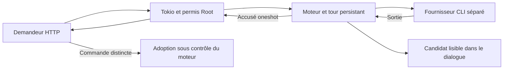

# Orchestration Tokio dans Swarm

[English](../en/TOKIO-ORCHESTRATION.md) · [Plan Biba](../plans/actions-confiance/BIBA-TRANSVERSE-APEX.md) · [Qualification ciblée](#rejouer-la-qualification-ciblée)

## Choisir la frontière

Utiliser Tokio pour la coordination asynchrone entre composants Rust coopératifs qui peuvent partager les privilèges d’un processus. Un canal typé convient lorsqu’une tâche doit confier une opération à un propriétaire unique ou recevoir un résultat ponctuel. Réutiliser le transport existant si l’opération a déjà un propriétaire et une règle d’admission.

Un fournisseur CLI ou une commande native nécessitant une frontière de privilèges reste dans un processus séparé, avec les contrôles d’exécution appropriés. Le moteur conserve l’autorité sur le tour et l’éventuelle adoption. Les messages transportent des données et des références. Le consommateur autorisé vérifie l’instance Root, l’identité, la révision, les labels applicables et la décision au point d’effet.

## Appliquer le modèle

1. Donner la ressource et le point d’écriture à un propriétaire identifié. Modéliser les messages et résultats avec des variantes explicites et corréler chaque demande à sa tentative.
2. Pour une nouvelle file interne, définir sa capacité ou identifier la borne qui existe en amont. Choisir explicitement l’attente, le refus ou la reprise selon le contrat de l’appelant. Relier tout choix opérateur au réglage persistant, à la validation commune et au consommateur effectif.
3. Utiliser `oneshot` pour un retour ponctuel. Préserver un état durable consultable quand une opération peut survivre au demandeur. Un accusé, un effet enregistré et l’adoption correspondent à des événements distincts.
4. Définir les événements de fin par propriétaire. Spécifier les effets d’une fermeture de canal, d’un arrêt métier et d’un arrêt de service, puis vérifier la libération des ressources et le sort des opérations déjà prises en charge.
5. Associer les assertions à la révision, au profil et au binaire exercés. Favoriser des barrières observables et relire l’état public du récepteur. Conserver résultats bruts sûrs, ordre d’événements, identités, empreintes, erreurs et limites.

## Application à la préparation Web native

Le transport utilise une file `mpsc` non bornée, des permis Root et Admin et une réponse HTTP `oneshot`. Le serveur acquiert le permis avant la collecte du corps. Le retour de `/api/v1/preparations/send` décrit le tour pris en charge. Le fournisseur CLI s’exécute séparément. Le moteur enregistre la réponse candidate et le dialogue permet de la relire. L’adoption est une opération distincte. [Transport](../../rust/crates/swarm-web/src/service/transport.rs#L235) · [Route](../../rust/crates/swarm-web/src/service/preparations.rs#L206).

Dans la source moteur, l’ordre des écritures sur le tour règle la concurrence entre l’arrêt et la finalisation. Si l’arrêt a enregistré `stopping` en premier, la finalisation enregistre `interrupted` et écarte la réponse. Si la finalisation a déjà enregistré un état terminal, l’arrêt sert cet état sous le contrôle de lecture applicable. [Finalisation](../../rust/crates/swarm-engine/src/root_store/preparation_call.rs#L1137) · [Arrêt](../../rust/crates/swarm-engine/src/root_store/preparation_call.rs#L1281).

Sur dev.380, les fixtures avec fournisseur inerte ont vérifié le nominal, l’arrêt avec sortie retenue, le refus de saturation avec reprise explicite et la persistance après déconnexion. La qualification ciblée a aussi observé un arrêt qui conserve un candidat déjà enregistré, puis un arrêt qui interrompt un tour après drainage des octets du fournisseur mais avant publication. Le drainage ne situe pas la fin du parsing ni le dernier contrôle avant le commit. Le périmètre général D11 dépend de preuves propres à chaque frontière.

## Rejouer la qualification ciblée

La [recette preparation-web-stop-order](../../tools/verification/recipes/preparation-web-stop-order.json) sélectionne uniquement ces deux ordres. Préparer un binaire natif qualifié, un checkout ou une copie de sources isolée avec une zone de fixtures valide et un répertoire de sortie privé admis. Le lanceur utilise Linux, Python 3 et `ss` d’iproute2. Définir `SWARM_PREPARATION_UI_BINARY`, `SWARM_PREPARATION_STOP_ORDER_SHA256`, `SWARM_PREPARATION_STOP_ORDER_PARENT` et `SWARM_PREPARATION_STOP_ORDER_RESERVE_BYTES` avant d’appeler [le lanceur de recettes](../../tools/verification/README.md). Conserver l’identification du build, le reçu de recette et le dossier du parcours HTTP et CLI.

[Canaux Tokio](https://tokio.rs/tokio/tutorial/channels) · [Arrêt asynchrone](https://tokio.rs/tokio/topics/shutdown)
