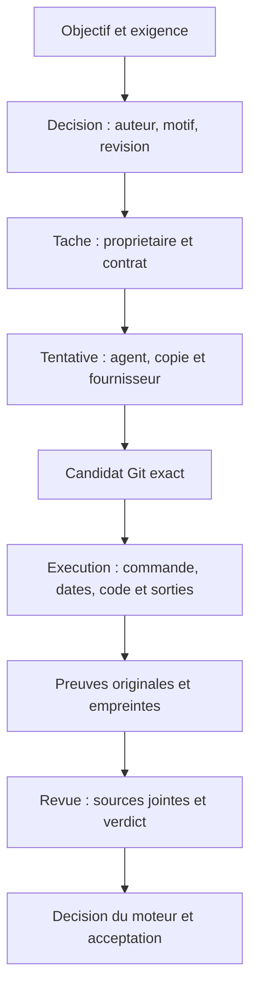
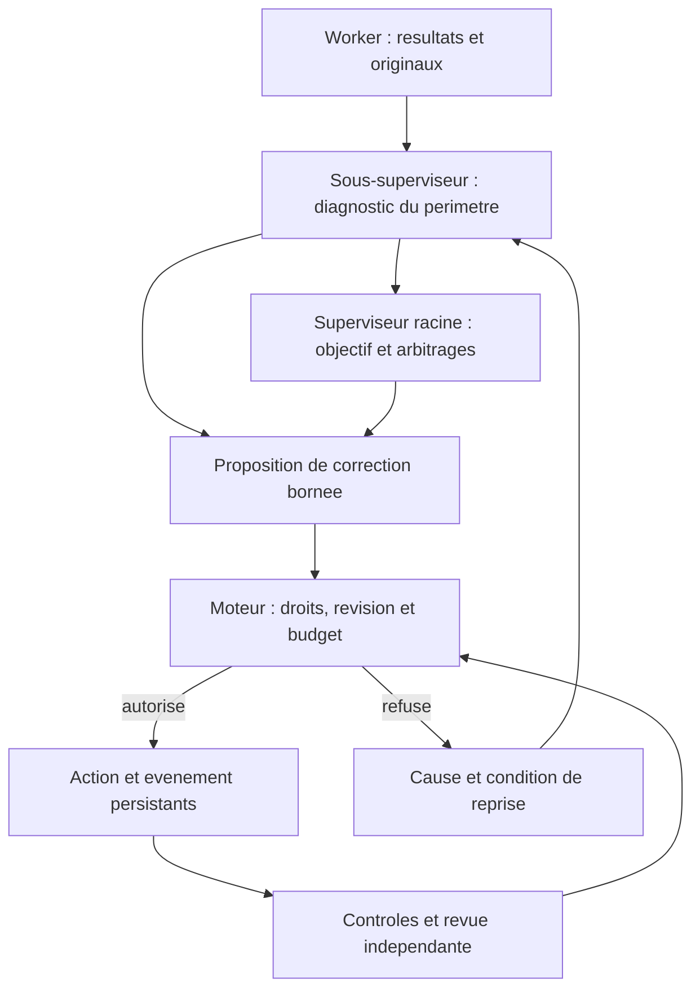
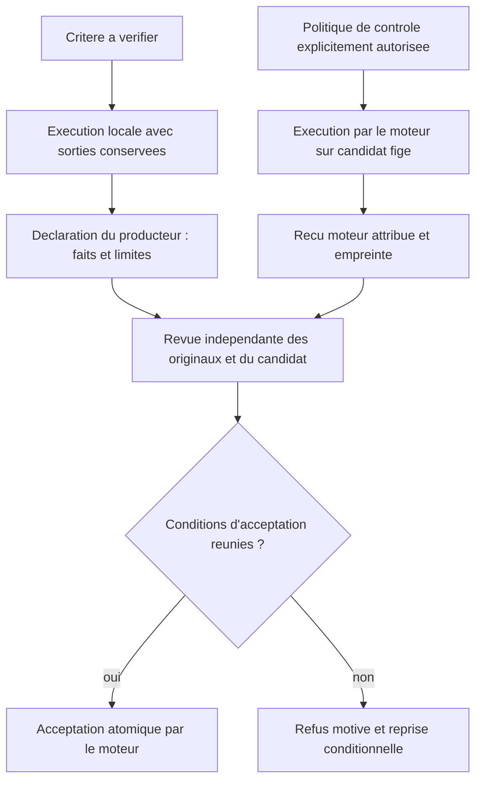
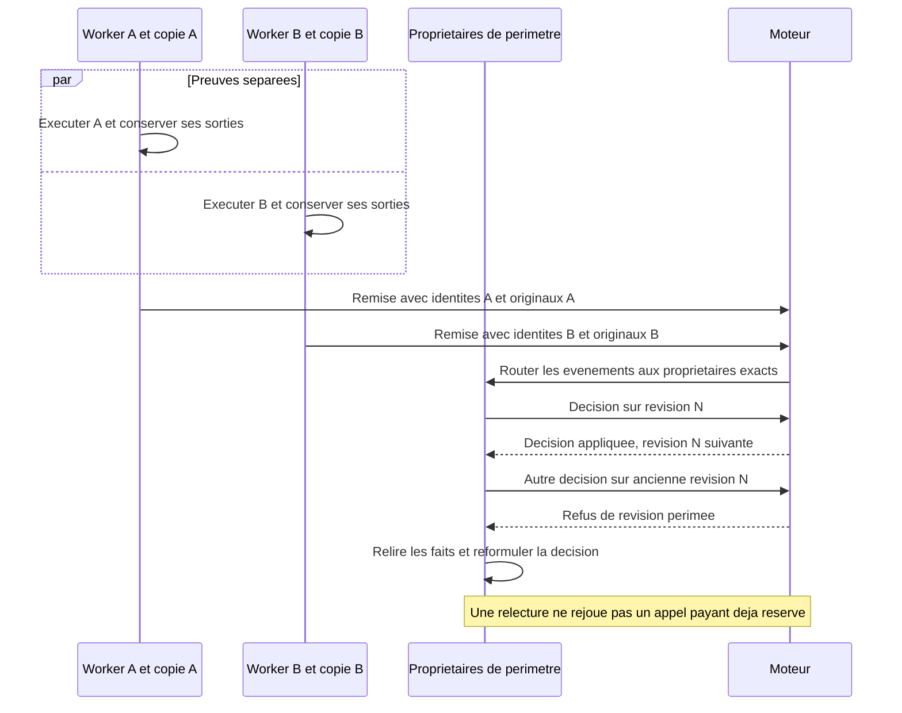
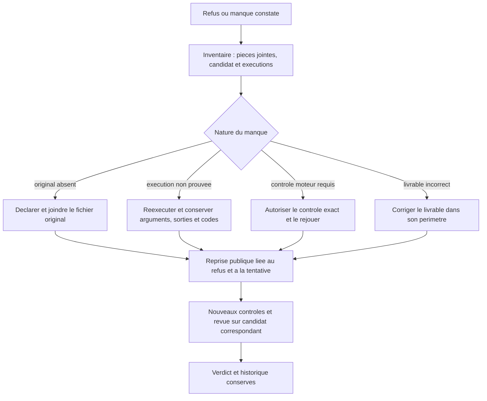
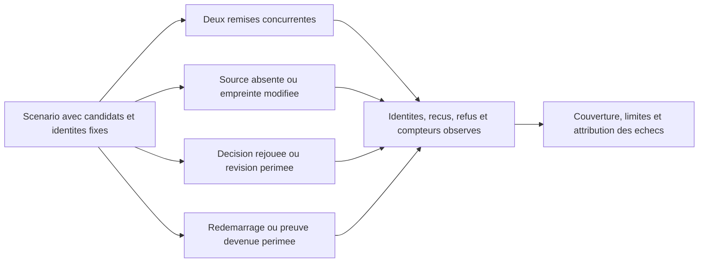
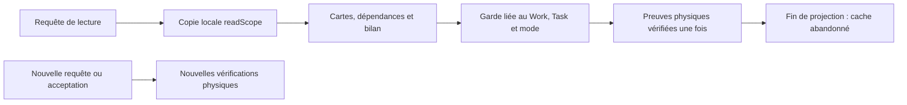

# Traçabilité : preuves, responsabilités et agents concurrents

[English](../en/TRACEABILITY.md)

## À quoi sert la traçabilité

La traçabilité permet de répondre à six questions : quel objectif était visé,
qui a décidé, quel agent a exécuté, sur quelle révision, quel résultat a été
observé et quelle décision en a été tirée. Elle sert au diagnostic, à la reprise,
à la revue indépendante, à la maîtrise du coût et à l’attribution des défauts.
Elle permet notamment de distinguer un défaut du livrable, un manque de preuve,
une règle incorrecte du moteur et une indisponibilité du fournisseur.

Un journal d’activité ne suffit pas à établir ces liens. Une commande annoncée
ne prouve pas son exécution ; un fichier de rapport ne prouve pas sa lecture ;
un processus terminé ne prouve pas l’acceptation. Une empreinte permet de vérifier
des octets ; elle ne prouve ni leur vérité ni la qualité de la décision IA.

Le [contrat de parallélisme](AGENT-PARALLELISM.md) explique quand plusieurs agents
peuvent avancer ensemble. Le [contrat de preuves de revue](REVIEW-EVIDENCE.md)
explique quels originaux sont réellement transmis au vérificateur. Les règles
ci-dessous séparent mécanismes existants et exigences à vérifier dans les lots
d’évolution ; elles ne déclarent pas ces lots déjà acceptés.
Le [diagnostic autorécursif](AUTORECURSIVE-RECOVERY.md) impose de traiter aussi
les défauts de la méthode, du contrôle et de la transmission, puis de revenir
à l’exigence initiale. Signaler un manque ne termine pas sa correction.

## La chaîne de preuve

Chaque lien doit être reconstructible. L’absence d’une mesure est indiquée comme
inconnue. Une ancienne preuve reste historique quand une révision, un contrat,
une politique ou une entrée pertinente change ; elle ne devient pas une preuve
fraîche par changement de statut.

| Objet | Identités et faits à conserver | Utilité |
| --- | --- | --- |
| Décision | Mission, périmètre, auteur, événement, révision attendue, motif | Attribuer et rejouer la décision sans double effet |
| Tentative | Tâche, tentative, agent, propriétaire, copie, modèle/fournisseur | Séparer plusieurs agents, coûts et résultats |
| Exécution | Candidat/état des sources, arguments exacts, environnement pertinent, dates, code de sortie, stdout/stderr | Reproduire le résultat effectivement observé |
| Preuve | Chemin, contenu original, taille, empreinte, objet Git si applicable | Vérifier l’intégrité et joindre l’original |
| Revue | Identité, candidat, contrat, politique, contexte reçu, verdict par critère | Comprendre un refus et vérifier sa fraîcheur |
| Acceptation | Reçus, phases de contrôles, revue requise et transition atomique | Prouver ce que le moteur a réellement validé |

Les compteurs d’appels IA, d’outils, de contrôles et de tentatives sont distincts.
Un coût absent ne vaut pas zéro ; un appel réservé ne prouve pas qu’il a été
envoyé ni facturé. PID et dates aident au diagnostic ; ils ne remplacent pas les
identités durables mission/tâche/tentative, notamment après redémarrage.

## Qui fait quoi, à quel niveau

| Niveau | Responsabilité | Limite |
| --- | --- | --- |
| Worker | Exécuter dans sa copie, enregistrer les commandes et sorties, relier chaque critère à ses originaux, remettre découvertes et limites | Ne certifie pas un futur contrôle du moteur et n’accepte pas son travail |
| Sous-superviseur | Exploiter les remises de son périmètre, diagnostiquer les manques, proposer une correction et adapter le plan dans ses droits | Ne réattribue pas le périmètre d’un autre propriétaire |
| Superviseur racine | Évaluer l’objectif complet, les dépendances, les remontées et les arbitrages entre périmètres | Ne remplace pas le contrôleur et ne fabrique pas les preuves des workers |
| Reviewer indépendant | Examiner le candidat, les originaux effectivement joints et les résultats ; motiver chaque verdict | Une source reçue n’est pas nécessairement comprise ; aucune écriture ni autoacceptation |
| Juge global | Décider de poursuivre ou terminer un cycle sur l’objectif et ses preuves | Une revue de candidat ne constitue pas ce jugement global |
| Moteur déterministe | Réserver, attribuer, vérifier révisions/droits/empreintes, exécuter les contrôles préautorisés, composer les contextes, publier les transitions | N’infère pas la justesse sémantique d’un livrable à partir d’un hash ou d’un statut |
| Opérateur | Autoriser les commandes de contrôle et politiques ; appliquer une correction externe explicitement attribuée si nécessaire | Une intervention humaine reste visible et ne devient pas un succès autonome |

**Parcours de responsabilité attendu.** Les décisions IA sont des propositions
que le moteur doit valider ; les workers ne coordonnent pas directement leurs
écritures avec d’autres workers.

## Trois niveaux de vérification à conserver

1. **Vérification locale** : le producteur ou l’opérateur exécute réellement une
   commande dans une copie isolée et conserve le résultat. L’auteur et les
   conditions de cette exécution sont déclarés.
2. **Contrôle du moteur** : une commande explicitement autorisée est exécutée
   par le contrôleur sur son candidat. Le reçu établit ce qui a été exécuté,
   avec arguments, code de sortie, sortie retenue et empreinte.
3. **Revue indépendante** : le vérificateur juge les critères à partir du
   candidat, des sources jointes et des preuves. Un reçu mécanique réussi ne
   démontre pas à lui seul la couverture sémantique.

Une exécution locale bien tracée conserve sa valeur et son origine. Elle ne
doit pas être présentée comme un reçu moteur. Si l’acceptation exige un nouveau
test comportemental contrôlé par le moteur, ajouter explicitement ce contrôle
à la politique autorisée et le rejouer ; ne pas élargir une commande à partir
d’une suggestion IA sans autorisation.

## Contraintes et gestion des preuves

| Contrainte | Pourquoi elle existe | Gestion |
| --- | --- | --- |
| Identité et périmètre | Éviter une preuve attribuée à un autre agent ou critère | Vérifier mission, tâche, tentative, propriétaire et contrat |
| Candidat exact | Éviter de valider une version différente de celle publiée | Lier contrôles et revue au même candidat ; recontrôler les changements pertinents |
| Révision et événement | Éviter les décisions périmées et effets doubles | Compare-and-swap, événement idempotent, relecture avant nouvelle décision |
| Original et empreinte | Distinguer citation, contenu reçu et contenu modifié | Joindre le fichier réel, vérifier le blob et le digest |
| Contexte limité | Éviter un appel payant avec preuves absentes ou tronquées | Refuser les sources invalides avant appel ; découpage explicite si pris en charge |
| Sorties volumineuses | Borner stockage et contexte sans cacher la limite | Indiquer la sortie retenue et ses limites ; conserver les artefacts nécessaires selon la politique |
| Budget et réservation | Éviter les doubles appels et reprises masquées | Compteurs partagés atomiques, historique conservé, aucune remise à zéro |
| Données sensibles | Éviter de publier secrets et état privé dans les preuves | Sélectionner les données autorisées ; expliquer une omission nécessaire |
| Arrêt ou redémarrage | Distinguer processus vivant, perdu et résultat durable | Réconcilier identités, baux et effets avant reprise |

Le moteur actuel joint les fichiers déclarés dans `delivery.criteria[].evidence`
et les sources complémentaires de `docs/TASK-ID.review-context.json` depuis le
candidat Git. Les limites de cette transmission sont documentées dans
[REVIEW-EVIDENCE](REVIEW-EVIDENCE.md). Le reçu de contrôle peut avoir une sortie
retenue bornée : ce mécanisme ne signifie pas que les originaux de revue peuvent
être tronqués silencieusement.

Les réglages ajoutés doivent être persistés, exposés dans l’Admin FR/EN et
utilisés par le moteur. Les invariants d’identité, intégrité, droits et absence
de double effet ne sont pas des leviers pour faire accepter un résultat refusé.
Les comptes ayant accès à la base et aux exécutables hôtes restent hors de la
frontière de protection des opérations publiques.

## Plusieurs agents en même temps

Les agents travaillent dans leurs copies et enregistrent leurs propres preuves.
La mission ne doit pas utiliser un unique fichier de suivi réécrit par tous les
workers. Chaque remise indique son propriétaire, sa tâche, sa tentative et son
candidat. Les événements sont conservés ; les changements d’état sont arbitrés
atomiquement. Deux événements simultanés ne rendent pas deux décisions sur une
même ancienne révision valides.

**Exemple de concurrence, pas une mesure de cette mission.**

L’horodatage décrit l’observation, pas un ordre causal suffisant entre machines.
Les identifiants, liens d’événements et révisions établissent les dépendances.
Le [chemin de publication actuel](AGENT-PARALLELISM.md) reste exclusif par mission
pendant contrôles, revue et publication ; il est distinct de la production
parallèle. Une publication qui modifie le candidat peut invalider une preuve,
même si le worker concerné a correctement conservé son journal local.

## Corriger un manque de traçabilité

Le sous-superviseur diagnostique d’abord son périmètre ; le responsable racine
intervient pour les dépendances et décisions globales. Le moteur fournit les
faits vérifiables et applique les opérations autorisées. Ajouter une citation,
répéter une affirmation ou modifier artificiellement un fichier pour entrer
dans le diff ne remplace pas un original ni une exécution.

Une correction externe est possible seulement par une opération publique prise
en charge, avec acteur et motif explicites, conservation du refus et nouveaux
contrôles. Ne pas modifier le candidat en revue ni ses fichiers de preuve.
Une politique amendée doit invalider ses preuves précédentes ; elle n’autorise
ni autoacceptation ni nouvelle tentative implicite.

## Cas T2 du 10 octobre 2026

Le premier fragment de la revue `review-8a5b4d26457e4456353da385` a examiné le
code et les tests du juge, mais a signalé des résultats de tests locaux non
recoupés par les reçus moteur. Les contrôles préautorisés rejouaient une suite
générique, sans les nouveaux `TestJudge*`/`TestConfigureJudge*`. Ce constat
intermédiaire ne constitue pas le verdict final de la revue.

La correction prépare une reproduction sur une copie isolée du candidat
`a27e175eb4f3e38f9cede1c888956a5ca5a0310f`, avec stdout/stderr, codes de sortie,
dates et empreintes. L’origine opérateur reste visible. Si un contrôle moteur
supplémentaire est requis, il doit être ajouté à la politique par le parcours
public et réellement exécuté. Les compteurs et preuves historiques restent
conservés. Les résultats effectifs de cette reprise appartiennent au relevé
de recherche, pas à une déclaration anticipée de succès dans ce contrat.

## Utiliser cette analyse pour construire le moteur

Cette analyse précise les critères existants du plan T2–T7. Chaque lot doit
relier ses changements à ces identifiants, examiner l’écart sur son candidat,
puis fournir le résultat observable et l’original associé. Une exigence écrite
reste à vérifier ; elle ne devient pas implémentée par sa présence dans un prompt.

| ID | Exigence de développement | Lot et responsable | Vérification attendue |
| --- | --- | --- | --- |
| TR-1 | Lier l’exécution à la tâche, tentative, candidat, arguments, dates, code et sorties ; distinguer origine locale et contrôleur | T4 remise et reçu ; T6 mesures | Retrouver un test annoncé dans ses sorties réelles ; une preuve absente reste inconnue |
| TR-2 | Fournir au décideur l’inventaire exact des sources reçues et manquantes, avec origine et fraîcheur | T3 contexte des responsables ; T5 consignes | Source manquante, source inchangée, original faux et refus avant appel lorsque le moteur détecte l’invalidité |
| TR-3 | Router découvertes et manques au propriétaire ; réserver l’arbitrage entre périmètres au responsable racine | T3 sous-planification ; T4 remises | Deux propriétaires distincts traitent leurs événements ; découverte et décision persistées, y compris après redémarrage |
| TR-4 | Conserver des preuves indépendantes par agent et arbitrer les décisions concurrentes atomiquement | T3 réservations ; T4 publication | Deux remises simultanées attribuées ; décision périmée et rejeu refusent les effets doubles |
| TR-5 | Reprendre par une opération publique après une correction identifiée, sans effacer refus, consommations ni ancien candidat | T4 reprise ; T5 parcours API/CLI/Admin | Précondition modifiée nommée, nouveaux contrôles et revue correspondant au candidat, historique consultable |
| TR-6 | Mesurer ce que ces garanties coûtent et ce qu’elles permettent réellement | T6 banc ; T7 recette indépendante | Couverture des preuves, inconnus, reprises, attente centrale et coût connu/inconnu ; séparer doubles et fournisseur réel |

TR-1 à TR-6 sont des repères de travail complémentaires, pas de nouvelles gates
ajoutées à la mission. Le juge T2 consomme les preuves d’objectif ; il ne transforme
pas une déclaration locale en exécution du contrôleur. T5 expose les nouvelles
politiques dans l’Admin FR/EN, avec persistance et provenance. Les preuves de T6
et T7 doivent distinguer un mécanisme disponible d’un parcours effectivement
utilisé par un sous-superviseur ou le responsable racine.

## Vérifications attendues

Vérifier le parcours normal, les refus, la reprise après changement de précondition,
la persistance et la concurrence en racines temporaires. Conserver code de sortie,
sources et candidat exacts. Séparer tests avec doubles, fournisseur réel et
interventions humaines. Une source intacte peut contenir une erreur ; une revue
favorable peut être insuffisamment fondée : les preuves servent aussi à auditer
les agents et le moteur, pas seulement à auditer les workers.

## Compter les contrôles gérés sans perdre leur historique

`mission spending` et le cockpit lisent les exécutions enregistrées dans `task.auto-validation` et `managed.integrated`. Le premier transporte une liste de résultats ; le second une liste par tâche dans `controls`. Le compteur ajoute chaque résultat `executed=true`, réussi ou échoué, une fois par événement de cette mission. Une structure illisible reste une erreur et ne devient pas zéro.

Exemple : publication alpha avec un contrôle, puis publication beta avec recontrôle alpha et contrôle beta. Le bilan indique **3 exécutions enregistrées**, tandis que le dernier candidat possède **2 contrôles frais**. Ces unités sont distinctes ; sommer seulement les validations finales perdrait le premier contrôle. Les contrôles sans événement de résultat enregistré ne sont pas déduits des tests du worker ni des intentions de lancement. Un coût absent reste inconnu, même si une somme JSON vaut zéro avec zéro appel ayant rapporté un coût.

## Vérifier une fois par projection, de nouveau à l'acceptation

Un affichage de mission construit plusieurs projections de la même tâche et de ses dépendances. Les gardes d'une revue gérée peuvent relire le contexte intégral, les lots, la chaîne historique et Git. Les répéter pour chaque carte amplifie la latence : une mission conservée à cinq tâches et deux lots a pris 41,66 secondes pour son snapshot public, alors que le stockage répondait normalement.

`readScope` crée désormais une copie locale à la lecture. Le snapshot HTTP et `missionStatus` partagent cette copie avec leurs projections imbriquées. La garde indépendante mémorise succès **et refus**, avec une clé liée au Work complet, à la Task et au mode historique. Contrat, tentative, candidat, configuration de revue ou mode différents ne réutilisent pas un avis. L'échec de sérialisation reste une erreur.

Ce cache ne vit que le temps de la projection, comme les empreintes de gate. Le Store actif n'en possède aucun : l'acceptation et chaque nouvelle requête relisent les preuves. Une disparition ou modification entre lectures invalide le prochain résultat ; aucune acceptation, consommation ou preuve persistée n'est modifiée. Les projections restent séquentielles dans la requête : cette map n'est pas un cache concurrent partagé. La mesure après installation est conservée dans le RETEX de livraison ; ce mécanisme ne promet pas un seuil universel.

