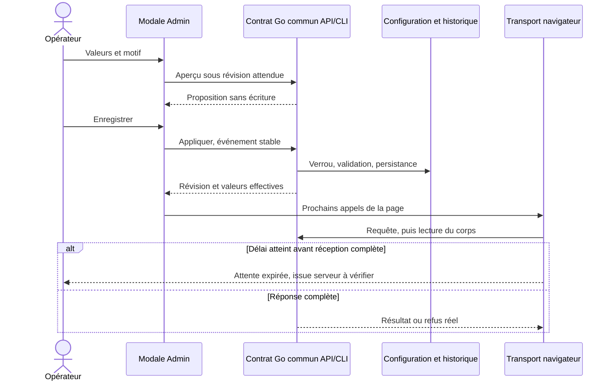

# Délais des requêtes navigateur

[English](../en/WEB-REQUEST-POLICY.md)

## Effet et propriétaire

L'opérateur règle l'attente de l'interface dans **Admin → Attente des requêtes
navigateur → Régler les délais navigateur**. La modale sépare requêtes courantes,
lecture de l'état et test de connexion IA, en millisecondes. `0` désactive
l'expiration navigateur. Ces délais ne terminent aucun agent, n'acceptent aucun
résultat et ne réessaient aucune mutation.

Une expiration signifie que l'interface n'a pas reçu la réponse complète dans le
délai choisi. Elle ne prouve pas que le serveur a annulé l'opération. Après une
mutation à l'issue incertaine, relire l'état par le parcours public avant une
nouvelle décision ; conserver l'identifiant d'événement pour un éventuel rejeu
autorisé. Aucun remboursement, changement de tentative ou répétition automatique
n'est induit par ce transport.

## Source commune et persistance

| Réglage | Valeur initiale versionnée | Consommateur |
| --- | --- | --- |
| `general_ms` | 15000 ms | Autres lectures/actions API du cockpit, préparation, Projets et diagnostic de version |
| `snapshot_ms` | 60000 ms | `/api/v1/snapshot`, avec ou sans paramètres |
| `connection_test_ms` | 65000 ms | `/api/v1/providers/connections/test`, avec ou sans paramètres |

Les valeurs initiales sont dans `config/web-requests.json`, embarqué par Go. La
configuration enregistrée dans `.swarm/web-requests.json` prend le relais, avec
révision, motif, auteur et historique. Un fichier malformé ou redirigé par lien
symbolique est refusé : aucun délai client de secours ne le masque.

API : `GET /api/v1/web-requests`, `POST /api/v1/web-requests/preview` et
`POST /api/v1/web-requests/apply`. CLI équivalente :

```sh
swarm --root ./mon-projet run-limits web-requests show
swarm --root ./mon-projet run-limits web-requests history
swarm --root ./mon-projet run-limits web-requests preview --input changement.json
swarm --root ./mon-projet run-limits web-requests apply --input changement.json
```

Le changement demande `schema_version: 1`, un `event_id` stable,
`expected_revision`, les trois valeurs et un motif de 8 à 2000 caractères.
L'aperçu ne modifie pas la configuration. L'application utilise un verrou entre
processus, refuse les révisions périmées et conserve un rejeu identique sans
nouvelle révision. Réutiliser l'événement avec d'autres valeurs est refusé.

La borne supérieure exposée par l'API est celle des entiers exactement
représentables par JavaScript, `2^53 - 1` millisecondes ; elle ne constitue pas un
plafond d'exploitation. Le transport découpe les timers longs en segments de
31 bits, sans raccourcir le délai choisi. Il couvre réception des en-têtes **et
lecture complète du corps** ; timers et listeners sont libérés à la fin.


L’aperçu et l’application vérifient aussi la même représentation persistée, saut de ligne inclus, avant toute écriture. L’historique conserve une borne technique de fichier de 1 Mio ; lorsqu’elle est atteinte, les deux opérations refusent sans modifier valeurs ni historique. Ce refus ne réduit pas les délais choisis et n’efface pas les anciennes révisions.

## Réception dans les interfaces

Le serveur authentifié sert `/api/v1/web-requests/script.js` avec `no-store`.
Ce script fournit la révision et les valeurs avant les scripts applicatifs, sous
la politique CSP existante. `web/web-requests.js` partage le transport entre
cockpit, préparation, accueil Projets et diagnostic de version. Les consoles
chargent le même contrat ; leurs lectures relayées par le cockpit utilisent son
transport. Les flux EventSource et l'envoi de visite à la fermeture de page ne
sont pas des requêtes de lecture avec ce délai.

Dans la page Admin, charger/enregistrer les réglages met à jour les prochains
appels de cette page. Les appels déjà partis gardent leur copie. Les autres
pages reçoivent la configuration au rechargement ; aucune propagation instantanée
entre onglets n'est annoncée.



## Vérification et limites

Les recettes ciblées contrôlent persistance, aperçu, rejeu, concurrence, refus,
authentification, configuration réellement reçue et parcours FR/EN dans les deux
thèmes. Les probes de délai navigateur sont interceptées et ne démarrent aucun
fournisseur. Cela n'établit ni un appel IA réel ni l'installation native du nouveau
binaire.

Cette correction concerne le transport de l'interface. Les limites serveur fixes
à 60 secondes sont supprimées dans la correction source suivante : le
[contrat d'attente des fournisseurs](PROVIDER-LIVENESS.md) fournit la durée totale
aux tests de connexion et à l'assistance de page. Modifier `connection_test_ms`
ne modifie pas cette durée serveur. Le chargement CSS/module de `prephase-editor.js` utilise maintenant `general_ms`. Les budgets de
lancement et délais de préparation gardent leurs contrats distincts.

Le chargement de l’éditeur utilise le délai courant Admin `general_ms` ; 0 désactive cette expiration. En cas d’expiration, le texte simple reste éditable et enregistrable. Un import dynamique déjà parti continue sans rejeu ; il ne crée pas tardivement un éditeur après le passage en mode simple. La durée reçue est conservée pour ce chargement.
