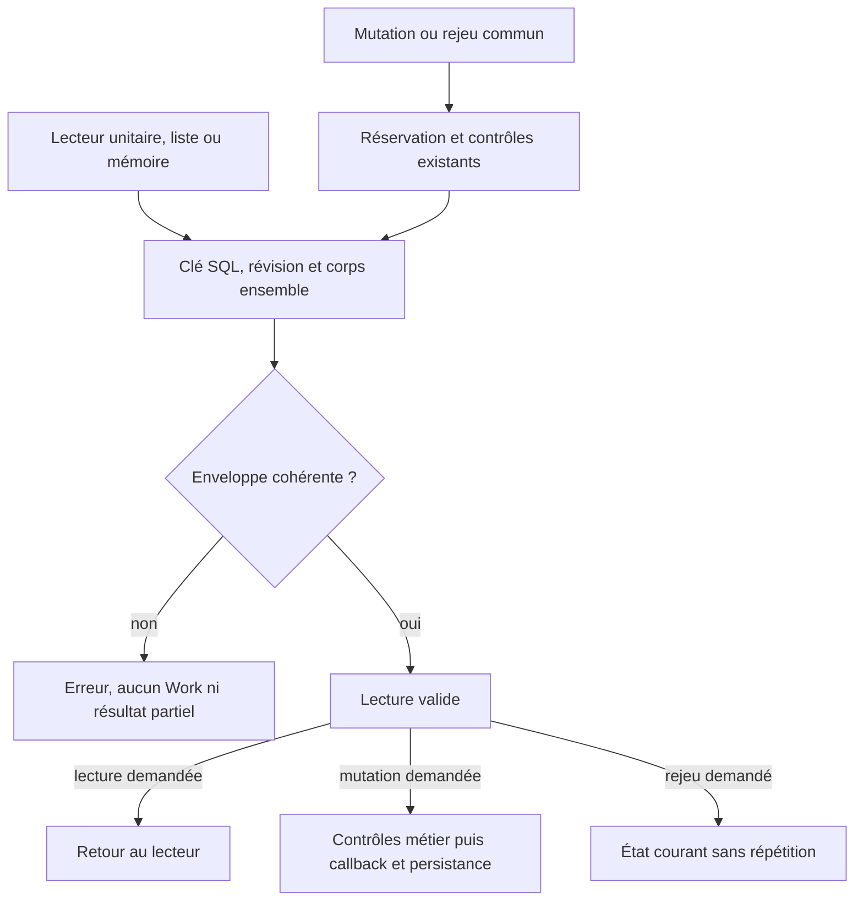

# Lecture cohérente d'un travail persisté

[English](../en/WORK-ROW-CONTRACT.md) · [Référence CLI](../../REFERENCE.md) ·
[Mémoire du projet](../PROJECT-MEMORY.md)

## Contrat actuel

`internal/engine/work_row.go` fournit le lecteur commun de l'enveloppe SQL
`works`. `Store.get/list`, les lectures de mutation et de rejeu dans
`mutateWithHookOnce`, ainsi que les lecteurs de mémoire versionnée l'utilisent.
Les autres lectures SQL explicites ne sont pas toutes raccordées à ce module.

Une lecture obtient `id`, `revision` et `body` dans le même résultat SQL. Elle
exige une clé conforme à `safeName`, un corps UTF-8/JSON décodable en `Work`,
`schema_version: 1`, une révision SQL strictement positive et l'égalité de
l'identifiant et de la révision JSON avec les colonnes SQL. Le schéma JSON 1
est distinct de la version du stockage SQLite contrôlée par les migrations.
Ce contrôle ne revalide pas chaque champ métier ou toute l'histoire du travail.
Les champs optionnels historiques peuvent être absents ; lire ne réécrit pas
les octets ni les champs inconnus conservés dans la base.

`readWorkRow` valide aussi l'identifiant demandé avant la requête. Un refus de
ligne retourne `Work{}` avec une erreur, jamais un travail partiellement décodé.
Les causes SQL/JSON restent accessibles par les erreurs enveloppées, notamment
`errors.Is(err, sql.ErrNoRows)` pour une source absente. Un diagnostic de
cohérence nomme une clé SQL valide ; une clé invalide n'est pas recopiée.

`listWorkRows` garde l'ordre `rowid DESC`. Une liste réellement vide est un
succès avec une collection vide. Une erreur de requête, de ligne, d'itération
ou de fermeture retourne une collection absente avec erreur ; aucune liste
partielle n'est publiée. Le curseur est fermé sur chaque parcours. Les wrappers
mémoire ajoutent leur contexte d'erreur et le guide hérité utilise le même scan.

## Mutation, rejeu et création

La mutation commune conserve sa réservation du rédacteur SQL, le contrôle de
version du stockage et les contrôles d'événement/révision existants. Pour un
travail existant, la ligne doit passer le lecteur commun avant le callback
métier et le hook transactionnel. Une ligne incohérente ne déclenche aucun de
ces deux callbacks et ne laisse aucune mutation métier ou événement enregistré.
La réservation peut avoir exécuté une instruction SQL sans changement de valeur ;
le refus et le rollback ne signifient pas qu'aucune instruction SQL n'a eu lieu.

Un rejeu d'événement exact lit et valide le travail courant dans la transaction.
Il retourne cet état courant, même si sa révision dépasse celle de l'événement,
sans répéter les callbacks ou l'événement. La création suit son producteur : le
travail nouveau peut être à révision zéro en mémoire puis est persisté à sa
première révision. Aucune ligne stockée à révision zéro n'est admise pour autant.

## Effet opérateur et reprise

`work show WORK --json`, `work list --json` et `GET /api/v1/works` refusent une
ligne incohérente. Les fixtures vérifient une sortie CLI vide avec code 2 et une
réponse HTTP 400, ainsi que l'absence de mutation du stockage. Ces lectures ne
sont pas un outil de réparation. Préserver la base originale et faire diagnostiquer
la source par son propriétaire ; une réparation réelle nécessite son propre
périmètre et sa vérification. Le retour au cas valide des tests modifie uniquement
une fixture isolée, jamais une mission en cours.

La concordance SQL/JSON ne prouve ni auteur, ni propriétaire, ni droit d'usage,
ni authenticité face à un acteur capable de réécrire ensemble les données. Elle
ne fournit pas d'engagement atomique jusqu'à un effet externe. Les contrôles
d'identité et les dix conformités publiques M20 restent des travaux distincts.

## Vérification et limites

La recette reproductible est décrite dans le
[rapport M28](../plans/deepagents-integration/RESULTATS-MEMOIRE-24.md), avec les
sources des tests et leurs reçus. Elle couvre les refus, le retour à une fixture
valide, les causes d'erreur, les champs historiques, le rejeu, les mutations,
la concurrence et des frontières mémoire/CLI/API/archives/plan affectées.

L'inventaire corrigé `callers-current.json` joint au rapport recense les sélecteurs
`get/list` et les SELECT littéraux sur la table exacte `works` ; il ne constitue
ni un graphe d'exécution
complet ni un audit de propagation d'erreur dans chaque appelant. Les lecteurs
SQL directs restants (archives, automation, préparation, organisation, identité,
etc.) nécessitent une analyse par module ; certains ont déjà leurs propres
contrôles. Propriétaire de cette suite : chantier mémoire/Store pour les sources
mémoire, chantier identité pour ses propres lecteurs. Reprendre sur ces chemins
réels et leurs contrats avant toute extension. Les preuves locales ne prouvent
ni revue indépendante, ni mise à jour d'un serveur déjà démarré.
