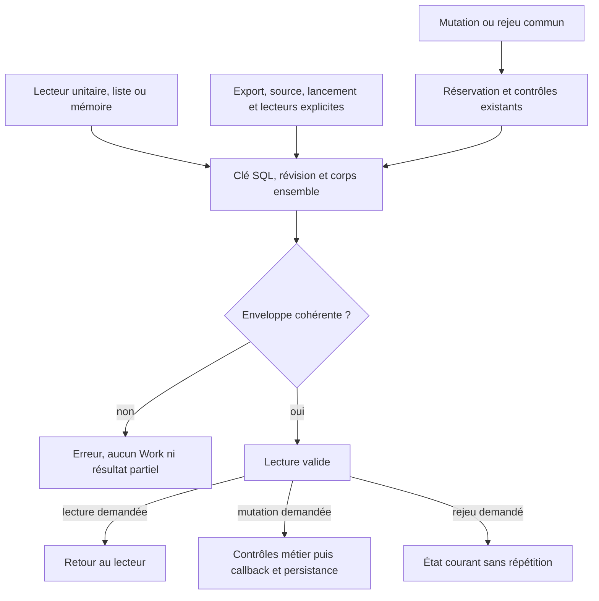
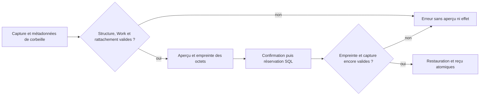

# Lecture cohérente d'un travail persisté

[English](../en/WORK-ROW-CONTRACT.md) · [Référence CLI](../../REFERENCE.md) ·
[Mémoire du projet](../PROJECT-MEMORY.md)

## Contrat actuel

`internal/engine/work_row.go` fournit le lecteur commun de l'enveloppe SQL
`works`. `Store.get/list`, les lectures de mutation et de rejeu dans
`mutateWithHookOnce`, ainsi que les lecteurs de mémoire versionnée l'utilisent.
Les lecteurs explicites de sources de résumé, export, lancement transactionnel,
automation (politique, espace et reprise causale), graphe (aperçu/application),
organisation, révocation des baux de planification, conversion d'un cadrage vers
un travail existant et contexte de reprise l'utilisent aussi. La jointure de
l'inventaire utilise `decodeWorkRow`, le même validateur après scan de ses colonnes
supplémentaires, sans ouvrir un autre lecteur SQL. Les requêtes de métadonnées,
migrations et lecteurs du chantier identité restent distingués dans l'inventaire
M29 ; le lecteur du plan identité garde son propre contrat de projection.

Une lecture obtient `id`, `revision` et `body` dans le même résultat SQL. Elle
exige une clé conforme à `safeName`, un corps UTF-8/JSON décodable en `Work`,
`schema_version: 1`, une révision SQL strictement positive et l'égalité de
l'identifiant et de la révision JSON avec les colonnes SQL. Le schéma JSON 1
est distinct de la version du stockage SQLite contrôlée par les migrations.
Ce contrôle ne revalide pas chaque champ métier ou toute l'histoire du travail.
Les champs optionnels historiques peuvent être absents ; lire ne réécrit pas
les octets ni les champs inconnus conservés dans la base.

`readWorkRow` valide aussi l'identifiant demandé avant la requête. Un refus de
ligne retourne `Work{}` avec une erreur, jamais un travail partiellement décodé.
Les causes SQL/JSON restent accessibles par les erreurs enveloppées, notamment
`errors.Is(err, sql.ErrNoRows)` pour une source absente. Un diagnostic de
cohérence nomme une clé SQL valide ; une clé invalide n'est pas recopiée.

`listWorkRows` garde l'ordre `rowid DESC`. Une liste réellement vide est un
succès avec une collection vide. Une erreur de requête, de ligne, d'itération
ou de fermeture retourne une collection absente avec erreur ; aucune liste
partielle n'est publiée. Le curseur est fermé sur chaque parcours. Les wrappers
mémoire ajoutent leur contexte d'erreur et le guide hérité utilise le même scan.

## Mutation, rejeu et création

La mutation commune conserve sa réservation du rédacteur SQL, le contrôle de
version du stockage et les contrôles d'événement/révision existants. Pour un
travail existant, la ligne doit passer le lecteur commun avant le callback
métier et le hook transactionnel. Une ligne incohérente ne déclenche aucun de
ces deux callbacks et ne laisse aucune mutation métier ou événement enregistré.
La réservation peut avoir exécuté une instruction SQL sans changement de valeur ;
le refus et le rollback ne signifient pas qu'aucune instruction SQL n'a eu lieu.

Un rejeu d'événement exact lit et valide le travail courant dans la transaction.
Il retourne cet état courant, même si sa révision dépasse celle de l'événement,
sans répéter les callbacks ou l'événement. La création suit son producteur : le
travail nouveau peut être à révision zéro en mémoire puis est persisté à sa
première révision. Aucune ligne stockée à révision zéro n'est admise pour autant.
La conversion de préparation conserve cette distinction. Le rejeu exact d'une
application de brouillon de graphe reste son reçu historique, sans promettre de
relire le Work courant. L'enveloppe ne remplace aucun contrôle métier ou droit.

## Captures dynamiques et restauration

Le producteur `snapshotMission` relit le Work avec le noyau commun dans la
transaction, puis contrôle la capture complète avant sa mise en corbeille.
L'aperçu de restauration contrôle aussi cette capture : schéma 1, tables
autorisées, noms de colonnes valides sans doublon, cellules décodables et un seul Work dont clé,
révision positive et titre concordent avec la corbeille. Le corps de ce Work
passe le même validateur d'enveloppe que les lectures courantes.

Chaque ligne appartient au périmètre SQL capturé : mission directe, agent ou
préparation présents dans la capture, demande ou programme d'automation présent.
Une réservation de préparation sans mission peut rester liée à sa préparation
capturée ; une mission étrangère ne devient pas une valeur vide. Des tables
optionnelles vides peuvent manquer dans les anciennes captures. Une table
inconnue, même vide, ou une dépendance étrangère est refusée. Ce contrôle ne
revalide pas tous les champs métier et ne confère aucune autorité d'identité.

L'aperçu d'une restauration de corbeille ajoute `snapshot_sha256`. Son jeton lie
les octets exacts de la capture, en plus de la révision et de la génération du
cycle de vie. Une modification, même de taille égale, exige un nouvel aperçu
(`preview_conflict`). La transaction relit l'empreinte et revalide la capture
avant toute insertion, suppression de corbeille ou reçu. Le reçu conserve la
même empreinte ; un rejeu exact retourne ce reçu historique sans nouvel effet.
Une restauration de simple marquage d'archive ne possède pas de capture : le
champ est alors absent. Les reçus historiques sans empreinte gardent ce champ
absent ; aucun lien rétrospectif n'est fabriqué. Le passage entre ces deux états
exige un aperçu courant.

Un refus conserve la corbeille et les données existantes. L'aperçu n'effectue
aucune écriture temporaire. La recherche de corbeille n'est tentée que si le
Work actif est absent ; une panne SQL ou une enveloppe active incohérente garde
sa cause. Réparer une capture réelle exige un diagnostic et son propre périmètre :
les tests ne modifient que des fixtures isolées. L'empreinte établit une liaison
au contenu observé, pas son authenticité face à un auteur capable de réécrire
la base. Propriété, auteur attesté et droits d'usage M20 restent distincts.

## Effet opérateur et reprise

`work show WORK --json`, `work list --json` et `GET /api/v1/works` refusent une
ligne incohérente. Les fixtures vérifient une sortie CLI vide avec code 2 et une
réponse HTTP 400, ainsi que l'absence de mutation du stockage. Ces lectures ne
sont pas un outil de réparation. Préserver la base originale et faire diagnostiquer
la source par son propriétaire ; une réparation réelle nécessite son propre
périmètre et sa vérification. Le retour au cas valide des tests modifie uniquement
une fixture isolée, jamais une mission en cours.

La source extractive CLI/API et l'inventaire HTTP du cycle de vie refusent aussi
l'enveloppe incohérente. L'export CLI ne publie alors aucune archive et conserve
un fichier de destination déjà présent. Après restauration d'une fixture valide,
source, inventaire et export/import fonctionnent de nouveau. Le sélecteur terminal
des tâches garde l'erreur de lecture au lieu d'afficher « aucune tâche » ; rendu
et dialogue trient chacun les tâches du Work déjà lu. En automation,
`unknown_target` désigne une cible SQL absente ; une panne de lecture ou une ligne
invalide garde sa cause.

La concordance SQL/JSON ne prouve ni auteur, ni propriétaire, ni droit d'usage,
ni authenticité face à un acteur capable de réécrire ensemble les données. Elle
ne fournit pas d'engagement atomique jusqu'à un effet externe. Les contrôles
d'identité et les dix conformités publiques M20 restent des travaux distincts.

## Vérification et limites

La recette reproductible est décrite dans le
[rapport M28](../plans/deepagents-integration/RESULTATS-MEMOIRE-24.md), avec les
sources des tests et leurs reçus. Elle couvre les refus, le retour à une fixture
valide, les causes d'erreur, les champs historiques, le rejeu, les mutations,
la concurrence et des frontières mémoire/CLI/API/archives/plan affectées.

Le [rapport M29](../plans/deepagents-integration/RESULTATS-MEMOIRE-25.md) complète
les preuves sur les lecteurs explicites. Son inventaire distingue SELECT de
corps et de métadonnées, noyau commun et lecteur d'identité. Tous les lecteurs
SQL de corps hors identité recensés passent maintenant par le noyau commun.
Cela ne prouve pas l'exhaustivité du SQL construit ou de la propagation d'erreur :
boucles de supervision, callbacks de fraîcheur et vues complémentaires gardent
une qualification du diagnostic à réaliser. MEM-P1 reste partiel, avec les
chemins, propriétaires et conditions de reprise dans la matrice M29. Le chantier
mémoire/Store possède les appelants ; le chantier identité possède ses lecteurs.
Les preuves locales ne prouvent ni revue indépendante, ni mise à jour d'un serveur
déjà démarré. Aucun nouveau contexte agent ou asset web n'est embarqué ici.
