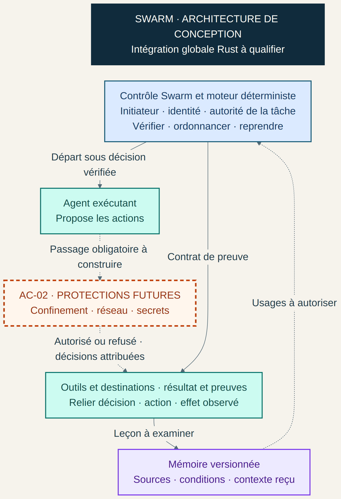
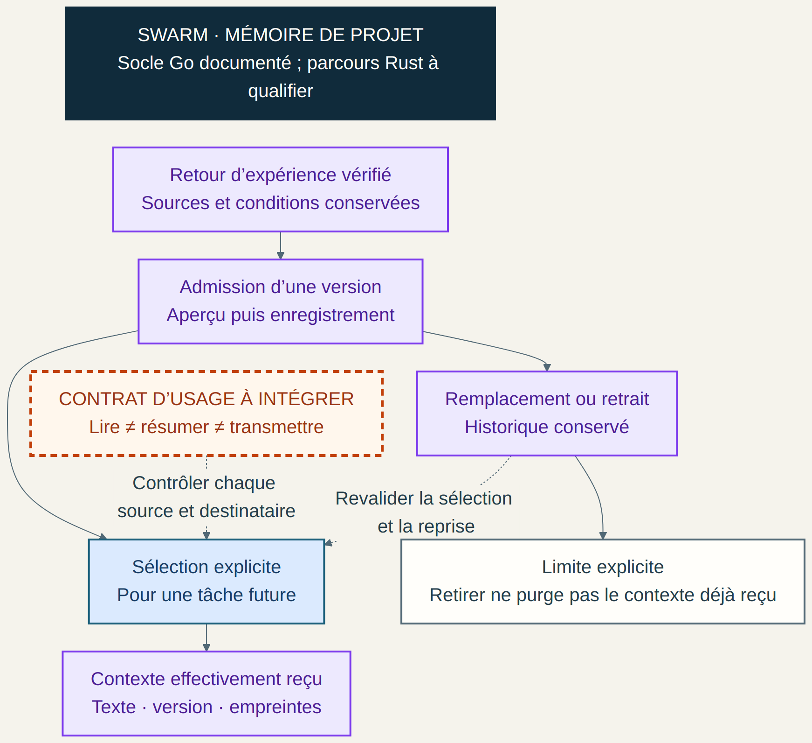

# Swarm relier identité mémoire et contrôle des agents

Un agent qui retrouve une information utile doit aussi savoir dans quel contexte
il peut l’utiliser. Une mémoire exacte peut être transmise au mauvais destinataire.
Une action pertinente peut dépasser les droits de la tâche. Un journal détaillé
peut montrer une activité sans établir qui l’a autorisée.

Le projet Swarm construit son architecture autour de ces liens : l’identité de
l’acteur, l’autorité de sa tâche, la provenance de sa mémoire et les preuves de
son exécution.

## Une supervision qui relie observation et décision

La supervision tient une place centrale dans Swarm. Le superviseur racine
conserve l’objectif global ; un sous-superviseur conduit son périmètre. Le
contrat implémenté dans le socle Go distingue les observations du moteur —
durée, attente d’un outil, compteurs — et la décision motivée du responsable
de continuer ou d’arrêter. Le moteur contrôle cette décision et confirme la
fin effective du processus. Le temps écoulé ne vaut pas acceptation du travail.

Le port Rust possède déjà des parcours CLI vérifiés avec des fournisseurs de
fixture : lancement et suivi d’un worker, reprise d’un worker en attente, puis
planification suivie de l’exécution d’un worker. Ils peuvent servir à préparer
une démonstration concrète, après répétition sur le binaire filmé. Les autres
rôles et la supervision web restent à qualifier.

La séparation des responsabilités fait aussi écho aux expérimentations publiées
par Cursor sur les rôles de planification et d’exécution ; leurs résultats
ne sont pas des résultats Swarm.
[Référence Cursor](https://cursor.com/blog/scaling-agents).

## Une identité attachée à une tâche et à une autorité

Dans un système à plusieurs agents, un nom comme « reviewer » ne suffit pas à
établir une identité. Il faut distinguer la personne ou le service à l’origine
du travail, l’agent logique, son instance d’exécution et le fournisseur de modèle.

Le contrat d’identité de Swarm décrit des autorisations liées à une mission,
à un plan, à une opération, à une ressource et à un contenu précis. Chaque
délégation reste dans les droits explicitement délégables du parent. Une révocation conserve l’attribution historique
tout en retirant l’autorité courante.

Un noyau interne et des protocoles ont été vérifiés sur des fixtures isolées.
Leur raccordement à l’ensemble des lancements et des usages mémoire reste à
qualifier. C’est une distinction essentielle pour présenter le projet avec
précision : une décision d’autorisation et un effet réellement contrôlé ont
des preuves différentes.

Cette séparation rejoint l’architecture *Secure Software Factory* d’Agent
Baseline : un orchestrateur propose le travail ; l’autorisation et son application
relèvent de contrôles indépendants de l’agent qui le demande.
[Référence Agent Baseline](https://github.com/agentbaseline/agentbaseline/blob/d842a1bb34a42e9d7c0d54a1b12ead9e0e59e283/software-factory/software-factory.md).

## Une mémoire versionnée et choisie pour un usage

Les distinctions entre mémoire de conversation, mémoire entre conversations,
faits, expériences et procédures offrent un cadre utile pour concevoir un agent.
[Référence LangChain](https://docs.langchain.com/oss/python/concepts/memory).

Le socle mémoire historique de Swarm, documenté dans l’implémentation Go, suit
une chaîne explicite : retour d’expérience vérifié, admission d’une version,
sélection pour une tâche future, puis conservation du contexte effectivement reçu.
Une leçon garde ses conditions d’usage, ses sources et ses empreintes.

La première recherche est textuelle ; la sélection relève de l’opérateur.
Le projet ne suppose ni apprentissage automatique autonome ni recherche
vectorielle déjà disponible. Une leçon mémorisée ne modifie pas les permissions
ou les budgets de l’agent.

Le contrat d’usage distingue trois opérations : lire, résumer et transmettre.
Leur autorisation commune de bout en bout reste un chantier d’intégration.
L’attribution d’un texte, son propriétaire et le droit de le transmettre
constituent trois informations différentes.

Le retrait d’une leçon concerne ses usages futurs. Il ne supprime pas une
information déjà reçue par une conversation ou conservée par un fournisseur.
Les reprises doivent donc tenir compte des versions réellement reçues.

## La prochaine étape de sécurité

Le plan AC-02 prépare une couche complémentaire : confinement des processus,
contrôle réseau, usage des secrets et traçabilité entre tâche, outil, processus,
connexion et décision.

L’approche retenue est un moteur Swarm propre, dont le sous-ensemble compatible
OpenShell sera explicitement défini et testé. NVIDIA fournit une référence de politique YAML
pour les fichiers, processus et accès réseau. La compatibilité visée devra être
démontrée sur les comportements pris en charge.
[Référence NVIDIA OpenShell v0.1.5](https://docs.nvidia.com/openshell/v0.1.5/how-it-works/policies/schema).

Le travail de Bromure apporte une autre perspective : rendre les protections
compréhensibles à travers un éditeur de politique, un panneau des refus, une
chaîne de connexion et une chronologie de sécurité. Ces quatre parcours inspirent
les futures spécifications Swarm.
[Article Bromure](https://bromure.io/en/blog/openshell-policies-and-network-lineage).

Les YAML d’Agent Baseline apportent aussi une idée utile : conserver un catalogue
structuré des exigences, puis relier chaque contrôle à son propriétaire, son
critère observable et ses preuves. Ce catalogue documentaire a un rôle distinct
du YAML qui pilote un confinement.
[Catalogue Agent Baseline](https://github.com/agentbaseline/agentbaseline/blob/d842a1bb34a42e9d7c0d54a1b12ead9e0e59e283/whitepaper/controls.yaml).

## Où en est Swarm

Au 23 octobre 2026, la migration intégrale vers Rust est en cours. Des parcours
CLI ciblés de lancement, suivi et reprise ont des preuves conservées ; les
parcours complets identité, mémoire et interface web restent à qualifier.
AC-02 est enregistré comme chantier futur, sans démarrage.

Une présentation d’architecture peut déjà expliquer ces choix et leurs liens.
Une démonstration intégrée des nouvelles protections devra montrer leur effet
dans les parcours réellement livrés.

L’objectif est de pouvoir relier chaque résultat à une tâche, une identité,
une autorité, une version de mémoire et des preuves observables. C’est cette
continuité que Swarm cherche à construire.
