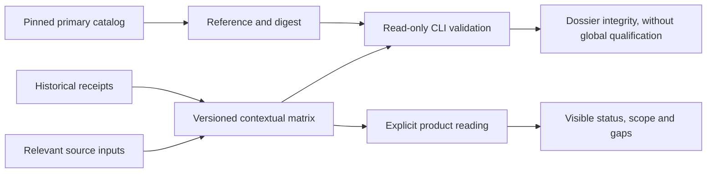

# Control mappings and limits

R19 links twelve selected controls to contextual local Swarm evidence across
access, identity, audit, cryptography, lifecycle, providers and incident handling.
This illustrative subset selects no baseline and establishes no certification,
global compliance or independent assessment. Nine partial, two unassessed and one
out-of-scope control are not a compliance score.

The context is `local-simulation-v1`: public/internal data, identities exercised in
fixtures and simulated effects. The dossier does not qualify the displaying server.
NIST cautions that mappings alone do not establish control equivalence:
[primary source](https://csrc.nist.gov/pubs/sp/800/53/r5/upd1/final).
The official OSCAL5.2.0 catalog is pinned by revision and SHA-256 in
`docs/architecture/actions-confiance-controls-reference.json`, with its original
copy retained in the R19 verification area. No remote catalog is loaded by the
product or validator at runtime.

## Read and verify

The **Controls and limits** card explicitly loads `web/trust-controls.json`.
Filtering selects an area. Status and the first gap remain visible; disclosures
show scope, rationale, owner, evidence paths/digests and missing external
assessment. An empty dossier, unsupported assurance or context displays an error
and clears old results. Labels render as text, never executable HTML. Browser
checks cover display structure, rather than repository file integrity.

Run the complete read-only check from the candidate root:

```sh
python3 tools/actions-confiance/controls.py --root /candidate/path
```

`--matrix` accepts another contained relative path. JSON status
`mapping_artifact_valid` means the structure, pinned primary reference, receipt
hashes and named relevant source bindings match. It always reports
`tests_rerun:false`, `runtime_qualified:false` and three false assurance claims.
Exit2 rejects missing/altered evidence, stale source, escaping paths, links,
unknown properties/rows and unsupported assurance. Historical receipts are never
rewritten to make validation pass.

Each evidence entry names a historical receipt and an explicit subset of its
relevant inputs. That selection limits the mapping's scope; it neither refreshes
all old dependencies nor replaces a recent recipe. Relevant changes require a
new recipe receipt and mapping update while retaining the original. A context
change requires a fresh analysis and version. This contract cannot establish true
certification, global compliance or independent-assessment assertions merely
because an input document declares them.

## Interpret the gaps

| Area | Local evidence | Remaining limitation |
| --- | --- | --- |
| Access | Mandates, exact approval, uniqueness | Real provider authorization unqualified |
| Identity | Isolated OIDC and introspection | Real workforce/directory lifecycle unassessed |
| Audit | Chain, signatures, checkpoint, archives | Human review and storage immutability unproven |
| Cryptography | Key rotation and revocation | HSM, swap and privileged tracing unqualified |
| Lifecycle | Revisions and pinned versions | Change governance and off-site recovery unassessed |
| Providers | Local paths and fixed helper | Real provider oversight and general containment unassessed |
| Incidents | Explicit open gap | Organizational team, escalation and exercises unassessed |

Codex owns this program's local evidence; an appointed organizational owner must
assess a real deployment before external use. No business timeout or budget is
introduced. The validator's technical input bound is16MiB, exposed in
`technical_bounds`, and protects file reading rather than controlling Swarm
execution. Matrix and reference are versioned sources, not Admin permission
settings. Runtime consumption, business data and existing policies stay distinct.

Recipes: `tools/actions-confiance/test_controls.py`,
`tests/actions_confiance_controls.py --root /candidate/path --evidence-dir /candidate/path/evidence --timeout-seconds 120`
and `node tests/actions_confiance_controls_ui.cjs /binary/path /evidence/path`.
They exercise refusals, FR/EN, themes/mobile, unchanged business state and the
distinction between historical documentation and current observation.


