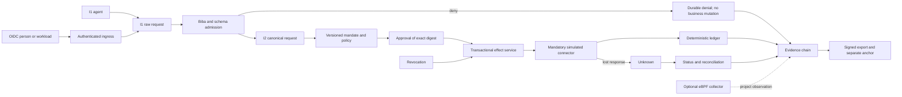
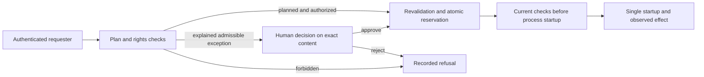

# Trusted actions — target architecture

## Status, scope and decision

This T1 design and its Go inventory are historical. For the current Rust core,
see [Rust Biba technical architecture](BIBA-RUST.md), its diagrams and the
distinction between integrated `trust` flows and the cross-cutting Biba target.
The user’s 26 October 2026 decision retains Biba as the reference integrity rule;
integration gaps do not imply conformance.

This is the T1 target, not an implementation claim. Billing and the second
sensitive connector remain deterministic simulations in isolated roots. No real
payment, third-party account, publication or external deployment is authorized.

The selected design is a **per-action reference monitor**. Agent launch controls
remain useful, but the business service rechecks authenticated identity, mandate,
policy, exact approvals and canonical parameters inside the transaction that
commits the simulated effect. Every sensitive effect crosses an authorized
connector. An uninventoried direct path is an explicit gap and disables the
affected action.

The future [AC-02 execution security and menus plan](plans/actions-confiance/securite-execution-apex.md)
was recorded on 23 October 2026, with Bromure, NVIDIA and Agent Baseline
Software Factory/YAML references. Lots A0–A7 remain not started; resumption
requires Rust migration/qualification and an explicit request to start.
Recording this plan changes no running protection.

## Inspected foundation and gaps

| Mechanism | Observed state and reuse | Gap |
| --- | --- | --- |
| `works`/`events` mutations | Optimistic revision, unique events and SQLite transactions in `store.go` | No mandate, approval or business ledger model |
| Web session | Private project/address token, session cookie and CSRF in `web_session.go` | Not enterprise person/workload authentication; host/UID is not federated identity (R01, R13) |
| Command receipts | `pilotage_receipts.go` binds event identity to request digest and preserves uncertainty | Must be generalized to business connector effects (R06) |
| Managed settlement consent | Exact local consent binds task, attempt, result, candidate and contract | Applies to local Git integration, not a business effect or requester/approver separation |
| Validation and review | Candidate/input-bound receipts, preserved originals and freshness guards | Review evidence never grants effect authority (R11) |
| Logs | Attributed activity/log pages and visible retention gaps | Diagnostic logs are not durable signed business evidence (R07, R16) |
| Configuration | Existing preview/apply, revision, history and Admin patterns | New domain policies do not exist yet and must have no hidden limits (R08) |
| UX | Shared design system, `etat`/`sombre`, focus and i18n | Separate Business Process application is still a target (R10, R15) |
| eBPF | Study only in `CURSOR-ENGINE-EVOLUTION-20261010.md` | No integrated collector or privileged load has been observed (R20) |

A read-only log console does not prove storage immutability. Only authoritative
services and public operations may mutate protected business tables.

## Threats and security properties

Threats include a forged `actor` or integrity level, mandate expansion by an
agent, self-approval, revocation racing commitment, parameter changes after
approval, duplicate submission or lost response, direct connector execution,
data/secret exfiltration, evidence alteration/reorder/omission, over-claimed
plugin isolation, PID reuse or lost eBPF events, and conflating simulation,
observation, local checks, review and acceptance.

The design fails closed, derives no authority from agent prose, never compensates
a denied rule with a score, separates requester and approver, serializes current
authorization with effect, binds idempotency to content, reconciles unknown state
before retry, preserves provenance/integrity, verifies exports with a separately
acquired key and anchor, and makes absent/lossy eBPF observation visible.

## Biba variant and admission

Protected objects use **strict Biba**:

- simple integrity: no read down;
- star property: no write up;
- invocation: a lower subject cannot directly invoke a higher service;
- integrity elevation is only performed by a named, policy-authorized trusted
  admission procedure. It validates schema, authenticated identity, mandate,
  provenance and explicit invariants, then creates a new higher-level object
  linked to the original digest. It never rewrites the original.

| Level | Subjects and objects | Rule |
| --- | --- | --- |
| I0 external | network input, unendorsed agent output, raw telemetry | May create I0 only; never policy, key, approval or official evidence |
| I1 attributable | authenticated requester or mission/task/attempt-bound agent; drafts and simulations | No self-promotion; only invokes same-level controls/admission entry |
| I2 protected business | admission, approval and effect services; admitted mandate/request, approval, intent and ledger | Mutated only by owning public operations and transactions |
| I3 control | separate administrator, key and anchor services; policies, identity mappings, keys and anchors | Dual-control surfaces; I0/I1 agents have no write path |

The ingress stores an I0/I1 request. Admission yields either a retained denial or
a canonical I2 request. The caller cannot choose subject/object levels or an
admission implementation. Direct storage, imports, internal CLI paths, migration,
restore and connector binaries are bypass candidates: each must either deny
write-up or be a bounded trusted subject with a receipt (R09).

## Effect boundaries and reference flow

1. An intent digest has no effect.
2. A decision authorizes an exact connector intent but does not prove commitment.
3. The effect service rechecks authority, reserves content-bound idempotency and
   crosses only the allowed connector.
4. The observed result is `committed`, `denied`, `unknown` or `reconciled`.
5. Evidence links these stages but cannot rewrite the effect.

The R04 serialization point is the business-store transaction. A revocation
accepted before the locked mandate check denies the commit; an effect persisted
before revocation remains visible. Timestamps alone never decide the race.

## Identity, mandates and approval

T3 selects OIDC Authorization Code with PKCE for people and client credentials
using `private_key_jwt` for workloads. Issuer, audience, signature, nonce/PKCE,
times, key ID and security attributes are validated. External roles/groups pass
through a local versioned mapping and never become permissions directly. Stored
context contains identifiers/digests, not raw tokens. An isolated fake issuer
tests rotation, revocation and lifecycle without creating external accounts
(R01, R13).

The R02 mandate binds subject, delegator/chain, actions, resource selectors,
constraints, version, policy revision, validity, revocation, integrity and
digest. An R05 approval binds the canonical action digest—including amount,
currency, beneficiary and resource—to an authenticated approver, role, decision
and expiry. Any covered change makes it incompatible. Separation of duties is
an explicit rule, never an aggregate score.

### Required extension: agent identity and creation

**Target requiring implementation and qualification.** Existing Trust identity
checks do not establish caller authentication throughout the general agent
lifecycle. `prepareLaunch` checks task, revision and idempotency among other
guards; its `event_id` is not proof of identity. See the
[plan and 18 IDA scenarios](../plans/actions-confiance/identites-agents-replan.md)
(French).

The engine must bind each instance to its mission, task, attempt and authenticated
principal. A legitimate agent may create a child only within the adopted plan
and its explicitly delegable rights. An admissible exception must remain blocked,
with an explanation, pending a decision by an authenticated, authorized person
distinct from the requester. A requesting service cannot act as human approval.

Approval must bind the exact content, rights, plan and resources. Replay,
concurrency, revocation, plan changes, recovery and delayed startup must share
the same CLI/API/internal checks. Imported historical grants remain historical.
Framing permissions distinguish owner, author and permitted use; a legitimate
agent gains no implicit right to receive another scope's framing.

This flow is a target, not the current startup behavior. Protecting the registry,
secrets and journals from the provider process requires a verified execution
boundary. The sealed helper, telemetry or an API append-only journal does not
establish confinement of general agents.

## Effects, idempotency and recovery

The R03 billing ledger is deterministic and isolated. One transaction records
the intent, current authority check, idempotency reservation and known business
result. R06 keys are unique per connector and bound to canonical content: same
key/same content returns known state; same key/different content returns conflict
without mutation.

A crash or lost response leaves `unknown`. The connector exposes `status` and
`reconcile`; the runtime reads stable connector state before any new commit.
Reconciliation appends evidence and never replaces history. Stale mandate,
approval, policy or Admin preview fails without mutation and requires fresh input.

## Data, secrets, processes and connectors

T4 binds classification, destinations, providers/tools, controlled paths and an
ephemeral secret grant to each action. Secrets are resolved outside agent copies,
injected only into the minimal connector, and excluded from requests, logs and
exports. Unproven binary/socket/path/network containment disables sensitive
actions. Negative recipes cover exfiltration, `..`, symlinks, forbidden targets,
secret reuse and non-mediated execution (R14).

The R18 connector SPI is versioned: `manifest`, `validate`, `prepare`, `commit`,
`status`, `reconcile`. The manifest declares schemas, resources, isolation and
capabilities. Billing and a second sensitive simulated connector share the
contract suite; unsupported isolation or direct bypass is denied.

T5 owns versioned process definitions, version-pinned cases, transitions,
validations and attributable exceptions. Process models must use the
`swarm-model-design` method when created and only supported public operations.
An exception never rewrites its definition or history (R15).

A first local slice is now implemented and verified: published definitions,
version-pinned cases, reviews and exceptions through `/api/v1/processes`, the
`process` CLI and a separate web build. [T5](actions-confiance-T5.md) documents
current behavior, authority, bounds and recipes. Transitions create no T2 effect;
effect linkage and version retirement/migration remain extensions. The foundation
table above preserves the initial T1 observation.

## Durable evidence and adversarial simulation

A first local R16 slice implements public-key registry and Ed25519 anchors,
second-I3 activation and immediate attributed revocation. Private keys remain
ephemeral in protected memory; historical HMAC proofs are preserved.
[T6](actions-confiance-T6.md) documents contracts and limits. An outside witness
anchor comparison is available with an operator-held independent checkpoint;
this does not provide immutable storage against the same UID. Archive copies
retain originals under an Admin minimum period, with explicit release after
expiry and no deletion. The fixed R17 corpus and Go/API/CLI/Admin FR/EN flows are implemented;
see [Laboratory](actions-confiance-laboratoire.md). Attempts retain
version/digest/seed/policies/results and replay attribution. Its fixed helper
checks14 actual OS guards before scenarios; arbitrary providers remain outside
this scope. Production paths/connectors cannot be selected. The second connector remains unfinished;
third-party storage and global qualification are not demonstrated.

R07 links intent, identity, mandate, policy, decision, commitment and observation
by digest. Each envelope includes sequence, prior digest, type, references,
payload digest, occurrence/record time, signing key and signature; denials and
unknown results remain evidence.

T6 adds signing-key rotation/revocation, overlap, independent anchoring and
retention. The verifier receives public key and anchor separately from the
export and detects altered content, reorder and omission below that anchor; it
makes no statement beyond the latest known anchor. Ordinary logs remain
diagnostics, not substitutes (R16).

The R17 lab uses an isolated fixture root/store and explicitly simulated
connectors. Versioned scenarios retain seed, inputs, policies, results and limits,
deny every production destination, and replay deterministically. Simulation is
never labelled real-provider or real-effect evidence.

## Separate UX and product configuration

Projects and Business Process frontends share the versioned API and accessible
design tokens only. They retain separate entry points, navigation, builds and
tests; neither reads SQLite. Projects uses mission/task language. Business
Processes exposes definitions, case inbox, validation, exceptions and supervision.

Text states include draft, awaiting approval, denied, expired, revoked,
committed, unknown and reconciled. Blocking reason and next action stay visible.
Admin dialogs provide title/label/close, keyboard, Escape and focus restoration.
Tests cover FR/EN, `etat`/`sombre`, 1440/1024/760/390/320 widths,
loading/empty/error/success and failed requests; color is never the only status
channel (R10).

Every action, identity, data, process, evidence, connector and eBPF policy has a
single persisted versioned source. Preview validates exact normalized values
without mutation. Apply binds preview token, event identity and expected revision,
preserves history and rejects stale writes. Go/API/CLI/Admin use one validator
and separate configured/effective values, consumption and technical limits.
Durations name their units; zero is accepted only with field-specific disabled,
unlimited or inherited semantics. Security absence is never implicit permission,
and frontend attributes/Go constants cannot hide a second policy ceiling (R08).

## eBPF target (T7)

The optional Linux collector is separate from the engine, uses `cilium/ebpf` and
a local Unix transport, and may be absent without disabling Swarm. Startup probes
kernel/BTF, `CAP_BPF`, `CAP_PERFMON`, any reported `CAP_SYS_ADMIN` fallback,
memory-lock and each probe. The historical kernel/BTF observation is not future
candidate proof.

The initial probe set studies `sched_process_exec`/`sched_process_exit` plus
`openat`/`openat2` and `connect` syscall tracepoints. Paths/endpoints are collected
only when privacy policy permits; otherwise digests/buckets are emitted. Any LSM
enforcement is a separate future scope and is not R20 observation.

PID plus start time prevents reuse errors; descendant and available cgroup data
bind events to engine-provided mission/task/attempt identities. Foreign PIDs are
discarded. Peer credentials authenticate the transport. Boot ID, sequence,
ring-loss counter, probe set, permission state and cleanup remain visible. T7
measures events and CPU/memory/latency with and without collection on the same
fixture. Missing system authority is an explicit environment failure, not a
reason to stop independent lots (R20).

## Fourteen stories and R01–R20

| Story | Requirements | Owner and observable control |
| --- | --- | --- |
| `s01-mandat` | R02, R04, R09 | T2; versioned mandate, Biba admission and revoke/commit race |
| `s02-reglement` | R01, R03, R05 | T2/T3; authenticated identity, exact digest, SoD and ledger transaction |
| `s03-reprise` | R06 | T2; content-bound key, unknown, status/reconcile and restart |
| `s04-preuve` | R07, R16 | T6; signed chain, separate anchor, tamper/order/omission |
| `s05-pilotage` | R08, R10 | T2–T7; preview/apply/history and accessible FR/EN Admin |
| `s06-recette` | R11, R12 | T8; public operations, named tests, fresh review and RETEX |
| `s07-identites` | R01, R13 | T3; OIDC PKCE/private_key_jwt, mapping, delegation/revocation |
| `s08-donnees` | R14 | T4; action classification/grant and exfiltration attacks |
| `s09-processus` | R10, R15 | T5; definitions/cases/exceptions and separate UX |
| `s10-conservation` | R07, R16 | T6; rotation/revocation, independent verification |
| `s11-simulation` | R17 | T6; isolated root, no production connector, persistent result |
| `s12-connecteurs` | R03, R06, R18 | T6; SPI, two simulations and shared contract suite |
| `s13-referentiels` | R19 | T6; contextual matrix, owner/evidence/gap, no derived certification |
| `s14-ebpf` | R20 | T7; bounded probes with visible loss/permission/cleanup/overhead |

The complete requirement set is R01 identity, R02 mandate, R03 effect, R04
revocation, R05 approval, R06 recovery, R07 evidence, R08 configuration, R09
Biba integrity, R10 interface, R11 qualification, R12 delivery, R13 enterprise
identity, R14 data, R15 process, R16 durable evidence, R17 simulation, R18
connectors, R19 frameworks and R20 eBPF.

## Executable lots and negative recipes

| Lot | Contract output | Minimum negative recipe |
| --- | --- | --- |
| T2 | mandate/request/approval/effect v1 | forged actor/level, expired/revoked mandate, self-approval, parameter drift, replay conflict, crash/reconcile, direct bypass |
| T3 | `identity-context-v1` | issuer/audience/nonce failure, expired/revoked identity, workload impersonation, stale delegation |
| T4 | data policy and secret grant v1 | exfiltration, path/symlink escape, forbidden target/tool/provider, secret reuse |
| T5 | process definition/case v1 and Business Process UX | invalid transition/version, unauthorized exception, cross-case read, separate build |
| T6 | evidence envelope, connector SPI, scenario and control map | tamper/reorder/omission, revoked key, lab escape, over-capability, duplicate effect, unsupported compliance claim |
| T7 | `kernel-observation-v1` | missing capability/BTF, foreign/reused PID, loss, disconnect, cleanup and overhead regression |
| T8 | exact-candidate R01–R20 matrix and RETEX | candidate drift, missing original, zero tests, failed mandatory check, simulation/real conflation, self-acceptance |

Schemas and contract tests are published before consumers. T3/T4 can develop
against a frozen T2 seam; T5/T6 consume only published versions. T7 is optional
for engine operation but mandatory for an R20 pass. T8 never changes the
candidate under controls or review.

R19 produces a target-context applicability matrix for access, identity, audit,
cryptography, lifecycle, suppliers and incident handling. Each row names
framework/version, control, rationale, scope, owner, evidence, status and gap.
Local tests or simulations do not establish certification or organization-wide
compliance.

Public recipes use isolated roots and assert actual mutation, denial without
mutation, concurrency, restart and persistence. Local doubles, real kernel
collection, real providers, operator intervention, engine receipts, independent
review and acceptance are distinct. Controls and review bind the same SHA.
Final delivery includes current FR/EN docs, recipes, R01–R20 matrix, complete
review originals and RETEX after full qualification. Untested criteria remain
open; only the supervisor under engine gates can accept (R11, R12).

## Contextual control mapping R19

The version1 dossier selects twelve NIST SP800-53 5.2.0 controls as an illustrative
subset with no baseline. `web/trust-controls.json` is shared by the read-only
product card and `tools/actions-confiance/controls.py`. The CLI validates the pinned
primary catalog, historical receipts and named relevant source inputs; unsupported
assurance claims are rejected. The browser does not verify repository files or
qualify the current runtime. See [the R19 contract](actions-confiance-referentiels.md).
