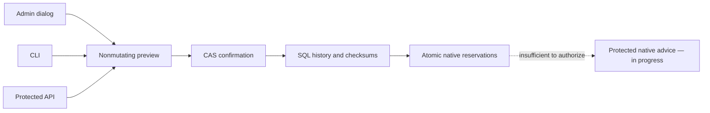

# Admin AI advice: dedicated budget

State on 21 October 2026: the budget is available in native Admin, protected API
and CLI. Direct AI advice is still being connected; saving a budget starts no
model. Portable prompt/proposal import remains available.

## Parameters

The Admin AI advice budget dialog is independent of mission budgets. It displays
the limit, explicit per-call estimate/source, retained history and cumulative
reserved estimate. No price or monetary amount is selected silently. Missing
configuration is explicitly unconfigured.

| Field | Current contract |
| --- | --- |
| Limit | UI USD, exact decimal string `limit_micro_usd` on the wire. Zero refuses new reservations; explicit null disables the limit. |
| Estimate per advice call | Positive `reserve_per_call_micro_usd`, explicitly selected by the operator with a nonempty source. Not an embedded tariff or provider invoice. |
| Source | Provenance/date/assumptions text. Presence establishes neither verified nor fresh pricing. Do not enter secrets. |
| Reason | Nonempty retained text with event, revision, timestamp and locally observed actor; the latter is not authenticated human identity. |

A microdollar is 10^-6 USD: at most six input decimal places. Wire strings retain
integers above 2^53. Storage accepts nonnegative i64 micro-USD amounts; this is a
technical representation bound, not a commercial limit. Unrepresentable amounts
refuse without rounding or truncation.

Preview does not mutate; save requires confirmation. A changed monetary state
invalidates the preview. Unrelated storage settings do not change its token but
are still consumed by the actual operation. Refusals retain inputs. Empty ACKs
are not saves. After response loss, the exact original intention can replay;
check history rather than assuming rollback.

## Reservations and limits

Native accounting uses immediate SQL transactions and saved contention policy.
Concurrent calls cannot reserve the same capacity. Same id and request hash
replay the original estimate; conflicting reuse refuses. Accounting never grants
provider execution permission by itself. Historical reservations survive changed
limits/estimates. Lowering the limit below retained usage blocks new admissions,
without resetting consumption. Failures/uncertainty imply no automatic refund.
The displayed total is a **reserved estimate**, not actual measured cost; the
provider invoice remains unknown. No guarantee that an external call stays below
its estimate is established.

`admin_advice_budget_history` and `admin_advice_budget_reservations` use normalized
scalar columns, not operational BLOBs. Reads check contiguous revisions, policy,
references and checksums; history entries are chained. This detects uncompensated
corruption, not a malicious same-UID owner recomputing hashes or rolling back the
whole Root. Corruption refuses instead of returning an empty balance: preserve
the Root/evidence and diagnose the original inconsistency before qualified recovery.

## Public operations

- `swarm-rust admin-budget show --root ROOT --json`
- `swarm-rust admin-budget preview --root ROOT --input FILE --json`
- `swarm-rust admin-budget apply --root ROOT --input FILE --json`
- GET/HEAD `/api/v1/admin-advice-budget`, POST `/preview` and `/apply` subroutes.

Existing session/Host/CSRF checks and the dedicated Admin lane apply. These
operations read no provider secret. Strict request example:

```json
{
  "schema_version": 1,
  "event_id": "UNIQUE-EXAMPLE",
  "expected_revision": "0",
  "policy": {
    "limit_micro_usd": "1000000",
    "reserve_per_call_micro_usd": "10000",
    "estimate_source": "EXAMPLE operator estimate, replace before use"
  },
  "reason": "EXAMPLE explicit configuration"
}
```

These amounts are **example inputs**, not prices or product defaults. Apply the
exact intention with its returned `preview_token`. Null must be explicit; omitting
the limit never means unlimited. Unknown/duplicate keys refuse.



## Replayable verification

`npm run test:admin-budget-ui-unit` checks exact conversions and ACK correlation.
`npm run test:admin-budget-native -- --binary CLI_PATH --output EVIDENCE_DIRECTORY`
checks actual HTTP/browser in FR/EN and both themes, in an isolated Root without
providers. Evidence: `docs/plans/migration-rust/evidence/20261021-admin-budget/`: original
compile failures16/18, source19 (6 units, 3 real Root integrations including
concurrency, normal build), native-http20 (4 browser/HTTP journeys). No model
execution, measured invoice, user-service installation, independent acceptance or
complete migration is claimed.

## Shared provider response

`ProviderResponseStream` owns JSONL framing, the explicit response cap and the saved
settings event cap. A valid terminal returns complete bytes and unauthenticated
usage/model declarations. It neither validates the response domain nor authorizes
a process or a change. `PlanningOutputStream` retains its interface and then checks
`PlanningProposal`; future Admin advice must apply its own strict domain contract
before publication. Errors, missing/ambiguous terminals and exceeded limits refuse
without truncated success. Historical `planning-output-*` codes remain compatible.
No additional timeout or price is introduced.

Recipe `shared-response22` retains the nine previous planner cases plus three
generic cases covering non-Planning replies, separate caps, non-JSON data and
invalid terminals. All twelve pass; this does not establish protected Admin
inference or global migration parity.
