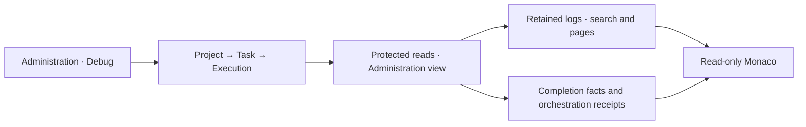

# Swarm Debug console

In **Administration → Debug console**, enable the switch and open the console.
The switch resets to off on every page load. The console loads its data and
Monaco when opened. Closing the dialog releases its editor and in-memory log.
Disabling Debug also closes the dialog. These controls leave log collection
and agent settings unchanged.

Select an attempt in **Project → Task → Execution**. **Orchestration and
executions outside tasks** contains orchestrator launches and attempts with
no recorded task.

| Maximum detail | Visible events |
| --- | --- |
| Error | Errors, incidents and reported refusals |
| Warning | Errors, warnings and limits |
| Info | Execution events and all preceding levels. This is the initial level. |
| Debug | Preceding levels, detailed events and facts available from receipts |

Each attempt search runs the literal filter against its retained log and
supports paging through matching records. The severity filter applies to the
displayed page. Ctrl+F in Monaco searches that page. Clear the search to see
execution completion facts on the first page at Debug level. Records outside
the retention window cannot be retrieved through the console.

Execution completion facts are limited to allowlisted values such as exit code,
output size and capture state. For an orchestrator launch, the console shows
the recorded phase, refusal codes and receipt facts once the engine has
recorded the receipt digest. Without the digest, the diagnosis remains
pending. Receipt projections omit prompts, raw captures, paths and secrets.
Retained log messages follow their existing visibility contract.

The counters show the levels on the loaded page, including levels hidden by
the filter. **Previous error** and **Next error** reveal each error in Monaco
and announce its position. Navigation wraps at either end of the page.
Completion facts show the receipt timestamp when available. The counters
remain visible when the console falls back to plain text.

If Monaco cannot load, the log remains readable as text. A read refusal remains
visible, with its code when available. Close and reopen a project branch to
retry a failed read. See the [French version](../architecture/ADMIN-DEBUG.md).

## Application logs for the relay

Open the dedicated console in **Administration → Accounts and access →
Application logs**. The daemon checks account-management permission on every
read and write. HTTP calls for missions, tasks, Trust actions and preparation
reviews record the relay stages. Allowed Biba or Bell–LaPadula codes remain
visible. Mission logs have their own read permissions.

The rotation overview shows active log size against the threshold, the archive
count against saved retention, archived bytes, and the last observed rotation.
When retention is reduced, it shows how many archives will be removed at the
next rotation. The **Source** column distinguishes active events from archived
events and shows their archive date. Under **Reading options**, search, byte windows and paging follow the
selected source. Appending to the active log keeps an archive-only snapshot
valid while its archives remain unchanged.

Literal search and minimum severity apply to the selected byte window over
the retained archives followed by the active log. **Start** and **End** keep
complete lines inside the selected window, bounded by the saved rotation
size. **Full history** allows paging through the retained records. The reading
page size can be reduced for the session. Display order, page and match
navigation, line wrapping and counts guide reading. TXT and HTML downloads
contain the visible columns on the displayed page. Escape closes the console
and restores focus to its shortcut.

Applied search, severity, source and read position appear above the table.
Selecting a filter chip clears that criterion and returns to the first page.
**Refresh** repeats the applied criteria. When rotation or an append expires
the snapshot between pages, **Resume reading** requests the first page with
those same criteria. The Archives source reports an empty archive store
separately from a search with no matching rows. Read errors clear the displayed
results.

The **Log** tab opens by default with search, results and exports. **Rotation
and retention** contains the metrics and settings. Left, Right, Home and End
switch tabs with the keyboard. The table highlights literal, case-sensitive
matches in displayed cells. A match in an undisplayed log field can return
a row without a highlight. Switching tabs preserves filters and settings in
progress. Exports retain the cell text.

The Rust authority daemon records the start of its listener at Info in the
application journal. Invalid or stale history reads emit a Warn event to the
daemon's standard error. Internal read failures emit an Error there. These
events carry the HTTP status and stable code. Keeping them outside
`authority.log` preserves its snapshots and excludes filter text and snapshot
values from the diagnostic.

The active `authority.log` lives in the daemon's declared directory. The
whole active file is archived before the next event would exceed the saved
size. A retention reduction takes effect on the next rotation. The shipped
defaults are 8 MiB, 3 archives and 200 rows. Saves use a revision check.
The historical `GET /log?q&level` contract remains supported. The console
discovers paging through `history_version` and rotation metrics and sources
through `rotation_version`. Older daemons continue to
serve a recent batch and the console shows compatible controls.

The [application log recipe](../../tools/verification/recipes/authority-application-logs-ui.json)
runs Chromium with simulated responses. It covers the controls, keyboard,
refusals, recovery, stale responses, both languages and both mobile themes.
The retained-file HTTP checks use an isolated engine and daemon via
`tests/authority_app_logs_http_ui.cjs ENGINE DAEMON FRESH_OUTPUT`.

The GitHub Actions **Check authority log rotation and history through Admin** step
runs targeted tests and the authenticated UI with the distribution engine and
release authority daemon. It retains both binary digests and the assertion report.

[Logging code rule](../../.claude/rules/structured-logging.md).

## Access audit

**Connections**, exports and the **Dashboard** share period and session
filters. The dashboard also counts refused sign-ins without a session when
they match the applicable filters. Recent connections lists successful
sign-ins. **Administration actions** shows the recorded outcome matched to
each Authority administration intent. Historical entries without correlation
display an unknown result. Purging requires both audit access and account
management. Audit readers cannot purge.

Groups reflect the authenticated account at the time of the event. The IP
address is the immediate TCP peer, which may be a proxy. The daemon does not
trust forwarded headers as provenance. Networks use /24 for IPv4 and /64 for
IPv6. The network filter applies to sessions and aggregates. Hourly activity
uses UTC. The ratio reports action intents and page views in the same scope.
Older records keep absent values.

The session detail can search **Application logs** by tracking ID for a
relayed request if the account can open that console. At **Debug**, diagnostic
entries show identity, policy and relay stages and the observed outcome.
A transport failure after a recorded intent produces a 502 audit outcome.
The level and retention may exclude entries. Application diagnostics do not
add peer IPs, headers or request content.

The resource filter excludes activity on the administration view or API. The account filter uses current administration rights. A rejection after recording the intent, such as HTTP 413 for an oversized body, retains its outcome and tracking ID.

The display name and observed administration right are recorded for the authenticated account.
