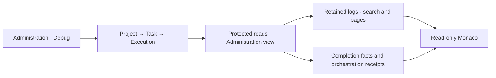

# Swarm Debug console

In **Administration → Debug console**, enable the switch and open the console.
The switch resets to off on every page load. The console loads its data and
Monaco when opened. Closing the dialog releases its editor and in-memory log.
Disabling Debug also closes the dialog. These controls leave log collection
and agent settings unchanged.

Select an attempt in **Project → Task → Execution**. **Orchestration and
executions outside tasks** contains orchestrator launches and attempts with
no recorded task.

| Maximum detail | Visible events |
| --- | --- |
| Error | Errors, incidents and reported refusals |
| Warning | Errors, warnings and limits |
| Info | Execution events and all preceding levels. This is the initial level. |
| Debug | Preceding levels, detailed events and facts available from receipts |

Each attempt search runs the literal filter against its retained log and
supports paging through matching records. The severity filter applies to the
displayed page. Ctrl+F in Monaco searches that page. Clear the search to see
execution completion facts on the first page at Debug level. Records outside
the retention window cannot be retrieved through the console.

Execution completion facts are limited to allowlisted values such as exit code,
output size and capture state. For an orchestrator launch, the console shows
the recorded phase, refusal codes and receipt facts once the engine has
recorded the receipt digest. Without the digest, the diagnosis remains
pending. Receipt projections omit prompts, raw captures, paths and secrets.
Retained log messages follow their existing visibility contract.

The counters show the levels on the loaded page, including levels hidden by
the filter. **Previous error** and **Next error** reveal each error in Monaco
and announce its position. Navigation wraps at either end of the page.
Completion facts show the receipt timestamp when available. The counters
remain visible when the console falls back to plain text.

If Monaco cannot load, the log remains readable as text. A read refusal remains
visible, with its code when available. Close and reopen a project branch to
retry a failed read. See the [French version](../architecture/ADMIN-DEBUG.md).

### Review failure in Conduite

A submitted task can read its current review incident under the Logs permission
and the revision shown. The engine cross-checks the original receipt, execution
row, result event and certificate. Task details report the last boundary reached,
the exit code when known and the recovery limit for a managed repository.
A read failure has its own message.

The Unix message is a category derived from provider-reported text. Swarm returns
a fixed code without copying captured streams, paths or prompts. Reading this
projection grants neither retry nor approval permission.

### Native Rust review phases

In **Monitoring → Logs**, select the producer of the submitted task. Search for
`review_attempt`, then paste its full digest into the text filter to follow one
attempt. The type filter accepts `review-info`, `review-warn` and `review-error`.
The native filtered `GET /api/v1/logs` applies the saved log page policy. With
the Authority relay, this route and `GET /api/v1/agent-logs` require read access
and the Logs view permission. Live Agents omits these rows. The relay application
journal continues to use its own permissions and rotation.

The engine emits these events when executing `task review`, including the
shared mission entry point. It binds a verified producer attempt before context
assembly. Read-only `review-preview` and `review-inputs` calls and replay of
a retained outcome emit no new lines. A refusal before the producer is
identified creates no mission journal entry. The writer uses the existing
journal, timestamp and message cap. An event that cannot fit the cap is dropped
as a whole. The result carries safe sink failures separately. For a refusal, its JSON
diagnostic retains them with the original causes. The original operation
supplies the business outcome.

| Phase | Observable facts |
| --- | --- |
| `preflight` | Effective source, file and prompt limits, with sizes already observed. A size refusal can precede reservation. |
| `reservation` | Created review ID, committed revision and call counts and limit, or the refusal code. |
| `grant` and `process` | Helper registration, gate permission, grant delivery, channel state and safe refusals, including known identity and Biba codes. Grant delivery leaves provider execution undetermined. |
| `reply` and `receipt` | Decode result, aggregate opinion, observed exit code, byte counts and truncation. Receipt retention failure has its own phase. |
| `publication` | Recorded opinion, applicability and task state where known. |

The correlation digest identifies the structured request intent in the
producer’s scope. An attempt can have distinct results for a phase. The writer
keeps one line per phase and outcome code for that digest. Elapsed times are
monotonic, unmeasured counters stay unknown, and only recognized stable causes
carry a recovery condition. The projection omits source text, prompts, replies,
private error messages, paths, tokens and provider identifiers. These review
boundaries execute no additional Bell–LaPadula control. Relay refusals use the
existing relay diagnostics.

The [managed native reviewer recipe](../../tools/verification/recipes/native-managed-reviewer.json)
covers a successful review, size refusal, replay and CLI/HTTP filtering in an
isolated root. The Authority policy test `exclusive_route_requires_view_permission`
covers the missing-view refusal and the authorized counterpart.

## Application logs for the relay

Open the dedicated console in **Administration → Accounts and access →
Application logs**. The daemon checks account-management permission on every
read and write. HTTP calls for missions, tasks, Trust actions and preparation
reviews record the relay stages. Allowed Biba or Bell–LaPadula codes remain
visible. Mission logs have their own read permissions.

The rotation overview shows active log size against the threshold, the archive
count against saved retention, archived bytes, and the last observed rotation.
When retention is reduced, it shows how many archives will be removed at the
next rotation. The **Source** column distinguishes active events from archived
events and shows their archive date. Under **Reading options**, search, byte windows and paging follow the
selected source. Appending to the active log keeps an archive-only snapshot
valid while its archives remain unchanged.

Literal search and minimum severity apply to the selected byte window over
the retained archives followed by the active log. **Start** and **End** keep
complete lines inside the selected window, bounded by the saved rotation
size. **Full history** allows paging through the retained records. The reading
page size can be reduced for the session. Display order, page and match
navigation, line wrapping and counts guide reading. TXT and HTML downloads
contain the visible columns on the displayed page. Escape closes the console
and restores focus to its shortcut.

Applied search, severity, source and read position appear above the table.
Selecting a filter chip clears that criterion and returns to the first page.
**Refresh** repeats the applied criteria. When rotation or an append expires
the snapshot between pages, **Resume reading** requests the first page with
those same criteria. The Archives source reports an empty archive store
separately from a search with no matching rows. Read errors clear the displayed
results.

The **Log** tab opens by default with search, results and exports. **Rotation
and retention** contains the metrics and settings. Left, Right, Home and End
switch tabs with the keyboard. The table highlights literal, case-sensitive
matches in displayed cells. A match in an undisplayed log field can return
a row without a highlight. Switching tabs preserves filters and settings in
progress. Exports retain the cell text.

The Rust authority daemon records the start of its listener at Info in the
application journal. Invalid or stale history reads emit a Warn event to the
daemon's standard error. Internal read failures emit an Error there. These
events carry the HTTP status and stable code. Keeping them outside
`authority.log` preserves its snapshots and excludes filter text and snapshot
values from the diagnostic.

The active `authority.log` lives in the daemon's declared directory. The
whole active file is archived before the next event would exceed the saved
size. A retention reduction takes effect on the next rotation. The shipped
defaults are 8 MiB, 3 archives and 200 rows. Saves use a revision check.
The historical `GET /log?q&level` contract remains supported. The console
discovers paging through `history_version` and rotation metrics and sources
through `rotation_version`. Older daemons continue to
serve a recent batch and the console shows compatible controls.

The [application log recipe](../../tools/verification/recipes/authority-application-logs-ui.json)
runs Chromium with simulated responses. It covers the controls, keyboard,
refusals, recovery, stale responses, both languages and both mobile themes.
The retained-file HTTP checks use an isolated engine and daemon via
`tests/authority_app_logs_http_ui.cjs ENGINE DAEMON FRESH_OUTPUT`.

The GitHub Actions **Check authority log rotation and history through Admin** step
runs targeted tests and the authenticated UI with the distribution engine and
release authority daemon. It retains both binary digests and the assertion report.

[Logging code rule](../../.claude/rules/structured-logging.md).
